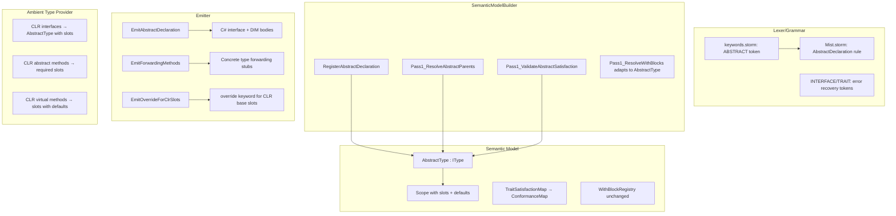

# Design Document: Abstract Type Unification

## Overview

This feature replaces the `interface` and `trait` keywords with a single `abstract` keyword, unifying Mist's contract mechanism under slot semantics with optional default implementations. The change touches every layer of the compiler pipeline: lexer/grammar, parser, semantic model, type checker (in the `SemanticModelBuilder`), analysis, and the C# transpiler backend.

**Design philosophy:** An abstract type declares a set of *slots* (holes that must be filled) and optional *defaults* (methods with bodies that serve as the implementation unless overridden). This maps cleanly to C# interfaces with default interface methods (DIM). Property slots cannot have defaults — only methods can.

**Key decisions:**
- The grammar adds an `ABSTRACT` keyword token and a new `AbstractDeclaration` rule, while removing `INTERFACE` and `TRAIT` tokens from valid declarations (they remain recognized for error recovery).
- The semantic model introduces an `AbstractType` that replaces both `InterfaceType` and `TraitType`. The `TypeKind` enum gains an `Abstract` variant (replacing both `Interface` and `Trait`).
- Structural typing is removed entirely. All conformance requires explicit nominal declaration or a `with` block.
- Default implementations use Rust-style semantics: the default IS the implementation regardless of reference type. The emitter ensures this by emitting both a DIM on the interface and a forwarding method on concrete types that don't override.

## Architecture



## Components and Interfaces

### 1. Lexer and Grammar (keywords.storm + Mist.storm)

**Changes to `keywords.storm`:**
- Add: `token ABSTRACT = "abstract";`
- Keep `INTERFACE` and `TRAIT` tokens (for error recovery/diagnostics), but they no longer gate valid productions.

**Changes to `Mist.storm`:**

A new `AbstractDeclaration` rule replaces `InterfaceDeclaration` and `TraitDeclaration`:

```
rule AbstractDeclaration = modifiers:Modifier* ABSTRACT name:IDENTIFIER
    typeParams:TypeParameterList?
    parentAbstracts:(COLON parents:BaseList)?
    constraints:WhereClause*
    LEFT_BRACE members:AbstractMemberDeclaration* RIGHT_BRACE;

rule AbstractMemberDeclaration
    = method:AbstractMethodDeclaration           as AbstractMethodMember
    | property:InterfacePropertyDeclaration      as AbstractPropertyMember
    | defaultMethod:MethodDeclaration            as AbstractDefaultMethodMember
    | associatedType:AssociatedTypeSlotDeclaration as AbstractAssociatedTypeMember
    | unconstrainedAssociatedType:UnconstrainedAssociatedTypeSlotDeclaration as AbstractUnconstrainedAssociatedTypeMember
    | modifiedAssociatedType:ModifiedAssociatedTypeSlotDeclaration as AbstractModifiedAssociatedTypeMember
    | nestedType:TypeDeclaration                  as AbstractNestedTypeMember
    ;

rule AbstractMethodDeclaration = returnOwnership:OwnershipSpecifier? returnType:TypeReference name:IDENTIFIER
    typeParams:TypeParameterList?
    LEFT_PARENTHESIS parameters:ParameterList? RIGHT_PARENTHESIS
    withClauses:WithClause*
    constraints:WhereClause*
    SEMICOLON;
```

**Key parsing distinction:** A method with a body (block) is a default implementation; a method terminated by semicolon is a slot. Properties always use the `InterfacePropertyDeclaration` rule (get/set accessors without bodies) and cannot have defaults.

The `TypeDeclaration` rule becomes:
```
rule TypeDeclaration
    = classDeclaration:ClassDeclaration           as ClassType
    | structDeclaration:StructDeclaration         as StructType
    | abstractDeclaration:AbstractDeclaration     as AbstractType
    | enumDeclaration:EnumDeclaration             as EnumType
    ;
```

The old `InterfaceDeclaration` and `TraitDeclaration` rules are removed.

**Error recovery:** The parser checks for `INTERFACE` and `TRAIT` tokens at the start of `TopLevelItem` parsing positions and emits targeted error diagnostics with migration guidance before attempting to recover.

**`WithDeclaration` changes:** The rule remains structurally the same, but the field name changes from `traitName` to `abstractName` to reflect the new terminology:

```
rule WithDeclaration = WITH typeName:IDENTIFIER COLON abstractName:IDENTIFIER abstractTypeArgs:TypeArgumentList?
    LEFT_BRACE mappings:MemberMapping+ RIGHT_BRACE;
```

### 2. Semantic Model (Semantics/Model/Types/)

**New type: `AbstractType`** (replaces both `InterfaceType` and `TraitType`):

```csharp
public sealed class AbstractType : IType
{
    public string DisplayName { get; }
    public TypeKind Kind => TypeKind.Abstract;
    public IScope MemberScope { get; }
    public string? ContainingNamespace { get; }
    
    /// <summary>Parent abstract types this type inherits from.</summary>
    public IReadOnlyList<IType> ParentAbstractTypes { get; internal set; } = Array.Empty<IType>();
    
    /// <summary>Type parameters declared on this abstract type.</summary>
    public IReadOnlyList<IType> TypeParameters { get; internal set; } = Array.Empty<IType>();
    
    /// <summary>Whether this abstract type is declared as readonly.</summary>
    public bool IsReadonly { get; internal set; }
    
    /// <summary>Whether a cycle was detected in the inheritance chain.</summary>
    public bool IsCyclic { get; internal set; }
    
    /// <summary>
    /// Method symbols that have default implementations.
    /// Key: method name, Value: the declaring syntax node (MethodDeclarationNode).
    /// </summary>
    public Dictionary<string, Storm.Runtime.SyntaxNode> DefaultMethods { get; } = new();
}
```

**TypeKind enum change:**
- Add `Abstract`
- Keep `Interface` and `Trait` temporarily for CLR-imported types (the ambient type provider maps CLR interfaces to `TypeKind.Abstract` directly; old enum values remain only for backward-compat during transition)

**`ConstructedAbstractType`** replaces `ConstructedTraitType` for generic abstract types.

**`ConformanceMap`** replaces `TraitSatisfactionMap`:
- Same structure but operates on `AbstractType` instead of `TraitType`
- No structural matching — only explicit declaration + with-block mappings
- Records which slots are filled by the implementer and which rely on defaults

**`WithBlockRegistry`** remains structurally identical but changes internal key type from `(IType, IType)` with `TraitType` values to `(IType, IType)` with `AbstractType` values.

### 3. SemanticModelBuilder Changes

The following passes are modified or replaced:

| Current Pass | New Pass | Change |
|---|---|---|
| `RegisterInterfaceDeclaration` | `RegisterAbstractDeclaration` | Handles new AST node, creates `AbstractType` |
| `RegisterTraitDeclaration` | Removed | Folded into `RegisterAbstractDeclaration` |
| `Pass1_ResolveTraitParents` | `Pass1_ResolveAbstractParents` | Resolves parent abstract types (same logic as trait parents) |
| `Pass1_DetectTraitCycles` | `Pass1_DetectAbstractCycles` | Cycle detection on abstract type inheritance |
| `Pass1_DetectInterfaceCycles` | Removed (merged) | Combined into `Pass1_DetectAbstractCycles` |
| `Pass1_ResolveWithBlocks` | Modified | Resolves against `AbstractType` instead of `TraitType`; no structural matching |
| `Pass1_ResolveTraitSatisfaction` | Removed | No structural matching; satisfaction is purely nominal |
| `Pass1_ValidateInterfaceSatisfaction` | `Pass1_ValidateAbstractSatisfaction` | Checks all slots are filled or have defaults |
| `ResolveInterfaceDeclaration` | `ResolveAbstractDeclaration` | Pass 2 type resolution |
| `ResolveTraitDeclaration` | Removed | Merged into `ResolveAbstractDeclaration` |

**New: Default method registration.** During `RegisterAbstractDeclaration`, methods with bodies are registered in `AbstractType.DefaultMethods`. The method body is resolved during Pass 2 (type resolution) using the abstract type's full member scope for `this` resolution.

**New: Slot satisfaction validation.** `Pass1_ValidateAbstractSatisfaction` checks:
1. For each slot (method or property without default), the implementing type must have a public member with matching signature.
2. Methods with defaults don't require an implementation but accept one (slot filling takes precedence).
3. Diamond inheritance: if multiple parent abstract types declare the same slot, a single implementation satisfies all.

**Removed structural matching code paths:**
- `TryStructuralMatch`, `TryStructuralMatchWithSubstitution`
- `TryMatchTraitField`, `TryMatchTraitMethod`, `TryMatchTraitProperty` (and their substitution variants)
- All auto-satisfaction logic in `Pass1_ResolveTraitSatisfaction`

### 4. Type Checker (TypeCheckerAnalyzer + SemanticModelBuilder)

The type checker changes focus on assignability rules:

- **Assignment to abstract-typed variable:** Only types that declare `: AbstractType` in their base clause OR have a `with` block establishing conformance are assignable.
- **No structural conformance:** A type with matching public members but no explicit declaration is NOT assignable to an abstract-typed location.
- **Member access on abstract-typed expressions:** Resolves against the abstract type's member scope (both slots and defaults are visible).
- **Transitive assignability:** If `IChild : IParent`, an implementer of `IChild` is assignable to `IParent`-typed locations.

### 5. Emitter Changes (CSharpTranspiler/CSharpEmitter.cs)

**`EmitAbstractDeclaration`** (replaces both `EmitInterfaceDeclaration` and `EmitTraitDeclaration`):

```
// Slots (no body) → C# interface method/property signatures
// Default methods (with body) → C# default interface methods (DIM)
interface IAbstract {
    string Slot();           // slot
    string Default() {       // DIM
        return "default";
    }
}
```

**Forwarding methods for defaults:**

When a concrete type does NOT override a default method, the emitter generates a forwarding stub:

```csharp
class Concrete : IAbstract {
    // Slot is filled by user code
    public string Slot() => "filled";
    
    // Forwarding method for DIM (ensures callable without casting)
    public string Default() => ((IAbstract)this).Default();
}
```

This ensures Rust-style semantics: calling `concrete.Default()` and `((IAbstract)concrete).Default()` produce identical behavior.

**Override for CLR slots (existing `FindBaseOverrideSlot` mechanism):**

The existing logic in `FindBaseOverrideSlot` already walks the CLR inheritance chain looking for `virtual`/`abstract` methods. This is preserved. When a Mist type fills a slot originating from a CLR base class, the emitter generates `override`:

```csharp
class MistDerived : ClrBaseClass {
    public override void AbstractMethod() { ... }  // CLR slot → override
}
```

**Hiding semantics for Mist concrete inheritance:**

For Mist-to-Mist concrete class inheritance (not slot filling), the existing hiding check is preserved. When a derived class declares a member matching a base class member, it must use `new`:

```csharp
class Derived : Base {
    new public string Speak() => "derived";  // hiding, not override
}
```

**`EmitExplicitTraitImplementations` → `EmitExplicitAbstractImplementations`:**

With-block mappings continue to emit explicit interface implementations:

```csharp
// with Logger : INamed { GetLabel as Name; }
// emits:
string INamed.Name() => this.GetLabel();
```

### 6. Ambient Type Provider Changes

**`AssemblyTypeProvider.ResolveTypeCore`:**

| CLR construct | Mist representation |
|---|---|
| C# `interface` | `AbstractType` with all members as slots |
| C# class with `abstract` methods | `AbstractType`-like slots on the ClassType (filled via `override` emission) |
| C# class with `virtual` methods | Slots with defaults on the ClassType (optional filling) |

The `IsVirtualOrAbstract` property on ambient symbols (already tracked) drives whether the emitter generates `override` or leaves the base implementation inherited.

**New behavior for virtual methods:** When the ambient type provider encounters a `virtual` method with a body, it marks the symbol as having a default. The type checker does NOT require Mist types to fill these slots (same semantics as abstract type defaults).

### 7. With Block Adaptation

The `with` block mechanism adapts minimally:

1. **Resolves target as `AbstractType`** instead of `TraitType`
2. **Only requires mappings for unfilled slots** — if a default method exists and no mapping is provided, the default is used
3. **Mapping overrides defaults** — if a `with` block maps a member to a slot that has a default, the mapping wins
4. **No structural pre-matching** — all `with` block members must be explicitly mapped; there is no auto-detection of matching names

The `with` block continues to emit as explicit interface implementations in C#.

### 8. Member Hiding vs Slot Filling Decision Logic

The emitter must distinguish three cases:

```
┌─────────────────────────────────────────────────────────────┐
│ Method on concrete type matches a name in scope             │
├─────────────────────────────────────────────────────────────┤
│ 1. Slot from abstract type in base clause?                  │
│    → Slot filling (implements interface member)             │
│    → Emit: public string Method() (implicit interface impl) │
│                                                             │
│ 2. CLR virtual/abstract method on base class?               │
│    → Override (FindBaseOverrideSlot returns non-null)        │
│    → Emit: public override string Method()                  │
│                                                             │
│ 3. Mist concrete base class method?                         │
│    → Hiding (requires `new` keyword)                        │
│    → Emit: public new string Method()                       │
│    → Warning if `new` missing                               │
└─────────────────────────────────────────────────────────────┘
```

These three cases are mutually exclusive in their triggering conditions and do not conflict.

## Data Models

### AbstractType

```csharp
public sealed class AbstractType : IType
{
    public string DisplayName { get; }
    public TypeKind Kind => TypeKind.Abstract;
    public IScope MemberScope { get; }
    public string? ContainingNamespace { get; }
    public IReadOnlyList<IType> ParentAbstractTypes { get; internal set; }
    public IReadOnlyList<IType> TypeParameters { get; internal set; }
    public bool IsReadonly { get; internal set; }
    public bool IsCyclic { get; internal set; }
    
    /// <summary>
    /// Method names that have default implementation bodies.
    /// Used by the emitter to decide whether to generate forwarding stubs.
    /// </summary>
    public HashSet<string> DefaultMethodNames { get; } = new();
}
```

### ConstructedAbstractType

```csharp
public sealed class ConstructedAbstractType : IType
{
    public string DisplayName { get; }
    public TypeKind Kind => TypeKind.Abstract;
    public AbstractType GenericAbstractDefinition { get; }
    public IReadOnlyList<IType> TypeArguments { get; }
}
```

### ConformanceRecord (replaces TraitSatisfaction)

```csharp
public sealed class ConformanceRecord
{
    /// <summary>Members filled by the implementing type (name → symbol).</summary>
    public IReadOnlyDictionary<string, ISymbol> FilledSlots { get; init; }
    
    /// <summary>Members filled via with-block mapping (name → source symbol).</summary>
    public IReadOnlyDictionary<string, ISymbol> WithMappings { get; init; }
    
    /// <summary>Methods that use the default implementation (name → default node).</summary>
    public IReadOnlySet<string> DefaultsUsed { get; init; }
}
```

### ConformanceMap (replaces TraitSatisfactionMap)

```csharp
public sealed class ConformanceMap
{
    private readonly Dictionary<(IType, IType), ConformanceRecord> _conformances = new();
    
    public void Register(IType type, IType abstractType, ConformanceRecord record);
    public bool Conforms(IType type, IType abstractType);
    public ConformanceRecord? GetConformance(IType type, IType abstractType);
    public IEnumerable<(IType Type, IType Abstract, ConformanceRecord Record)> All();
}
```

## Correctness Properties

*A property is a characteristic or behavior that should hold true across all valid executions of a system — essentially, a formal statement about what the system should do. Properties serve as the bridge between human-readable specifications and machine-verifiable correctness guarantees.*

### Property 1: Abstract declaration parse round-trip

*For any* valid abstract type declaration (varying identifier names, generic parameters, constraint clauses, and member combinations of slots and defaults), parsing the source text SHALL produce an `AbstractDeclarationNode` with the correct name, type parameters, base list, and member classifications (slots vs defaults).

**Validates: Requirements 1.1, 1.2, 1.3, 1.5, 1.6, 1.7**

### Property 2: No structural conformance

*For any* concrete type that has public members matching all slots of an abstract type but does NOT declare `: AbstractType` in its base clause and has no `with` block, the type checker SHALL reject assignment of that type to a variable typed as the abstract type.

**Validates: Requirements 3.3, 3.4**

### Property 3: Complete slot filling accepted

*For any* abstract type with N required slots (members without defaults) and any concrete type that declares `: AbstractType` and provides public implementations matching all N slot signatures exactly (by name, return type, and parameter types), the type checker SHALL accept the concrete type as a valid implementer.

**Validates: Requirements 4.1, 4.3**

### Property 4: Missing slot filling rejected

*For any* abstract type with N required slots (N ≥ 1) and any concrete type that declares `: AbstractType` but is missing at least one slot implementation, the type checker SHALL emit an error diagnostic listing each unfilled slot by name and signature.

**Validates: Requirements 4.2, 4.3**

### Property 5: Default methods do not require implementation

*For any* abstract type with M default methods and any concrete type that declares `: AbstractType` and fills all required slots but provides no implementation for any default method, the type checker SHALL accept the type as valid.

**Validates: Requirements 4.5, 5.1**

### Property 6: Slot signature matching is exact

*For any* abstract type slot and any concrete type implementation where the name matches but either the return type or at least one parameter type differs, the type checker SHALL reject the implementation as not satisfying the slot.

**Validates: Requirements 4.6**

### Property 7: Method dispatch is reference-type-independent

*For any* concrete type that either takes a default method implementation or overrides one, calling the method through the concrete type reference and through the abstract type reference SHALL produce identical behavior (same return value and side effects).

**Validates: Requirements 5.2, 5.3**

### Property 8: Forwarding methods emitted for defaults

*For any* abstract type with default methods and any concrete type that does not provide its own implementation for those defaults, the emitter SHALL generate both a default interface method body on the C# interface AND a forwarding method on the concrete class that delegates to the DIM.

**Validates: Requirements 5.5, 7.6**

### Property 9: With-block establishes assignability

*For any* type and any abstract type, when a valid `with` block maps all required slots (those without defaults), the type SHALL be accepted for assignment to variables and parameters typed as the abstract type.

**Validates: Requirements 6.1, 6.6**

### Property 10: With-block emits explicit interface implementation

*For any* `with` block mapping with `SourceMember as TargetSlot`, the emitter SHALL generate an explicit interface implementation method/property that delegates to the source member.

**Validates: Requirements 6.2**

### Property 11: With-block defaults don't require mappings

*For any* abstract type with M default methods and N required slots, a `with` block SHALL only require mappings for the N required slots. Omitting mappings for default methods SHALL be accepted.

**Validates: Requirements 6.3**

### Property 12: Abstract type emits as C# interface

*For any* abstract type declaration, the emitter SHALL produce a C# `interface` declaration. Slots (no body) emit as signature-only members. Default methods (with body) emit as default interface method bodies.

**Validates: Requirements 7.1, 7.2, 7.3, 7.5**

### Property 13: CLR ambient type mapping

*For any* CLR interface in a referenced assembly, the ambient type provider SHALL expose it as an `AbstractType` with all interface members as required slots. *For any* CLR `abstract` method on a class, it SHALL appear as a required slot. *For any* CLR `virtual` method with an implementation, it SHALL appear as a fillable but not required slot.

**Validates: Requirements 8.1, 8.2, 8.3**

### Property 14: CLR slot filling emits override

*For any* Mist type that fills a slot originating from a CLR `abstract` or `virtual` method on a base class, the emitter SHALL generate the C# `override` keyword on the emitted method.

**Validates: Requirements 8.4**

### Property 15: Unfilled CLR virtual slots emit nothing

*For any* Mist type that does NOT fill a slot originating from a CLR `virtual` method, the emitter SHALL NOT emit any method for that slot (the base class implementation is inherited normally via C# semantics).

**Validates: Requirements 8.5**

### Property 16: Abstract-typed assignability

*For any* variable, parameter, or return type declared as an abstract type, the type checker SHALL accept assignment of any concrete type that has established conformance (via `: AbstractType` or a `with` block) and SHALL reject types without conformance.

**Validates: Requirements 9.1, 9.2**

### Property 17: Transitive assignability through abstract hierarchy

*For any* abstract type hierarchy where `IChild : IParent`, an implementer of `IChild` SHALL be assignable to a variable typed as `IParent`.

**Validates: Requirements 9.4**

### Property 18: Concrete class hiding requires `new` and preserves base behavior

*For any* Mist concrete class hierarchy where a derived class declares a method with the same name and signature as a base class method, (a) the compiler SHALL emit a warning if `new` is missing, (b) the emitter SHALL generate `new` on the derived method, and (c) calling the method through a base-typed reference SHALL invoke the base implementation (hiding semantics, not override).

**Validates: Requirements 10.1, 10.2, 10.3**


## Error Handling

### Parse-time Errors

| Error Condition | Diagnostic Message | Recovery |
|---|---|---|
| `interface` keyword encountered | "The 'interface' keyword has been removed. Use 'abstract' instead." | Skip to next `}` and continue parsing |
| `trait` keyword encountered | "The 'trait' keyword has been removed. Use 'abstract' with nominal typing (': AbstractType') or a 'with' block for retroactive conformance." | Skip to next `}` and continue parsing |
| Property with body in abstract type | "Property slots cannot have default implementations. Only methods can have defaults." | Treat as slot, discard body |

### Semantic Errors (SemanticModelBuilder)

| Error Condition | Diagnostic Message | Severity |
|---|---|---|
| Missing slot implementation | "Type '{TypeName}' does not implement abstract member '{AbstractType}.{MemberName}({Signature})'" | Error |
| Signature mismatch on slot filling | "Type '{TypeName}' member '{MemberName}' has wrong signature for '{AbstractType}.{MemberName}'. Expected: {expected}. Actual: {actual}" | Error |
| `with` block references undefined type | "Type '{TypeName}' is not defined in scope" | Error |
| `with` block references undefined abstract type | "Abstract type '{AbstractName}' is not defined in scope" | Error |
| `with` block member type mismatch | "Cannot map '{SourceMember}' to '{TargetSlot}': source has type '{SourceType}', slot requires '{SlotType}'" | Error |
| `with` block for already-conforming type | "Type '{TypeName}' already declares ': {AbstractType}'. Remove the redundant 'with' block." | Error |
| Non-conforming type assigned to abstract variable | "Cannot assign type '{SourceType}' to '{AbstractType}': type does not implement the abstract type" | Error |
| Cyclic abstract type inheritance | "Abstract type '{Name}' is part of a circular inheritance chain" | Error |
| Abstract type inheriting from non-abstract type | "Abstract type '{Name}' can only inherit from other abstract types, not '{BaseType}'" | Error |

### Warnings

| Warning Condition | Diagnostic Message | Severity |
|---|---|---|
| Concrete member hides base without `new` | "'{TypeName}.{MemberName}' hides inherited member '{BaseTypeName}.{MemberName}'. Use 'new' if intentional." | Warning |
| `new` on non-hiding member | "The member '{TypeName}.{MemberName}' does not hide an inherited member. The 'new' keyword is not required." | Warning |

### Error Recovery Strategy

The parser uses a "skip to next synchronization point" strategy for removed keywords:
1. When `interface` or `trait` is encountered at a declaration position, emit the diagnostic immediately.
2. Attempt to parse the declaration body as if it were valid (same grammar shape as `abstract`).
3. Do NOT register the declaration in the semantic model — it's treated as an error node.
4. Continue parsing subsequent declarations normally.

This strategy gives users maximum diagnostic coverage (they see errors for all their old declarations, not just the first one).

## Testing Strategy

### Property-Based Testing

This feature is well-suited for property-based testing because:
- The core logic involves type-checking rules that should hold universally across all valid/invalid inputs
- The input space (type declarations, member signatures, conformance relationships) is large and structured
- Pure logic properties (acceptance/rejection decisions) can be tested without process spawning

**Library:** FsCheck (already available in the test project)

**Configuration:** Minimum 100 iterations per property test.

**Tag format:** `// Feature: abstract-type-unification, Property {N}: {description}`

**Testing approach:** Use the in-process `CompilerDriver` and `SemanticModelBuilder` for property tests. Generate Mist source code strings, compile them in-process, and inspect the diagnostic bag for expected errors/acceptances. No process spawning for property tests.

### Property Tests (from Correctness Properties)

Each correctness property maps to a single PBT test that generates random inputs and verifies the universal property:

1. **Parse round-trip** — Generate random abstract type sources, verify AST structure
2. **No structural conformance** — Generate types with matching members but no declaration, verify rejection
3. **Complete slot filling** — Generate valid implementations, verify acceptance
4. **Missing slot filling** — Generate incomplete implementations, verify error diagnostics
5. **Defaults not required** — Generate types relying on defaults, verify acceptance
6. **Exact signature matching** — Generate near-miss signatures, verify rejection
7. **Reference-type independence** — Batch-compile programs, verify identical output via both reference types
8. **Forwarding method emission** — Generate concrete types, inspect emitted C# for forwarding stubs
9. **With-block conformance** — Generate valid with blocks, verify assignability
10. **With-block explicit impl emission** — Inspect emitted C# for explicit interface implementations
11. **With-block defaults optional** — Generate with blocks omitting defaults, verify acceptance
12. **Abstract type C# emission structure** — Inspect emitted C# interface structure
13. **CLR ambient mapping** — Load test assemblies, verify AbstractType creation
14. **CLR override emission** — Generate slot-filling code, verify `override` in emitted C#
15. **CLR unfilled virtual** — Generate types not filling virtuals, verify no emission
16. **Abstract assignability** — Generate conforming/non-conforming types, verify assignment behavior
17. **Transitive assignability** — Generate hierarchies, verify parent-type assignment
18. **Concrete hiding** — Generate class hierarchies with hiding, verify `new` keyword and behavior

### Unit Tests (Example-Based)

- `interface` keyword produces exact error message text
- `trait` keyword produces exact error message text
- Empty abstract type body (`abstract IMarker { }`) parses correctly
- Diamond inheritance with single implementation (specific scenario)
- `with` block filling a default method (specific runtime behavior)
- `with` block referencing undefined type produces exact error
- Redundant `with` block for already-conforming type produces exact error
- `new` keyword on non-hiding member produces exact warning

### Integration Tests (Sample Execution)

- Compile and run `samples/AbstractTypes/Program.mist` — verify exact expected output
- Compile and run all migrated samples — verify they produce unchanged output
- Compile and run `samples/AllFeatures/Program.mist` — verify the full suite passes

### Process Spawning Budget

Property-based tests use in-process compilation (no spawning). Integration tests spawn `dotnet` once per sample (batched: compile once, run once per sample). Total spawning budget: ~15 process invocations for the full test suite.

### Migration Verification

Each migrated sample (from the migration table in requirements) gets a snapshot test:
1. Record expected stdout before migration (from current passing output)
2. After migration: compile and run, verify stdout matches snapshot
3. This ensures zero semantic change for existing code migrated from `interface`/`trait` to `abstract`
