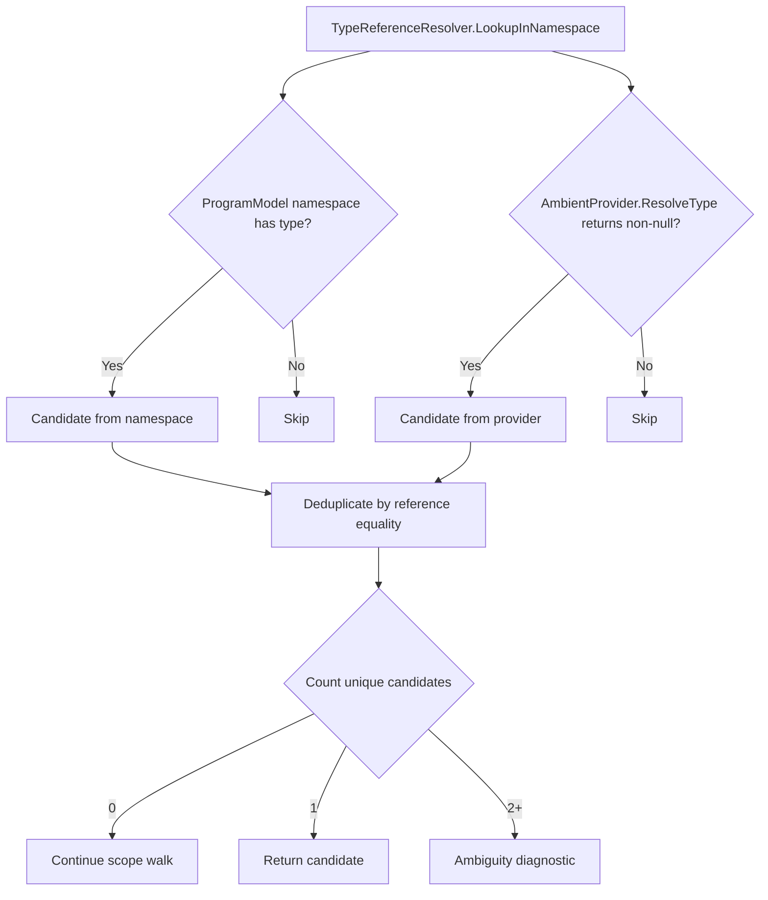
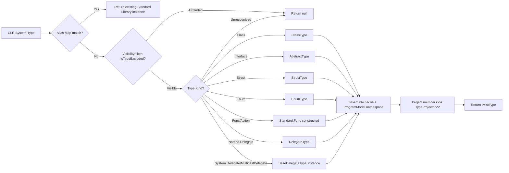
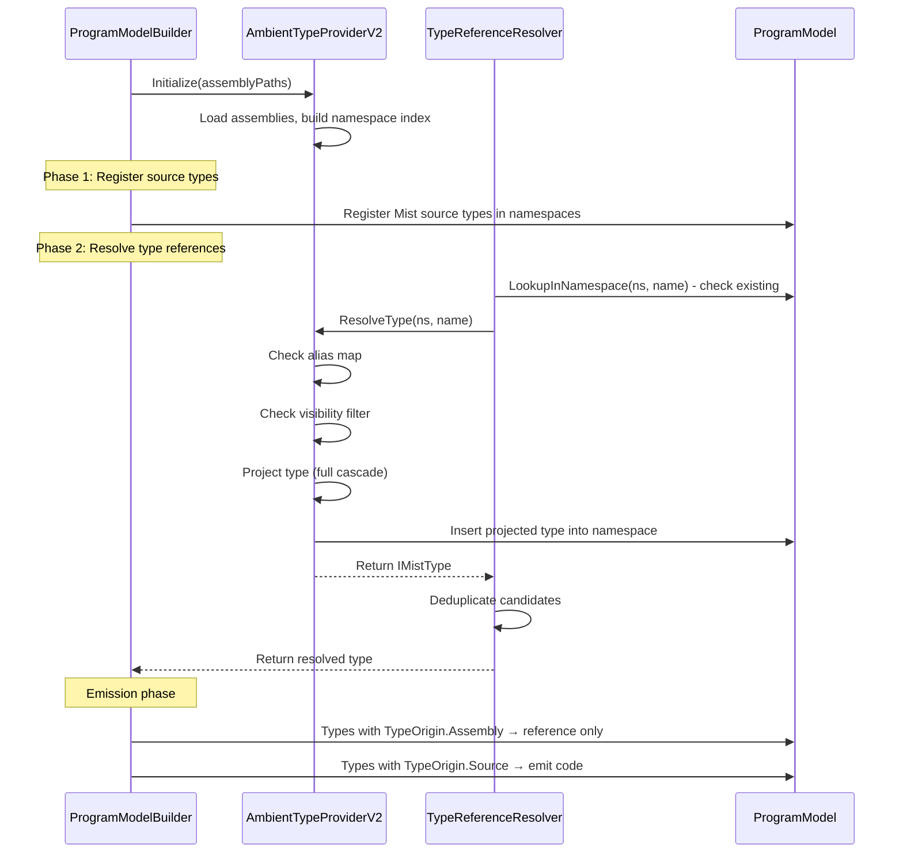

# AmbientTypeProvider V2 - Design

## Overview

The AmbientTypeProvider V2 integrates .NET assembly types into the ProgramModel as first-class `IMistType` instances. Unlike V1 (which produced old-model `IType`/`ISymbol` objects), V2 projects CLR types directly into the same type graph that Mist source types live in. The ProgramModel is agnostic to a type's origin — all types are `MistType` regardless of whether they came from `.mist` source or a .NET assembly.

The provider exposes a narrow 3-method interface (`IAmbientTypeProvider`) consumed by the `TypeReferenceResolver`. Types are projected lazily on first reference with full member cascade through the transitive type graph. A projection cache keyed by `(namespace, typeName)` guarantees reference equality across all resolution paths.

## Architecture

### Single Graph Principle

Once a CLR type is projected, it lives in `ProgramModel.Namespaces` alongside Mist source types. It is a `MistType` subclass (`ClassType`, `StructType`, `AbstractType`, `EnumType`) with all its public members populated. The only distinction is an origin marker (`TypeOrigin.Source` vs `TypeOrigin.Assembly`) used by the emitter to know "don't emit this, just reference it."

Nested types from assemblies receive `TypeOrigin.Assembly`. Constructed types (`ConstructedType`) built from assembly definitions also carry `TypeOrigin.Assembly`. Generic type parameters (`TypeParameter`) do NOT receive a marker — they are structural placeholders.

### Deployment Topology

```
Source/Mist/ProgramModel/Contracts/IAmbientTypeProvider.cs   ← interface (consumed by TypeReferenceResolver)
Source/Mist/Backends/CSharpTranspiler/AmbientTypeProviderV2.cs ← implementation (depends on MetadataLoadContext)
Source/Mist/Backends/CSharpTranspiler/TypeProjectorV2.cs       ← projection engine
Source/Mist/Backends/CSharpTranspiler/VisibilityFilterV2.cs    ← reuse/port from V1
Source/Mist/Backends/CSharpTranspiler/AmbientExtensionScanner.cs ← reused from V1
Source/Mist/Driver/LoadedAssemblyInfo.cs                       ← shared neutral type (no Semantics refs)
```

The interface lives in `ProgramModel/Contracts/` (references only `Mist.ProgramModel.*` types). The implementation lives in `Backends/CSharpTranspiler/` because it depends on `System.Reflection.MetadataLoadContext`. This separation satisfies Requirement 15.

### Peer Source Resolution (Not Fallback)

The ambient provider is NOT a fallback — it is consulted as a peer alongside the ProgramModel namespace. During name lookup at each scope level, the `TypeReferenceResolver`:

1. Collects candidates from the `Namespace_Registry` (source types + already-projected CLR types).
2. Collects candidates from `IAmbientTypeProvider.ResolveType()`.
3. Deduplicates by reference equality (alias-mapped types collapse to one).
4. 0 unique candidates → continue to parent scope.
5. 1 unique candidate → return it.
6. 2+ unique candidates → emit ambiguity diagnostic, return `ErrorType`.

This peer-source model enables ambiguity detection between Mist-declared and CLR-provided types sharing the same name.



## Components and Interfaces

### IAmbientTypeProvider Interface

The interface resides in `ProgramModel/Contracts/` and references only ProgramModel types.

```csharp
namespace Mist.ProgramModel.Contracts;

/// <summary>
/// Resolves types from loaded .NET assemblies into IMistType instances
/// that live in the ProgramModel alongside source-declared types.
/// </summary>
public interface IAmbientTypeProvider
{
    /// <summary>
    /// Attempts to resolve a type by namespace and name.
    /// Returns the projected IMistType if found, null otherwise.
    /// If the type maps to an existing Mist Standard Library type (alias),
    /// returns that instance silently without creating a new one.
    /// </summary>
    IMistType? ResolveType(string namespaceName, string typeName);

    /// <summary>
    /// Arity-aware overload. Distinguishes generic types sharing the same base
    /// name (e.g., Func`1 vs Func`2). typeParameterCount is the number of
    /// generic parameters on the CLR type definition.
    /// </summary>
    IMistType? ResolveType(string namespaceName, string typeName, int typeParameterCount);

    /// <summary>
    /// Returns all type names available in a namespace from loaded assemblies.
    /// Includes CLR arity-suffixed names (e.g., List`1, Dictionary`2).
    /// Used for ambiguity detection and name-existence checks without triggering
    /// full type projection.
    /// </summary>
    IReadOnlyList<string> GetTypeNamesInNamespace(string namespaceName);

    /// <summary>
    /// Returns extension method descriptors declared in the given namespace.
    /// Extension methods are collected during assembly scanning and cached
    /// per-namespace for subsequent calls.
    /// </summary>
    IReadOnlyList<AmbientExtensionMethodInfo> GetExtensionMethodsInNamespace(
        string namespaceName);
}
```

### AmbientTypeProviderV2 (Implementation)

The implementation class lives at `Backends/CSharpTranspiler/AmbientTypeProviderV2.cs`.

**Responsibilities:**
- Owns the `MetadataLoadContext` and loaded assemblies.
- Builds and owns the namespace index (namespace → type name set).
- Owns the projection cache: `ConcurrentDictionary<(string Namespace, string TypeName), IMistType>`.
- Delegates type projection to `TypeProjectorV2`.
- Delegates visibility filtering to `VisibilityFilterV2`.
- Manages the alias map.
- Inserts projected types into `ProgramModel.Namespaces`.
- Thread-safe: concurrent resolution of different types is supported via `ConcurrentDictionary`.

**Key design decision:** The provider is responsible for inserting projected types into the ProgramModel namespace (Requirement 2.8). The TypeReferenceResolver does NOT decide placement — it simply receives the projected type from `ResolveType()`.

### TypeProjectorV2 (Projection Engine)

Converts a CLR `System.Type` into a `MistType` subclass with all public members. Handles:

- Type kind determination (class/struct/interface/enum/delegate).
- Member projection (methods, properties, fields, constructors, indexers, operators).
- Type parameter and constraint projection.
- Special type handling (Nullable, IDisposable, Span, ref params, Func/Action, IEnumerable).
- Virtual/abstract method detection for override emission.

The projector receives a callback to resolve CLR type references back through the provider's cache (for base types, interfaces, member signature types). This prevents circular projection and ensures all type references are cache-mediated.

### VisibilityFilterV2

Port of V1's `VisibilityFilter` but producing no references to `Mist.Semantics.*`. Same exclusion logic:

1. Non-public types → excluded from namespace index and projection.
2. Non-public members → excluded (except protected virtual/abstract for override detection).
3. Events → excluded.
4. `ref readonly` returns → member excluded.
5. Pointer types in signature → member excluded.
6. Signature references excluded type → member excluded (cascading).
7. Named delegates with excluded Invoke signature → type treated as excluded for cascading.
8. Override detection NOT performed on excluded types.

## Data Models

### Type Projection Pipeline



### Alias Map

The alias map lives INSIDE the ambient provider. When asked to project a CLR type with an alias entry, the provider silently returns the existing Standard Library `IMistType` instance — no new type created, no diagnostic emitted.

| CLR Type | Mist Type | Category |
|----------|-----------|----------|
| System.Int32 | Standard.Int32 | Numeric |
| System.Int64 | Standard.Int64 | Numeric |
| System.Int16 | Standard.Int16 | Numeric |
| System.Byte | Standard.Byte | Numeric |
| System.SByte | Standard.SByte | Numeric |
| System.UInt32 | Standard.UInt32 | Numeric |
| System.UInt64 | Standard.UInt64 | Numeric |
| System.UInt16 | Standard.UInt16 | Numeric |
| System.Single | Standard.Single | Numeric |
| System.Double | Standard.Double | Numeric |
| System.Decimal | Standard.Decimal | Numeric |
| System.String | Standard.String | Primitive |
| System.Boolean | Standard.Boolean | Primitive |
| System.Char | Standard.Char | Primitive |
| System.Void | Standard.Void | Primitive |
| System.Threading.Tasks.Task | Standard.Task | Async |
| System.Threading.Tasks.ValueTask | Standard.ValueTask | Async |

**Lookup strategy:** The alias map is a `Dictionary<(string Namespace, string TypeName), (string MistNamespace, string MistTypeName)>`. On `ResolveType(ns, name)`, the provider first checks the alias map. If a match is found, it looks up the corresponding Mist type in `ProgramModel.Namespaces[mistNs].Types[mistName]` and returns that instance. The returned instance has `TypeOrigin.Source` (it was defined by the Standard Library loader, not by this provider).

### Type Kind Projection Matrix

| CLR Concept | Mist Type | Key Properties |
|-------------|-----------|----------------|
| Non-sealed non-abstract class | `ClassType` | `Modifiers.IsAbstract = false`, `IsSealed = false` |
| Abstract class | `ClassType` | `Modifiers.IsAbstract = true` |
| Sealed class | `ClassType` | `Modifiers.IsSealed = true` |
| Interface | `AbstractType` | Method/property slots from public members |
| Struct (value type) | `StructType` | `Modifiers.IsRef = false` |
| Ref struct (IsByRefLike) | `StructType` | `Modifiers.IsRef = true` |
| Enum | `EnumType` | `UnderlyingType` + `EnumMember` per constant |
| Func/Action delegates | `Standard.Func` constructed | Structural transformation by arity |
| Named delegates | `DelegateType` | `ClrFullName` + `FuncSignature` |
| System.Delegate / MulticastDelegate | `BaseDelegateType.Instance` | Singleton |
| Unrecognized TypeAttributes | `null` (not projected) | Return null, no ProgramModel entry |

### Member Projection Matrix

| CLR Member | Mist Model Type | Key Fields |
|------------|----------------|------------|
| Public instance/static methods | `Method` | Name, ReturnType, Parameters, Modifiers.IsStatic, TypeParametersList |
| Public constructors | `Constructor` | Parameters |
| Public properties | `Property` | Type, Getter accessor, Setter accessor, Modifiers.IsStatic |
| Public fields (including readonly/const) | `Field` | Type, Modifiers.IsStatic, Modifiers.IsReadonly |
| Public indexers | `Indexer` | ElementType, Parameters, Getter, Setter |
| Operator overloads | `Operator` | OperatorKind, ReturnType, Parameters |
| Protected virtual/abstract methods | `Method` | IsVirtualOrAbstract=true, ClrAccessModifier |

### Projection Cache

```csharp
// Thread-safe cache: (namespace, typeName) → projected IMistType
private readonly ConcurrentDictionary<(string Namespace, string TypeName), IMistType> cache = new();
```

**Cache key format:**
- Non-generic types: `("System", "Object")`
- Generic types with known arity: `("System.Collections.Generic", "List`1")`
- Arity-zero cross-key: When resolving without arity (`-1`), also check `typeName + "`0"` for consistency with internal arity-aware paths.

**Insertion timing:** The type shell is inserted into the cache BEFORE projecting members. This prevents infinite recursion when base type or interface resolution loops back to an in-progress type. If another thread wins the race to project the same key, the losing thread discards its work and returns the cached instance (reference equality preserved).

### Namespace Index

```csharp
// Built during initialization — namespace → set of type names in that namespace
private readonly Dictionary<string, HashSet<string>> namespaceIndex = new();
```

Built by scanning all loaded assemblies' `ExportedTypes` (names only). No full `Type_Projection` occurs during initialization. This makes `GetTypeNamesInNamespace()` cheap and immediate.

### Lazy Projection with Full Cascade on First Touch

When `ResolveType` is called for a type not yet in the cache:

1. **Alias check** — If the type has an alias entry, return the existing stdlib instance immediately.
2. **Visibility check** — If the type fails `IsTypeExcluded`, return null.
3. **Create type shell** — Instantiate the appropriate `MistType` subclass (ClassType, StructType, etc.) with name, namespace, and an empty scope.
4. **Insert shell into cache** — Prevents recursive loops when projecting members/base types.
5. **Resolve base type** — If the CLR type has a non-Object base class, recursively resolve it through the same cache path. If unresolvable, hide the entire type (remove from cache, return null).
6. **Resolve interfaces** — For each implemented interface, recursively resolve. If any is unresolvable, hide the entire type.
7. **Project members** — Iterate all public members. For each member's signature types, resolve through the cache (triggering cascaded projection of referenced types). Members referencing excluded types are skipped.
8. **Project type parameters and constraints** — For generic types, populate `TypeParametersList` with constraints. If any constraint type is unresolvable, hide the entire type.
9. **Insert into ProgramModel namespace** — Add the fully-projected type to `ProgramModel.Namespaces[ns].Types[name]`.
10. **Return** — The projected `IMistType`.

**Full cascade:** Resolving `List<T>` projects its members, which reference `IEnumerable<T>`, `ICollection<T>`, etc. Those are themselves fully projected through the same pipeline. This is acceptable for V2 given the narrow integration surface. If profiling later shows startup cost, a two-phase shell-then-members approach can be introduced without changing the `IAmbientTypeProvider` contract.

### Func/Action Delegate Projection

Func/Action are NOT alias-mapped — they require structural transformation based on generic arity.

**Func family** (`System.Func<TResult>` through `System.Func<T1,...,T16,TResult>`):
- Projected as `Standard.Func` constructed with the matching type arguments.
- `Func<int, string>` → `ConstructedType(Standard.Func<,>, [Standard.Int32, Standard.String])`.

**Action family** (`System.Action` through `System.Action<T1,...,T16>`):
- Projected as `Standard.Func` whose last type argument is `Standard.Void`.
- `Action<int>` → `ConstructedType(Standard.Func<,>, [Standard.Int32, Standard.Void])`.
- `Action` (no params) → `ConstructedType(Standard.Func<>, [Standard.Void])`.

**Named delegates** (Predicate, Comparison, RequestDelegate, etc.):
- Projected as `DelegateType` with:
  - `ClrFullName`: preserved CLR namespace-qualified name (for emission).
  - `FuncSignature`: structurally equivalent `Standard.Func` constructed type.
- The CLR name is for the emitter; semantically the delegate behaves as its Func equivalent.

**System.Delegate / MulticastDelegate:**
- Returns `BaseDelegateType.Instance` singleton.

### IEnumerable/IEnumerator Mapping

These are effectively alias-style but at the interface level:

| CLR Type | Mist Type |
|----------|-----------|
| `System.Collections.Generic.IEnumerable<T>` | `Standard.IEnumerable<T>` |
| `System.Collections.Generic.IEnumerator<T>` | `Standard.IEnumerator<T>` |

When a projected type implements `IEnumerable<T>`, the provider uses the Mist `Standard.IEnumerable<T>` in the `BaseAbstractTypes` list. This ensures foreach resolution works against the Mist interface.

The mapping is applied transitively: if a member's return type or parameter type is `IEnumerable<T>` or `IEnumerator<T>`, the corresponding Mist Standard type is used.

### Special Type Handling

| CLR Pattern | Mist Projection | Mechanism |
|-------------|----------------|-----------|
| `Nullable<T>` (value type) | `UnionType(T, Standard.Void)` | `TypeInterner.GetOrCreateUnionType` |
| IDisposable (no explicit Drop) | `HasDrop=true`, `IsDisposableDrop=true` | Emitter emits `.Dispose()` |
| IDisposable (has explicit Drop) | `HasDrop=true`, `IsDisposableDrop=false` | Emitter emits `.Drop()` |
| IsByRefLikeAttribute | `StructType` with `Modifiers.IsRef=true` | Ref-struct detection |
| `ref` parameter | `RefKind.Ref`, `ClrCallingConvention.Ref` | Parameter symbol |
| `in` parameter | `RefKind.Ref`, `ClrCallingConvention.In` | Parameter symbol |
| `out` parameter | `RefKind.Ref`, `ClrCallingConvention.Out` | Parameter symbol |
| By-ref return (mutable) | `ReturnRefKind=RefKind.Ref`, unwrapped element type | Method symbol |
| `Nullable<T>` unwrapping | Unwrap outer Nullable before intrinsic substitution | Inner type projected |
| ByRef type unwrapping | Unwrap outer ByRef before intrinsic substitution | Inner type projected |

### Generic Type Projection

**Type definitions:** A CLR generic type definition (e.g., `List`1`) is projected as the appropriate `MemberType` subclass with `TypeParametersList` populated. It is registered with an arity-bearing name using angle brackets: `List<>` for arity 1, `Dictionary<,>` for arity 2.

**Constructed types:** When a type reference includes type arguments, the `TypeInterner.GetOrCreateConstructedType(definition, typeArgs)` produces or retrieves the interned `ConstructedType`. Identical definition+arguments at different sites resolve to the same instance.

**Type parameter constraints:**

| CLR Constraint | Projection |
|---------------|-----------|
| `where T : class` | Class constraint on TypeParameter |
| `where T : struct` | Struct constraint on TypeParameter |
| `where T : new()` | Constructor constraint on TypeParameter |
| `where T : BaseClass` | Type constraint referencing projected base |
| `where T : IInterface` | Type constraint referencing projected abstract |

**Unresolvable constraints:** If ANY constraint references a type that cannot be resolved from loaded assemblies, the ENTIRE type is immediately hidden — not projected. No diagnostic emitted. Remaining constraints are NOT processed.

**Method-level generics:** Methods with generic type parameters have their own `TypeParametersList` populated per method. If a method-level constraint is unresolvable, that specific method is hidden (not projected), silently.

### Nested Type Resolution

Nested CLR types (e.g., `List<T>.Enumerator`) are projected as `MistType` instances with `DeclaringType` set to the parent.

**Registration keys in namespace types dictionary:**

| Scenario | Key Format | Example |
|----------|-----------|---------|
| Non-generic parent | `Outer.Inner` | `StringComparison.Ordinal` → key `StringComparison.Ordinal` |
| Generic parent, non-generic nested | `Parent<commas>.Inner` | `List<>.Enumerator` |
| Generic parent, generic nested | `Parent<commas>.Inner<commas>` | `Outer<>.Inner<>` |
| Non-generic parent, generic nested | `Outer.Inner<commas>` | `Outer.Inner<>` |

**Unresolvable parent:** If the parent type cannot be resolved (e.g., parent is non-public or in an unloaded assembly), the nested type is silently skipped — not projected. No diagnostic.

### Base Type and Interface Resolution

**Base types:**
- `System.Object` is excluded (implicit, adds no value).
- Any other base class is resolved through the projection cache.
- `BaseType` field remains null until base class resolution completes.
- If base class cannot be resolved → entire type is hidden (not projected).

**Interfaces:**
- Each implemented interface is resolved through the projection cache.
- Added to `BaseAbstractTypes` list in CLR metadata declaration order.
- If ANY interface cannot be resolved → entire type is hidden.
- `IEnumerable<T>` and `IEnumerator<T>` are mapped to their Mist Standard equivalents.

**Cycle handling:**
- The type shell is inserted into the projection cache BEFORE resolving base types/interfaces.
- If a recursive lookup encounters the in-progress type, it gets the cached shell (not infinite recursion).
- This cache-mediated recursion safety handles mutual type references and inheritance diamonds.

### Extension Method Discovery

Extension methods are scanned lazily per-namespace and cached.

```csharp
public record AmbientExtensionMethodInfo(
    string MethodName,
    Type ReceiverClrType,           // CLR type of first parameter
    string ContainingClassName,     // Static class declaring the method
    ParameterInfo[] RemainingParameters, // Parameters after receiver
    Type ReturnClrType,
    bool IsGenericMethodDefinition,
    Type[] GenericTypeParameters);
```

**Discovery criteria (Requirement 12.2):**
1. Method is public and static.
2. Method is decorated with `[ExtensionAttribute]`.
3. Method has at least one parameter.
4. Declaring class is public, static, and in the target namespace.

**Integration with TypeReferenceResolver:**
When a namespace is imported (`using System.Linq;`), the resolver retrieves extension methods for that namespace from `GetExtensionMethodsInNamespace` and collects them as peer candidates alongside source-defined extension methods during member lookup. The provider is a peer source for extensions, not a fallback.

### Virtual/Override Handling

Mist has no `virtual`/`override`/`abstract` keywords for methods. However, when a Mist type inherits from a CLR class, the C# emitter needs to emit `override` on methods matching base class virtual/abstract slots.

**In ProgramModel:** Protected virtual/abstract methods from CLR base types are projected as `Method` with:
- `IsVirtualOrAbstract = true`
- `ClrAccessModifier = "protected"` or `"public"`

**Resolution:** These methods participate in member lookup for the derived Mist type, but only for override matching. The type checker validates signature compatibility.

**Emission:** The C# emitter sees a Mist method whose name and signature match a base `IsVirtualOrAbstract` member and emits it with `override`.

**Override detection on excluded types:** NOT performed. Only types passing visibility filtering participate in virtual/abstract method projection (Requirement 13.8).

### Assembly Loading (Reused from V1)

The assembly loading infrastructure is retained without modification:

1. **Path collection:** `FrameworkReferenceResolver.Resolve()` + `PackageResolver.ResolvePackages()` → combined `ImmutableArray<string>` of DLL paths.
2. **MetadataLoadContext:** Single instance initialized with `PathAssemblyResolver` containing all assembly paths. Used for all reflection-only loading.
3. **Per-assembly loading:** Each path loaded via `metadataContext.LoadFromAssemblyPath(path)`. Failures emit a diagnostic (assembly path + exception message), skip that assembly, and continue.
4. **LoadedAssemblyInfo:** For each successful load: `FilePath`, `MetadataAssembly`, `NamespaceIndex` (from scanning `Assembly.ExportedTypes`).
5. **Result:** `ImmutableArray<LoadedAssemblyInfo>` available for namespace/type resolution.

`LoadedAssemblyInfo` is a neutral shared type residing in `Driver/` (outside both `ProgramModel/` and `Backends/CSharpTranspiler/`). It contains no references to `Mist.Semantics.*` and is safe to share between V1 and V2 (Requirement 15.5, 15.6).

### Integration Flow



### Empty Provider Handling

The provider is permitted to produce no types during initialization or error states (e.g., when no assemblies load successfully). Consumers handle an empty provider gracefully:
- `ResolveType` returns null.
- `GetTypeNamesInNamespace` returns empty list.
- `GetExtensionMethodsInNamespace` returns empty list.
- The TypeReferenceResolver simply gets no candidates from the provider and continues its normal scope walk.

### Isolation from Legacy System

The V2 implementation MUST NOT reference any type from `Mist.Semantics`, `Mist.Semantics.Contracts`, or `Mist.Semantics.Model`:

- No `using Mist.Semantics.*` directives.
- No references to `IType`, `ISymbol`, `ISemanticModel`, `ClassType` (from Semantics.Model.Types), etc.
- Produces only `IMistType` and ProgramModel member types (`Method`, `Property`, `Field`, `Constructor`, `Indexer`, `Operator`).
- Does not share mutable runtime state with V1 (`AssemblyTypeProvider`): separate cache, separate `MetadataLoadContext`, separate static fields.
- Shared read-only types (like `LoadedAssemblyInfo`) in neutral locations are permitted if they contain no Semantics references.

## Visibility Filtering Rules

Evaluation order (matches V1):

| # | Rule | Result |
|---|------|--------|
| 1 | Type is not public (or nesting chain has non-NestedPublic) | Type excluded from index + projection |
| 2 | Member is not public | Member skipped (exception: protected virtual/abstract for override detection) |
| 3 | Member is an EventInfo | Member skipped |
| 4 | Member has ref readonly return | Member skipped |
| 5 | Member signature contains pointer type (T*) | Member skipped (IntPtr/UIntPtr preserved) |
| 6 | Member signature references excluded type (cascading, recursive through by-ref/array/generic args) | Member skipped |
| 7 | Named delegate with excluded Invoke signature (pointer, ref struct, ref readonly return) | Delegate type treated as excluded for cascading |
| 8 | Override detection on excluded types | NOT performed |

## Correctness Properties

*A property is a characteristic or behavior that should hold true across all valid executions of a system — essentially, a formal statement about what the system should do. Properties serve as the bridge between human-readable specifications and machine-verifiable correctness guarantees.*

### Property 1: Alias identity preservation

*For any* CLR type (namespace, name) pair that exists in the alias map, calling `ResolveType(namespace, name)` SHALL return a reference-equal instance to the existing Standard Library type in `ProgramModel.Namespaces["Standard"].Types[mistName]`, and no new type instance SHALL be created.

**Validates: Requirements 3.1, 2.2, 7.4**

### Property 2: Alias substitution in member signatures

*For any* projected method whose CLR signature references an aliased type (e.g., `System.String`) in any position (parameter type, return type, or generic type argument), the corresponding projected type reference SHALL be reference-equal to the Standard Library instance from the alias map.

**Validates: Requirements 3.3**

### Property 3: Delegate family projection

*For any* CLR type matching the `System.Func<>` family (arity 1-17) or `System.Action` family (arity 0-16), the projection SHALL produce a `ConstructedType` whose definition is `Standard.Func` with the correct number of type arguments, where Action types have `Standard.Void` as the final type argument.

**Validates: Requirements 4.1, 4.2, 4.4**

### Property 4: Standard interface mapping

*For any* type reference to `System.Collections.Generic.IEnumerable<T>` or `System.Collections.Generic.IEnumerator<T>` encountered during projection (in member signatures or interface lists), the resolved type SHALL be the corresponding Mist `Standard.IEnumerable<T>` or `Standard.IEnumerator<T>` instance.

**Validates: Requirements 5.1, 5.2, 5.3**

### Property 5: Resolution idempotence and reference equality

*For any* type (namespace, name), calling `ResolveType` multiple times (including concurrently from different threads) SHALL always return the same reference-equal instance.

**Validates: Requirements 6.3, 6.4**

### Property 6: Projection inserts into ProgramModel namespace

*For any* CLR type successfully projected by `ResolveType` (non-null return, non-aliased), the type SHALL exist in `ProgramModel.Namespaces[namespace].Types[registeredName]` after the call returns.

**Validates: Requirements 2.6, 2.8**

### Property 7: Type kind projection correctness

*For any* CLR type projected by the provider, the resulting `MistType` subclass SHALL match the CLR type kind: non-sealed non-abstract class → `ClassType`, abstract class → `ClassType` with `IsAbstract`, sealed class → `ClassType` with `IsSealed`, interface → `AbstractType`, struct → `StructType`, ref struct → `StructType` with `IsRef=true`, enum → `EnumType`.

**Validates: Requirements 8.1, 8.2, 8.3, 8.4, 8.5, 8.6, 8.7**

### Property 8: Member projection completeness

*For any* projected CLR type, every public method, constructor, property, field, indexer, and operator declared on the CLR type (that does not reference excluded types) SHALL appear in the projected type's corresponding member list with correct name, types, and modifiers.

**Validates: Requirements 9.1, 9.2, 9.3, 9.4, 9.5, 9.6**

### Property 9: Generic arity correctness

*For any* projected generic type definition, the `TypeParametersList.Count` SHALL equal the CLR type's generic parameter count, and the type SHALL be registered under an arity-bearing name with `N-1` commas in angle brackets. For generic methods, `method.TypeParametersList.Count` SHALL equal the CLR method's generic parameter count.

**Validates: Requirements 10.1, 10.2, 10.5**

### Property 10: Unresolvable constraints hide type

*For any* CLR generic type where at least one type parameter constraint references a type that cannot be resolved from loaded assemblies, `ResolveType` SHALL return null and the type SHALL NOT appear in the ProgramModel namespace.

**Validates: Requirements 10.3**

### Property 11: Constructed type interning

*For any* two resolution paths that produce the same generic definition and type argument combination, the resulting `ConstructedType` instance SHALL be reference-equal (interned by the TypeInterner).

**Validates: Requirements 10.4**

### Property 12: Visibility filtering excludes non-public types and members

*For any* CLR type that is not publicly accessible (or whose nesting chain contains a non-NestedPublic type), `ResolveType` SHALL return null. *For any* projected type, no member in its projected member lists SHALL correspond to a non-public CLR member (except protected virtual/abstract methods projected for override detection).

**Validates: Requirements 13.1, 13.2, 13.3, 13.4, 13.5, 13.6, 13.7, 13.8**

### Property 13: TypeOrigin.Assembly assignment

*For any* type projected by the provider (that is not alias-mapped), the type SHALL have `TypeOrigin.Assembly` set. Nested types and constructed types from assemblies SHALL also carry `TypeOrigin.Assembly`. Generic type parameters SHALL NOT receive a TypeOrigin marker.

**Validates: Requirements 7.1**

### Property 14: Nested type key format

*For any* projected nested type, it SHALL be registered in its parent's namespace types dictionary with the correct dot-separated key format incorporating parent arity notation (e.g., `List<>.Enumerator`, `Outer.Inner`, `Outer<>.Inner<>`).

**Validates: Requirements 16.1, 16.2, 16.3, 16.4**

### Property 15: Base type resolution cache coherence

*For any* projected class with a non-Object base class, the projected type's `BaseType` SHALL be reference-equal to the instance returned by independently calling `ResolveType(baseNamespace, baseName)`.

**Validates: Requirements 17.1, 17.4**

### Property 16: Interface resolution order preservation

*For any* projected type implementing multiple CLR interfaces, the `BaseAbstractTypes` list SHALL contain the projected interface instances in the same declaration order as the CLR metadata.

**Validates: Requirements 17.2**

### Property 17: Unresolvable inheritance hides type

*For any* CLR type whose base class or any implemented interface cannot be resolved from loaded assemblies, `ResolveType` SHALL return null and the type SHALL NOT appear in the ProgramModel namespace.

**Validates: Requirements 17.3**

## Error Handling

| Scenario | Behavior |
|----------|----------|
| Assembly fails to load | Emit diagnostic with path + exception message, skip assembly, continue loading remaining |
| Type not found in any loaded assembly | `ResolveType` returns null |
| Type fails visibility filter | `ResolveType` returns null |
| Type has unresolvable constraint | Hide entire type, return null, no diagnostic |
| Type has unresolvable base class / interface | Hide entire type, return null, no diagnostic |
| Nested type with unresolvable parent | Skip silently, not projected |
| Member signature references excluded type | Skip that member, project remaining members |
| Member has ref readonly return | Skip that member |
| Member has pointer types | Skip that member |
| Aliased type requested | Silently return existing stdlib instance (no fail-fast, no diagnostic) |
| Unrecognized type category (TypeAttributes) | Return null, no ProgramModel entry |
| Method-level constraint unresolvable | Hide that method only, continue projecting other members |
| Empty provider (no assemblies loaded) | All methods return null/empty collections; consumers handle gracefully |
| Concurrent resolution race | Losing thread discards work, returns cached instance (no error) |

**Design rationale for "hide silently" policy:** Types and members that cannot be fully resolved are hidden rather than producing partial/broken projections. This prevents downstream type errors from propagating as confusing diagnostics. The developer sees "unresolved type" if they reference something hidden, which is a clear signal. The only diagnostic emitted is assembly load failures (which are infrastructure problems, not code problems).

## Testing Strategy

### Testing Reality: ProgramModel Has No Existing Tests

The ProgramModel has zero unit tests today. The AmbientTypeProvider V2 is the first real consumer that exercises the ProgramModel's type resolution infrastructure end-to-end (namespace registration, type lookup, constructed type interning, member resolution). Prior to this feature, no real-world integration test was feasible because even trivial programs need `System.Console` or basic types that come from the ambient provider.

**Implication:** Integration tests for the provider will inevitably surface pre-existing ProgramModel bugs. These are expected and should be fixed as prerequisites during implementation rather than treated as provider test failures. The test suite serves double duty — validating the provider AND validating the ProgramModel's ability to host projected types.

### Three-Layer Testing Approach

**Layer 1: Isolated provider tests (no ProgramModel dependency)**

Test the provider's core logic in isolation:
- Alias map lookup returns correct mappings for all 17 entries.
- Visibility filter excludes non-public types, events, pointer signatures, ref readonly returns.
- Type kind determination (CLR TypeAttributes → correct MistType subclass).
- Func/Action structural transformation by arity.
- Nested type key format generation.
- Generic arity-bearing name construction.

These tests construct provider components directly and verify their output without wiring up the full ProgramModel pipeline.

**Layer 2: Provider + ProgramModel integration tests**

Wire up the full pipeline (AmbientTypeProviderV2 + ProgramModel namespace registration) and verify:
- `ResolveType` inserts projected types into `ProgramModel.Namespaces`.
- Reference equality holds across repeated resolution.
- Constructed type interning works (same definition + args → same instance).
- Base type / interface resolution produces cache-coherent references.
- Extension methods are discoverable per-namespace.

These tests load real .NET runtime assemblies via `MetadataLoadContext` and exercise the actual BCL type graph. **When these tests fail due to ProgramModel bugs (e.g., namespace registration, type lookup, or interning issues), those bugs are fixed as implementation prerequisites.**

**Layer 3: Sample ingestion tests (no emission)**

The new pipeline does not yet have emission stages (stages 5/6). Full end-to-end compilation to a running binary is not possible. The best validation available is:
- Feed all existing sample programs through the new pipeline's frontend (lexing → parsing → ProgramModel construction with AmbientTypeProvider).
- Verify that samples are ingested without unresolved-type diagnostics or resolution errors.
- Verify that CLR types referenced in samples (`System.Console`, `List<T>`, etc.) resolve successfully through the provider.

This proves the provider integrates correctly with the TypeReferenceResolver and that the ProgramModel can host the type graph needed for real programs, even though no C# is emitted yet.

### Baseline and Incremental Progression

The experimental pipeline (`--pipeline experimental`) runs stages 0–4 (clean, load, lex, parse, ProgramModel construction) and no-ops stages 5–6 (analysis, emission). Sample-ingestion testing therefore measures **ProgramModel-construction diagnostics**, not end-to-end compilation.

**Established baseline:** an empty program plus the standard library ingests with **zero diagnostics**. This is the regression floor — any change that reintroduces a diagnostic for this case is a regression. Run it with:

```
dotnet run --project Source/Mist.CLI build <program-dir> --pipeline experimental
```

("Build failed" is expected while emission is a no-op; the signal to watch is the `N error(s)` count from ProgramModel construction.)

**Progression toward AllFeatures:** richer samples (culminating in `AllFeatures`) cannot yet be verified through this pipeline, because they reference CLR/ambient types (`System.Console`, `List<T>`, and so on) that only resolve once the AmbientTypeProvider projects them. As the provider is built out, progressively more samples should ingest cleanly. **`AllFeatures` ingesting with zero ProgramModel-construction diagnostics is the exit criterion for the frontend integration** — reaching that, not the empty-app baseline, is what proves the provider works against a real type graph.

**Expect latent ProgramModel bugs.** The ProgramModel had no direct test coverage before this work, and exercising it with real programs reliably surfaces pre-existing bugs. Several were already found and fixed while establishing the baseline: unlabeled-token capture in the parser, a namespace-blind type-lookup fallback in the type checker, `intrinsic` members on built-in types, and associated type slots on abstracts. Treat further discoveries the same way — fix forward per "Handling ProgramModel Bugs," and record systemic gaps in Carbonek project MIST.

### Property Tests (FsCheck)

Property-based testing using FsCheck (already used in the project):
- Minimum 100 iterations per property.
- Tag format: `Feature: ambient-type-provider-v2, Property {N}: {title}`
- **No process spawning** for property tests — the provider is tested in-process.
- Input generation: random (namespace, typeName) pairs drawn from the actual loaded assembly namespace index.

Properties 1-17 (defined in the Correctness Properties section) are the verification targets.

### Test Categories

| Category | Layer | Examples | Approach |
|----------|-------|----------|----------|
| Alias identity | 1, 2 | All 17 entries return stdlib reference | Property test + unit tests |
| Type kind mapping | 1, 2 | CLR type kinds → correct MistType | Property test over loaded types |
| Visibility filtering | 1 | Non-public types/members excluded | Property test on filter logic |
| Reference equality | 2 | Same type resolved twice → same ref | Property test with repeated calls |
| Generic arity | 1, 2 | TypeParametersList matches CLR arity | Property test over generic defs |
| Delegate projection | 1 | Func/Action → Standard.Func | Property test over all arities |
| Interface mapping | 2 | IEnumerable → Standard.IEnumerable | Property test over implementing types |
| Nested types | 1, 2 | Correct key format, parent ref | Property test over nested types |
| Base type coherence | 2 | BaseType == independently resolved | Property test over types with bases |
| Unresolvable hiding | 2 | Types with missing deps → null | Unit tests with controlled assemblies |
| Extension discovery | 2 | System.Linq extensions found | Unit test with specific namespace |
| Concurrency | 2 | Parallel resolution → same refs | Property test with parallel tasks |
| Sample ingestion | 3 | All samples parse + resolve without errors | Frontend pipeline test (may surface ProgramModel bugs) |

### Handling ProgramModel Bugs

When integration tests surface ProgramModel bugs:
1. **Identify** — Determine if the failure is in the provider or in ProgramModel infrastructure.
2. **Fix forward** — Fix the ProgramModel bug as part of the implementation task that discovered it.
3. **Add regression test** — The failing integration test becomes the regression test for the ProgramModel fix.
4. **Document** — Note the ProgramModel fix in the task's completion notes so the scope expansion is visible.

This approach means the AmbientTypeProvider V2 implementation may take longer than pure provider logic would suggest, because it's also bootstrapping the ProgramModel's test coverage. This is expected and acceptable.

## Resolved Open Questions

1. **Projection depth**: Full member projection cascades through the transitive type graph on first touch. Acceptable for V2 given the narrow integration surface (3-method interface). Future optimization: two-phase shell-then-members if profiling shows startup cost.

2. **Nested types with unresolvable parents**: Skip silently. Don't project nested types whose parent can't be resolved.

3. **Aliased types**: Silently return existing Standard Library instance — no fail-fast, no diagnostics.

4. **TypeOrigin.Assembly**: Assigned to nested and constructed types from assemblies. Generic type parameters don't get a marker.

5. **Unresolvable constraints**: Immediately hide the entire type without processing remaining constraints.

6. **Override detection**: Not performed on excluded (non-public) types.

7. **Empty provider**: Allowed during initialization or error states. Consumers handle gracefully.

8. **Unrecognized type categories**: Simple "return null" — no precedence language needed.

9. **Cross-assembly base types**: If a base class lives in an unloaded assembly, the entire derived type is hidden (not projected). No `ErrorType` fallback — cleaner than V1's `UnresolvedRelationship` approach.

10. **Extension methods in ProgramModel**: Extension methods remain a separate lookup path via `GetExtensionMethodsInNamespace` rather than being injected as `ExtensionBlock` instances. This preserves lazy evaluation and avoids eagerly populating the ProgramModel with extension blocks that may never be queried.

11. **Generic variance**: CLR `in`/`out` variance on type parameters (covariance/contravariance) is NOT projected in V2. The Mist type system does not currently model variance, so it is omitted. Can be added later when Mist gains variance support.
