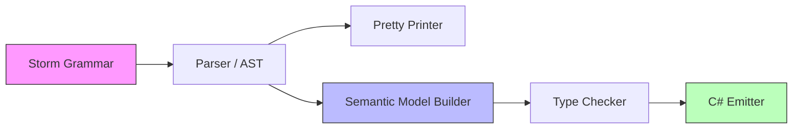

# Design Document: Anonymous Types

## Overview

This design introduces anonymous types to the Mist language, mirroring C#'s anonymous type semantics. Anonymous types allow developers to create lightweight, immutable objects with named properties without declaring a type. The feature spans parsing, semantic model, type checking, emission, and tooling.

The key insight driving this design is that C# already provides full anonymous type support — the C# compiler synthesizes the backing class, generates `Equals`/`GetHashCode`, and handles structural equality. Mist's emitter passes `new { ... }` through directly, relying on C#'s infrastructure rather than generating helper types.

### Design Decisions

1. **New grammar alternative vs. reusing `TargetTypedNewExpressionNoArgs`**: The current grammar parses `new { ... }` as a target-typed new expression with a property initializer block. Anonymous types require a distinct AST node (`AnonymousTypeExpression`) because the semantics differ fundamentally — anonymous types infer their own type structurally, while target-typed `new` resolves the type from context. A new grammar alternative is added before the existing `TargetTypedNewExpressionNoArgs` rule, matching when the brace content contains `IDENTIFIER EQUAL Expression` or valid projection forms.

2. **`AnonymousType` as a new `IType` implementation**: Rather than encoding anonymous types via `ClassType` or `ConstructedType`, a dedicated `AnonymousType` record captures the ordered property names and types. This enables the type checker to enforce structural equality (same names + types + order = same type) without conflating them with user-declared classes.

3. **`TypeKind.Class` for anonymous types**: Anonymous types are reference types (heap-allocated), consistent with C#'s implementation where the compiler generates a sealed class. Using `TypeKind.Class` integrates with existing `unknown` assignability logic.

4. **Pass-through emission**: The emitter produces C#'s native `new { ... }` syntax verbatim. No helper types or factories are generated. Variables holding anonymous types always use `var` in the emitted C# because anonymous types have no denotable name.

## Architecture

The feature touches the following compiler pipeline stages:



1. **Grammar** (`Mist.storm`): New `AnonymousTypeExpression` alternative in the `Primary` rule, with supporting `AnonymousPropertyList` and `AnonymousProperty` sub-rules.
2. **Parser** (Storm-generated): Produces `AnonymousTypeExpressionPrimaryNode` AST nodes.
3. **Pretty Printer** (`MistPrettyPrinter.cs`): Formats anonymous type AST nodes back to source.
4. **Semantic Model** (`SemanticModelBuilder.cs`): Resolves property types, constructs `AnonymousType` instances, registers them in the type map.
5. **Type Checker** (`TypeCheckerAnalyzer.cs`): Validates property access, enforces read-only semantics, scope restrictions, structural equality rules, and pattern matching.
6. **Emitter** (`CSharpEmitter.cs`): Emits `new { ... }` directly, uses `var` for variable declarations, handles property access and pattern matching pass-through.
7. **TextMate Grammar** (`mist.tmLanguage.json`): Highlights property names in anonymous type initializers.

## Components and Interfaces

### Grammar Changes (`Mist.storm`)

New rules added to the grammar:

```storm
// In the Primary rule — BEFORE TargetTypedNewExpressionNoArgs:
| NEW LEFT_BRACE properties:AnonymousPropertyList RIGHT_BRACE  as AnonymousTypeExpression

// Supporting rules:
rule AnonymousPropertyList = AnonymousProperty (COMMA AnonymousProperty)* COMMA?;

rule AnonymousProperty
    = name:IDENTIFIER EQUAL value:Expression   as ExplicitAnonymousProperty
    | projection:Postfix                        as ProjectedAnonymousProperty
    ;
```

**Disambiguation**: The `AnonymousTypeExpression` alternative is ordered before `TargetTypedNewExpressionNoArgs`. When the parser encounters `new {`, it attempts `AnonymousPropertyList` first. If the content matches `IDENTIFIER EQUAL Expression` or a valid `Postfix` (identifier / member access), it succeeds as an anonymous type. If not (e.g., a collection initializer with non-identifier expressions), it falls through to the existing target-typed new expression path.

**Empty braces**: `new { }` fails to match `AnonymousPropertyList` (which requires at least one property), falls through to `TargetTypedNewExpressionNoArgs`, and then the semantic model builder / type checker reports the appropriate error for whichever interpretation applies.

### AST Nodes (Storm-generated)

The Storm grammar generator produces:
- `AnonymousTypeExpressionPrimaryNode` — contains `Properties: ImmutableArray<AnonymousPropertyNode>`
- `ExplicitAnonymousPropertyAnonymousPropertyNode` — contains `Name: Token`, `Value: ExpressionNode`
- `ProjectedAnonymousPropertyAnonymousPropertyNode` — contains `Projection: PostfixNode`

### `AnonymousType` (New Type)

```csharp
// Source/Mist/Semantics/Model/Types/AnonymousType.cs
public sealed class AnonymousType : IType
{
    /// Ordered property names.
    public IReadOnlyList<string> PropertyNames { get; }
    
    /// Parallel list of resolved property types.
    public IReadOnlyList<IType> PropertyTypes { get; }
    
    public string DisplayName { get; }
    public TypeKind Kind => TypeKind.Class;
    
    public AnonymousType(IReadOnlyList<string> propertyNames, IReadOnlyList<IType> propertyTypes)
    {
        PropertyNames = propertyNames;
        PropertyTypes = propertyTypes;
        
        // Build display: "{ Name: string, Version: int }"
        var parts = new string[propertyNames.Count];
        for (var i = 0; i < propertyNames.Count; i++)
            parts[i] = $"{propertyNames[i]}: {propertyTypes[i].DisplayName}";
        DisplayName = $"{{ {string.Join(", ", parts)} }}";
    }
    
    /// Two AnonymousTypes are structurally equal if they have the same
    /// property names, types, and order.
    public bool StructurallyEquals(AnonymousType other)
    {
        if (PropertyNames.Count != other.PropertyNames.Count) return false;
        for (var i = 0; i < PropertyNames.Count; i++)
        {
            if (PropertyNames[i] != other.PropertyNames[i]) return false;
            if (PropertyTypes[i] != other.PropertyTypes[i]) return false;
        }
        return true;
    }
}
```

### Semantic Model Builder Changes

In `SemanticModelBuilder.cs`, add handling for `AnonymousTypeExpressionPrimaryNode`:

1. For each `ExplicitAnonymousProperty`: resolve the expression type, record `(name, type)`.
2. For each `ProjectedAnonymousProperty`: extract the inferred name from the `Postfix` node (last identifier in the chain or simple identifier), resolve the expression type.
3. Validate no duplicate property names.
4. Validate projections resolve to identifiers or member accesses (report error for literals, method calls, etc.).
5. Construct an `AnonymousType` and register it in the type map for the node.

### Type Checker Changes

In `TypeCheckerAnalyzer.cs`:

1. **Property access**: When resolving `.PropertyName` on an `AnonymousType`, look up the property name in `PropertyNames` and return the corresponding type from `PropertyTypes`. Report "undefined member" if not found.
2. **Read-only enforcement**: If an assignment targets a member on an `AnonymousType`, report "anonymous type properties are read-only".
3. **Scope restrictions**: Report errors when `AnonymousType` appears as:
   - Method return type annotation
   - Method parameter type annotation
   - Field type annotation
   - Generic type argument
4. **Assignability**: Two variables with the same `AnonymousType` (via `StructurallyEquals`) are assignable. `AnonymousType` is assignable to `unknown`.
5. **Equality operators**: `==` and `!=` are valid between two values of the same `AnonymousType`. Report error for different anonymous types.
6. **Pattern matching**: Property patterns are validated against `AnonymousType` property names/types. `var` patterns bind with the full `AnonymousType`.
7. **Duplicate detection**: Report error if the same property name appears twice.
8. **Projection validation**: Report error if a projection expression cannot yield a property name (e.g., integer literal, method call result).

### Emitter Changes

In `CSharpEmitter.cs`:

1. **`AnonymousTypeExpressionPrimaryNode`**: Emit `new { Name1 = expr1, Name2 = expr2 }` for explicit properties; emit `new { identifier }` or `new { expr.Member }` for projections.
2. **Variable declarations**: When the declared type is an `AnonymousType`, always emit `var` regardless of the Mist source declaration style.
3. **Property access**: Emit `anonValue.Name` directly (standard member access).
4. **Pattern matching**: Property patterns on anonymous types emit C# property patterns directly.
5. **`unknown` assignment**: Standard `unknown` → `object` lowering applies.

### Pretty Printer Changes

In `MistPrettyPrinter.cs`, add a case for `AnonymousTypeExpressionPrimaryNode`:
- Explicit properties: `new { Name = expr }`
- Projected properties (simple identifier): `new { variable }`
- Projected properties (member access): `new { expr.Member }`

## Data Models

### Type System Additions

| Type | `IType` Implementation | `TypeKind` | Equality Semantics |
|------|----------------------|------------|-------------------|
| `AnonymousType` | `AnonymousType` | `Class` | Structural (same names + types + order) |

### Diagnostic Messages

| Code | Message Template | Trigger |
|------|-----------------|---------|
| `MIST_ANON_EMPTY` | "Anonymous types require at least one property" | `new { }` |
| `MIST_ANON_DUPLICATE_PROP` | "Anonymous type already contains a property named '{name}'" | Duplicate property name |
| `MIST_ANON_NO_PROJECTION_NAME` | "Cannot infer property name from expression; use explicit `Name = expr` form" | Projection from literal/method call |
| `MIST_ANON_READONLY` | "Anonymous type properties are read-only" | Assignment to anon property |
| `MIST_ANON_ESCAPE_SIGNATURE` | "Anonymous types cannot appear in method signatures" | Anon type in return/param position |
| `MIST_ANON_ESCAPE_FIELD` | "Anonymous types cannot be used as field types" | Anon type as field type |
| `MIST_ANON_ESCAPE_GENERIC` | "Anonymous types have no denotable name and cannot be used as generic type arguments" | Anon type as type argument |
| `MIST_ANON_EQUALITY_MISMATCH` | "Cannot compare anonymous types with different shapes" | `==`/`!=` between different anon types |


## Correctness Properties

*A property is a characteristic or behavior that should hold true across all valid executions of a system — essentially, a formal statement about what the system should do. Properties serve as the bridge between human-readable specifications and machine-verifiable correctness guarantees.*

### Property 1: Anonymous type expression round-trip

*For any* valid anonymous type expression source string (containing any combination of explicit assignments and property projections), parsing the source then pretty-printing the resulting AST then re-parsing SHALL produce a structurally equivalent AST node.

**Validates: Requirements 1.1, 1.2, 1.3, 1.4, 1.6, 1.7**

### Property 2: AnonymousType construction preserves data and DisplayName

*For any* list of N property names (N ≥ 1) and N corresponding IType instances, constructing an `AnonymousType` SHALL store the property names and types in the same order and produce a `DisplayName` matching `{ Name1: T1, Name2: T2, ..., NameN: TN }`.

**Validates: Requirements 2.1, 2.2**

### Property 3: Structural equality is determined by names, types, and order

*For any* two `AnonymousType` instances, `StructurallyEquals` SHALL return true if and only if the property names, property types, and property order are identical.

**Validates: Requirements 2.3, 2.4**

### Property 4: Property access resolution

*For any* `AnonymousType` with N properties and any property name, if the name exists in the type's property list at index `i`, member access SHALL resolve to `PropertyTypes[i]`; if the name does not exist, the type checker SHALL report an undefined member diagnostic.

**Validates: Requirements 3.1, 3.2**

### Property 5: Anonymous type properties are read-only

*For any* `AnonymousType` and any property name in its property list, an assignment targeting that property SHALL be rejected with a read-only diagnostic.

**Validates: Requirements 3.3, 10.4**

### Property 6: Same-shape anonymous types are assignable

*For any* anonymous type shape (names, types, order), two variables whose inferred types are structurally equal `AnonymousType` instances SHALL be assignable to each other.

**Validates: Requirements 4.6**

### Property 7: Disambiguation — anonymous content produces AnonymousTypeExpression

*For any* source of the form `new { content }` where content matches one or more `IDENTIFIER EQUAL Expression` or valid projection forms, the parser SHALL produce an `AnonymousTypeExpressionPrimaryNode`.

**Validates: Requirements 6.4**

### Property 8: Non-anonymous content falls through to target-typed new

*For any* source of the form `new { content }` where content does NOT match anonymous property syntax (e.g., contains only collection initializer elements like bare expressions or `{ nested }`), the parser SHALL produce a `TargetTypedNewExpressionNoArgsPrimaryNode`.

**Validates: Requirements 6.5**

### Property 9: Emitter produces correct C# anonymous type syntax

*For any* valid anonymous type expression containing explicit properties and/or projections, the emitter SHALL produce C#'s `new { ... }` syntax preserving property names and projection forms, and any variable declaration whose type is `AnonymousType` SHALL emit using `var`.

**Validates: Requirements 7.1, 7.2, 7.3, 7.5**

### Property 10: Property patterns validate against AnonymousType

*For any* `AnonymousType` and a property pattern, if the pattern references a property name that exists in the type, the sub-pattern SHALL be validated against that property's type; if the name does not exist, the type checker SHALL report an error.

**Validates: Requirements 5.1, 5.3**

### Property 11: Equality operators require same-shape anonymous types

*For any* two values where at least one has an `AnonymousType`, the `==` and `!=` operators SHALL be accepted if and only if both values have structurally equal `AnonymousType` instances.

**Validates: Requirements 9.1, 9.3**

### Property 12: Duplicate property names are rejected

*For any* anonymous type expression where the same property name appears more than once (whether through explicit assignment or projection), the type checker SHALL report a duplicate property diagnostic.

**Validates: Requirements 10.1**

### Property 13: Property patterns on unknown accept any property names

*For any* set of property names in a property pattern and a scrutinee of type `unknown`, the type checker SHALL accept the pattern without reporting missing-property errors, deferring validation to runtime.

**Validates: Requirements 8.3**

## Error Handling

### Parser Errors

- **Empty anonymous type** (`new { }`): Falls through to `TargetTypedNewExpressionNoArgs` parsing. If the semantic context requires an anonymous type, the type checker reports `MIST_ANON_EMPTY`. If it's a valid target-typed new context, no error.
- **Missing comma separator**: Standard parser recovery — the Storm parser reports a syntax error at the unexpected token.
- **Trailing comma**: Allowed by the grammar (`AnonymousPropertyList` includes optional trailing comma).

### Type Checker Errors

- **Duplicate property names**: Detected during `AnonymousType` construction in the semantic model builder. The first occurrence is accepted; subsequent duplicates emit `MIST_ANON_DUPLICATE_PROP`.
- **Invalid projection**: When a `ProjectedAnonymousProperty`'s `Postfix` node cannot be reduced to a simple identifier or member access (e.g., it's a method call or literal), emit `MIST_ANON_NO_PROJECTION_NAME`.
- **Escape to method signatures/fields/generics**: Caught during type annotation resolution. When the resolved type is `AnonymousType` in a forbidden position, emit the appropriate diagnostic (`MIST_ANON_ESCAPE_SIGNATURE`, `MIST_ANON_ESCAPE_FIELD`, `MIST_ANON_ESCAPE_GENERIC`).
- **Read-only assignment**: Detected when the assignment target is resolved to an `AnonymousType` property. Emit `MIST_ANON_READONLY`.
- **Cross-shape equality**: Detected when `==`/`!=` operands have different `AnonymousType` shapes. Emit `MIST_ANON_EQUALITY_MISMATCH`.
- **Property initializer type error**: If a property expression fails type checking (e.g., references an undefined variable), the underlying error is reported as normal, and the property type is set to `ErrorType`. The `AnonymousType` is still constructed to allow further diagnostics downstream.

### Recovery Strategy

The general principle is: report the error, use `ErrorType` for the affected slot, and continue analysis. This allows multiple errors in a single anonymous type expression to be reported in one pass rather than stopping at the first error.

## Testing Strategy

### Property-Based Tests (FsCheck)

Each correctness property is implemented as an FsCheck property test with a minimum of 100 iterations. Tests use the shared `CompilerDriver` for in-process compilation where needed, following the batching policy for any tests that require process spawning.

**Library**: FsCheck (already used in the project for existing property tests like `TupleTypePropertyTests` and `TargetTypedNewDisambiguationPropertyTests`)

**Configuration**: 100 iterations minimum per property test.

**Tag format**: `Feature: anonymous-types, Property {N}: {property text}`

Property tests cover:
- Parser round-trip (Property 1)
- `AnonymousType` data model invariants (Properties 2, 3)
- Type checker property access resolution (Property 4)
- Read-only enforcement (Property 5)
- Same-shape assignability (Property 6)
- Grammar disambiguation (Properties 7, 8)
- Emitter correctness (Property 9)
- Pattern matching validation (Properties 10, 13)
- Equality operator rules (Property 11)
- Duplicate detection (Property 12)

### Unit Tests (xUnit)

Unit tests cover specific examples and edge cases:
- Empty anonymous type `new { }` diagnostic
- Anonymous type used as method return type → error
- Anonymous type used as parameter type → error
- Anonymous type used as field type → error
- Anonymous type used as generic type argument → error
- Assignment to `unknown` succeeds
- `var` pattern binds full `AnonymousType`
- Emitter produces `object` for `unknown`-typed variable
- Property pattern against `unknown` emits correct C# code
- TextMate grammar scoping (validated by snapshot/grep of tmLanguage rules)

### Integration Tests

- Sample app at `samples/AnonymousTypes/Program.mist` compiles and produces expected stdout output
- `samples/AllFeatures/Program.mist` includes the anonymous types demo and runs successfully
- No regressions in existing samples (verified by AllFeatures build)

### Test Process Spawning

Property-based tests that require compilation use the in-process `CompilerDriver` for parsing and type checking validation. For emission tests requiring C# compilation and execution, the batching pattern is used: generate N scenarios, build one batched program, compile once, run once, compare N output lines. This keeps process spawns to 1 per test class maximum.
