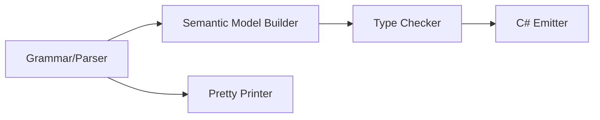

# Design Document: Array Literals

## Overview

This design adds array literal syntax (`[expr, expr, ...]`) to the Mist programming language, enabling developers to create pre-populated arrays inline without element-by-element assignment. The feature introduces two AST node types — `ArrayLiteralExpression` for non-empty literals and `EmptyArrayLiteralExpression` for the empty array literal `[]` — and threads them through the parser, type checker, C# emitter, and pretty printer.

The key design challenge is disambiguation: `[...]` already serves two roles in Mist (index suffix and list patterns). The Storm parser's structure naturally resolves this — Primary alternatives are tried before postfix suffixes, and pattern rules are separate from expression rules — so no special lookahead or backtracking is needed.

### Design Decisions

1. **Grammar placement**: `ArrayLiteralExpression` is added as a new Primary alternative. Since Primary is tried before PostfixSuffix in the Postfix rule, `[...]` at expression-start positions parses as an array literal, while `[...]` after a primary expression parses as an IndexSuffix.

2. **Empty array syntax**: Empty arrays use `[]` (bare brackets with no elements). This is a distinct grammar alternative (`EmptyArrayLiteralExpression`) placed before the non-empty `ArrayLiteralExpression` alternative so it matches first for empty brackets. The empty array literal `[]` requires a target type annotation: when assigned to a typed variable (e.g., `int[] e = [];`), the target element type is used; when no target type is available (e.g., `var foo = [];`), the compiler reports a diagnostic error indicating that empty array literals require an explicit element type annotation.

3. **TypeLiteralExpression remains a type literal**: `int[]` in expression position is a type literal (referring to the type itself, like C#'s `typeof(int[])`). It does NOT represent an empty array. This is handled by the existing `TypeLiteralExpression` grammar alternative.

4. **C# emission strategy**: Non-empty array literals emit as `new[] { e1, e2, ... }` (type-inferred) or `new T[] { e1, e2, ... }` (explicit type). Empty array literals emit as `Array.Empty<T>()` when the target type is known. When no target type is available, the empty array literal is a compile error and no C# code is emitted.

5. **Type inference**: The element type is inferred as the common type of all elements. If all elements share the same type, that type is used. If types differ with no common type, a diagnostic is emitted.

## Architecture

The feature touches four compiler phases in sequence:



1. **Grammar** (`Mist.storm`): New `ArrayLiteralExpression` alternative in the `Primary` rule.
2. **Semantic Model Builder** (`SemanticModelBuilder.cs`): Resolves element types and produces an `ArrayType` for the expression.
3. **Type Checker** (`TypeCheckerAnalyzer.cs`): Validates element type compatibility, rejects `void` and `unknown` elements.
4. **C# Emitter** (`CSharpEmitter.cs`): Emits `new[] { ... }` or `Array.Empty<T>()`.
5. **Pretty Printer** (`MistPrettyPrinter.cs`): Reproduces `[e1, e2, ...]` syntax.
6. **TextMate Grammar** (`mist.tmLanguage.json`): Existing punctuation rules already cover `[`, `]`, and `,`.

## Components and Interfaces

### 1. Grammar Changes (`Source/Mist/Grammar/Mist.storm`)

Add two new Primary alternatives for array literals:

```storm
rule Primary
    = ...existing alternatives...
    | LEFT_BRACKET RIGHT_BRACKET                                                    as EmptyArrayLiteralExpression
    | LEFT_BRACKET first:Expression (COMMA rest:Expression)* COMMA? RIGHT_BRACKET  as ArrayLiteralExpression
    ;
```

The `EmptyArrayLiteralExpression` alternative is placed **before** `ArrayLiteralExpression` so that `[]` (empty brackets) matches the empty case first, rather than failing to match the non-empty case which requires at least one expression.

The Storm source generator will produce:
- `EmptyArrayLiteralExpressionPrimaryNode` — no fields (just empty brackets)
- `ArrayLiteralExpressionPrimaryNode` with:
  - `First`: `ExpressionNode` — the first element
  - `Rest`: `ImmutableArray<ExpressionNode>` — remaining elements (from the `(COMMA rest:Expression)*` repetition)

**TypeLiteralExpression**: The existing `TypeLiteralExpression` alternative continues to handle `int[]`, `string[]`, etc. in expression position as type literals (referring to the type itself). No special-casing for array types is needed — they remain pure type references.

### 2. AST Nodes (Storm-Generated)

The Storm source generator will automatically produce:

```csharp
// Generated from the grammar rule — empty array literal []
public sealed class EmptyArrayLiteralExpressionPrimaryNode : PrimaryNode
{
    // No fields — represents bare []
}

// Generated from the grammar rule — non-empty array literal [e1, e2, ...]
public sealed class ArrayLiteralExpressionPrimaryNode : PrimaryNode
{
    public ExpressionNode First { get; set; }
    public ImmutableArray<ExpressionNode> Rest { get; set; }
}
```

### 3. Semantic Model Builder (`SemanticModelBuilder.cs`)

New cases in the Primary expression resolution switch:

```csharp
case EmptyArrayLiteralExpressionPrimaryNode emptyArray:
{
    // If a target type is available (e.g., from variable declaration annotation),
    // use the target element type. Otherwise, produce ErrorType (the type checker will emit a diagnostic).
    if (targetType is ArrayType targetArrayType)
    {
        result = targetArrayType;
    }
    else
    {
        result = ErrorType.Instance;
    }
    break;
}

case ArrayLiteralExpressionPrimaryNode arrayLiteral:
{
    // Resolve all element expressions
    var elementType = ResolveExpression(arrayLiteral.First, ...);
    foreach (var elem in arrayLiteral.Rest)
    {
        var elemType = ResolveExpression(elem, ...);
        elementType = FindCommonType(elementType, elemType);
    }
    result = new ArrayType(elementType);
    break;
}
```

**TypeLiteralExpression with array type**: The existing `TypeLiteralExpression` handling remains unchanged — it produces a type reference (like `typeof(int[])` in C#), NOT an empty array. No special-casing for array types is needed here.

### 4. Type Checker (`TypeCheckerAnalyzer.cs`)

New `CheckArrayLiteral` method:

- Recursively type-checks each element expression
- Validates all elements have compatible types
- Rejects `void` elements (diagnostic `MIST_TC_0034`)
- Rejects `unknown` elements (diagnostic using `UnknownAsArrayElement`)
- When target type is known (explicit annotation), validates each element is assignable to the target element type

For `EmptyArrayLiteralExpression`:
- When assigned to a typed variable, validate the target type is an array type
- When no target type is available, emit a diagnostic error indicating that empty array literals require an explicit element type annotation

### 5. C# Emitter (`CSharpSourceWriter` in `CSharpEmitter.cs`)

New cases in `EmitPrimary`:

```csharp
case EmptyArrayLiteralExpressionPrimaryNode emptyArray:
{
    // When target type is known (e.g., int[] e = []), emit Array.Empty<T>()
    // When no target type, this is a compile error — the type checker will have already reported a diagnostic
    var elementTypeName = resolvedType is ArrayType at
        ? EmitTypeName(at.ElementType)
        : throw new InvalidOperationException("Empty array literal without target type should have been rejected by the type checker");
    return $"Array.Empty<{elementTypeName}>()";
}

case ArrayLiteralExpressionPrimaryNode arrayLiteral:
{
    var elements = new List<string> { EmitExpression(arrayLiteral.First) };
    foreach (var elem in arrayLiteral.Rest)
        elements.Add(EmitExpression(elem));
    return $"new[] {{ {string.Join(", ", elements)} }}";
}
```

**TypeLiteralExpression with array type**: Reverts to standard type literal emission (e.g., `typeof(int[])` or whatever the existing `TypeLiteralExpression` handler produces). The special case that previously treated array-typed `TypeLiteralExpression` as an empty array literal is removed.

### 6. Pretty Printer (`MistPrettyPrinter.cs`)

New cases in `EmitPrimary`:

```csharp
case EmptyArrayLiteralExpressionPrimaryNode:
{
    return "[]";
}

case ArrayLiteralExpressionPrimaryNode arrayLiteral:
{
    var elements = new List<string> { EmitExpression(arrayLiteral.First) };
    foreach (var elem in arrayLiteral.Rest)
        elements.Add(EmitExpression(elem));
    return $"[{string.Join(", ", elements)}]";
}
```

### 7. TextMate Grammar (`mist.tmLanguage.json`)

The existing punctuation rules already scope `[` and `]` as `punctuation.separator.comma.mist` for commas and bracket characters are handled by the general punctuation patterns. No changes are needed — the existing rules cover array literal syntax since it uses the same `[`, `]`, and `,` tokens that are already highlighted.

## Data Models

### AST Node Types

| Node | Fields | Description |
|------|--------|-------------|
| `EmptyArrayLiteralExpressionPrimaryNode` | (none) | Empty array literal `[]` |
| `ArrayLiteralExpressionPrimaryNode` | `First: ExpressionNode`, `Rest: ImmutableArray<ExpressionNode>` | Non-empty array literal `[e1, e2, ...]` |

### Type System

The existing `ArrayType` class in the semantic model is reused:

```csharp
// Already exists in Mist.Semantics.Model.Types
public sealed class ArrayType : IType
{
    public IType ElementType { get; }
    // ...
}
```

### Diagnostic IDs

| ID | Condition | Message |
|----|-----------|---------|
| `MIST_TC_0034` | Element type is `void` | "Cannot create an array of type 'void'. Void is not permitted as an array element type." |
| `MIST_TC_0095` | Elements have incompatible types | "Array literal elements have incompatible types: '{type1}' and '{type2}'. All elements must share a common type." |
| Existing `UnknownAsArrayElement` | Element type contains `unknown` | "Cannot create an array with element type containing 'unknown'." |

### C# Emission Mapping

| Mist Source | C# Output |
|-------------|-----------|
| `[1, 2, 3]` | `new[] { 1, 2, 3 }` |
| `[[1, 2], [3, 4]]` | `new[] { new[] { 1, 2 }, new[] { 3, 4 } }` |
| `int[] e = [];` | `int[] e = Array.Empty<int>()` |
| `var foo = [];` | compile error (no emitted output) |
| `var x = [1, 2, 3]` | `var x = new[] { 1, 2, 3 }` |
| `int[] x = [1, 2, 3]` | `int[] x = new int[] { 1, 2, 3 }` |
| `int[]` (in expression position) | `typeof(int[])` (type literal, not an array) |


## Correctness Properties

*A property is a characteristic or behavior that should hold true across all valid executions of a system — essentially, a formal statement about what the system should do. Properties serve as the bridge between human-readable specifications and machine-verifiable correctness guarantees.*

### Property 1: Array literal parsing produces correct element count

*For any* list of N valid expressions (where N ≥ 1), parsing the source text `[e1, e2, ..., eN]` in expression position SHALL produce an `ArrayLiteralExpressionPrimaryNode` whose total element count (First + Rest) equals N.

**Validates: Requirements 1.1, 11.1, 11.2, 11.3, 11.4, 11.5**

### Property 2: Trailing comma equivalence

*For any* valid array literal source text `[e1, e2, ..., eN]`, parsing with a trailing comma `[e1, e2, ..., eN,]` SHALL produce an AST with the same element count and equivalent element expressions as parsing without the trailing comma.

**Validates: Requirements 1.2**

### Property 3: Expression-position disambiguation

*For any* identifier `name` and expression `expr`, parsing `name[expr]` SHALL produce a Postfix node with an IndexSuffix (not an ArrayLiteralExpression), while parsing `var x = [expr]` SHALL produce a variable declaration whose initializer contains an ArrayLiteralExpressionPrimaryNode.

**Validates: Requirements 3.1, 3.2, 3.3**

### Property 4: Pattern-context disambiguation

*For any* expression `scrutinee` and pattern content inside an `is` expression, parsing `scrutinee is [pattern]` SHALL produce an IsExpression whose pattern is a ListPattern (not an ArrayLiteralExpression).

**Validates: Requirements 4.1, 4.2, 4.3**

### Property 5: Homogeneous element type inference

*For any* array literal where all N elements have the same type T, the type checker SHALL infer the expression's type as `T[]` (an ArrayType with ElementType = T).

**Validates: Requirements 5.1, 5.3**

### Property 6: Incompatible element type diagnostic

*For any* array literal containing elements of two types T1 and T2 where T1 is not assignable to T2 and T2 is not assignable to T1, the type checker SHALL emit a diagnostic error indicating incompatible element types.

**Validates: Requirements 5.2**

### Property 7: Void and unknown element rejection

*For any* array literal containing at least one element whose type is `void` or contains `unknown`, the type checker SHALL emit a diagnostic error rejecting the element type.

**Validates: Requirements 6.3, 6.4**

### Property 8: C# emission format

*For any* non-empty array literal with elements [e1, ..., eN], the C# emitter SHALL produce output matching the pattern `new[] { <e1>, ..., <eN> }` where each `<ei>` is the C# emission of the corresponding element. *For any* empty array literal `[]` with a known target element type T, the emitter SHALL produce `Array.Empty<T>()`.

**Validates: Requirements 7.1, 7.3, 8.1**

### Property 9: Pretty-print round trip

*For any* valid array literal source text, parsing then pretty-printing then parsing again SHALL produce an AST equivalent to the first parse (same node types, same element count, same element structure).

**Validates: Requirements 9.1, 9.2, 9.3**

## Error Handling

### Parse Errors

| Condition | Behavior |
|-----------|----------|
| `[,]` or `[, expr]` (leading comma) | Parse error: expected expression |
| `[expr` (missing closing bracket) | Parse error: expected `]` |

### Type Checker Diagnostics

| ID | Severity | Condition | Message |
|----|----------|-----------|---------|
| `MIST_TC_0034` | Error | Element is `void`-typed | "Cannot create an array of type 'void'. Void is not permitted as an array element type." |
| `MIST_TC_0095` | Error | Elements have no common type | "Array literal elements have incompatible types: '{type1}' and '{type2}'. All elements must share a common type." |
| `UnknownAsArrayElement` | Error | Element type contains `unknown` | "Cannot create an array with element type containing 'unknown'. Array elements are writable storage." |

### Recovery Strategy

- On parse error inside an array literal, the parser attempts to synchronize at the next `]` or `;` to continue parsing the rest of the file.
- On type errors in individual elements, the type checker continues checking remaining elements to report all errors in a single pass.

## Testing Strategy

### Unit Tests (Example-Based)

- **Parser**: Specific examples for each expression position (variable init, argument, return, assignment RHS, nested)
- **Empty arrays**: `[]` with typed variable, `[]` with `var`, `[]` as method argument
- **Type literals**: `int[]` in expression position remains a type literal
- **Error cases**: malformed literals
- **TextMate**: Verify existing scopes apply to array literal tokens (smoke tests)

### Property-Based Tests

Property-based testing is appropriate for this feature because:
- The parser, type checker, and emitter operate on a wide input space (arbitrary expressions as elements, varying element counts)
- Universal properties hold across all valid inputs (round-trip, disambiguation, type inference)
- Input variation reveals edge cases (empty elements, deeply nested arrays, mixed types)

**Library**: FsCheck (already used throughout the test suite)

**Configuration**: Minimum 100 iterations per property test.

**Test tagging format**: Each property test includes a comment referencing its design property:
```
// Feature: array-literals, Property N: <property text>
```

**Process spawning**: Property tests that verify end-to-end compilation use the batched approach (generate all scenarios, compile once, run once, compare N output lines) per the test-process-spawning policy. In-process compilation via `CompilerDriver.Compile()` is preferred for parser and type checker properties.

### Integration Tests

- **Sample app**: `samples/ArrayLiterals/Program.mist` exercises all permutations
- **AllFeatures**: `samples/AllFeatures/Program.mist` calls `ArrayLiterals.Program.RunDemo()`
- **End-to-end**: Compile sample app, run, verify stdout output matches expected baselines
