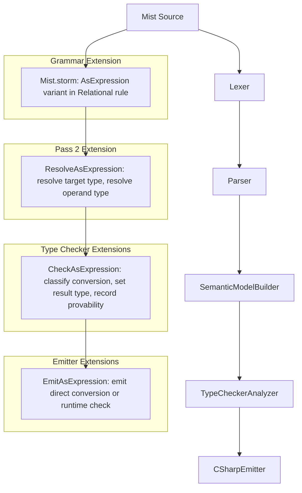
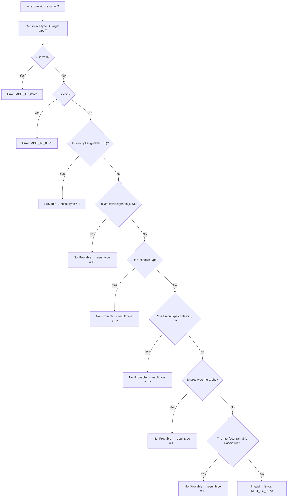

# Design Document: As Operator

## Overview

This design adds the `as` operator to the Mist programming language. The `as` operator provides safe type conversion that yields either the target type `T` (when provably safe) or `T?` (i.e., `T | void`, when a runtime check is needed). It never throws.

The key insight: Mist has no null, so failed conversions produce `void` — the standard "absence" value. The result type is determined statically:

| Conversion kind | Example | Result type |
|---|---|---|
| Identity | `dog as Dog` | `Dog` |
| Widening (derived → base) | `dog as Animal` | `Animal` |
| Widening (to implemented interface) | `list as IEnumerable<int>` | `IEnumerable<int>` |
| Widening (constituent → union) | `42 as int \| string` | `int \| string` |
| Narrowing (base → derived) | `animal as Dog` | `Dog?` |
| Union extraction | `union as int` | `int?` |
| Unknown narrowing | `unknown as int` | `int?` |
| Unrelated types | `dog as string` | **Compile error** |

The `as` operator complements `is` patterns: `is` narrows inside a conditional branch; `as` produces the optional value as a standalone expression.

### Design Decisions

- **Same precedence as `is`**: The `as` operator parses at the `Relational` level, making `x + y as T` parse as `(x + y) as T` and `x as T == y` parse as `(x as T) == y`. This matches C# precedence.
- **Non-associative**: `x as T1 as T2` is a parse error. The user must write `(x as T1) as T2`. This avoids confusion about whether chaining narrows through intermediates.
- **No user-defined cast operator interaction**: The `as` operator operates purely on type hierarchy, union membership, and unknown narrowing. It does NOT invoke implicit/explicit cast operators. This keeps the semantics simple and predictable — user-defined conversions use explicit cast syntax `(T)expr`.
- **Reuses existing `AS` token**: The `AS` keyword already exists for trait with-block member mappings (`sourceName as targetName`). The grammar context disambiguates: in a `Relational` rule position with a `TypeReference` on the right, it's an `AsExpression`; inside a `MemberMapping` rule, it's a renaming.
- **Provability uses `IsDirectlyAssignable`**: The same logic that determines whether a cast expression is trivially valid (identity/subtype, without implicit operators) determines whether `as` produces bare `T` vs `T?`. This ensures consistency with the existing type system.
- **Metadata on the AST node**: The type checker records a flag on the `AsExpression` node indicating `Provable` vs `NonProvable`. The emitter reads this to decide whether to emit a direct conversion or a runtime check.

## Architecture

The `as` operator integrates into the existing compiler pipeline:



### Pipeline Integration Points

| Pipeline Stage | Change |
|---|---|
| `Mist.storm` | Add `AsExpression` variant to `Relational` rule |
| `MistPrettyPrinter` | Handle `AsExpressionRelationalNode` in `EmitRelational` |
| `SemanticModelBuilder` Pass 2 | Resolve `AsExpression` — resolve target type and operand |
| `TypeCheckerAnalyzer` | Validate and classify `AsExpression` — set result type, record provability metadata |
| `CSharpEmitter` | Emit `AsExpression` — direct conversion for provable, runtime check for non-provable |
| `mist.tmLanguage.json` | Ensure `as` is highlighted as `keyword.operator.mist` in expression context |

## Components and Interfaces

### Grammar Change (`Mist.storm`)

The `Relational` rule gains a new `AsExpression` variant:

```storm
rule Relational
    = left:Additive IS pattern:Pattern                                          as IsExpression
    | left:Additive AS targetType:TypeReference                                 as AsExpression
    | left:Additive (operator:(LESS_THAN | GREATER_THAN | LESS_THAN_OR_EQUAL
                              | GREATER_THAN_OR_EQUAL) right:Additive)*         as RelationalComparison
    ;
```

**Design rationale**: Placed alongside `IsExpression` because both operate on a left `Additive` operand with a type on the right. The `AS` token already exists — no lexer changes needed. The `AsExpression` alternative is ordered after `IsExpression` (both are tried as ordered alternatives by the PEG parser; since `IS` and `AS` are distinct tokens, there's no ambiguity).

### AST Nodes (Storm-generated)

The Storm source generator will produce:

- `AsExpressionRelationalNode` — left operand (`AdditiveNode`), target type (`TypeReferenceNode`)

This mirrors `IsExpressionRelationalNode` which has left operand + pattern.

### SemanticModelBuilder Extension (Pass 2)

In `ResolveRelational`, add a case for `AsExpressionRelationalNode`:

```csharp
case AsExpressionRelationalNode asExpr:
    ResolveAsExpression(asExpr, ...);
    break;
```

`ResolveAsExpression`:
1. Resolves the target type reference to an `IType`.
2. Resolves the left operand expression to determine its Compile_Time_Type.
3. Records the resolved target type on the node (so the type checker and emitter can access it).

The expression type is NOT set here — that's deferred to the type checker, which determines whether the result is `T` or `T | void`.

### TypeCheckerAnalyzer Extension

Add a new `CheckAsExpression` method called when visiting `AsExpressionRelationalNode`:

```csharp
private static void CheckAsExpression(
    AsExpressionRelationalNode asExpr,
    ISemanticModel model,
    DiagnosticBag diagnostics)
{
    var targetType = model.GetTypeOf(asExpr); // resolved target type from Pass 2
    var sourceType = model.GetTypeOf(asExpr.Left);

    if (targetType is null || IsErrorType(targetType)) return;
    if (sourceType is null || IsErrorType(sourceType)) return;

    // Reject void source
    if (sourceType.IsVoid())
    {
        diagnostics.Add(...MIST_TC_0072...);
        return;
    }

    // Reject void target
    if (targetType.IsVoid())
    {
        diagnostics.Add(...MIST_TC_0071...);
        return;
    }

    // Classify the conversion
    var classification = ClassifyAsConversion(sourceType, targetType, model);

    switch (classification)
    {
        case AsConversionKind.Provable:
            model.SetTypeOf(asExpr, targetType);
            model.RecordAsConversionKind(asExpr, AsConversionKind.Provable);
            break;

        case AsConversionKind.NonProvable:
            var optionalType = MakeOptionalType(targetType); // T | void
            model.SetTypeOf(asExpr, optionalType);
            model.RecordAsConversionKind(asExpr, AsConversionKind.NonProvable);
            break;

        case AsConversionKind.Invalid:
            diagnostics.Add(...MIST_TC_0070...);
            break;
    }
}
```

#### Conversion Classification Algorithm

```csharp
private static AsConversionKind ClassifyAsConversion(
    IType sourceType, IType targetType, ISemanticModel model)
{
    // 1. Provable: source is directly assignable to target
    //    (identity, subtype, interface, trait — NOT implicit cast operators)
    if (IsDirectlyAssignable(sourceType, targetType, model))
        return AsConversionKind.Provable;

    // 2. Non-provable: target is directly assignable to source (narrowing)
    //    Base → Derived, Interface → Concrete
    if (IsDirectlyAssignable(targetType, sourceType, model))
        return AsConversionKind.NonProvable;

    // 3. Non-provable: source is unknown → any concrete target
    if (sourceType is UnknownType)
        return AsConversionKind.NonProvable;

    // 4. Non-provable: source is a union and target is a constituent
    if (sourceType is UnionType sourceUnion)
    {
        if (IsConstituentOf(targetType, sourceUnion))
            return AsConversionKind.NonProvable;
        // Target shares inheritance with a constituent
        foreach (var constituent in sourceUnion.Constituents)
        {
            if (IsDirectlyAssignable(targetType, constituent, model)
                || IsDirectlyAssignable(constituent, targetType, model))
                return AsConversionKind.NonProvable;
        }
    }

    // 5. Non-provable: both are classes in the same hierarchy
    //    (not direct parent-child but share an ancestor)
    if (SharesTypeHierarchy(sourceType, targetType))
        return AsConversionKind.NonProvable;

    // 6. Non-provable: target is an interface/trait that source MIGHT implement
    //    (source is a class type and target is an interface — even if not
    //     currently proven to implement it, a derived class might)
    if (targetType.Kind == TypeKind.Interface || targetType.Kind == TypeKind.Trait)
    {
        if (sourceType.Kind == TypeKind.Class || sourceType.Kind == TypeKind.Struct)
            return AsConversionKind.NonProvable;
    }

    // 7. Invalid: no type relationship exists
    return AsConversionKind.Invalid;
}
```



### CSharpEmitter Extension

In `EmitRelational`, add a case for `AsExpressionRelationalNode`:

```csharp
case AsExpressionRelationalNode asExpr:
    return EmitAsExpression(asExpr);
```

`EmitAsExpression` dispatches based on the recorded conversion kind:

```csharp
private string EmitAsExpression(AsExpressionRelationalNode asExpr)
{
    var operand = EmitAdditive(asExpr.Left);
    var targetType = EmitTypeReference(asExpr.TargetType);
    var conversionKind = _model.GetAsConversionKind(asExpr);
    var sourceType = _model.GetTypeOf(asExpr.Left);
    var resolvedTargetType = _model.GetTypeOf(asExpr);

    switch (conversionKind)
    {
        case AsConversionKind.Provable:
            return EmitProvableAsConversion(operand, sourceType, resolvedTargetType, targetType);

        case AsConversionKind.NonProvable:
            return EmitNonProvableAsConversion(operand, sourceType, resolvedTargetType, targetType);

        default:
            // Should not reach — type checker rejects invalid conversions.
            return operand;
    }
}
```

#### Provable Conversion Emission

```csharp
private string EmitProvableAsConversion(string operand, IType sourceType, IType targetType, string emittedTargetType)
{
    // Identity — no cast needed
    if (TypesEqual(sourceType, targetType))
        return operand;

    // Struct widening — the implicit conversion operator handles it
    if (sourceType is StructType && targetType is StructType)
        return $"(({emittedTargetType}){operand})";

    // Class widening — standard upcast
    if (sourceType is ClassType && targetType is ClassType)
        return $"(({emittedTargetType}){operand})";

    // Interface/trait widening — upcast
    return $"(({emittedTargetType}){operand})";
}
```

#### Non-Provable Conversion Emission

For non-provable conversions, the emission depends on the source and target type kinds. The result must be a `T | void` union value:

```csharp
private string EmitNonProvableAsConversion(string operand, IType sourceType, IType resolvedTargetType, string emittedTargetType)
{
    // The result type is T | void — we need to emit code that produces
    // the union helper's representation.

    // For reference types (classes): C# `as` produces null on failure,
    // and the union helper maps null → void constituent.
    if (IsReferenceType(resolvedTargetType))
        return $"({operand} as {emittedTargetType})";

    // For value types (structs) from unknown/object source:
    // Use `is` pattern to extract or produce default
    if (sourceType is UnknownType)
        return $"({operand} is {emittedTargetType} __as_tmp ? __as_tmp : default({emittedTargetType}?))";

    // For union source: emit the union's tag-based extraction
    if (sourceType is UnionType)
        return EmitUnionExtraction(operand, sourceType, emittedTargetType);

    // General fallback: is-pattern
    return $"({operand} is {emittedTargetType} __as_tmp ? __as_tmp : default({emittedTargetType}?))";
}
```

The exact emission patterns will depend on how the existing union type helper infrastructure emits union values. The emitter must produce code that the union constructor / pattern machinery can consume. The details will be refined during implementation by examining how `is` patterns currently emit narrowing for unions and unknown types.

### MistPrettyPrinter Extension

In the method that handles `Relational` nodes, add:

```csharp
case AsExpressionRelationalNode asExpr:
    return $"{EmitAdditive(asExpr.Left)} as {EmitTypeReference(asExpr.TargetType)}";
```

Format: `expression as Type` — spaces around `as`, consistent with `is` formatting.

### Semantic Model Metadata

A new metadata mechanism is needed to record the conversion classification on `AsExpression` nodes. Options:

1. **Reuse `RecordResolvedOperator`** — store a sentinel symbol indicating provable/non-provable. This is hacky.
2. **New dedicated storage** — add a `Dictionary<SyntaxNode, AsConversionKind>` to the semantic model, with `RecordAsConversionKind` / `GetAsConversionKind` methods.

Option 2 is cleaner. The enum:

```csharp
public enum AsConversionKind
{
    Provable,      // Result type is T — no runtime check needed
    NonProvable,   // Result type is T | void — runtime check emitted
}
```

### TextMate Grammar Extension

The `as` keyword is already recognized in Mist's TextMate grammar (for trait member mappings). Verify that it's scoped as `keyword.operator.mist` in expression contexts. If it's currently only scoped as `keyword.other.mist` in member mapping context, add a pattern for expression-level `as`:

```json
{
  "name": "keyword.operator.type.mist",
  "match": "\\b(as|is)\\b"
}
```

### New Diagnostic IDs

| ID | Stage | Message |
|---|---|---|
| `MIST_TC_0070` | TypeChecker | The 'as' operator cannot be used between '{sourceType}' and '{targetType}' because no type relationship exists. Use an explicit cast operator if a user-defined conversion is needed. |
| `MIST_TC_0071` | TypeChecker | 'as void' is not a valid conversion. |
| `MIST_TC_0072` | TypeChecker | A void-typed expression cannot be used with the 'as' operator. |

## Data Models

### AST Nodes (Storm-generated)

- `AsExpressionRelationalNode` — fields: `Left` (Additive), `TargetType` (TypeReference)

### Conversion Classification

| Source Type | Target Type | Classification | Result Type |
|---|---|---|---|
| `Dog` | `Dog` | Provable (identity) | `Dog` |
| `Dog` | `Animal` | Provable (widening) | `Animal` |
| `Point3D` | `Point` | Provable (struct widening) | `Point` |
| `Dog` | `IAnimal` | Provable (interface) | `IAnimal` |
| `int` | `int \| string` | Provable (constituent→union) | `int \| string` |
| `Animal` | `Dog` | NonProvable (narrowing) | `Dog?` |
| `int \| string` | `int` | NonProvable (union→constituent) | `int?` |
| `unknown` | `int` | NonProvable (unknown narrowing) | `int?` |
| `Animal` | `ISwimmable` | NonProvable (class→interface) | `ISwimmable?` |
| `Dog` | `string` | Invalid | Compile error |
| `int` | `bool` | Invalid | Compile error |
| `void` | `T` | Invalid | Compile error |
| `T` | `void` | Invalid | Compile error |

### Interaction with Existing Type System

The `as` operator does NOT participate in the `IsAssignable` chain. It's a standalone expression that:
1. Uses `IsDirectlyAssignable` for provability classification
2. Produces a result type that then flows through normal type checking at the use site

No changes to `IsAssignable` are needed.

## Correctness Properties

### Property 1: As expression round-trip

*For any* valid Mist AST containing `as` expressions with varying left operands and target types, pretty-printing the AST and then parsing the result and pretty-printing again SHALL produce identical output.

**Validates: Requirements 1.1, 1.2, 1.3, 9.1, 9.2**

### Property 2: Provable conversions produce bare T

*For any* `as` expression where the source type is directly assignable to the target type (identity, subtype, interface implementation, trait satisfaction, or constituent-to-union), the Type_Checker SHALL set the result type to exactly `T` (not `T | void`).

**Validates: Requirements 2.1, 2.2, 2.3, 2.4, 2.5**

### Property 3: Non-provable conversions produce T?

*For any* `as` expression where the conversion is non-provable (narrowing, union extraction, unknown narrowing), the Type_Checker SHALL set the result type to `T | void`.

**Validates: Requirements 3.1, 3.2, 3.3, 3.4, 3.5**

### Property 4: Invalid conversions produce compile errors

*For any* `as` expression where no type relationship exists between the source and target types, the Type_Checker SHALL emit exactly one diagnostic error and SHALL NOT set a result type on the expression (or set it to ErrorType).

**Validates: Requirements 4.1, 4.2, 4.3, 4.4**

### Property 5: Provable as-expressions emit no runtime checks

*For any* `as` expression classified as Provable, the emitted C# code SHALL NOT contain `is` type-test patterns, `as` null-checks, or conditional expressions. It SHALL emit either the operand unchanged or a simple cast.

**Validates: Requirements 6.1, 6.2, 6.3**

### Property 6: Non-provable as-expressions emit safe runtime checks

*For any* `as` expression classified as NonProvable, the emitted C# code SHALL contain a runtime type check that never throws. The emitted code SHALL produce either the target-typed value or the void/null sentinel.

**Validates: Requirements 6.4, 6.5, 6.6, 6.7**

### Property 7: As operator does not trigger user-defined conversions

*For any* `as` expression where the source type has an implicit or explicit cast operator to the target type but no type hierarchy relationship, the Type_Checker SHALL classify the conversion as Invalid (not Provable or NonProvable). User-defined conversions require explicit cast syntax.

**Validates: Requirement 7.5**
