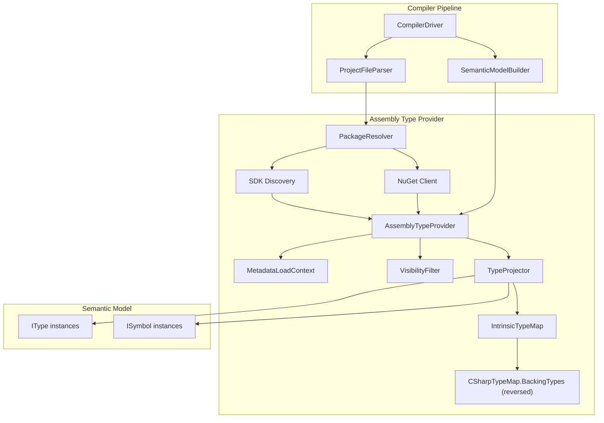

# Design Document: Assembly Type Provider

## Overview

The Assembly Type Provider replaces the manually coded `CSharpAmbientTypeResolver` with an automatic metadata-reading system that loads .NET assembly DLLs via `System.Reflection.MetadataLoadContext` and projects their public types into the Mist semantic model. This eliminates the need to hand-write type definitions for .NET interop and enables Mist developers to use any .NET type from SDK assemblies or NuGet packages.

The system integrates into the existing compiler pipeline at the same point as the current `IAmbientTypeResolver` — during semantic model construction (Stage 4 in `CompilerDriver`). It produces the same `IType` and `ISymbol` instances that the rest of the pipeline expects, maintaining full compatibility with the type checker, analyzers, and C# emitter.

### Key Design Decisions

1. **Lazy resolution**: Types are materialized only when first referenced, not eagerly loaded at startup. This keeps compilation fast for projects that reference large assemblies but only use a few types.
2. **Single source of truth for intrinsic mappings**: The CLR-to-Mist type substitution table is derived by reversing the existing `CSharpTypeMap.BackingTypes` dictionary. No separate mapping table is maintained.
3. **Conservative nullable projection**: All reference types are projected as `T | void` regardless of NRT annotations, ensuring null safety at the Mist level.
4. **Visibility filter as a gate**: Unsupported CLR features (out, ref, pointers, ref structs) cause members to be hidden rather than producing errors, so developers can still use the supported surface of a type.
5. **SDK discovery disk cache**: The resolved SDK reference assembly path is cached to `~/.mist/sdk-ref-path.cache`. Subsequent compilations skip the `dotnet --list-sdks` process spawn entirely — a simple file read replaces a 50-100ms process spawn. The cache is invalidated when the cached path no longer exists on disk, and regenerated by the `publish` script.
6. **Static provider instance caching**: The `CSharpTranspilerBackend` caches the `AssemblyTypeProvider` instance statically. When the same SDK assembly paths are used across multiple `Compile()` calls (the common case — SDK doesn't change mid-process), the existing provider is reused. This avoids recreating the `MetadataLoadContext` and reloading 167 DLLs per compilation — critical for property-based tests that compile hundreds of programs in a single test run (~30ms × 100 iterations = 3 seconds saved per test class).
7. **SDK assembly path caching in CompilerDriver**: The `Directory.GetFiles(sdkRefPath, "*.dll")` result is cached statically in `CompilerDriver` since the SDK assembly list doesn't change during a process lifetime.

## Architecture



### Pipeline Integration

1. **ProjectFileParser** parses `[packages]` from `mist.toml` and produces `PackageReference` entries.
2. **PackageResolver** downloads/caches NuGet packages and discovers SDK assemblies.
3. **AssemblyTypeProvider** implements `IAmbientTypeResolver` and uses `MetadataLoadContext` to read assembly metadata on demand.
4. **SemanticModelBuilder** queries the provider during Pass 2 name resolution (same integration point as today's `CSharpAmbientTypeResolver`).

## Components and Interfaces

### 1. ProjectFileParser Extension (packages table)

Extends the existing `ProjectFileParser` to parse a `[packages]` table:

```csharp
// Added to ProjectConfiguration record
public ImmutableArray<NuGetPackageReference> Packages { get; }

public record NuGetPackageReference(string Name, string Version);
```

Validation rules:
- Package name must match `[a-zA-Z0-9\-_\.]+` and not exceed 128 characters
- Version must be a non-empty, non-whitespace string
- The `[packages]` field, if present, must be a TOML table
- Each value must be a string type

### 2. SdkDiscovery

Locates the .NET SDK installation and resolves the target framework reference path:

```csharp
public sealed class SdkDiscovery
{
    /// <summary>
    /// Discovers the SDK reference assembly path for the given target framework.
    /// Searches: dotnet --list-runtimes, well-known paths (/usr/share/dotnet,
    /// C:\Program Files\dotnet, ~/.dotnet).
    /// Returns null and emits diagnostic if not found.
    /// </summary>
    public static string? FindReferenceAssemblyPath(
        string targetFramework, // e.g., "net10.0"
        DiagnosticBag diagnostics);
}
```

Strategy:
1. Run `dotnet --list-sdks` to find installed SDKs
2. Parse output to find the highest version supporting the target framework
3. Construct the reference assembly path: `{sdkRoot}/packs/Microsoft.NETCore.App.Ref/{version}/ref/{tfm}/`
4. Fall back to well-known paths if `dotnet` CLI is not on PATH

#### SDK Discovery Disk Cache

The resolved path is cached to `~/.mist/sdk-ref-path.cache` to avoid spawning `dotnet --list-sdks` on every compilation:

```csharp
public static partial class SdkDiscovery
{
    private static readonly string CacheFilePath =
        Path.Combine(Environment.GetFolderPath(Environment.SpecialFolder.UserProfile),
            ".mist", "sdk-ref-path.cache");

    // In-process cache: avoids even the disk read on repeated calls
    private static string? _inProcessCache;
    private static bool _inProcessCacheInitialized;

    public static string? FindReferenceAssemblyPath(string targetFramework, DiagnosticBag diagnostics)
    {
        // 1. In-process cache (instant)
        // 2. Disk cache (file read, validated by Directory.Exists)
        // 3. Full discovery (dotnet --list-sdks + filesystem scan)
        // Result written to disk cache on success.
    }

    /// Called by publish script to warm the cache.
    public static void RegenerateDiskCache();
}
```

Invalidation: if the cached path no longer exists on disk, full discovery runs and the cache is refreshed.

### 3. PackageResolver

Resolves NuGet packages to assembly file paths:

```csharp
public sealed class PackageResolver
{
    /// <summary>
    /// Resolves all package references to assembly paths.
    /// Downloads packages not in the local cache.
    /// Resolves transitive dependencies.
    /// Selects nearest compatible TFM for each package.
    /// </summary>
    public static ImmutableArray<string> ResolvePackages(
        ImmutableArray<NuGetPackageReference> packages,
        string targetFramework,
        DiagnosticBag diagnostics);
}
```

Implementation approach:
- Use `NuGet.Protocol` and `NuGet.Packaging` libraries for package resolution
- Local cache at `~/.nuget/packages/` (standard NuGet cache location)
- TFM preference order: net10.0 > net9.0 > net8.0 > netstandard2.1 > netstandard2.0
- Transitive resolution via `NuGet.DependencyResolver`
- Version conflicts resolved by selecting highest compatible version (NuGet nearest-version semantics)
- Exact version matching only (no version ranges)

### 4. AssemblyTypeProvider

The core component implementing `IAmbientTypeResolver`:

```csharp
public sealed class AssemblyTypeProvider : IAmbientTypeResolver
{
    private readonly MetadataLoadContext _metadataContext;
    private readonly IntrinsicTypeMap _intrinsicMap;
    private readonly VisibilityFilter _filter;
    private readonly TypeProjector _projector;

    // Cache: (namespace, typeName) → (IType, ISymbol[])
    private readonly Dictionary<(string, string), (IType, ImmutableArray<ISymbol>)> _cache;

    // Namespace index: namespace → set of type names
    private readonly Dictionary<string, HashSet<string>> _namespaceIndex;

    public bool HasNamespace(string namespaceName);
    public IType? ResolveType(string namespaceName, string typeName);
    public ImmutableArray<ISymbol> GetMembers(IType type);
    public ImmutableArray<string> GetTypeNamesInNamespace(string namespaceName);
}
```

Initialization:
1. Receive assembly paths from `SdkDiscovery` + `PackageResolver`
2. Create `MetadataLoadContext` with all assembly paths as the assembly resolver
3. Build namespace index by scanning all assemblies' exported types (names only, no full metadata read)
4. Types are projected lazily on first `ResolveType` call

#### Static Provider Instance Caching

The `CSharpTranspilerBackend` caches the `AssemblyTypeProvider` instance statically to avoid recreating the `MetadataLoadContext` and reloading 167 SDK DLLs on every `Compile()` call:

```csharp
public sealed class CSharpTranspilerBackend : IBackend
{
    private static AssemblyTypeProvider? _cachedProvider;
    private static ImmutableArray<string> _cachedPaths;
    private static readonly object _providerCacheLock = new();

    public IAmbientTypeResolver? GetAmbientTypeResolver(
        ImmutableArray<string> assemblyPaths, DiagnosticBag diagnostics)
    {
        // Reuse if assembly paths are identical (same SDK, no NuGet packages)
        // Create fresh only when paths differ (project has NuGet packages)
    }
}
```

This ensures the expensive initialization (MetadataLoadContext creation + loading 167 DLLs + namespace index build ≈ 30-66ms) happens once per process, not per compilation. For property-based tests running 100+ compilations, this eliminates ~3-6 seconds of overhead per test class.

#### SDK Assembly Path Caching in CompilerDriver

The `CompilerDriver` caches the `Directory.GetFiles(sdkRefPath, "*.dll")` result statically:

```csharp
public sealed class CompilerDriver : ICompilerDriver
{
    private static ImmutableArray<string>? _sdkAssemblyPathsCache;
    private static readonly object _sdkAssemblyPathsCacheLock = new();

    private static ImmutableArray<string> GetCachedSdkAssemblyPaths(
        string targetFramework, DiagnosticBag diagnostics)
    {
        // Returns cached paths or computes once via SdkDiscovery + Directory.GetFiles
    }
}
```

### 5. VisibilityFilter

Determines which CLR members are visible to Mist:

```csharp
public sealed class VisibilityFilter
{
    /// <summary>
    /// Returns true if the type should be excluded from projection.
    /// Excludes: ref structs, non-public types.
    /// </summary>
    public bool IsTypeExcluded(Type clrType);

    /// <summary>
    /// Returns true if the member should be excluded from projection.
    /// Excludes: out params, ref params (not in), ref returns, pointer types,
    /// signatures referencing excluded types, non-public members, events.
    /// </summary>
    public bool IsMemberExcluded(MemberInfo member);
}
```

Exclusion rules (in evaluation order):
1. Non-public accessibility → exclude
2. Events → exclude
3. Ref struct types → exclude entirely
4. `out` parameters → exclude method/constructor
5. `ref` parameters (excluding `in`) → exclude method/constructor
6. `ref` return type → exclude method/property
7. Pointer types in signature → exclude member
8. Signature references an excluded type → exclude member

### 6. TypeProjector

Converts CLR metadata into Mist `IType` and `ISymbol` instances:

```csharp
public sealed class TypeProjector
{
    /// <summary>
    /// Projects a CLR type into a Mist IType with its member symbols.
    /// Applies intrinsic substitution and visibility filtering.
    /// </summary>
    public (IType Type, ImmutableArray<ISymbol> Members) ProjectType(
        Type clrType,
        IStdlibTypeProvider stdlib);
}
```

Projection rules:
- CLR class → `ClassType` (with `ContainingNamespace`, `BaseType`, `Interfaces`, `TypeParameters`)
- CLR struct (non-ref) → `StructType`
- CLR interface → `InterfaceType`
- CLR enum → `EnumType` (with `Members`, `UnderlyingType`)
- Generic type → type with `TypeParameters` list populated
- Generic arity suffix (e.g., `` `2 ``) stripped from `DisplayName`

### 7. IntrinsicTypeMap

Provides bidirectional mapping between CLR types and Standard Library types:

```csharp
public sealed class IntrinsicTypeMap
{
    // Built by reversing CSharpTypeMap.BackingTypes
    // e.g., "int" → "Standard.Int32", "string" → "Standard.String"
    private readonly Dictionary<string, string> _clrToMist;

    /// <summary>
    /// Returns the Standard Library type name for a CLR type, or null if no mapping exists.
    /// </summary>
    public string? GetMistTypeName(string clrTypeName);

    /// <summary>
    /// Recursively substitutes intrinsic types in a type reference,
    /// including nested generic type arguments.
    /// </summary>
    public IType SubstituteIntrinsics(IType projectedType, IStdlibTypeProvider stdlib);
}
```

The reversed map (derived from `CSharpTypeMap.BackingTypes`):
| CLR Type | Mist Standard Library Type |
|----------|---------------------------|
| `int` / `System.Int32` | `Standard.Int32` |
| `uint` / `System.UInt32` | `Standard.UInt32` |
| `long` / `System.Int64` | `Standard.Int64` |
| `ulong` / `System.UInt64` | `Standard.UInt64` |
| `short` / `System.Int16` | `Standard.Int16` |
| `ushort` / `System.UInt16` | `Standard.UInt16` |
| `byte` / `System.Byte` | `Standard.Byte` |
| `sbyte` / `System.SByte` | `Standard.SByte` |
| `float` / `System.Single` | `Standard.Single` |
| `double` / `System.Double` | `Standard.Double` |
| `decimal` / `System.Decimal` | `Standard.Decimal` |
| `bool` / `System.Boolean` | `Standard.Boolean` |
| `char` / `System.Char` | `Standard.Char` |
| `string` / `System.String` | `Standard.String` |
| `void` / `System.Void` | `Standard.Void` |
| `System.Type` | `Standard.Type` |
| `System.Console` | `Standard.Console` |
| `System.Math` | `Standard.Math` |
| `System.Convert` | `Standard.Convert` |
| `System.Threading.Tasks.Task` | `Standard.Task` |
| `System.Collections.Generic.IEnumerator<T>` | `Standard.IEnumerator<T>` |
| `System.Collections.Generic.IEnumerable<T>` | `Standard.IEnumerable<T>` |

### 8. NullableProjection

Handles the `T | void` projection for nullable and reference types:

```csharp
public enum NullableOrigin
{
    /// <summary>Originated from Nullable&lt;T&gt; (value type wrapper).</summary>
    NullableValueType,
    /// <summary>Originated from a reference type (class, interface, string, array, delegate).</summary>
    ReferenceType,
}

/// <summary>
/// Metadata attached to UnionType instances created by the type provider
/// to track whether the union originated from Nullable&lt;T&gt; or a reference type.
/// Used by the CSharp_Emitter to produce correct CLR-level signatures.
/// </summary>
public sealed class NullableProjectionInfo
{
    public NullableOrigin Origin { get; }
    public IType InnerType { get; }
}
```

Rules:
- `Nullable<T>` → `UnionType([T_mist, VoidType])` with `NullableOrigin.NullableValueType`
- Reference type `T` → `UnionType([T_mist, VoidType])` with `NullableOrigin.ReferenceType`
- Non-nullable value type `T` → plain `T_mist` (no union)


## Data Models

### Assembly Loading Model

```csharp
/// <summary>
/// Represents a loaded assembly's metadata for type resolution.
/// </summary>
public sealed class LoadedAssemblyInfo
{
    public string FilePath { get; }
    public Assembly MetadataAssembly { get; }

    /// <summary>
    /// Pre-built index: namespace → type names in that namespace.
    /// Built during assembly loading by scanning ExportedTypes.
    /// </summary>
    public IReadOnlyDictionary<string, IReadOnlyList<string>> NamespaceIndex { get; }
}
```

### Type Projection Model

The projected types use the existing Mist type model:

- `ClassType` — for CLR classes (with `MemberScope`, `ContainingNamespace`, `BaseType`, `Interfaces`, `TypeParameters`)
- `StructType` — for CLR structs (with `MemberScope`, `ContainingNamespace`, `Interfaces`, `TypeParameters`)
- `InterfaceType` — for CLR interfaces (with `MemberScope`, `ContainingNamespace`, `Interfaces`, `TypeParameters`)
- `EnumType` — for CLR enums (with `MemberScope`, `ContainingNamespace`, `UnderlyingType`, `Members`)
- `TypeParameterType` — for generic type parameters (with `Name`, `Ordinal`, `Constraints`)
- `ConstructedType` — for constructed generic types (with `GenericDefinition`, `TypeArguments`)
- `UnionType` — for nullable projections (with `Constituents` = [T, Void])

All projected symbols use `SymbolOrigin.Backend` to distinguish them from user-declared symbols.

### Member Symbol Model

Members are projected as `Symbol` instances (the existing concrete implementation of `ISymbol`):

```csharp
// Method symbol
new Symbol(methodName, SymbolKind.Method, SymbolOrigin.Backend, memberScope, returnType, null)
// with parameter symbols added to the method's parameter scope

// Property symbol
new Symbol(propertyName, SymbolKind.Property, SymbolOrigin.Backend, memberScope, propertyType, null)

// Field symbol
new Symbol(fieldName, SymbolKind.Field, SymbolOrigin.Backend, memberScope, fieldType, null)

// Constructor symbol
new Symbol(".ctor", SymbolKind.Constructor, SymbolOrigin.Backend, memberScope, declaringType, null)

// Indexer symbol
new Symbol("this[]", SymbolKind.Indexer, SymbolOrigin.Backend, memberScope, elementType, null)
```

### Operator Projection Model

CLR operators are projected using the existing operator symbol infrastructure:

| CLR Method Name | Mist Operator |
|----------------|---------------|
| `op_Addition` | `+` (binary) |
| `op_Subtraction` | `-` (binary) |
| `op_Multiply` | `*` (binary) |
| `op_Division` | `/` (binary) |
| `op_Modulus` | `%` (binary) |
| `op_Equality` | `==` (comparison) |
| `op_Inequality` | `!=` (comparison) |
| `op_LessThan` | `<` (comparison) |
| `op_GreaterThan` | `>` (comparison) |
| `op_LessThanOrEqual` | `<=` (comparison) |
| `op_GreaterThanOrEqual` | `>=` (comparison) |
| `op_UnaryNegation` | `-` (unary) |
| `op_UnaryPlus` | `+` (unary) |
| `op_Implicit` | implicit cast |
| `op_Explicit` | explicit cast |

### IEnumerable/IEnumerator Interop Model

When a CLR type implements `IEnumerable<T>`:
1. The type is projected as implementing `Standard.IEnumerable<TElement>` (where `TElement` = projected T)
2. The `Enumerator` associated type slot is synthesized by inspecting `GetEnumerator()` return type:
   - If return type is a concrete type (e.g., `List<T>.Enumerator`) → use that concrete type
   - If return type is `IEnumerator<T>` → use `Standard.IEnumerator<TElement>`
3. The non-generic `IEnumerable` interface is ignored (not projected)

## Correctness Properties

*A property is a characteristic or behavior that should hold true across all valid executions of a system — essentially, a formal statement about what the system should do. Properties serve as the bridge between human-readable specifications and machine-verifiable correctness guarantees.*

### Property 1: Package Name Validation Round-Trip

*For any* string, the `ProjectFileParser` SHALL accept it as a valid package name if and only if it matches the regex `[a-zA-Z0-9\-_\.]+` and does not exceed 128 characters. All other strings SHALL produce an Error diagnostic.

**Validates: Requirements 1.2, 1.3, 1.8**

### Property 2: Type Kind Projection Correctness

*For any* public CLR type that is not excluded by the visibility filter, the Assembly_Type_Provider SHALL produce a Mist type whose `TypeKind` matches the CLR type's classification: classes produce `ClassType`, structs produce `StructType`, interfaces produce `InterfaceType`, and enums produce `EnumType`.

**Validates: Requirements 4.1, 4.2, 4.3, 4.4**

### Property 3: Visibility Filter Completeness

*For any* CLR member, the visibility filter SHALL exclude it if and only if at least one of the following holds: (a) it is not public, (b) it is an event, (c) it has `out` parameters, (d) it has `ref` parameters (excluding `in`), (e) it has a `ref` return type, (f) it has pointer types in its signature, (g) its declaring type is a ref struct, or (h) its signature references a type that is itself excluded. All other public members SHALL be projected.

**Validates: Requirements 6.1, 6.2, 6.3, 6.4, 6.5, 6.6, 6.7**

### Property 4: Intrinsic Type Substitution Round-Trip

*For any* entry in the `CSharpTypeMap.BackingTypes` dictionary, reversing the mapping (CLR name → Mist name) and then looking up the CLR type during projection SHALL produce the corresponding Standard Library `IType` instance. The reversed map SHALL be the single source of truth — no separate mapping table exists.

**Validates: Requirements 7.1, 7.4, 7.6**

### Property 5: Recursive Generic Argument Substitution

*For any* constructed generic CLR type whose type arguments include intrinsic types at any nesting depth, the Assembly_Type_Provider SHALL recursively substitute the corresponding Standard Library types at every position. The substitution depth is unbounded (e.g., `Dictionary<string, List<int>>` → `Dictionary<Standard.String, List<Standard.Int32>>`).

**Validates: Requirements 7.5, 10.7**

### Property 6: Member Projection Completeness

*For any* public method, property, field, constructor, or indexer on a CLR type that passes the visibility filter, the Assembly_Type_Provider SHALL produce a corresponding Mist symbol with parameter types and return type translated to Mist types (with intrinsic substitution applied).

**Validates: Requirements 5.1, 5.2, 5.3, 5.4, 5.5, 5.9**

### Property 7: Nullable and Reference Type Projection

*For any* CLR type appearing in a member signature: if it is `Nullable<T>`, the projected type SHALL be `T | void`; if it is a reference type (class, interface, string, array, delegate), the projected type SHALL be `T | void`; if it is a non-nullable value type, the projected type SHALL be the plain Mist type without a union.

**Validates: Requirements 14.1, 14.2, 14.5**

### Property 8: Inheritance Chain Projection

*For any* CLR class with a multi-level inheritance chain (C : B : A), the Assembly_Type_Provider SHALL project the full chain such that the Mist type for C is assignable to the Mist types for B and A. Base type members SHALL be accessible on derived types.

**Validates: Requirements 4.7, 4.8, 13.1, 13.2, 13.6**

### Property 9: Operator Projection

*For any* CLR type that defines public static operator methods (`op_Addition`, `op_Equality`, `op_Implicit`, `op_UnaryNegation`, etc.), the Assembly_Type_Provider SHALL project corresponding Mist operator symbols with correct operand types and return types.

**Validates: Requirements 12.1, 12.2, 12.3, 12.4**

### Property 10: Generic Constraint Translation

*For any* CLR type parameter with constraints, the Assembly_Type_Provider SHALL translate `class` to `HasClassConstraint`, `struct` to `HasStructConstraint`, `new()` to a constructor constraint, and base type/interface constraints to the corresponding projected Mist types. Constraints with no Mist equivalent SHALL be omitted (the type parameter remains less constrained).

**Validates: Requirements 4.6, 10.2, 10.3, 10.4, 10.5**

### Property 11: Type Resolution Caching Identity

*For any* CLR type resolved through the Assembly_Type_Provider, subsequent resolutions of the same type (identified by namespace, name, and generic arity) SHALL return the same `IType` instance (reference equality).

**Validates: Requirements 3.4**

### Property 12: Overload Preservation

*For any* CLR type with multiple public method overloads sharing the same name, the Assembly_Type_Provider SHALL project all overloads that pass the visibility filter as separate Mist method symbols. Filtering one overload SHALL NOT affect the projection of other overloads.

**Validates: Requirements 11.1, 11.2**

### Property 13: IEnumerable Interface Mapping

*For any* CLR type implementing `System.Collections.Generic.IEnumerable<T>`, the Assembly_Type_Provider SHALL project it as implementing `Standard.IEnumerable<TElement>` where `TElement` is the projected Mist type for `T`. The `Enumerator` associated type slot SHALL be synthesized from the `GetEnumerator()` return type.

**Validates: Requirements 18.1, 18.2, 18.3**

### Property 14: SDK Version Selection

*For any* set of installed .NET SDK versions, the Assembly_Type_Provider SHALL select the latest (highest) version that provides reference assemblies for the target framework.

**Validates: Requirements 2.4, 2.6**

### Property 15: NuGet TFM Selection

*For any* NuGet package targeting multiple frameworks, the Package_Resolver SHALL select the nearest compatible target framework moniker at or below net10.0, preferring net10.0 > net9.0 > net8.0 > netstandard2.1 > netstandard2.0.

**Validates: Requirements 9.5**


## Error Handling

### Diagnostic Categories

| Diagnostic ID | Severity | Condition | Recovery |
|--------------|----------|-----------|----------|
| `MIST_PKG_INVALID_NAME` | Error | Package name fails validation | Skip package, continue |
| `MIST_PKG_INVALID_VERSION` | Error | Version is empty/whitespace/non-string | Skip package, continue |
| `MIST_PKG_TABLE_EXPECTED` | Error | `[packages]` is not a TOML table | Skip all packages |
| `MIST_SDK_NOT_FOUND` | Error | .NET SDK installation not found | Halt assembly loading |
| `MIST_SDK_NO_FRAMEWORK` | Error | Target framework path doesn't exist | Halt assembly loading |
| `MIST_ASM_LOAD_FAILED` | Error | Assembly file unreadable/corrupted | Skip assembly, continue |
| `MIST_PKG_NOT_FOUND` | Error | Package not found on any feed | Skip package, continue |
| `MIST_PKG_NO_COMPATIBLE_TFM` | Error | No compatible framework target | Skip package, continue |
| `MIST_PKG_NETWORK_ERROR` | Error | Download timeout/connection failure | Skip package, continue |
| `MIST_NS_NOT_FOUND` | Error | `using` references non-existent namespace | Continue (unresolved names will error later) |
| `MIST_TYPE_AMBIGUOUS` | Error | Type name ambiguous across namespaces | Report conflicting namespaces |
| `MIST_ABSTRACT_INSTANTIATION` | Error | `new` on abstract CLR type | Report error at call site |
| `MIST_SEALED_INHERITANCE` | Error | Mist type inherits from sealed CLR type | Report error at declaration |

### Error Recovery Strategy

The Assembly Type Provider follows a **graceful degradation** model:

1. **SDK not found**: Fatal for assembly loading. No SDK or NuGet assemblies are available. Compilation continues with only Mist-declared types and Standard Library types.
2. **Individual assembly failure**: The specific assembly is skipped. Types from other assemblies remain available.
3. **Individual package failure**: The package and its types are unavailable. Other packages continue to work.
4. **Type resolution failure**: Falls through to the existing "undefined type" diagnostic in the semantic model.

### Timeout Handling

- NuGet package download: 60-second timeout per package
- SDK discovery (`dotnet --list-sdks`): 10-second timeout
- Assembly metadata reading: No timeout (local file I/O)

## Testing Strategy

### Property-Based Tests (FsCheck)

Property-based tests validate the universal correctness properties defined above. Each test runs a minimum of 100 iterations with generated inputs.

**Test infrastructure**: Tests use a pre-built test assembly (`Mist.Tests.InteropFixtures.dll`) containing a curated set of CLR types covering all projection scenarios: classes, structs, interfaces, enums, generics, operators, ref structs, out/ref parameters, indexers, nullable types, inheritance chains, and IEnumerable implementations.

**Library**: FsCheck (already used in the project for property-based testing)

**Key property tests**:

1. **TypeKindProjection** — Generate random type selections from the fixture assembly, verify kind mapping
2. **VisibilityFilter** — Generate random member selections, verify filter decisions match rules
3. **IntrinsicSubstitution** — Generate random CLR type names from the BackingTypes map, verify round-trip
4. **RecursiveSubstitution** — Generate random nested generic constructions with intrinsic arguments, verify all levels substituted
5. **NullableProjection** — Generate random signature positions, verify T|void vs plain projection
6. **OverloadPreservation** — Generate random overload sets with some filtered, verify remaining are projected
7. **CachingIdentity** — Resolve same type multiple times, verify reference equality
8. **PackageNameValidation** — Generate random strings, verify acceptance matches regex
9. **TfmSelection** — Generate random TFM lists, verify nearest compatible is selected
10. **SdkVersionSelection** — Generate random version lists, verify highest is selected

**Process spawning**: Property tests use in-process compilation via `CompilerDriver.Compile()` and direct `AssemblyTypeProvider` API calls. No external process spawning occurs during property test execution. Integration tests that verify end-to-end compilation use the batched approach (1 compile, 1 run, N output lines).

### Unit Tests (xUnit)

Example-based tests for specific scenarios:

- Absent `[packages]` table → empty package list
- Non-table `[packages]` → error diagnostic
- Non-string version value → error diagnostic
- Corrupted assembly file → error diagnostic, compilation continues
- Abstract type instantiation → error diagnostic
- Sealed type inheritance → error diagnostic
- Ambiguous type name → error diagnostic with namespace list
- Non-existent namespace in `using` → error diagnostic
- `in` parameters treated as pass-by-value (not filtered)
- Events hidden from projection
- Optional parameters with defaults projected as optional
- Generic method type parameters projected

### Integration Tests

End-to-end tests that compile and run Mist programs:

- Sample application (`samples/AssemblyTypeProvider/Program.mist`) compiles and produces expected output
- `foreach` over `List<int>` works correctly
- Generic CLR type construction emits correct C# type arguments
- Nullable narrowing emits correct C# code
- Array interop (Standard.Array passed to CLR method expecting T[])

Integration tests use the batched approach: compile once, run once, compare output lines.

### Test Fixture Assembly

A dedicated test assembly (`Mist.Tests.InteropFixtures`) provides controlled CLR types for testing:

```csharp
// Classes, structs, interfaces, enums with various features
public class SimpleClass { }
public struct SimpleStruct { }
public interface ISimpleInterface { }
public enum SimpleEnum { A = 1, B = 2 }

// Generics with constraints
public class GenericClass<T> where T : class { }
public class MultiConstraint<T> where T : struct, IComparable<T> { }

// Visibility filter targets
public class HasOutParam { public void Method(out int x) { x = 0; } }
public class HasRefParam { public void Method(ref int x) { } }
public class HasInParam { public void Method(in int x) { } } // Should NOT be filtered
public ref struct RefStructType { }

// Operators
public struct Operatable
{
    public static Operatable operator +(Operatable a, Operatable b) => a;
    public static bool operator ==(Operatable a, Operatable b) => true;
    public static implicit operator int(Operatable a) => 0;
}

// Inheritance chains
public class Base { }
public class Middle : Base { }
public class Derived : Middle { }

// IEnumerable implementations
public class CustomCollection : IEnumerable<int> { ... }
```

