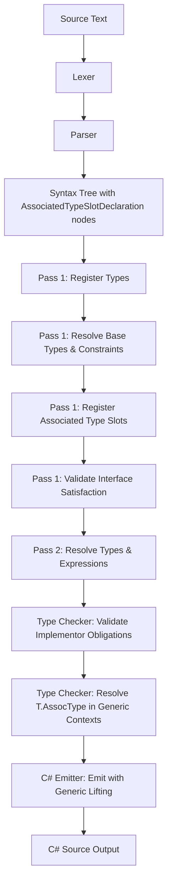

# Design Document: Associated Types

## Overview

Associated types introduce abstract type slots into Mist interfaces and traits. An associated type slot declares a name and a constraint list that implementors must satisfy by providing a concrete nested type or type alias. This enables patterns like zero-allocation iteration where the concrete enumerator struct type is resolved statically at compile time, avoiding boxing and virtual dispatch.

The feature touches every layer of the compiler pipeline:
1. **Grammar & Parser** — New `InterfaceMemberDeclaration` and `TraitMemberDeclaration` alternatives for `type Name : ConstraintList;` syntax
2. **Semantic Model** — Registration of abstract type slots as first-class members of interfaces/traits
3. **Type Checker** — Enforcement of implementor obligations and resolution in generic contexts
4. **C# Emitter** — Translation strategy that lifts associated types into synthesized generic type parameters on the emitted C# interface
5. **Pretty Printer** — Round-trip formatting of the new syntax
6. **TextMate Grammar** — Syntax highlighting for the new declaration pattern

### Design Rationale

Mist already supports generic constraints (`where T : IFoo`) and concrete type aliases (`type X = int;`). Associated types fill the gap between these: they declare an abstract type slot that is part of an interface's contract but whose concrete definition is deferred to implementors. This is analogous to Rust's associated types, Swift's associated types, or Scala's abstract type members.

The primary motivating use case is zero-allocation iteration:

```mist
interface Iterable<TValue> {
    type Enumerator : IEnumerator<TValue>, struct;
    Enumerator GetEnumerator();
}
```

An implementor like `List<T>` provides a concrete nested struct:

```mist
class List<T> : Iterable<T> {
    public struct ListEnumerator : IEnumerator<T> { /* ... */ }
    public type Enumerator = ListEnumerator;
    public ListEnumerator GetEnumerator() { /* ... */ }
}
```

Generic code constrained by `Iterable<T>` can reference `T.Enumerator` and the compiler resolves it statically to the concrete struct, enabling stack allocation and inlining.

## Architecture

The implementation follows the existing multi-pass architecture of the Mist compiler:



### Key Architectural Decisions

1. **Grammar extension via new alternatives** — Rather than overloading the existing `TypeAliasDeclaration` rule, we add a new `AssociatedTypeSlotDeclaration` alternative to `InterfaceMemberDeclaration` and `TraitMemberDeclaration`. This keeps the parser's disambiguation clean: `:` means abstract slot, `=` means concrete alias.

2. **Reuse of `ConstraintList` rule** — The constraint syntax for associated type slots reuses the existing `ConstraintList` and `WhereClause` rules verbatim, ensuring consistency with generic constraints.

3. **Semantic model: new `AssociatedTypeSlot` type** — A new type in the semantic model represents the abstract slot, storing its name, constraint metadata, and optional type parameters. This is registered in the interface/trait's member scope.

4. **C# emission via generic lifting** — Since C# interfaces cannot declare abstract nested types, the emitter lifts each associated type slot into a synthesized type parameter on the C# interface. For example, `Iterable<TValue>` with an `Enumerator` slot becomes `IIterable<TValue, TEnumerator>` in C#. At implementation sites, the concrete type is substituted as a type argument.

5. **Static resolution in generic contexts** — When `T` is constrained by an interface with associated types, `T.Enumerator` resolves through the constraint's associated type slot. At monomorphization (or in the emitter), this becomes the concrete type argument.

## Components and Interfaces

### 1. Grammar Changes (Mist.storm)

New grammar rules:

```storm
rule AssociatedTypeSlotDeclaration = TYPE name:IDENTIFIER
    typeParams:TypeParameterList?
    COLON constraints:ConstraintList
    slotWhereConstraints:WhereClause*
    SEMICOLON;

rule UnconstrainedAssociatedTypeSlotDeclaration = TYPE name:IDENTIFIER
    typeParams:TypeParameterList?
    SEMICOLON;
```

Modified rules — add new alternatives:

```storm
rule InterfaceMemberDeclaration
    = method:InterfaceMethodDeclaration           as InterfaceMethodMember
    | property:InterfacePropertyDeclaration       as InterfacePropertyMember
    | associatedType:AssociatedTypeSlotDeclaration as InterfaceAssociatedTypeMember
    | unconstrainedAssociatedType:UnconstrainedAssociatedTypeSlotDeclaration as InterfaceUnconstrainedAssociatedTypeMember
    ;

rule TraitMemberDeclaration
    = field:TraitFieldDeclaration                 as TraitFieldMember
    | method:TraitMethodDeclaration               as TraitMethodMember
    | property:TraitPropertyDeclaration           as TraitPropertyMember
    | associatedType:AssociatedTypeSlotDeclaration as TraitAssociatedTypeMember
    | unconstrainedAssociatedType:UnconstrainedAssociatedTypeSlotDeclaration as TraitUnconstrainedAssociatedTypeMember
    ;
```

**Disambiguation strategy**: The parser distinguishes associated type slots from concrete type aliases by the token following the name (or type parameter list):
- `:` → Associated type slot (abstract, only in interfaces/traits)
- `=` → Concrete type alias (existing behavior)
- `;` (no `:` or `=`) → Unconstrained associated type slot

If `type Name : ...;` appears in a class or struct body, the parser emits a diagnostic error since the existing `MemberDeclaration` rule does not include the `AssociatedTypeSlotDeclaration` alternative.

### 2. Parser Changes (MistParser.cs)

The parser already handles `InterfaceMemberDeclaration` and `TraitMemberDeclaration` as separate rule methods. The Storm parser generator will produce new node types:
- `AssociatedTypeSlotDeclarationNode` — with fields: `Name`, `TypeParams`, `Constraints`, `SlotWhereConstraints`
- `UnconstrainedAssociatedTypeSlotDeclarationNode` — with fields: `Name`, `TypeParams`

**Modifier validation**: The parser (or a post-parse validation pass) checks that associated type slot declarations are not preceded by modifier keywords. Since the grammar rule does not include a `modifiers:Modifier*` prefix, any modifier before `type` in an interface/trait body will cause a parse error naturally (the `type` keyword will be consumed by the `TypeAliasDeclaration` path at the top level, which requires `=`). A dedicated diagnostic is emitted in the semantic model builder if modifiers are detected via a validation pass.

### 3. Semantic Model Changes

#### New Type: `AssociatedTypeSlotType`

```csharp
public sealed class AssociatedTypeSlotType : IType
{
    public string DisplayName { get; }
    public TypeKind Kind => TypeKind.AssociatedTypeSlot;
    public IScope MemberScope { get; }
    public string? ContainingNamespace { get; }
    
    /// <summary>The interface or trait that declares this slot.</summary>
    public IType DeclaringType { get; }
    
    /// <summary>Constraints that the concrete type must satisfy.</summary>
    public TypeParameterConstraints Constraints { get; }
    
    /// <summary>Type parameters declared on the slot itself (for generic slots).</summary>
    public IReadOnlyList<IType> TypeParameters { get; }
}
```

#### Registration (SemanticModelBuilder.cs)

A new method `RegisterAssociatedTypeSlotDeclaration` is added, called during Pass 1 when processing interface/trait members. It:
1. Creates an `AssociatedTypeSlotType` instance
2. Registers it as a symbol in the interface/trait's member scope
3. Records the constraint list for later resolution

Constraint resolution reuses the existing `ResolveConstraintClause` infrastructure.

#### Duplicate Detection

During Pass 1, after registering all slots, the builder checks for duplicate slot names within the same interface/trait and emits `MIST_AT_0001` if found.

### 4. Type Checker Changes (TypeCheckerAnalyzer / SemanticModelBuilder)

#### Implementor Obligation Validation

Extended from the existing `Pass1_ValidateInterfaceSatisfaction`:

1. For each interface implemented by a class/struct, collect all `AssociatedTypeSlotType` members
2. For each slot, look up a matching concrete type member in the implementor's scope (by name and arity)
3. Validate that the concrete type satisfies all constraints from the slot's `TypeParameterConstraints`
4. Emit diagnostics for missing or unsatisfied slots

#### Signature Matching

When validating that an implementor's method signatures match the interface, type references to associated type slot names in the interface signature must match the concrete type member in the implementor's signature. This extends the existing `SignaturesMatch` / `TypeReferencesMatchWithSubstitution` logic.

#### Generic Context Resolution

When a type parameter `T` is constrained by an interface with associated types:
- `T.SlotName` is resolved by looking up `SlotName` in the constraining interface's member scope
- The resolved type is the `AssociatedTypeSlotType`, which carries constraint information
- Member access and method calls on values of type `T.SlotName` are validated against the slot's constraints
- At instantiation sites, `T.SlotName` resolves to the concrete type member of the instantiating type

### 5. C# Emitter Changes (CSharpEmitter.cs)

#### Generic Lifting Strategy

Since C# interfaces cannot have abstract nested types, the emitter uses a **generic type parameter lifting** strategy:

**Mist source:**
```mist
interface Iterable<TValue> {
    type Enumerator : IEnumerator<TValue>, struct;
    Enumerator GetEnumerator();
}
```

**Emitted C#:**
```csharp
public interface IIterable<TValue, TEnumerator>
    where TEnumerator : struct, IEnumerator<TValue>
{
    TEnumerator GetEnumerator();
}
```

**Implementor Mist:**
```mist
class MyList<T> : Iterable<T> {
    public struct MyEnumerator : IEnumerator<T> { /* ... */ }
    public type Enumerator = MyEnumerator;
    public MyEnumerator GetEnumerator() { /* ... */ }
}
```

**Emitted C#:**
```csharp
public class MyList<T> : IIterable<T, MyList<T>.MyEnumerator>
{
    public struct MyEnumerator : IEnumerator<T> { /* ... */ }
    public MyEnumerator GetEnumerator() { /* ... */ }
}
```

#### Emission Rules

1. **Interface/trait emission**: Skip the associated type slot declaration; add a synthesized type parameter (prefixed with `T` + slot name) to the interface's type parameter list; add corresponding `where` constraints.
2. **Implementor emission**: When emitting the base list, substitute the concrete type as a type argument in the interface's type argument list.
3. **Method signatures**: Replace associated type slot name references with the synthesized type parameter name.
4. **Generic contexts**: When a generic function is constrained by an interface with associated types, the emitter adds the synthesized type parameters to the function's generic parameter list and propagates constraints.

### 6. Pretty Printer Changes (MistPrettyPrinter.cs)

New methods:
- `EmitAssociatedTypeSlotDeclaration(AssociatedTypeSlotDeclarationNode node)` — formats as `type {Name}{TypeParams} : {ConstraintList}{WhereClauses};`
- `EmitUnconstrainedAssociatedTypeSlotDeclaration(UnconstrainedAssociatedTypeSlotDeclarationNode node)` — formats as `type {Name}{TypeParams};`

The `EmitInterfaceMemberDeclaration` and `EmitTraitMemberDeclaration` switch statements gain new cases for the associated type alternatives.

### 7. TextMate Grammar Changes

A new pattern is added to the interface/trait body patterns that matches `type` followed by an identifier and `:` (without `=`):

```json
{
    "match": "\\b(type)\\s+([A-Z]\\w*)\\s*(?:<[^>]*>)?\\s*(:)",
    "captures": {
        "1": { "name": "keyword.declaration.mist" },
        "2": { "name": "entity.name.type.alias.mist" },
        "3": { "name": "punctuation.separator.mist" }
    }
}
```

Constraint keywords (`struct`, `class`) in the constraint list are highlighted with `storage.modifier.mist`. Interface references are highlighted as `entity.name.type.mist`.

### 8. Diagnostic IDs

| ID | Scenario | Message Template |
|----|----------|-----------------|
| `MIST_AT_0001` | Duplicate associated type slot name | "Interface/trait '{TypeName}' declares duplicate associated type slot '{SlotName}'" |
| `MIST_AT_0002` | Missing concrete type member | "Type '{ImplName}' does not provide a concrete type for associated type slot '{SlotName}' required by '{InterfaceName}'" |
| `MIST_AT_0003` | Unsatisfied constraint | "Concrete type '{ConcreteType}' does not satisfy constraint '{Constraint}' required by associated type slot '{SlotName}' in '{InterfaceName}'" |
| `MIST_AT_0004` | Unresolved associated type reference | "Type parameter '{TypeParam}' does not have an associated type '{SlotName}'; '{TypeParam}' is not constrained by an interface or trait declaring '{SlotName}'" |
| `MIST_AT_0005` | Modifiers on associated type slot | "Modifiers are not permitted on associated type slot declarations" |
| `MIST_AT_0006` | Abstract slot in class/struct | "Abstract type slots are only permitted in interfaces and traits" |

## Data Models

### Syntax Tree Nodes (Generated by Storm)

```
AssociatedTypeSlotDeclarationNode
├── Name: TokenNode (IDENTIFIER)
├── TypeParams: TypeParameterListNode? 
├── Constraints: ConstraintListNode
└── SlotWhereConstraints: ImmutableArray<WhereClauseNode>

UnconstrainedAssociatedTypeSlotDeclarationNode
├── Name: TokenNode (IDENTIFIER)
└── TypeParams: TypeParameterListNode?
```

### Semantic Model

```
AssociatedTypeSlotType : IType
├── DisplayName: string
├── Kind: TypeKind.AssociatedTypeSlot
├── MemberScope: IScope (empty for simple slots; contains type params for generic slots)
├── ContainingNamespace: string?
├── DeclaringType: IType (the interface or trait)
├── Constraints: TypeParameterConstraints
└── TypeParameters: IReadOnlyList<IType>
```

### TypeKind Enum Extension

```csharp
public enum TypeKind
{
    // ... existing values ...
    AssociatedTypeSlot
}
```

### Symbol Registration

Associated type slots are registered as `Symbol` instances in the interface/trait's member scope with:
- `Name` = slot name (e.g., "Enumerator")
- `Type` = the `AssociatedTypeSlotType` instance
- `BindingKind` = a new `BindingKind.AssociatedTypeSlot` value

## Correctness Properties

*A property is a characteristic or behavior that should hold true across all valid executions of a system — essentially, a formal statement about what the system should do. Properties serve as the bridge between human-readable specifications and machine-verifiable correctness guarantees.*

### Property 1: Pretty-print round-trip preserves structure

*For any* valid associated type slot declaration (constrained or unconstrained, with or without generic type parameters, with or without where clauses) embedded in an interface or trait body, parsing the source text, pretty-printing the resulting syntax tree, and parsing the pretty-printed output SHALL produce a syntax tree that is structurally identical to the original.

**Validates: Requirements 1.1, 1.2, 1.3, 1.5, 1.7, 7.1, 7.2, 7.3, 7.4**

### Property 2: Parser disambiguation between abstract slots and concrete aliases

*For any* valid type name and constraint list, a declaration `type Name : ConstraintList;` in an interface body SHALL parse as an `AssociatedTypeSlotDeclaration` node, while a declaration `type Name = TypeExpr;` in the same position SHALL parse as a concrete type alias node. The two forms SHALL never produce the same node type.

**Validates: Requirements 1.4**

### Property 3: Abstract slot in class/struct emits diagnostic

*For any* valid associated type slot declaration text, placing that declaration inside a class or struct body SHALL cause the compiler to emit diagnostic `MIST_AT_0006` indicating that abstract type slots are only permitted in interfaces and traits.

**Validates: Requirements 1.6**

### Property 4: Modifiers on associated type slot emit diagnostic

*For any* non-empty combination of modifier keywords (`public`, `private`, `static`) preceding an associated type slot declaration in an interface or trait body, the compiler SHALL emit diagnostic `MIST_AT_0005` indicating that modifiers are not permitted on associated type slot declarations.

**Validates: Requirements 1.8**

### Property 5: Semantic registration records correct constraints

*For any* interface or trait containing one or more associated type slots with varying constraint lists (including `struct`, `class`, interface references, `new()`, and combinations thereof), the semantic model SHALL register each slot as a discoverable type member whose `TypeParameterConstraints` metadata exactly reflects the declared constraints.

**Validates: Requirements 2.1, 2.2, 2.3, 2.4**

### Property 6: Duplicate slot names emit diagnostic

*For any* interface or trait body containing two or more associated type slots with the same name (regardless of differing constraint lists), the semantic model SHALL emit diagnostic `MIST_AT_0001` identifying the duplicate.

**Validates: Requirements 2.7**

### Property 7: Implementor obligation enforcement

*For any* interface with N associated type slots (each with a constraint list) and any implementor that provides M concrete type members (where 0 ≤ M ≤ N), the type checker SHALL emit exactly (N − M) diagnostics for missing slots (`MIST_AT_0002`), and for each provided concrete type member that does not satisfy its slot's constraints, the type checker SHALL emit diagnostic `MIST_AT_0003` identifying the unsatisfied constraint.

**Validates: Requirements 3.1, 3.2, 3.3, 3.4, 3.5, 3.6, 3.7, 3.8, 3.9, 8.1, 8.2**

### Property 8: Implementor signature substitution

*For any* interface method whose signature references an associated type slot name (as return type, parameter type, or generic type argument), and any implementor of that interface, the type checker SHALL accept the implementor's method only if its signature uses the corresponding concrete type member in every position where the interface signature uses the slot name. Using any other type in those positions SHALL produce a diagnostic error.

**Validates: Requirements 4.1, 4.2, 4.3, 4.4**

### Property 9: Generic context resolution of associated types

*For any* generic function or method whose type parameter `T` is constrained by an interface declaring associated type slots, references to `T.SlotName` in any type position (local variable types, parameter types, return types, generic type arguments) SHALL be accepted by the type checker, and operations valid on the slot's constraint list SHALL be permitted on values of type `T.SlotName`.

**Validates: Requirements 5.1, 5.2, 5.3**

### Property 10: Invalid associated type reference emits diagnostic

*For any* generic type parameter `T` constrained by an interface, and any identifier `X` that is not an associated type slot of any constraining interface or trait, a reference to `T.X` in a type position SHALL cause the type checker to emit diagnostic `MIST_AT_0004`.

**Validates: Requirements 5.4, 8.3**

### Property 11: End-to-end emission correctness

*For any* valid Mist program containing interfaces with associated type slots, implementors providing concrete type members, and generic functions using associated type references via constrained type parameters, the emitted C# code SHALL compile without errors and produce the same observable output as specified by the Mist program's semantics.

**Validates: Requirements 6.1, 6.2, 6.3, 6.4, 6.5, 6.6**

## Error Handling

### Parse Errors

| Condition | Diagnostic | Severity | Recovery |
|-----------|-----------|----------|----------|
| `type Name : Constraints;` in class/struct body | MIST_AT_0006: "Abstract type slots are only permitted in interfaces and traits" | Error | Skip to next semicolon, continue parsing |
| Modifiers before associated type slot | MIST_AT_0005: "Modifiers are not permitted on associated type slot declarations" | Error | Ignore modifiers, parse slot normally |
| Missing semicolon after slot declaration | Existing MIST_PARSE_* error | Error | Standard recovery |
| Empty constraint list after `:` | Existing MIST_PARSE_* error | Error | Standard recovery |

### Semantic Errors

| Condition | Diagnostic | Severity | Recovery |
|-----------|-----------|----------|----------|
| Duplicate slot name in same interface/trait | MIST_AT_0001: "Interface/trait '{Type}' declares duplicate associated type slot '{Name}'" | Error | Register first occurrence, skip duplicates |
| Unresolved type in constraint list | Existing MIST_TC_* error (reuses generic constraint resolution) | Error | Use ErrorType, continue |
| Missing concrete type member in implementor | MIST_AT_0002: "Type '{Impl}' does not provide a concrete type for associated type slot '{Slot}' required by '{Interface}'" | Error | Skip satisfaction check for this slot |
| Concrete type does not satisfy constraint | MIST_AT_0003: "Concrete type '{Type}' does not satisfy constraint '{Constraint}' required by associated type slot '{Slot}' in '{Interface}'" | Error | Continue checking other constraints |
| Invalid T.SlotName reference | MIST_AT_0004: "Type parameter '{T}' does not have an associated type '{Name}'; '{T}' is not constrained by an interface or trait declaring '{Name}'" | Error | Use ErrorType, continue |

### Error Recovery Strategy

The compiler follows the existing pattern of continuing after errors to report as many diagnostics as possible in a single compilation pass:

1. **Parse errors**: The parser recovers by skipping to the next synchronization point (semicolon or closing brace) and continues parsing subsequent declarations.
2. **Semantic errors**: The semantic model uses `ErrorType` as a placeholder for unresolved types, allowing downstream passes to continue without cascading errors.
3. **Type checking errors**: The type checker reports all obligation violations for a single implementor before moving to the next, giving developers a complete picture of what's missing.

### Diagnostic Location Strategy

- **MIST_AT_0001** (duplicate): Points to the second (duplicate) slot declaration
- **MIST_AT_0002** (missing): Points to the implementor's type declaration header (class/struct name)
- **MIST_AT_0003** (unsatisfied): Points to the concrete type member declaration
- **MIST_AT_0004** (unresolved): Points to the `T.SlotName` usage site
- **MIST_AT_0005** (modifiers): Points to the first modifier token
- **MIST_AT_0006** (wrong context): Points to the `type` keyword

## Testing Strategy

### Unit Tests (Example-Based)

Unit tests cover specific examples and edge cases:

- **Parser**: Verify specific syntax tree shapes for representative declarations (simple slot, generic slot, unconstrained slot, slot with multiple constraints)
- **Semantic model**: Verify registration for specific interface/trait configurations
- **Type checker**: Verify specific error scenarios (missing slot, wrong kind, missing interface impl)
- **C# emitter**: Verify emitted C# for specific patterns (generic lifting, implementor base list, signature substitution)
- **Pretty printer**: Verify formatting for specific declaration patterns
- **TextMate grammar**: Snapshot tests for syntax highlighting scopes

### Property-Based Tests

Property-based tests verify universal properties across generated inputs. The test framework is **FsCheck** (already used in the project).

**Configuration:**
- Minimum 100 iterations per property test
- Each test references its design document property via tag comment

**Test approach (per workspace steering rules):**
- Tests that require compilation use the **batched** approach: generate all scenarios upfront, build a single program, compile once via the shared `CompilerDriver` instance, run once, compare outputs line-by-line.
- Tests that only need parsing/pretty-printing operate in-process with no process spawning.

**Property test classes:**

1. `AssociatedTypeRoundTripPropertyTests` — Property 1 (round-trip)
   - Generates random valid slot declarations, parses in-process, pretty-prints, parses again, compares trees
   - Zero process spawns

2. `AssociatedTypeDisambiguationPropertyTests` — Property 2 (`:` vs `=`)
   - Generates random names/constraints, creates both forms, verifies different node types
   - Zero process spawns

3. `AssociatedTypeErrorPropertyTests` — Properties 3, 4, 6, 10 (error diagnostics)
   - Generates invalid programs, compiles in-process via `CompilerDriver`, verifies diagnostics
   - Zero process spawns (in-process compilation only)

4. `AssociatedTypeSemanticPropertyTests` — Property 5 (semantic registration)
   - Generates interfaces with random slots, compiles in-process, inspects semantic model
   - Zero process spawns

5. `AssociatedTypeObligationPropertyTests` — Properties 7, 8 (implementor obligations)
   - Generates interface/implementor pairs with varying satisfaction, compiles in-process, verifies diagnostics
   - Zero process spawns

6. `AssociatedTypeGenericContextPropertyTests` — Property 9 (generic resolution)
   - Generates generic functions with slot references, compiles in-process, verifies acceptance
   - Zero process spawns

7. `AssociatedTypeEmissionPropertyTests` — Property 11 (end-to-end)
   - Generates valid programs with associated types, compiles via shared driver, runs once (batched), verifies output
   - 1 process spawn per test run (batched)

### Integration Tests

- **Sample compilation**: Compile and run `samples/AssociatedTypes/Program.mist`, verify output matches expected
- **AllFeatures integration**: Verify `samples/AllFeatures/Program.mist` includes the associated types demo and runs successfully

### Tag Format

Each property test includes a comment tag:
```csharp
// Feature: associated-types, Property 1: Pretty-print round-trip preserves structure
```
