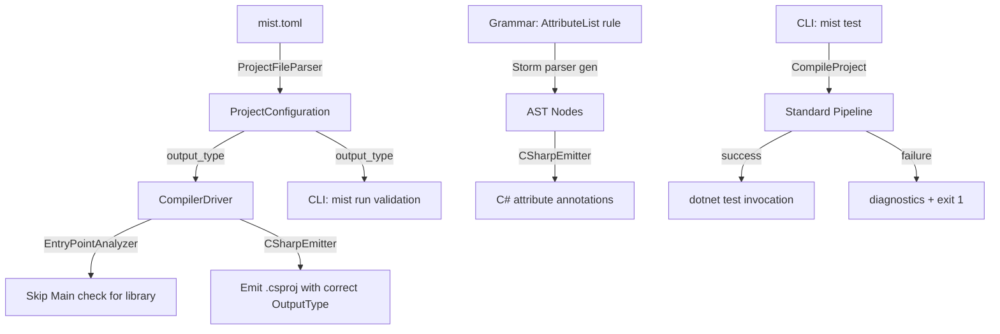

# Design Document: Attributes and Test Command

## Overview

This feature adds three interconnected capabilities to the Mist compiler:

1. **Attribute syntax** — `[Name]`, `[Name(args)]`, `[Name<T>]` annotations on type and method declarations, parsed from grammar rules and emitted as C# attributes.
2. **`mist test` CLI command** — A new verb that compiles the project and invokes `dotnet test` on the emitted output.
3. **Project output type** — A new `output_type` field in `mist.toml` controlling whether the emitted .csproj is an `Exe` or `Library`.

These features compose naturally: attributes enable `[Fact]`/`[Theory]` annotations, the test command provides the execution workflow, and output type allows test projects to be libraries (no Main required).

## Architecture

The feature touches four major layers of the compiler:



**Key architectural decisions:**

1. **Attributes are grammar-first**: New PEG rules (`AttributeList`, `Attribute`, `AttributeArgument`) produce AST nodes automatically via the Storm parser generator. No manual AST construction is needed.

2. **Declaration-position only**: Because attributes use `[`/`]` brackets which are also used for arrays, indexing, and list patterns in expression position, the grammar places `AttributeList*` exclusively before the `modifiers:Modifier*` prefix of declarations. PEG ordered-choice ensures no ambiguity — the parser tries `AttributeList` only when positioned at the start of a declaration rule.

3. **Transparent emission**: The emitter walks `AttributeList` nodes and produces verbatim C# attribute syntax. No semantic analysis of attribute contents is performed — the CLR validates attributes at compile time via Roslyn.

4. **Test command reuses existing pipeline**: `mist test` calls the same `CompileProject` helper as `mist build`, then spawns `dotnet test` on success. No test-specific compilation behavior is needed.

5. **Output type flows through existing infrastructure**: `output_type` is parsed into `ProjectConfiguration`, propagated via `CompilerOptions`, consumed by the emitter (for .csproj generation) and the `EntryPointAnalyzer` (to suppress Main validation for libraries).

## Components and Interfaces

### Grammar Layer (Mist.storm)

New rules added to the Storm PEG grammar:

```
rule AttributeList = LEFT_BRACKET Attribute (COMMA Attribute)* RIGHT_BRACKET;

rule Attribute = name:QualifiedIdentifier typeArgs:TypeArgumentList? 
    arguments:(LEFT_PARENTHESIS AttributeArgumentList? RIGHT_PARENTHESIS)?;

rule AttributeArgumentList = AttributeArgument (COMMA AttributeArgument)*;

rule AttributeArgument
    = name:IDENTIFIER EQUAL value:Expression  as NamedAttributeArgument
    | value:Expression                         as PositionalAttributeArgument
    ;
```

Modified declaration rules gain `attributes:AttributeList*` prefix:
- `ClassDeclaration`
- `StructDeclaration`
- `AbstractDeclaration`
- `EnumDeclaration`
- `MethodDeclaration`
- `ConstructorDeclaration`
- `FieldDeclaration`

**Disambiguation rationale**: `AttributeList` is only reachable from declaration rules (which start with `attributes:AttributeList* modifiers:Modifier* KEYWORD ...`). In expression position, `LEFT_BRACKET` enters the `ArrayLiteralExpression`, `EmptyArrayLiteralExpression`, `IndexSuffix`, or `ListPattern` rules. Since PEG parsing is context-sensitive to the current rule, no ambiguity arises — the same `[` token is parsed differently based on whether the parser is in a declaration context or an expression context.

### CLI Layer (Mist.CLI)

**CliCommand enum** — Add `Test` variant.

**CliArgumentParser** — Recognize `"test"` as a command verb. Validate `test` + `--mode lex` as incompatible (same as `run` + `--mode lex`).

**Program.cs** — Add `RunTestCommand` handler that:
1. Compiles via `CompileProject` (existing helper)
2. On failure: prints diagnostics, returns exit code 1
3. On success: invokes `dotnet test <csproj-path>` with stdout/stderr streaming
4. Returns `dotnet test` exit code

**Run command validation** — Before compilation, parse `mist.toml` and check `output_type`. If `"library"`, emit error and return 1.

### ProjectFileParser

**New field**: Parse optional `output_type` string field. Valid values: `"executable"` (default), `"library"`. Invalid values produce a diagnostic error.

**Validation**: Case-sensitive exact match against the two valid strings.

### ProjectConfiguration

**New parameter**: `OutputType` field of type `ProjectOutputType` enum (`Executable`, `Library`).

### CompilerOptions

**New parameter**: `OutputType` field propagated from `ProjectConfiguration`.

### EntryPointAnalyzer

**Library mode**: When `OutputType == Library`:
- Skip all entry point validation (no Main required, no TLS conflict checks)
- If top-level statements exist, emit error `MIST_EP_0007`: "Library projects cannot have top-level statements"

### CSharpEmitter

**Attribute emission**: When emitting a declaration node that has `AttributeList` children:
1. For each `AttributeList` node, emit `[` + comma-separated attributes + `]` on a separate line before the declaration
2. For each `Attribute`: emit qualified name + optional type args + optional `(args)`
3. For `NamedAttributeArgument`: emit `Name = value`
4. For `PositionalAttributeArgument`: emit the expression
5. Special case: If the expression is a `TypeLiteralExpression` (type reference in expression position), emit `typeof(T)` wrapping

**OutputType in .csproj**: The `EmitCsproj` method accepts the output type and emits either `<OutputType>Exe</OutputType>` or `<OutputType>Library</OutputType>`.

### Test Package Warning

After successful compilation but before invoking `dotnet test`, scan the AST for method declarations with attribute names ending in `Fact`, `Theory`, `Test`, or `TestMethod`. If found and no package in `mist.toml` contains "Test" or "xunit" (case-insensitive), emit warning diagnostic `MIST_TEST_0001`.

## Data Models

### New Enum: ProjectOutputType

```csharp
public enum ProjectOutputType
{
    Executable,
    Library,
}
```

### Modified Record: ProjectConfiguration

```csharp
public sealed record ProjectConfiguration(
    string Name,
    string NamespaceRoot,
    ImmutableArray<ProjectReference> References,
    string? EntryPoint = null,
    ImmutableArray<string> GlobalUsings = default,
    ImmutableArray<NuGetPackageReference> Packages = default,
    ImmutableArray<FrameworkReference> FrameworkReferences = default,
    string TargetFramework = "net10.0",
    ImmutableArray<CsprojProperty> CsprojProperties = default,
    ProjectOutputType OutputType = ProjectOutputType.Executable);
```

### Modified Record: CompilerOptions

```csharp
public sealed record CompilerOptions(
    // ... existing parameters ...
    ProjectOutputType OutputType = ProjectOutputType.Executable);
```

### Modified Enum: CliCommand

```csharp
public enum CliCommand
{
    Build,
    Run,
    Test,
    Steering,
    Inspect,
    Restore,
}
```

### AST Nodes (Auto-generated by Storm)

The Storm parser generator will automatically produce these node types from the grammar rules:

- `AttributeListNode` — contains `Attribute[]`
- `AttributeNode` — contains `QualifiedIdentifierNode name`, optional `TypeArgumentListNode typeArgs`, optional argument list
- `NamedAttributeArgumentNode` — contains `IDENTIFIER name`, `ExpressionNode value`
- `PositionalAttributeArgumentNode` — contains `ExpressionNode value`

Declaration nodes (`ClassDeclarationNode`, `StructDeclarationNode`, etc.) gain an `AttributeLists` property of type `AttributeListNode[]`.

## Correctness Properties

*A property is a characteristic or behavior that should hold true across all valid executions of a system — essentially, a formal statement about what the system should do. Properties serve as the bridge between human-readable specifications and machine-verifiable correctness guarantees.*

### Property 1: Attribute Emission Round-Trip

*For any* valid Mist program containing declarations annotated with attributes (varying attribute count, argument types, named/positional arguments, type arguments, and qualified names), compiling and inspecting the emitted C# output SHALL produce attribute annotations that preserve:
- The qualified attribute name
- The number and order of positional arguments
- The number and names of named arguments
- The type argument list (if present)
- The grouping (single-list comma-separated vs. multi-list on separate lines)

**Validates: Requirements 1.1, 1.2, 1.3, 1.5, 1.6, 3.1, 3.2, 3.3, 3.4, 3.6, 3.7, 3.8**

### Property 2: Declaration-Position Disambiguation

*For any* valid Mist program containing both attribute annotations on declarations and bracket expressions in expression position (array literals, index access, list patterns), the parser SHALL produce `AttributeListNode` only in declaration context and `ArrayLiteralExpression`/`IndexSuffix`/`ListPattern` nodes in expression context — never confusing the two.

**Validates: Requirements 1.10**

### Property 3: CLI Test Command Argument Parsing

*For any* valid combination of CLI arguments where the first positional argument is `"test"` and remaining arguments are drawn from the same flag set accepted by `build` (`--backend`, `--output`, `--bin`, `--quiet`, `--verbose`), the argument parser SHALL produce a `CliArguments` with `Command == Test` and all flags correctly populated.

**Validates: Requirements 5.1, 5.2**

### Property 4: Output Type Parsing Validation

*For any* string value that is not exactly `"executable"` or `"library"` used as the `output_type` field in a valid `mist.toml`, the `ProjectFileParser` SHALL produce a diagnostic error. Conversely, for the two valid values, it SHALL produce the corresponding `ProjectOutputType` enum value without error.

**Validates: Requirements 14.1, 14.2, 14.3**

### Property 5: Test Package Warning Detection

*For any* Mist program where at least one method has an attribute whose unqualified name ends in `Fact`, `Theory`, `Test`, or `TestMethod`, and the project's package list does not contain any package name matching "Test" or "xunit" (case-insensitive substring), the system SHALL emit warning diagnostic `MIST_TEST_0001`. If the package list does contain such a package, no warning SHALL be emitted.

**Validates: Requirements 6.3**

### Property 6: Type Literal Attribute Arguments Emit as typeof

*For any* Mist attribute argument that is a type literal (primitive type like `int`, qualified name like `System.String`, or generic type like `List<int>`), the emitter SHALL produce `typeof(T)` in the C# output where T is the type reference.

**Validates: Requirements 4.6**

## Error Handling

### Parse Errors

| Condition | Diagnostic ID | Severity |
|-----------|--------------|----------|
| Malformed attribute argument list (missing `)`, trailing comma) | Parser diagnostic (auto-generated by Storm) | Error |
| Attribute in expression position | N/A — parsed as array/index (no error, different semantics) | — |

### Project File Errors

| Condition | Diagnostic ID | Severity |
|-----------|--------------|----------|
| `output_type` has invalid value | `MIST_PROJECT_INVALID_OUTPUT_TYPE` | Error |
| `mist run` on library project | CLI error message (pre-compilation) | Error |

### Entry Point Errors

| Condition | Diagnostic ID | Severity |
|-----------|--------------|----------|
| Library project with top-level statements | `MIST_EP_0007` | Error |

### Test Command Errors

| Condition | Diagnostic ID | Severity |
|-----------|--------------|----------|
| Test attributes without test framework packages | `MIST_TEST_0001` | Warning |
| `mist test --mode lex` | CLI parse error | Error |
| `dotnet` not found on PATH | CLI error message | Error |

### CLI Errors

| Condition | Behavior |
|-----------|----------|
| Compilation failure during `mist test` | Print diagnostics to stderr, return exit code 1, do not invoke `dotnet test` |
| `dotnet test` returns non-zero | Forward that exit code as CLI exit code |

## Testing Strategy

### Unit Tests (Example-Based)

- **Grammar structure tests**: Verify the Storm grammar file contains the expected `AttributeList`, `Attribute`, `AttributeArgument` rules.
- **Argument parser tests**: Test specific CLI arg patterns for the `test` command (valid combinations, incompatible flags).
- **ProjectFileParser tests**: Test `output_type` field parsing with valid values, invalid values, missing values.
- **Entry point suppression**: Test that library projects compile without Main; test that library + TLS produces error.
- **Run command validation**: Test that `mist run` on library project produces error before compilation.
- **TextMate grammar**: Verify JSON structure contains expected patterns and scopes.
- **Emitter edge cases**: No-arg attributes emit without parens; type literal args emit as `typeof(T)`.

### Property-Based Tests (Universal Properties)

Property-based testing is appropriate for this feature because:
- The parser and emitter handle a large input space of attribute configurations (varying names, argument counts, argument types, combinations)
- Round-trip properties (parse → emit → verify structure preserved) are strong correctness guarantees
- The CLI argument parser handles combinatorial flag sets

**Library**: FsCheck (already used in the project's test suite)

**Configuration**: Minimum 100 iterations per property test.

**Tag format**: `Feature: attributes-and-test-command, Property N: <property text>`

Each correctness property above maps to a single property-based test:

1. **Property 1** — Generate random attribute configurations (1–4 attributes per list, 1–3 lists, 0–5 positional args, 0–3 named args, optional type args). Build a Mist program, compile in-memory, regex-parse the emitted C# to verify structure is preserved.

2. **Property 2** — Generate programs with both attribute annotations on declarations AND bracket expressions (`[1, 2, 3]`, `arr[i]`) in method bodies. Compile and verify both parse correctly (attributes produce AST node, expressions produce array/index nodes).

3. **Property 3** — Generate random subsets of `{--backend X, --output Y, --bin Z, --quiet, --verbose}` prepended with `test`. Parse and verify all flags are correctly extracted.

4. **Property 4** — Generate random strings and verify: `"executable"` and `"library"` produce success; all other strings produce a diagnostic error.

5. **Property 5** — Generate method declarations with/without test-matching attributes, with/without test-matching packages. Verify warning presence/absence matches the expected condition.

6. **Property 6** — Generate various type references (primitives, qualified names, generic types) used as attribute arguments. Compile and verify the emitted C# contains `typeof(...)` wrapping.

### Integration Tests

- **Sample compilation**: `samples/Attributes` compiles and produces expected output.
- **Test sample**: `samples/Testing` compiles and all tests pass via `mist test`.
- **End-to-end test command**: Run `mist test` on the Testing sample, verify exit code 0.

### Test Design Constraints

Per the project's test policies:
- Property tests that require compilation use **batched compilation** (one compile, one process spawn) rather than per-iteration spawning.
- The shared `CompilerDriver` instance is reused across iterations.
- All test output is ASCII-only.
