# Design Document: Class Inheritance

## Overview

This design adds single class inheritance to the Mist programming language. A class may extend exactly one base class using `: BaseClassName` syntax, inheriting its fields and methods. The model is **additive-only** — derived classes can add new members but cannot override or redeclare base class members. Method resolution uses **static dispatch**, meaning calls resolve by the declared (compile-time) type of the variable, not the runtime type.

The feature touches every stage of the compiler pipeline:

1. **Grammar & Lexer** — new `base` keyword (for constructor chaining only); optional inheritance clause on `ClassDeclaration`
2. **Parser / Pretty-Printer** — parse and round-trip the inheritance clause and `base(args)` constructor chains
3. **Semantic Model Builder** — resolve base types, walk inheritance chains for member lookup, detect cycles
4. **Type Checker** — subtype assignability (derived → base), reject base → derived and unrelated assignments
5. **C# Emitter** — emit `: BaseClass` on class declarations, emit `: base()` constructor chains

### Design Decisions

| Decision | Choice | Rationale |
|---|---|---|
| Inheritance arity | Single only | Keeps the type system simple; matches C# semantics |
| Member redeclaration | Forbidden (additive-only) | Avoids hidden shadowing bugs; no `virtual`/`override`/`new` complexity |
| Dispatch model | Static (compile-time) | Predictable behavior; no vtable surprises |
| `base` keyword | Constructor chaining only | Since member redeclaration is forbidden, `base.Member` in method bodies is redundant — `this.Member` always resolves the same way. `base` is only needed for `: base(args)` constructor chains. |
| Abstract classes | Not supported | Out of scope for this feature |
| Constructor chaining | `: base()` emitted automatically | Ensures C# output compiles; base constructors must be satisfiable |

## Architecture

The inheritance feature is implemented as incremental changes across existing compiler pipeline stages. No new pipeline stages are introduced.

```mermaid
flowchart LR
    subgraph Grammar
        A[keywords.storm<br/>+ BASE keyword]
        B[Mist.storm<br/>+ InheritanceClause<br/>+ BaseChain ctor]
    end
    subgraph Parsing
        C[MistParser<br/>auto-generated]
        D[MistPrettyPrinter<br/>+ inheritance clause<br/>+ base ctor chain]
    end
    subgraph Semantics
        E[ClassType<br/>+ BaseType property]
        F[SemanticModelBuilder<br/>+ base type resolution<br/>+ cycle detection<br/>+ inherited member lookup]
    end
    subgraph Analysis
        G[TypeCheckerAnalyzer<br/>+ subtype assignability<br/>+ IsAssignable update]
    end
    subgraph Emission
        H[CSharpEmitter<br/>+ : BaseClass syntax<br/>+ : base&#40;&#41; chains]
    end

    A --> C
    B --> C
    C --> D
    C --> F
    F --> E
    E --> G
    G --> H
```



### Data Flow

1. The **Storm parser generator** reads the updated grammar and produces AST node types that include an optional `BaseClass` identifier on `ClassDeclarationNode`.
2. The **SemanticModelBuilder** Pass 1 registers all types first, then resolves `BaseType` references (supporting forward declarations). It detects self-inheritance and cycles during this pass.
3. The **SemanticModelBuilder** Pass 2 resolves member access by walking the inheritance chain via `ClassType.BaseType`.
4. The **TypeCheckerAnalyzer** uses an updated `IsAssignable` method that walks the `BaseType` chain to determine subtype relationships.
5. The **CSharpEmitter** emits `: BaseClass` in class declarations and `: base()` in constructor declarations when the base class has an explicit constructor.

## Components and Interfaces

### 1. Grammar Changes (`keywords.storm`, `Mist.storm`)

**keywords.storm** — Add the `base` keyword:

```
token BASE = "base";
```

**Mist.storm** — Modify `ClassDeclaration` to include an optional inheritance clause:

```
rule ClassDeclaration = modifiers:Modifier* CLASS name:IDENTIFIER
                        baseClass:(COLON baseClassName:IDENTIFIER)?
                        LEFT_BRACE members:MemberDeclaration* RIGHT_BRACE;
```

Add a `BaseConstructorChain` variant to `ConstructorDeclaration`:

```
rule ConstructorChain
    = COLON THIS LEFT_PARENTHESIS arguments:ArgumentList? RIGHT_PARENTHESIS  as ThisChain
    | COLON BASE LEFT_PARENTHESIS arguments:ArgumentList? RIGHT_PARENTHESIS  as BaseChain
    ;
```

### 2. ClassType Changes (`ClassType.cs`)

Add a `BaseType` property to `ClassType`:

```csharp
public sealed class ClassType : IType
{
    public string DisplayName { get; }
    public TypeKind Kind => TypeKind.Class;
    public IScope MemberScope { get; }
    public string? ContainingNamespace { get; }
    public ClassType? BaseType { get; internal set; }  // NEW

    public ClassType(string displayName, IScope memberScope, string? containingNamespace)
    {
        DisplayName = displayName;
        MemberScope = memberScope;
        ContainingNamespace = containingNamespace;
        BaseType = null;
    }
}
```

### 3. SemanticModelBuilder Changes

#### Pass 1 — Base Type Resolution

After all types are registered in Pass 1, a new step resolves base type references:

```
For each ClassDeclarationNode with a baseClassName:
  1. Look up baseClassName in the parent scope
  2. If not found → emit MIST_UNDEFINED_BASE_TYPE diagnostic
  3. If found but is a StructType → emit MIST_CANNOT_INHERIT_STRUCT diagnostic
  4. If found and is a ClassType → set classType.BaseType = resolvedClassType
  5. After all base types are set, run cycle detection:
     - For each class, walk the BaseType chain
     - If we revisit a class already in the chain → emit MIST_CIRCULAR_INHERITANCE diagnostic
     - Self-inheritance (A extends A) is a special case of this
```

#### Pass 2 — Inherited Member Lookup

Update `LookupMemberType` to walk the inheritance chain:

```
LookupMemberType(targetType, memberName):
  current = targetType
  while current is not null:
    search current.MemberScope for memberName
    if found → return member type
    current = current.BaseType
  emit MIST_UNDEFINED_MEMBER diagnostic
```

#### Pass 2 — Additive-Only Constraint

During Pass 1 member registration, check for redeclarations:

```
RegisterMemberDeclaration(member, typeScope, classType):
  Walk classType.BaseType chain
  For each ancestor:
    If ancestor.MemberScope contains a member with the same name:
      emit MIST_MEMBER_REDECLARATION diagnostic
```

### 4. TypeCheckerAnalyzer Changes

#### Updated `IsAssignable`

```csharp
private static bool IsAssignable(IType source, IType target)
{
    if (IsUnknown(source) || IsUnknown(target)) return true;
    if (ReferenceEquals(source, target)) return true;
    if (source.DisplayName == target.DisplayName) return true;
    if (IsNumeric(source) && IsNumeric(target))
        return HasImplicitNumericConversion(source, target);

    // NEW: Subtype assignability — walk the inheritance chain
    if (source is ClassType sourceClass && target is ClassType)
    {
        var current = sourceClass.BaseType;
        while (current is not null)
        {
            if (ReferenceEquals(current, target) || current.DisplayName == target.DisplayName)
                return true;
            current = current.BaseType;
        }
    }

    return false;
}
```

This enables:
- Derived → Base assignment (variables, parameters, return types)
- Rejects Base → Derived assignment
- Rejects unrelated class → class assignment

### 5. MistPrettyPrinter Changes

Update `EmitClassDeclaration` to include the inheritance clause:

```csharp
private void EmitClassDeclaration(ClassDeclarationNode classDecl)
{
    var modifiers = EmitModifiers(classDecl.Modifiers);
    var name = classDecl.Name.Lexeme;
    var baseClause = "";
    if (classDecl.BaseClass is not null)  // Check for inheritance clause
    {
        var baseName = classDecl.BaseClass.BaseClassName.Lexeme;
        baseClause = $" : {baseName}";
    }
    AppendLine($"{modifiers}class {name}{baseClause} {{");
    // ... rest unchanged
}
```

Update `EmitConstructorDeclaration` to handle `BaseChain` constructor chaining (`: base(args)`).

### 6. CSharpEmitter Changes

Update `EmitClassDeclaration` to emit `: BaseClass`:

```csharp
private void EmitClassDeclaration(ClassDeclarationNode classDecl)
{
    var modifiers = EmitModifiers(classDecl.Modifiers);
    var name = classDecl.Name.Lexeme;
    var baseClause = "";
    if (classDecl.BaseClass is not null)
    {
        var baseName = classDecl.BaseClass.BaseClassName.Lexeme;
        baseClause = $" : {baseName}";
    }
    AppendLine($"{modifiers}class {name}{baseClause}");
    AppendLine("{");
    // ... rest unchanged
}
```

Update `EmitConstructorDeclaration` to emit `: base()` when the base class has an explicit constructor:

```csharp
private void EmitConstructorDeclaration(ConstructorDeclarationNode ctorDecl)
{
    // ... existing code ...
    var chain = "";
    if (ctorDecl.Chain is ThisChainConstructorChainNode thisChain)
    {
        chain = " : this(" + EmitArgumentList(thisChain.Arguments) + ")";
    }
    else if (ctorDecl.Chain is BaseChainConstructorChainNode baseChain)
    {
        chain = " : base(" + EmitArgumentList(baseChain.Arguments) + ")";
    }
    // ... rest unchanged
}
```

## Data Models

### AST Node Changes (Storm-generated)

The Storm parser generator will produce these new/modified node types from the grammar changes:

| Node | Change | Fields |
|---|---|---|
| `ClassDeclarationNode` | Modified | + `BaseClass: (COLON, IDENTIFIER)?` (optional) |
| `ThisChainConstructorChainNode` | Renamed from current | `Arguments: ArgumentListNode?` |
| `BaseChainConstructorChainNode` | New | `Arguments: ArgumentListNode?` |

### Semantic Model Changes

| Type | Change | Details |
|---|---|---|
| `ClassType` | + `BaseType` property | `ClassType? BaseType { get; internal set; }` — null when no base class |

### New Diagnostic IDs

| ID | Stage | Message Template |
|---|---|---|
| `MIST_UNDEFINED_BASE_TYPE` | SemanticModelConstruction | `"The base type '{name}' could not be found."` |
| `MIST_CANNOT_INHERIT_STRUCT` | SemanticModelConstruction | `"Class '{derived}' cannot inherit from struct '{base}'."` |
| `MIST_CIRCULAR_INHERITANCE` | SemanticModelConstruction | `"Circular inheritance detected: '{chain}'."` |
| `MIST_MEMBER_REDECLARATION` | SemanticModelConstruction | `"'{derived}' cannot redeclare member '{name}' already defined in '{base}'."` |
| `MIST_BASE_CTOR_UNSATISFIED` | SemanticModelConstruction | `"Base class '{base}' requires constructor arguments that are not provided."` |


## Correctness Properties

*A property is a characteristic or behavior that should hold true across all valid executions of a system — essentially, a formal statement about what the system should do. Properties serve as the bridge between human-readable specifications and machine-verifiable correctness guarantees.*

### Property 1: Parse/print round-trip for inheritance clauses

*For any* valid Mist AST containing class declarations with or without an inheritance clause, pretty-printing the AST to source text and then parsing the source text back should produce an AST that, when pretty-printed again, yields identical source text.

**Validates: Requirements 1.1, 1.2, 1.4, 1.5, 1.6**

### Property 2: Base type resolution correctness

*For any* set of class declarations where some classes include inheritance clauses referencing other declared classes (including forward references), the semantic model builder shall set the `BaseType` property of each derived class's `ClassType` to the correct resolved `ClassType`, and shall set `BaseType` to null for classes without an inheritance clause.

**Validates: Requirements 2.1, 2.4, 2.5**

### Property 3: Cycle detection

*For any* set of class declarations forming a cyclic inheritance chain (including self-inheritance where a class names itself as its base), the semantic model builder shall emit a diagnostic error indicating circular inheritance is detected.

**Validates: Requirements 3.2, 3.3**

### Property 4: Inherited member resolution via chain walk

*For any* class hierarchy where a member (field or method) is declared in an ancestor class but not in the derived class, accessing that member through a derived class instance shall resolve to the ancestor's member definition. Conversely, accessing a member name that does not exist in any class in the inheritance chain shall produce an undefined-member diagnostic.

**Validates: Requirements 4.1, 4.2, 4.5, 7.2**

### Property 5: Additive-only constraint (no redeclaration)

*For any* derived class that declares a field or method with the same name as a field or method in any of its ancestor classes, the semantic model builder shall emit a diagnostic error indicating the member cannot be redeclared.

**Validates: Requirements 4.3, 4.4**

### Property 6: Subtype assignability (derived assignable to base)

*For any* class hierarchy of depth 1 or more, assigning a derived class value to a variable, parameter, or return type declared as any of its ancestor classes shall be accepted by the type checker without diagnostics.

**Validates: Requirements 6.1, 6.3, 6.4**

### Property 7: Non-assignability of incompatible class types

*For any* two class types where neither is an ancestor of the other (including the case where a base class value is assigned to a derived class variable), the type checker shall emit a diagnostic error indicating the types are not assignable.

**Validates: Requirements 6.2, 6.5**

### Property 8: C# emission preserves inheritance structure

*For any* Mist program containing class declarations with inheritance clauses, the emitted C# source shall contain `class DerivedName : BaseName` for each derived class, and classes without inheritance clauses shall be emitted as `class Name` without a base clause.

**Validates: Requirements 8.1, 8.2**

## Error Handling

### Diagnostic Strategy

All new diagnostics follow the existing pattern: a `DiagnosticId` string, `DiagnosticSeverity.Error`, the appropriate `PipelineStage`, a human-readable message, and optional source location.

| Error Condition | Diagnostic ID | Pipeline Stage | Recovery |
|---|---|---|---|
| Base class name not found | `MIST_UNDEFINED_BASE_TYPE` | SemanticModelConstruction | Set `BaseType = null`, continue. Members won't resolve but cascading errors are suppressed via `UnknownType`. |
| Inheriting from a struct | `MIST_CANNOT_INHERIT_STRUCT` | SemanticModelConstruction | Set `BaseType = null`, continue. |
| Self-inheritance | `MIST_CIRCULAR_INHERITANCE` | SemanticModelConstruction | Set `BaseType = null` to break the cycle, continue. |
| Circular inheritance chain | `MIST_CIRCULAR_INHERITANCE` | SemanticModelConstruction | Set `BaseType = null` on the class that closes the cycle, continue. |
| Member redeclaration in derived class | `MIST_MEMBER_REDECLARATION` | SemanticModelConstruction | Register the member anyway (the derived class's version shadows for its own scope), emit diagnostic. |
| Base → derived assignment | `MIST_TC_0001` | Analysis | Existing diagnostic ID, extended message. |
| Unrelated class assignment | `MIST_TC_0001` | Analysis | Existing diagnostic ID, extended message. |
| Base constructor args unsatisfied | `MIST_BASE_CTOR_UNSATISFIED` | SemanticModelConstruction | Emit diagnostic, continue compilation. |

### Error Recovery Principles

- When base type resolution fails, `BaseType` is set to `null`. This means the class behaves as if it has no base class for the rest of the pipeline, preventing cascading errors.
- `UnknownType` continues to serve as the error-suppression sentinel — any operation involving `UnknownType` silently succeeds to avoid diagnostic floods.
- The emitter skips inheritance-related output when `BaseType` is null, producing valid (if incomplete) C# output.

## Testing Strategy

### Property-Based Tests (FsCheck)

The project already uses **FsCheck 3.1.0** with **xUnit** for property-based testing. Each correctness property maps to one property-based test with a minimum of 100 iterations.

**Test tag format:** `Feature: class-inheritance, Property {N}: {title}`

| Property | Test Approach | Generator Strategy |
|---|---|---|
| 1: Round-trip | Generate random `ClassDeclarationNode` ASTs with/without inheritance clauses → pretty-print → parse → pretty-print → compare strings | Extend `MistAstGenerator.GenClassDeclaration()` to optionally include a `BaseClass` field with a random identifier |
| 2: Base type resolution | Generate random two-class programs (A extends B, with forward/backward ordering) → build semantic model → assert `BaseType` is correctly set or null | New generator in `MistProgramGenerator` for inheritance hierarchies |
| 3: Cycle detection | Generate random cyclic chains (A→B→A, A→A, A→B→C→A) → build semantic model → assert `MIST_CIRCULAR_INHERITANCE` diagnostic | New generator for cyclic class sets |
| 4: Inherited member resolution | Generate random hierarchies (depth 1-3) with fields/methods at various levels → build semantic model → resolve member access → assert correct type returned | Extend `MistProgramGenerator` with hierarchy + member access generators |
| 5: Additive-only | Generate random base class with a member, derived class redeclaring same member name → build semantic model → assert `MIST_MEMBER_REDECLARATION` diagnostic | New generator for redeclaration scenarios |
| 6: Subtype assignability | Generate random hierarchies → create derived-to-base assignments → run type checker → assert no `MIST_TC_0001` diagnostic | Extend `MistProgramGenerator` with assignment generators |
| 7: Non-assignability | Generate random unrelated class pairs or base-to-derived assignments → run type checker → assert `MIST_TC_0001` diagnostic | New generator for incompatible assignment scenarios |
| 8: C# emission | Generate random programs with inheritance → emit C# → assert output contains `class D : B` pattern | Extend existing emission test infrastructure |

### Unit Tests (Example-Based)

Unit tests complement property tests for specific scenarios and edge cases:

- **Grammar smoke test**: Parse `class Dog : Animal { }` and verify AST structure
- **Constructor chaining**: Parse `MyClass(int x) : base(x) { }`, verify AST
- **Error messages**: Verify exact diagnostic messages for each error condition
- **Multi-level inheritance**: `A extends B extends C` — verify transitive member access
- **Mixed declarations**: Program with classes, structs, and inheritance — verify only class-to-class inheritance is accepted

### Integration Tests

- **End-to-end compilation**: Compile a Mist program with inheritance → verify the emitted C# compiles and runs correctly via the existing `CSharpCompilationDriver`
- **Inheritance sample application**: A `samples/Inheritance/` directory containing Mist source files that demonstrate single-level inheritance, multi-tier inheritance (3+ levels deep), subtype assignability, inherited member access, and base constructor chaining. The sample serves as both a living documentation example and an integration test — it must compile and run through the full pipeline.
- **CSHARP_FEATURES.md update**: Verify the documentation reflects the new feature status
