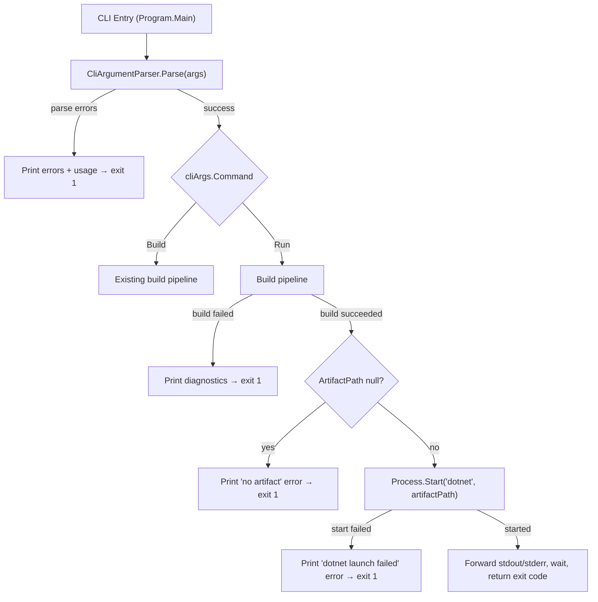

# Design Document: CLI Build & Run Commands

## Overview

This design adds two explicit top-level command verbs — `build` and `run` — to the Mist CLI. Today the CLI accepts a flat argument list and always compiles. After this change the first positional argument is inspected for a known verb; `build` preserves the current compile-only behavior, while `run` compiles and then executes the resulting DLL via `dotnet <artifact-path>`. When no verb is supplied the CLI defaults to `build`, keeping every existing invocation backward-compatible.

The change touches three files in `Source/Mist.CLI`:

| File | Change |
|---|---|
| `Args/CliArguments.cs` | Add `CliCommand` enum (`Build`, `Run`) and a `Command` field to the `CliArguments` record. |
| `Args/CliArgumentParser.cs` | Detect the command verb as the first positional arg; validate `run` + `--mode lex` rejection; update usage string. |
| `Program.cs` | Branch on `Command` — `Build` keeps current logic, `Run` builds then spawns `dotnet <artifact>` and forwards I/O + exit code. |

No changes are required to the compiler library (`Source/Mist`).

## Architecture



The architecture is intentionally thin: the only new runtime concept is a child-process launch after a successful build. No new services, abstractions, or cross-cutting concerns are introduced.

### Design Decisions

1. **Enum over subclass hierarchy** — A simple `CliCommand` enum is sufficient because the two commands share all options and differ only in post-build behavior. A full command-object pattern would be over-engineering for two branches.
2. **Synchronous I/O forwarding** — `dotnet <dll>` is expected to run interactively. We inherit stdout/stderr (no redirection) so the child process writes directly to the terminal. This avoids buffering issues and keeps the implementation trivial.
3. **Validation in the parser** — The `run` + `--mode lex` rejection is enforced in `CliArgumentParser` rather than `Program.cs` so that all argument validation lives in one place and the caller always receives a fully-validated `CliArguments`.

## Components and Interfaces

### 1. `CliCommand` Enum

New enum in `Args/CliArguments.cs`:

```csharp
public enum CliCommand
{
    Build,
    Run,
}
```

### 2. `CliArguments` Record (modified)

Add a `Command` parameter with a default of `CliCommand.Build`:

```csharp
public sealed record CliArguments(
    string ProjectFolder,
    CliCommand Command = CliCommand.Build,
    string BackendId = "csharp",
    string OutputDirectory = "",
    string BinDirectory = "",
    CompilerMode Mode = CompilerMode.Compile);
```

The `Command` field is placed second (after `ProjectFolder`) so that existing callers that use positional construction still compile — `ProjectFolder` is the only required parameter.

### 3. `CliArgumentParser.Parse` (modified)

Parsing changes:

1. After the main loop collects positional args, inspect `positionalArgs[0]`:
   - If `"build"` → set `command = CliCommand.Build`, remove it from positional list.
   - If `"run"` → set `command = CliCommand.Run`, remove it from positional list.
   - Otherwise → leave positional list untouched (implicit `Build`).
2. After all parsing, if `command == Run && mode == Lex` → add a `CliParseError("The 'run' command is not compatible with '--mode lex'.")`.
3. Update the usage string to: `"Usage: mist <build|run> [project-folder] [--backend <id>] [--output <dir>] [--bin <dir>] [--mode <compile|lex>]"`.

The verb detection happens *after* the main loop (not inside it) because the loop already collects all non-flag tokens into `positionalArgs`. This keeps the loop simple and avoids special-casing the first argument mid-iteration.

### 4. `Program.Main` (modified)

After a successful parse, branch on `cliArgs.Command`:

- **`CliCommand.Build`** — existing logic unchanged.
- **`CliCommand.Run`** — call the existing build pipeline. On failure, return non-zero. On success, call a new `RunArtifact` helper.

### 5. `RunArtifact` Helper (new private method in `Program`)

```
private static int RunArtifact(string artifactPath)
```

Responsibilities:
- Create a `ProcessStartInfo` targeting `dotnet` with the artifact path as the argument.
- Set `UseShellExecute = false`, do **not** redirect stdout/stderr (inherit from parent).
- Start the process; if `Process.Start` returns `null`, print error to stderr and return exit code 1.
- Call `process.WaitForExit()` and return `process.ExitCode`.

### 6. Updated Usage String

The usage string printed on parse errors changes from:

```
Usage: mist [project-folder] [--backend <id>] [--output <dir>] [--bin <dir>] [--mode <compile|lex>]
```

to:

```
Usage: mist <build|run> [project-folder] [--backend <id>] [--output <dir>] [--bin <dir>] [--mode <compile|lex>]
```

## Data Models

### `CliCommand` Enum

| Value | Meaning |
|---|---|
| `Build` | Compile only (default). |
| `Run` | Compile, then execute the primary output artifact. |

### `CliArguments` Record (updated)

| Field | Type | Default | Description |
|---|---|---|---|
| `ProjectFolder` | `string` | *(required)* | Root directory of the Mist project. |
| `Command` | `CliCommand` | `Build` | Resolved command verb. |
| `BackendId` | `string` | `"csharp"` | Backend identifier. |
| `OutputDirectory` | `string` | `""` | Transpiled output directory (resolved to `<project>/out` if empty). |
| `BinDirectory` | `string` | `""` | Compiled binary directory (resolved to `<project>/bin` if empty). |
| `Mode` | `CompilerMode` | `Compile` | Compiler pipeline mode. |

### `CliParseError` / `CliParseResult` — unchanged

No structural changes. The parser may produce a new error message for the `run` + `lex` combination, but the types themselves are stable.

### `CompilerResult` — unchanged

The `PrimaryOutputArtifactPath` field already carries the DLL path needed by the run command. No modifications required.


## Correctness Properties

*A property is a characteristic or behavior that should hold true across all valid executions of a system — essentially, a formal statement about what the system should do. Properties serve as the bridge between human-readable specifications and machine-verifiable correctness guarantees.*

PBT applies to the argument-parsing layer of this feature. `CliArgumentParser.Parse` is a pure function (`string[] → CliParseResult`) whose behavior varies meaningfully with input and is cheap to execute thousands of times. The process-launching and I/O-forwarding logic is integration-level and not suitable for PBT.

### Property 1: Non-"run" arguments default to Build command

*For any* valid argument array whose first positional token is not `"run"` (including arrays starting with `"build"`, arrays starting with a directory path, flag-only arrays, and empty arrays), the parser SHALL return `Command == CliCommand.Build` with no errors (assuming all other arguments are individually valid).

**Validates: Requirements 1.1, 1.3, 2.1, 2.2, 2.3, 9.2**

### Property 2: "run" verb sets Run command

*For any* valid argument array whose first positional token is `"run"` and whose flags do not include `--mode lex`, the parser SHALL return `Command == CliCommand.Run` with no errors (assuming all other arguments are individually valid).

**Validates: Requirements 1.2, 9.2**

### Property 3: "run" with lex mode is rejected

*For any* argument array that contains `"run"` as the first positional token and includes `--mode lex` (in any position among the flags), the parser SHALL return at least one error whose message indicates that `run` is not compatible with `--mode lex`.

**Validates: Requirements 7.1**

## Error Handling

| Scenario | Detection Point | Behavior |
|---|---|---|
| Parse errors (unknown flags, missing values, invalid mode, etc.) | `CliArgumentParser.Parse` | Print each error to stderr, print updated usage string, return exit code 1. |
| `run` + `--mode lex` | `CliArgumentParser.Parse` | Add `CliParseError("The 'run' command is not compatible with '--mode lex'.")`. Handled by the general parse-error path above. |
| No `.mist` source files found | `Program.Main` | Print error to stderr, return exit code 1. (Unchanged from today.) |
| Build failure (diagnostics with errors) | `Program.Main` after `driver.Compile` | Print diagnostics to stderr, return exit code 1. Skip artifact execution for `run`. |
| `run` succeeds but `PrimaryOutputArtifactPath` is null | `Program.Main`, post-build check | Print `"error: Build succeeded but no executable artifact was produced."` to stderr, return exit code 1. |
| `dotnet` process fails to start (`Process.Start` returns null) | `RunArtifact` helper | Print `"error: Failed to start 'dotnet' process."` to stderr, return exit code 1. |
| `dotnet` process throws on start (e.g., `dotnet` not on PATH) | `RunArtifact` helper, `catch` block | Print `"error: Failed to launch 'dotnet': {ex.Message}"` to stderr, return exit code 1. |
| `dotnet` process exits with non-zero code | `RunArtifact` helper | Forward the child process exit code as the CLI exit code. No additional error message — the child's own stderr output is already visible. |

## Testing Strategy

### Unit Tests (example-based)

| Test | Validates |
|---|---|
| `Parse([])` → Command == Build, ProjectFolder == cwd | Req 2.1 |
| `Parse(["build"])` → Command == Build | Req 1.1 |
| `Parse(["run"])` → Command == Run | Req 1.2 |
| `Parse(["run", "--mode", "lex"])` → error containing "not compatible" | Req 7.1 |
| `Parse(["build", "--mode", "lex"])` → no error, Mode == Lex | Req 1.1 (no rejection for build+lex) |
| `Parse(["<valid-dir>"])` → Command == Build, ProjectFolder == dir | Req 1.3, 2.2 |
| `Parse(["--backend", "csharp"])` → Command == Build, ProjectFolder == cwd | Req 2.3 |
| Parse error path prints updated usage string containing `<build\|run>` | Req 8.1 |
| Null artifact path after successful build → error message + exit 1 | Req 6.3, 6.4 |
| Process start failure → error message + exit 1 | Req 6.1, 6.2 |

### Property-Based Tests

Library: **FsCheck** (via `FsCheck.Xunit`) — the standard PBT library for .NET/C# projects.

Each property test runs a minimum of 100 iterations with randomly generated argument arrays.

| Property Test | Tag | Validates |
|---|---|---|
| Non-"run" args → Build command | Feature: cli-build-run-commands, Property 1: Non-"run" arguments default to Build command | Req 1.1, 1.3, 2.1, 2.2, 2.3, 9.2 |
| "run" args → Run command | Feature: cli-build-run-commands, Property 2: "run" verb sets Run command | Req 1.2, 9.2 |
| "run" + lex → parse error | Feature: cli-build-run-commands, Property 3: "run" with lex mode is rejected | Req 7.1 |

Generator strategy:
- Generate random valid flag sequences: `--backend <id>`, `--output <dir>`, `--bin <dir>`, `--mode compile` in random order, with random omission.
- For Property 1: prepend either `"build"`, a valid directory path, or nothing.
- For Property 2: prepend `"run"`, exclude `--mode lex` from generated flags.
- For Property 3: prepend `"run"`, always include `--mode lex`, allow other random flags.

Note: The parser validates that directory paths exist on disk, so the generators must use `Directory.GetCurrentDirectory()` or a temp directory as the project folder value to avoid false parse errors.

### Integration Tests

| Test | Validates |
|---|---|
| `mist build <valid-project>` → exit 0, artifacts produced | Req 3.1 |
| `mist build <invalid-project>` → exit non-zero, diagnostics on stderr | Req 3.2 |
| `mist run <valid-project>` → builds then executes, exit code forwarded | Req 4.1, 5.1, 5.2 |
| `mist run <valid-project>` → stdout/stderr forwarded from child | Req 5.3, 5.4 |
| `mist run <invalid-project>` → exit non-zero, no execution attempt | Req 4.2 |
