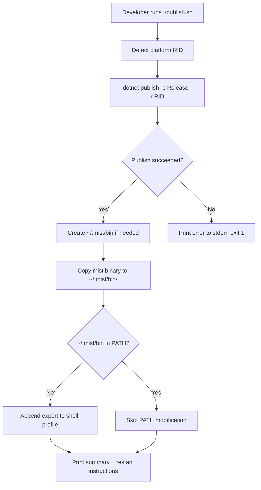

# Design Document: CLI Publish Tool

## Overview

This design describes how to package the Mist compiler CLI as a self-contained, single-file executable named `mist` and provide a one-command install workflow via a `publish.sh` script. The goal is to replace the verbose `dotnet run --project Source/Mist.CLI/Mist.CLI.csproj` invocation with a simple `mist` command available on the user's PATH.

The feature has three parts:

1. **Project configuration** — Add publish-related MSBuild properties to `Source/Mist.CLI/Mist.CLI.csproj` so that `dotnet publish` produces a trimmed, self-contained, single-file executable named `mist`.
2. **Publish script** — Create `publish.sh` at the repo root. The script auto-detects the platform RID, runs `dotnet publish`, copies the binary to `~/.mist/bin`, and ensures that directory is on the user's PATH.
3. **Behavioral equivalence** — The published `mist` binary delegates to the same `Program.Main` entry point, so all argument parsing, compilation, and execution behavior is identical to the `dotnet run` path.

No changes to the compiler pipeline, argument parser, or any runtime logic are required. The feature is purely additive configuration and tooling.

## Architecture



### Key Design Decisions

1. **Single-file + self-contained + trimmed**: These three MSBuild properties work together. `PublishSingleFile` bundles everything into one file, `SelfContained` includes the .NET runtime so no SDK is needed on the target, and `PublishTrimmed` removes unused framework code to reduce binary size. All three are set in the csproj so they apply to every `dotnet publish` invocation without needing command-line flags.

2. **RID auto-detection in the script**: Rather than requiring the user to pass a RID, the script uses `uname` to detect OS and architecture and maps them to .NET RID strings. This keeps the install to a single `./publish.sh` command.

3. **`~/.mist/bin` as the install directory**: A user-local directory avoids `sudo` requirements and follows the convention used by tools like `rustup` (`~/.cargo/bin`) and `go install` (`~/go/bin`).

4. **Shell profile detection**: The script checks `$SHELL` to determine whether to modify `~/.zshrc` or `~/.bashrc`. It only appends the PATH export if the directory isn't already in PATH, preventing duplicate entries on repeated runs.

5. **No changes to Program.cs or argument parsing**: The published binary runs the exact same `Program.Main` method. `dotnet publish` with `PublishSingleFile` produces a native host that bootstraps the same IL. Behavioral equivalence is guaranteed by the .NET publish pipeline — no adapter code is needed.

## Components and Interfaces

### Component 1: Mist.CLI.csproj Configuration

**File**: `Source/Mist.CLI/Mist.CLI.csproj`

Four MSBuild properties are added to the existing `<PropertyGroup>`:

| Property | Value | Purpose |
|---|---|---|
| `AssemblyName` | `mist` | Names the output executable `mist` (instead of `Mist.CLI`) |
| `PublishSingleFile` | `true` | Bundles all assemblies into a single executable |
| `SelfContained` | `true` | Includes the .NET runtime in the output |
| `PublishTrimmed` | `true` | Removes unused framework code via IL trimming |

These properties only affect `dotnet publish` output. `dotnet build` and `dotnet run` behavior is unchanged — the `AssemblyName` change renames the debug output to `mist.dll` but `dotnet run --project` still works identically.

### Component 2: publish.sh Script

**File**: `publish.sh` (repository root)

The script is a POSIX-compatible bash script with `set -euo pipefail` for strict error handling.

**Interface** (command-line):
```
./publish.sh
```
No arguments. All configuration is auto-detected.

**Internal flow**:

1. **Prerequisite check**: Verify `dotnet` is on PATH. If not, print error and exit 1.
2. **RID detection**: Use `uname -s` (OS) and `uname -m` (architecture) to compute the .NET RID:
   - `Darwin` + `arm64` → `osx-arm64`
   - `Darwin` + `x86_64` → `osx-x64`
   - `Linux` + `x86_64` → `linux-x64`
   - `Linux` + `aarch64` → `linux-arm64`
   - Unsupported combinations → error and exit 1
3. **Publish**: Run `dotnet publish Source/Mist.CLI/Mist.CLI.csproj -c Release -r <RID>`. On failure, print error and exit 1.
4. **Install**: Create `~/.mist/bin` if it doesn't exist. Copy the published `mist` binary from the publish output directory to `~/.mist/bin/mist`. This overwrites any existing binary (idempotent).
5. **PATH configuration**: Check if `$HOME/.mist/bin` is in `$PATH`. If not, detect the shell profile file and append the export line. If already present, skip and inform the user.
6. **Summary**: Print the install path, version confirmation, and (if PATH was modified) instructions to restart the terminal or source the profile.

**Shell profile detection logic**:
- If `$SHELL` ends with `zsh` → use `~/.zshrc`
- If `$SHELL` ends with `bash` → use `~/.bashrc` (fall back to `~/.bash_profile` if `~/.bashrc` doesn't exist on macOS)
- Otherwise → use `~/.profile` as a generic fallback

**Publish output path resolution**:
The `dotnet publish` output lands in `Source/Mist.CLI/bin/Release/net10.0/<RID>/publish/mist`. The script constructs this path from the known project structure, target framework, and detected RID.

### Component 3: Published mist Binary

The binary is the output of `dotnet publish`. It is a native single-file executable that embeds the .NET runtime and all project assemblies. When invoked, it runs `Program.Main(args)` — the same entry point as `dotnet run --project Source/Mist.CLI/Mist.CLI.csproj -- <args>`.

No wrapper code or shim is needed. The behavioral equivalence is structural: same code, same entry point, same argument parser.

## Data Models

This feature does not introduce new data models. The existing `CliArguments`, `CliCommand`, and `CliParseResult` types are unchanged. The published binary consumes the same argument format.

The only "data" involved is:

- **MSBuild properties**: Key-value pairs in the csproj XML.
- **Shell profile line**: The string `export PATH="$HOME/.mist/bin:$PATH"` appended to the profile file.
- **Published binary**: An opaque native executable produced by `dotnet publish`.

## Error Handling

### publish.sh Error Scenarios

| Scenario | Detection | Response |
|---|---|---|
| `dotnet` not installed | `command -v dotnet` fails | Print "Error: .NET SDK is required but 'dotnet' was not found on PATH." to stderr, exit 1 |
| Unsupported OS/architecture | `uname` returns unrecognized values | Print "Error: Unsupported platform: <os>-<arch>" to stderr, exit 1 |
| `dotnet publish` fails | Non-zero exit code from `dotnet publish` | Print "Error: dotnet publish failed." to stderr, exit 1 (the `set -e` flag also ensures this) |
| Copy to install dir fails | `cp` returns non-zero | Print "Error: Failed to copy mist binary to ~/.mist/bin/" to stderr, exit 1 |
| Cannot create install dir | `mkdir -p` fails | Print error to stderr, exit 1 (handled by `set -e`) |
| Shell profile not writable | Append fails | Print warning but do not fail the script — the binary is installed, PATH just needs manual config |

### Script exit codes

- `0`: Publish and install completed successfully.
- `1`: Any error occurred (prerequisite missing, publish failed, copy failed).

## Testing Strategy

### Why Property-Based Testing Does Not Apply

This feature consists of:
- **MSBuild configuration** (declarative XML properties) — no function with inputs/outputs to test
- **A shell script** with side effects (process execution, file I/O, environment modification) — not amenable to PBT
- **Behavioral equivalence** of a published binary — an integration concern verified by running both paths

There are no pure functions, parsers, serializers, or data transformations introduced. The existing `CliArgumentParser` is already tested elsewhere. Property-based testing is not appropriate for this feature.

### Unit Tests (Example-Based)

**Project**: `Test/Mist.CLI.Tests` (xUnit)

| Test | What it verifies |
|---|---|
| Csproj has AssemblyName=mist | Parse the csproj XML and assert the property value |
| Csproj has PublishSingleFile=true | Parse the csproj XML and assert the property value |
| Csproj has SelfContained=true | Parse the csproj XML and assert the property value |
| Csproj has PublishTrimmed=true | Parse the csproj XML and assert the property value |

These can be implemented as simple XML-reading tests that load the csproj file and check for the expected `<PropertyGroup>` entries.

### Integration Tests (Shell Script)

These are manual or CI-based tests that verify the end-to-end publish workflow:

| Test | What it verifies |
|---|---|
| `./publish.sh` succeeds on a clean machine | Script exits 0, `~/.mist/bin/mist` exists and is executable |
| `./publish.sh` is idempotent | Running twice doesn't duplicate PATH entries in shell profile |
| Published `mist build <project>` matches `dotnet run` output | Compile a sample project with both methods, compare diagnostics and exit codes |
| Published `mist run <project>` matches `dotnet run` output | Run a sample project with both methods, compare stdout and exit codes |
| Published `mist` with invalid args prints usage | Invoke with bad args, verify stderr contains usage message and exit code is 1 |
| Script fails gracefully without `dotnet` | Temporarily remove dotnet from PATH, verify error message and exit 1 |

### Smoke Tests

| Test | What it verifies |
|---|---|
| `publish.sh` has executable permission | `test -x publish.sh` |
| `publish.sh` starts with proper shebang | First line is `#!/usr/bin/env bash` |
| Published binary runs without .NET SDK | On a clean environment without the .NET SDK, `~/.mist/bin/mist --help` or `mist` with no args produces expected output (verifies self-contained works) |
