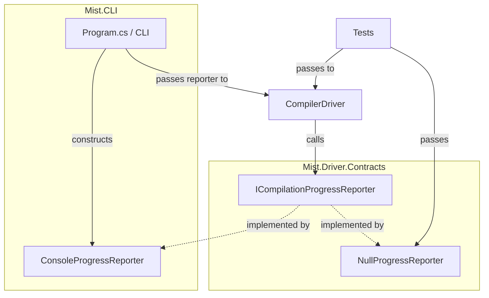

# Design Document: Compiler Progress Output

## Overview

This feature adds structured, per-stage progress output to the Mist compiler CLI. The design introduces an `ICompilationProgressReporter` interface that the `CompilerDriver` calls at each pipeline stage, keeping the driver testable (tests inject `NullProgressReporter.Instance`) while the CLI wires in a `ConsoleProgressReporter` that writes human-readable progress to stdout.

The architecture follows the **Observer pattern** — the driver notifies a reporter of stage transitions without knowing how (or whether) the output is rendered. This keeps the compiler library free of console I/O concerns.

### Key Design Decisions

1. **Interface in `Mist.Driver.Contracts`** — so test projects can reference it without depending on `Mist.CLI`.
2. **Optional constructor parameter with default** — existing call sites (tests) don't need changes; they get `NullProgressReporter.Instance` automatically.
3. **Detail strings built by the driver** — the driver computes metrics (token counts, node counts, etc.) and passes pre-formatted detail strings to the reporter. The reporter is a pure output sink.
4. **Per-analyzer timing in `AnalyzerRunner`** — the runner is extended to return timing data alongside diagnostics, avoiding a second timing layer in the driver.
5. **BackendResult extended with `EmittedFileCount`** — rather than having the reporter scan the output directory, the backend reports how many `.cs` files it wrote. This is more reliable and avoids filesystem coupling in the reporter.

---

## Architecture



### Data Flow

1. **CLI** creates a `ConsoleProgressReporter` and a `Stopwatch`.
2. **CLI** reports Stage 0 (cleaning) directly — this happens before the driver is called.
3. **CLI** passes the reporter to `CompilerDriver`.
4. **CompilerDriver.Compile** calls `reporter.ReportStageStart(...)` and `reporter.ReportStageComplete(...)` at each pipeline boundary.
5. After `Compile` returns, the **CLI** calls `reporter.ReportBuildSummary(...)` with the overall result.

---

## Components and Interfaces

### ICompilationProgressReporter

```csharp
namespace Mist.Driver.Contracts;

/// <summary>
/// Receives progress notifications from the compilation pipeline.
/// </summary>
public interface ICompilationProgressReporter
{
    /// <summary>
    /// Called when a compilation stage begins.
    /// </summary>
    /// <param name="stageNumber">Zero-based stage index (0–6).</param>
    /// <param name="title">Human-readable stage name (e.g., "Cleaning", "Lexing").</param>
    void ReportStageStart(int stageNumber, string title);

    /// <summary>
    /// Called when a compilation stage completes.
    /// </summary>
    /// <param name="stageNumber">Zero-based stage index.</param>
    /// <param name="elapsed">Wall-clock time for this stage.</param>
    /// <param name="details">One or more detail lines (without leading indent — the reporter adds formatting).</param>
    void ReportStageComplete(int stageNumber, TimeSpan elapsed, IReadOnlyList<string> details);

    /// <summary>
    /// Called once at the end of the build to report the final outcome.
    /// </summary>
    void ReportBuildSummary(bool succeeded, int errorCount, int warningCount, TimeSpan totalElapsed);
}
```

### NullProgressReporter

```csharp
namespace Mist.Driver.Contracts;

/// <summary>
/// No-op implementation of <see cref="ICompilationProgressReporter"/>.
/// Used in tests and any context where progress output is unwanted.
/// </summary>
public sealed class NullProgressReporter : ICompilationProgressReporter
{
    public static readonly NullProgressReporter Instance = new();

    private NullProgressReporter() { }

    public void ReportStageStart(int stageNumber, string title) { }
    public void ReportStageComplete(int stageNumber, TimeSpan elapsed, IReadOnlyList<string> details) { }
    public void ReportBuildSummary(bool succeeded, int errorCount, int warningCount, TimeSpan totalElapsed) { }
}
```

### ConsoleProgressReporter

Lives in `Source/Mist.CLI/Output/ConsoleProgressReporter.cs`.

```csharp
namespace Mist.CLI.Output;

public sealed class ConsoleProgressReporter : ICompilationProgressReporter
{
    private readonly TextWriter _out;

    public ConsoleProgressReporter(TextWriter output)
    {
        _out = output;
    }

    public void ReportStageStart(int stageNumber, string title)
    {
        _out.WriteLine($"Stage {stageNumber} - {title}");
    }

    public void ReportStageComplete(int stageNumber, TimeSpan elapsed, IReadOnlyList<string> details)
    {
        foreach (var detail in details)
            _out.WriteLine($"    {detail}");
        _out.WriteLine($"    Took {elapsed.TotalSeconds:F2}s");
        _out.WriteLine(); // blank separator line
    }

    public void ReportBuildSummary(bool succeeded, int errorCount, int warningCount, TimeSpan totalElapsed)
    {
        var status = succeeded ? "Build succeeded" : "Build failed";
        _out.WriteLine($"{status}  {errorCount} error(s), {warningCount} warning(s)  Total: {totalElapsed.TotalSeconds:F2}s");
    }
}
```

**Design decision**: The `ConsoleProgressReporter` accepts a `TextWriter` rather than writing directly to `Console.Out`. This makes it unit-testable — tests pass a `StringWriter` and assert on the captured output.

### CompilerDriver Changes

The constructor gains an optional `ICompilationProgressReporter?` parameter (defaulting to `null`, resolved to `NullProgressReporter.Instance` internally):

```csharp
public CompilerDriver(
    ILexer lexer,
    IParser parser,
    ISemanticModelBuilder semanticModelBuilder,
    ImmutableArray<IAnalyzer> analyzers,
    ImmutableArray<IBackend> backends,
    ICompilationProgressReporter? progressReporter = null)
{
    // ...existing assignments...
    this.progressReporter = progressReporter ?? NullProgressReporter.Instance;
}
```

### AnalyzerRunner Changes

`RunAll` is extended to return per-analyzer timing:

```csharp
public sealed record AnalyzerTimingEntry(string AnalyzerId, TimeSpan Elapsed);

public sealed record AnalyzerRunResult(
    ImmutableArray<Diagnostic> Diagnostics,
    ImmutableArray<AnalyzerTimingEntry> Timings);
```

The `RunAll` method wraps each analyzer call in a `Stopwatch` and returns `AnalyzerRunResult` instead of `ImmutableArray<Diagnostic>`.

### BackendResult Extension

`BackendResult` gains an `EmittedFileCount` property:

```csharp
public sealed record BackendResult(
    bool Succeeded,
    string? PrimaryArtifactPath,
    ImmutableArray<Diagnostic> Diagnostics,
    int EmittedFileCount = 0);
```

The default value of `0` ensures backward compatibility — existing backend implementations that don't set it won't break.

### AST Node Counting Utility

A small static helper for counting nodes in a `SyntaxNode` tree:

```csharp
namespace Mist.Driver;

internal static class SyntaxTreeMetrics
{
    /// <summary>
    /// Counts all nodes in the tree rooted at <paramref name="root"/>,
    /// including the root itself.
    /// </summary>
    public static int CountNodes(Storm.Runtime.SyntaxNode root)
    {
        var count = 1;
        foreach (var child in root.Children())
            count += CountNodes(child);
        return count;
    }
}
```

---

## Data Models

### AnalyzerTimingEntry

| Field | Type | Description |
|-------|------|-------------|
| `AnalyzerId` | `string` | The `IAnalyzer.AnalyzerId` of the analyzer that ran |
| `Elapsed` | `TimeSpan` | Wall-clock time for that analyzer's `Analyze` call |

### AnalyzerRunResult

| Field | Type | Description |
|-------|------|-------------|
| `Diagnostics` | `ImmutableArray<Diagnostic>` | All diagnostics from all analyzers |
| `Timings` | `ImmutableArray<AnalyzerTimingEntry>` | Per-analyzer timing entries |

### BackendResult (extended)

| Field | Type | Description |
|-------|------|-------------|
| `Succeeded` | `bool` | Whether emission succeeded |
| `PrimaryArtifactPath` | `string?` | Path to the primary output artifact |
| `Diagnostics` | `ImmutableArray<Diagnostic>` | Backend diagnostics |
| `EmittedFileCount` | `int` | Number of `.cs` files written (default 0) |

---

## Correctness Properties

*A property is a characteristic or behavior that should hold true across all valid executions of a system — essentially, a formal statement about what the system should do. Properties serve as the bridge between human-readable specifications and machine-verifiable correctness guarantees.*

### Property 1: AST node count is recursive sum

*For any* `SyntaxNode` tree, `CountNodes(root)` SHALL equal `1 + sum(CountNodes(child) for each child in root.Children())`.

**Validates: Requirements 5.2**

### Property 2: Top-level construct count matches symbol filter

*For any* `ISemanticModel`, the reported Stage 4 count SHALL equal the number of symbols in `AllSymbols` where `Origin == SymbolOrigin.UserCode` and `Kind` is one of `Class`, `Struct`, `Interface`, or `Trait`.

**Validates: Requirements 6.1, 6.2**

### Property 3: ConsoleProgressReporter stage formatting

*For any* stage number `N` (0–6), title string `T`, list of detail strings `D`, and elapsed `TimeSpan`, the `ConsoleProgressReporter` output SHALL:
- Start with a line matching `"Stage {N} - {T}"`
- Follow with each detail line prefixed by exactly four spaces
- End with a line matching `"    Took {elapsed.TotalSeconds:F2}s"` followed by a blank line

**Validates: Requirements 10.3, 10.4, 10.5, 10.6**

### Property 4: ConsoleProgressReporter summary formatting

*For any* boolean `succeeded`, non-negative integers `errorCount` and `warningCount`, and `TimeSpan totalElapsed`, the `ConsoleProgressReporter` output SHALL match `"{status}  {E} error(s), {W} warning(s)  Total: {T.TT}s"` where `status` is `"Build succeeded"` or `"Build failed"`.

**Validates: Requirements 9.2, 9.3**

### Property 5: NullProgressReporter produces identical CompilerResult

*For any* valid set of compiler options and source files, `CompilerDriver.Compile` called with `NullProgressReporter.Instance` SHALL produce the same `CompilerResult` (same `Succeeded`, same `PrimaryOutputArtifactPath`, same `Diagnostics`) as a driver constructed without any reporter.

**Validates: Requirements 11.1**

---

## Error Handling

| Scenario | Handling |
|----------|----------|
| Reporter method throws | The driver does NOT catch reporter exceptions — a broken reporter is a programming error, not a runtime condition. Tests use `NullProgressReporter` which cannot throw. |
| Stage skipped due to earlier errors | The driver still calls `ReportStageComplete` for stages that ran, but skipped stages get no notification. The summary is always reported. |
| Timing inaccuracy | `Stopwatch` is used for all timing. On platforms without high-resolution timers, times may show as `0.00s` for very fast stages. This is acceptable. |
| Empty source file list | Stage 1 reports `0 user files`. Subsequent stages may report 0 tokens / 0 nodes. The summary still fires. |
| Backend fails to emit | Stage 6 is still reported with `EmittedFileCount = 0` and `PrimaryArtifactPath = null`. The summary reports failure. |

---

## Testing Strategy

### Unit Tests (Example-Based)

| Test | What it verifies |
|------|-----------------|
| `NullProgressReporter_DoesNotThrow` | All methods callable without exception |
| `NullProgressReporter_IsSingleton` | `Instance` returns same reference |
| `ConsoleProgressReporter_StageStart_Format` | Output matches `"Stage N - Title\n"` |
| `ConsoleProgressReporter_StageComplete_Format` | Details indented, elapsed formatted, blank line |
| `ConsoleProgressReporter_Summary_Succeeded` | Correct format for success |
| `ConsoleProgressReporter_Summary_Failed` | Correct format for failure |
| `Driver_ReportsStage1_FileCounts` | Spy reporter receives correct stdlib/ref/user counts |
| `Driver_ReportsStage2_TokenCount` | Spy reporter receives correct total token count |
| `Driver_ReportsStage3_NodeCount` | Spy reporter receives correct AST node count |
| `Driver_ReportsStage4_ConstructCount` | Spy reporter receives correct filtered symbol count |
| `Driver_ReportsStage5_AnalyzerTimings` | Spy reporter receives one entry per analyzer |
| `Driver_ReportsStage6_EmitMetrics` | Spy reporter receives .cs file count and artifact path |
| `Driver_ReportsSummary_OnSuccess` | Summary called with succeeded=true and correct counts |
| `Driver_ReportsSummary_OnFailure` | Summary called with succeeded=false on error |
| `Driver_SkippedStages_NotReported` | If lexing fails, stages 3–6 are not reported |

### Property-Based Tests (FsCheck)

| Property | Generator | Iterations |
|----------|-----------|------------|
| Property 1: AST node count recursion | Generate arbitrary tree structures (nested lists of children) | 100+ |
| Property 2: Top-level construct filter | Generate lists of `(SymbolKind, SymbolOrigin)` pairs, verify filter count | 100+ |
| Property 3: Stage formatting | Generate random stage numbers (0–6), random title strings, random detail lists, random TimeSpans | 100+ |
| Property 4: Summary formatting | Generate random booleans, non-negative ints, random TimeSpans | 100+ |
| Property 5: NullProgressReporter equivalence | Use a small fixed set of valid Mist programs (not random — compilation is expensive) | 3–5 examples |

**Note on Property 5**: Full compilation is expensive (file I/O, parsing, semantic analysis). This property is verified with a small set of representative programs rather than 100 random inputs. This is an example-based test in practice, included as a property for traceability.

**Library**: FsCheck.Xunit (already in the test project dependencies).

**Tag format**: Each property test includes a comment:
```csharp
// Feature: compiler-progress-output, Property {N}: {property text}
```

### Integration Tests

| Test | What it verifies |
|------|-----------------|
| `CLI_Build_ProducesProgressOutput` | End-to-end: run CLI on a sample project, verify stdout contains all stage headers and summary |
| `CLI_Build_ErrorsGoToStderr` | Diagnostics still go to stderr, progress to stdout |

**Process spawning note**: Integration tests that invoke the CLI spawn exactly 1 process per test. Per the test-process-spawning policy, this is acceptable for a small number of integration tests (2–3 total).
