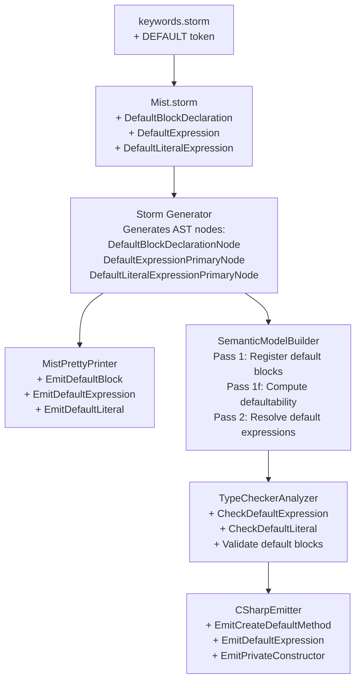

# Design Document: `default` Keyword

> **Superseded** by [`defaultability`](../defaultability/requirements.md) (2026-09-26), which states the rules as they now stand and governs wherever the two differ. This document is kept so references to it by requirement number still resolve; the new spec's appendix maps each requirement here to where it now lives.

## Overview

This design adds the `default` keyword to the Mist programming language compiler. Unlike C#'s `default` (which produces zeroed-out values or `null`), Mist's `default` is a value-based mechanism where every concrete type has a fully-computed compile-time default value. The feature spans all compiler pipeline stages:

1. **Grammar & Lexing** — New `DEFAULT` keyword token, `DefaultBlockDeclaration` member rule, `DefaultExpression` and `DefaultLiteralExpression` primary rules.
2. **Parsing** — Storm-generated parser produces new AST node types for default blocks and expressions.
3. **Pretty-Printer** — Round-trip formatting support for all new AST nodes.
4. **Semantic Model** — Defaultability analysis (inferred vs explicit vs not-defaultable), default value computation with topological ordering, type binding resolution.
5. **Type Checker** — Validation of `default(T)` and bare `default` expressions, type inference for bare `default`, error diagnostics for invalid usage.
6. **C# Emitter** — Factory method for default value creation, private parameterless constructors for classes, expression emission referencing factory methods.
7. **Tooling** — Syntax highlighting update, feature coverage documentation update.

### Design Rationale

The design follows the existing compiler architecture closely. Each pipeline stage is extended with the minimum changes needed. The Storm parser generator handles AST node generation from grammar rules, so the primary grammar work is defining the new rules in `Mist.storm` and `keywords.storm`. The semantic model builder gains a new pass (Pass 1f) for defaultability analysis, slotted between existing passes. The type checker gains new cases in its expression-checking methods. The emitter gains new emission methods for default constructs.

Key decisions:
- **Defaultability is a type-level property** stored on `ClassType` and `StructType`, not a separate registry. This keeps the data close to where it's used.
- **Default values are represented as a dictionary of field name → compile-time value**, stored on the type. This is simple and sufficient for the v1 feature.
- **The `Info` diagnostic severity** must be added to `DiagnosticSeverity` to support the redundant default block diagnostic (Requirement 11).
- **Default block is a member-level declaration**, not a type-level modifier. This matches the grammar structure where `MemberDeclaration` is the extension point.

## Architecture

The feature touches every stage of the compiler pipeline. The following diagram shows the data flow:



### Pipeline Stage Integration Points

| Stage | File(s) | Changes |
|-------|---------|---------|
| Grammar | `keywords.storm`, `Mist.storm` | Add `DEFAULT` token, 3 new parser rules |
| Lexing | (auto-generated) | Storm handles keyword recognition |
| Parsing | (auto-generated) | Storm generates new AST node types |
| Pretty-Printer | `MistPrettyPrinter.cs` | 3 new emit methods |
| Semantic Model | `SemanticModelBuilder.cs`, `ClassType.cs`, `StructType.cs` | New pass, new type properties |
| Diagnostics | `DiagnosticSeverity.cs`, `DiagnosticId.cs` | Add `Info` severity, ~12 new diagnostic IDs |
| Type Checker | `TypeCheckerAnalyzer.cs` | New expression checking, default block validation |
| Emitter | `CSharpEmitter.cs` | New member/expression emission |
| Syntax Highlighting | `mist.tmLanguage.json` | Add `default` to keyword patterns |
| Documentation | `CSHARP_FEATURES.md` | Update feature tracking |

## Components and Interfaces

### 1. Grammar Changes (`keywords.storm` + `Mist.storm`)

**`keywords.storm`** — Add one line:
```
token DEFAULT = "default";
```

**`Mist.storm`** — Add three new rules and modify two existing rules:

#### New Rule: `DefaultBlockDeclaration`
```
rule DefaultBlockDeclaration = DEFAULT LEFT_BRACE entries:DefaultFieldInitializer* RIGHT_BRACE;
```

#### New Rule: `DefaultFieldInitializer`
Two forms — simple field override and type binding:
```
rule DefaultFieldInitializer
    = fieldName:IDENTIFIER EQUAL value:Expression                                          as DefaultFieldOverride
    | fieldName:IDENTIFIER COLON typeName:TypeReference
      nestedOverrides:(LEFT_BRACE nestedEntries:DefaultNestedOverride* RIGHT_BRACE)?       as DefaultTypeBinding
    ;

rule DefaultNestedOverride = fieldName:IDENTIFIER EQUAL value:Expression;
```

Design note: `DefaultNestedOverride` is a separate rule (not reusing `DefaultFieldInitializer`) because nested overrides inside a type binding are always simple `field = value` assignments — they cannot contain further type bindings. This keeps the grammar unambiguous and the AST simpler.

#### Modified Rule: `MemberDeclaration`
Add a new variant:
```
rule MemberDeclaration
    = ...existing variants...
    | defaultBlock:DefaultBlockDeclaration as DefaultBlockMember
    ;
```

#### New Primary Expression Variants
```
rule Primary
    = ...existing variants...
    | DEFAULT LEFT_PARENTHESIS type:TypeReference RIGHT_PARENTHESIS  as DefaultExpression
    | DEFAULT                                                         as DefaultLiteralExpression
    ;
```

**Ordering note**: `DefaultExpression` (with parenthesis) must be listed before `DefaultLiteralExpression` (bare keyword) so the parser's ordered-choice semantics prefer the longer match when a `(` follows `default`. Both must appear before `IdentifierExpression` since `DEFAULT` is a keyword token, not an `IDENTIFIER`.

#### Grammar Restriction for Interfaces and Traits

Default blocks are restricted to classes and structs by the grammar structure: `InterfaceDeclaration` uses `InterfaceMemberDeclaration` (not `MemberDeclaration`), and `TraitDeclaration` uses `TraitMemberDeclaration`. Since `DefaultBlockDeclaration` is only added to `MemberDeclaration`, it is syntactically impossible to place a default block inside an interface or trait. No additional parser rejection logic is needed — the grammar enforces this structurally.

### 2. AST Nodes (Storm-Generated)

Storm will auto-generate these node types from the grammar rules:

| Node Type | Parent | Fields |
|-----------|--------|--------|
| `DefaultBlockDeclarationNode` | — | `Entries: ImmutableArray<DefaultFieldInitializerNode>` |
| `DefaultFieldOverrideDefaultFieldInitializerNode` | `DefaultFieldInitializerNode` | `FieldName: Token`, `Value: ExpressionNode` |
| `DefaultTypeBindingDefaultFieldInitializerNode` | `DefaultFieldInitializerNode` | `FieldName: Token`, `TypeName: TypeReferenceNode`, `NestedEntries: ImmutableArray<DefaultNestedOverrideNode>?` |
| `DefaultNestedOverrideNode` | — | `FieldName: Token`, `Value: ExpressionNode` |
| `DefaultBlockMemberMemberDeclarationNode` | `MemberDeclarationNode` | `DefaultBlock: DefaultBlockDeclarationNode` |
| `DefaultExpressionPrimaryNode` | `PrimaryNode` | `Type: TypeReferenceNode` |
| `DefaultLiteralExpressionPrimaryNode` | `PrimaryNode` | (no fields) |

### 3. Pretty-Printer Changes (`MistPrettyPrinter.cs`)

Add handling in `EmitMemberDeclaration` for `DefaultBlockMemberMemberDeclarationNode`:

```csharp
case DefaultBlockMemberMemberDeclarationNode defaultBlockMember:
    EmitDefaultBlockDeclaration(defaultBlockMember.DefaultBlock);
    break;
```

New method `EmitDefaultBlockDeclaration`:
- Empty block → `default { }`
- Non-empty block → `default {` + newline, each entry indented on its own line, `}`
- Field override entry → `fieldName = <expression>`
- Type binding entry → `fieldName: TypeReference` optionally followed by `{ field = value, ... }`

Add handling in `EmitPrimary` (via the expression emission path) for:
- `DefaultExpressionPrimaryNode` → `default(<TypeReference>)`
- `DefaultLiteralExpressionPrimaryNode` → `default`

### 4. Semantic Model Changes

#### 4a. Type Properties

Add to `ClassType` and `StructType`:

```csharp
/// <summary>
/// The defaultability status of this type.
/// </summary>
public DefaultabilityStatus Defaultability { get; internal set; } = DefaultabilityStatus.Unknown;

/// <summary>
/// The computed default field values for this type, keyed by field name.
/// Null if the type is not defaultable.
/// </summary>
public IReadOnlyDictionary<string, DefaultFieldValue>? DefaultValues { get; internal set; }

/// <summary>
/// The AST node for the explicit default block, if one was declared.
/// Null for inferred defaults and non-defaultable types.
/// </summary>
internal DefaultBlockDeclarationNode? DefaultBlockNode { get; set; }
```

New types:

```csharp
public enum DefaultabilityStatus
{
    Unknown,       // Not yet computed
    Inferred,      // All fields defaultable, no explicit block needed
    Explicit,      // Has an explicit default block
    NotDefaultable // Has non-defaultable fields without type bindings
}

public sealed class DefaultFieldValue
{
    public string FieldName { get; }
    public IType FieldType { get; }
    public DefaultValueKind ValueKind { get; }
    public object? ConstantValue { get; }        // For primitives and string
    public IType? ConcreteType { get; }           // For type bindings
    public IReadOnlyDictionary<string, DefaultFieldValue>? NestedOverrides { get; }
}

public enum DefaultValueKind
{
    ZeroInitialized,
    FieldInitializer,
    ExplicitOverride,
    TypeBinding,
    InheritedDefault,
    NestedTypeDefault,
}
```

#### 4b. Semantic Model Builder — Pass 1 Registration

In `Pass1_RegisterTypes` → `RegisterMemberDeclaration`, add a case for `DefaultBlockMemberMemberDeclarationNode`:
- Store the `DefaultBlockDeclarationNode` on the containing `ClassType` or `StructType`.
- If a default block is already stored, emit `MIST_DEFAULT_DUPLICATE` diagnostic.

#### 4c. Semantic Model Builder — New Pass 1f: Defaultability Analysis

Insert a new pass between the existing Pass 1e validations and Pass 1b base type resolution (or after Pass 1b, since defaultability depends on base type resolution and field type resolution). The pass runs **after Pass 2** (type resolution) because it needs resolved field types to determine defaultability.

Actually, the correct placement is **after Pass 2** because:
1. Field types must be resolved to determine if they are defaultable.
2. Base types must be resolved to inherit defaults.
3. Interface/trait types must be resolved to detect non-defaultable fields.

The pass:
1. Collects all `ClassType` and `StructType` symbols.
2. Builds a dependency graph based on field types.
3. Processes types in topological order (types with no dependencies first).
4. For each type:
   - If it has an explicit default block → `Explicit`
   - If all fields have defaultable types → `Inferred`
   - Otherwise → `NotDefaultable` + emit diagnostic
5. Computes `DefaultValues` dictionary for defaultable types.

#### 4d. Semantic Model Builder — Pass 2 Expression Resolution

In `ResolvePrimary`, add cases for:
- `DefaultExpressionPrimaryNode` → Resolve the type reference, record the expression type.
- `DefaultLiteralExpressionPrimaryNode` → Record as needing type inference (resolved later by the type checker or by context).

#### 4e. DiagnosticSeverity Extension

Add `Info` to the `DiagnosticSeverity` enum:

```csharp
public enum DiagnosticSeverity
{
    Info,
    Warning,
    Error,
}
```

This is needed for the redundant default block diagnostic (Requirement 11). The `Info` value is placed before `Warning` to maintain severity ordering. The `DiagnosticBag.HasErrors` check only looks for `Error`, so `Info` diagnostics will not block compilation.

#### 4f. New Diagnostic IDs

Add to `DiagnosticId.cs`:

```csharp
// ── Default keyword diagnostics ──────────────────────────────────────
public static readonly DiagnosticId DefaultNotSupported = new("MIST_DEFAULT_NOT_SUPPORTED");
public static readonly DiagnosticId DefaultDuplicateBlock = new("MIST_DEFAULT_DUPLICATE");
public static readonly DiagnosticId DefaultFieldNotVisible = new("MIST_DEFAULT_FIELD_NOT_VISIBLE");
public static readonly DiagnosticId DefaultNotConstant = new("MIST_DEFAULT_NOT_CONSTANT");
public static readonly DiagnosticId DefaultUndefinedType = new("MIST_DEFAULT_UNDEFINED_TYPE");
public static readonly DiagnosticId DefaultOnInterface = new("MIST_DEFAULT_ON_INTERFACE");
public static readonly DiagnosticId DefaultOnTrait = new("MIST_DEFAULT_ON_TRAIT");
public static readonly DiagnosticId DefaultOnTypeParameter = new("MIST_DEFAULT_ON_TYPE_PARAMETER");
public static readonly DiagnosticId DefaultCannotInferType = new("MIST_DEFAULT_CANNOT_INFER");
public static readonly DiagnosticId DefaultRedundantBlock = new("MIST_DEFAULT_REDUNDANT");
public static readonly DiagnosticId DefaultRequiresTypeBinding = new("MIST_DEFAULT_REQUIRES_BINDING");
public static readonly DiagnosticId DefaultBaseNotDefaultable = new("MIST_DEFAULT_BASE_NOT_DEFAULTABLE");
```

### 5. Type Checker Changes (`TypeCheckerAnalyzer.cs`)

#### 5a. Default Expression Checking

In `CheckPrimaryNode`, add cases:

**`DefaultExpressionPrimaryNode`**:
1. Resolve the type reference to an `IType`.
2. If unresolved → emit `MIST_DEFAULT_UNDEFINED_TYPE`.
3. If `InterfaceType` → emit `MIST_DEFAULT_ON_INTERFACE`.
4. If `TraitType` → emit `MIST_DEFAULT_ON_TRAIT`.
5. If `TypeParameterType` → emit `MIST_DEFAULT_ON_TYPE_PARAMETER`.
6. If `ClassType` or `StructType` with `Defaultability != NotDefaultable` → valid, assign type.
7. If `NotDefaultable` → emit `MIST_DEFAULT_NOT_SUPPORTED` with explanation.

**`DefaultLiteralExpressionPrimaryNode`**:
1. Look up the expected type from context (assignment target type, return type, parameter type).
2. If context provides a type → treat as `default(InferredType)` and validate as above.
3. If in a `var` declaration → emit `MIST_DEFAULT_CANNOT_INFER` ("type cannot be inferred because neither side provides a type").
4. If no context type → emit `MIST_DEFAULT_CANNOT_INFER` ("type of default cannot be determined from context").

#### 5b. Default Block Validation

Add a new validation pass in `Analyze` that walks all type symbols:

For each type with an explicit default block:
1. Validate each field override references a field that exists in the type's member scope (including inherited fields).
2. Validate visibility: if the field is from a base type, it must be public (not private). Emit `MIST_DEFAULT_FIELD_NOT_VISIBLE` on violation.
3. Validate type bindings: the concrete type must be a `ClassType` or `StructType` that is defaultable.
4. Validate compile-time constant expressions (v1: only literal expressions are compile-time constants).
5. Check for redundancy: if the explicit default block produces the same values as the inferred default would, emit `MIST_DEFAULT_REDUNDANT` (Info severity).

### 6. C# Emitter Changes (`CSharpEmitter.cs`)

#### 6a. Default Value Emission (Factory Method for All Types)

**All defaultable types (classes and structs)** — emit a static factory method `__CreateDefault()` that creates a **new instance** on each call:

```csharp
// For a struct:
public static MyStruct __CreateDefault()
{
    var inst = new MyStruct();
    inst.x = 0;
    inst.y = 7;
    return inst;
}

// For a class:
public static MyClass __CreateDefault()
{
    var inst = new MyClass();
    inst.x = 0;
    inst.y = 7;
    return inst;
}
```

If any type has a field whose type contains reference-type fields (whether the field itself is a class, or a struct containing class fields), the factory method must recursively call the nested type's factory method to ensure no shared references:

```csharp
public static Outer __CreateDefault()
{
    var inst = new Outer();
    inst.inner = Inner.__CreateDefault();  // new Inner instance each time
    inst.count = 0;
    return inst;
}
```

The `__CreateDefault` naming convention uses double-underscore prefix to avoid collisions with user-defined members.

**Design rationale**: A unified factory method pattern is used for both structs and classes. While pure value-type structs could safely use a `static readonly` field (since C# copies the entire value on assignment), structs can contain reference-type fields. When a struct with a class-typed field is copied via assignment, the struct is copied but the reference field still points to the same object — two copies of the struct would share the same class instance, causing the same aliasing bug that affects classes. Using `__CreateDefault()` universally eliminates this entire category of bugs and simplifies the emitter (one pattern, no struct-vs-class branching).

#### 6b. Private Constructor Emission

For defaultable **classes**, emit a private parameterless constructor if one doesn't already exist:

```csharp
private MyClass() { }  // Only if no parameterless constructor exists
```

This constructor is used internally by `__CreateDefault()` to create the default instance. It does not invoke any user-defined constructor logic.

Structs do not need a private constructor — C# allows `new MyStruct()` without an explicit parameterless constructor.

#### 6c. Default Expression Emission

In `EmitPrimary`:
- `DefaultExpressionPrimaryNode` → `TypeName.__CreateDefault()`
- `DefaultLiteralExpressionPrimaryNode` → `InferredTypeName.__CreateDefault()`

(The inferred type comes from the semantic model's expression type map.)

No struct-vs-class branching is needed — all defaultable types use the same `__CreateDefault()` call pattern.

For primitive types, emit the C# default literal directly:
- `default(int)` → `default(int)` (C# already handles this)
- `default(string)` → `""` (Mist's string default is empty string, not null)

#### 6d. Type Binding Emission

For interface/trait fields with type bindings, always call the concrete type's factory method:
```csharp
inst.renderer = OpenGLRenderer.__CreateDefault();
```

For type bindings with nested overrides:
```csharp
var __temp_renderer = OpenGLRenderer.__CreateDefault();
__temp_renderer.level = 2;
inst.renderer = __temp_renderer;
```

#### 6e. Default Block Member Skipping

In `EmitMemberDeclaration`, add a case for `DefaultBlockMemberMemberDeclarationNode` that emits nothing — the default block is a Mist-only construct that is consumed by the semantic model builder and emitter's default field generation logic, not emitted as a C# member.

### 7. Syntax Highlighting (`mist.tmLanguage.json`)

Add `default` to the `keyword.other.mist` pattern:

```json
{
  "name": "keyword.other.mist",
  "match": "\\b(new|var|this|get|set|init|field|operator|with|as|default)\\b"
}
```

### 8. Feature Coverage Documentation (`CSHARP_FEATURES.md`)

Update the `Expressions — Literals` table:
```
| `default` / `default(T)` | ✅ | Mist divergence: value-based defaults, inferred defaults, type bindings, bare `default` literal |
```

Update the Summary table to reflect the new implementation count.

## Data Models

### DefaultFieldValue

Represents the computed default value for a single field:

```csharp
public sealed class DefaultFieldValue
{
    /// <summary>Name of the field.</summary>
    public string FieldName { get; init; }

    /// <summary>Resolved type of the field.</summary>
    public IType FieldType { get; init; }

    /// <summary>How this default value was determined.</summary>
    public DefaultValueKind ValueKind { get; init; }

    /// <summary>
    /// The compile-time constant value for primitive and string fields.
    /// Null for reference-type fields (which use ConcreteType instead).
    /// </summary>
    public object? ConstantValue { get; init; }

    /// <summary>
    /// For type bindings: the concrete type whose default is used.
    /// Null for primitive/string fields.
    /// </summary>
    public IType? ConcreteType { get; init; }

    /// <summary>
    /// For type bindings with nested overrides: the field overrides
    /// applied to the concrete type's default.
    /// </summary>
    public IReadOnlyDictionary<string, DefaultFieldValue>? NestedOverrides { get; init; }
}
```

### DefaultabilityStatus

```csharp
public enum DefaultabilityStatus
{
    /// <summary>Not yet computed (initial state).</summary>
    Unknown,

    /// <summary>All fields are defaultable; no explicit block needed.</summary>
    Inferred,

    /// <summary>Has an explicit default { } block.</summary>
    Explicit,

    /// <summary>Has non-defaultable fields without type bindings.</summary>
    NotDefaultable,
}
```

### Zero-Initialization Values

| Type | Zero Value |
|------|-----------|
| `int`, `uint`, `long`, `ulong`, `short`, `ushort`, `byte`, `sbyte` | `0` |
| `float`, `double`, `decimal` | `0.0` (with appropriate suffix) |
| `bool` | `false` |
| `char` | `'\0'` |
| `string` | `""` |
| Class/Struct (defaultable) | Recursive default value |
| Interface/Trait | Requires type binding |


## Correctness Properties

*A property is a characteristic or behavior that should hold true across all valid executions of a system — essentially, a formal statement about what the system should do. Properties serve as the bridge between human-readable specifications and machine-verifiable correctness guarantees.*

### Property 1: Pretty-printer round-trip for default constructs

*For any* valid Mist source text containing default blocks, `default(TypeName)` expressions, and/or bare `default` literal expressions, parsing the source then pretty-printing the AST then re-parsing the output SHALL produce an equivalent AST.

**Validates: Requirements 4.5**

### Property 2: Default block parsing preserves structure

*For any* class or struct declaration containing a default block with N field initializer entries (where each entry is either a field override or a type binding), parsing the declaration SHALL produce an AST node whose default block contains exactly N entries, each with the correct field name and entry kind.

**Validates: Requirements 2.1, 2.2, 2.4, 2.5**

### Property 3: Default expression parsing captures type reference

*For any* valid type name T, parsing the expression `default(T)` SHALL produce a `DefaultExpressionPrimaryNode` whose type reference resolves to T.

**Validates: Requirements 3.1, 3.4**

### Property 4: Defaultability classification correctness

*For any* class or struct type where all fields have defaultable types and no explicit default block is declared, the semantic model SHALL classify the type as having an `Inferred` defaultability status. *For any* class or struct type with an explicit default block, the semantic model SHALL classify the type as `Explicit`.

**Validates: Requirements 5.1, 5.2**

### Property 5: Non-defaultable type detection

*For any* class or struct type that has at least one field with an interface or trait type and no default block providing a type binding for that field, the semantic model SHALL classify the type as `NotDefaultable` and SHALL emit a diagnostic naming the problematic field.

**Validates: Requirements 5.3, 13.11**

### Property 6: Default value computation from field initializers and zero-initialization

*For any* defaultable type, each field's computed default value SHALL equal the field's declared initializer value if one exists, or the zero-initialization value for the field's type if no initializer is declared.

**Validates: Requirements 6.1, 6.2**

### Property 7: Explicit override replaces inferred default

*For any* type with an explicit default block containing a field override `fieldName = value`, the computed default value for that field SHALL equal the override value, regardless of any field initializer or zero-initialization value.

**Validates: Requirements 6.4**

### Property 8: Type binding resolution

*For any* type with an explicit default block containing a type binding `fieldName: ConcreteType` (with or without nested overrides), the computed default value for that field SHALL use the default value of `ConcreteType`, with any nested overrides applied on top.

**Validates: Requirements 6.5, 6.6**

### Property 9: Inheritance of default values

*For any* derived class whose base class is defaultable, the derived class's default values for inherited fields SHALL equal the base class's default values for those fields, unless the derived class's explicit default block overrides them.

**Validates: Requirements 6.7, 6.8, 10.1, 10.2, 10.3**

### Property 10: Default expression type assignment

*For any* `default(TypeName)` expression where `TypeName` resolves to a defaultable `ClassType` or `StructType`, the type checker SHALL assign the resolved type to the expression.

**Validates: Requirements 7.1, 7.2**

### Property 11: Bare default type inference

*For any* bare `default` literal expression appearing in a context where the target type is a known defaultable type (typed variable declaration, method return, parameter position), the type checker SHALL infer the target type and assign it to the expression.

**Validates: Requirements 7.8**

### Property 12: Visibility enforcement in default blocks

*For any* default block field override or type binding, the referenced field SHALL be visible to the declaring type. Overrides of public fields on the declaring type and its base types SHALL be accepted. Overrides of private base-type fields SHALL produce a diagnostic error.

**Validates: Requirements 9.1, 9.2, 9.3**

### Property 13: Redundant default block detection

*For any* type with an explicit default block whose computed default values are identical to what the inferred default would produce, the compiler SHALL emit an informational diagnostic indicating the block is redundant.

**Validates: Requirements 11.1, 11.2**

### Property 14: C# emission of default value accessors

*For any* defaultable type (class or struct), the C# emitter SHALL produce a static factory method named `__CreateDefault` on the emitted C# type that returns a new instance with the computed default values on each call.

**Validates: Requirements 12.1**

### Property 15: C# emission of default expressions

*For any* `default(TypeName)` expression or bare `default` literal expression targeting a defaultable type (class or struct), the C# emitter SHALL emit a call to the corresponding type's `__CreateDefault()` factory method.

**Validates: Requirements 12.3**

### Property 16: Default instance independence for types with reference fields

*For any* defaultable type (class or struct) that contains at least one reference-type field, two separate evaluations of `default(TypeName)` SHALL produce instances where the reference-type fields point to distinct objects (i.e., `ReferenceEquals` returns `false` for each corresponding reference-type field), and each instance's field values SHALL equal the computed defaults.

**Validates: Requirements 12.4, 12.9**

## Error Handling

### Diagnostic Summary

| Diagnostic ID | Severity | Stage | Trigger |
|---------------|----------|-------|---------|
| `MIST_DEFAULT_NOT_SUPPORTED` | Error | Analysis | `default(T)` where T is not defaultable |
| `MIST_DEFAULT_DUPLICATE` | Error | SemanticModel | More than one default block in a type |
| `MIST_DEFAULT_FIELD_NOT_VISIBLE` | Error | Analysis | Default block overrides a non-visible field |
| `MIST_DEFAULT_NOT_CONSTANT` | Error | Analysis | Non-constant expression in default context |
| `MIST_DEFAULT_UNDEFINED_TYPE` | Error | Analysis | `default(T)` where T is undefined |
| `MIST_DEFAULT_ON_INTERFACE` | Error | Analysis | `default(T)` where T is an interface |
| `MIST_DEFAULT_ON_TRAIT` | Error | Analysis | `default(T)` where T is a trait |
| `MIST_DEFAULT_ON_TYPE_PARAMETER` | Error | Analysis | `default(T)` where T is a type parameter |
| `MIST_DEFAULT_CANNOT_INFER` | Error | Analysis | Bare `default` with no inferable type |
| `MIST_DEFAULT_REDUNDANT` | Info | Analysis | Explicit default block matches inferred default |
| `MIST_DEFAULT_REQUIRES_BINDING` | Error | SemanticModel | Interface/trait field without type binding |
| `MIST_DEFAULT_BASE_NOT_DEFAULTABLE` | Error | SemanticModel | Derived type's base class is not defaultable |

### Error Recovery Strategy

- **Parse errors**: If a default block or default expression fails to parse, the Storm parser's error recovery will skip to the next synchronization point (typically `}` or `;`). The rest of the compilation unit continues parsing normally.
- **Semantic errors**: If a type is not defaultable, the semantic model records `NotDefaultable` status. Downstream passes (type checker, emitter) check this status and skip default-related processing for that type, preventing cascading errors.
- **Type resolution errors**: If a type reference in `default(T)` cannot be resolved, the type checker emits a diagnostic and assigns `UnknownType` to the expression, which prevents further cascading errors (existing pattern in the codebase).
- **Compile-time constant errors**: If a default block expression is not a compile-time constant, the diagnostic is emitted but the default value computation continues with a sentinel value, allowing other diagnostics to be reported.

### DiagnosticSeverity Extension

The `DiagnosticSeverity` enum must be extended with an `Info` level:

```csharp
public enum DiagnosticSeverity
{
    Info,      // Informational — does not block compilation
    Warning,   // Warning — does not block compilation
    Error,     // Error — blocks compilation
}
```

The `DiagnosticBag.HasErrors` property already checks for `Error` severity specifically, so adding `Info` will not affect compilation gating. The `DiagnosticFormatter` will need a minor update to format `Info` diagnostics (e.g., prefix with "info:" instead of "warning:" or "error:").

## Testing Strategy

### Test Framework

- **Unit tests**: xUnit with `[Fact]` and `[Theory]` attributes
- **Property-based tests**: FsCheck 3.1.0 via `FsCheck.Xunit` integration
- **Test project**: `Test/Mist.Tests/`

### Property-Based Testing Configuration

- Minimum **100 iterations** per property test
- Each property test references its design document property via comment tag
- Tag format: `Feature: default-keyword, Property {number}: {property_text}`
- FsCheck generators produce random Mist source fragments (type declarations, default blocks, expressions)

### Process Spawning Policy Compliance

All property-based tests use **in-process compilation** via `CompilerDriver.Compile()` directly. No per-iteration process spawning. For end-to-end tests that need to run compiled output:

- **Batching pattern**: Generate all N scenarios upfront, build a single Mist program that exercises all scenarios, compile once, run once, compare N output lines.
- **Shared driver**: A single `CompilerDriver` instance is reused across all iterations.

```csharp
private static readonly CompilerDriver SharedDriver = new(
    new MistLexer(), new MistParser(), new SemanticModelBuilder(),
    ImmutableArray.Create<IAnalyzer>(new TypeCheckerAnalyzer()),
    ImmutableArray.Create<IBackend>(new CSharpTranspilerBackend()));
```

### Test Categories

#### 1. Grammar & Parsing Tests (Properties 1–3)

- **Property tests**: Round-trip parsing (Property 1), default block structure (Property 2), default expression parsing (Property 3)
- **Example tests**: Interface/trait rejection (Requirements 2.6, 2.7), disambiguation between `default(T)` and bare `default` (Requirement 3.5)
- **Generator**: Random Mist source with default blocks containing 0–5 field entries, random type names, random field override values

#### 2. Semantic Model Tests (Properties 4–9)

- **Property tests**: Defaultability classification (Property 4), non-defaultable detection (Property 5), default value computation (Properties 6–9)
- **Example tests**: Duplicate default block (Requirement 5.4), primitive defaultability (Requirement 5.6), compile-time constant validation (Requirement 6.9)
- **Generator**: Random type hierarchies with varying field types, initializers, and default blocks

#### 3. Type Checker Tests (Properties 10–12)

- **Property tests**: Type assignment (Property 10), type inference (Property 11), visibility enforcement (Property 12)
- **Example tests**: Interface/trait/type-parameter errors (Requirements 7.4–7.6), undefined type (Requirement 7.7), `var x = default` error (Requirement 7.9)

#### 4. Emitter Tests (Properties 14–16)

- **Property tests**: Default factory method emission (Property 14), expression emission (Property 15), default instance independence for types with reference fields (Property 16)
- **Example tests**: Private constructor generation for classes (Requirement 12.6), no user constructor invocation (Requirement 12.5), factory method recursion for nested reference-type fields (Requirement 12.9)
- **End-to-end batched test**: Compile a Mist program with multiple default expressions for both classes and structs (including structs with reference-type fields), run once, verify output values and that reference-type fields in independently-created default instances are distinct references

#### 5. Diagnostic Tests (Property 13)

- **Property test**: Redundant default block detection (Property 13)
- **Example tests**: Each diagnostic message scenario (Requirements 13.1–13.12)

#### 6. Tooling Tests

- **Smoke test**: Verify `mist.tmLanguage.json` includes `default` in keyword patterns
- **Manual verification**: Syntax highlighting visual check (not automated)
