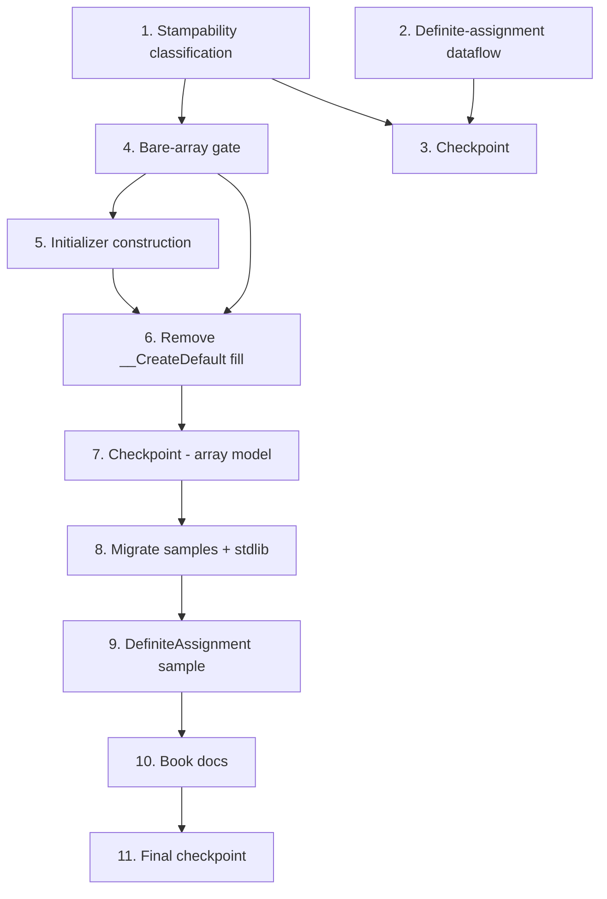

# Implementation Plan: Definite Assignment

## Overview

This plan implements definite-assignment analysis (constructor fields + locals), stampability classification for structs, the bare/initializer array-construction split, removal of the interim `__CreateDefault` array-fill loop, and migration of affected samples and the `Array` bootstrap. Work is ordered so the stampability classifier lands before the array gate that depends on it, and the `__CreateDefault` removal lands together with the new array construction paths so no unsound window exists. Property-based tests use FsCheck with batched/in-process compilation per the process-spawning policy.

## Tasks

- [ ] 1. Stampability classification in the semantic model
  - [ ] 1.1 Add `bool IsStampable` property to `StructType` (`Source/Mist/Semantics/Model/Types/StructType.cs`)
    - Default `false`, `internal set`.
    - _Requirements: 3.1_
  - [ ] 1.2 Implement `ComputeStampability` in `SemanticModelBuilder`
    - Mirror `ComputeDefaultability`: iterate struct types, compute `IsStructStampable` with a `visited` set for cycle safety.
    - Rules: primitive field → ok; nested struct field → recurse; type-parameter / dependent-type-parameter field → not stampable; class/interface/trait/union/array field → not stampable.
    - Invoke from the same place `ComputeDefaultability` is invoked (after field types resolved).
    - _Requirements: 3.1, 3.2, 3.3, 3.4, 3.5_
  - [ ] 1.3 Write property test for stampability classification (Property 3)
    - **Property 3: Stampability classification correctness**
    - Create `Test/Mist.Tests/Semantics/StampabilityClassificationPropertyTests.cs`.
    - FsCheck generator produces structs with randomized field-type compositions (primitives, nested structs, class fields, string fields, type-parameter fields).
    - In-process compile via shared `CompilerDriver`; assert `IsStampable` matches the recursive primitive-or-stampable-struct predicate. No process spawn.
    - **Validates: Requirements 3.1, 3.2, 3.3, 3.4, 3.5**

- [ ] 2. Unified definite-assignment dataflow (read-before-assignment)
  - [ ] 2.1 Introduce `AssignmentState` (assigned fields, assigned locals, terminated flag) with `Clone()` and `IntersectWith()` in `TypeCheckerAnalyzer`
    - _Requirements: 1.1, 2.1_
  - [ ] 2.2 Generalize the existing assignment-only walker into a forward read+write dataflow
    - Thread `AssignmentState` through statements; clone per branch and intersect at `if`/`else` merges; conservative loop handling (body-only assignments not propagated out).
    - Record assignment targets as writes; flag reads of not-yet-assigned fields/locals.
    - Seed initial field set from explicit initializers + synthetic-default fields (reuse existing `initiallyAssigned`); seed locals with initializers at declaration.
    - _Requirements: 1.2, 1.3, 1.4, 1.5, 1.6, 2.2, 2.3, 2.4, 2.5_
  - [ ] 2.3 Detect constructor field read-before-assignment and emit `MIST_FIELD_READ_BEFORE_ASSIGNMENT`
    - Add diagnostic ID to `DiagnosticId.cs`. Located at the read expression; message names field + constructor.
    - Handle the `this`-escape case (this passed/returned/method-called before all non-defaultable fields assigned).
    - Preserve the existing end-of-constructor `MIST_FIELD_NOT_DEFINITELY_ASSIGNED` check unchanged.
    - _Requirements: 1.1, 1.4, 1.5, 1.6, 1.7, 1.8, 7.1, 7.4_
  - [ ] 2.4 Detect local read-before-assignment and emit `MIST_LOCAL_READ_BEFORE_ASSIGNMENT`
    - Add diagnostic ID. Cover compound assignment (read-then-write). Run on constructor and non-constructor bodies.
    - Treat array-construction sites (`new T[size]`, `new Array<T,Size>(fn)`, `[a,b,c]`) as producing fully-assigned values.
    - _Requirements: 2.1, 2.2, 2.3, 2.4, 2.5, 2.6, 5.4, 5.9, 7.2, 7.4_
  - [ ] 2.5 Write property test for field read-before-assignment (Property 1)
    - **Property 1: Field read-before-assignment soundness**
    - Create `Test/Mist.Tests/Analysis/FieldReadBeforeAssignmentPropertyTests.cs`.
    - Generator produces constructors with randomized assign/read orderings across branches. In-process; assert the emit-iff-unassigned-path biconditional. No process spawn.
    - **Validates: Requirements 1.1, 1.2, 1.3, 1.4, 1.5, 1.6, 1.8**
  - [ ] 2.6 Write property test for local read-before-assignment (Property 2)
    - **Property 2: Local read-before-assignment soundness**
    - Create `Test/Mist.Tests/Analysis/LocalReadBeforeAssignmentPropertyTests.cs`.
    - Generator produces method bodies with randomized local declare/assign/read orderings (incl. branches, loops, compound assignment). In-process; assert biconditional. No process spawn.
    - **Validates: Requirements 2.1, 2.2, 2.3, 2.4, 2.5, 2.6**
  - [ ] 2.7 Unit tests for definite-assignment edge cases
    - Field: all-branch assign (ok), one-branch assign (error), read-after-assign (ok), this-escape (error), initializer/synthetic-default pre-assigned (ok), end-of-ctor not-assigned still fires.
    - Local: initializer (ok), read-before (error), conditional merge (ok), loop-body read (error), compound-before-assign (error).
    - _Requirements: 1.2, 1.3, 1.5, 1.6, 1.7, 2.2, 2.4_

- [ ] 3. Checkpoint — Classification and dataflow
  - Ensure all tests pass; confirm no existing tests regressed from the new read checks. Ask the user if questions arise.

- [ ] 4. Bare array creation stampability gate (Type Checker)
  - [ ] 4.1 Add `MIST_ARRAY_REQUIRES_INITIALIZER` diagnostic ID
    - _Requirements: 4.2_
  - [ ] 4.2 Gate `new T[size]` on stampability in the array-creation check
    - Accept primitive or stampable struct; otherwise emit `MIST_ARRAY_REQUIRES_INITIALIZER` with a reason (reference type vs. struct-with-non-stampable-field) and a fix suggestion.
    - _Requirements: 4.1, 4.2, 4.5, 4.6, 7.3, 7.4_
  - [ ] 4.3 Write property test for the bare-array gate (Property 4)
    - **Property 4: Bare-array stampability gate**
    - Create `Test/Mist.Tests/Analysis/BareArrayStampabilityGatePropertyTests.cs`.
    - Generator produces `new T[N]` over randomized element types. In-process compile; assert success iff stampable, exactly one diagnostic otherwise. No process spawn.
    - **Validates: Requirements 4.1, 4.2, 4.5, 4.6**

- [ ] 5. Initializer-based array construction (`new Array<T, Size>(fn)`)
  - [ ] 5.1 Add the explicit `(Func<int, TValue> initializer)` constructor to `Source/Standard/Bootstrap/Array.mist`
    - Mark `intrinsic`; confirm declaring it suppresses the inferred `new()`. Remove the `where TValue : default` constraint.
    - _Requirements: 5.1, 6.4, 8.3, 8.3a_
  - [ ] 5.2 Type-check `new Array<T, Size>(fn)`
    - Validate single function argument, one integer-index parameter, return assignable to `T`; accept any `T`. Emit a diagnostic on signature mismatch.
    - _Requirements: 5.1, 5.2, 5.5, 5.7_
  - [ ] 5.3 Emit the per-index initialization loop in `CSharpEmitter`
    - Lower `new Array<T,Size>(fn)` to `new T[Size]` + `for (i in 0..Size) arr[i] = fn(i)`, lifted to a local as needed. Invoke only the user `fn`.
    - _Requirements: 5.3, 6.2_
  - [ ] 5.4 Write property test for initializer construction totality (Property 5)
    - **Property 5: Initializer construction totality**
    - Create `Test/Mist.Tests/Backend/InitializerArrayConstructionPropertyTests.cs`.
    - **Process-spawning:** batched — generate N `(T, size, fn)` scenarios, build ONE program that prints every element, compile once, run once, compare line-by-line. Single `dotnet` spawn for the whole property.
    - **Validates: Requirements 5.1, 5.2, 5.3, 5.4, 6.1, 6.2**

- [ ] 6. Remove the interim `__CreateDefault` array-fill loop and finalize stamp emission
  - [ ] 6.1 Remove the `EmitArrayDefaultFillIfNeeded` calls and helper from `CSharpEmitter` (typed + inferred var-decl paths)
    - Bare stampable arrays emit `new T[size]` with no loop (zero-fill); non-zero stampable defaults replicate the stamp value.
    - _Requirements: 4.1, 4.3, 4.4_
  - [ ] 6.2 Write property test verifying no hidden default-fill (Property 6)
    - **Property 6: No hidden default-fill**
    - Create `Test/Mist.Tests/Backend/NoHiddenArrayFillPropertyTests.cs`.
    - In-process emit to memory; assert emitted C# for array-creation paths contains no per-element `__CreateDefault()`; bare stampable path has no per-element loop; initializer path invokes only `fn`. No process spawn (source inspection).
    - **Validates: Requirements 4.3, 4.4, 6.3**

- [ ] 7. Checkpoint — Array construction model
  - Ensure all tests pass; build `samples/AllFeatures` and confirm no new diagnostics from the compiler changes alone (before migration). Ask the user if questions arise.

- [ ] 8. Migrate affected samples and Standard Library
  - [ ] 8.1 Migrate reference-type-array samples
    - `Iterators` (`new string[3]`), `TopLevelStatements/Disambiguation.mist` (`new string[2]`), `TopLevelStatements/Program.mist` (`new string[3]`): replace with array literals or `new Array<T,Size>(fn)`.
    - _Requirements: 8.1, 8.6, 8.8, 8.9_
  - [ ] 8.2 Migrate `ClrRefInterop` — remove the `Array.Resize` demo
    - Delete the `[ref-param-array]` block and its `new string[2]`; replace with a CLR ref-param demo that does not reassign an array (`Interlocked.Increment(ref int)` or `Interlocked.Add(ref int, int)`).
    - _Requirements: 8.7_
  - [ ] 8.3 Migrate `OptionalDefaultability` — `new Point[2]` where `Point` is a class
    - Replace with array literal or initializer construction; rewrite PROOF comments/narrative to the stampable-vs-initializer model (the old "array requires TValue:default" theme is superseded).
    - _Requirements: 8.10_
  - [ ] 8.4 Scan and migrate any Standard Library bare `new T[size]` over non-stampable `T`
    - _Requirements: 8.2_
  - [ ] 8.5 Verify stampable samples compile unchanged
    - Build each sample in Req 8.11 (`new int[N]` users). If any newly fails, fix the stampability classifier, not the sample.
    - _Requirements: 8.11_

- [ ] 9. Definite-assignment sample application
  - [ ] 9.1 Create `samples/DefiniteAssignment/Program.mist` with the proof code verbatim
    - Include `mist.toml`. The proof code from Requirement 9 must appear as-is and produce the exact expected output.
    - _Requirements: 9.1, 9.2, 9.3, 9.5_
  - [ ] 9.2 Wire `DefiniteAssignment.Program.RunDemo()` into `samples/AllFeatures`
    - Add the call to `samples/AllFeatures/Program.mist` and the reference to `samples/AllFeatures/mist.toml`.
    - _Requirements: 9.4_
  - [ ] 9.3 Verify the sample and AllFeatures
    - Compile and run `DefiniteAssignment`; assert exact expected output. Build+run `samples/AllFeatures` with zero errors/warnings/info diagnostics.
    - _Requirements: 8.4, 9.5_

- [ ] 10. Book documentation
  - [ ] 10.1 Add a definite-assignment chapter/section under the Type System area in `book/src/`
    - Cover: field/local read-before-assignment rejection; bare array for stampable types; initializer construction for non-stampable types; the no-null/zero-invalid soundness guarantee.
    - _Requirements: 10.1, 10.2_
  - [ ] 10.2 Add compiled snippets and reference the chapter in `SUMMARY.md`
    - All examples as compiled snippets per the Book Snippet Policy.
    - _Requirements: 10.3, 10.4_

- [ ] 11. Final checkpoint
  - Run the full test suite; confirm zero failures and zero new warnings. Confirm `samples/AllFeatures` runs clean. Ask the user for review.

## Task Dependency Graph



```json
{
  "waves": [
    { "wave": 1, "tasks": ["1", "2"], "rationale": "Stampability classification and the definite-assignment dataflow are independent and can proceed in parallel." },
    { "wave": 2, "tasks": ["3"], "rationale": "Checkpoint after classification and dataflow land." },
    { "wave": 3, "tasks": ["4"], "rationale": "Bare-array gate depends on stampability classification (task 1)." },
    { "wave": 4, "tasks": ["5"], "rationale": "Initializer construction builds on the array-creation type-checking from task 4." },
    { "wave": 5, "tasks": ["6"], "rationale": "Removing __CreateDefault must land with both the bare gate (4) and initializer path (5) so no unsound window exists." },
    { "wave": 6, "tasks": ["7"], "rationale": "Checkpoint after the array construction model is complete." },
    { "wave": 7, "tasks": ["8"], "rationale": "Sample/stdlib migration requires the compiler to accept the new forms." },
    { "wave": 8, "tasks": ["9"], "rationale": "The dedicated sample depends on the migrated compiler + stdlib." },
    { "wave": 9, "tasks": ["10"], "rationale": "Book docs follow the working feature and sample." },
    { "wave": 10, "tasks": ["11"], "rationale": "Final full-suite checkpoint." }
  ]
}
```

## Notes

- **Sequencing-critical:** Task 6 (remove `__CreateDefault` fill) must not land before tasks 4 and 5, or reference-type arrays would be both unsound (old fill removed) and uncompilable (no initializer path). The wave order enforces this.
- **Process-spawning compliance:** Only tasks 5.4 and 9.3 run compiled output. Task 5.4 is batched to a single `dotnet` spawn (N scenarios → one program → one run). All analyzer/classifier/emitter-inspection property tests (1.3, 2.5, 2.6, 4.3, 6.2) run fully in-process via the shared `CompilerDriver` with zero spawns.
- **Proof code is immutable:** The `samples/DefiniteAssignment/Program.mist` proof code (Requirement 9) must appear verbatim and produce the exact expected output; if it cannot compile, fix the compiler, not the proof code.
- **Sample integrity:** Per the sample-app-integrity policy, migrations to other samples are limited to the array-construction changes mandated by Requirement 8; no unrelated edits.
- **Bootstrap constructor parameter type:** The exact spelling of the index→value function parameter in `Array.mist` (`Func<int, TValue>` vs. a Mist function-type spelling) is confirmed during task 5.1 against current Mist function-typed-parameter conventions.

