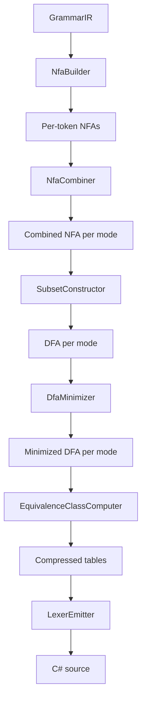

# Design Document: DFA-Based Lexer Generation

## Overview

This design replaces the current per-token `TryMatch` lexer generation strategy in `LexerEmitter` with a DFA-based (Deterministic Finite Automaton) table-driven lexer. The pipeline is:

1. **NFA Construction** — Convert each `ExpressionIR` token definition to an NFA using Thompson's construction.
2. **NFA Combination** — Combine all token NFAs within a lexer mode into a single NFA with a shared start state.
3. **Subset Construction** — Convert each combined NFA to a DFA, resolving accepting-state conflicts by declaration-order priority.
4. **DFA Minimization** — Minimize each DFA using Hopcroft's algorithm to reduce transition table size.
5. **Equivalence Class Computation** — Group input characters with identical transition behavior to compress table width.
6. **Code Emission** — Emit C# source with static transition tables and a table-driven `Lex` loop replacing the per-token `TryMatch` methods.

The generated lexer maintains the same public API (`Lex`, `IsHidden`, `GetTokenMode`) so that consumers like `MistLexer.cs` require no changes.

## Architecture

The new components live inside `Source/Storm.SourceGenerator/Emit/` alongside the existing `LexerEmitter.cs`. The pipeline runs at source-generation time (inside the Roslyn incremental generator), not at runtime.



All new types are internal to the `Storm.SourceGenerator` assembly. The only public-facing change is the content of the emitted C# source — the emitted API surface is identical.

### Key Design Decisions

1. **Operate on `char` (UTF-16 code units)**: The existing lexer operates on `string` characters. The DFA alphabet is the full UTF-16 range (0–65535). Equivalence classes compress this to a manageable table width.

2. **One DFA per mode**: Each lexer mode (`default`, `Interpolation`, etc.) gets its own minimized DFA and transition table. The emitted lexer switches tables when the mode stack changes.

3. **No runtime Regex**: `RegexLiteralIR` patterns are parsed into NFA fragments at generation time, eliminating all `System.Text.RegularExpressions` usage from emitted code.

4. **Reuse existing utilities**: `CodeWriter`, `SanitizeIdentifier`, and `EmissionContext` are reused unchanged. The `TokenKind` enum emission is preserved as-is.

5. **Target `netstandard2.0`**: All new code must compile under `netstandard2.0` (the source generator's target framework). No C# features beyond what `LangVersion latest` allows on `netstandard2.0`.

## Components and Interfaces

### NfaState and Nfa

```csharp
namespace Storm.SourceGenerator.Emit;

/// <summary>
/// A single state in an NFA. Each state has a list of transitions
/// (on a character or epsilon) and an optional accepting annotation.
/// </summary>
internal sealed class NfaState
{
    public int Id { get; }
    public List<NfaTransition> Transitions { get; } = new();
    
    /// <summary>
    /// If this is an accepting state, the token kind (declaration index).
    /// -1 means non-accepting.
    /// </summary>
    public int AcceptingTokenIndex { get; set; } = -1;
}

/// <summary>
/// A transition from one NFA state to another, either on a character
/// predicate or on epsilon (predicate is null).
/// </summary>
internal sealed class NfaTransition
{
    /// <summary>
    /// Null for epsilon transitions. Otherwise, returns true if the
    /// character triggers this transition.
    /// </summary>
    public Func<char, bool>? Predicate { get; }
    
    /// <summary>
    /// Character ranges for this transition, used during subset construction
    /// to build DFA transitions. Null for epsilon transitions.
    /// </summary>
    public CharRange[]? Ranges { get; }
    
    public NfaState Target { get; }
}

/// <summary>
/// An NFA fragment with a single start state and a single accept state.
/// Thompson's construction always produces fragments of this shape.
/// </summary>
internal sealed class NfaFragment
{
    public NfaState Start { get; }
    public NfaState Accept { get; }
}
```

### NfaBuilder

Converts `ExpressionIR` trees to `NfaFragment`s using Thompson's construction. Also handles `RegexLiteralIR` by parsing the regex pattern into an equivalent expression tree first.

```csharp
internal static class NfaBuilder
{
    /// <summary>
    /// Build an NFA fragment for a single ExpressionIR.
    /// </summary>
    public static NfaFragment Build(ExpressionIR expression);
    
    /// <summary>
    /// Build a combined NFA for all tokens in a mode.
    /// Creates a new start state with epsilon transitions to each token's NFA.
    /// Annotates each token NFA's accept state with the token's declaration index.
    /// </summary>
    public static Nfa BuildCombined(IReadOnlyList<TokenIR> tokens);
}
```

### RegexParser

Parses `RegexLiteralIR` patterns into `ExpressionIR` trees so they can be fed into the standard Thompson's construction path.

```csharp
internal static class RegexParser
{
    /// <summary>
    /// Parse a regex pattern string into an ExpressionIR tree.
    /// Supports: character classes, quantifiers (+, *, ?), escapes (\s, \d, \w, \n, \t, etc.),
    /// dot metacharacter, grouping with parentheses, alternation with |.
    /// </summary>
    public static ExpressionIR Parse(string pattern);
}
```

### SubsetConstructor

Converts a combined NFA to a DFA using the powerset construction.

```csharp
internal static class SubsetConstructor
{
    /// <summary>
    /// Convert an NFA to an equivalent DFA.
    /// Each DFA state corresponds to a set of NFA states.
    /// Accepting DFA states get the token with the lowest declaration index
    /// among the NFA accepting states in the set.
    /// </summary>
    public static Dfa Convert(Nfa nfa);
}
```

### DfaState and Dfa

```csharp
internal sealed class DfaState
{
    public int Id { get; }
    
    /// <summary>
    /// Transitions indexed by character. Stored as a sorted list of
    /// (CharRange, targetStateId) pairs during construction, then
    /// converted to equivalence-class-indexed arrays for emission.
    /// </summary>
    public List<DfaTransition> Transitions { get; } = new();
    
    /// <summary>
    /// -1 for non-accepting states. Otherwise, the token declaration index.
    /// </summary>
    public int AcceptingTokenIndex { get; set; } = -1;
}

internal sealed class Dfa
{
    public int StartStateId { get; }
    public IReadOnlyList<DfaState> States { get; }
}
```

### DfaMinimizer

Minimizes a DFA using Hopcroft's algorithm.

```csharp
internal static class DfaMinimizer
{
    /// <summary>
    /// Minimize the DFA by merging indistinguishable states.
    /// Two states are distinguishable if they have different accepting
    /// token indices or if any input leads to distinguishable states.
    /// </summary>
    public static Dfa Minimize(Dfa dfa);
}
```

### EquivalenceClassComputer

Groups characters with identical transition behavior across all DFA states.

```csharp
internal static class EquivalenceClassComputer
{
    /// <summary>
    /// Compute equivalence classes for the DFA's alphabet.
    /// Returns a mapping from char to class index, and the number of classes.
    /// </summary>
    public static (int[] charToClass, int classCount) Compute(Dfa dfa);
}
```

### Updated LexerEmitter

The existing `LexerEmitter.Emit` method is replaced. The `TokenKind` enum emission is preserved. The per-token `TryMatch` methods, regex fields, and the old `Lex` loop are replaced with:

- Static transition table arrays (one per mode)
- Static accepting state arrays (one per mode)
- Equivalence class mapping array
- A table-driven `Lex` method with maximal munch and mode stack

## Data Models

### CharRange

```csharp
internal readonly struct CharRange
{
    public char Lo { get; }  // inclusive
    public char Hi { get; }  // inclusive
    
    public CharRange(char lo, char hi) { Lo = lo; Hi = hi; }
    public CharRange(char single) { Lo = single; Hi = single; }
    
    public bool Contains(char c) => c >= Lo && c <= Hi;
}
```

### NFA Representation

- **States**: Numbered 0..N-1. Each state has a list of transitions.
- **Transitions**: Either epsilon (no predicate) or character-predicate-based. Character transitions carry `CharRange[]` for efficient subset construction.
- **Accepting states**: Annotated with `(tokenDeclarationIndex)`. A state can have multiple annotations in the combined NFA; subset construction resolves to the lowest index.

### DFA Representation

- **States**: Numbered 0..M-1. State 0 is the start state.
- **Transitions**: Stored as `(CharRange, targetStateId)` pairs during construction. Converted to equivalence-class-indexed `int[]` arrays for emission.
- **Accepting states**: Each state has a single `acceptingTokenIndex` (-1 for non-accepting).

### Emitted Table Layout

```csharp
// Equivalence class mapping: char -> class index
private static readonly byte[] _charClass = new byte[65536];

// Transition table per mode: [state, classIndex] -> nextState (-1 = no transition)
private static readonly short[,] _transTable_default = new short[STATE_COUNT, CLASS_COUNT];

// Accepting state table per mode: [state] -> tokenKind (-1 = non-accepting)
private static readonly short[] _accept_default = new short[STATE_COUNT];
```

For multi-mode grammars, one pair of `_transTable_{mode}` and `_accept_{mode}` arrays is emitted per mode. The `Lex` method selects the active tables based on the mode stack.

## Correctness Properties

*A property is a characteristic or behavior that should hold true across all valid executions of a system — essentially, a formal statement about what the system should do. Properties serve as the bridge between human-readable specifications and machine-verifiable correctness guarantees.*

### Property 1: NFA Round-Trip

*For any* valid `ExpressionIR` tree and *for any* string, the NFA produced by Thompson's construction accepts the string if and only if the expression semantically matches that string (using the current `TryMatch` implementation as oracle).

**Validates: Requirements 1.1, 1.2, 1.3, 1.4, 1.5, 1.6, 1.7, 1.8, 1.9, 1.10, 11.1, 11.3**

### Property 2: Combined NFA Union

*For any* set of token expressions in a lexer mode and *for any* string, the combined NFA accepts the string if and only if at least one individual token NFA accepts it.

**Validates: Requirements 2.1**

### Property 3: Subset Construction Language Preservation with Priority

*For any* combined NFA and *for any* string, the DFA produced by subset construction accepts the string if and only if the NFA accepts it, and when the DFA accepts, the assigned token kind has the lowest declaration index among all tokens that match.

**Validates: Requirements 3.1, 3.2, 3.3**

### Property 4: Minimization Correctness

*For any* DFA and *for any* string, the minimized DFA accepts the string if and only if the original DFA accepts it, with the same accepting token kind.

**Validates: Requirements 4.1, 4.2, 4.3**

### Property 5: Minimization Idempotence

*For any* DFA, minimizing twice produces a DFA with the same number of states as minimizing once.

**Validates: Requirements 4.4**

### Property 6: Maximal Munch

*For any* DFA and *for any* input string, the lexer loop always produces the longest possible match at each position — no shorter accepting prefix is chosen when a longer one exists.

**Validates: Requirements 6.2**

### Property 7: Declaration Order Priority on Tie

*For any* grammar with overlapping token patterns and *for any* input where two tokens match the same length, the lexer selects the token with the lower declaration index.

**Validates: Requirements 6.3**

### Property 8: Mode Stack Transitions

*For any* sequence of tokens with push/pop mode actions, the mode stack transitions correctly: push adds the target mode, pop removes the top mode (if stack depth > 1), and the active transition table always corresponds to the current top of the mode stack.

**Validates: Requirements 7.1, 7.2, 7.3, 7.4**

### Property 9: Channel Assignment Matches Hidden Flag

*For any* token matched by the lexer, the token is assigned to the Hidden channel if and only if it is marked as hidden in the grammar.

**Validates: Requirements 8.1, 8.2, 8.3**

### Property 10: Full Lexer Equivalence

*For any* input string, the DFA-based lexer produces the same token stream as the current TryMatch-based lexer — identical token kinds, lexeme strings, source spans, and channel assignments, including error tokens for unrecognized characters.

**Validates: Requirements 12.1, 12.2, 12.3, 12.4, 12.5**

## Error Handling

### Generation-Time Errors

- **Unsupported regex features**: If a `RegexLiteralIR` contains features not supported by `RegexParser` (e.g., backreferences, lookahead), the parser reports a diagnostic and falls back to a catch-all error NFA. This is a generation-time error reported through the Roslyn `SourceProductionContext`.
- **Empty token expressions**: If a token expression matches the empty string (e.g., `OptionalIR` wrapping everything), the NFA builder should detect this and report a warning, since it would cause infinite loops in the lexer.

### Runtime Errors (in emitted code)

- **Unrecognized character**: When no DFA transition exists and no accepting state has been seen, the lexer emits an `Error` token for the current character, adds a diagnostic message, and advances by one position. This matches the current behavior.
- **Mode stack underflow**: `PopModeIR` only pops if the stack has more than one entry, preventing underflow. This matches the current behavior.

## Testing Strategy

### Property-Based Tests (FsCheck.Xunit)

The test project (`Test/Storm.SourceGenerator.Tests`) already uses `FsCheck.Xunit` version 3.1.0. All property-based tests will use this library.

**Configuration**: Each property test runs a minimum of 100 iterations. Each test is tagged with a comment referencing its design property.

**Property tests to implement**:

| Property | Description | Generator Strategy |
|----------|-------------|-------------------|
| P1: NFA Round-Trip | NFA accepts iff TryMatch accepts | Generate random `ExpressionIR` trees (depth-limited) and random strings |
| P2: Combined NFA Union | Combined NFA = union of individual NFAs | Generate random sets of `ExpressionIR` trees and random strings |
| P3: Subset Construction | DFA accepts same language as NFA with priority | Generate random combined NFAs and random strings |
| P4: Minimization Correctness | Minimized DFA = original DFA | Generate random DFAs and random strings |
| P5: Minimization Idempotence | minimize(minimize(dfa)) = minimize(dfa) | Generate random DFAs |
| P6: Maximal Munch | Longest match always chosen | Generate grammars with overlapping tokens and random inputs |
| P7: Declaration Order Priority | Lower index wins on tie | Generate grammars with same-length overlapping patterns |
| P8: Mode Stack Transitions | Push/pop behave correctly | Generate token sequences with mode actions |
| P9: Channel Assignment | Hidden flag determines channel | Generate grammars with mixed hidden/visible tokens |
| P10: Full Lexer Equivalence | DFA lexer = TryMatch lexer | Generate random inputs, compare both lexers |

### Unit Tests (xUnit)

Unit tests cover specific examples, edge cases, and structural verification:

- **Structural emission tests**: Verify emitted code contains transition tables, no `Regex` usage, correct method signatures, correct `TokenKind` enum.
- **Edge cases**: Empty input, single-character input, input with only unrecognized characters, deeply nested mode push/pop sequences.
- **Regex parsing**: Specific regex patterns (`\s+`, `[^\n]*`, `[a-zA-Z_][a-zA-Z0-9_]*`, `.`) produce correct NFA structures.
- **API compatibility**: Emitted code has `Lex`, `IsHidden`, `GetTokenMode` with correct signatures and mode constants.

### Integration Tests

- **Mist grammar end-to-end**: Lex the full Mist grammar's test corpus with both the old and new emitters and compare token streams.
- **Interpolated string mode switching**: Verify `$"text{expr}text"` produces correct token sequences with mode transitions.
