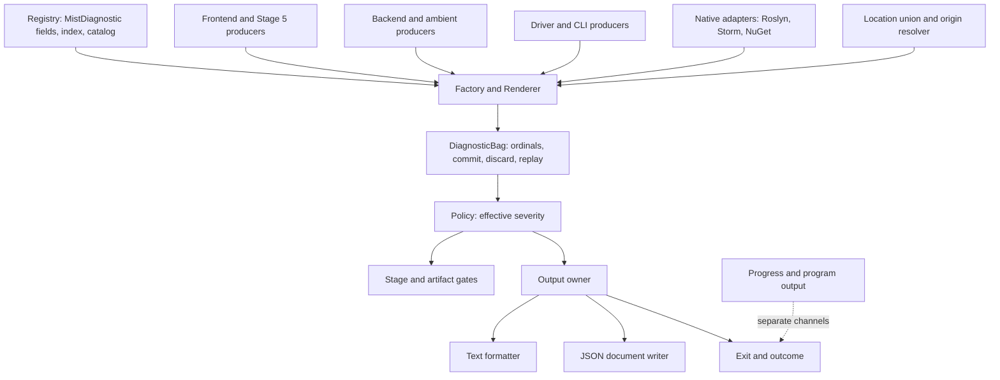

# Design Document: Diagnostics

## Overview

The compiler already has the right seams: `DiagnosticDescriptor` centralizes static metadata, `DiagnosticBag` collects per stage and supports speculative withholding, `DiagnosticHelper` resolves node origins, `DiagnosticFormatter` owns the MSBuild-shaped line, `AnalysisContext` owns Stage 5 cascade suppression, and `CompileFeedback` with `ResolutionDiagnostics` already streams dependency findings early and delivers every occurrence once. This design keeps every one of those seams and changes what flows through them.

What changes is the content. A descriptor becomes a registry entry with a number, a title, a description, a category, a policy class and a typed slot schema. An occurrence stops being a rendered string and becomes typed slot values, a location from a closed union, related locations, provenance frames and a cause. Collection gains ordinals and explicit transaction outcomes. One output owner renders text as today or a buffered JSON document. Policy is computed once and gates read it. The public codes are reissued once as `MISTnnnn`.

The design does not introduce a second diagnostic hierarchy beside `Diagnostic`, does not make `Mist.Common` depend on Roslyn or on Storm's generated model, and does not make the CLI the owner of the diagnostic model. Adapters own every foreign dependency.

## Decision register

| Decision | Settled as | Requirements |
|---|---|---|
| D01 Identity | `MISTnnnn`, one number per template, typed descriptor, no aliases, one-time reissue | 1, 5, 15 |
| D02 Category | thirteen closed tokens, exactly one per number, metadata only | 3 |
| D03 Severity | Info, Warning, Error; Fixed, Promotable, Optional; effective severity before gates | 6 |
| D04 CLI | format, file, policy overrides, minimum severity; no hiding by number or category | 12 |
| D05 Arguments | named typed slots, one renderer, wording frozen through the reissue | 7 |
| D06 Location | closed union, absence reasons, frames, roles, identity comparison | 8 |
| D07 Collection | ordinals, append order, no value dedup, commit, discard, replay, cause links | 9 |
| D08 Machine output | one buffered JSON document, stderr or file, all admitted findings | 11 |
| D09 Exit | matrix unchanged, outcome in the document, host boundary | 13 |
| D10 Visibility | defects fail closed, Roslyn warnings never forwarded, native array in JSON | 14 |
| D11 Adjudication | one merge, seven retirements, one held back, producer required to mint | 4.6, 15 |

## Architecture



Dependency rules:

- `Mist.Common.Diagnostics` depends on `Mist.Common.Source` and nothing else. It never references Roslyn, NuGet, the Storm generated model or the CLI.
- The origin resolver keeps its dependency on `Storm.Runtime.SyntaxNode` where it stands today, in `DiagnosticHelper`, which is already in Common because the generated node type is the AST contract.
- Each native adapter lives beside its producer: the Roslyn adapter in the backend's compilation driver, the Storm adapter in `MistLexer` and `MistParser`, the NuGet adapter in the package resolver.
- The output owner lives in the CLI, because it is the only component that knows which stream a command owns. The text formatter and the JSON writer live in Common so a future host can reuse them.

## Components and Interfaces

All code below is a shape, not a final signature. Names follow the glossary in `requirements.md`.

### MistDiagnostic

```csharp
public sealed record MistDiagnostic(
    DiagnosticNumber Number,            // MIST0384; minted only by registry declarations
    string Title,                       // "Not callable"
    string Template,                    // "'{name}' is not a method, and its type '{type}' ..."
    string Description,                 // one paragraph: condition and remedy
    DiagnosticCategory Category,        // TYP
    PolicyClass Policy,                 // Fixed | Promotable | Optional
    DiagnosticSeverity DefaultSeverity, // Info | Warning | Error
    ImmutableArray<Slot> Slots,         // [(name, Name), (type, Type)]
    ImmutableArray<DiagnosticNumber> Related = default,
    bool EnabledByDefault = true);      // meaningful for Optional only

public readonly record struct Slot(string Name, SlotKind Kind);
```

`DiagnosticNumber` wraps the four-digit value and has no public constructor. Registry classes mint numbers through an internal factory that the registry assembly alone can call. The field name on the registry class remains the strong reference producers use; it is a C# symbol, not a contract.

Stage is not on the descriptor. Requirement 2.5 moves it to the occurrence, because the same descriptor is reported by different stages today and the declared stage has already drifted from the detector once.

### Slot values

```csharp
public abstract record SlotValue;
public sealed record NameValue(string Name) : SlotValue;
public sealed record TypeValue(TypeIdentity Identity, string MistSpelling) : SlotValue;   // snapshot
public sealed record SymbolValue(SymbolIdentity Identity, string MistSpelling) : SlotValue;
public sealed record PathValue(string NormalizedPath) : SlotValue;
public sealed record IntegerValue(long Value) : SlotValue;
public sealed record BooleanValue(bool Value) : SlotValue;
public sealed record EnumValue(string Token) : SlotValue;
public sealed record TextValue(string Text) : SlotValue;                 // upstream messages, nothing else
public sealed record SequenceValue(SlotKind ElementKind, ImmutableArray<SlotValue> Items) : SlotValue;
public sealed record OptionalValue(SlotKind Kind, SlotValue? Value) : SlotValue;  // absent is distinct from empty
```

A `TypeValue` is taken with `TypeDisplay.Mist` at report time, which is what the 33 sites that pass a type do today; the difference is that the identity travels with the spelling and the model is never read again. A `TextValue` is reserved for wrapped upstream messages and for the few driver sites that carry an exception message, and the registry validator may flag any other use.

### Diagnostic

```csharp
public sealed record Diagnostic
{
    public int Ordinal { get; }                       // per operation, assigned at admission
    public MistDiagnostic Descriptor { get; }
    public ImmutableArray<SlotValue> Arguments { get; }   // in schema order
    public Location Location { get; }
    public ImmutableArray<RelatedLocation> Related { get; }
    public ImmutableArray<Frame> Frames { get; }
    public int? Cause { get; }                        // ordinal of the occurrence this wraps
    public PipelineStage Stage { get; }               // the producer, recorded here
    public DiagnosticSeverity DefaultSeverity => Descriptor.DefaultSeverity;
    public DiagnosticSeverity EffectiveSeverity { get; }
    public string? SeverityReason { get; }            // "promoted by mist.toml" and the like
    public ProviderCode? Native { get; }              // CS8123 with provider "roslyn", when wrapping
    public string Message => Renderer.Render(this);   // computed, never stored as identity
    internal Diagnostic(...) { }                      // Factory only
}
```

The constructor is internal. `Message` is computed, so a test that compares text still works, and nothing downstream can mutate it.

### Location

```csharp
public abstract record Location;
public sealed record SourceRange(SourceIdentity File, int Offset, int Length) : Location;
public sealed record SourcePoint(SourceIdentity File, int Offset) : Location;
public sealed record FileOnly(string Path) : Location;
public sealed record ProjectLocation(string ManifestPath, SourceRange? KeySpan) : Location;
public sealed record ExternalLocation(string Assembly, string Symbol) : Location;
public sealed record GeneratedLocation(string Path, LinePositionSpan Native, SourceRange? Mapped) : Location;
public sealed record Absent(AbsenceReason Reason) : Location;

public enum AbsenceReason { NotYetAttached, TestOrigin, SyntheticWithoutRoot, OutOfBounds, Unavailable }

public readonly record struct RelatedLocation(RelatedRole Role, Location Location);
public enum RelatedRole { PreviousDeclaration, Import, Constraint, CloneDefinition, Instantiation, GeneratedOutput, DependencyDeclaration }

public abstract record Frame;
public sealed record LoweringFrame(string Reason) : Frame;             // "await insertion"
public sealed record SynthesisFrame(string Reason) : Frame;            // the current SyntheticOrigin reasons
public sealed record OperationFrame(string Project, ImmutableArray<string> ReferenceChain, string? Package) : Frame;
public sealed record TruncatedFrame(int Depth, bool Cyclic) : Frame;   // the chain was cut here
```

`SourceIdentity` is the `SourceText` instance's identity plus its path and a content hash, so two files with coincident ranges never compare equal and a span is always read against the text it was computed from. Line and column are derived by `SourceText.ToLinePositionSpan` exactly as today; the text formatter asks for them, nothing else stores them.

`DiagnosticHelper.ResolveLocation` keeps its chain walk and its depth limit. It returns a `Location` and the frames instead of a joined string, and the node extension stops discarding them. Bounds are checked as start at least zero, length at least zero, end at most length, with `checked` arithmetic.

### Factory and Renderer

```csharp
public static class DiagnosticFactory
{
    public static Diagnostic Create(
        MistDiagnostic descriptor, Location location, PipelineStage stage,
        ReadOnlySpan<SlotValue> arguments,
        ImmutableArray<RelatedLocation> related = default,
        ImmutableArray<Frame> frames = default,
        int? cause = null,
        ProviderCode? native = null);
}
```

`Create` checks the argument count and each kind against the schema. A breach does not throw: it admits the intended occurrence with an `Absent(Unavailable)` location if the location was the problem, or with a fixed fallback template if the arguments were, and admits one `ICE` occurrence naming the descriptor and the producing stage. The renderer formats under `CultureInfo.InvariantCulture`, substitutes named placeholders from the schema, honors escaped braces, and never throws: a renderer fault renders the fallback template, which has no slots.

During migration a descriptor whose template still uses `{0}`-style indices is rendered positionally; the registry validator accepts indices until Phase 3, when it requires names.

### DiagnosticBag

```csharp
public sealed class DiagnosticBag
{
    public void Report(MistDiagnostic d, Location at, PipelineStage stage, params ReadOnlySpan<SlotValue> args);
    public void Add(Diagnostic occurrence);                  // forwarding only
    public Withheld Withhold(Action action);                // returns the withheld occurrences
    public bool HasErrors { get; }                           // reads EffectiveSeverity
    public ImmutableArray<Diagnostic> ToImmutableArray();
}

public sealed class Withheld
{
    public ImmutableArray<Diagnostic> Occurrences { get; }
    public void Commit();     // append to parent, ordinals intact
    public void Discard();    // drop
    public void Replay(Diagnostic earlier);   // commit an occurrence withheld before
}
```

The node extension `ReportAtNode` stays as the ergonomic entry for syntax-anchored producers and resolves the location through `DiagnosticHelper`; its `analyzerName` parameter is removed, because the producer stage is recorded on the occurrence and the lone-string overload hazard disappears with typed arguments. `Contains` is deleted; its one caller, the clone helper, compares cause ordinals instead.

The ordinal counter belongs to the operation, not the bag. Bags created by stages take their counter from an operation scope the driver creates once per compile, so an occurrence withheld in one bag and replayed into another keeps its ordinal.

### Policy

```csharp
public sealed record DiagnosticPolicy(
    bool PromoteAllWarnings,
    ImmutableHashSet<DiagnosticNumber> Promoted,
    ImmutableHashSet<DiagnosticNumber> Disabled,
    ImmutableHashSet<DiagnosticNumber> Enabled);

public static class SeverityPolicy
{
    public static (DiagnosticSeverity Effective, string? Reason) Apply(MistDiagnostic d, DiagnosticPolicy policy);
}
```

The policy is parsed from the `[diagnostics]` table of `mist.toml` by `ProjectFileParser`, overridden by the CLI, validated against the registry before compilation, and handed to the operation scope. `Apply` runs once at admission. A `Fixed` descriptor always returns its default. A `Promotable` descriptor returns `Error` when promoted. An `Optional` descriptor that is disabled never reaches `Apply`, because its rule is not run; Stage 5 consults `policy.IsEnabled(descriptor)` when it registers analyzers, and the driver does the same for its optional checks.

### Output owner

```csharp
public sealed class DiagnosticOutput
{
    public DiagnosticOutput(DiagnosticFormat format, TextWriter text, Stream? document, DiagnosticSeverity minimum);
    public void Stream(Diagnostic d);          // early delivery, text mode only
    public void Complete(CompilerResult result, Outcome outcome);  // final pass and summary, or the document
}
```

`CompileFeedback` becomes this type's compile-specific caller. In text mode it keeps today's behavior exactly: write each streamed ordinal as it arrives, then after the summary write every ordinal not yet written, in result order. In JSON mode it collects and writes one document in `Complete`. The minimum-severity filter is applied here and nowhere else, and it sets `visible` rather than dropping anything.

### Native adapters

- **Roslyn.** The compilation driver iterates every diagnostic of the in-process emit. Errors are admitted under the wrapper descriptor with `GeneratedLocation`, the `ProviderCode` and a `TextValue` of the native message. Every diagnostic, errors included, is also appended to the operation's native list for the JSON `native` array. Nothing else is admitted.
- **Storm runtime.** `MistLexer` and `MistParser` keep their wrapper descriptors. The adapter maps a runtime entry to a `SourcePoint`, or to `SourceRange` when the lexer supplies a span, with the entry's message in a `TextValue`. Speculative rollback stays upstream; the adapter sees only committed entries. Build-time `STORM` codes never enter Mist's registry.
- **NuGet.** `PackageResolver` keeps its wrapper descriptors for restore failures. The restore process result is parsed by a small typed adapter that records native `NU` codes as `ProviderCode` on the occurrence where the output supplies one, and otherwise records the raw stderr excerpt in a `TextValue`. No regex classification of English keywords remains in a formatter.

### Host boundary

`Program.Main` wraps command dispatch in one `try`. An unhandled exception becomes one `ICE` occurrence through the factory, with the exception type, message and stack in a `TextValue` sequence, rendered through the active output owner, exit 1. No other catch is added by this design, and the pipeline's existing dispose-and-rethrow in `StandardPipeline` stays.

### Registry index and catalog

`DiagnosticRegistry.Index` is built once per process by reflecting the `public static readonly MistDiagnostic` fields of every type in `Mist.Common.Diagnostics`. It exposes lookup by number, enumeration by category, the tombstone list and the validation routine that Requirement 4's Tier 1 test calls. A checked-in script, `tools/diagnostics/catalog.sh`, runs a small console entry over the index to regenerate `book/src/reference/diagnostics.md` grouped by category. The script is run by hand and the page is committed; the Tier 1 test fails when the committed page is stale.

## Data Models

### The JSON document

```json
{
  "schemaVersion": "1.0",
  "compiler": "mist 0.0.0+af6a1f70",
  "command": "build",
  "project": "samples/HelloMist",
  "outcome": "failed",
  "counts": { "admitted": 3, "errors": 1, "warnings": 2, "info": 0, "hidden": 1 },
  "diagnostics": [
    {
      "ordinal": 1,
      "code": "MIST0384",
      "title": "Not callable",
      "category": "TYP",
      "policy": "fixed",
      "severity": { "default": "error", "effective": "error", "reason": null },
      "message": "'foo' is not a method, and its type 'int' is not a function type, so it cannot be called.",
      "arguments": { "name": "foo", "type": { "spelling": "int", "identity": "Standard.Int32" } },
      "location": { "kind": "sourceRange", "path": "Program.mist", "line": 12, "column": 5, "endLine": 12, "endColumn": 8, "offset": 211, "length": 3 },
      "related": [],
      "frames": [],
      "cause": null,
      "native": null,
      "stage": "semanticModelConstruction",
      "visible": true
    }
  ],
  "native": [
    { "provider": "roslyn", "code": "CS8618", "severity": "warning",
      "message": "Non-nullable field 'item0' must contain a non-null value when exiting constructor.",
      "location": { "kind": "generated", "path": "out/HelloMist/Program.cs", "line": 10, "column": 12 } }
  ]
}
```

Key order is fixed as shown. Enum values are lower camel case. The `location` object's `kind` is one of `sourceRange`, `sourcePoint`, `fileOnly`, `project`, `external`, `generated`, `absent`; an `absent` location carries `reason`. `arguments` is an object keyed by slot name; a type or symbol value is an object with `spelling` and `identity`; a sequence is an array; an absent optional is `null`.

### The project policy table

```toml
[diagnostics]
warnings_as_errors = ["MIST0211", "MIST0052"]   # or: true
disable = ["MIST0450"]                            # Optional entries only
enable  = ["MIST0451"]
```

### The crosswalk

One row per descriptor field at `af6a1f70`, in the file `.kiro/specs/diagnostics/crosswalk.md`:

| Field | Old code | Disposition | Number | Title | Category |
|---|---|---|---|---|---|
| `ProgramModelDiagnostics.NotCallable` | `MIST_PM_NOT_CALLABLE` | merged with `NotCallableExtensionNotImported` | `MIST0384` | Not callable | TYP |
| `ProgramModelDiagnostics.ValueNotCallable` | `MIST_PM_NOT_CALLABLE` | numbered | `MIST0385` | Value not callable | TYP |
| `CommonDiagnostics.NamespaceNotFound` | `MIST_NS_NOT_FOUND` | retired, see `UndefinedNamespace` | none | | |
| `CommonDiagnostics.PackageNoCompatibleTfm` | `MIST_PKG_001` | held back, no producer | none | | |

The numbers above are placeholders for the shape. Numbers are minted in one pass, in registry order, when the reissue change is made.

## Text output

Unchanged line shapes, with the number in place of the old spelling:

```text
Program.mist(12,5): error MIST0384: 'foo' is not a method, and its type 'int' is not a function type, so it cannot be called.
mist.toml: error MIST0052: The 'namespaces' field in '[global_usings]' section of 'mist.toml' must be an array.
error MIST0901: Internal compiler error: no emission for statement 'FooStatement'. This is a compiler bug; please report it with the program that caused it.
```

The summary line is unchanged in shape and counts effective severity over every admitted occurrence.

## The reissue procedure

1. Land the registry types, the slot schema, the factory and the renderer with every existing descriptor still carrying its old spelling and a positional template. Nothing visible changes.
2. Apply the one merge and the seven retirements, and hold back the one descriptor without a producer. Run the producer scan of Requirement 4.6.
3. Mint numbers in one pass, registry file by registry file in declaration order, starting at `MIST0001`. Write the crosswalk.
4. In the same change, rewrite every test assertion on a code, every book page, every specification citation and the CLI help through the crosswalk. Assertions on message text do not change. Run the Tier 1 text-freeze table.
5. Add the leading supersession notes to the two old specifications and rewrite `full-accessibility-model`'s citations.
6. Build with zero warnings, format, full ledger including `AllFeaturesV2`. The change lands as one commit so that no revision ever has two numbering schemes.

Frozen history is never touched: `git show 6d862f63:backlog/issues.yaml`, Carbonek findings and `TestResults/` keep old spellings, and the crosswalk is how a reader translates them.

## Supersession

| Old clause | Status | Superseded by |
|---|---|---|
| descriptor-system 1.2 to 1.5: fields of `DiagnosticDescriptor` | superseded | Requirement 2 |
| descriptor-system 2.1 to 2.7: named registry classes | superseded | Requirement 2.7 |
| descriptor-system 2.9: XML summary on every field | superseded | Requirement 2.3, Requirement 18.1 |
| descriptor-system 2.11: no two fields share an ID | superseded | Requirement 1.3 |
| descriptor-system 2.12: shared descriptors live in `CommonDiagnostics` | superseded | Requirement 2.7 |
| descriptor-system 3.1 to 3.3: `Report` overloads, analyzer-name overload | superseded | Requirement 5, `DiagnosticBag` above |
| descriptor-system 3.4: `FormatException` on arity mismatch | superseded | Requirement 7.5 |
| descriptor-system 3.5: `Add(Diagnostic)` kept for migration | narrowed | Requirement 1.7 |
| descriptor-system 4.1 to 4.5: preserve exact string IDs | superseded | Requirements 1, 15 |
| descriptor-system 5.1 to 5.4: no inline `new DiagnosticId(` | tightened | Requirement 5 |
| descriptor-system 6.4, 6.5: identical messages, tests unchanged | in force | Requirement 7.9 |
| descriptor-system 7: steering file | superseded, no file exists | guidance lives in `AGENTS.md` and this specification |
| formatting 4.3, 4.4, 7.3, 7.4: nullable location | superseded | Requirement 8 |
| formatting 5.6 and design Property 1: formatter round trip for all values | superseded | Requirement 11 |
| formatting design: 100 iterations for every property | superseded | Requirement 17.5 |
| formatting 1 to 3, 6: Storm runtime and frontend positions | in force | unchanged |

## Migration plan

Each packet is bounded, lands behind the adapters above, and is verified at the tiers Requirement 17 names. Dependencies are strict within Phase 1 and loose across Phase 2.

### Phase 0: pin and probe

- **0.1 Refresh the inventories.** Re-run the review's scanners against the reissue revision; every count in `requirements.md` is re-stated at that revision.
- **0.2 Probe the held-back descriptor.** Resolve a package with no asset for the target framework and record what is reported today; file the result for the owner.
- **0.3 Probe the four retired `MIST_PM` conditions.** For each, write the program that should trigger it and record what is reported today; a gap becomes a lead for the owner.
- **0.4 Count the nullable-flow warnings** in the emitted suite at the reissue revision and record them on the backend quality lead.

### Phase 1: Common infrastructure, in order

- **1.1 Registry types and index.** `MistDiagnostic`, `DiagnosticNumber`, `DiagnosticCategory`, `PolicyClass`, `Slot`, the reflection index, the tombstone list, the Tier 1 validation test. Existing descriptors are converted field by field with their old spelling as a temporary number and a positional template. Depends on nothing.
- **1.2 Slots, factory, renderer.** `SlotValue`, `DiagnosticFactory`, the renderer with positional and named substitution, the fallback template, the Tier 1 text-freeze table over every template. Depends on 1.1.
- **1.3 The reissue.** Merge, retire, hold back, mint, crosswalk, rewrite tests, book, specs and help, supersession notes. One commit. Depends on 1.2.
- **1.4 Location union and provenance.** The `Location` records, `RelatedLocation`, `Frame`, `SourceIdentity`, the resolver returning frames, bounds with `checked` arithmetic, Tier 1 table over parsed, synthetic, test and cyclic origins, CRLF, LF, CR, multi-unit characters, first character, end of file and each invalid bound. Depends on 1.2.
- **1.5 Ordinals and transactions.** The operation scope, ordinal assignment, `Withheld` with commit, discard and replay, deletion of `Contains`, Tier 1 tests for nesting, exception restore and ordinal preservation. Depends on 1.2.
- **1.6 Policy.** `DiagnosticPolicy`, the `[diagnostics]` table in `ProjectFileParser`, `SeverityPolicy.Apply` at admission, every gate switched to effective severity, the Stage 5 registration hook for `Optional`. Tier 1 over every class and override combination. Depends on 1.1.
- **1.7 Output owner, text, JSON, file.** `DiagnosticOutput`, `CompileFeedback` rewritten over it, the JSON writer with fixed key order, the `--diagnostic-file` path, Tier 1 conventions tests, a handful of Tier 4 command-output seams for stdout and stderr separation and the run and test child boundary. Depends on 1.4, 1.5, 1.6.
- **1.8 CLI controls.** The six flags, applicability per command, bad-selector `CFG` findings, help text, README and book sentences, the steering text correction. Depends on 1.7.
- **1.9 Host boundary.** The `Main` catch, the `ICE` rendering, exit 1, one Tier 2 test with an injected throwing command. Depends on 1.7.

### Phase 2: producers, in bounded batches

Frontend, after 1.4 and 1.5:

- **2.1 Source anchors.** Parser origins before validation; lexer span and unexpected scalar as slots; the eight parser recovery sites; constraint and duplicate-type anchors.
- **2.2 Declarations and resolution.** `ProgramModel` declaration, type, name, conversion and variadic families to typed slots; `ScopeResolver`'s failure protocol kept intact.
- **2.3 Binding failures and speculation.** `OverloadFailure`, `IndexBinder`, `OperatorBinder` deferred findings as replay; the trial sites as commit or discard; `ExpressionFailures.Resolve` as replay.
- **2.4 Stage 5 rules.** Every `AnalysisContext.Report` and `Refuse` site to typed slots; `ReportAtProject` to the `Project` location; `DeclarationShapeAnalyzer` and `ContextCalls` related locations instead of text; suppression semantics untouched.
- **2.5 Clone causes.** `CloneDiagnostics` and `CastAnalyzer` wrappers reference the cause ordinal; containment by `SourceIdentity`.
- **2.6 Exceptions and gates.** The 37 throw sites classified as invariant, API guard or input failure; `UnsupportedStatement` and `UnresolvedExpression` keep source until the owning stage reports.

Backend, after 1.4 and 1.5:

- **2.7 Emission facts.** The 35 bag sites to typed slots; the fail-closed `ICE` findings of Requirement 14.1; source-less refusals to explicit `External`, `Project` or `Absent` locations.
- **2.8 Roslyn provenance.** The native adapter; `GeneratedLocation`; the `native` array; deletion of the text mapper and its property test.
- **2.9 Ambient outcomes.** Typed withholding reasons retained from projection to inspection; the use-site frame of Requirement 14.7; no eager errors.
- **2.10 Operational boundaries.** The 17 metadata catches keep their recovery and record typed causes where a finding exists; infrastructure fallbacks stay silent.
- **2.11 Backend tests.** Producer coverage pushed to its owner tier; the Tier 3 fixtures that build Standard replaced by direct model setup.

Driver and CLI, after 1.6 and 1.7:

- **2.12 Manifest feedback.** `inspect` and `restore` write every manifest occurrence regardless of configuration nullness and stop on an error; restore fails on an error-bearing input. Can start on current descriptors before 1.3 if wanted.
- **2.13 Command diagnostics.** The sixteen argument failures, the seven installer failures and the raw operational failures become descriptors.
- **2.14 Consumer severity.** Lex mode, `TypeInspector` and `restore` drain every severity; the test-framework warning is admitted before the summary.
- **2.15 Resolution descriptors.** The twenty direct constructions in the driver go through the factory with full dynamic detail.
- **2.16 Process feedback.** The NuGet adapter; child output left as child output.
- **2.17 Exception feedback.** Expected operational failures normalized; benign cache and cleanup fallbacks stay silent.
- **2.18 Verification.** Copied predicate tests replaced by production decisions with direct inputs; tier traits on everything touched.

Storm boundary, conditional:

- **2.19** Only if the adapter of 2.1 cannot meet Requirement 8 with committed runtime entries, specify a separately pinned Storm change adding a span and kind to runtime entries while keeping the current overloads and rollback.

### Phase 3: closure

- **3.1 Inventory scan.** Zero `new Diagnostic(` and `new DiagnosticId(` outside the registry and factory; every descriptor has a producer; no positional template remains; the validator flips to require named slots.
- **3.2 Catalog.** The generator script and the committed page; the Tier 1 staleness check.
- **3.3 Tests.** Every touched test carries one tier trait; no new Tier 5 or Tier 6.
- **3.4 Gates.** Zero warnings, format, full ledger.

## Correctness Properties

Each property is a Tier 1 or Tier 2 test over directly constructed inputs unless it says otherwise.

### Property 1: Numbers are unique and well formed
*For any* two descriptors in the index, their numbers differ, match `MIST[0-9]{4}`, are not `MIST0000` and are not tombstones. **Validates: Requirements 1.1, 1.3, 1.5, 4.1**

### Property 2: Templates and schemas agree
*For any* descriptor, the set of placeholder names in its template equals the set of slot names, and every escaped brace parses. **Validates: Requirements 4.3, 7.1**

### Property 3: Rendering is total
*For any* descriptor and any representative slot values of the declared kinds, rendering returns a string and throws nothing; for any schema breach, the factory admits an `ICE` and the intended occurrence and throws nothing. **Validates: Requirements 4.5, 7.5**

### Property 4: The reissue changes codes and nothing else
*For any* descriptor present at `af6a1f70`, rendering with the slot values its template implies produces the same text before and after the reissue. **Validates: Requirement 7.9**

### Property 5: Effective severity is monotone and bounded
*For any* descriptor and policy, `Apply` never lowers severity, never raises a `Fixed` descriptor, never returns anything but the default for `Fixed`, and returns `Error` for a promoted `Promotable`. **Validates: Requirements 6.3, 6.4, 6.6**

### Property 6: Gates read effective severity
*For any* result containing a promoted warning and no error, the pipeline stops at the same gate it would for an error. (Tier 2 over `StandardPipeline` with injected stages.) **Validates: Requirement 6.7**

### Property 7: Locations never fabricate
*For any* span with a negative start, a negative length or an end past the text, resolution yields `Absent(OutOfBounds)` and never a `SourceRange`; for any valid span including the first character and end of file, resolution yields the span's derived line and column. **Validates: Requirements 8.3, 8.4, 8.5**

### Property 8: Frames survive the chain
*For any* synthetic chain of depth up to the limit, the resolved occurrence carries one frame per link in order; past the limit or on a cycle it carries a `TruncatedFrame`. **Validates: Requirement 8.7**

### Property 9: Ordinals are unique and preserved
*For any* sequence of admissions, withholds, commits, discards and replays within one operation, admitted ordinals are strictly increasing and a replayed occurrence keeps its original ordinal. **Validates: Requirements 9.1, 9.5**

### Property 10: Equal values stay distinct
*For any* two occurrences with equal descriptor, slot values and location, both are admitted and both are delivered. **Validates: Requirements 9.3, 9.7**

### Property 11: The output owner writes each ordinal once
*For any* interleaving of streamed and final occurrences, every admitted ordinal appears exactly once in text output and exactly once in the document. **Validates: Requirement 9.7**

### Property 12: Hiding changes visibility, not facts
*For any* minimum severity and set of occurrences, the document contains every occurrence, `visible` is false exactly for those below the minimum, `counts.hidden` equals their number, and no error is ever invisible. **Validates: Requirements 11.4, 12.4**

### Property 13: The exit code is a function of effective errors
*For any* result, exit is 1 if and only if an occurrence with effective severity `Error` exists or the operation failed, regardless of any filter. **Validates: Requirements 6.11, 13.1**

### Property 14: The document is deterministic
*For any* result, serializing twice yields byte-identical documents, and the key order matches the schema. **Validates: Requirement 11.6**

## Error Handling

- **A registry fault** such as a duplicate number or a bad template is caught by the Tier 1 validator before it ships; at runtime the index refuses to build and the host boundary reports an `ICE`.
- **A factory fault** such as a wrong slot kind admits the intended occurrence with a fallback rendering and one `ICE`, so the user still sees the real error and the compiler's error is visible.
- **An invalid span** admits with `Absent(OutOfBounds)` and one `ICE`.
- **An emitter fallback** admits an `ICE` and writes its comment; no artifact is produced.
- **An unhandled exception** reaches `Main` only, becomes one `ICE`, and exits 1.
- **An invalid policy or control** produces one `CFG` occurrence before compilation and exits 1.
- **A failed Roslyn compile without parseable diagnostics** produces the existing structured operation failure with the executable and exit code as slots.

## Testing Strategy

- **Tier 1.** Registry validation, slots, rendering, the text-freeze table, the location table, frames, ordinals and transactions, policy, JSON conventions, the catalog staleness check. Hundreds of cases, all over directly constructed values; FsCheck properties may exceed 50 iterations here.
- **Tier 2.** Each Stage 5 rule that walks a body, the binder chains that defer and replay, `StandardPipeline` gates with injected stages, the host boundary with an injected throwing command.
- **Tier 3.** Rare: a whole-phase check with a stub ambient provider where a rule needs a finished model.
- **Tier 4.** The Stage 4 to Stage 5 no-cascade seam that exists today, the Storm-to-Mist adapter seam, and about ten command-output seams covering stream separation, the run and test child boundary and the file option.
- **Tier 5 and 6.** Unchanged. `AllFeaturesV2` runs once per full ledger and its baseline, being program stdout, is unaffected by any of this.
- Every migrated test is reviewed against its tier before it is tagged; a tag never permits forbidden infrastructure. Tests that build Standard to prove a backend producer are rewritten to direct model setup as packet 2.11 says.

## Open items and leads

These are not decisions and nothing here is filed; they are recorded for the owner.

- The resolver never reports `PackageNoCompatibleTfm` although `csharp-interop-v2` Requirement 1 says it shall; packet 0.2 measures what happens today.
- Whether the four retired `MIST_PM` conditions are reported under other numbers or are gaps; packet 0.3 measures each.
- Twenty-six nullable-flow Roslyn warning sites in the emitted suite at `af6a1f70`; a backend quality item.
- The distributed steering text still says builds are quiet by default; corrected in packet 1.8.
- A source map from generated C# to Mist ranges, which would fill `GeneratedLocation.Mapped`; a backend design of its own.
- Cancellation handling and its exit value.
- Newline-delimited streaming and SARIF as adapters over the document.
- An `explain` command over the registry index.
- Per-source suppression directives.
