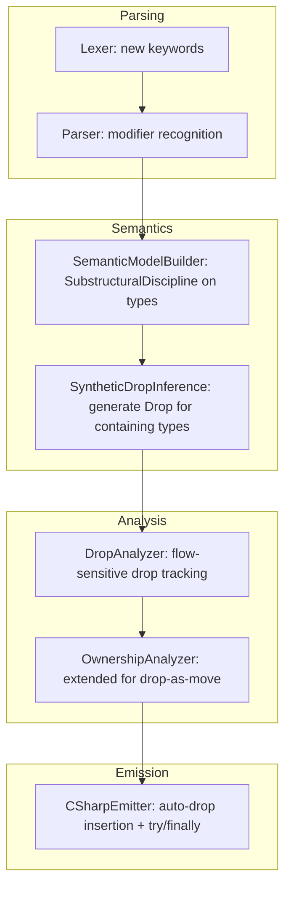

# Design Document: Drop Semantics

## Overview

This design introduces substructural type modifiers (`affine`, `linear`, `relevant`) and a unified `Drop()` method that provides deterministic cleanup with compiler-enforced calling semantics. The design replaces the existing `LiveTaskInfo`-based live-task tracking system with a general-purpose drop discipline that subsumes task awaiting, resource cleanup, and value extraction into a single mechanism.

The core insight: `Drop()` is both cleanup and value extraction. A type's substructural modifier determines the compiler's enforcement rules around when and how many times `Drop()` fires. The `await` keyword becomes syntactic sugar for `Drop()` on task types, unifying async completion with deterministic cleanup.

**Substructural Disciplines Summary:**

| Modifier | Drop fires... | Implies `owned`? | Aliasable? | Can forget? |
|---|---|---|---|---|
| (none) | Only in `with` blocks | No | Yes | Yes |
| `affine` | Only in `with` blocks (≤1) | Yes | No | Yes (outside `with`) |
| `linear` | Always at scope exit (exactly 1) | Yes | No | No |
| `relevant` | Always at scope exit (1+, idempotent) | No | Yes | No |

## Architecture

The drop semantics feature spans all compiler phases:



**Phase responsibilities:**

1. **Lexer/Parser** — Recognize `affine`, `linear`, `relevant` as storage modifiers. No grammar changes to `Drop()` method declarations (they're regular methods with a special name).

2. **Semantic Model** — Add a `SubstructuralDiscipline` enum to `ClassType`/`StructType`. Replace `IsOwnedType` boolean with the richer discipline model (affine/linear imply owned). Run synthetic drop inference to propagate drop obligations through field containment.

3. **Analysis** — A new `DropAnalyzer` (or extension of `OwnershipAnalyzer`) performs flow-sensitive tracking of drop state. It enforces: use-after-drop errors, field-drop-outside-container errors, linear/relevant forget errors, conflicting modifier errors, and owned-field-in-non-owned-container errors.

4. **Emission** — The C# emitter inserts `Drop()` calls (or `await` for task types) at scope exit points, wrapped in `try/finally` for linear/relevant types. Substructural modifiers are erased in the emitted C#.

## Components and Interfaces

### 1. SubstructuralDiscipline Enum

```csharp
namespace Mist.Semantics.Model;

/// <summary>
/// The substructural discipline of a type declaration.
/// Determines compiler enforcement rules for Drop() invocation.
/// </summary>
public enum SubstructuralDiscipline
{
    /// <summary>No substructural modifier. Drop only in with-blocks (0 to many).</summary>
    None,

    /// <summary>affine — Drop only in with-blocks, at most once. Implies owned.</summary>
    Affine,

    /// <summary>linear — Drop always at scope exit, exactly once. Implies owned.</summary>
    Linear,

    /// <summary>relevant — Drop always at scope exit for every reference (1+, idempotent). Aliasable.</summary>
    Relevant,
}
```

### 2. Type Model Extensions

`ClassType` and `StructType` gain:

```csharp
/// <summary>
/// The substructural discipline declared on this type.
/// Replaces the raw IsOwnedType boolean for affine/linear types.
/// </summary>
public SubstructuralDiscipline Discipline { get; internal set; } = SubstructuralDiscipline.None;

/// <summary>
/// Whether this type has a Drop() method (explicit or synthesized).
/// </summary>
public bool HasDrop { get; internal set; }

/// <summary>
/// The return type of the Drop() method, or null if Drop() returns void or is absent.
/// </summary>
public IType? DropReturnType { get; internal set; }
```

The existing `IsOwnedType` property is retained for backward compatibility but its semantics become: `IsOwnedType => Discipline is Affine or Linear || explicitly marked owned`.

### 3. VariableDropState (Flow-Sensitive Tracking)

```csharp
namespace Mist.Analysis.Builtin;

/// <summary>
/// Tracks the drop state of a variable during flow-sensitive analysis.
/// </summary>
public enum VariableDropState
{
    /// <summary>Variable is live — not yet dropped, moved, or returned.</summary>
    Live,

    /// <summary>Variable has been explicitly dropped (Drop() called).</summary>
    Dropped,

    /// <summary>Variable has been moved (ownership transferred).</summary>
    Moved,

    /// <summary>Variable has been returned from the method.</summary>
    Returned,
}
```

### 4. DropAnalyzer

A new analyzer (or integrated into `OwnershipAnalyzer`) that:

- Walks method bodies flow-sensitively
- Tracks `VariableDropState` per variable with drop obligations
- Inserts logical auto-drop points at scope exits for linear/relevant types
- Validates field-drop restrictions (only inside container's Drop())
- Validates containment rules (affine/linear fields need owned containers)
- Reports diagnostics for use-after-drop, forget violations, conflicting modifiers

### 5. SyntheticDropInferencePass

A semantic model pass that runs after all types are built:

```
For each type T:
  If T has no explicit Drop() method:
    Collect all fields F1, F2, ... Fn where Fi.Type.HasDrop == true
    If any such fields exist:
      Synthesize Drop() on T:
        - Return type: void
        - Body: call Fi.Drop() in declaration order
      Set T.HasDrop = true
      Set T.DropReturnType = null
  This cascades: process types in dependency order (leaves first)
```

### 6. CSharpEmitter Extensions

The emitter is extended to:

- Insert `Drop()` calls at scope exit for linear/relevant variables
- Wrap linear/relevant scopes in `try/finally` to guarantee drop on exception
- Emit `await` instead of `.Drop()` for `Task<T>` and `ValueTask<T>` types
- Handle reverse-declaration-order drop sequencing
- Handle conditional moves (drop only in branches where variable is live)
- Erase substructural modifiers from emitted C#

### 7. Keywords and Parsing

Three new keywords added to `keywords.storm`:

```storm
token AFFINE   = "affine";
token LINEAR   = "linear";
token RELEVANT = "relevant";
```

These are recognized as storage modifiers in the same position as `owned` (before `class`/`struct`).

### 8. TextMate Grammar Updates

- `affine`, `linear`, `relevant` added to `storage.modifier.mist` scope
- `Drop` recognized as `entity.name.function.destructor.mist` in method declaration position

## Data Models

### SubstructuralDiscipline Resolution

The semantic model builder resolves discipline from modifiers:

```
modifiers → discipline:
  [affine]   → Affine  (implies owned = true)
  [linear]   → Linear  (implies owned = true)
  [relevant] → Relevant (owned = false, aliasable = true)
  [owned]    → None    (owned = true, no substructural discipline)
  []         → None    (unrestricted)

Invalid combinations (compile error):
  [affine, linear], [affine, relevant], [linear, relevant]
  [affine, owned], [linear, owned]  — redundant, affine/linear imply owned
  [relevant, owned]  — contradictory, relevant must be aliasable
```

### Drop Obligation Propagation

```
DropObligation(Type T):
  if T.HasDrop:
    match T.Discipline:
      None     → WithBlockOnly    (Drop fires in with-blocks, nowhere else)
      Affine   → WithBlockAtMostOnce (Drop fires in with-blocks, ≤1 total)
      Linear   → ScopeExit        (Drop fires at scope exit, exactly once)
      Relevant → ScopeExitAll     (Drop fires at scope exit for all references)
  else:
    NoObligation
```

### Auto-Drop Insertion Points

For each local variable `v` at scope exit:

```
ShouldAutoInsertDrop(v):
  let T = type_of(v)
  match T.Discipline:
    Linear:
      if v.state == Live → insert Drop()
      if v.state == Moved | Returned → skip (elision)
      if v.state == Dropped → skip (already called)
    Relevant:
      always insert Drop() (idempotent, fires for every reference)
    Affine:
      never auto-insert (only in with-blocks)
    None:
      never auto-insert (only in with-blocks)
```

### Field Containment Rules

```
ValidateFieldContainment(container_type, field_type):
  if field_type.Discipline in {Affine, Linear}:
    require container_type.IsOwnedType == true
    // Otherwise: aliasing the container would violate single-holder invariant
  if field_type.Discipline == Relevant:
    always permitted (relevant is aliasable + idempotent)
  if field_type.Discipline == None:
    always permitted
```

### Drop in Manual Drop() Methods

When a programmer writes a manual `Drop()` on a type with droppable fields:

```
AnalyzeManualDrop(type T, method Drop()):
  let droppable_fields = [f for f in T.fields if f.Type.HasDrop]
  let explicitly_dropped = track which fields have Drop() called in body
  at end of Drop() body:
    for each f in droppable_fields where f not in explicitly_dropped:
      insert f.Drop() call (declaration order)
```

### Task Type Declarations (Standard Library)

```mist
public relevant class Task<TResult>
{
    intrinsic public TResult Drop();
    // ... existing static methods ...
}

public linear class ValueTask<TResult>
{
    intrinsic public TResult Drop();
}
```

### Await Desugaring

```
await expr  →  expr.Drop()

// For Task<T> or ValueTask<T> where Drop() returns T:
T result = await task;  →  T result = task.Drop();

// For Task (void):
await task;  →  task.Drop();
```

The C# emitter reverses this: `task.Drop()` emits as `await task` in C# output.


## Correctness Properties

*A property is a characteristic or behavior that should hold true across all valid executions of a system — essentially, a formal statement about what the system should do. Properties serve as the bridge between human-readable specifications and machine-verifiable correctness guarantees.*

### Property 1: Substructural Modifier Implies Correct Ownership

*For any* type declared with `affine` or `linear` modifier, `IsOwnedType` SHALL be `true`. *For any* type declared with `relevant` modifier, `IsOwnedType` SHALL be `false`.

**Validates: Requirements 1.3, 1.4, 1.5**

### Property 2: Conflicting Modifier Rejection

*For any* pair of modifiers drawn from `{affine, linear, relevant}`, and *for any* combination of `{owned + relevant}` or `{owned + affine}` or `{owned + linear}`, applying both to a type declaration SHALL produce a compile-time error.

**Validates: Requirements 1.6, 1.7**

### Property 3: Drop-as-Consume for Owned Types

*For any* variable `v` of an affine or linear type, if `v.Drop()` is called at source location L, then any access to `v` at a location dominated by L SHALL produce a compile-time "use of dropped value" error.

**Validates: Requirements 3.1, 3.2**

### Property 4: Drop Does Not Consume Relevant Types

*For any* variable `v` of a relevant type, calling `v.Drop()` SHALL NOT make `v` inaccessible — subsequent accesses to `v` SHALL compile without error.

**Validates: Requirements 3.3**

### Property 5: Linear Auto-Drop at Scope Exit

*For any* local variable of a linear type that reaches scope exit in the `Live` state (not moved, returned, or explicitly dropped), the compiler SHALL insert exactly one `Drop()` call at that scope exit point.

**Validates: Requirements 2.8, 4.1**

### Property 6: Linear Drop Elision on Move or Return

*For any* local variable of a linear type that has been moved to another variable or function parameter, or returned from the method, the compiler SHALL NOT insert a `Drop()` call at the source scope exit.

**Validates: Requirements 4.2, 4.3**

### Property 7: Relevant Auto-Drop Fires for Every Reference

*For any* local variable of a relevant type at scope exit, the compiler SHALL always insert a `Drop()` call, regardless of whether the variable was also passed to other functions or aliased.

**Validates: Requirements 2.9, 4.4, 6.3**

### Property 8: No Auto-Drop for Unrestricted and Affine at Scope Exit

*For any* local variable of an unrestricted type or an affine type, the compiler SHALL NOT auto-insert `Drop()` at scope exit. Drop only fires via explicit `with`-block mechanisms.

**Validates: Requirements 2.6, 2.7, 4.8, 5.3**

### Property 9: With-Block Triggers Drop at Block Exit

*For any* expression used in a `with(expr) { ... }` block where `expr`'s type has a `Drop()` method, the compiler SHALL insert a `Drop()` call at the block exit point.

**Validates: Requirements 5.1, 5.2**

### Property 10: Reverse Declaration Order for Multiple Drops

*For any* scope containing N variables with drop obligations (N ≥ 2), the compiler SHALL insert `Drop()` calls in reverse declaration order — the last declared variable is dropped first.

**Validates: Requirements 4.5, 13.1**

### Property 11: Lending Does Not Transfer Drop Responsibility

*For any* linear or affine variable lent as `readonly ref`, `frozen`, or `borrowed`, the compiler SHALL still insert `Drop()` on the owner at scope exit. Lending is temporary and does not transfer the drop obligation.

**Validates: Requirements 9.1, 9.2, 9.3**

### Property 12: Synthetic Drop Inference for Containing Types

*For any* type T that has one or more fields with `Drop()` methods and does NOT explicitly define its own `Drop()`, the compiler SHALL synthesize a `Drop()` method. The synthesized Drop() SHALL call field drops in declaration order and return void.

**Validates: Requirements 10.1, 10.2, 10.3, 10.4, 10.5**

### Property 13: Field Containment Rule — Owned Fields Require Owned Containers

*For any* non-owned type that declares a field of an affine or linear type, the compiler SHALL report a compile-time error. *For any* owned type with affine/linear fields, or *for any* type with relevant/unrestricted fields, no error SHALL be reported.

**Validates: Requirements 11.1, 11.2, 11.3, 11.4**

### Property 14: Field Drop Restricted to Container's Drop Method

*For any* call to `Drop()` on a field of an affine or linear type, if the call site is NOT inside the containing type's `Drop()` method, the compiler SHALL report a compile-time error. Inside the container's `Drop()`, field Drop() calls SHALL be permitted. Relevant fields have no such restriction.

**Validates: Requirements 12.1, 12.2, 12.3**

### Property 15: Await Desugars to Drop

*For any* expression `await e` where `e` has type `Task<T>` or `ValueTask<T>`, the semantic meaning SHALL be equivalent to `e.Drop()` — both invoke the same Drop method and yield the same result type `T`.

**Validates: Requirements 7.5, 8.5**

### Property 16: C# Emission Uses Await for Task/ValueTask Drop

*For any* auto-drop insertion or explicit `Drop()` call on a `Task<T>` or `ValueTask<T>`, the C# emitter SHALL emit an `await` expression rather than a method call named `Drop`.

**Validates: Requirements 7.10, 8.8, 14.5, 14.6**

### Property 17: Substructural Modifiers Erased in Emitted C#

*For any* Mist program containing types with `affine`, `linear`, or `relevant` modifiers, the emitted C# source SHALL NOT contain these keywords — they have no runtime representation.

**Validates: Requirements 14.7**

### Property 18: Try/Finally Wrapping for Linear/Relevant Scopes

*For any* scope containing linear or relevant variables, the C# emitter SHALL wrap the scope body in a `try/finally` block, with `Drop()` calls in the `finally` block, to guarantee cleanup even on exception.

**Validates: Requirements 14.3**

### Property 19: Conditional Move Branch-Sensitive Drop

*For any* linear variable that is moved in one branch of a conditional but not another, the compiler SHALL insert `Drop()` only in the branches where the variable was NOT moved.

**Validates: Requirements 4.6, 13.5**

### Property 20: Drop Return Value Capture

*For any* affine or linear type with a non-void `Drop()` method, explicitly calling `Drop()` SHALL allow the caller to capture the return value (e.g., `T result = v.Drop()`).

**Validates: Requirements 3.4, 7.4**

### Property 21: Parsing Round-Trip for Substructural Modifiers

*For any* valid type declaration containing `affine`, `linear`, or `relevant` modifiers, parsing then printing the AST SHALL preserve the modifier in the output.

**Validates: Requirements 1.1, 1.2**

## Error Handling

### Compile-Time Errors

| Error Code | Condition | Message Template |
|---|---|---|
| MIST_DROP_001 | Use-after-drop/move on linear type | "Use of moved/dropped value '{Name}'." |
| MIST_DROP_002 | Use-after-drop on affine type | "Use of dropped value '{Name}'." |
| MIST_DROP_003 | Non-owned container with affine/linear field | "Non-owned type '{TypeName}' cannot contain {modifier} field '{FieldName}'. Aliasing the container would violate the single-holder invariant of the field." |
| MIST_DROP_004 | Field Drop() outside container's Drop() | "Cannot drop field '{FieldName}' outside of the containing type's Drop() method." |
| MIST_DROP_005 | Conflicting modifiers | "Conflicting type modifiers." |
| MIST_DROP_006 | Drop() with parameters | "Drop() method must not accept parameters." |

### Error Recovery Strategy

- **Conflicting modifiers**: Report the error and treat the type as having `SubstructuralDiscipline.None` for further analysis (avoid cascading errors).
- **Use-after-drop**: Report at first use-after-drop site. Continue analysis to find other independent errors but do not cascade from the dead variable.
- **Field containment violation**: Report on the field declaration. Continue building the type model so other errors in the type body can still be reported.
- **Missing Drop() on linear type at scope exit**: This should never happen (the compiler always inserts it). If the synthetic drop inference fails to find a `Drop()` method on a linear type, report an internal compiler error.

### Runtime Behavior

- **Faulted Task Drop()**: When `Drop()` is called on a faulted `Task<T>`, the exception is propagated (re-thrown). The `try/finally` wrapper in the emitted C# ensures that other variables in the same scope are still dropped even if one Drop() throws.
- **Exception in Drop()**: If a Drop() implementation throws, the exception propagates normally. Other drops in the same finally block still execute (each gets its own try/catch in the finally, or the emitter chains them).

## Testing Strategy

### Unit Tests (Example-Based)

Unit tests cover specific scenarios and edge cases:

- **Modifier parsing**: Verify each valid modifier combination parses correctly
- **Error messages**: Verify exact diagnostic text for each error code
- **TextMate grammar**: Verify scope assignments for new keywords
- **Standard library declarations**: Verify Task/ValueTask have correct disciplines
- **Specific interactions**: await on void Task, await on Task<int>, Drop() with generic return types

### Property-Based Tests

Property-based tests verify universal properties across generated inputs. Each property test:
- Runs minimum 100 iterations
- References its design document property via tag comment
- Uses the batched compilation approach (generate N scenarios, compile once, verify all)

**Testing Library**: FsCheck (already used in the project for property-based testing)

**Property tests to implement** (referencing properties above):

1. **Property 1** — Generate random type declarations with each discipline, verify IsOwnedType matches expected value. Tag: `Feature: drop-semantics, Property 1: Substructural modifier implies correct ownership`

2. **Property 3** — Generate programs with Drop() followed by access, verify compile error in all cases. Tag: `Feature: drop-semantics, Property 3: Drop-as-consume for owned types`

3. **Property 5+6** — Generate linear variables with random control flow (some moved, some live at exit), verify auto-drop appears exactly where expected. Tag: `Feature: drop-semantics, Property 5: Linear auto-drop at scope exit`

4. **Property 10** — Generate scopes with N droppable variables (N from 2 to 10), verify drop order in emitted output is reverse declaration order. Tag: `Feature: drop-semantics, Property 10: Reverse declaration order`

5. **Property 12** — Generate types with varying field compositions (some droppable, some not), verify synthetic Drop() is generated exactly when expected and calls fields in declaration order. Tag: `Feature: drop-semantics, Property 12: Synthetic drop inference`

6. **Property 13** — Generate random container/field type discipline combinations, verify compile error iff non-owned container has affine/linear field. Tag: `Feature: drop-semantics, Property 13: Field containment rule`

7. **Property 14** — Generate field Drop() calls at various call sites (inside Drop(), outside Drop(), in other methods), verify error iff outside container's Drop(). Tag: `Feature: drop-semantics, Property 14: Field drop restriction`

8. **Property 17** — Generate programs with substructural types, compile and verify emitted C# does not contain `affine`, `linear`, or `relevant` keywords. Tag: `Feature: drop-semantics, Property 17: Modifier erasure`

9. **Property 21** — Generate random valid type declarations with modifiers, parse then print, verify round-trip preservation. Tag: `Feature: drop-semantics, Property 21: Parsing round-trip`

### Integration Tests

Integration tests verify end-to-end behavior by compiling and running complete programs:

- **Sample application**: Compile `samples/DropSemantics/Program.mist` and verify stdout matches expected output exactly.
- **Task awaiting**: Verify async programs with Task<T> produce correct results via auto-drop.
- **Exception propagation**: Verify faulted tasks propagate exceptions through Drop().
- **Nested ownership**: Verify complex ownership hierarchies with synthetic drop.

### Test Process Constraints

Per the test-process-spawning policy:
- Property tests use the **batched compilation approach**: generate all N scenarios, build a single Mist program that exercises all of them, compile once (in-process via `CompilerDriver`), run the compiled DLL once, compare N output lines.
- Each property test class spawns at most 1 external process per test run.
- The shared `CompilerDriver` instance is reused across iterations.
