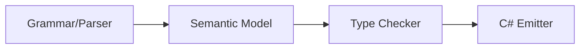

# Design Document: Enum Declarations

## Overview

This design adds enum declarations to the Mist programming language. Unlike C# enums (restricted to integral primitives), Mist enums can wrap any valid type — primitives, classes, structs, or union types. An enum is a named, nominal collection of static values that wraps an underlying type.

Enums are top-level constructs alongside classes, structs, interfaces, and traits. They are emitted as C# `record class` types with value equality semantics, static member fields, and an implicit conversion operator to the underlying type.

### Key Design Decisions

1. **Record class emission** — Enums emit as `record class` rather than C# `enum` because Mist enums support arbitrary underlying types (not just integral primitives). Record classes provide value equality semantics and static member access naturally.

2. **Nominal typing** — Two enums with the same underlying type are distinct types. This prevents accidental mixing of semantically different enumerations.

3. **Implicit conversion to underlying type only** — Enum values implicitly convert to their underlying type, but not the reverse. This preserves type safety while allowing ergonomic use where the underlying type is expected.

4. **Name-only enums default to `byte`** — When no values are specified, members receive sequential byte values starting from 0, matching the common use case of simple discriminators.

## Architecture

The enum feature touches four compiler stages:



1. **Grammar** — A new `EnumDeclaration` rule in `Mist.storm` and `enum` keyword in `keywords.storm`.
2. **Semantic Model** — A new `EnumType` class implementing `IType`, plus enum member registration in `SemanticModelBuilder`.
3. **Type Checker** — Validation of member value assignability, implicit conversion rules, and pattern matching support.
4. **C# Emitter** — Emission of `record class` with static readonly fields and implicit conversion operator.

### Integration Points

- **TopLevelItem** — `EnumDeclaration` becomes a new alternative in the `TopLevelItem` and `NamespaceBodyItem` rules.
- **TypeDeclaration** — Enums are registered as types in Pass 1, similar to classes and structs.
- **TypeReference resolution** — Enum names are valid type references in all positions.
- **Pattern matching** — `is EnumName.MemberName` patterns resolve to value equality checks.
- **Extension methods** — Enums can be extended via extension blocks (no special handling needed; they are types).

## Components and Interfaces

### Grammar Changes (`Mist.storm` and `keywords.storm`)

**New keyword:**
```storm
token ENUM = "enum";
```

**New grammar rules:**
```storm
rule EnumDeclaration = modifiers:Modifier* ENUM name:IDENTIFIER
    typeAnnotation:(COLON type:TypeReference)?
    LEFT_BRACE members:EnumMemberList? RIGHT_BRACE;

rule EnumMemberList = EnumMember (COMMA EnumMember)* COMMA?;

rule EnumMember = name:IDENTIFIER value:(COLON Expression)?;
```

**Integration into existing rules:**

`TypeDeclaration` gains a new alternative:
```storm
rule TypeDeclaration
    = classDeclaration:ClassDeclaration           as ClassType
    | structDeclaration:StructDeclaration         as StructType
    | interfaceDeclaration:InterfaceDeclaration   as InterfaceType
    | traitDeclaration:TraitDeclaration           as TraitType
    | enumDeclaration:EnumDeclaration             as EnumType
    ;
```

### Semantic Model (`EnumType`)

```csharp
public sealed class EnumType : IType
{
    public string DisplayName { get; }
    public TypeKind Kind => TypeKind.Enum;
    public IType UnderlyingType { get; internal set; }
    public IReadOnlyList<EnumMemberInfo> Members { get; internal set; }
    public IScope MemberScope { get; }
    public string? ContainingNamespace { get; }
}

public sealed class EnumMemberInfo
{
    public string Name { get; }
    public object? ResolvedValue { get; }
    public IType? ValueType { get; }
}
```

A new `TypeKind.Enum` value is added to the `TypeKind` enum. This gives the semantic model, type checker, and emitter a first-class way to identify enum types without downcasting. The C# emitter maps `TypeKind.Enum` to a `record class` emission, but the semantic model correctly represents enums as their own kind.

- `UnderlyingType` is set during Pass 2 type resolution (either from the explicit annotation or inferred from member values).
- `MemberScope` contains symbols for each enum member, enabling dot-access resolution.

### Semantic Model Builder Changes

**Pass 1** — Register the enum as a type symbol with a new `SymbolKind.Enum` value. Create the `EnumType` instance and register member symbols in its `MemberScope`.

**Pass 2** — Resolve the underlying type:
1. If explicit annotation: resolve the `TypeReference` node.
2. If members have values: infer from member value types (homogeneous → that type, heterogeneous → union type).
3. If name-only: set underlying type to `byte`.

Resolve each member's value expression and verify assignability to the underlying type. For name-only members, assign sequential values (0, 1, 2, ...) with continuation after explicit values.

### Type Checker Changes

- **Implicit conversion**: When assigning an `EnumType` value to a location of the underlying type, accept without error. The reverse (underlying → enum) is rejected.
- **Nominal distinction**: Two `EnumType` instances with different `DisplayName` values are never assignable to each other, even if their underlying types match.
- **Pattern matching**: `is EnumName.MemberName` resolves to a value equality check against the member's resolved value.

### C# Emitter Changes

For an enum declaration like:
```mist
public enum Direction : string {
    North: "N",
    South: "S",
    East: "E",
    West: "W"
}
```

The emitter produces:
```csharp
public record class Direction(string Value)
{
    public static readonly Direction North = new Direction("N");
    public static readonly Direction South = new Direction("S");
    public static readonly Direction East = new Direction("E");
    public static readonly Direction West = new Direction("W");

    public static implicit operator string(Direction e) => e.Value;
}
```

For union underlying types, the `Value` parameter type uses the union helper struct name (from `UnionHelperGenerator.GetHelperTypeName`).

### Pretty Printer Changes

`MistPrettyPrinter` gains an `EmitEnumDeclaration` method that reconstructs the enum source text from the AST, handling:
- Access modifiers
- Optional type annotation (`: TypeReference`)
- Comma-separated member list with optional trailing comma
- Member value expressions (`: Expression`)

## Data Models

### EnumType

| Field | Type | Description |
|-------|------|-------------|
| `DisplayName` | `string` | The enum's declared name |
| `Kind` | `TypeKind` | Always `TypeKind.Enum` |
| `UnderlyingType` | `IType` | The resolved underlying type |
| `Members` | `IReadOnlyList<EnumMemberInfo>` | Ordered list of enum members |
| `MemberScope` | `IScope` | Scope containing member symbols |
| `ContainingNamespace` | `string?` | Namespace the enum is declared in |

### EnumMemberInfo

| Field | Type | Description |
|-------|------|-------------|
| `Name` | `string` | Member identifier |
| `ResolvedValue` | `object?` | The compile-time value (for name-only: integer; for valued: the expression result) |
| `ValueType` | `IType?` | The type of the member's value expression |

### AST Nodes (Storm-generated)

- `EnumDeclarationNode` — modifiers, name, optional type annotation, member list
- `EnumMemberListNode` — sequence of `EnumMemberNode`
- `EnumMemberNode` — name identifier, optional value expression

## Correctness Properties

*A property is a characteristic or behavior that should hold true across all valid executions of a system — essentially, a formal statement about what the system should do. Properties serve as the bridge between human-readable specifications and machine-verifiable correctness guarantees.*

### Property 1: Enum declaration round-trip

*For any* valid enum declaration (with any combination of access modifiers, type annotations, valued members, name-only members, and trailing commas), parsing the source then printing the syntax tree back to source then parsing again SHALL produce an equivalent syntax tree.

**Validates: Requirements 1.1, 1.2, 1.3, 1.4, 1.5, 1.6, 12.1**

### Property 2: Enum type construction invariants

*For any* valid enum declaration, the semantic model SHALL produce an `EnumType` with `Kind == TypeKind.Enum`, a non-null `UnderlyingType`, and a `Members` list whose length equals the number of declared members.

**Validates: Requirements 2.1, 2.2, 2.3**

### Property 3: Underlying type inference correctness

*For any* enum declaration without an explicit type annotation: if all member values have the same type T, the underlying type SHALL be T; if member values have distinct types, the underlying type SHALL be a union of those types; if no member has an explicit value (name-only), the underlying type SHALL be `byte`.

**Validates: Requirements 3.1, 3.2, 3.3**

### Property 4: Sequential value assignment

*For any* enum with N members where some or all members lack explicit values, each implicit member SHALL receive a value equal to the previous member's value plus 1 (with the first implicit member receiving 0 if it is the first member overall, or previous+1 otherwise).

**Validates: Requirements 4.1, 4.2, 4.3**

### Property 5: Enum member access resolution

*For any* enum and any member name that exists in that enum, the expression `EnumName.MemberName` SHALL resolve to a value whose type is the `EnumType`.

**Validates: Requirements 5.1, 5.3**

### Property 6: Invalid member access produces error

*For any* enum and any identifier that is NOT a member of that enum, accessing `EnumName.InvalidName` SHALL produce a diagnostic error.

**Validates: Requirements 5.2**

### Property 7: Enum usable as type reference

*For any* enum, using its name as a type annotation in variable declarations, parameter types, return types, and field types SHALL be accepted without error.

**Validates: Requirements 6.1, 6.2, 6.3, 6.4**

### Property 8: Implicit conversion to underlying type

*For any* enum value, assigning it to a variable of the underlying type or passing it as an argument where the underlying type is expected SHALL be accepted without error.

**Validates: Requirements 7.1, 7.2**

### Property 9: Reverse conversion rejected

*For any* enum with underlying type T, assigning a value of type T to a variable of the enum type SHALL produce a type error.

**Validates: Requirements 7.3**

### Property 10: Pattern matching value equality

*For any* enum member M with value V, the expression `x is EnumName.M` SHALL evaluate to true when x equals V and false when x does not equal V.

**Validates: Requirements 8.1, 8.2, 8.3**

### Property 11: C# emission structure

*For any* valid enum declaration, the emitted C# SHALL contain a `record class` with the correct access modifier, a primary constructor parameter of the underlying type named `Value`, a `public static readonly` field for each member, and an `implicit operator` converting to the underlying type.

**Validates: Requirements 9.1, 9.2, 9.3, 9.4, 10.1, 10.2, 10.3**

### Property 12: Nominal type distinction

*For any* two enum declarations with different names but identical underlying types, assigning a value of one enum type to a variable of the other enum type SHALL produce a type error.

**Validates: Requirements 2.4**

## Error Handling

### Diagnostic IDs

| ID | Severity | Condition |
|----|----------|-----------|
| `MIST_SB_0080` | Error | Enum member value not assignable to explicit underlying type |
| `MIST_SB_0081` | Error | Enum member value not assignable to inferred underlying type |
| `MIST_SB_0082` | Error | Undefined enum member access (`EnumName.InvalidMember`) |
| `MIST_SB_0083` | Error | Cannot assign underlying type value to enum type variable |
| `MIST_SB_0084` | Error | Duplicate enum name in same scope |

### Error Recovery

- If a member value fails type checking, the member is still registered (with `ErrorType` as its value type) so that subsequent members can continue resolution.
- If the underlying type annotation cannot be resolved, the enum uses `ErrorType` as its underlying type and skips member value validation.
- Parse errors within the enum body (e.g., missing comma) use the standard Storm error recovery (skip to next `}` or `,`).

## Testing Strategy

### Property-Based Testing

The project uses **FsCheck 3.1.0** with xUnit for property-based testing. Each property test runs a minimum of 100 iterations.

**Test configuration:**
- Library: FsCheck.Xunit
- Minimum iterations: 100 per property
- Tag format: `Feature: enums, Property {number}: {property_text}`

**Process spawning policy:** Per the test-process-spawning workspace rule, tests that require compilation and execution will use the **batched approach** — generate all scenarios upfront, build a single program, compile once, run once, and compare output lines. The shared `CompilerDriver` instance is used for in-process compilation.

### Property Tests

| Property | Test Approach |
|----------|--------------|
| 1 (Round-trip) | Generate random enum ASTs via FsCheck, print to source, parse, print again, compare strings |
| 2 (Type construction) | Generate random valid enum sources, compile in-process, inspect EnumType in semantic model |
| 3 (Type inference) | Generate enums with known member types, compile, verify underlying type matches expected |
| 4 (Sequential values) | Generate name-only and mixed enums, compile, verify member values follow sequencing rules |
| 5 (Member access) | Generate enums, compile programs that access members, verify no diagnostics |
| 6 (Invalid access) | Generate enums, compile programs accessing non-existent members, verify error diagnostic |
| 7 (Type reference) | Generate enums used in all type positions, compile, verify no diagnostics |
| 8 (Implicit conversion) | Generate enums with assignments to underlying type, compile, verify no diagnostics |
| 9 (Reverse conversion) | Generate enums with reverse assignments, compile, verify type error diagnostic |
| 10 (Pattern matching) | Batched test: generate enum + is-expression programs, compile once, run once, verify output |
| 11 (C# emission) | Generate enums, emit C#, verify output contains expected record class structure |
| 12 (Nominal distinction) | Generate pairs of enums with same underlying type, compile cross-assignments, verify errors |

### Unit Tests (Example-Based)

- Keyword registration: verify `enum` lexes as keyword token
- `enum` in identifier position produces syntax error
- Duplicate enum values accepted without error (Requirement 4.4)
- Union underlying type uses helper struct name in emission (Requirement 9.5)
- Default visibility emits as `internal` (Requirement 10.3)
- Enum members always publicly accessible regardless of enum visibility (Requirement 10.4)

### Integration Tests

- Sample project `samples/Enums/Program.mist` compiles and runs without errors
- `samples/AllFeatures/Program.mist` includes enum demo call
- End-to-end: Mist enum source → C# emission → Roslyn compilation → execution produces expected output
