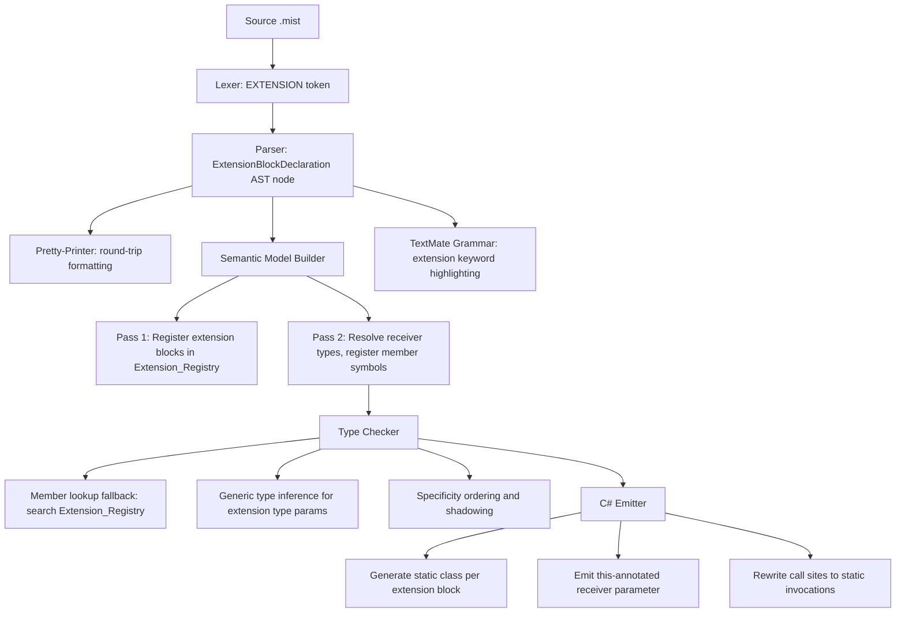
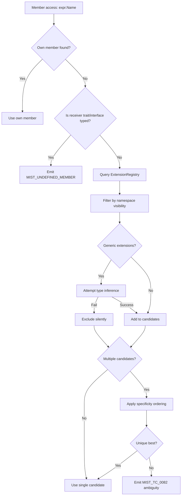

# Design Document: Extension Methods (Extension Blocks)

## Overview

This document describes the design for adding extension blocks to the Mist programming language. Extension blocks allow developers to add methods and properties to types they do not own, using the syntax `extension(ReceiverType self) { ... }`. The feature supports generic extensions, universal extensions via `extension(unknown self)`, and static members within extension blocks.

Extension blocks integrate into the existing Mist compiler pipeline at every stage: grammar (Storm), lexer, parser, pretty-printer, semantic model, type checker, C# emitter, and TextMate syntax highlighting. The design follows the C# extension method lowering strategy — extension blocks compile to static classes with `this`-annotated first parameters.

### Design Decisions

1. **Keyword**: `extension` (reserved keyword, not a contextual keyword)
2. **Block syntax**: `extension(Type self) { ... }` — one receiver declaration per block
3. **Member syntax**: Standard Mist method/property syntax inside the block (same as class members)
4. **Static members**: `static` keyword on individual members determines whether `self` is accessible
5. **Universal extensions**: `extension(unknown self)` provides methods on all types
6. **Generic extensions**: `extension<T>(List<T> self) { ... }` with type parameter inference
7. **Multiple blocks**: Multiple extension blocks on the same type are allowed; error only on duplicate member signatures
8. **Trait/interface orthogonality**: Extensions do NOT participate in trait satisfaction or interface implementation
9. **C# lowering**: Static classes with `this`-annotated first parameters (standard C# extension method pattern)
10. **Property lowering**: Extension properties lower to `get_PropertyName` static methods
11. **Shadowing**: Own members always shadow extensions; more-specific receiver types preferred over less-specific

## Architecture

Extension blocks integrate into the Mist compiler pipeline as follows:



### Pipeline Integration Points

| Stage | Change |
|-------|--------|
| **Grammar** (`keywords.storm`, `Mist.storm`) | Add `EXTENSION` token; add `ExtensionBlockDeclaration` rule as a `TopLevelItem` alternative |
| **Lexer** (`MistLexer`) | Auto-generated from Storm — recognizes `extension` keyword |
| **Parser** (`MistParser`) | Auto-generated from Storm — produces `ExtensionBlockDeclarationNode` |
| **Pretty-Printer** (`MistPrettyPrinter`) | New `EmitExtensionBlockDeclaration` method |
| **Semantic Model** (`SemanticModelBuilder`) | New `Extension_Registry`; new pass logic to register extension blocks and their members |
| **Type Checker** (`TypeCheckerAnalyzer`) | Member lookup fallback; specificity ordering; static receiver access validation |
| **Emitter** (`CSharpSourceWriter`) | New `EmitExtensionBlock` method; call-site rewriting |
| **TextMate** (`mist.tmLanguage.json`) | New pattern for `extension` keyword and block structure |

## Components and Interfaces

### Grammar Changes

#### `keywords.storm` — New Token

```storm
token EXTENSION = "extension";
```

#### `Mist.storm` — New Rules

```storm
// ─── Extension Block Declaration ─────────────────────────────────────────────

rule ExtensionBlockDeclaration = typeParams:TypeParameterList?
    EXTENSION LEFT_PARENTHESIS receiverType:TypeReference receiverName:IDENTIFIER RIGHT_PARENTHESIS
    LEFT_BRACE members:ExtensionMemberDeclaration* RIGHT_BRACE;

rule ExtensionMemberDeclaration
    = method:MethodDeclaration    as ExtensionMethodMember
    | property:PropertyDeclaration as ExtensionPropertyMember
    ;
```

#### `Mist.storm` — TopLevelItem Extension

```storm
rule TopLevelItem
    = namespaceDeclaration:NamespaceDeclaration  as NamespaceItem
    | typeDeclaration:TypeDeclaration            as TypeItem
    | withDeclaration:WithDeclaration            as WithItem
    | extensionDeclaration:ExtensionBlockDeclaration as ExtensionItem   // NEW
    ;
```

#### `Mist.storm` — TypeDeclaration in Namespace (add extension support)

The `NamespaceDeclaration` rule's `body` currently accepts `TypeDeclaration*`. We extend it to accept a new `NamespaceBodyItem` that includes both type declarations and extension blocks:

```storm
rule NamespaceBodyItem
    = typeDeclaration:TypeDeclaration              as NamespaceTypeItem
    | extensionDeclaration:ExtensionBlockDeclaration as NamespaceExtensionItem
    ;

rule NamespaceDeclaration
    = NAMESPACE name:QualifiedIdentifier SEMICOLON body:NamespaceBodyItem*   as FileScopedNamespace
    | NAMESPACE name:QualifiedIdentifier LEFT_BRACE body:NamespaceBodyItem* RIGHT_BRACE as BlockNamespace
    ;
```

### AST Node Definitions

The Storm source generator will produce the following AST node types:

```csharp
// Generated by Storm source generator
public sealed class ExtensionBlockDeclarationNode : SyntaxNode
{
    public TypeParameterListNode? TypeParams { get; }
    public TypeReferenceNode ReceiverType { get; }
    public TokenNode ReceiverName { get; }  // IDENTIFIER token
    public ImmutableArray<ExtensionMemberDeclarationNode> Members { get; }
}

public abstract class ExtensionMemberDeclarationNode : SyntaxNode { }

public sealed class ExtensionMethodMemberExtensionMemberDeclarationNode 
    : ExtensionMemberDeclarationNode
{
    public MethodDeclarationNode Method { get; }
}

public sealed class ExtensionPropertyMemberExtensionMemberDeclarationNode 
    : ExtensionMemberDeclarationNode
{
    public PropertyDeclarationNode Property { get; }
}

// New TopLevelItem alternative
public sealed class ExtensionItemTopLevelItemNode : TopLevelItemNode
{
    public ExtensionBlockDeclarationNode ExtensionDeclaration { get; }
}
```

### Semantic Model Changes

#### New: `ExtensionRegistry`

```csharp
namespace Mist.Semantics.Model;

/// <summary>
/// A single registered extension block with its resolved receiver type,
/// member scope, and source metadata.
/// </summary>
public sealed class ExtensionBlockInfo
{
    /// <summary>The resolved receiver type (e.g., ClassType for "string").</summary>
    public required IType ReceiverType { get; init; }
    
    /// <summary>The receiver parameter name (e.g., "self").</summary>
    public required string ReceiverParameterName { get; init; }
    
    /// <summary>The scope containing the extension block's member symbols.</summary>
    public required IScope MemberScope { get; init; }
    
    /// <summary>Type parameters declared on the extension block (empty for non-generic).</summary>
    public required IReadOnlyList<TypeParameterType> TypeParameters { get; init; }
    
    /// <summary>The containing namespace (null for top-level extensions).</summary>
    public required string? ContainingNamespace { get; init; }
    
    /// <summary>The AST node for diagnostic reporting.</summary>
    public required Storm.Runtime.SyntaxNode DeclaringNode { get; init; }
    
    /// <summary>Whether this is a universal extension (receiver type is unknown).</summary>
    public bool IsUniversal => ReceiverType is UnknownType;
}

/// <summary>
/// Indexes all extension blocks by receiver type for efficient lookup
/// during member resolution. Populated by the SemanticModelBuilder
/// and consumed by the TypeCheckerAnalyzer.
/// </summary>
public sealed class ExtensionRegistry
{
    // Keyed by IType (the resolved receiver type)
    private readonly Dictionary<IType, List<ExtensionBlockInfo>> _byReceiverType = new();
    
    // Universal extensions (receiver type = unknown) stored separately for fast access
    private readonly List<ExtensionBlockInfo> _universalExtensions = new();

    public void Register(ExtensionBlockInfo info)
    {
        if (info.IsUniversal)
        {
            _universalExtensions.Add(info);
        }
        
        if (!_byReceiverType.TryGetValue(info.ReceiverType, out var list))
        {
            list = new List<ExtensionBlockInfo>();
            _byReceiverType[info.ReceiverType] = list;
        }
        list.Add(info);
    }

    /// <summary>
    /// Returns all extension blocks whose receiver type is assignable from the given type.
    /// Includes universal extensions.
    /// </summary>
    public IReadOnlyList<ExtensionBlockInfo> GetApplicableExtensions(IType valueType)
    { /* ... */ }

    /// <summary>
    /// Returns only universal extensions (receiver type = unknown).
    /// </summary>
    public IReadOnlyList<ExtensionBlockInfo> GetUniversalExtensions()
        => _universalExtensions;

    /// <summary>
    /// Returns extension blocks whose receiver type exactly matches the given type.
    /// Used for static extension member lookup.
    /// </summary>
    public IReadOnlyList<ExtensionBlockInfo> GetExactExtensions(IType type)
    { /* ... */ }
}
```

#### `ISemanticModel` Extension

```csharp
// Add to ISemanticModel interface:
ExtensionRegistry ExtensionRegistry { get; }
```

#### SemanticModelBuilder — New Pass Logic

The `SemanticModelBuilder` adds extension block processing in two passes:

**Pass 1 (Type Registration):**
- Scan for `ExtensionBlockDeclarationNode` in top-level items and namespace bodies
- Create a placeholder scope for each extension block
- Register type parameters (if generic) in the extension block's scope

**Pass 2 (Reference Resolution):**
- Resolve the receiver type reference to an `IType`
- If resolution fails → emit `MIST_SB_0070` diagnostic, skip block
- Register a parameter symbol for the receiver in the block's scope
- Walk member declarations:
  - For methods: register as `SymbolKind.Method` in the block's member scope
  - For properties: register as `SymbolKind.Property`; reject `set` accessors with `MIST_SB_0071`
  - For fields or other invalid members: emit `MIST_SB_0072`
- Register the `ExtensionBlockInfo` in the `ExtensionRegistry`
- Check for duplicate signatures across all extension blocks for the same receiver type → `MIST_SB_0073`

### Type Checker Changes

#### Member Lookup Fallback

When `TypeCheckerAnalyzer` resolves a member access `expr.MemberName` and the type's own scope does not contain a matching member:

1. Query `ExtensionRegistry.GetApplicableExtensions(receiverType)`
2. Filter by namespace visibility (only extensions whose `ContainingNamespace` is imported or null)
3. For generic extensions: attempt type inference from receiver type → extension's receiver pattern
4. Collect candidate extension members matching the name
5. Apply overload resolution if multiple candidates
6. Apply specificity ordering:
   - Own members > extension members (already handled — we only reach here if own lookup failed)
   - More-specific receiver type > less-specific (e.g., `string` > `unknown`)
   - Exact type match > base type match > universal

#### Specificity Ordering Algorithm

```
Given candidates C1 (receiver R1) and C2 (receiver R2):
  - If R1 is assignable to R2 but not vice versa → C1 is more specific
  - If R2 is assignable to R1 but not vice versa → C2 is more specific
  - If neither is assignable to the other → ambiguous (emit diagnostic)
  - Special case: unknown is less specific than any concrete type
```

#### Generic Extension Type Inference

For a generic extension `extension<T>(List<T> self)` and a receiver of type `List<int>`:

1. Unify the extension's receiver type pattern with the actual receiver type
2. Extract type argument bindings (T → int)
3. Substitute bindings into member signatures (return types, parameter types)
4. If unification fails → silently exclude from candidates

#### Static Extension Member Lookup

When a static member access `TypeName.MemberName` fails on the type's own static scope:

1. Query `ExtensionRegistry.GetExactExtensions(type)` (no assignability — exact match only)
2. Filter for members marked `static`
3. Apply same overload resolution and specificity rules

#### Trait/Interface Exclusion

- `CheckTraitSatisfaction`: Do NOT query `ExtensionRegistry` — only own members count
- Member access on trait-typed or interface-typed variables: Do NOT fall back to extension lookup

#### Validation Rules

- If a `static` extension member body references the receiver parameter → emit `MIST_TC_0080`
- If a method parameter name conflicts with the receiver parameter name → emit `MIST_TC_0081`
- If receiver type is `void` → emit `MIST_SB_0074`

### C# Emitter Changes

#### Extension Block Emission

Each extension block emits as a `static class`:

```csharp
// Mist source:
// extension(string self) {
//     int WordCount() { return self.Split(' ').Length; }
//     static string Empty() { return ""; }
// }

// Emitted C#:
public static class StringExtensions_Program_L5
{
    public static int WordCount(this string self)
    {
        return self.Split(' ').Length;
    }
    
    public static string Empty()
    {
        return "";
    }
}
```

#### Naming Convention

Generated class name: `{ReceiverTypeName}Extensions_{FileName}_{LineNumber}`

- `ReceiverTypeName`: The simple name of the receiver type (e.g., `String`, `ListOfT`, `Unknown`)
- `FileName`: Source file name without extension, sanitized for C# identifiers
- `LineNumber`: 1-based line number of the `extension` keyword in source

This ensures deterministic, collision-free names across compilation units.

#### Call-Site Rewriting

```csharp
// Mist source:
// var count = greeting.WordCount();

// Emitted C# (extension method syntax — C# resolves it):
var count = greeting.WordCount();
// OR explicit static call:
var count = StringExtensions_Program_L5.WordCount(greeting);
```

The emitter uses C# extension method syntax (dot-notation) since the generated class has `this` on the first parameter. The C# compiler handles resolution.

#### Extension Property Emission

```csharp
// Mist source:
// extension(string self) {
//     int Length2 => self.Length * 2;
// }

// Emitted C#:
public static class StringExtensions_Program_L10
{
    public static int get_Length2(this string self)
    {
        return self.Length * 2;
    }
}
```

Call sites accessing extension properties are rewritten to method calls:

```csharp
// Mist: var x = greeting.Length2;
// C#:   var x = StringExtensions_Program_L10.get_Length2(greeting);
```

#### Universal Extension Emission

```csharp
// Mist source:
// extension(unknown self) {
//     string ToString() { ... }
// }

// Emitted C#:
public static class UnknownExtensions_Object_L1
{
    public static string ToString(this object self)
    {
        // ...
    }
}
```

The receiver type `unknown` maps to C# `object`. Value types are boxed automatically by the CLR when passed as `object`.

#### Generic Extension Emission

```csharp
// Mist source:
// extension<T>(List<T> self) {
//     T First() { return self[0]; }
// }

// Emitted C#:
public static class ListExtensions_Program_L3
{
    public static T First<T>(this List<T> self)
    {
        return self[0];
    }
}
```

Type parameters from the extension block are hoisted to the individual methods in the emitted C#.

### Pretty-Printer Changes

Add `EmitExtensionBlockDeclaration` to `MistPrettyPrinter`:

```csharp
private void EmitExtensionBlockDeclaration(ExtensionBlockDeclarationNode extDecl)
{
    var typeParams = EmitTypeParameterList(extDecl.TypeParams);
    var receiverType = EmitTypeReference(extDecl.ReceiverType);
    var receiverName = extDecl.ReceiverName.Lexeme;
    
    AppendLine($"extension{typeParams}({receiverType} {receiverName}) {{");
    _indentLevel++;

    for (var i = 0; i < extDecl.Members.Length; i++)
    {
        if (i > 0) AppendLine();
        EmitExtensionMemberDeclaration(extDecl.Members[i]);
    }

    _indentLevel--;
    AppendLine("}");
}

private void EmitExtensionMemberDeclaration(ExtensionMemberDeclarationNode member)
{
    switch (member)
    {
        case ExtensionMethodMemberExtensionMemberDeclarationNode methodMember:
            EmitMethodDeclaration(methodMember.Method);
            break;
        case ExtensionPropertyMemberExtensionMemberDeclarationNode propertyMember:
            EmitPropertyDeclaration(propertyMember.Property);
            break;
    }
}
```

The `EmitCompilationUnit` and `EmitNamespaceDeclaration` methods are updated to handle the new `ExtensionItem` alternative in `TopLevelItem` and `NamespaceBodyItem`.

### TextMate Grammar Changes

Add to `mist.tmLanguage.json`:

```json
{
  "name": "keyword.declaration.mist",
  "match": "\\b(namespace|using|class|struct|interface|trait|extension)\\b"
}
```

Add a new pattern in `declaration-names` for extension block structure:

```json
{
  "match": "\\b(extension)\\s*(?:<([^>]+)>)?\\s*\\(\\s*([a-zA-Z_]\\w*(?:\\s*<[^>]+>)?(?:\\[\\])?)\\s+([a-zA-Z_]\\w*)\\s*\\)",
  "captures": {
    "1": { "name": "keyword.declaration.mist" },
    "2": { "name": "entity.name.type.parameter.mist" },
    "3": { "name": "entity.name.type.mist" },
    "4": { "name": "variable.parameter.mist" }
  }
}
```

## Data Models

### New Diagnostic IDs

| ID | Stage | Severity | Description |
|----|-------|----------|-------------|
| `MIST_SB_0070` | SemanticModel | Error | Extension block receiver type cannot be resolved |
| `MIST_SB_0071` | SemanticModel | Error | Extension property declares a `set` accessor (read-only only) |
| `MIST_SB_0072` | SemanticModel | Error | Extension block contains invalid member (only methods and properties allowed) |
| `MIST_SB_0073` | SemanticModel | Error | Duplicate extension member signature for the same receiver type |
| `MIST_SB_0074` | SemanticModel | Error | `void` cannot be used as an extension receiver type |
| `MIST_TC_0080` | TypeChecker | Error | Static extension member references receiver parameter |
| `MIST_TC_0081` | TypeChecker | Error | Method parameter name conflicts with receiver parameter name |
| `MIST_TC_0082` | TypeChecker | Error | Ambiguous extension method resolution (multiple equally-specific candidates) |
| `MIST_TC_0083` | TypeChecker | Warning | Extension member shadows receiver parameter name |

### Extension Block Symbol Structure

```
ExtensionBlockInfo
├── ReceiverType: IType (resolved)
├── ReceiverParameterName: string
├── MemberScope: IScope
│   ├── Method symbols (SymbolKind.Method)
│   └── Property symbols (SymbolKind.Property)
├── TypeParameters: IReadOnlyList<TypeParameterType>
├── ContainingNamespace: string?
└── DeclaringNode: SyntaxNode
```

### Extension Registry Lookup Flow



## Correctness Properties

*A property is a characteristic or behavior that should hold true across all valid executions of a system — essentially, a formal statement about what the system should do. Properties serve as the bridge between human-readable specifications and machine-verifiable correctness guarantees.*

### Property 1: Extension Block Round-Trip

*For any* valid extension block AST (including generic extensions, mixed static/instance members, various receiver types, and multiple blocks in one file), pretty-printing the AST and then parsing the resulting source text SHALL produce an AST that, when pretty-printed again, yields identical source text.

**Validates: Requirements 2.7, 4.4, 5.6, 6.7**

### Property 2: Extension Registration Completeness

*For any* set of N valid extension blocks declared on receiver type T (with distinct member signatures), the Extension_Registry SHALL contain exactly N registered `ExtensionBlockInfo` entries for T, and the union of their member scopes SHALL contain all declared methods and properties.

**Validates: Requirements 8.1, 8.2, 8.3, 8.6, 8.7, 9.1, 20.7**

### Property 3: Extension Member Lookup Fallback

*For any* type T that does not declare a member named M, and any extension block on T that declares a member named M with compatible signature, calling `instance.M(args)` on a value of type T SHALL resolve to the extension member and type-check successfully.

**Validates: Requirements 11.1, 11.2, 13.1, 13.2**

### Property 4: Own Members Shadow Extensions

*For any* type T that declares a member named M, and any extension block on T that also declares a member named M, calling `instance.M()` on a value of type T SHALL always resolve to T's own member, never to the extension member.

**Validates: Requirements 11.4, 13.3**

### Property 5: Receiver Specificity Ordering

*For any* type T with extension method M defined on both T specifically and on `unknown`, calling `instance.M()` on a value of type T SHALL resolve to the T-specific extension, not the universal one.

**Validates: Requirements 11.5**

### Property 6: Generic Extension Type Inference

*For any* generic extension `extension<T>(G<T> self)` and any concrete type `G<X>`, when a value of type `G<X>` calls an extension method, the type checker SHALL infer `T = X` and substitute X throughout the member's return type and parameter types.

**Validates: Requirements 12.1, 12.4, 25.1, 25.2, 25.3**

### Property 7: Trait/Interface Exclusion

*For any* type T with extension method M whose signature matches a trait requirement or interface method, T SHALL NOT satisfy the trait or implement the interface via the extension member. Extension members SHALL NOT be discoverable on trait-typed or interface-typed variables.

**Validates: Requirements 14.1, 14.2, 14.3, 15.1, 15.2**

### Property 8: Universal Extension Applicability

*For any* universal extension method M (receiver type `unknown`) and any type T (including concrete types, unknown, and union types), calling `value.M()` on a value of type T SHALL resolve to the universal extension method.

**Validates: Requirements 9.2, 24.1, 26.3**

### Property 9: Static Receiver Access Rejection

*For any* static extension member whose body contains a reference to the receiver parameter name, the type checker SHALL emit diagnostic `MIST_TC_0080`.

**Validates: Requirements 3.3, 13.4**

### Property 10: Duplicate Signature Detection

*For any* two extension blocks on the same receiver type T that declare members with identical names and parameter type lists, the semantic model builder SHALL emit diagnostic `MIST_SB_0073`.

**Validates: Requirements 8.9, 20.4**

### Property 11: Set Accessor Rejection

*For any* extension property that declares a `set` or `init` accessor, the compiler SHALL emit diagnostic `MIST_SB_0071`.

**Validates: Requirements 6.5, 20.3**

### Property 12: Namespace Visibility

*For any* extension block declared inside namespace N, the extension's members SHALL only be discoverable at call sites where namespace N is imported via a `using` directive. Extensions declared at the top level (no namespace) SHALL be visible from all files.

**Validates: Requirements 27.1, 27.2**

### Property 13: Union Extension Applicability

*For any* union type `A | B` and extension method M, M SHALL be discoverable on the union-typed value if and only if M is applicable to both A and B with compatible signatures.

**Validates: Requirements 26.1, 26.2**

### Property 14: Unknown Type-Specific Exclusion

*For any* type-specific extension method M (receiver type is not `unknown`) and any value whose static type is `unknown`, calling `value.M()` SHALL NOT resolve to M.

**Validates: Requirements 24.2**

## Error Handling

### Parse-Time Errors

| Condition | Behavior |
|-----------|----------|
| `extension` used as identifier | Standard "expected identifier" parse error (keyword reserved) |
| Missing `(` after `extension` | Parse error with recovery |
| Missing receiver type | Parse error: "expected type reference" |
| Missing receiver name | Parse error: "expected identifier for receiver parameter" |
| Missing `{` after `)` | Parse error with recovery |

### Semantic Model Errors

| Condition | Diagnostic | Severity |
|-----------|-----------|----------|
| Receiver type unresolvable | `MIST_SB_0070` | Error |
| Extension property with `set` accessor | `MIST_SB_0071` | Error |
| Field declaration in extension block | `MIST_SB_0072` | Error |
| Duplicate member signature across extension blocks | `MIST_SB_0073` | Error |
| `void` as receiver type | `MIST_SB_0074` | Error |

### Type Checker Errors

| Condition | Diagnostic | Severity |
|-----------|-----------|----------|
| Static member references receiver | `MIST_TC_0080` | Error |
| Parameter name conflicts with receiver | `MIST_TC_0081` | Error |
| Ambiguous extension resolution | `MIST_TC_0082` | Error |
| Member shadows receiver parameter | `MIST_TC_0083` | Warning |

### Error Recovery Strategy

- **Unresolvable receiver type**: Skip the entire extension block; do not register in Extension_Registry
- **Invalid member (field)**: Emit diagnostic, skip that member, continue processing remaining members
- **Set accessor on property**: Emit diagnostic, treat property as get-only for downstream analysis
- **Duplicate signatures**: Emit diagnostic on the second occurrence; keep the first registration

## Testing Strategy

### Property-Based Tests (PBT)

Property-based testing is appropriate for this feature because:
- The parser handles a large input space (various type references, member combinations, modifiers)
- Round-trip properties are ideal for parser/pretty-printer validation
- Member lookup has universal properties that hold across all types and extensions

**Library**: FsCheck (already used in the project)
**Iterations**: Minimum 100 per property test
**Process spawning**: All PBT tests will use the batched approach (1 compile, 1 run, N output lines) per the workspace test-process-spawning policy.

Each property test is tagged with:
```
Feature: extension-methods, Property {N}: {property_text}
```

### Unit Tests (Example-Based)

- Specific syntax error messages for malformed extension blocks
- Specific diagnostic messages for each error condition
- TextMate grammar pattern matching verification
- Specific C# emission output for known inputs

### Integration Tests

- End-to-end compilation and execution of programs using extension methods
- Extension methods on primitive types, generic types, and unknown
- Universal extension methods (ToString, GetHashCode) on various types
- Static extension method invocation
- Extension property access
- Namespace scoping with `using` directives
- Interaction with existing features (traits, interfaces, type unions, pattern matching)
