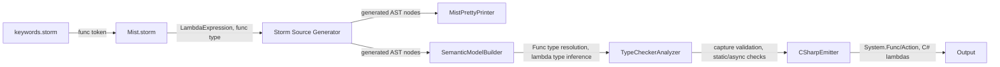
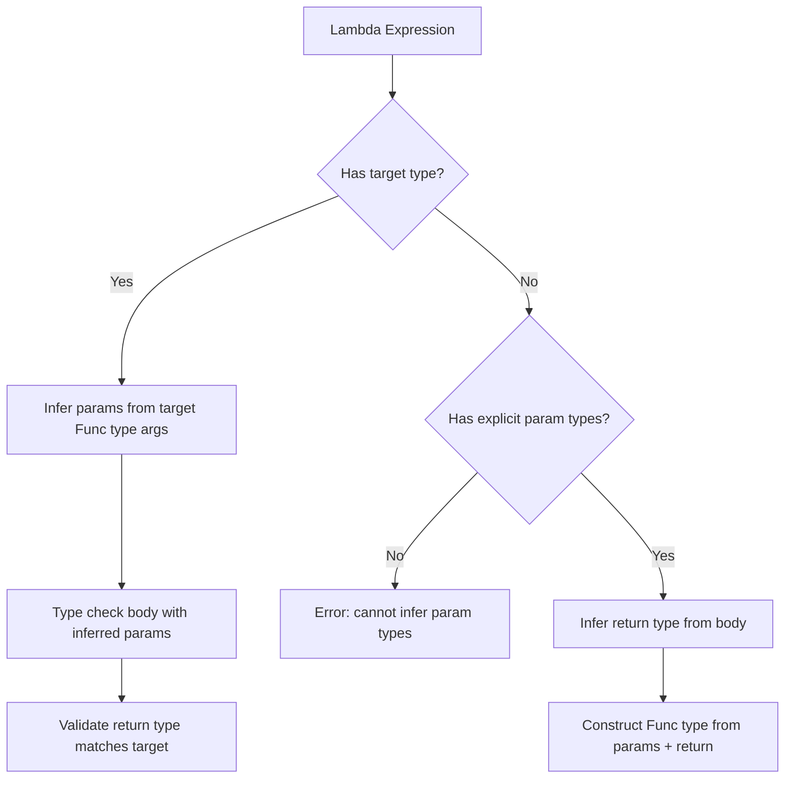
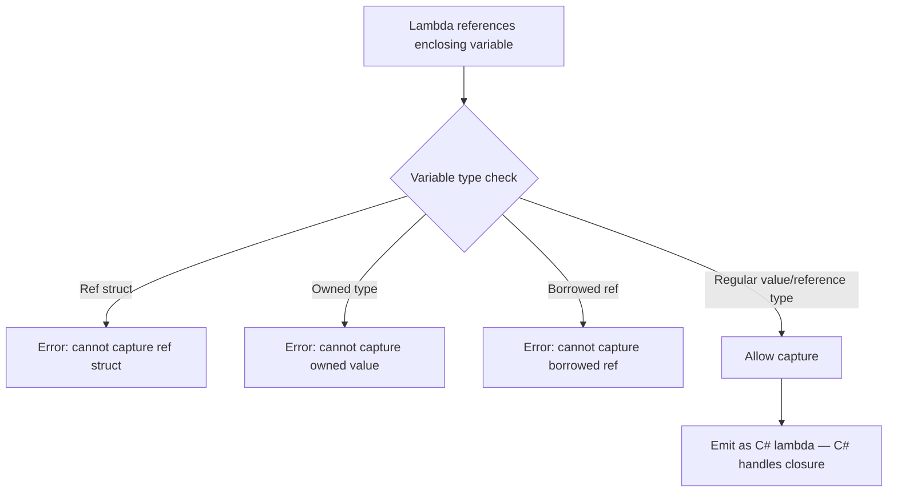

# Design Document: First-Class Functions and Lambdas

## Overview

This design adds first-class functions and lambda expressions to the Mist language. The model unifies all callable types under a single `Func<TParams..., TResult>` generic type family. Since `void` is a real unit type in Mist, there is no need for a separate `Action` type — `Action<T>` is simply a type alias for `Func<T, void>`. The lowercase keyword `func` serves as a reserved alias for `Standard.Func`, following the same pattern as `int` → `Int32`.

The core abstractions are:

1. **`Func<T1, ..., TN, TResult>`** — the intrinsic type family representing callable values (last type arg = return type)
2. **`func` keyword** — lowercase alias for `Standard.Func`, a first-class type keyword
3. **`Action<T1, ..., TN>`** — type alias family for `Func<T1, ..., TN, void>` (sugar for void-return)
4. **Lambda expressions** — anonymous functions using `=>` syntax (expression-bodied and block-bodied)
5. **Static lambdas** — `static` modifier prohibits variable capture
6. **Async lambdas** — `async` modifier enables explicit async context within the lambda
7. **Variable capture** — by-reference capture with closure generation delegated to C#

### Design Rationale

Mist's approach differs from C#'s delegate system:

- **No `delegate` keyword**: Since Mist has type aliases and `Func` types are structural (two `Func` types with the same type arguments are the same type), named delegates add no value beyond what `type Predicate<T> = func<T, bool>;` provides.
- **Unified `Func` family**: Because `void` is a real type, `Func<T, void>` is valid. `Action<T>` is pure sugar.
- **`func` as keyword**: Makes function types feel foundational, not library-level. Consistent with `int`, `string`, `void`.
- **Capture restrictions**: Ref structs and owned types cannot be captured — this preserves stack-only and ownership invariants without requiring complex escape analysis.

## Architecture

The feature follows the existing compiler pipeline:



### Type System Integration

The `Func` type family is structural — two `Func` types with identical type arguments are the same type regardless of how they were declared:

| Mist Source | Resolved Type | C# Emission |
|---|---|---|
| `func<int, string>` | `Standard.Func<Int32, String>` | `System.Func<int, string>` |
| `Func<int, string>` | `Standard.Func<Int32, String>` | `System.Func<int, string>` |
| `func<int, void>` | `Standard.Func<Int32, Void>` | `System.Action<int>` |
| `Action<int>` | `Standard.Func<Int32, Void>` | `System.Action<int>` |
| `func<void>` | `Standard.Func<Void>` | `System.Action` |
| `Action` | `Standard.Func<Void>` | `System.Action` |

### Lambda Type Inference Strategy

Lambda type inference follows a target-type-driven approach:

1. **Target type available** (explicit variable type, parameter type): Infer lambda parameter types from the target `Func` type's type arguments.
2. **Explicit lambda parameters with `var`**: Infer return type from expression/block body, construct `Func` type.
3. **No target type, implicit parameters**: Error — cannot infer parameter types.



### Capture Semantics

Lambdas capture variables by reference. The Mist compiler does NOT generate closure classes — it delegates closure generation entirely to C#'s lambda compilation. This is possible because:

1. Mist lambdas emit as C# lambdas
2. C# handles all closure class generation, variable lifting, and per-iteration capture
3. Mist only needs to validate capture restrictions (ref structs, owned types) at the type-checking level



## Components and Interfaces

### 1. Standard Library: Func Declaration (`Source/Standard/Bootstrap/Func.mist`)

```mist
namespace Standard;

// Func type family: arity 0 (just return type) through 16 parameters + return type.
// The last type argument is always the return type.

intrinsic public class Func<TResult> { }
intrinsic public class Func<T1, TResult> { }
intrinsic public class Func<T1, T2, TResult> { }
intrinsic public class Func<T1, T2, T3, TResult> { }
intrinsic public class Func<T1, T2, T3, T4, TResult> { }
intrinsic public class Func<T1, T2, T3, T4, T5, TResult> { }
intrinsic public class Func<T1, T2, T3, T4, T5, T6, TResult> { }
intrinsic public class Func<T1, T2, T3, T4, T5, T6, T7, TResult> { }
intrinsic public class Func<T1, T2, T3, T4, T5, T6, T7, T8, TResult> { }
intrinsic public class Func<T1, T2, T3, T4, T5, T6, T7, T8, T9, TResult> { }
intrinsic public class Func<T1, T2, T3, T4, T5, T6, T7, T8, T9, T10, TResult> { }
intrinsic public class Func<T1, T2, T3, T4, T5, T6, T7, T8, T9, T10, T11, TResult> { }
intrinsic public class Func<T1, T2, T3, T4, T5, T6, T7, T8, T9, T10, T11, T12, TResult> { }
intrinsic public class Func<T1, T2, T3, T4, T5, T6, T7, T8, T9, T10, T11, T12, T13, TResult> { }
intrinsic public class Func<T1, T2, T3, T4, T5, T6, T7, T8, T9, T10, T11, T12, T13, T14, TResult> { }
intrinsic public class Func<T1, T2, T3, T4, T5, T6, T7, T8, T9, T10, T11, T12, T13, T14, T15, TResult> { }
intrinsic public class Func<T1, T2, T3, T4, T5, T6, T7, T8, T9, T10, T11, T12, T13, T14, T15, T16, TResult> { }
```

Each `Func` variant is an intrinsic class with `IsBackendBacked = true`. The semantic model builder recognizes these by their `Standard.Func` qualified name and arity. They have no Mist-visible members — invocation is handled by the type checker recognizing `Func`-typed expressions followed by `InvocationSuffix`.

### 2. Standard Library: Action Aliases (`Source/Standard/Bootstrap/Action.mist`)

```mist
namespace Standard;

// Action type alias family: sugar for Func<..., void>
type Action = Func<void>;
type Action<T1> = Func<T1, void>;
type Action<T1, T2> = Func<T1, T2, void>;
type Action<T1, T2, T3> = Func<T1, T2, T3, void>;
type Action<T1, T2, T3, T4> = Func<T1, T2, T3, T4, void>;
type Action<T1, T2, T3, T4, T5> = Func<T1, T2, T3, T4, T5, void>;
type Action<T1, T2, T3, T4, T5, T6> = Func<T1, T2, T3, T4, T5, T6, void>;
type Action<T1, T2, T3, T4, T5, T6, T7> = Func<T1, T2, T3, T4, T5, T6, T7, void>;
type Action<T1, T2, T3, T4, T5, T6, T7, T8> = Func<T1, T2, T3, T4, T5, T6, T7, T8, void>;
type Action<T1, T2, T3, T4, T5, T6, T7, T8, T9> = Func<T1, T2, T3, T4, T5, T6, T7, T8, T9, void>;
type Action<T1, T2, T3, T4, T5, T6, T7, T8, T9, T10> = Func<T1, T2, T3, T4, T5, T6, T7, T8, T9, T10, void>;
type Action<T1, T2, T3, T4, T5, T6, T7, T8, T9, T10, T11> = Func<T1, T2, T3, T4, T5, T6, T7, T8, T9, T10, T11, void>;
type Action<T1, T2, T3, T4, T5, T6, T7, T8, T9, T10, T11, T12> = Func<T1, T2, T3, T4, T5, T6, T7, T8, T9, T10, T11, T12, void>;
type Action<T1, T2, T3, T4, T5, T6, T7, T8, T9, T10, T11, T12, T13> = Func<T1, T2, T3, T4, T5, T6, T7, T8, T9, T10, T11, T12, T13, void>;
type Action<T1, T2, T3, T4, T5, T6, T7, T8, T9, T10, T11, T12, T13, T14> = Func<T1, T2, T3, T4, T5, T6, T7, T8, T9, T10, T11, T12, T13, T14, void>;
type Action<T1, T2, T3, T4, T5, T6, T7, T8, T9, T10, T11, T12, T13, T14, T15> = Func<T1, T2, T3, T4, T5, T6, T7, T8, T9, T10, T11, T12, T13, T14, T15, void>;
type Action<T1, T2, T3, T4, T5, T6, T7, T8, T9, T10, T11, T12, T13, T14, T15, T16> = Func<T1, T2, T3, T4, T5, T6, T7, T8, T9, T10, T11, T12, T13, T14, T15, T16, void>;
```

These use the existing type alias mechanism. The semantic model builder resolves `Action<int>` → `Func<int, void>` transparently.

### 3. Grammar Changes

#### New Keyword Token (`keywords.storm`)

```storm
token FUNC = "func";
```

#### PrimitiveType Rule Extension (`Mist.storm`)

The `func` keyword is NOT added to `PrimitiveType` because it requires type arguments (it's always `func<...>`). Instead, it's handled as a special case in `TypeReference` — when the parser encounters `FUNC` followed by `<`, it produces a `NamedTypeRef` node with the identifier "func". This is resolved by the semantic model builder to `Standard.Func` with the appropriate arity.

Alternative approach: Add `func` as a recognized keyword in the `TypeReference` rule directly:

```storm
rule TypeReference
    = ...existing alternatives...
    | FUNC typeArgs:TypeArgumentList as FuncTypeRef
    ;
```

This produces a dedicated `FuncTypeRefTypeReferenceNode` that the semantic model builder maps to `Standard.Func<...>`.

#### Lambda Expression Grammar (`Mist.storm`)

Lambda expressions are added as a new alternative in the `Primary` rule:

```storm
rule Primary
    = ...existing alternatives...
    | lambda:LambdaExpression as LambdaExpressionPrimary
    ;

rule LambdaExpression
    = modifiers:LambdaModifier* params:LambdaParameterList SUCH_THAT body:Block       as BlockLambda
    | modifiers:LambdaModifier* params:LambdaParameterList SUCH_THAT body:Expression   as ExpressionLambda
    ;

rule LambdaModifier
    = STATIC as StaticLambdaModifier
    | ASYNC  as AsyncLambdaModifier
    ;

rule LambdaParameterList
    = LEFT_PARENTHESIS params:LambdaParamList? RIGHT_PARENTHESIS  as ParenthesizedLambdaParams
    | name:IDENTIFIER                                              as SingleImplicitParam
    ;

rule LambdaParamList = LambdaParam (COMMA LambdaParam)*;

rule LambdaParam
    = type:TypeReference name:IDENTIFIER  as TypedLambdaParam
    | name:IDENTIFIER                      as UntypedLambdaParam
    ;
```

**Precedence note**: The `LambdaExpression` alternative in `Primary` uses `SUCH_THAT` (`=>`). This token is already used in switch arms and expression-bodied properties, but those contexts are syntactically distinct (switch arms appear inside `switch { }` blocks, properties appear in member declarations). In the `Primary` rule, a lambda is recognized by the presence of either a single identifier or a parenthesized list followed by `=>`.

**Ambiguity resolution**: The parser must distinguish between:
- `x => x + 1` (lambda with single implicit param)
- `(x) => x + 1` (lambda with parenthesized single param)
- `(x, y) => x + y` (lambda with multiple params)
- `(int x) => x + 1` (lambda with typed param)
- `() => 42` (lambda with zero params)

The key disambiguation is: when the parser sees `IDENTIFIER SUCH_THAT`, it's a single-param lambda. When it sees `LEFT_PARENTHESIS`, it looks ahead to determine if this is a parenthesized expression or a lambda parameter list (presence of `SUCH_THAT` after the closing paren confirms lambda).

### 4. Semantic Model Builder Changes

#### Pass 1: Func Type Registration

The `Func` types are registered as intrinsic classes during stdlib loading (same as `Int32`, `String`, etc.). No special Pass 1 logic is needed beyond what already exists for intrinsic types.

#### Pass 2: Lambda Expression Type Resolution

When the semantic model builder encounters a `LambdaExpressionPrimaryNode`, it:

1. **Determines the target type** from context (variable declaration type, parameter type, return type)
2. **Resolves parameter types**:
   - If parameters are explicitly typed: use declared types
   - If parameters are implicitly typed: infer from target type's `Func` type arguments
   - If no target type and implicit params: defer to type checker (which will error)
3. **Resolves body type**:
   - Expression body: type of the expression
   - Block body: common type of all `return` statements
4. **Constructs the lambda's `Func` type**: `Func<param1Type, param2Type, ..., returnType>`
5. **Records the expression type** in the semantic model

#### Pass 2: Method Group Conversion

When an identifier expression appears in a context expecting a `Func` type and the identifier resolves to a method symbol (not a variable), the semantic model builder performs method group conversion:

1. Check that the method's parameter types match the target `Func` type's parameter type arguments
2. Check that the method's return type matches the target `Func` type's return type argument
3. Record the expression type as the target `Func` type

#### Pass 2: Func-Typed Invocation

When a `PostfixSuffix` of kind `InvocationSuffix` is applied to an expression whose type is a `Func` type (specifically a `ConstructedType` whose `GenericDefinition` is one of the `Standard.Func` classes):

1. Extract parameter types from the `Func` type's type arguments (all but the last)
2. Extract return type from the last type argument
3. Type-check arguments against parameter types
4. Record the invocation expression's type as the return type

### 5. Type Checker Changes

#### Lambda Capture Validation

The type checker walks the lambda body and identifies all references to variables from enclosing scopes. For each captured variable:

- If the variable's type is a ref struct → error `MIST_TC_0110`
- If the variable has `owned` ownership → error `MIST_TC_0111`
- If the variable has `ref`/`frozen ref`/`readonly ref`/`borrowed` ownership → error `MIST_TC_0112`

#### Static Lambda Validation

For lambdas with the `static` modifier, the type checker verifies that the body references ONLY:
- The lambda's own parameters
- Static fields and constants
- Type names

Any reference to a local variable, instance field, or `this` → error `MIST_TC_0113`.

#### Async Lambda Validation

For lambdas with the `async` modifier:
- `await` expressions are permitted in the body
- The inferred return type is wrapped in `Task<T>`

For lambdas WITHOUT `async`:
- `await` expressions are forbidden → error `MIST_TC_0114`
- Auto-await rules apply (same as sync methods calling async methods)

#### Mixed Parameter Type Validation

If a lambda parameter list mixes typed and untyped parameters → error `MIST_TC_0115`.

### 6. C# Emitter Changes

#### Func Type Emission (`CSharpTypeMap.cs`)

Add logic to `GetTypeName` for `ConstructedType` instances whose `GenericDefinition` is a `Standard.Func` class:

```
if last type argument is Void:
    if arity == 1 (just return type): emit "System.Action"
    else: emit "System.Action<T1, ..., TN-1>"
else:
    emit "System.Func<T1, ..., TN>"
```

This maps:
- `Func<void>` → `System.Action`
- `Func<int, void>` → `System.Action<int>`
- `Func<int, string>` → `System.Func<int, string>`

#### Lambda Expression Emission

When the emitter encounters a `LambdaExpressionPrimaryNode`:

1. Emit modifiers: `static` → C# `static`, `async` → C# `async`
2. Emit parameter list: `(type1 name1, type2 name2)` or just `(name1, name2)` for inferred types
3. Emit `=>`
4. Emit body: expression directly, or `{ statements }` for block body

For non-async lambdas that call async methods (auto-await), the emitter adds `async` to the C# lambda (same pattern as sync methods calling async methods).

#### Method Group Emission

When the emitter encounters a method group conversion (identifier expression whose semantic type is a `Func` type and whose symbol is a method), emit just the method name — C# handles implicit delegate conversion.

#### Func-Typed Invocation Emission

When the emitter encounters an invocation on a `Func`-typed expression, emit standard C# delegate invocation: `variable(args)`.

### 7. Assembly Type Provider Changes

#### Delegate Projection

When the `TypeProjector` encounters a .NET delegate type in an ambient assembly:

- `System.Func<T1, ..., TN, TResult>` → project as `Standard.Func<T1, ..., TN, TResult>`
- `System.Action<T1, ..., TN>` → project as `Standard.Func<T1, ..., TN, Void>` (which is `Action<T1, ..., TN>`)
- `System.Action` (non-generic) → project as `Standard.Func<Void>` (which is `Action`)
- Named delegates (e.g., `Predicate<T>`, `Comparison<T>`) → project as type alias to equivalent `Func` type based on the delegate's `Invoke` method signature

For emission, when Mist code interacts with an API expecting a specific named delegate type, the emitter uses the original C# delegate type name to ensure compilation succeeds.

### 8. Pretty Printer Changes

Add cases to `MistPrettyPrinter`:

- `FuncTypeRefTypeReferenceNode` → emit `func<T1, T2, ..., TReturn>`
- `LambdaExpressionPrimaryNode` → emit `[static] [async] params => body`
- Expression lambda: `params => expr`
- Block lambda: `params => { stmts }`
- Single param without parens: `x => expr`
- Zero params: `() => expr`
- Typed params: `(int x, string y) => expr`

### 9. TextMate Grammar Changes

Add `func` to the type keywords pattern (alongside `int`, `string`, `void`, etc.):

```json
{
  "match": "\\b(int|uint|long|ulong|short|ushort|byte|sbyte|float|double|decimal|bool|char|string|regex|void|unknown|func)\\b",
  "name": "storage.type.primitive.mist"
}
```

The `static` and `async` modifiers before lambdas are already covered by existing modifier patterns.

### 10. Book Highlight.js Changes

Add `func` to the `RESERVED_TYPES` string in `book/theme/mist-lang.js`:

```javascript
var RESERVED_TYPES = 'int uint long ulong short ushort byte sbyte float double decimal bool char string regex void unknown var func';
```

## Diagnostic ID Allocation

| ID | Condition | Requirement |
|---|---|---|
| `MIST_TC_0110` | Lambda captures a ref struct variable | 11.1 |
| `MIST_TC_0111` | Lambda captures an owned-type variable | 11.2, 11.3 |
| `MIST_TC_0112` | Lambda captures a borrowed/frozen/readonly ref variable | 11.4, 11.5, 11.6 |
| `MIST_TC_0113` | Static lambda references enclosing variable | 8.2, 8.4 |
| `MIST_TC_0114` | `await` in non-async lambda body | 9.5 |
| `MIST_TC_0115` | Mixed typed/untyped lambda parameters | 4.7, 4.8 |
| `MIST_TC_0116` | Lambda parameter types cannot be inferred (no target type) | 6.6 |
| `MIST_TC_0117` | Inconsistent return types in block lambda | 6.7 |
| `MIST_TC_0118` | Missing return in non-void block lambda | 5.4 |
| `MIST_TC_0119` | Func invocation argument count mismatch | 7.9 |
| `MIST_TC_0120` | Func invocation argument type mismatch | 7.10 |
| `MIST_TC_0121` | Ambiguous method group (multiple overloads match) | 7.8 |

## Data Models

### LambdaExpressionInfo (Semantic Model)

The semantic model stores metadata about each lambda expression for use by the type checker and emitter:

```
LambdaExpressionInfo:
  - Parameters: ImmutableArray<(string Name, IType Type)>
  - ReturnType: IType
  - FuncType: ConstructedType (the full Func<...> type)
  - IsStatic: bool
  - IsAsync: bool
  - CapturedVariables: ImmutableArray<ISymbol>
  - BodyKind: Expression | Block
```

### Func Type Recognition

A type is recognized as a `Func` type when:
1. It is a `ConstructedType`
2. Its `GenericDefinition` is a `ClassType` with `DisplayName == "Func"` and `ContainingNamespace == "Standard"` and `IsBackendBacked == true`

Helper method: `IsFuncType(IType type)` → bool

## Interaction with Existing Features

### Type Aliases

`type Predicate<T> = func<T, bool>;` works through the existing type alias mechanism. The alias resolves to `Func<T, bool>`, and lambda type inference sees through the alias to extract parameter/return types.

### Generics

`Func` types can be used as generic type arguments: `List<func<int, string>>`. This works naturally because `Func` types are just `ConstructedType` instances.

### Ownership System

`Func`-typed values are reference types (closures are heap-allocated). They support all ownership specifiers valid for reference types. Invocation is a read operation (permitted on `readonly ref` and `frozen ref`).

### Structured Concurrency

Async lambdas interact with the existing structured concurrency system:
- Non-async lambda calling async method → auto-await (emitter adds `async` to C# lambda)
- Async lambda → explicit `Task<T>` return type, `await` permitted in body
- Scope-exit await rules apply within async lambda bodies

### Extension Methods

Lambdas can be passed to extension methods that accept `Func` parameters. The type inference system infers lambda parameter types from the extension method's parameter type.


## Correctness Properties

### Property 1: Func Type Structural Equality

Two `Func` types with the same number of type arguments and identical corresponding type arguments MUST resolve to the same type. `func<int, string>`, `Func<int, string>`, and any type alias that resolves to `Func<int, string>` are all the same type.

- **Validates: Requirements 1.6, 2.3, 16.4**

### Property 2: Lambda Type Inference Completeness

For every lambda expression that has either (a) a target type providing parameter types, or (b) explicitly-typed parameters, the compiler MUST successfully infer a complete `Func` type. No valid lambda should produce an "unknown type" result.

- **Validates: Requirements 6.1, 6.2, 6.3, 6.4, 6.5**

### Property 3: Capture-by-Reference Semantics

Mutations to a captured variable inside a lambda MUST be visible outside the lambda, and mutations outside MUST be visible inside. This is verified by the sample app's capture test (increment counter, observe shared state).

- **Validates: Requirements 10.1, 10.2**

### Property 4: Static Lambda Isolation

A static lambda MUST NOT reference any variable from an enclosing scope. The type checker MUST reject any such reference with `MIST_TC_0113`. The resulting `Func` type is identical to a non-static lambda with the same signature.

- **Validates: Requirements 8.2, 8.3, 8.4, 8.5**

### Property 5: Async Lambda Return Type Wrapping

An async lambda with body type `T` MUST have inferred type `func<..., Task<T>>`. A non-async lambda calling an async method MUST auto-await (body type is `T`, not `Task<T>`), but the emitted C# lambda is marked `async`.

- **Validates: Requirements 9.2, 9.3, 9.6, 9.8, 9.9**

### Property 6: Pretty-Print Round-Trip

For all valid `func` type references and lambda expressions: `print(parse(print(ast))) == print(ast)`.

- **Validates: Requirements 13.7, 13.8**

### Property 7: C# Emission Correctness

- `Func<T1, ..., TN, TResult>` where TResult ≠ void → `System.Func<T1, ..., TN, TResult>`
- `Func<T1, ..., TN, void>` → `System.Action<T1, ..., TN>`
- `Func<void>` → `System.Action`

- **Validates: Requirements 14.1, 14.2, 14.3**

## Error Handling

### Compile-Time Errors

| Diagnostic | Trigger | Recovery |
|---|---|---|
| `MIST_TC_0110` | Lambda captures ref struct | Report error, skip capture validation for that variable |
| `MIST_TC_0111` | Lambda captures owned type | Report error, skip capture validation |
| `MIST_TC_0112` | Lambda captures borrowed/frozen/readonly ref | Report error, skip capture validation |
| `MIST_TC_0113` | Static lambda references enclosing variable | Report error, continue type checking body |
| `MIST_TC_0114` | `await` in non-async lambda | Report error, treat as if async for continued analysis |
| `MIST_TC_0115` | Mixed typed/untyped lambda params | Report error, treat all as untyped for continued analysis |
| `MIST_TC_0116` | Cannot infer lambda param types | Report error, assign ErrorType to params |
| `MIST_TC_0117` | Inconsistent return types in block lambda | Report error, use first return type |
| `MIST_TC_0118` | Missing return in non-void block lambda | Report error |
| `MIST_TC_0119` | Func invocation arg count mismatch | Report error |
| `MIST_TC_0120` | Func invocation arg type mismatch | Report error per mismatched arg |
| `MIST_TC_0121` | Ambiguous method group | Report error listing matching overloads |

All errors are non-fatal — the compiler continues analysis after reporting, using `ErrorType` where a type cannot be determined. This ensures the developer sees all errors in a single compilation pass.

## Testing Strategy

### Unit Tests (In-Process, No Process Spawning)

1. **Parser tests**: Verify that all lambda syntax variants produce correct AST node types. Test each form: single param, multi-param, zero-param, typed params, block body, expression body, static modifier, async modifier.

2. **Pretty-printer round-trip tests**: Parse → print → parse → print produces identical output for all lambda and func type syntax variants.

3. **Semantic model tests**: Verify type resolution for `func<int, string>`, lambda type inference from target types, method group conversion, and Func-typed invocation return types.

4. **Type checker diagnostic tests**: Verify each diagnostic fires correctly — capture restrictions, static lambda violations, mixed params, missing returns, etc.

### Integration Tests (Batched, Minimal Process Spawning)

5. **End-to-end compilation test**: Compile a Mist program using all lambda features through the full pipeline and verify the emitted C# compiles and runs correctly. Uses batched approach: one compile, one run, multiple output lines verified.

6. **Sample app verification**: The `FirstClassFunctions` sample app serves as the primary integration test. One compile + one run, output compared line-by-line against expected output.

### What Is NOT Tested

- Closure class generation details (delegated to C# compiler)
- Runtime performance of closures (out of scope for correctness)
- Interaction with garbage collection (runtime concern)
