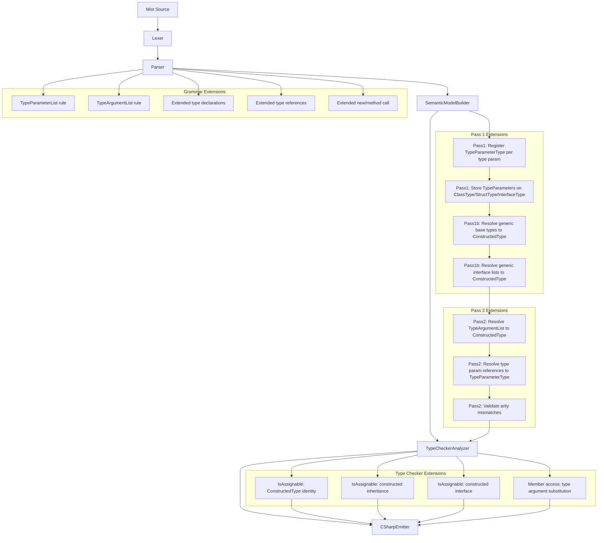
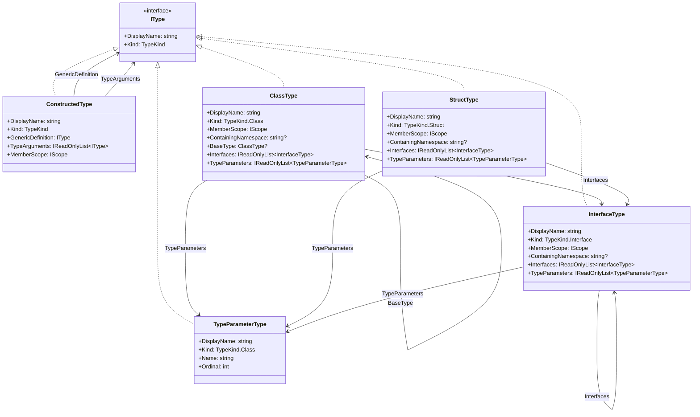

# Design Document: Generics and Type Arguments

## Overview

This design adds generics (type parameters and type arguments) to the Mist programming language. Generics allow classes, structs, interfaces, and methods to be parameterized by one or more type parameters, enabling type-safe reusable data structures and algorithms. Mist generics follow the C# reified generics model, where type information is preserved at runtime through the C# backend.

The implementation touches every stage of the compiler pipeline:

1. **Grammar** — New `TypeParameterList` and `TypeArgumentList` rules; extended `ClassDeclaration`, `StructDeclaration`, `InterfaceDeclaration`, `MethodDeclaration`, `InterfaceMethodDeclaration`, `TypeReference`, `ObjectCreationExpression`, and `MethodCallSuffix` rules
2. **Pretty Printer** — Format type parameter lists on declarations, type argument lists on type references, `new` expressions, and method invocations
3. **Semantic Model** — New `TypeParameterType` and `ConstructedType` types; type parameter registration in scopes; constructed type resolution; generic inheritance resolution; generic member resolution
4. **Type Checker** — Extended `IsAssignable` to handle `ConstructedType` identity, constructed type inheritance, and constructed interface assignability; type argument substitution for member access
5. **C# Emitter** — Emit angle bracket syntax for all generic contexts (declarations, type references, `new` expressions, method invocations, inheritance clauses)
6. **Syntax Highlighting** — Add type parameter patterns to the TextMate grammar

### Design Decisions

- **No lexer changes**: `<` and `>` are already lexed as `LESS_THAN` and `GREATER_THAN` tokens. Disambiguation is handled purely through Storm grammar rules since type argument lists only appear in four structural contexts (type declarations, method declarations, `new` expressions, and method invocations).
- **Two new semantic types**: `TypeParameterType` represents an unsubstituted type parameter (e.g., `T`). `ConstructedType` represents a generic type with all type parameters substituted (e.g., `List<int>`). This separation keeps the existing `ClassType`/`StructType`/`InterfaceType` types clean while adding generic capabilities.
- **Type parameters stored on declaration types**: `ClassType`, `StructType`, and `InterfaceType` gain a `TypeParameters` property (list of `TypeParameterType`). Method symbols gain a similar property for generic methods.
- **Type argument substitution at access time**: When accessing a member of a `ConstructedType` (e.g., `box.value` where `box: Box<int>`), the type checker substitutes `T → int` in the member's type. This avoids duplicating the entire member scope per constructed type.
- **Arity is part of type identity**: `Box<int>` and `Box<string>` are distinct types. Two `ConstructedType` instances are equal only if they share the same generic definition and all type arguments are equal.
- **No constraints in this spec**: Type parameters are unconstrained. Generic constraints (`where T : ...`) will be addressed in a separate spec.
- **No type inference in this spec**: All type arguments must be explicitly provided. Type inference will be addressed separately.

## Architecture

The generics feature integrates into the existing multi-pass compiler pipeline:



### Pipeline Integration Points

| Pipeline Stage | Change |
|---|---|
| `Mist.storm` | Add `TypeParameterList`, `TypeArgumentList` rules; extend `ClassDeclaration`, `StructDeclaration`, `InterfaceDeclaration`, `MethodDeclaration`, `InterfaceMethodDeclaration`, `NamedTypeRef`, `ObjectCreationExpression`, `MethodCallSuffix` |
| `MistPrettyPrinter` | Emit type parameter lists on all declaration types; emit type argument lists on type references, `new` expressions, and method invocations |
| `SemanticModelBuilder` Pass 1 | Create `TypeParameterType` for each type parameter; store on `ClassType.TypeParameters`, `StructType.TypeParameters`, `InterfaceType.TypeParameters`; register in member scope |
| `SemanticModelBuilder` Pass 1 | Store type parameters on method symbols for generic methods |
| `SemanticModelBuilder` Pass 1b | Resolve generic base types and interface lists to `ConstructedType` |
| `SemanticModelBuilder` Pass 2 | Resolve `TypeArgumentList` on type references to `ConstructedType`; resolve type parameter references to `TypeParameterType`; validate arity |
| `TypeCheckerAnalyzer` | Extend `IsAssignable` for `ConstructedType` identity, inheritance, and interface assignability; substitute type arguments on member access |
| `CSharpEmitter` | Emit `<T, U>` on declarations; emit `<int, string>` on type references, `new` expressions, method invocations, and inheritance clauses |
| `CSharpTypeMap` | Handle `TypeParameterType` and `ConstructedType` |
| `mist.tmLanguage.json` | Add type parameter highlighting patterns |

## Components and Interfaces

### Grammar Changes (`Mist.storm`)

**New rules:**

```
rule TypeParameterList = LESS_THAN IDENTIFIER (COMMA IDENTIFIER)* GREATER_THAN;

rule TypeArgumentList = LESS_THAN TypeReference (COMMA TypeReference)* GREATER_THAN;
```

**Modified rules:**

```
rule ClassDeclaration = modifiers:Modifier* CLASS name:IDENTIFIER
    typeParams:TypeParameterList?
    baseClause:(COLON baseClassName:IDENTIFIER typeArgs:TypeArgumentList? (COMMA IDENTIFIER TypeArgumentList?)*)? 
    LEFT_BRACE members:MemberDeclaration* RIGHT_BRACE;

rule StructDeclaration = modifiers:Modifier* STRUCT name:IDENTIFIER
    typeParams:TypeParameterList?
    interfaceList:(COLON interfaceName:IDENTIFIER TypeArgumentList? (COMMA IDENTIFIER TypeArgumentList?)*)?
    LEFT_BRACE members:MemberDeclaration* RIGHT_BRACE;

rule InterfaceDeclaration = INTERFACE name:IDENTIFIER
    typeParams:TypeParameterList?
    interfaceList:(COLON interfaceName:IDENTIFIER TypeArgumentList? (COMMA IDENTIFIER TypeArgumentList?)*)?
    LEFT_BRACE methods:InterfaceMethodDeclaration* RIGHT_BRACE;

rule MethodDeclaration = modifiers:Modifier* returnType:TypeReference name:IDENTIFIER
    typeParams:TypeParameterList?
    LEFT_PARENTHESIS parameters:ParameterList? RIGHT_PARENTHESIS body:Block;

rule InterfaceMethodDeclaration = returnType:TypeReference name:IDENTIFIER
    typeParams:TypeParameterList?
    LEFT_PARENTHESIS parameters:ParameterList? RIGHT_PARENTHESIS SEMICOLON;

rule TypeReference
    = primitiveType:PrimitiveType arrayRank:(LEFT_BRACKET RIGHT_BRACKET)?  as PrimitiveTypeRef
    | VOID                                                                  as VoidTypeRef
    | name:QualifiedIdentifier typeArgs:TypeArgumentList? arrayRank:(LEFT_BRACKET RIGHT_BRACKET)?  as NamedTypeRef
    ;

// In Primary:
| NEW type:QualifiedIdentifier typeArgs:TypeArgumentList? LEFT_PARENTHESIS arguments:ArgumentList? RIGHT_PARENTHESIS as ObjectCreationExpression

// In PostfixSuffix:
| DOT name:IDENTIFIER typeArgs:TypeArgumentList? LEFT_PARENTHESIS arguments:ArgumentList? RIGHT_PARENTHESIS as MethodCallSuffix
```

**Design rationale for disambiguation**: Type argument lists are syntactically identical to comparison chains (`a < b, c > d`). The grammar avoids ambiguity by restricting `TypeArgumentList` to four structural contexts where a comparison expression cannot appear:
1. After a type name in declarations (`class Foo<T>`)
2. After a method name in declarations (`void Bar<T>(...)`)
3. After a type name in `new` expressions (`new Foo<int>(...)`)
4. After a method name in method call suffixes (`obj.Bar<int>(...)`)

In all other expression contexts, `<` and `>` remain comparison operators. No lexer changes or lookahead heuristics are needed.

### New Type: `TypeParameterType` (`Source/Mist/Semantics/Model/Types/TypeParameterType.cs`)

```csharp
public sealed class TypeParameterType : IType
{
    public string DisplayName { get; }
    public TypeKind Kind => TypeKind.Class; // Type params are treated as reference types by default
    public string Name { get; }
    public int Ordinal { get; } // Position in the type parameter list (0-based)

    public TypeParameterType(string name, int ordinal)
    {
        Name = name;
        DisplayName = name;
        Ordinal = ordinal;
    }
}
```

### New Type: `ConstructedType` (`Source/Mist/Semantics/Model/Types/ConstructedType.cs`)

```csharp
public sealed class ConstructedType : IType
{
    public string DisplayName { get; }
    public TypeKind Kind { get; }
    
    /// <summary>The unparameterized generic type definition (ClassType, StructType, or InterfaceType).</summary>
    public IType GenericDefinition { get; }
    
    /// <summary>The concrete type arguments substituted for the type parameters.</summary>
    public IReadOnlyList<IType> TypeArguments { get; }
    
    /// <summary>The member scope of the generic definition (members are resolved with substitution).</summary>
    public IScope MemberScope => GenericDefinition switch
    {
        ClassType c => c.MemberScope,
        StructType s => s.MemberScope,
        InterfaceType i => i.MemberScope,
        _ => throw new InvalidOperationException()
    };

    public ConstructedType(IType genericDefinition, IReadOnlyList<IType> typeArguments)
    {
        GenericDefinition = genericDefinition;
        TypeArguments = typeArguments;
        Kind = genericDefinition.Kind;
        
        // Build display name: "Box<int>" or "Map<string, int>"
        var argNames = string.Join(", ", typeArguments.Select(a => a.DisplayName));
        DisplayName = $"{genericDefinition.DisplayName}<{argNames}>";
    }
}
```

### Extended Types

**`ClassType`** — Add `TypeParameters` property:
```csharp
public IReadOnlyList<TypeParameterType> TypeParameters { get; internal set; }
    = Array.Empty<TypeParameterType>();
```

**`StructType`** — Add `TypeParameters` property:
```csharp
public IReadOnlyList<TypeParameterType> TypeParameters { get; internal set; }
    = Array.Empty<TypeParameterType>();
```

**`InterfaceType`** — Add `TypeParameters` property:
```csharp
public IReadOnlyList<TypeParameterType> TypeParameters { get; internal set; }
    = Array.Empty<TypeParameterType>();
```

### Method Symbol Extension

Method symbols for generic methods need to carry their type parameters. The approach is to add a `TypeParameters` property to the `Symbol` class (or introduce a `MethodSymbol` subclass). The simpler approach, consistent with the existing codebase, is to store type parameters on the `Symbol`:

```csharp
// In Symbol class:
public IReadOnlyList<TypeParameterType> TypeParameters { get; internal set; }
    = Array.Empty<TypeParameterType>();
```

### SemanticModelBuilder Extensions

#### Pass 1: Register Type Parameters

When registering a class, struct, or interface declaration that has a `TypeParameterList`:

1. For each identifier in the `TypeParameterList`, create a `TypeParameterType(name, ordinal)`.
2. Store the list on the type (e.g., `classType.TypeParameters = typeParams`).
3. Register each `TypeParameterType` as a symbol in the type's member scope so that it can be resolved as a type within the type body.
4. Check for duplicate type parameter names within the same list and emit `MIST_DUPLICATE_TYPE_PARAMETER` if found.
5. Check if a type parameter name shadows the enclosing type name and emit `MIST_TYPE_PARAMETER_SHADOWS_TYPE` warning if so.

For generic methods:
1. Create `TypeParameterType` instances for each method type parameter.
2. Store on the method symbol's `TypeParameters` property.
3. Register in the method's local scope (so they take precedence over enclosing type parameters).

#### Pass 1b: Resolve Generic Base Types and Interface Lists

Extend the existing base type and interface list resolution to handle type arguments:

1. When a base clause or interface list entry includes a `TypeArgumentList`, resolve each type argument to an `IType`.
2. Look up the referenced type name. If it has type parameters, construct a `ConstructedType` with the resolved type arguments.
3. Validate arity: if the number of type arguments doesn't match the number of type parameters, emit `MIST_ARITY_MISMATCH`.
4. If type arguments are provided but the referenced type is not generic, emit `MIST_NOT_GENERIC`.
5. If a generic type is referenced without type arguments and the referencing type doesn't provide its own matching type parameters, emit `MIST_MISSING_TYPE_ARGUMENTS`.

Store the resolved `ConstructedType` on `ClassType.BaseType` (which changes from `ClassType?` to `IType?` to accommodate `ConstructedType`) and on the `Interfaces` lists (which change from `IReadOnlyList<InterfaceType>` to `IReadOnlyList<IType>` to accommodate `ConstructedType`).

#### Pass 2: Resolve Type References with Type Arguments

Extend type reference resolution:

1. When a `NamedTypeRef` includes a `TypeArgumentList`, resolve each type argument recursively (supporting nested generics like `List<List<int>>`).
2. Look up the referenced type. If it's generic, construct a `ConstructedType`.
3. If the identifier resolves to a `TypeParameterType` (e.g., `T` inside `class Box<T>`), return the `TypeParameterType` directly.
4. Validate arity and emit diagnostics for mismatches.

For `ObjectCreationExpression` with type arguments:
1. Resolve the type arguments.
2. Construct a `ConstructedType` for the created type.
3. Resolve constructor calls against the generic definition's constructors.

For `MethodCallSuffix` with type arguments:
1. Resolve the type arguments.
2. Look up the method. If it's a generic method, substitute type parameters with the provided type arguments.
3. Validate arity.

### TypeCheckerAnalyzer Extensions

Extend `IsAssignable` to handle `ConstructedType`:

```csharp
// ConstructedType identity: same generic definition + same type arguments
if (source is ConstructedType sourceConstructed && target is ConstructedType targetConstructed)
{
    if (ReferenceEquals(sourceConstructed.GenericDefinition, targetConstructed.GenericDefinition)
        && sourceConstructed.TypeArguments.Count == targetConstructed.TypeArguments.Count)
    {
        var allMatch = true;
        for (int i = 0; i < sourceConstructed.TypeArguments.Count; i++)
        {
            if (!TypesEqual(sourceConstructed.TypeArguments[i], targetConstructed.TypeArguments[i]))
            {
                allMatch = false;
                break;
            }
        }
        if (allMatch) return true;
    }
}

// ConstructedType inheritance: e.g., OrderedList<int> : List<int>
// Walk the base type chain of the source's generic definition, substituting type args
if (source is ConstructedType sourceConst && target is ConstructedType)
{
    // Check if source's base type, after substitution, matches target
    var baseType = GetSubstitutedBaseType(sourceConst);
    if (baseType is not null && IsAssignable(baseType, target))
        return true;
}

// ConstructedType to constructed interface
if (target is ConstructedType targetConst && targetConst.GenericDefinition is InterfaceType)
{
    if (ImplementsConstructedInterface(source, targetConst))
        return true;
}
```

**Member access with type substitution**: When the type checker resolves a member access on a `ConstructedType` (e.g., `box.value` where `box: Box<int>`), it must substitute the type parameter with the corresponding type argument. A helper method `SubstituteType(IType type, IReadOnlyList<TypeParameterType> typeParams, IReadOnlyList<IType> typeArgs)` performs this substitution:

- If `type` is a `TypeParameterType` and matches one of the `typeParams`, return the corresponding `typeArgs` entry.
- If `type` is a `ConstructedType`, recursively substitute its type arguments.
- Otherwise, return the type unchanged.

### CSharpEmitter Extensions

Extend all emission methods to handle type parameter lists and type argument lists:

- `EmitClassDeclaration`: Emit `<T, U>` after class name if type parameters present.
- `EmitStructDeclaration`: Same pattern.
- `EmitInterfaceDeclaration`: Same pattern.
- `EmitMethodDeclaration`: Emit `<T>` after method name if type parameters present.
- `EmitInterfaceMethodDeclaration`: Same pattern.
- `EmitTypeReference`: For `NamedTypeRef` with type arguments, emit `Name<Arg1, Arg2>`.
- `EmitPrimary` (ObjectCreationExpression): Emit `new Name<Arg>(args)`.
- `EmitPostfixSuffix` (MethodCallSuffix): Emit `target.Method<Arg>(args)`.
- Inheritance clauses: Emit `class Foo<T> : Bar<T>`, `class IntList : List<int>`, etc.

### CSharpTypeMap Extension

Add cases for the new types:

```csharp
TypeParameterType tp => tp.Name,
ConstructedType ct => $"{GetTypeName(ct.GenericDefinition)}<{string.Join(", ", ct.TypeArguments.Select(GetTypeName))}>",
```

### MistPrettyPrinter Extensions

Add helper methods:

- `EmitTypeParameterList(TypeParameterListNode?)`: Emits `<T, U>` or empty string.
- `EmitTypeArgumentList(TypeArgumentListNode?)`: Emits `<int, string>` or empty string.

Extend existing methods:
- `EmitClassDeclaration`: Insert type parameter list after class name.
- `EmitStructDeclaration`: Insert type parameter list after struct name.
- `EmitInterfaceDeclaration`: Insert type parameter list after interface name.
- `EmitMethodDeclaration`: Insert type parameter list after method name.
- `EmitInterfaceMethodDeclaration`: Insert type parameter list after method name.
- `EmitTypeReference` (NamedTypeRef): Append type argument list after name.
- `EmitPrimary` (ObjectCreationExpression): Append type argument list after type name.
- `EmitPostfixSuffix` (MethodCallSuffix): Append type argument list after method name.
- Base/interface clauses: Append type argument lists after each base/interface name.

### TextMate Grammar Extensions

Add type parameter highlighting in declaration contexts:

```json
{
    "match": "\\b(class|struct|interface)\\s+([a-zA-Z_]\\w*)\\s*<([^>]+)>",
    "captures": {
        "1": { "name": "keyword.declaration.mist" },
        "2": { "name": "entity.name.type.mist" },
        "3": { "name": "entity.name.type.parameter.mist" }
    }
}
```

Add method type parameter highlighting:

```json
{
    "match": "([a-zA-Z_]\\w*)\\s*<([^>]+)>\\s*\\(",
    "captures": {
        "1": { "name": "entity.name.function.mist" },
        "2": { "name": "entity.name.type.parameter.mist" }
    }
}
```

### New Diagnostic IDs

| ID | Stage | Message |
|---|---|---|
| `MIST_ARITY_MISMATCH` | SemanticModelConstruction | Type '{name}' expects {expected} type argument(s) but received {actual}. |
| `MIST_NOT_GENERIC` | SemanticModelConstruction | Type '{name}' is not generic and does not accept type arguments. |
| `MIST_MISSING_TYPE_ARGUMENTS` | SemanticModelConstruction | Generic type '{name}' requires type arguments. |
| `MIST_DUPLICATE_TYPE_PARAMETER` | SemanticModelConstruction | Duplicate type parameter name '{name}'. |
| `MIST_TYPE_PARAMETER_SHADOWS_TYPE` | SemanticModelConstruction | Type parameter '{name}' shadows the enclosing type name. |
| `MIST_METHOD_ARITY_MISMATCH` | Analysis | Method '{name}' expects {expected} type argument(s) but received {actual}. |
| `MIST_UNDEFINED_TYPE_ARGUMENT` | SemanticModelConstruction | Type argument '{name}' could not be resolved. |

## Data Models

### Type Hierarchy with Generics



### AST Nodes (Storm-generated)

The Storm source generator will produce these new/modified node types from the grammar rules:

- `TypeParameterListNode` — contains one or more `IDENTIFIER` tokens
- `TypeArgumentListNode` — contains one or more `TypeReferenceNode` entries
- Modified `ClassDeclarationNode` — gains optional `TypeParams` field
- Modified `StructDeclarationNode` — gains optional `TypeParams` field
- Modified `InterfaceDeclarationNode` — gains optional `TypeParams` field
- Modified `MethodDeclarationNode` — gains optional `TypeParams` field
- Modified `InterfaceMethodDeclarationNode` — gains optional `TypeParams` field
- Modified `NamedTypeRefTypeReferenceNode` — gains optional `TypeArgs` field
- Modified `ObjectCreationExpressionPrimaryNode` — gains optional `TypeArgs` field
- Modified `MethodCallSuffixPostfixSuffixNode` — gains optional `TypeArgs` field

### Type Argument Substitution Example

```
Source: class Box<T> { T value; T GetValue() { return value; } }
Usage:  Box<int> box = new Box<int>();
        int v = box.GetValue();

Substitution map: { T → int }

box.value  → type is T → substitute → int
box.GetValue() → return type is T → substitute → int
```

### Constructed Type Resolution Example

```
Source: class Map<K, V> { }
        class StringMap<V> : Map<string, V> { }
        
StringMap<int> → ConstructedType(StringMap, [int])
  Base: Map<string, V> with V=int → ConstructedType(Map, [string, int])
```


## Correctness Properties

*A property is a characteristic or behavior that should hold true across all valid executions of a system — essentially, a formal statement about what the system should do. Properties serve as the bridge between human-readable specifications and machine-verifiable correctness guarantees.*

### Property 1: Generic syntax round-trip

*For any* valid Mist AST containing generic declarations (classes, structs, interfaces, and methods with type parameter lists), type references with type argument lists (including nested generics like `List<List<int>>`), object creation expressions with type arguments, method invocations with type arguments, and generic inheritance/interface clauses, pretty-printing the AST and then parsing the result and pretty-printing again SHALL produce identical output.

**Validates: Requirements 1.1, 1.2, 1.3, 1.4, 1.5, 1.6, 2.1, 2.2, 2.3, 2.4, 3.1, 3.2, 3.3, 3.4, 3.5, 4.1, 4.2, 4.3, 4.4, 5.1, 5.2, 5.3, 5.4, 5.5, 5.6, 5.7, 5.8, 5.9, 5.10**

### Property 2: Type parameter registration

*For any* generic type declaration (class, struct, or interface) with N type parameters, and for any generic method declaration with M type parameters, the semantic model builder SHALL create exactly N (or M) `TypeParameterType` instances, store them on the declaring type's (or method symbol's) `TypeParameters` property with correct ordinals (0 through N-1), and register each as a resolvable type in the declaring scope. Fields, method parameters, and return types that reference a type parameter name SHALL resolve to the corresponding `TypeParameterType`.

**Validates: Requirements 6.1, 6.2, 6.3, 6.4, 9.1, 9.2**

### Property 3: Duplicate type parameter diagnostic

*For any* type or method declaration whose `TypeParameterList` contains two or more identical identifier names, the semantic model builder SHALL emit a `MIST_DUPLICATE_TYPE_PARAMETER` diagnostic error for each duplicate occurrence.

**Validates: Requirements 6.5, 13.3**

### Property 4: Constructed type resolution

*For any* type reference that includes a `TypeArgumentList` where the referenced type is a generic type declaration with matching arity, the semantic model builder SHALL produce a `ConstructedType` whose `GenericDefinition` is the referenced type and whose `TypeArguments` match the resolved type arguments. When type arguments are themselves type parameters (e.g., `List<T>` inside `class Wrapper<T>`), the type arguments SHALL resolve to the corresponding `TypeParameterType`. When type arguments are nested generics (e.g., `List<List<int>>`), the inner type arguments SHALL be resolved first and the outer `ConstructedType` SHALL contain the inner `ConstructedType` as a type argument.

**Validates: Requirements 7.1, 7.4, 7.5**

### Property 5: Arity mismatch diagnostic

*For any* type reference or method invocation that provides a different number of type arguments than the referenced generic type or method declares type parameters, the compiler SHALL emit a diagnostic error stating the expected and actual arity. This applies to both type-level arity mismatches (`MIST_ARITY_MISMATCH`) and method-level arity mismatches (`MIST_METHOD_ARITY_MISMATCH`).

**Validates: Requirements 7.2, 11.6, 13.1, 13.4**

### Property 6: Non-generic type argument diagnostic

*For any* type reference that provides type arguments to a type that is not a generic type declaration (i.e., has zero type parameters), the compiler SHALL emit a `MIST_NOT_GENERIC` diagnostic error.

**Validates: Requirements 7.3, 13.2**

### Property 7: Generic inheritance resolution

*For any* class that specifies a generic base class with type arguments, and for any type that specifies generic interfaces with type arguments, the semantic model builder SHALL resolve each base type and interface to a `ConstructedType` with the correct type arguments. When a generic type inherits from another generic type using its own type parameters (e.g., `class OrderedList<T> : List<T>`), the base type's type arguments SHALL reference the derived type's `TypeParameterType` instances. When a non-generic type inherits from a generic type with concrete arguments (e.g., `class IntList : List<int>`), the base type's type arguments SHALL be the concrete types.

**Validates: Requirements 8.1, 8.2, 8.3, 8.5**

### Property 8: Missing type arguments diagnostic

*For any* non-generic type that inherits from a generic type without providing type arguments, the compiler SHALL emit a `MIST_MISSING_TYPE_ARGUMENTS` diagnostic error.

**Validates: Requirements 8.4, 13.5**

### Property 9: Constructed type member access substitution

*For any* member access on a `ConstructedType` (e.g., accessing a field or calling a method on a `Box<int>` value), the type checker SHALL substitute each type parameter in the member's type with the corresponding type argument from the constructed type. For example, if `Box<T>` has a field of type `T` and the constructed type is `Box<int>`, the field's effective type SHALL be `int`.

**Validates: Requirements 9.3, 11.5**

### Property 10: Constructed type assignability

*For any* two `ConstructedType` instances built from the same generic definition with the same type arguments, assignment from one to the other SHALL be accepted by the type checker. Additionally, if a `ConstructedType` inherits from another `ConstructedType` (e.g., `OrderedList<int>` extends `List<int>`), assignment from the derived to the base SHALL be accepted. If a `ConstructedType` implements a constructed interface (e.g., `Box<int>` implements `IContainer<int>`), assignment from the implementing type to the interface SHALL be accepted.

**Validates: Requirements 11.1, 11.3, 11.4**

### Property 11: Constructed type non-assignability

*For any* two `ConstructedType` instances built from the same generic definition but with at least one differing type argument (e.g., `List<int>` and `List<string>`), assignment from one to the other SHALL cause the type checker to emit a diagnostic error.

**Validates: Requirements 11.2**

### Property 12: C# emission correctness for generics

*For any* valid Mist program containing generic type declarations, generic method declarations, type references with type arguments, object creation expressions with type arguments, method invocations with type arguments, generic inheritance clauses, and nested generic type arguments, the emitted C# code SHALL contain syntactically correct angle bracket syntax that mirrors the Mist source structure. Specifically, generic type declarations SHALL emit `<T, U>` after the type name, type references SHALL emit `<int, string>` after the type name, and inheritance clauses SHALL emit the correct constructed type syntax.

**Validates: Requirements 12.1, 12.2, 12.3, 12.4, 12.5, 12.6, 12.7, 12.8**

### Property 13: Undefined type argument diagnostic

*For any* type reference where a type argument name cannot be resolved to a known type (neither a declared type, a type parameter in scope, nor a primitive type), the compiler SHALL emit a `MIST_UNDEFINED_TYPE_ARGUMENT` diagnostic error.

**Validates: Requirements 13.6**

## Error Handling

### Compilation Errors (Diagnostics)

| Scenario | Diagnostic ID | Severity | Recovery |
|---|---|---|---|
| Type argument count doesn't match type parameter count | `MIST_ARITY_MISMATCH` | Error | Treat as `UnknownType`, continue |
| Type arguments provided to non-generic type | `MIST_NOT_GENERIC` | Error | Ignore type arguments, continue |
| Generic type used without type arguments | `MIST_MISSING_TYPE_ARGUMENTS` | Error | Treat as open generic, continue |
| Duplicate type parameter name in list | `MIST_DUPLICATE_TYPE_PARAMETER` | Error | Use first occurrence, skip duplicates |
| Type parameter shadows enclosing type name | `MIST_TYPE_PARAMETER_SHADOWS_TYPE` | Warning | Continue (type parameter takes precedence in scope) |
| Method type argument count mismatch | `MIST_METHOD_ARITY_MISMATCH` | Error | Treat return type as `UnknownType`, continue |
| Type argument cannot be resolved | `MIST_UNDEFINED_TYPE_ARGUMENT` | Error | Substitute `UnknownType`, continue |
| Incompatible constructed type assignment | `MIST_TC_0001` (existing) | Error | Existing type checker handling |

### Error Recovery Strategy

The compiler follows the existing pattern of continuing compilation after errors to report as many issues as possible in a single pass:

- **Arity mismatches**: The type reference resolves to `UnknownType`. Subsequent type checking on expressions using this type is suppressed (existing `UnknownType` cascading-error suppression).
- **Non-generic type with type arguments**: The type arguments are ignored and the type resolves to the non-generic type. A diagnostic is emitted but compilation continues.
- **Missing type arguments**: The generic type is treated as if it were referenced without construction. Members are accessible but type parameter positions resolve to `UnknownType`.
- **Duplicate type parameters**: The first occurrence is used. Subsequent duplicates are skipped during registration but diagnostics are emitted for each.
- **Undefined type arguments**: Each unresolvable type argument is substituted with `UnknownType`. The `ConstructedType` is still created (with `UnknownType` arguments) to allow continued analysis.

## Testing Strategy

### Property-Based Testing (FsCheck)

The project uses **FsCheck 3.1.0** with **xUnit** for property-based testing. Each correctness property maps to one or more PBT test classes.

**Configuration**: Minimum 100 iterations per property test.

**Generator extensions needed**:
- Extend `MistAstGenerator` with generators for `TypeParameterListNode` (1-4 type parameters), `TypeArgumentListNode` (1-4 type arguments including nested generics)
- Extend `MistAstGenerator` with generators for generic `ClassDeclarationNode`, `StructDeclarationNode`, `InterfaceDeclarationNode`, `MethodDeclarationNode`, `InterfaceMethodDeclarationNode`
- Extend `MistAstGenerator` with generators for `NamedTypeRef` with type arguments, `ObjectCreationExpression` with type arguments, `MethodCallSuffix` with type arguments
- Extend `MistProgramGenerator` with generators for complete programs containing generic types, constructed types, generic inheritance, and generic method invocations
- Add generators for invalid programs (arity mismatches, non-generic type arguments, duplicate type parameters, undefined type arguments, missing type arguments)
- Add generators for `ConstructedType` and `TypeParameterType` instances for type checker property tests

### Test Plan

| Property | Test Class | Type |
|---|---|---|
| Property 1: Round-trip | `GenericRoundTripPropertyTests` | PBT |
| Property 2: Type parameter registration | `TypeParameterRegistrationPropertyTests` | PBT |
| Property 3: Duplicate type parameter diagnostic | `DuplicateTypeParameterPropertyTests` | PBT |
| Property 4: Constructed type resolution | `ConstructedTypeResolutionPropertyTests` | PBT |
| Property 5: Arity mismatch diagnostic | `ArityMismatchPropertyTests` | PBT |
| Property 6: Non-generic type argument diagnostic | `NonGenericTypeArgumentPropertyTests` | PBT |
| Property 7: Generic inheritance resolution | `GenericInheritanceResolutionPropertyTests` | PBT |
| Property 8: Missing type arguments diagnostic | `MissingTypeArgumentsPropertyTests` | PBT |
| Property 9: Member access substitution | `ConstructedTypeMemberAccessPropertyTests` | PBT |
| Property 10: Constructed type assignability | `ConstructedTypeAssignabilityPropertyTests` | PBT |
| Property 11: Constructed type non-assignability | `ConstructedTypeNonAssignabilityPropertyTests` | PBT |
| Property 12: Emission correctness | `GenericEmissionPropertyTests` | PBT |
| Property 13: Undefined type argument diagnostic | `UndefinedTypeArgumentPropertyTests` | PBT |
| Sample app compilation | `GenericsSampleIntegrationTests` | Integration |
| AllFeatures update | `AllFeaturesSampleIntegrationTests` | Integration |
| Syntax highlighting | Manual verification | Manual |
| CSHARP_FEATURES.md update | Manual verification | Manual |

### Unit Tests (Example-Based)

In addition to PBT, targeted unit tests cover:

- Empty type parameter list edge case (should not occur per grammar, but defensive)
- Single type parameter (`class Box<T>`) — simplest case
- Multiple type parameters (`class Map<K, V>`) — comma separation
- Nested generics (`List<List<int>>`) — recursive resolution
- Deeply nested generics (`Map<string, List<List<int>>>`) — multiple levels
- Generic type with base class and interfaces (`class Foo<T> : Bar<T>, IFoo<T>`)
- Non-generic type extending constructed generic (`class IntList : List<int>`)
- Generic method inside generic type where method type param shadows type param
- Static field in generic type
- Forward reference to generic type (type used before declaration)
- Disambiguation: `a < b` as comparison vs `new Foo<int>()` as generic — both in same program

### Tag Format

Each property-based test is tagged with:
```
Feature: generics-type-arguments, Property {number}: {property_text}
```
