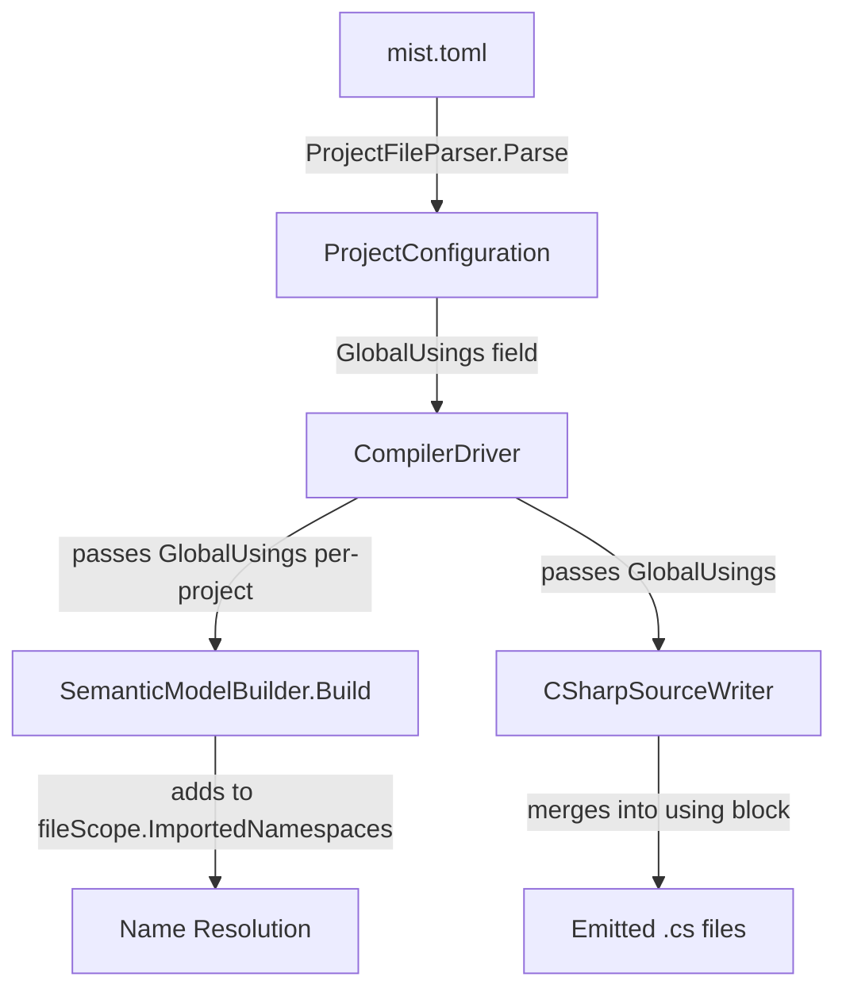

# Design Document: Global Usings

## Overview

This feature adds a `[global_usings]` section to `mist.toml` that declares namespaces implicitly imported into every source file within the declaring project. Global usings are scoped per-project — they never leak across project reference boundaries.

The implementation touches four pipeline stages:

1. **Parsing** — `ProjectFileParser` reads and validates the new TOML section.
2. **Pipeline wiring** — `CompilerDriver` passes each project's global usings to the semantic model builder, scoped to that project's compilation units only.
3. **Semantic resolution** — `SemanticModelBuilder` treats global usings as implicit `using` declarations during name resolution.
4. **Code generation** — `CSharpSourceWriter` merges global usings into the emitted `using` directive block.

The design prioritizes simplicity: global usings are represented as an `ImmutableArray<string>` on `ProjectConfiguration` and flow through the existing pipeline without introducing new abstractions.

## Architecture



### Data Flow

1. `ProjectFileParser.Parse` reads `[global_usings].namespaces` from TOML → stores in `ProjectConfiguration.GlobalUsings`.
2. `CompilerDriver.Compile` reads `ProjectConfiguration.GlobalUsings` for the root project and each resolved referenced project.
3. For each project's compilation units, the driver passes that project's `GlobalUsings` to `SemanticModelBuilder.Build` via a new parameter.
4. `SemanticModelBuilder` calls `fileScope.AddImportedNamespace(ns)` for each global using namespace on every file scope it creates.
5. `CSharpSourceWriter` receives global usings and merges them into the `usings` HashSet alongside explicit and backend namespaces before emitting the sorted, deduplicated block.

## Components and Interfaces

### ProjectConfiguration (modified)

```csharp
public sealed record ProjectConfiguration(
    string Name,
    string NamespaceRoot,
    ImmutableArray<ProjectReference> References,
    ImmutableArray<string> GlobalUsings);
```

The new `GlobalUsings` parameter defaults to `ImmutableArray<string>.Empty` when the section is absent.

### ProjectFileParser (modified)

New parsing logic after the `[[references]]` section:

```csharp
// 10. Read [global_usings] section (optional)
ImmutableArray<string> globalUsings = ImmutableArray<string>.Empty;

if (model.TryGetValue("global_usings", out var guObj))
{
    if (guObj is not TomlTable guTable)
    {
        // Section exists but is not a table — report error
        diagnostics.Add(...MIST_GLOBAL_USING_INVALID_FORMAT...);
        return null;
    }

    if (!guTable.TryGetValue("namespaces", out var nsObj))
    {
        diagnostics.Add(...MIST_GLOBAL_USING_MISSING_NAMESPACES...);
        return null;
    }

    if (nsObj is not TomlArray nsArray)
    {
        diagnostics.Add(...MIST_GLOBAL_USING_INVALID_FORMAT...);
        return null;
    }

    var builder = ImmutableArray.CreateBuilder<string>();
    var seen = new HashSet<string>(StringComparer.Ordinal);

    for (var i = 0; i < nsArray.Count; i++)
    {
        if (nsArray[i] is not string entry)
        {
            diagnostics.Add(...MIST_GLOBAL_USING_INVALID_FORMAT at index i...);
            return null;
        }

        if (string.IsNullOrWhiteSpace(entry))
        {
            diagnostics.Add(...MIST_GLOBAL_USING_EMPTY_NAMESPACE...);
            return null;
        }

        if (!ValidNamespacePattern().IsMatch(entry))
        {
            diagnostics.Add(...MIST_GLOBAL_USING_INVALID_NAMESPACE...);
            return null;
        }

        if (!seen.Add(entry))
        {
            diagnostics.Add(...MIST_GLOBAL_USING_DUPLICATE_NAMESPACE warning...);
            continue; // skip duplicate, continue parsing
        }

        builder.Add(entry);
    }

    globalUsings = builder.ToImmutable();
}

return new ProjectConfiguration(name, namespaceRoot, references.ToImmutable(), globalUsings);
```

A new regex validates namespace format:

```csharp
[GeneratedRegex(@"^[a-zA-Z_][a-zA-Z0-9_]*(\.[a-zA-Z_][a-zA-Z0-9_]*)*$")]
private static partial Regex ValidNamespacePattern();
```

### ISemanticModelBuilder (modified)

```csharp
ISemanticModel Build(
    MistCompilation compilation,
    ImmutableArray<Storm.Runtime.SyntaxNode> asts,
    IAmbientTypeResolver? ambientTypeResolver,
    string namespaceRoot,
    string projectFolder,
    DiagnosticBag diagnostics,
    ImmutableHashSet<string>? directReferencePaths = null,
    ImmutableArray<string> globalUsings = default);
```

The new `globalUsings` parameter defaults to an empty array for backward compatibility.

### SemanticModelBuilder (modified)

In the Pass 2 type resolution section where file scopes are created, after processing explicit `using` declarations:

```csharp
// Process global usings — add each as an imported namespace on the file scope.
foreach (var globalNs in globalUsings)
{
    var nsExists = false;

    // Check user-defined namespaces.
    foreach (var member in globalScope.Members)
    {
        if (member.Kind == SymbolKind.Namespace && member.Name == globalNs)
        {
            nsExists = true;
            break;
        }
    }

    // Check ambient namespaces.
    if (!nsExists && ambientTypeResolver is not null)
    {
        nsExists = ambientTypeResolver.HasNamespace(globalNs);
    }

    if (nsExists)
    {
        fileScope.AddImportedNamespace(globalNs);
    }
    else
    {
        diagnostics.Add(new Diagnostic(
            new DiagnosticId("MIST_GLOBAL_USING_UNDEFINED_NAMESPACE"),
            DiagnosticSeverity.Warning,
            PipelineStage.SemanticModelConstruction,
            $"Global using namespace '{globalNs}' could not be found.",
            Location: default,
            CompilationUnitPath: sourceText?.Path ?? "<unknown>",
            AnalyzerName: null));
    }
}
```

Global usings are added to the file scope's imported namespaces with the same mechanism as explicit `using` declarations. This means:
- Ambiguity detection works identically (same `MIST_AMBIGUOUS_TYPE` diagnostic).
- Redundant explicit usings are silently accepted (the `HashSet` in `AddImportedNamespace` deduplicates).
- No special priority logic is needed — global and explicit usings have equal priority by design.

### CompilerDriver (modified)

The driver already parses `ProjectConfiguration` for the root project (Step 1c). The modification:

1. After parsing the root project's config, extract `GlobalUsings` and pass it to `SemanticModelBuilder.Build`.
2. For referenced projects, each `ResolvedProjectReference` already carries its `Configuration`. Pass each referenced project's `Configuration.GlobalUsings` when building the semantic model for that project's units.

Since the `SemanticModelBuilder.Build` call currently processes all units together (stdlib + referenced + user), the global usings need to be applied per-file based on which project the file belongs to. The implementation approach:

- Pass the root project's `GlobalUsings` to `SemanticModelBuilder.Build`.
- The builder applies these global usings only to file scopes for units where `OriginProjectPath is null` (user's own files).
- For referenced project units (`OriginProjectPath is not null`), the builder needs access to that project's global usings. This is achieved by adding a `GlobalUsings` property to `CompilationUnit`:

```csharp
public sealed record CompilationUnit(Common.Text.SourceText Source)
{
    // ... existing properties ...

    /// <summary>
    /// The global usings declared in this unit's owning project's mist.toml.
    /// Applied during semantic model construction as implicit imports.
    /// Empty for stdlib units.
    /// </summary>
    public ImmutableArray<string> GlobalUsings { get; init; } = ImmutableArray<string>.Empty;
}
```

The driver sets `GlobalUsings` on each `CompilationUnit` when loading source files:
- User units: set from root project's `ProjectConfiguration.GlobalUsings`.
- Referenced project units: set from that project's `ResolvedProjectReference.Configuration.GlobalUsings`.
- Stdlib units: left empty (stdlib has no global usings).

The `SemanticModelBuilder` then reads `unit.GlobalUsings` when constructing each file's scope, rather than receiving a single flat list.

### CSharpSourceWriter (modified)

In `EmitCompilationUnit`, after collecting explicit usings and backend namespaces:

```csharp
// Add global usings for this compilation unit.
var unit = _model.Units[unitIndex];
foreach (var globalNs in unit.GlobalUsings)
{
    usings.Add(globalNs); // HashSet deduplicates automatically
}
```

The existing `HashSet<string>` and `OrderBy` sort handle deduplication and ordering.

### CompilerOptions (modified)

Add a `GlobalUsings` field so that in-process compilation (used by tests) can pass global usings without requiring a `mist.toml` on disk:

```csharp
public sealed record CompilerOptions(
    string ProjectFolder,
    ImmutableArray<string> SourcePaths,
    BackendId Backend,
    string OutputDirectory,
    string BinDirectory,
    string ProjectName,
    string NamespaceRoot,
    ImmutableArray<string> EnabledAnalyzerIds,
    bool EmitToDisk = true,
    ImmutableArray<string> GlobalUsings = default);
```

## Data Models

### New Diagnostic IDs

| ID | Severity | Stage | Description |
|----|----------|-------|-------------|
| `MIST_GLOBAL_USING_MISSING_NAMESPACES` | Error | Driver | `[global_usings]` section present but missing `namespaces` field |
| `MIST_GLOBAL_USING_EMPTY_NAMESPACE` | Error | Driver | Empty or whitespace-only namespace entry |
| `MIST_GLOBAL_USING_INVALID_NAMESPACE` | Error | Driver | Namespace entry contains invalid characters |
| `MIST_GLOBAL_USING_INVALID_FORMAT` | Error | Driver | `namespaces` field is not an array or contains non-string elements |
| `MIST_GLOBAL_USING_DUPLICATE_NAMESPACE` | Warning | Driver | Duplicate namespace entry (removed, parsing continues) |
| `MIST_GLOBAL_USING_UNDEFINED_NAMESPACE` | Warning | SemanticModelConstruction | Global using namespace not found in semantic model |

### TOML Format

```toml
name = "MyProject"
namespace_root = "MyProject"

[global_usings]
namespaces = [
    "System",
    "System.Collections.Generic",
    "MyProject.Models"
]

[[references]]
path = "../SharedLib"
```

### ProjectConfiguration Serialization

For round-trip fidelity (Requirement 7), serialization writes:

```toml
[global_usings]
namespaces = ["System", "System.Collections.Generic"]
```

Unknown fields in `[global_usings]` are silently discarded during parsing (forward compatibility).

## Correctness Properties

*A property is a characteristic or behavior that should hold true across all valid executions of a system — essentially, a formal statement about what the system should do. Properties serve as the bridge between human-readable specifications and machine-verifiable correctness guarantees.*

### Property 1: ProjectConfiguration round-trip

*For any* valid `ProjectConfiguration` (with valid name, namespace root, references, and global usings list), serializing it to TOML and parsing the result back SHALL produce a `ProjectConfiguration` where `Name`, `NamespaceRoot`, `References`, and `GlobalUsings` are structurally equal to the original (order-sensitive for `GlobalUsings`).

**Validates: Requirements 1.1, 1.2, 1.3, 1.6, 3.1, 7.1, 7.2, 7.4**

### Property 2: Invalid namespace rejection

*For any* string that is either empty, whitespace-only, or contains characters outside the set `[a-zA-Z0-9_.]`, parsing a `mist.toml` with that string in the `namespaces` array SHALL produce an error diagnostic (either `MIST_GLOBAL_USING_EMPTY_NAMESPACE` or `MIST_GLOBAL_USING_INVALID_NAMESPACE`) and return `null`.

**Validates: Requirements 2.1, 2.2**

### Property 3: Duplicate detection and removal

*For any* `namespaces` array containing at least one duplicate entry (case-sensitive), parsing SHALL produce a `MIST_GLOBAL_USING_DUPLICATE_NAMESPACE` warning diagnostic and the resulting `GlobalUsings` list SHALL contain each namespace at most once, preserving the order of first occurrence.

**Validates: Requirements 2.5**

### Property 4: Diagnostic file path inclusion

*For any* invalid `[global_usings]` configuration that produces a diagnostic, the diagnostic message SHALL contain the absolute path to the `mist.toml` file.

**Validates: Requirements 2.6**

### Property 5: Global using resolution equivalence

*For any* valid namespace `N` containing a type `T`, if `N` is declared as a global using, then referencing `T` by simple name in any source file within that project SHALL resolve successfully — equivalent to having `using N;` at the top of the file.

**Validates: Requirements 4.1**

### Property 6: Redundant explicit using tolerance

*For any* namespace that appears both as a global using and as an explicit `using` declaration in a source file, the semantic model builder SHALL produce no diagnostic related to the redundancy.

**Validates: Requirements 4.2**

### Property 7: Undefined namespace warning

*For any* namespace name listed in global usings that does not exist as either a user-defined namespace or an ambient namespace, the semantic model builder SHALL produce a `MIST_GLOBAL_USING_UNDEFINED_NAMESPACE` warning diagnostic.

**Validates: Requirements 4.3**

### Property 8: Emitter deduplication and sorting

*For any* compilation unit with global usings, explicit using declarations, and backend namespaces, the emitted C# file SHALL contain each namespace as a `using` directive exactly once, and the directives SHALL be sorted in ordinal alphabetical order.

**Validates: Requirements 6.1, 6.2, 6.3, 6.4**

## Error Handling

### Parse-Time Errors (ProjectFileParser)

All parse-time errors follow the existing pattern: report a diagnostic and return `null`. The caller (`CompilerDriver`) already handles `null` returns by short-circuiting compilation.

**Error precedence**: Validation checks are applied in order. The first fatal error (anything except the duplicate warning) halts parsing and returns `null`. The duplicate warning is non-fatal — parsing continues with the duplicate removed.

**Diagnostic messages** always include the `mist.toml` file path for user orientation.

### Semantic-Time Warnings (SemanticModelBuilder)

- `MIST_GLOBAL_USING_UNDEFINED_NAMESPACE` is a **warning**, not an error. Compilation continues. This matches the behavior of C# where `global using` for a non-existent namespace produces a warning.
- Ambiguity errors (`MIST_AMBIGUOUS_TYPE`) use the existing diagnostic infrastructure — no new error handling needed.

### Backward Compatibility

- Existing `mist.toml` files without `[global_usings]` continue to work unchanged (empty list default).
- The `ProjectConfiguration` record gains a new parameter with a default value, so existing construction sites compile without modification.
- The `ISemanticModelBuilder.Build` signature gains a new parameter with a default value.

## Testing Strategy

### Unit Tests (xUnit)

- **ProjectFileParser tests**: Verify each validation rule (empty namespace, invalid chars, missing field, non-array format, non-string elements, duplicates). Use concrete `mist.toml` content strings.
- **SemanticModelBuilder tests**: Verify global usings are added to file scopes, undefined namespace warnings, ambiguity detection.
- **CSharpSourceWriter tests**: Verify emitted using directives include global usings, are sorted, and are deduplicated.

### Property-Based Tests (FsCheck + xUnit)

Property-based tests use FsCheck 3.x with the project's established batching pattern (per the test-process-spawning steering). Each property test runs a minimum of 100 iterations.

- **Property 1 (Round-trip)**: Generate random `ProjectConfiguration` objects with random `GlobalUsings` lists, serialize to TOML, parse back, assert structural equality. Tag: `Feature: global-usings, Property 1: ProjectConfiguration round-trip`
- **Property 2 (Invalid rejection)**: Generate random invalid namespace strings, assert parsing produces the correct error diagnostic. Tag: `Feature: global-usings, Property 2: Invalid namespace rejection`
- **Property 3 (Duplicate removal)**: Generate random namespace lists with injected duplicates, assert warning and correct deduplication. Tag: `Feature: global-usings, Property 3: Duplicate detection and removal`
- **Property 4 (File path in diagnostics)**: Generate random invalid configurations, assert all diagnostics contain the file path. Tag: `Feature: global-usings, Property 4: Diagnostic file path inclusion`
- **Property 5 (Resolution equivalence)**: Generate random namespace/type pairs, compile with global usings, assert type resolves. Uses in-process compilation via `CompilerDriver.Compile()`. Tag: `Feature: global-usings, Property 5: Global using resolution equivalence`
- **Property 6 (Redundant tolerance)**: Generate random namespaces present in both global and explicit usings, assert no redundancy diagnostic. Tag: `Feature: global-usings, Property 6: Redundant explicit using tolerance`
- **Property 7 (Undefined warning)**: Generate random non-existent namespace names, assert warning diagnostic. Tag: `Feature: global-usings, Property 7: Undefined namespace warning`
- **Property 8 (Emitter deduplication)**: Generate random namespace sets from multiple sources, assert emitted output is sorted and deduplicated. Tag: `Feature: global-usings, Property 8: Emitter deduplication and sorting`

### Integration Tests

- **Multi-project scoping**: Set up A→B project reference where both have global usings. Verify each project's units see only their own global usings. Uses in-process compilation with a capturing `SemanticModelBuilder`.
- **Sample app compilation**: Compile and run `samples/GlobalUsings/` end-to-end, verify expected stdout output.

### Process Spawning Note

Property tests for Properties 1–4 and 6–8 are pure in-process tests (no process spawning needed — they test parsing, semantic model construction, and emitter logic directly).

Property 5 (resolution equivalence) uses in-process compilation via `CompilerDriver.Compile()` with `EmitToDisk = false`. No external process is spawned per iteration. If end-to-end verification of the emitted C# is needed, a single batched compilation + run is used per the test-process-spawning policy.
