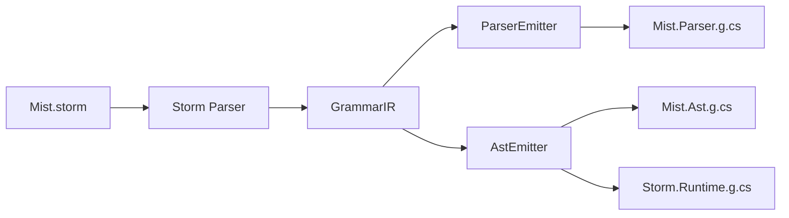

# Design Document: PEG Ordered-Choice Parser Emitter

## Overview

This design replaces the ParserEmitter's three-tier prediction strategy (LL(1) switch → bounded lookahead → backtracking fallback) with a uniform PEG ordered-choice backtracking strategy for all multi-alternative rules. Single-alternative rules continue to parse directly without backtracking overhead.

The current ParserEmitter (`Source/Storm.SourceGenerator/Emit/ParserEmitter.cs`) computes FIRST sets, determines a `PredictionStrategy` enum value, and dispatches to one of three code generation paths: `EmitLL1Switch`, `EmitBoundedLookahead`, or `EmitBacktracking`. This complexity produces ~3400 lines of generated parser code with inconsistent patterns across rules and incomplete state restoration during backtracking.

The new approach:
- Removes all FIRST set computation, `PredictionStrategy` enum, LL(1) switch emission, bounded lookahead emission, `TryParse` memoization helper, and `_memo` dictionary
- Emits a single uniform PEG ordered-choice pattern for every multi-alternative rule
- Emits direct parsing for every single-alternative rule
- Preserves the Mist grammar (`Mist.storm`) exactly as-is

The generated parser will be shorter, uniform, and trivially auditable. Every multi-alternative rule follows the same save → try → restore → try → ... → fail pattern.

## Architecture

The architecture remains a source generator pipeline:



The change is entirely within the **ParserEmitter** box. The IR types (`RuleIR`, `RuleAlternativeIR`, `ExpressionIR` hierarchy) are unchanged. The `AstEmitter` is unchanged. The `EmissionContext` is unchanged.

### Decision: PEG over LL(*)

PEG ordered-choice was chosen over the current mixed LL(*) approach because:
1. PEG semantics are simpler — try alternatives in order, commit to first success
2. State restoration is uniform — same three variables every time
3. The grammar already has alternatives ordered for PEG semantics (most specific first)
4. Correctness is easier to verify — one pattern to audit instead of three
5. The performance cost is acceptable for a compiler that processes single files

## Components and Interfaces

### ParserEmitter — Methods to Remove

The following methods and types will be deleted entirely:

| Method/Type | Reason for Removal |
|---|---|
| `PredictionStrategy` enum | No longer needed — only two paths exist |
| `ComputeFirstSet` / `ComputeFirstSetInner` | FIRST sets not used in PEG approach |
| `IsNullable` | Only used by `ComputeFirstSet` |
| `DetermineStrategy` | No strategy selection needed |
| `AreDisjoint` | Only used by `DetermineStrategy` |
| `EmitLL1Switch` | LL(1) switch emission removed |
| `EmitBoundedLookahead` | Bounded lookahead emission removed |
| `FindOverlappingAlts` | Only used by `EmitBoundedLookahead` |
| `BuildLookaheadCondition` | Only used by `EmitBoundedLookahead` |
| `FindFirstRequiredToken` | Only used for FIRST set guard in single-alt |

### ParserEmitter — Methods to Keep (Unchanged)

These helper-emission methods produce the same generated helper functions:

| Method | Generated Helper |
|---|---|
| `EmitParserState` | `_tokens`, `_allTokens`, `_pos`, `_hasError`, `_diagnostics` fields |
| `EmitHelpers` (partial) | `Init`, `Peek`, `Cur`, `Eat`, `Match`, `Require`, `Error`, `Span` |
| `EmitHiddenTokenHelpers` | `AttachHidden<T>` |
| `EmitPublicParseMethod` | Public `ParseX(TokenStream, DiagnosticBag)` entry points |

**Key change to `EmitParserState`**: Remove the `_memo` dictionary field. The generated parser will no longer declare `private static Dictionary<(int, string), (bool, int)>? _memo;`.

**Key change to `EmitHelpers`**: Remove the `TryParse` method emission and the `_memo` initialization in `Init`.

### ParserEmitter — Methods to Rewrite

| Method | Current Behavior | New Behavior |
|---|---|---|
| `EmitMultiAlt` | Computes FIRST sets, selects strategy, dispatches to LL1/lookahead/backtracking | Emits uniform PEG ordered-choice pattern directly |
| `EmitSingleAlt` | Computes FIRST set for lookahead guard | Emits direct parse with `if (_hasError) return null;` guard only |
| `EmitInternalParseMethod` | Dispatches to `EmitSingleAlt` or `EmitMultiAlt` | Same dispatch, but both paths are simpler |

### ParserEmitter — Methods to Keep (Expression Parsing)

The expression-level parsing methods are retained as they handle the inner structure of alternatives:

- `EmitAltBody` — emits the body of a single alternative (parse elements, construct AST node)
- `EmitAltBodyWithCheck` — emits alternative body with `ok` flag for speculative parsing
- `EmitFullExprParse` / `EmitFullExprParseAssignOnly` — recursive expression emission
- `EmitExprParse` / `EmitExprParseAssignOnly` — individual expression emission
- `EmitOptionalExprParse` — optional (`?`) expression emission
- `EmitListExprParse` — repetition (`*`, `+`) expression emission
- `EmitSequenceExprParse` — sequence expression emission
- `EmitAlternationExprParse` — inline alternation expression emission
- `EmitAtomicSequenceBody` — atomic optional sequence emission
- `GetFirstTokenInExpr` — used by `EmitOptionalExprParse` for guard checks
- `CollectLabeledExprs` — used for pre-declaring variables in optional/repetition blocks
- `GetExprTypeName` / `GetExprDefaultValue` — type inference for pre-declarations
- Utility methods: `FindTokenForLiteral`, `TokenKindRef`, `PascalCase`, `EnsureUnique`

## Data Models

### IR Types (Unchanged)

```
RuleIR
  ├── Name: string
  └── Alternatives: IReadOnlyList<RuleAlternativeIR>

RuleAlternativeIR
  ├── AlternativeName: string?        (e.g., "FileScopedNamespace")
  ├── FieldLabels: IReadOnlyList<FieldLabelIR>
  └── Expression: ExpressionIR

ExpressionIR (abstract)
  ├── SequenceIR        { Elements: IReadOnlyList<ExpressionIR> }
  ├── AlternationIR     { Alternatives: IReadOnlyList<ExpressionIR> }
  ├── OptionalIR        { Inner: ExpressionIR }
  ├── ZeroOrMoreIR      { Inner: ExpressionIR }
  ├── OneOrMoreIR       { Inner: ExpressionIR }
  ├── TokenRefIR        { Token: TokenIR }
  ├── RuleRefIR         { Rule: RuleIR }
  ├── StringLiteralIR   { Value: string }
  ├── CharClassIR       { Text: string }
  └── InlineFragmentIR  { FragmentName: string, Body: ExpressionIR }
```

### Generated Parser State (Modified)

Before (current):
```csharp
private static ImmutableArray<Token> _tokens;
private static ImmutableArray<Token> _allTokens;
private static int _pos;
private static bool _hasError;
private static DiagnosticBag? _diagnostics;
private static Dictionary<(int, string), (bool, int)>? _memo;  // REMOVED
```

After (new):
```csharp
private static ImmutableArray<Token> _tokens;
private static ImmutableArray<Token> _allTokens;
private static int _pos;
private static bool _hasError;
private static DiagnosticBag? _diagnostics;
```

### DiagnosticBag API (Verified — Already Exists)

The `DiagnosticBag` class emitted by `AstEmitter.EmitRuntimeTypes()` already provides the API needed for PEG backtracking:

```csharp
public class DiagnosticBag
{
    private readonly List<string> _messages = new List<string>();

    public void Add(string message) => _messages.Add(message);
    public bool HasErrors => _messages.Count > 0;
    public int Count => _messages.Count;                    // ✓ exists
    public IReadOnlyList<string> Messages => _messages;

    public void TruncateTo(int count)                       // ✓ exists
    {
        if (count < _messages.Count)
            _messages.RemoveRange(count, _messages.Count - count);
    }
}
```

Both `Count` and `TruncateTo(int)` are already emitted. No changes to `AstEmitter` are required.

### Generated Code Pattern: Multi-Alternative Rules (PEG Ordered-Choice)

For a rule like:
```
rule NamespaceDeclaration
    = NAMESPACE name:QualifiedIdentifier SEMICOLON body:TypeDeclaration*   as FileScopedNamespace
    | NAMESPACE name:QualifiedIdentifier LEFT_BRACE body:TypeDeclaration* RIGHT_BRACE as BlockNamespace
    ;
```

The generated code follows this exact pattern:

```csharp
private static NamespaceDeclarationNode? _ParseNamespaceDeclaration()
{
    if (_hasError) return null;

    // (a) Save all mutable state
    var saved = _pos;
    var savedError = _hasError;
    var savedDiagCount = _diagnostics?.Count ?? 0;

    // (b) Alternative 1: FileScopedNamespace
    _pos = saved;
    _hasError = false;
    _diagnostics?.TruncateTo(savedDiagCount);
    {
        var sp = _pos;
        var ok = true;
        // ... parse elements with ok flag ...
        if (ok && !_hasError)
        {
            var node = new FileScopedNamespaceNamespaceDeclarationNode();
            // ... assign properties ...
            node.Span = Span(sp);
            node = AttachHidden(node, sp, _pos);
            return node;
        }
    }

    // (b) Alternative 2: BlockNamespace
    _pos = saved;
    _hasError = false;
    _diagnostics?.TruncateTo(savedDiagCount);
    {
        var sp = _pos;
        var ok = true;
        // ... parse elements with ok flag ...
        if (ok && !_hasError)
        {
            var node = new BlockNamespaceNamespaceDeclarationNode();
            // ... assign properties ...
            node.Span = Span(sp);
            node = AttachHidden(node, sp, _pos);
            return node;
        }
    }

    // (c) All alternatives failed — restore original state
    _pos = saved;
    _hasError = savedError;   // NOTE: savedError, not false
    _diagnostics?.TruncateTo(savedDiagCount);
    return null;
}
```

Key structural invariants:
1. State save (`saved`, `savedError`, `savedDiagCount`) appears once at the top
2. Before each alternative: `_pos = saved; _hasError = false; _diagnostics?.TruncateTo(savedDiagCount);`
3. Each alternative is in its own `{ }` block scope
4. Success check: `if (ok && !_hasError)` — both conditions required
5. Epilogue restores `_hasError` to `savedError` (not `false`) to preserve pre-existing error state

### Generated Code Pattern: Single-Alternative Rules (Direct Parse)

For a rule like:
```
rule ClassDeclaration = modifiers:Modifier* CLASS name:IDENTIFIER LEFT_BRACE members:MemberDeclaration* RIGHT_BRACE;
```

The generated code parses directly without any backtracking infrastructure:

```csharp
private static ClassDeclarationNode? _ParseClassDeclaration()
{
    if (_hasError) return null;

    var sp = _pos;
    // ... parse modifiers (ZeroOrMore) ...
    // ... Require CLASS, IDENTIFIER, LEFT_BRACE ...
    // ... parse members (ZeroOrMore) ...
    // ... Require RIGHT_BRACE ...

    if (_hasError)
    {
        return null;
    }
    var node = new ClassDeclarationNode();
    // ... assign properties ...
    node.Span = Span(sp);
    node = AttachHidden(node, sp, _pos);
    return node;
}
```

Key differences from multi-alt:
- No `saved = _pos` / `savedError` / `savedDiagCount` variables
- No `_hasError = false` resets
- No `TruncateTo` calls
- No `{ }` block scoping for alternatives
- Uses `Require` (which sets `_hasError` on failure) instead of `ok` flag checks
- Single `if (_hasError) return null;` guard at the top

### How `_hasError` Behaves: Speculative vs Genuine Parsing

The `_hasError` flag has dual semantics depending on context:

**Within a single-alternative rule (genuine parsing):**
- `Require` sets `_hasError = true` when a required token is missing
- This is a genuine parse failure — the method returns `null` and the error propagates up
- The `Match` helper returns `null` when `_hasError` is true, causing cascading failure

**Within a multi-alternative rule (speculative parsing):**
- Each alternative is tried with `_hasError` reset to `false`
- If `Require` sets `_hasError` during an alternative, it means *this alternative* failed
- Before the next alternative, `_hasError` is reset to `false` and `_pos` is restored
- If ALL alternatives fail, `_hasError` is restored to `savedError` (the value from before the rule was entered)
- The rule returns `null`, and the *caller* decides whether this is a genuine failure

**Error propagation chain:**
```
_ParseStatement()           // multi-alt: tries each statement type
  → _ParseIfStatement()     // single-alt: Require(IF), Require(LEFT_PAREN), ...
    → Require(IF)            // if token is not IF, sets _hasError = true
  ← returns null (alternative failed)
  → _hasError = false        // reset before next alternative
  → _ParseWhileStatement()  // try next alternative
    → Require(WHILE)         // succeeds
  ← returns WhileStatementNode
← returns WhileStatementStatementNode
```

### How Optional (`?`) and Repetition (`*`, `+`) Interact with Backtracking

**Optional (`?`) elements** use `Match` (which returns `null` on mismatch without setting `_hasError`) or FIRST-set guard checks:

```csharp
// Simple optional token: parameters:ParameterList?
var _Parameters = _ParseParameterList();  // returns null if no match — that's fine

// Optional sequence: initializer:(EQUAL Expression)?
// Uses FIRST-set guard to decide whether to enter
if (Peek() == (int)TokenKind.EQUAL)
{
    var _optSaved = _pos;
    // ... try to parse EQUAL Expression ...
    if (_result == null) _pos = _optSaved;  // restore on partial match
}
```

Optional elements do NOT set `_hasError` on mismatch — they simply produce `null`. This is correct behavior within both speculative and genuine parsing contexts.

**Repetition (`*`) elements** use a loop with position-based termination:

```csharp
// members:MemberDeclaration*
var _Members_b = ImmutableArray.CreateBuilder<MemberDeclarationNode>();
while (!_hasError)
{
    var _listSaved = _pos;
    var _savedError = _hasError;
    var _savedDiagCount = _diagnostics?.Count ?? 0;
    var _item = _ParseMemberDeclaration();
    if (_item == null || _pos == _listSaved)
    {
        _hasError = _savedError;
        _pos = _listSaved;
        _diagnostics?.TruncateTo(_savedDiagCount);
        break;
    }
    _Members_b.Add(_item);
}
var _Members = _Members_b.ToImmutable();
```

The repetition loop already performs its own save/restore for each iteration. When the inner parse returns `null` or makes no progress (`_pos == _listSaved`), the loop restores state and breaks. This pattern is correct and unchanged by the PEG refactor.

**Repetition (`+`) elements** work identically to `*` but with a post-loop length check:

```csharp
// After the loop:
if (_Members.Length == 0) ok = false;  // in speculative context
// or: the Require after the loop will fail in genuine context
```

### How AST Node Construction Works Within the New Pattern

AST node construction is identical in both patterns. The `EmitAltBody` and `EmitAltBodyWithCheck` methods handle this:

1. **Field labels** from `RuleAlternativeIR.FieldLabels` are mapped to local variables (`_Name`, `_Body`, etc.)
2. **Expression parsing** walks the alternative's `ExpressionIR` tree, emitting parse calls for each element
3. **Success gate**: `if (_hasError) return null;` (direct) or `if (ok && !_hasError)` (speculative)
4. **Node construction**: `var node = new TypeNameNode();` followed by property assignments
5. **Span computation**: `node.Span = Span(sp);` using the saved start position
6. **Hidden token attachment**: `node = AttachHidden(node, sp, _pos);`

The only difference is the success gate:
- **Direct parse** (single-alt): `if (_hasError) { return null; }` — then unconditionally construct
- **Speculative parse** (multi-alt): `if (ok && !_hasError) { construct and return; }` — construction is inside the conditional

## Memoization — Future Optimization

PEG parsers can exhibit exponential worst-case time complexity when the same rule is attempted at the same position multiple times across different backtracking paths. **Packrat parsing** solves this by memoizing the result of each rule at each position.

### Current State

The current ParserEmitter emits a `TryParse` helper and `_memo` dictionary, but this implementation is being removed because:
1. It adds complexity without being necessary for the Mist grammar's size
2. The current implementation has correctness issues (it probes then re-parses)
3. The PEG ordered-choice pattern is correct without memoization

### Future Memoization Design

When memoization becomes necessary (larger grammars, deeper backtracking), it can be added by wrapping each `_ParseX()` method body:

```csharp
private static XNode? _ParseX()
{
    if (_hasError) return null;

    // Memoization check
    var memoKey = _pos;
    if (_memoX.TryGetValue(memoKey, out var cached))
    {
        _pos = cached.EndPos;
        return cached.Result;
    }

    // ... existing PEG ordered-choice body ...
    var result = /* ... */;

    // Memoization store
    _memoX[memoKey] = (result, _pos);
    return result;
}
```

Key design points:
- **Per-rule memo tables** (`_memoX`, `_memoY`, ...) instead of a single dictionary with string keys — avoids string allocation and hashing overhead
- **Memo entry stores both result and end position** — the caller advances `_pos` to the memoized end position on cache hit
- **No changes to state save/restore logic** — memoization wraps the entire method body, the PEG pattern inside is unchanged
- **Selective memoization** — only rules that appear in multiple backtracking contexts need memoization, not every rule

This is explicitly deferred. The PEG ordered-choice pattern as designed is structured so that adding memoization requires only wrapping method bodies, not restructuring the save/restore logic.

## Correctness Properties

*A property is a characteristic or behavior that should hold true across all valid executions of a system — essentially, a formal statement about what the system should do. Properties serve as the bridge between human-readable specifications and machine-verifiable correctness guarantees.*

### Property 1: Multi-alternative rules emit PEG ordered-choice pattern

*For any* `RuleIR` with two or more alternatives, the emitted code SHALL contain: (a) exactly one state-save preamble (`var saved = _pos; var savedError = _hasError; var savedDiagCount = _diagnostics?.Count ?? 0;`), (b) for each alternative in declaration order, a state-reset block (`_pos = saved; _hasError = false; _diagnostics?.TruncateTo(savedDiagCount);`) followed by a `{ }` scoped block containing the alternative's parse logic and a success check (`if (ok && !_hasError)`), and (c) an epilogue that restores `_hasError` to `savedError` (not `false`) and returns `null`.

**Validates: Requirements 1.1, 1.2, 1.3, 1.4, 1.5, 1.6, 2.1, 2.2, 2.3, 6.2, 6.3, 6.4, 7.1, 7.2, 7.3, 7.4**

### Property 2: Single-alternative rules emit direct parse pattern

*For any* `RuleIR` with exactly one alternative, the emitted code SHALL begin with `if (_hasError) return null;`, SHALL NOT contain `var saved = _pos`, `_hasError = false` (as a reset), or `TruncateTo`, and SHALL use `Require` for mandatory tokens.

**Validates: Requirements 3.1, 3.2, 3.3**

### Property 3: No legacy prediction artifacts in emitted code

*For any* `RuleIR` (single or multi-alternative), the emitted code SHALL NOT contain `switch (Peek())` for alternative selection, SHALL NOT contain `Peek(1)` or deeper lookahead for alternative selection, SHALL NOT contain `TryParse` calls, and SHALL NOT reference `_memo`.

**Validates: Requirements 5.2, 5.3, 5.4, 10.1, 10.2, 10.3, 10.4**

### Property 4: DiagnosticBag TruncateTo preserves prefix

*For any* sequence of `Add` and `TruncateTo` operations on a `DiagnosticBag`, calling `TruncateTo(n)` where `n <= Count` SHALL result in `Count == n` and the first `n` messages being identical to the first `n` messages before the call.

**Validates: Requirements 11.3, 11.4**

## Error Handling

### Parse Errors

The error handling strategy is unchanged from the current implementation:

1. **`Require` sets `_hasError`** when a required token is missing — this is the only way `_hasError` gets set to `true` during parsing
2. **`Match` returns `null`** when `_hasError` is true — this causes cascading null returns up the call stack
3. **Multi-alt rules reset `_hasError`** between alternatives — a failed alternative is not a permanent error
4. **The public `ParseX` method** checks `_hasError` after parsing and returns `null` if any error occurred

### Diagnostic Messages

- Diagnostics are added by `Require` when a token mismatch occurs
- During speculative parsing, diagnostics from failed alternatives are discarded via `TruncateTo`
- Only diagnostics from the committed (successful) alternative or the final failure are preserved
- The `_diagnostics?.` null-conditional pattern handles the case where diagnostics are not provided

### Edge Cases

- **Empty input**: `Peek()` returns `TokenKind.EndOfFile`, no alternative matches, rule returns `null`
- **Partial match in alternative**: `_hasError` gets set by `Require`, alternative fails, state is restored
- **Nested multi-alt rules**: Each level has its own `saved`/`savedError`/`savedDiagCount` locals — C# block scoping ensures no conflicts
- **Repetition inside speculative alternative**: The `while` loop's own save/restore is independent of the outer alternative's save/restore

## Testing Strategy

### Unit Tests (Example-Based)

- Verify the emitted `Init` method no longer initializes `_memo`
- Verify the emitted parser state no longer declares `_memo`
- Verify the emitted helpers no longer include `TryParse`
- Verify `Require` helper still sets `_hasError` on mismatch
- Verify `DiagnosticBag.TruncateTo` with count equal to current count is a no-op
- Verify `DiagnosticBag.TruncateTo` with count of 0 clears all messages

### Property-Based Tests

Property-based testing is appropriate here because the ParserEmitter is a pure function from `RuleIR` → `string` (emitted code), and the structural properties of the output must hold across all possible grammar rule shapes.

Library: **FsCheck** (C# property-based testing library for .NET)

Each property test runs a minimum of 100 iterations with randomly generated `RuleIR` instances.

- **Feature: grammar-left-factoring, Property 1: Multi-alternative rules emit PEG ordered-choice pattern** — Generate random multi-alt `RuleIR`, emit code, verify structural pattern
- **Feature: grammar-left-factoring, Property 2: Single-alternative rules emit direct parse pattern** — Generate random single-alt `RuleIR`, emit code, verify absence of backtracking artifacts
- **Feature: grammar-left-factoring, Property 3: No legacy prediction artifacts in emitted code** — Generate random `RuleIR` (any arity), emit code, verify no `switch(Peek())`, `Peek(1)`, `TryParse`, or `_memo`
- **Feature: grammar-left-factoring, Property 4: DiagnosticBag TruncateTo preserves prefix** — Generate random sequences of Add/TruncateTo operations, verify Count and message prefix invariant

### Integration Tests

- Parse `samples/HelloMist/` end-to-end through lex → parse → semantic model → type check → C# transpile → dotnet build
- Parse `samples/Simpliest/` end-to-end
- Parse all `.mist` files in `samples/` and verify non-null AST roots
- Run existing test suite and verify zero new failures
