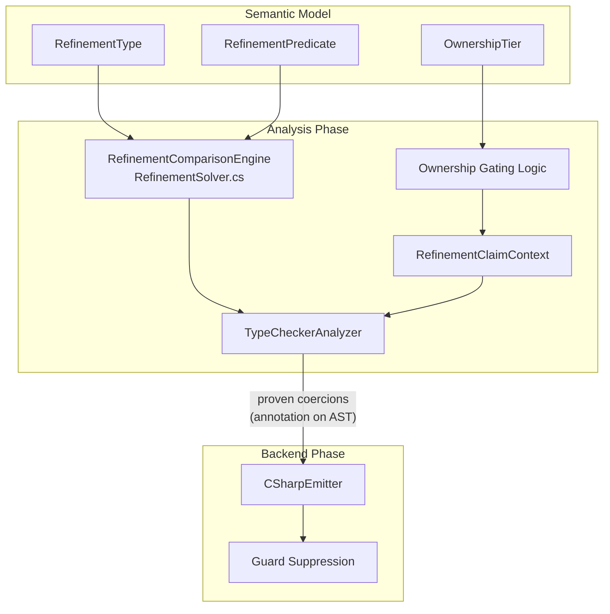

# Design Document: Implicit Refinement Coercion

## Overview

This design adds implicit refinement coercion and flow-based refinement claims to the Mist compiler. The feature eliminates boilerplate pattern matching when the compiler can statically prove that a value satisfies a refinement predicate, either through direct subset/superset reasoning between refinement types, or through flow analysis that tracks known constraints on variables.

The implementation extends three existing compiler components:

1. **RefinementSolver** (already exists at `Analysis/Builtin/RefinementSolver.cs`) — enhanced to serve as the Refinement Comparison Engine with full implication logic for relational, compound, equality, and inequality predicates.
2. **TypeCheckerAnalyzer** (already exists at `Analysis/Builtin/TypeCheckerAnalyzer.cs`) — extended with a `RefinementClaimContext` that tracks per-variable claims through control flow, and modified assignment/call checking to consult claims before emitting errors.
3. **CSharpEmitter** (already exists at `Backends/CSharpTranspiler/CSharpEmitter.cs`) — modified to skip runtime refinement guards when the type checker has proven the coercion statically.

The design is intentionally simplistic: no arithmetic reasoning, no inter-procedural analysis, no complex boolean logic in conditions. Claims come from three sources only: assignments, simple relational/pattern conditions, and copy propagation.

## Architecture



**Data flow:**
1. The TypeCheckerAnalyzer walks method bodies statement-by-statement.
2. At each assignment/call, it consults the `RefinementClaimContext` for the source variable's active claim.
3. If a claim exists, it invokes `RefinementSolver.Implies(claim, targetPredicate)` to check satisfaction.
4. If satisfaction is proven, the assignment/call is accepted and the AST node is annotated as "statically proven" (no guard needed).
5. The CSharpEmitter checks the annotation and skips guard emission for proven nodes.

## Components and Interfaces

### 1. RefinementComparisonEngine (Enhanced `RefinementSolver`)

The existing `RefinementSolver` is a thin static class delegating to `RefinementPredicate.Implies()`. The enhancement adds support for:

- `== literal` treated as `>= literal and <= literal`
- `!= literal` identity implication
- Mixed operator implication (`> a` implies `>= b` when `a >= b`)
- Multi-numeric-type support (int, long, short, byte, sbyte, ushort, uint, char → common `long`)

```csharp
// Enhanced API surface (still in RefinementSolver.cs)
internal static class RefinementSolver
{
    /// <summary>
    /// Returns true if every value satisfying <paramref name="source"/> also satisfies
    /// <paramref name="target"/>. Both predicates must share the same base type.
    /// </summary>
    public static bool Implies(RefinementPredicate source, RefinementPredicate target);

    /// <summary>
    /// Returns true if a claim (represented as a list of constraints) implies
    /// the target predicate. Used by flow analysis when the claim is not yet
    /// materialized as a full RefinementPredicate.
    /// </summary>
    public static bool ClaimImplies(
        IReadOnlyList<RelationalConstraint> claimConstraints,
        RefinementPredicate target);
}
```

The `RelationalConstraint` record (already exists inside `RefinementPredicate.cs` as a private type) is promoted to `internal`:

```csharp
internal readonly record struct RelationalConstraint(RelOp Op, long Value);
```

### 2. RefinementClaimContext

A new class that maintains per-variable refinement claims during type checking of a method body. It is scoped to a single method invocation of `CheckMethodBody`.

```csharp
// New file: Analysis/Builtin/RefinementClaimContext.cs
internal sealed class RefinementClaimContext
{
    /// <summary>
    /// Establishes or replaces the claim on a variable.
    /// </summary>
    public void SetClaim(string variableName, RefinementClaim claim);

    /// <summary>
    /// Gets the active claim for a variable, or null if none.
    /// </summary>
    public RefinementClaim? GetClaim(string variableName);

    /// <summary>
    /// Invalidates the claim on a variable (e.g., after ref lending or opaque assignment).
    /// </summary>
    public void InvalidateClaim(string variableName);

    /// <summary>
    /// Pushes a new scope (e.g., entering an if-branch). Claims in the child scope
    /// shadow the parent but do not modify it.
    /// </summary>
    public void PushScope();

    /// <summary>
    /// Pops the current scope, discarding branch-specific claims.
    /// </summary>
    public void PopScope();

    /// <summary>
    /// Merges two branch scopes. Only claims that are structurally identical
    /// in both branches survive.
    /// </summary>
    public void MergeBranches(RefinementClaimContext thenBranch, RefinementClaimContext? elseBranch);

    /// <summary>
    /// Snapshots the current state (used before loop bodies to detect assignments).
    /// </summary>
    public RefinementClaimContext Snapshot();
}
```

### 3. RefinementClaim

A lightweight value type representing the known constraints on a variable at a program point.

```csharp
// New file: Analysis/Builtin/RefinementClaim.cs
internal sealed class RefinementClaim
{
    /// <summary>The base type the claim applies to (e.g., int).</summary>
    public IType BaseType { get; }

    /// <summary>The list of relational constraints known to hold.</summary>
    public IReadOnlyList<RelationalConstraint> Constraints { get; }

    /// <summary>
    /// Combines this claim with additional constraints (logical AND).
    /// </summary>
    public RefinementClaim CombineWith(IReadOnlyList<RelationalConstraint> additional);

    /// <summary>
    /// Returns true if this claim implies the given refinement predicate.
    /// Delegates to RefinementSolver.ClaimImplies.
    /// </summary>
    public bool Satisfies(RefinementPredicate target);
}
```

### 4. Ownership Gating (in TypeCheckerAnalyzer)

A helper method determines whether a variable is eligible for flow analysis:

```csharp
private bool IsLocallyReasonable(string variableName, ISemanticModel model)
{
    // 1. Look up the variable's ownership tier
    // 2. Look up whether the variable's type is a value type or reference type
    // 3. Return true if:
    //    - Ownership is Owned, Borrowed, or Frozen
    //    - OR the variable is a value type (regardless of ownership annotation)
    // 4. Return false if:
    //    - Ownership is ReadonlyRef
    //    - OR the variable is an unrestricted reference type
}
```

### 5. CSharpEmitter Guard Suppression

The emitter already collects refinement parameter guards in `CollectRefinementParameterGuards` and emits them in `EmitRefinementGuards`. The modification:

- A new `HashSet<SyntaxNode> _provenCoercions` field is populated by the type checker (passed via a shared context or annotation on the semantic model).
- When emitting a method call, if the argument node is in `_provenCoercions`, the emitter skips the guard for that parameter.
- When emitting an assignment to a refinement-typed variable, if the assignment node is in `_provenCoercions`, no guard is emitted.

The mechanism for communicating proven coercions from the analyzer to the emitter uses the existing `DiagnosticBag` pattern — but instead of diagnostics, a parallel `ProvenCoercionSet` is attached to the compilation context:

```csharp
// New file: Analysis/Builtin/ProvenCoercionSet.cs
internal sealed class ProvenCoercionSet
{
    private readonly HashSet<Storm.Runtime.SyntaxNode> _provenNodes = new();

    public void MarkProven(Storm.Runtime.SyntaxNode node) => _provenNodes.Add(node);
    public bool IsProven(Storm.Runtime.SyntaxNode node) => _provenNodes.Contains(node);
}
```

## Data Models

### RelationalConstraint (promoted from private to internal)

```csharp
internal readonly record struct RelationalConstraint(RelOp Op, long Value);

internal enum RelOp
{
    GreaterThanOrEqual,  // >=
    LessThanOrEqual,     // <=
    GreaterThan,         // >
    LessThan,            // <
    Equal,               // ==
    NotEqual,            // !=
}
```

### RefinementClaim

```csharp
internal sealed class RefinementClaim
{
    public IType BaseType { get; }
    public ImmutableArray<RelationalConstraint> Constraints { get; }

    public RefinementClaim(IType baseType, ImmutableArray<RelationalConstraint> constraints);

    public RefinementClaim CombineWith(IReadOnlyList<RelationalConstraint> additional)
        => new(BaseType, Constraints.AddRange(additional));

    public bool Satisfies(RefinementPredicate target)
        => RefinementSolver.ClaimImplies(Constraints, target);
}
```

### Claim Sources

| Source | Claim Established |
|--------|-------------------|
| Literal assignment (`var i = 7;`) | `== 7` (expands to `>= 7 and <= 7`) |
| Variable copy (`var j = i;`) | Copy of `i`'s active claim |
| Refinement-typed assignment (`var x: AdultAge = ...`) | Declared refinement predicate |
| Function return (`var r = GetAge();` where return is `AdultAge`) | Return type's refinement |
| Conditional (`if (i < 100)`) | `< 100` in then-branch |
| Pattern match (`if (i is >= 0 and <= 50)`) | `>= 0 and <= 50` in then-branch |

### Claim Invalidation Events

| Event | Effect |
|-------|--------|
| Reassignment | Old claim replaced by new (or cleared if opaque) |
| `ref` parameter pass | Claim invalidated until borrow scope ends |
| Closure capture | Claim invalidated permanently |
| Loop body assignment | Pre-loop claim invalidated for loop body and post-loop |
| Control flow merge | Only structurally identical claims survive |

### Implication Rules (Comparison Engine)

| Source Constraint | Target Constraint | Implies When |
|-------------------|-------------------|--------------|
| `>= a` | `>= b` | `a >= b` |
| `<= a` | `<= b` | `a <= b` |
| `> a` | `>= b` | `a >= b` |
| `< a` | `<= b` | `a <= b` |
| `>= a` | `> b` | `a > b` |
| `<= a` | `< b` | `a < b` |
| `> a` | `> b` | `a >= b` |
| `< a` | `< b` | `a <= b` |
| `== a` | `>= b` | `a >= b` |
| `== a` | `<= b` | `a <= b` |
| `== a` | `!= b` | `a != b` |
| `!= a` | `!= a` | always (identity) |

## Error Handling

### Diagnostic IDs

| ID | Condition | Message Template |
|----|-----------|-----------------|
| `MIST0401` | Widening coercion fails (cannot prove subset) | `Cannot implicitly widen '{source}' to '{target}': cannot prove '{sourcePred}' implies '{targetPred}'. Use pattern matching to validate.` |
| `MIST0402` | Reference widening into non-readonly context | `Cannot implicitly widen reference type '{source}' to '{target}': destination must be readonly (frozen or readonly ref) for reference type widening.` |
| `MIST0403` | Narrowing coercion fails (cannot prove superset) | `Cannot implicitly narrow '{source}' to '{target}': cannot prove '{targetPred}' is a subset of '{sourcePred}'. Use pattern matching to validate.` |
| `MIST0404` | Narrowing into non-locally-reasonable destination | `Cannot implicitly narrow to '{target}': destination is not locally reasonable (unrestricted reference type). Use an ownership annotation or explicit pattern matching.` |
| `MIST0405` | Flow claim does not satisfy target refinement | `Variable '{name}' has claim '{claimDesc}' which does not satisfy refinement '{targetPred}' on type '{targetType}'. Use a conditional check or pattern match to establish the required constraint.` |
| `MIST0406` | Flow analysis unavailable (unrestricted ref / ReadonlyRef) | `Flow analysis is not available for '{name}' (unrestricted reference type or readonly ref). Use an ownership annotation (owned, borrowed, or frozen) or explicit pattern matching.` |
| `MIST0407` | Claim invalidated by ref borrow | `Refinement claim on '{name}' was invalidated by mutable borrow at {location}. Re-establish the claim via assignment or conditional check.` |

### Error Recovery

All diagnostic errors are non-fatal — the compiler continues checking subsequent statements. The type checker treats a failed coercion as if the assignment/call were accepted (to avoid cascading errors), but marks the node as "not proven" so the emitter will still emit a runtime guard if one would normally be generated.

## Testing Strategy

### Unit Tests (Example-Based)

Unit tests verify specific scenarios using the in-process `CompilerDriver`:

- **Comparison engine**: Direct calls to `RefinementSolver.Implies` and `RefinementSolver.ClaimImplies` with known predicate pairs.
- **Claim context**: Unit tests for `RefinementClaimContext` operations (set, get, invalidate, push/pop scope, merge).
- **Integration**: Compile Mist programs with implicit coercions and verify they produce no diagnostics. Compile programs with invalid coercions and verify the expected diagnostic ID is emitted.
- **Emission**: Compile programs with implicit coercions and inspect the emitted C# to confirm no runtime guards are present.

### Property-Based Tests (FsCheck)

Property-based tests verify universal correctness properties of the comparison engine and claim context. These tests operate purely in-process (no process spawning) by calling the solver and claim context APIs directly.

**Library**: FsCheck (already used in the project)
**Configuration**: Minimum 100 iterations per property test

### End-to-End Sample

The sample application at `samples/ImplicitRefinementCoercion/Program.mist` exercises all permutations and is compiled + run as part of the test suite (1 compile, 1 process spawn via the batched pattern).

## Correctness Properties

*A property is a characteristic or behavior that should hold true across all valid executions of a system — essentially, a formal statement about what the system should do. Properties serve as the bridge between human-readable specifications and machine-verifiable correctness guarantees.*

### Property 1: Implication Soundness

*For any* two sets of relational constraints (source and target) over the same base type, if `RefinementSolver.Implies(source, target)` returns true, then every integer value that satisfies all constraints in the source set also satisfies all constraints in the target set.

**Validates: Requirements 1.1, 1.3, 1.4, 1.5, 1.6, 1.7, 1.12**

### Property 2: Implication Completeness for Simple Bounds

*For any* pair of single relational constraints `(op1, a)` and `(op2, b)` over the same base type, if the mathematical implication holds (i.e., every integer satisfying `op1 a` also satisfies `op2 b`), then `RefinementSolver.Implies` returns true.

**Validates: Requirements 1.3, 1.5**

### Property 3: Value-Type Widening Acceptance

*For any* value-typed variable with refinement predicate `P_source` assigned to a destination with refinement predicate `P_target`, if `RefinementSolver.Implies(P_source, P_target)` returns true, then the type checker accepts the assignment without emitting a diagnostic.

**Validates: Requirements 2.1, 2.2, 2.6, 2.7**

### Property 4: Reference-Type Widening Readonly Gating

*For any* reference-typed variable with refinement predicate `P_source` assigned to a destination with refinement predicate `P_target` where `Implies(P_source, P_target)` is true, the type checker accepts the assignment if and only if the destination ownership tier is Frozen or ReadonlyRef.

**Validates: Requirements 2.3, 2.4**

### Property 5: Narrowing Coercion Acceptance

*For any* variable with refinement predicate `P_source` assigned to a locally-reasonable destination with refinement predicate `P_target`, if `RefinementSolver.Implies(P_target, P_source)` returns true (target is a subset of source), then the type checker accepts the assignment without emitting a diagnostic.

**Validates: Requirements 3.1, 3.2, 3.7**

### Property 6: Narrowing Ownership Gating

*For any* narrowing coercion where `Implies(P_target, P_source)` is true, the type checker accepts the assignment if and only if the destination is locally reasonable (owned, borrowed, frozen, or unrestricted value type).

**Validates: Requirements 3.3, 3.4**

### Property 7: Claim Establishment from Constant Assignment

*For any* integer constant `c` assigned to a locally-reasonable variable, the resulting claim satisfies any refinement predicate `P` for which `P.Evaluate(c)` returns true.

**Validates: Requirements 4.1, 4.3, 9.1**

### Property 8: Claim Satisfaction Acceptance

*For any* variable with an active claim whose constraints imply a target refinement predicate, the type checker accepts passing that variable to a parameter or assigning it to a destination of that refinement type without emitting a diagnostic.

**Validates: Requirements 4.5, 4.6**

### Property 9: Ownership Gating for Flow Analysis

*For any* variable, the type checker establishes and maintains refinement claims if and only if the variable is locally reasonable: ownership tier is Owned, Borrowed, or Frozen, or the variable is a value type regardless of ownership annotation. Variables with ReadonlyRef tier or unrestricted reference types never receive claims.

**Validates: Requirements 4.8, 7.1, 7.2, 7.3, 7.4, 7.5, 7.6**

### Property 10: Conditional Claim Establishment

*For any* simple relational condition `variable op literal` in an if-statement, the then-branch claim on that variable includes the constraint `(op, literal)`, and the else-branch claim includes the negated constraint (using the standard negation mapping: `<` ↔ `>=`, `<=` ↔ `>`, `==` ↔ `!=`).

**Validates: Requirements 5.1, 5.2, 5.3, 6.1, 6.2, 6.3, 6.4**

### Property 11: Claim Scoping and Merge

*For any* if/else statement where the then-branch establishes claim `C1` on a variable and the else-branch establishes claim `C2`, the claim after the merge point is `C1` if and only if `C1` is structurally identical to `C2`. Otherwise, no claim survives the merge.

**Validates: Requirements 5.5, 9.4, 9.7**

### Property 12: Copy Propagation Independence

*For any* value-typed variable `x` with active claim `C` that is copied to variable `y` (via `var y = x;`), the destination `y` receives claim `C`, and subsequent reassignment of `x` does not modify `y`'s claim.

**Validates: Requirements 4.2, 8.1, 8.4**

### Property 13: Ref Invalidation

*For any* variable with an active refinement claim that is passed as a `ref` argument, the claim is invalidated from the point of the call onward, and the variable has no active claim after the borrow.

**Validates: Requirements 7.8, 9.2, 9.3**

### Property 14: Closure Capture Invalidation

*For any* variable with an active refinement claim that is captured by a closure (lambda or anonymous function), the claim is invalidated at the point of capture.

**Validates: Requirements 9.5**

### Property 15: Loop Body Invalidation

*For any* variable with a pre-loop refinement claim that is assigned within a loop body, the pre-loop claim is invalidated for the entire loop body and all program points after the loop.

**Validates: Requirements 9.6**
