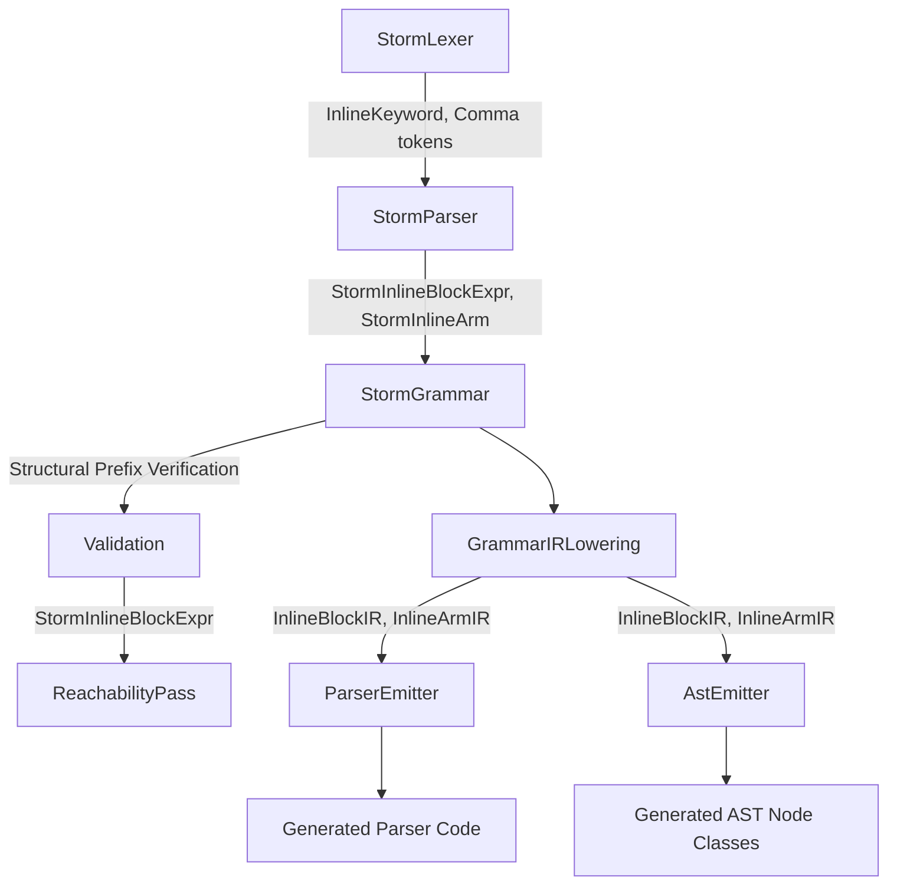
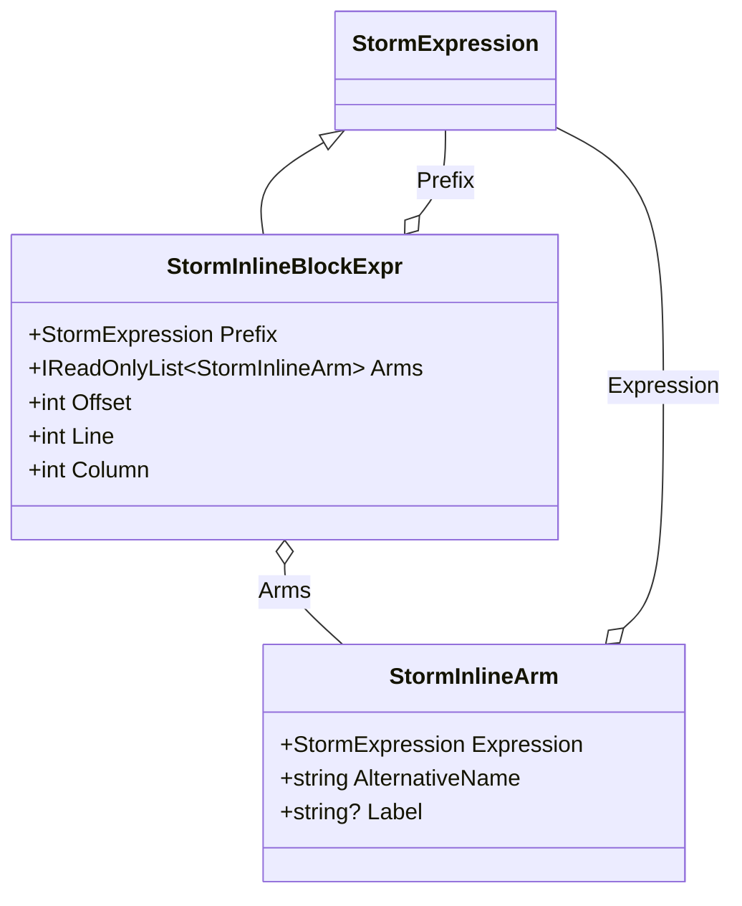
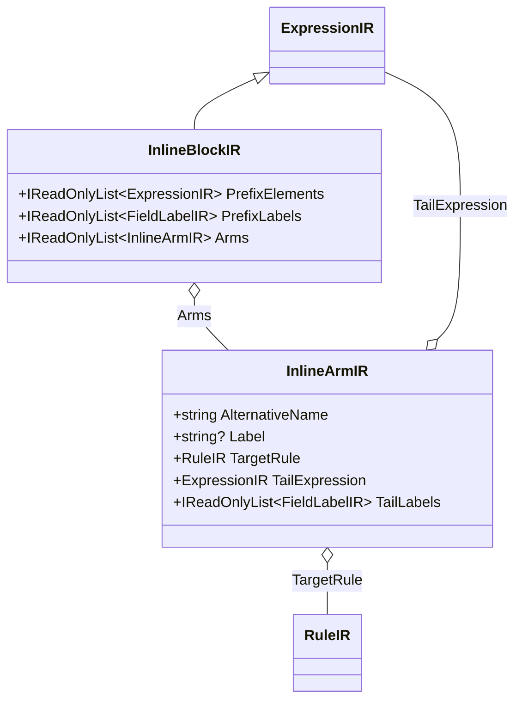

# Design Document: Inline Rule Prefix

## Overview

This feature extends the Storm parser generator with an `inline` keyword that allows grammar authors to declare that multiple alternatives share a common prefix. The emitter then generates code that parses the prefix exactly once and predicts which arm to take based on the next token(s) after the prefix — eliminating redundant backtracking and resolving false-positive STORM0006 warnings from the reachability pass.

The motivating case is `MemberDeclaration` in `Mist.storm`, where `MemberTypeAliasDeclaration` and `ModifiedAssociatedTypeSlotDeclaration` both start with `Modifier+ TYPE IDENTIFIER TypeParameterList?` but diverge on `EQUAL` (type alias) vs `COLON`/`SEMICOLON` (associated type slot). Today, the bounded k=3 reachability analysis cannot see past this shared prefix, emitting a false STORM0006 warning. The PEG runtime handles it via backtracking, but at the cost of parsing the prefix twice.

### Design Decisions

| Decision | Choice | Rationale |
|----------|--------|-----------|
| Prefix clause form | Nominal only (rule reference) | Keeps grammar DRY; prefix is already factored into a rule like `ModifiedTypeHead`. Literal sequences would duplicate structure. |
| Prefix verification | Direct reference or structural leading sequence; labels ignored | Preserves admitted expanded prefixes and permits arm-specific capture names. |
| Arm references | Single-sequence rules only | The matched reference or leading prefix sequence is stripped before parsing the tail. |
| `as AltName` | Mandatory on every arm | Required for flat-node naming. No default name can be inferred. |
| Arm ordering | PEG ordered-choice | Consistent with existing Storm semantics. First matching arm wins. |
| Delimiter | Braces + commas | Visually groups arms without ambiguity with the `|` pipe used in alternations. Trailing comma allowed for diff friendliness. |
| AST shape | Arm directly extends parent; original capture ownership preserved | Expanded prefix captures retain arm labels; a captured direct prefix remains a node. No wrapper is added for the inline block. |
| Nesting | Supported | An arm can itself be an inline block for multi-level prefix sharing. |

### Syntax Example

```storm
rule MemberDeclaration
    = constructor:ConstructorDeclaration as ConstructorMember
    | ...
    | inline ModifiedTypeHead: {
          memberTypeAlias:MemberTypeAliasDeclaration as MemberTypeAliasMember,
          modifiedAssociatedType:ModifiedAssociatedTypeSlotDeclaration as ModifiedAssociatedTypeMember,
      }
    ;
```

Where `ModifiedTypeHead` is a single-sequence rule defining the shared prefix:
```storm
rule ModifiedTypeHead = modifiers:Modifier+ TYPE name:IDENTIFIER typeParams:TypeParameterList?;
```

And each arm's rule body **begins with a rule reference to `ModifiedTypeHead`**:
```storm
rule MemberTypeAliasDeclaration = head:ModifiedTypeHead
    EQUAL type:RefinableTypeExpression
    constraints:WhereClause*
    SEMICOLON;

rule ModifiedAssociatedTypeSlotDeclaration = head:ModifiedTypeHead
    constraintClause:(COLON constraints:ConstraintList slotWhereConstraints:WhereClause*)?
    SEMICOLON;
```

This example uses a direct prefix reference. An arm may instead repeat the prefix rule's leading structure, with different field labels. Verification ignores labels in both forms. The parser consumes the shared prefix once and projects its values into the selected arm's original capture slots before parsing the tail.

## Architecture

The feature touches the Storm source generator pipeline at every stage:



### Pipeline Stages Affected

1. **Lexer** — Add `InlineKeyword` and `Comma` token kinds.
2. **Parser** — Parse `inline PrefixRule: { arm, arm, ... }` within alternations.
3. **Syntax AST** — New `StormInlineBlockExpr` and `StormInlineArm` node types.
4. **Validation** — Direct or structural prefix verification (new pass, emits STORM0017).
5. **Reachability Pass** — Treat inline blocks as opaque for inter-alternative analysis; check tail divergence among arms.
6. **IR Lowering** — Produce `InlineBlockIR` / `InlineArmIR` with prefix stripped from arms.
7. **Parser Emitter** — Emit parse-once-then-predict code for inline blocks.
8. **AST Emitter** — Emit arm node classes preserving each target rule's capture names and ownership.
9. **TextMate Grammar** — Highlight `inline` as a keyword in `.storm` files.

### Invariant: Non-Breaking for Non-Inline Grammars

When a grammar does not use `inline`, the generated output must be byte-for-byte identical to the pre-feature baseline. This is achieved by:
- The lexer change only affects keyword classification (a new case in `ClassifyKeyword`).
- The parser change only activates when `InlineKeyword` is encountered during expression parsing.
- IR lowering, parser emitter, and AST emitter only handle `InlineBlockIR` if one exists; all other paths are unchanged.

## Components and Interfaces

### 1. StormLexer Extensions

**Changes to `StormTokenKind` enum:**
```csharp
/// <summary>The <c>inline</c> keyword.</summary>
InlineKeyword,

/// <summary><c>,</c></summary>
Comma,
```

**Changes to `ClassifyKeyword`:**
```csharp
"inline" => StormTokenKind.InlineKeyword,
```

**Changes to `ClassifyOperator`:**
```csharp
',' => (StormTokenKind?)StormTokenKind.Comma,
```

### 2. StormSyntax AST Nodes

```csharp
/// <summary>
/// An inline block expression: <c>inline PrefixRule: { arm, arm, ... }</c>
/// Represents a set of alternatives that share a common prefix.
/// </summary>
public sealed record StormInlineBlockExpr(
    StormExpression Prefix,
    IReadOnlyList<StormInlineArm> Arms,
    int Offset,
    int Line,
    int Column) : StormExpression;

/// <summary>
/// A single arm within an inline block: <c>RuleRef as AltName</c> or
/// <c>label:RuleRef as AltName</c>.
/// </summary>
public sealed record StormInlineArm(
    StormExpression Expression,
    string AlternativeName,
    string? Label);
```

The `Prefix` property is always a `StormReferenceExpr` naming the prefix rule. The `Expression` in each arm is either a `StormReferenceExpr` (rule reference) or a nested `StormInlineBlockExpr`.

### 3. StormParser Extensions

New parsing method `ParseInlineBlock()` called from `ParsePrimary()` when `Current.Kind == StormTokenKind.InlineKeyword`:

```
inline IDENTIFIER COLON LEFT_BRACE
    InlineArm (COMMA InlineArm)* COMMA?
RIGHT_BRACE

InlineArm := (IDENTIFIER COLON)? (InlineBlock | IDENTIFIER) AS IDENTIFIER
```

The inline block is parsed at the primary expression level and produces a `StormInlineBlockExpr`. Within alternations, it occupies a single slot (may itself be wrapped with `as AltName` by the existing `ParseNamedAlternative` logic, though typically it won't be since arms have their own names).

### 4. Prefix Verification

A new validation pass (`InlinePrefixVerification`) that runs after grammar construction but before IR lowering:

```csharp
public static class InlinePrefixVerification
{
    public static List<StormDiagnostic> Verify(StormGrammar grammar);
}
```

Verification accepts a direct reference or the supported structural leading sequence. For each `StormInlineBlockExpr` found in rule bodies:
1. Resolve the prefix rule reference → must exist, must have a single-sequence body (not an alternation).
2. For each arm, resolve the arm's rule reference → must exist, must have a single-sequence body.
3. Accept a first element naming the prefix rule, ignoring its label. Otherwise compare the arm's leading elements against the prefix rule's body, ignoring labels and comparing supported references, literals and optional/repeated expressions.
4. On mismatch → emit STORM0017.

Capture labels describe the resulting API, not prefix acceptance. A structural match does not expand arbitrary referenced rules or introduce a new namespace-identity policy.

### 5. IR Types

```csharp
/// <summary>
/// An inline block in the lowered IR. Contains the prefix expression
/// sequence and the list of arms with their tails.
/// </summary>
public sealed class InlineBlockIR : ExpressionIR
{
    public IReadOnlyList<ExpressionIR> PrefixElements { get; }
    public IReadOnlyList<FieldLabelIR> PrefixLabels { get; }
    public IReadOnlyList<InlineArmIR> Arms { get; }

    public InlineBlockIR(
        IReadOnlyList<ExpressionIR> prefixElements,
        IReadOnlyList<FieldLabelIR> prefixLabels,
        IReadOnlyList<InlineArmIR> arms) { ... }
}

/// <summary>
/// A single arm within an InlineBlockIR, containing the tail expression
/// (the arm's rule body with the prefix stripped).
/// </summary>
public sealed class InlineArmIR
{
    public string AlternativeName { get; }
    public string? Label { get; }
    public RuleIR TargetRule { get; }
    public ExpressionIR TailExpression { get; }
    public IReadOnlyList<FieldLabelIR> TailLabels { get; }

    public InlineArmIR(
        string alternativeName,
        string? label,
        RuleIR targetRule,
        ExpressionIR tailExpression,
        IReadOnlyList<FieldLabelIR> tailLabels) { ... }
}
```

### 6. GrammarIRLowering Extensions

When encountering a `StormInlineBlockExpr` during rule expression lowering:

1. Resolve the prefix rule → look up the `RuleIR` for the prefix rule name.
2. Lower the prefix rule's body elements and labels for the shared parse. Retain the target arm's original capture description for projection.
3. For each arm:
   - Resolve the arm's target rule.
   - Get the target rule's body sequence elements.
   - Strip one element for a direct prefix reference, or the matched number of leading elements for an expanded prefix.
   - Lower the remaining tail elements into IR with their labels.
4. Produce an `InlineBlockIR` wrapped in a `RuleAlternativeIR` with null alternative name.

Prefix stripping removes precisely the verified parse prefix; capture projection maps the shared parsed values to the arm's own prefix slots. Relabelling changes slot names without changing prefix acceptance.

### 7. ParserEmitter Extensions

When emitting code for a `RuleAlternativeIR` whose expression is an `InlineBlockIR`:

```
// Save position for backtrack on prefix failure
var saved = _pos;

// Parse prefix once
var _Modifiers = ...;
var _Type = ...;
var _Name = ...;
var _TypeParams = ...;

if (ok && !_hasError) {
    // Predict arm based on next token(s)
    var peek = Peek();
    if (peek == (int)TokenKind.EQUAL) {
        // Arm: MemberTypeAliasMember
        // Parse tail...
        // Construct flat node with prefix + tail fields
    } else if (peek == (int)TokenKind.COLON || peek == (int)TokenKind.SEMICOLON) {
        // Arm: ModifiedAssociatedTypeMember
        // Parse tail...
    }
    // No arm matched → treat as failure
}

// Prefix failed or no arm matched → restore position
_pos = saved;
```

When multiple arms share a FIRST token in their tail, they are tried in declaration order within the same dispatch branch (PEG semantics preserved).

### 8. AstEmitter Extensions

When encountering an `InlineBlockIR` in a rule's alternatives:

For each arm, emit a sealed node class named `{AltName}{ParentRuleName}Node` that:
- Extends the parent rule's abstract base node.
- Preserves the target arm's capture names and types for the prefix and tail.
- Projects expanded prefix captures using the arm's labels.
- Retains a directly captured `head:Prefix` as a Prefix node holding its own captures.
- Yields canonical children once in grammar order; the captured Prefix owns its descendants so parent and origin walks reach them without duplicate ownership.
- Retains a labelled target-rule arm as the parent arm node's target-rule property.

This ensures AST compatibility when refactoring from standalone alternatives to inline blocks.

### 9. ReachabilityPass Extensions

When encountering a `StormInlineBlockExpr`:
- **Inter-alternative analysis**: Treat the entire inline block as a single opaque alternative. Use the prefix's FIRST-k set as the block's FIRST-k set.
- **Intra-block analysis**: Compute FIRST-k of each arm's tail. If a later arm's tail FIRST-k set is a subset of all earlier arms' tail FIRST-k union, emit STORM0006 for that arm.

### 10. Diagnostic: STORM0017

```
STORM0017: Arm 'ModifiedAssociatedTypeMember' in inline block references rule 
'ModifiedAssociatedTypeSlotDeclaration' which does not match prefix rule
'ModifiedTypeHead' by reference or leading structure.
```

Severity: Error. Suppresses code generation for the entire grammar.

## Data Models

### Token Kind Additions

| Kind | Lexeme | Context |
|------|--------|---------|
| `InlineKeyword` | `inline` | Keyword classification |
| `Comma` | `,` | Operator classification |

### AST Node Relationships



### IR Node Relationships



### Prefix Matching Algorithm

For each arm in an inline block:

1. Get the arm's referenced rule body.
2. Accept a first reference naming the prefix rule, ignoring its capture label.
3. Otherwise compare the leading arm elements to the prefix-body elements structurally, ignoring capture labels. Reference names, literal values and supported modifiers must match.
4. If neither form matches → STORM0017.

Labels are excluded from acceptance but retained for capture projection. Existing structural matching is preserved; broader expression equivalence is outside this change.

### Prefix Stripping in IR Lowering

Strip the prefix form accepted by verification:

| Arm Rule Body | After Stripping | Notes |
|---------------|-----------------|-------|
| `PrefixRule tail...` | `tail...` | First element removed |
| `label:PrefixRule tail...` | `tail...` | Label captured, first element removed |
| `PrefixRule` (no tail) | empty `SequenceIR` | Arm is pure prefix |
| Expanded prefix-body elements followed by tail | `tail...` | Matching leading element count removed; arm labels retained |

The prefix body is parsed once. Expanded arm captures receive the corresponding values in their own slots. A directly captured prefix node is reconstructed from those same values and owns the prefix descendants; it is yielded before the tail. There is no additional node representing the inline block.

## Correctness Properties

*A property is a characteristic or behavior that should hold true across all valid executions of a system — essentially, a formal statement about what the system should do. Properties serve as the bridge between human-readable specifications and machine-verifiable correctness guarantees.*

### Property 1: Keyword Classification — `inline` Produces InlineKeyword

*For any* Storm source text where the token `inline` appears as a standalone word (preceded by whitespace or start-of-input and followed by a non-identifier character), the Storm lexer SHALL produce a token with kind `InlineKeyword` for that occurrence.

**Validates: Requirements 1.1, 1.3**

### Property 2: Non-Standalone `inline` Remains Identifier

*For any* identifier string that contains "inline" as a proper substring (e.g., `inlineFoo`, `myinline`, `_inline_`), the Storm lexer SHALL produce a single `Identifier` token for the entire string, never splitting it into an `InlineKeyword` and a remainder.

**Validates: Requirements 1.2**

### Property 3: Comma Classification

*For any* Storm source text containing a `,` character outside of string literals, character classes, and regex literals, the Storm lexer SHALL produce a token with kind `Comma` and lexeme `,` at the correct offset.

**Validates: Requirements 1.4, 11.2, 11.3**

### Property 4: Inline Block Parsing Round-Trip

*For any* well-formed inline block source text (with valid prefix identifier, 1–N arms with valid rule references and `as` names, optional labels, optional trailing comma), parsing SHALL produce a `StormInlineBlockExpr` node whose `Prefix` is a `StormReferenceExpr` with the correct name, whose `Arms` list has the correct length, and whose each arm has the correct `AlternativeName`, `Label`, and `Expression`. The inline block SHALL occupy exactly one slot in its enclosing alternation.

**Validates: Requirements 2.1, 2.2, 2.3, 2.5, 3.3**

### Property 5: Nested Inline Block Parsing

*For any* inline block whose arms themselves contain nested inline blocks (up to depth 3), parsing SHALL produce correctly nested `StormInlineBlockExpr` nodes where each level's prefix and arms are independently correct.

**Validates: Requirements 2.4**

### Property 6: Prefix Verification Correctness

*For any* grammar containing an inline block:
- If every arm begins with a direct prefix reference or a supported structural match, regardless of field labels, verification SHALL emit zero STORM0017 diagnostics.
- If an arm matches neither form, verification SHALL emit one STORM0017 diagnostic for that failing arm.

**Validates: Requirements 4.1, 4.2, 4.3**

### Property 7: Reachability — Inline Block Opaque for Sibling Analysis

*For any* rule containing an inline block alongside other alternatives where the inline block's prefix FIRST-k set does NOT overlap with those siblings' FIRST-k sets, the reachability pass SHALL emit zero STORM0006 warnings for the inline block alternative or its sibling alternatives.

**Validates: Requirements 5.1**

### Property 8: Reachability — Intra-Block Tail Divergence

*For any* inline block whose arms have mutually distinct tail FIRST-k sets (no later arm's set is a subset of the union of earlier arms' sets), the reachability pass SHALL emit zero STORM0006 warnings for those arms. Conversely, *for any* inline block where a later arm's tail FIRST-k set IS a subset of earlier arms' union, the pass SHALL emit STORM0006 for that arm.

**Validates: Requirements 5.2, 5.3**

### Property 9: Reachability — Block FIRST-k Equals Prefix FIRST-k

*For any* rule containing an inline block, the FIRST-k set computed for the inline block as a whole (for comparison against sibling alternatives) SHALL equal the FIRST-k set of the prefix clause's referenced rule.

**Validates: Requirements 5.4**

### Property 10: IR Lowering — Matched Prefix Stripping

*For any* valid inline block, each arm's tail SHALL equal its rule body after removing the matched direct reference or structural leading sequence. The prefix elements SHALL contain the lowered prefix-rule body; the original arm capture description SHALL retain labels and direct-prefix ownership for projection.

**Validates: Requirements 6.1, 6.2, 6.3, 6.5**

### Property 11: AST Emission — Correct Node Class Per Arm

*For any* inline block with N arms inside a rule named `R`, the AST emitter SHALL produce exactly N sealed node classes, each named `{ArmAltName}{R}Node`, and each extending the abstract `{R}Node` base class.

**Validates: Requirements 8.1, 8.3**

### Property 12: AST Emission — Prefix and Tail Capture Fidelity

*For any* supported arm, expanded prefix captures SHALL retain its original labels, a direct captured prefix SHALL remain a node containing its descendants, and the tail captures SHALL survive. `Children()` SHALL expose each canonical child once in grammar order so parent links and origin stamping cover every capture.

**Validates: Requirements 8.2, 8.4, 8.5**

### Property 13: Non-Inline Grammar Byte-For-Byte Preservation

*For any* `.storm` grammar file that does NOT contain the `inline` keyword, the Storm source generator SHALL produce parser source and AST source byte-for-byte identical to the output produced by the pre-feature baseline code.

**Validates: Requirements 10.1, 10.3**

## Error Handling

### Lexer Errors

No new error conditions. The `inline` keyword is handled by keyword classification. The comma is handled by operator classification. Unrecognized characters continue to produce `StormTokenKind.Error` tokens.

### Parser Errors

| Condition | Behavior |
|-----------|----------|
| `inline` not followed by identifier | Emit syntax error, synchronize to next declaration |
| Missing `:` after prefix name | Emit syntax error, synchronize |
| Missing `{` after colon | Emit syntax error, synchronize |
| Empty arm list `{}` | Emit syntax error (at least one arm required) |
| Malformed arm (missing rule ref) | Emit syntax error for that arm, continue parsing remaining arms |
| Missing `as` clause on arm | Emit syntax error for that arm, continue parsing |
| Missing `}` at end | Emit "unterminated inline block" error |

The parser uses the existing `SynchronizeToDeclaration()` method for recovery at the block level. For individual arm errors, it skips to the next `,` or `}` and continues.

### Validation Errors (STORM0017)

Emitted when an arm matches neither a direct prefix reference nor its supported leading structure. Each failing arm gets its own diagnostic. The diagnostic includes:
- The prefix rule name
- The failing arm's rule name  
- The arm's alternative name

When STORM0017 is emitted, ALL code generation is suppressed (no partial output).

### IR Lowering Errors

If a prefix rule reference cannot be resolved during lowering (should be caught earlier by validation), an `STORM_UNDEFINED_REFERENCE` error is emitted. If an arm's referenced rule doesn't exist, same handling as existing undefined reference diagnostics.

### Runtime Errors (Generated Parser)

| Condition | Behavior |
|-----------|----------|
| Prefix fails to parse | Restore parser position, try next alternative (standard PEG backtrack) |
| Prefix succeeds, no arm prediction matches | Restore parser position, try next alternative |
| Arm tail fails to parse | Restore position to before prefix, try next alternative |

The generated parser's error handling follows existing PEG semantics: save position, try, restore on failure. The `_hasError` flag halts parsing on the first real parse failure.

## Testing Strategy

### Unit Tests

Unit tests cover individual components in isolation:

1. **Lexer tests**: `inline` keyword classification, comma classification, boundary cases (identifiers containing "inline").
2. **Parser tests**: Valid inline blocks (varying arm count, labels, trailing comma, nesting), error cases (malformed blocks, empty arms, missing `as`).
3. **Prefix verification tests**: Direct-reference and structural matches (including differing labels), and nonmatching controls, unresolved prefix rule, alternation-bodied prefix rule, alternation-bodied arm rule.
4. **Reachability tests**: Inline block treated as opaque, tail divergence detection, FIRST-k computation for blocks.
5. **IR lowering tests**: Prefix stripping correctness, empty tail case, label preservation, nested lowering.
6. **AST emitter tests**: Class naming, original capture names, direct-prefix ownership, grammar child order and no inline wrapper class.
7. **Parser emitter tests**: Generated code structure (save/restore pattern, prediction dispatch, flat node construction).

### Property-Based Tests

Property tests validate universal correctness guarantees using the FsCheck library (already used in the project for property-based testing):

- **Minimum 100 iterations per property test** (due to randomization).
- Each property test references its design document property via tag comment.
- Tag format: `// Feature: inline-rule-prefix, Property {number}: {title}`

Key generators needed:
- **Storm source generator**: Produces syntactically valid `.storm` source fragments with inline blocks of varying structure (arm count 1–5, label/no-label, nesting depth 0–2).
- **Grammar generator**: Produces `StormGrammar` instances with inline block expressions, matching/mismatching prefixes, various element types.
- **FIRST-k set generator**: Produces inline blocks with controlled tail divergence properties.

### Integration Tests

Integration tests verify end-to-end behavior:

1. **Mist.storm refactoring test**: Refactor `MemberDeclaration` to use inline block, verify zero STORM0006, same AST output, all existing tests pass.
2. **Non-regression test**: Verify byte-for-byte output identity for grammars without `inline`.
3. **Build warning test**: Verify zero new warnings after the feature.
4. **Full test suite**: Run `dotnet test` and verify no regressions.

### Test Architecture Note

Per the project's test process spawning policy, property-based tests that require compilation + execution of generated code will use the **batched approach**: generate all scenarios upfront, build a single program, compile once, run once, compare outputs line-by-line. Tests that only exercise the Storm source generator pipeline (lexer → parser → validation → IR → emission) can run entirely in-process without spawning external processes.

