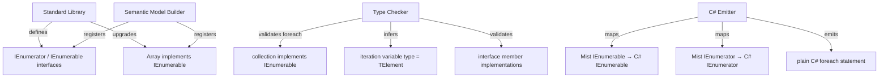

# Design Document: Iterators and Enumerables

## Overview

This design introduces first-class iterator/enumerable support to Mist through two generic interfaces — `IEnumerator<TElement>` and `IEnumerable<TElement>` — defined in the Standard Library. The `IEnumerable<TElement>` interface uses an associated type slot (`type Enumerator : IEnumerator<TElement>`) to allow concrete enumerator types resolved statically at compile time, avoiding boxing overhead for struct enumerators.

The existing `foreach` statement is upgraded from a pure syntax pass-through into a semantically-validated construct: the type checker verifies that the collection expression implements `IEnumerable<TElement>` and infers the iteration variable's type from the resolved `TElement`. The C# emitter maps Mist's `IEnumerable<TElement>` and `IEnumerator<TElement>` directly to their `System.Collections.Generic` counterparts and continues to emit plain C# `foreach` statements, relying on C#'s duck-typed foreach protocol.

The intrinsic `Array` type is upgraded to declare that it implements `IEnumerable<TValue>` with an intrinsic nested `Enumerator` struct.

### Design Rationale

- **C# nomenclature over Rust**: Using `IEnumerable`/`IEnumerator` (not `IntoIterator`/`Iterator`) because the C# backend maps these 1:1 to CLR interfaces, avoiding any desugaring layer.
- **Associated type slot for Enumerator**: Enables struct enumerators without boxing — the concrete type is known at compile time through the slot mechanism already implemented for associated types.
- **No frontend desugaring**: The emitter emits `foreach` directly as C# `foreach`. C#'s duck-typed foreach handles `GetEnumerator()`/`MoveNext()`/`Current` resolution at the CLR level. This keeps the emitter simple and leverages battle-tested C# runtime behavior.
- **Type checker validation**: Even though C# would catch enumeration errors at its compile step, validating in Mist's type checker gives developers Mist-native error messages and catches issues before the C# emission phase.

## Architecture

The feature touches four compiler pipeline stages and the standard library:



### Pipeline Flow

1. **StdlibLoader** loads `IEnumerator.mist` and `IEnumerable.mist` from `Source/Standard/`
2. **SemanticModelBuilder** (Pass 1) registers the interface types with their type parameters, associated type slots, and member signatures
3. **SemanticModelBuilder** (Pass 1b) registers `Array`'s `IEnumerable<TValue>` implementation and intrinsic `Enumerator` nested struct
4. **TypeCheckerAnalyzer** validates `foreach` collection expressions implement `IEnumerable<TElement>`, infers element types, and validates explicit type annotations
5. **CSharpEmitter** maps `IEnumerable`/`IEnumerator` to their `System.Collections.Generic` counterparts and emits `foreach` as-is

## Components and Interfaces

### Standard Library Files

#### `Source/Standard/IEnumerator.mist`

```mist
namespace Standard;

interface IEnumerator<TElement> {
    bool MoveNext();
    TElement Current { get; }
}
```

A minimal stateful cursor interface. `MoveNext()` advances to the next element (returns `false` when exhausted). `Current` returns the element at the current position.

#### `Source/Standard/IEnumerable.mist`

```mist
namespace Standard;

interface IEnumerable<TElement> {
    type Enumerator : IEnumerator<TElement>;
    Enumerator GetEnumerator();
}
```

The associated type slot `Enumerator` is constrained to implement `IEnumerator<TElement>`. This allows implementors to provide a concrete struct or class enumerator type that the compiler resolves statically.

#### `Source/Standard/Bootstrap/Array.mist` (updated)

```mist
namespace Standard;

type ZeroOrPositiveInt = int >= 0;

intrinsic public class Array<TValue, Length:ZeroOrPositiveInt> : IEnumerable<TValue>
{
    public type ArrayBounds = ZeroOrPositiveInt and < Length;

    intrinsic public Int32 Length { get; }

    intrinsic public TValue this[ArrayBounds index];

    intrinsic public struct Enumerator : IEnumerator<TValue> {
        intrinsic public bool MoveNext();
        intrinsic public TValue Current { get; }
    }

    intrinsic public Enumerator GetEnumerator();
}
```

The `Array` type declares it implements `IEnumerable<TValue>`. Its nested `Enumerator` struct and `GetEnumerator()` method are intrinsic — the C# backend maps these to the CLR array's built-in enumeration support.

### Type Checker Changes (`TypeCheckerAnalyzer.cs`)

#### `CheckForeachStatement` (enhanced)

The current implementation only checks the collection expression and body. The enhanced version:

1. Resolves the collection expression's type
2. Searches the type's interface list for `IEnumerable<TElement>` (checking both direct implementations and through `ConstructedType` unwrapping)
3. If not found: emits diagnostic `MIST_TC_FOREACH_NOT_ENUMERABLE` with the resolved type name
4. If found: extracts `TElement` from the `IEnumerable<TElement>` implementation
5. Binds the iteration variable to `TElement`
6. If an explicit type annotation is present: validates assignability from `TElement` to the declared type
7. If not assignable: emits diagnostic `MIST_TC_FOREACH_TYPE_MISMATCH`

#### Interface Implementation Validation

The existing interface member validation (which checks that implementors provide all required members) already handles `IEnumerator<TElement>` and `IEnumerable<TElement>` — no new validation logic is needed beyond what the associated types system already provides. The type checker already:
- Validates that associated type slots satisfy their constraints
- Validates that required methods are implemented with correct signatures
- Emits diagnostics for missing or mismatched members

### C# Emitter Changes (`CSharpEmitter.cs`)

#### Interface Mapping

The `CSharpTypeMap` needs two new entries to map Mist's iterator interfaces to their C# counterparts:

```csharp
["Standard.IEnumerator"] = "System.Collections.Generic.IEnumerator",
["Standard.IEnumerable"] = "System.Collections.Generic.IEnumerable",
```

When the emitter encounters a type implementing `IEnumerable<TElement>`, it emits the C# type as implementing `System.Collections.Generic.IEnumerable<T>`. The existing `EmitInterfaceWithAssociatedTypeArgs` method handles appending the concrete `Enumerator` type as an additional type argument (since the associated type slot is lifted to a type parameter in C#).

However, for `IEnumerable` and `IEnumerator` specifically, the C# mapping is special: these map to well-known CLR interfaces that do NOT have the associated type slot as a type parameter. The emitter must recognize these two interfaces and emit them using the standard C# generic interface form without the slot-lifted type argument.

#### Foreach Emission (unchanged)

The `EmitForeachStatement` method remains unchanged — it already emits a valid C# `foreach` statement. The semantic validation happens in the type checker; the emitter trusts that the model is valid.

#### Array Emission

For the intrinsic `Array` type, the emitter already handles arrays specially (C# arrays natively implement `IEnumerable<T>`). The `Enumerator` nested struct and `GetEnumerator()` method are intrinsic and do not need explicit emission — C# arrays provide these through the CLR.

### Semantic Model

No new type kinds are needed. The existing type system handles this feature:

- `InterfaceType` — models `IEnumerator<TElement>` and `IEnumerable<TElement>`
- `AssociatedTypeSlotType` — models the `type Enumerator : IEnumerator<TElement>` slot
- `ConstructedType` — models parameterized interface references like `IEnumerable<int>`
- `ClassType` / `StructType` — models implementors with their `Interfaces` list

The `SemanticModelBuilder` registers the new interfaces during Pass 1 (type registration) and resolves implementations during Pass 2 (type resolution), following the same pattern as all other interfaces.

## Data Models

### New Diagnostic IDs

| ID | Stage | Description |
|----|-------|-------------|
| `MIST_TC_FOREACH_NOT_ENUMERABLE` | TypeChecker | Collection expression does not implement `IEnumerable<TElement>` |
| `MIST_TC_FOREACH_TYPE_MISMATCH` | TypeChecker | Explicit element type not assignable from resolved `TElement` |

### Interface Resolution for Foreach

The type checker needs a helper to find `IEnumerable<TElement>` in a type's interface list:

```
FindIEnumerableImplementation(type: IType) → IType? (the TElement, or null)
```

Algorithm:
1. If `type` is `ArrayType` → return `type.ElementType` (arrays always implement `IEnumerable<ElementType>`)
2. For each interface in `type.Interfaces`:
   a. Unwrap `ConstructedType` to get the generic definition
   b. If the definition is `IEnumerable` (by name + namespace match):
      - Extract `TElement` from the first type argument
      - Return `TElement`
3. Return `null` (not enumerable)


## Correctness Properties

*A property is a characteristic or behavior that should hold true across all valid executions of a system — essentially, a formal statement about what the system should do. Properties serve as the bridge between human-readable specifications and machine-verifiable correctness guarantees.*

### Property 1: Valid IEnumerable/IEnumerator implementations are accepted

*For any* type that declares it implements `IEnumerable<TElement>` and provides a nested type `Enumerator` implementing `IEnumerator<TElement>` (with both `MoveNext()` and `Current`), and a `GetEnumerator()` method returning that `Enumerator` type, the type checker SHALL emit zero interface-related diagnostics for that type.

**Validates: Requirements 1.4, 2.4, 2.5**

### Property 2: Invalid IEnumerator/IEnumerable implementations produce diagnostics

*For any* type that declares it implements `IEnumerator<TElement>` but is missing `MoveNext()`, `Current`, or both, the type checker SHALL emit at least one diagnostic error identifying the missing member(s). Similarly, *for any* type implementing `IEnumerable<TElement>` whose `Enumerator` type does not satisfy `IEnumerator<TElement>`, or whose `GetEnumerator()` is missing or has a mismatched return type, the type checker SHALL emit a diagnostic.

**Validates: Requirements 1.5, 2.4, 2.5**

### Property 3: Foreach over IEnumerable types compiles with correct element type inference

*For any* type `T` implementing `IEnumerable<TElement>` (including intrinsic `Array<TValue, N>` where `TElement = TValue`), a `foreach` statement iterating over an expression of type `T` SHALL be accepted by the type checker, and the iteration variable's resolved type SHALL equal `TElement`.

**Validates: Requirements 3.1, 3.3, 5.5**

### Property 4: Foreach over non-IEnumerable types produces a diagnostic

*For any* type that does not implement `IEnumerable<TElement>`, a `foreach` statement with a collection expression of that type SHALL cause the type checker to emit diagnostic `MIST_TC_FOREACH_NOT_ENUMERABLE`.

**Validates: Requirements 3.2**

### Property 5: Explicit element type annotation compatibility

*For any* `foreach` statement with an explicit element type annotation, if the declared type is assignable from the resolved `TElement`, the type checker SHALL accept it without diagnostics. If the declared type is NOT assignable from `TElement`, the type checker SHALL emit diagnostic `MIST_TC_FOREACH_TYPE_MISMATCH`.

**Validates: Requirements 3.4, 3.5**

### Property 6: Emitter maps Mist iterator interfaces to C# System.Collections.Generic counterparts

*For any* type implementing Mist's `IEnumerable<TElement>` or `IEnumerator<TElement>`, the emitted C# source SHALL declare the type as implementing `System.Collections.Generic.IEnumerable<TElement>` or `System.Collections.Generic.IEnumerator<TElement>` respectively. The emitted `foreach` statement SHALL be a plain C# `foreach` with no desugaring into explicit `GetEnumerator()`/`MoveNext()`/`Current` calls.

**Validates: Requirements 4.1, 4.2, 4.3, 4.4, 4.5**

## Error Handling

### Diagnostic Messages

| Diagnostic ID | Severity | Message Template |
|---|---|---|
| `MIST_TC_FOREACH_NOT_ENUMERABLE` | Error | `Type '{typeName}' does not implement 'IEnumerable<TElement>' and cannot be used in a foreach statement` |
| `MIST_TC_FOREACH_TYPE_MISMATCH` | Error | `Cannot convert element type '{resolvedTElement}' to declared type '{declaredType}' in foreach statement` |

### Error Recovery

- When `MIST_TC_FOREACH_NOT_ENUMERABLE` fires, the type checker still processes the foreach body (binding the iteration variable to `ErrorType`) to avoid cascading errors.
- When `MIST_TC_FOREACH_TYPE_MISMATCH` fires, the iteration variable is bound to the declared type (not `TElement`) so the body type-checks against the user's intent.
- If the `IEnumerable` or `IEnumerator` stdlib interfaces fail to load, the type checker skips foreach validation entirely (falls back to current pass-through behavior) and emits a stdlib-load diagnostic.

### Existing Diagnostics (reused)

The existing interface member validation diagnostics (`MIST_SM_0022` — `MissingInterfaceOverload`) already cover the case where a type claims to implement `IEnumerator<TElement>` or `IEnumerable<TElement>` but is missing required members. No new diagnostics are needed for interface member validation.

## Testing Strategy

### Property-Based Tests (using FsCheck)

Property-based tests validate the universal correctness properties defined above. Each test generates random valid/invalid Mist programs, compiles them in-process using the shared `CompilerDriver`, and asserts on the presence/absence of diagnostics or emitted C# patterns.

**Configuration:**
- Minimum 100 iterations per property test
- Use in-process compilation via `CompilerDriver.Compile()` (no process spawning)
- Tag format: `Feature: iterators-enumerables, Property {N}: {title}`

**Test structure (batched per test-process-spawning policy):**
- Generate 100 scenarios upfront
- Build a single batched program or compile each in-process (no `dotnet` process spawn per iteration)
- For emitter properties: inspect the emitted C# string output directly (no process needed)
- For type checker properties: inspect the `DiagnosticBag` directly (no process needed)

### Unit Tests (example-based)

| Test | What it verifies |
|------|-----------------|
| `IEnumerator_InterfaceLoaded` | `IEnumerator<TElement>` exists in semantic model with correct members |
| `IEnumerable_InterfaceLoaded` | `IEnumerable<TElement>` exists with associated type slot and `GetEnumerator()` |
| `Array_ImplementsIEnumerable` | Array type's interface list includes `IEnumerable<TValue>` |
| `Array_HasEnumeratorStruct` | Array has nested `Enumerator` struct with `MoveNext()` and `Current` |
| `Foreach_ArrayInfersElementType` | `foreach (int x in intArray)` resolves `x` as `int` |
| `Foreach_UserDefinedEnumerable` | `foreach` over a class implementing `IEnumerable<string>` compiles |
| `Foreach_NonEnumerable_Diagnostic` | `foreach` over a plain class emits `MIST_TC_FOREACH_NOT_ENUMERABLE` |
| `Foreach_TypeMismatch_Diagnostic` | `foreach (string x in intEnumerable)` emits `MIST_TC_FOREACH_TYPE_MISMATCH` |
| `Emitter_IEnumerable_MapsToSystemCollections` | Emitted C# contains `System.Collections.Generic.IEnumerable<int>` |
| `Emitter_Foreach_NoDesugaring` | Emitted foreach is a plain `foreach` statement |

### Integration Tests

| Test | What it verifies |
|------|-----------------|
| `Iterators_Sample_CompilesAndRuns` | `samples/Iterators/Program.mist` compiles and produces expected output |
| `AllFeatures_IncludesIterators` | `samples/AllFeatures/Program.mist` calls `Iterators.Program.RunDemo()` and output includes iterator section |

### Test Library

- **Property-based testing:** FsCheck (already used in the project for other property tests)
- **Unit testing:** xUnit (already used)
- **Assertions:** FluentAssertions or xUnit Assert (match existing test style)
