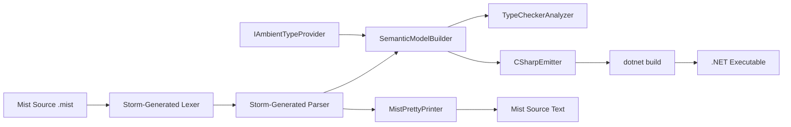
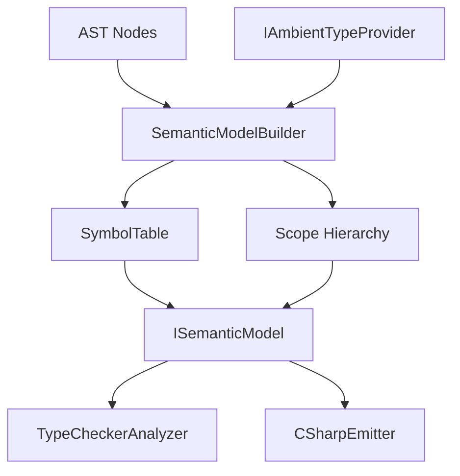

# Design Document

## Overview

This design document specifies the concrete language features, grammar, semantic model, type checker, C# transpiler, pretty printer, and sample application for Mist v1. It builds on the compiler architecture defined in `.kiro/specs/mist-compiler-architecture/`, which provides the pipeline skeleton (Storm source generator → lexer → parser → semantic model → analyzers → backend). This document fills in every architectural stub with concrete implementations.

The design covers seven deliverables:

1. **Complete Mist.storm grammar** — All tokens, parser rules, and operator precedence for the Mist v1 language, written in Storm syntax and placed at `Source/Mist/Grammar/Mist.storm`.
2. **Semantic model implementation** — How `SemanticModelBuilder` walks the AST to build symbols, types, and scopes; the updated `SymbolKind` and `TypeKind` enums; how primitives, arrays, void, string, and Unknown are represented.
3. **Ambient type system** — The `IAmbientTypeProvider` interface and how the C# backend injects .NET types into the semantic model before construction.
4. **Type checker implementation** — How `TypeCheckerAnalyzer` verifies each type rule from R8–R10.
5. **C# transpiler emission** — How `CSharpEmitter` walks the semantic model to produce valid C# source files.
6. **Pretty printer** — How `MistPrettyPrinter` formats an AST back to valid Mist source text.
7. **Sample application** — The Mist source code exercising every language feature.

Requirement references appear inline as `(R{n}.{m})` referring to the requirements document at `.kiro/specs/mist-language-v1/requirements.md`.

## Architecture

The Mist v1 language implementation fits into the existing compiler pipeline without changing any architectural contracts. The pipeline flow is:



Key architectural decisions:

- **The Storm grammar is the single source of truth** for all tokens and parser rules. The Storm source generator produces the lexer, parser, and AST node types. No hand-written lexer or parser code exists in the Mist project.
- **Ambient types are injected before semantic model construction.** The `CSharpTranspilerBackend` provides an `IAmbientTypeProvider` that the `CompilerDriver` passes to the `SemanticModelBuilder`. This keeps the semantic model backend-agnostic while allowing the backend to define what external types are available.
- **The type system uses exactly two TypeKind members: `Class` and `Struct`.** All primitives are `Struct`, `string` is `Class`, arrays are `Class`, `void` is `Struct`, and `Unknown` is a sentinel with no kind.
- **The pretty printer operates on the AST, not the semantic model.** It is a pure syntactic transformation used for round-trip testing.

## Components and Interfaces

### Storm Grammar (`Source/Mist/Grammar/Mist.storm`)

The complete Storm grammar defines all Mist v1 tokens and parser rules. The grammar is split across two files: `keywords.storm` contains all keyword tokens, and `Mist.storm` imports it and contains hidden tokens, operators, punctuation, literals, the identifier token, and all parser rules. The grammar uses `grammar Mist;` as its root declaration, which causes the Storm source generator to emit types into the `Mist.Generated` namespace with class names `MistLexer`, `MistParser`, and AST node types like `CompilationUnitNode`, `ClassDeclarationNode`, etc.

#### Keywords (`Source/Mist/Grammar/keywords.storm`)

Keywords are declared before `IDENTIFIER` so that declaration-order priority (R1.11) ensures keywords win over identifiers. All keyword tokens are defined in a separate `keywords.storm` file imported by `Mist.storm`:

```storm
// keywords.storm — Language and primitive-type keywords for Mist v1.

token NAMESPACE = "namespace";
token USING     = "using";
token CLASS     = "class";
token STRUCT    = "struct";
token PUBLIC    = "public";
token PRIVATE   = "private";
token STATIC    = "static";
token VOID      = "void";
token NEW       = "new";
token RETURN    = "return";
token IF        = "if";
token ELSE      = "else";
token WHILE     = "while";
token FOR       = "for";
token FOREACH   = "foreach";
token IN        = "in";
token BREAK     = "break";
token VAR       = "var";
token TRUE      = "true";
token FALSE     = "false";
token THIS      = "this";

// Primitive type keywords
token INT     = "int";
token UINT    = "uint";
token LONG    = "long";
token ULONG   = "ulong";
token SHORT   = "short";
token USHORT  = "ushort";
token BYTE    = "byte";
token SBYTE   = "sbyte";
token FLOAT   = "float";
token DOUBLE  = "double";
token DECIMAL = "decimal";
token BOOL    = "bool";
token CHAR    = "char";
token STRING  = "string";
```

#### Mist.storm (`Source/Mist/Grammar/Mist.storm`)

```storm
grammar Mist;
import "keywords.storm";
```

##### Hidden Tokens

```storm
hidden token WHITESPACE   = [ \t\r\n]+;
hidden token LINE_COMMENT = "//" [^\n]*;
```

##### Operators and Punctuation

```storm
token LOGICAL_AND           = "&&";
token LOGICAL_OR            = "||";
token EQUAL_EQUAL           = "==";
token NOT_EQUAL             = "!=";
token LESS_THAN_OR_EQUAL    = "<=";
token GREATER_THAN_OR_EQUAL = ">=";
token PLUS                  = "+";
token MINUS                 = "-";
token STAR                  = "*";
token SLASH                 = "/";
token MODULO                = "%";
token EQUAL                 = "=";
token LESS_THAN             = "<";
token GREATER_THAN          = ">";
token EXCLAMATION           = "!";
token DOT                   = ".";
token COMMA                 = ",";
token SEMICOLON             = ";";
token COLON                 = ":";
token LEFT_PARENTHESIS      = "(";
token RIGHT_PARENTHESIS     = ")";
token LEFT_BRACE            = "{";
token RIGHT_BRACE           = "}";
token LEFT_BRACKET          = "[";
token RIGHT_BRACKET         = "]";
```

Multi-character operators (`LOGICAL_AND`, `LOGICAL_OR`, `EQUAL_EQUAL`, `NOT_EQUAL`, `LESS_THAN_OR_EQUAL`, `GREATER_THAN_OR_EQUAL`) are declared before their single-character counterparts so that maximal-munch combined with declaration-order priority selects the longer token.

##### Literals

```storm
fragment HEX_DIGIT        = [0-9a-fA-F];
fragment INT_SUFFIX        = [lLuU] | "UL" | "ul" | "Ul" | "uL" | "Lu" | "lU" | "LU" | "lu";
fragment FLOAT_SUFFIX      = [fFdDmM];
fragment ESCAPE_SEQUENCE   = "\\\\" | "\\\"" | "\\n" | "\\r" | "\\t" | "\\0" | "\\'";

token HEX_LITERAL     = "0" [xX] HEX_DIGIT+ INT_SUFFIX?;
token INTEGER_LITERAL  = [0-9]+ INT_SUFFIX?;
token FLOAT_LITERAL    = [0-9]+ "." [0-9]+ FLOAT_SUFFIX?
                       | [0-9]+ FLOAT_SUFFIX;

token CHAR_LITERAL     = "'" (ESCAPE_SEQUENCE | [^'\\]) "'";
token STRING_LITERAL   = "\"" (ESCAPE_SEQUENCE | [^"\\])* "\"";

token INTERPOLATED_STRING_START = "$\"";
token INTERPOLATED_STRING_TEXT  = ([^"\\{] | ESCAPE_SEQUENCE)+;
token INTERPOLATED_STRING_END   = "\"";
```

`HEX_LITERAL` is declared before `INTEGER_LITERAL` so that `0xFF` matches as hex rather than as `0` followed by `xFF`.

##### Identifier

```storm
token IDENTIFIER = [a-zA-Z_][a-zA-Z0-9_]*;
```

Declared after all keywords so keywords take priority (R1.11).

##### Parser Rules — Top Level

```storm
rule CompilationUnit = usings:UsingDeclaration* namespace:NamespaceDeclaration? types:TypeDeclaration*;

rule UsingDeclaration = USING name:QualifiedIdentifier SEMICOLON;

rule QualifiedIdentifier = IDENTIFIER (DOT IDENTIFIER)*;

rule NamespaceDeclaration
    = NAMESPACE name:QualifiedIdentifier SEMICOLON body:TypeDeclaration*   as FileScopedNamespace
    | NAMESPACE name:QualifiedIdentifier LEFT_BRACE body:TypeDeclaration* RIGHT_BRACE as BlockNamespace
    ;

rule TypeDeclaration
    = classDecl:ClassDeclaration   as ClassType
    | structDecl:StructDeclaration as StructType
    ;
```

##### Parser Rules — Type Declarations

```storm
rule ClassDeclaration  = modifiers:Modifier* CLASS  name:IDENTIFIER LEFT_BRACE members:MemberDeclaration* RIGHT_BRACE;
rule StructDeclaration = modifiers:Modifier* STRUCT name:IDENTIFIER LEFT_BRACE members:MemberDeclaration* RIGHT_BRACE;

rule Modifier
    = PUBLIC  as PublicModifier
    | PRIVATE as PrivateModifier
    | STATIC  as StaticModifier
    ;

rule MemberDeclaration
    = constructor:ConstructorDeclaration as ConstructorMember
    | method:MethodDeclaration           as MethodMember
    | field:FieldDeclaration             as FieldMember
    ;
```

##### Parser Rules — Members

```storm
rule FieldDeclaration = modifiers:Modifier* type:TypeReference name:IDENTIFIER initializer:(EQUAL Expression)? SEMICOLON;

rule ConstructorDeclaration = modifiers:Modifier* name:IDENTIFIER LEFT_PARENTHESIS params:ParameterList? RIGHT_PARENTHESIS
                              chain:ConstructorChain? body:Block;

rule ConstructorChain = COLON THIS LEFT_PARENTHESIS args:ArgumentList? RIGHT_PARENTHESIS;

rule MethodDeclaration = modifiers:Modifier* returnType:TypeReference name:IDENTIFIER
                         LEFT_PARENTHESIS params:ParameterList? RIGHT_PARENTHESIS body:Block;

rule ParameterList = Parameter (COMMA Parameter)*;
rule Parameter = type:TypeReference name:IDENTIFIER;

rule ArgumentList = Expression (COMMA Expression)*;
```

##### Parser Rules — Type References

```storm
rule TypeReference
    = primitiveType:PrimitiveType arrayRank:(LEFT_BRACKET RIGHT_BRACKET)?  as PrimitiveTypeRef
    | VOID                                                                  as VoidTypeRef
    | name:QualifiedIdentifier arrayRank:(LEFT_BRACKET RIGHT_BRACKET)?     as NamedTypeRef
    ;

rule PrimitiveType
    = INT as IntType | UINT as UintType | LONG as LongType | ULONG as UlongType
    | SHORT as ShortType | USHORT as UshortType | BYTE as ByteType | SBYTE as SbyteType
    | FLOAT as FloatType | DOUBLE as DoubleType | DECIMAL as DecimalType
    | BOOL as BoolType | CHAR as CharType | STRING as StringType
    ;
```

##### Parser Rules — Statements

```storm
rule Block = LEFT_BRACE statements:Statement* RIGHT_BRACE;

rule Statement
    = varDecl:VariableDeclarationStatement           as VariableDeclarationStatement
    | returnStmt:ReturnStatement                     as ReturnStatement
    | ifStmt:IfStatement                             as IfStatement
    | whileStmt:WhileStatement                       as WhileStatement
    | forStmt:ForStatement                           as ForStatement
    | foreachStmt:ForeachStatement                   as ForeachStatement
    | breakStmt:BreakStatement                       as BreakStatement
    | exprStmt:ExpressionStatement                   as ExpressionStatement
    ;

rule VariableDeclarationStatement
    = type:TypeReference name:IDENTIFIER EQUAL init:Expression SEMICOLON  as TypedVariableDeclaration
    | VAR name:IDENTIFIER EQUAL init:Expression SEMICOLON                 as InferredVariableDeclaration
    ;

rule ReturnStatement
    = RETURN value:Expression? SEMICOLON
    ;

rule IfStatement
    = IF LEFT_PARENTHESIS condition:Expression RIGHT_PARENTHESIS thenBranch:Block
      elseBranch:ElseClause?
    ;

rule ElseClause
    = ELSE elseIf:IfStatement   as ElseIf
    | ELSE elseBlock:Block      as ElseBlock
    ;

rule WhileStatement = WHILE LEFT_PARENTHESIS condition:Expression RIGHT_PARENTHESIS body:Block;

rule ForStatement = FOR LEFT_PARENTHESIS init:ForInit? SEMICOLON condition:Expression? SEMICOLON iter:Expression? RIGHT_PARENTHESIS body:Block;

rule ForInit
    = varDecl:TypeReference name:IDENTIFIER EQUAL init:Expression  as ForInitVariableDeclaration
    | expr:Expression                                               as ForInitExpression
    ;

rule ForeachStatement = FOREACH LEFT_PARENTHESIS type:TypeReference name:IDENTIFIER IN collection:Expression RIGHT_PARENTHESIS body:Block;

rule BreakStatement = BREAK SEMICOLON;

rule ExpressionStatement = expr:Expression SEMICOLON;
```

##### Parser Rules — Expressions (Precedence Climbing)

Operator precedence is encoded structurally via a chain of rules, from lowest to highest binding:

```storm
rule Expression = Assignment;

rule Assignment = target:LogicalOr (EQUAL value:Assignment)?;

rule LogicalOr  = left:LogicalAnd (LOGICAL_OR right:LogicalAnd)*;
rule LogicalAnd = left:Equality   (LOGICAL_AND right:Equality)*;
rule Equality   = left:Relational (op:(EQUAL_EQUAL | NOT_EQUAL) right:Relational)*;
rule Relational = left:Additive   (op:(LESS_THAN | GREATER_THAN | LESS_THAN_OR_EQUAL | GREATER_THAN_OR_EQUAL) right:Additive)*;
rule Additive   = left:Multiplicative (op:(PLUS | MINUS) right:Multiplicative)*;
rule Multiplicative = left:Unary (op:(STAR | SLASH | MODULO) right:Unary)*;

rule Unary
    = EXCLAMATION operand:Unary    as LogicalNot
    | MINUS operand:Unary          as Negate
    | primary:Postfix              as PostfixExpr
    ;

rule Postfix = target:Primary suffix:PostfixSuffix*;

rule PostfixSuffix
    = DOT name:IDENTIFIER LEFT_PARENTHESIS args:ArgumentList? RIGHT_PARENTHESIS  as MethodCallSuffix
    | DOT name:IDENTIFIER                                                         as MemberAccessSuffix
    | LEFT_BRACKET index:Expression RIGHT_BRACKET                                 as IndexSuffix
    | LEFT_PARENTHESIS args:ArgumentList? RIGHT_PARENTHESIS                       as InvocationSuffix
    ;

rule Primary
    = intLit:INTEGER_LITERAL                                               as IntLiteralExpr
    | hexLit:HEX_LITERAL                                                   as HexLiteralExpr
    | floatLit:FLOAT_LITERAL                                               as FloatLiteralExpr
    | stringLit:STRING_LITERAL                                             as StringLiteralExpr
    | interpString:InterpolatedString                                      as InterpolatedStringExpr
    | charLit:CHAR_LITERAL                                                 as CharLiteralExpr
    | TRUE                                                                 as TrueLiteralExpr
    | FALSE                                                                as FalseLiteralExpr
    | THIS                                                                 as ThisExpr
    | NEW type:TypeReference LEFT_BRACKET size:Expression RIGHT_BRACKET    as ArrayCreationExpr
    | NEW type:QualifiedIdentifier LEFT_PARENTHESIS args:ArgumentList? RIGHT_PARENTHESIS as ObjectCreationExpr
    | LEFT_PARENTHESIS inner:Expression RIGHT_PARENTHESIS                  as ParenExpr
    | name:IDENTIFIER                                                      as IdentifierExpr
    ;

rule InterpolatedString = INTERPOLATED_STRING_START parts:InterpolatedPart* INTERPOLATED_STRING_END;

rule InterpolatedPart
    = text:INTERPOLATED_STRING_TEXT  as TextPart
    | LEFT_BRACE expr:Expression RIGHT_BRACE      as ExpressionPart
    ;
```

This precedence chain matches C# (R4.1): unary binds tightest, then `*`/`/`/`%`, then `+`/`-`, then `<`/`>`/`<=`/`>=`, then `==`/`!=`, then `&&`, then `||`, with `=` binding loosest.

### AST Node Type Mapping

The Storm source generator produces one C# type per `rule`. The following table shows the key mappings:

| Storm Rule | Generated C# Type | Named Alternatives |
|---|---|---|
| `CompilationUnit` | `CompilationUnitNode` | — |
| `NamespaceDeclaration` | `NamespaceDeclarationNode` (abstract) | `FileScopedNamespaceNode`, `BlockNamespaceNode` |
| `TypeDeclaration` | `TypeDeclarationNode` (abstract) | `ClassTypeNode`, `StructTypeNode` |
| `ClassDeclaration` | `ClassDeclarationNode` | — |
| `StructDeclaration` | `StructDeclarationNode` | — |
| `Modifier` | `ModifierNode` (abstract) | `PublicModifierNode`, `PrivateModifierNode`, `StaticModifierNode` |
| `MemberDeclaration` | `MemberDeclarationNode` (abstract) | `ConstructorMemberNode`, `MethodMemberNode`, `FieldMemberNode` |
| `FieldDeclaration` | `FieldDeclarationNode` | — |
| `ConstructorDeclaration` | `ConstructorDeclarationNode` | — |
| `MethodDeclaration` | `MethodDeclarationNode` | — |
| `TypeReference` | `TypeReferenceNode` (abstract) | `PrimitiveTypeRefNode`, `VoidTypeRefNode`, `NamedTypeRefNode` |
| `Statement` | `StatementNode` (abstract) | `VariableDeclarationStatementNode`, `ReturnStatementNode`, `IfStatementNode`, `WhileStatementNode`, `ForStatementNode`, `ForeachStatementNode`, `BreakStatementNode`, `ExpressionStatementNode` |
| `VariableDeclarationStatement` | `VariableDeclarationStatementNode` (abstract) | `TypedVariableDeclarationNode`, `InferredVariableDeclarationNode` |
| `ForInit` | `ForInitNode` (abstract) | `ForInitVariableDeclarationNode`, `ForInitExpressionNode` |
| `Expression` → `Primary` | `PrimaryNode` (abstract) | `IntLiteralExprNode`, `StringLiteralExprNode`, `IdentifierExprNode`, etc. |
| `Unary` | `UnaryNode` (abstract) | `LogicalNotNode`, `NegateNode`, `PostfixExprNode` |
| `PostfixSuffix` | `PostfixSuffixNode` (abstract) | `MethodCallSuffixNode`, `MemberAccessSuffixNode`, `IndexSuffixNode`, `InvocationSuffixNode` |


### Semantic Model — Updated Enums and Types

The architecture spec left `SymbolKind` and `TypeKind` as stubs. This design replaces them with concrete members.

#### SymbolKind (replaces existing stub in `ISymbol.cs`)

```csharp
public enum SymbolKind
{
    Namespace,
    Class,
    Struct,
    Field,
    Constructor,
    Method,
    Parameter,
    LocalVariable,
}
```

This matches R5.1 exactly. The existing `Variable`, `Function`, `Type`, `Parameter`, `Namespace` members are replaced.

#### TypeKind (replaces existing stub in `IType.cs`)

```csharp
public enum TypeKind
{
    Class,
    Struct,
}
```

This matches R5.2 exactly. The existing `Primitive`, `Function`, `Record`, `Union`, `Unknown` members are replaced. `TypeKind` classifies type constructors at the kind level — it does not enumerate individual types.

#### Type Representations

All types implement `IType`. The concrete type hierarchy lives in `Mist.Semantics.Model.Types`:

```csharp
namespace Mist.Semantics.Model.Types;

/// <summary>
/// A well-known primitive type (int, bool, char, etc.). All primitives are Struct.
/// </summary>
public sealed class PrimitiveType : IType
{
    public string DisplayName { get; }
    public TypeKind Kind => TypeKind.Struct;  // R5.11: all C# primitives are value types
    public string CSharpKeyword { get; }      // e.g. "int", "bool" — used by emitter

    // Well-known singleton instances:
    public static readonly PrimitiveType Int = new("int", "int");
    public static readonly PrimitiveType Uint = new("uint", "uint");
    public static readonly PrimitiveType Long = new("long", "long");
    public static readonly PrimitiveType Ulong = new("ulong", "ulong");
    public static readonly PrimitiveType Short = new("short", "short");
    public static readonly PrimitiveType Ushort = new("ushort", "ushort");
    public static readonly PrimitiveType Byte = new("byte", "byte");
    public static readonly PrimitiveType Sbyte = new("sbyte", "sbyte");
    public static readonly PrimitiveType Float = new("float", "float");
    public static readonly PrimitiveType Double = new("double", "double");
    public static readonly PrimitiveType Decimal = new("decimal", "decimal");
    public static readonly PrimitiveType Bool = new("bool", "bool");
    public static readonly PrimitiveType Char = new("char", "char");

    private PrimitiveType(string displayName, string csharpKeyword) { ... }
}

/// <summary>
/// The string type. String is a class (reference type) in .NET. (R5.12)
/// </summary>
public sealed class StringType : IType
{
    public static readonly StringType Instance = new();
    public string DisplayName => "string";
    public TypeKind Kind => TypeKind.Class;
}

/// <summary>
/// An array type. Arrays are classes (reference types) in .NET. (R5.13)
/// </summary>
public sealed class ArrayType : IType
{
    public IType ElementType { get; }
    public string DisplayName => $"{ElementType.DisplayName}[]";
    public TypeKind Kind => TypeKind.Class;

    public ArrayType(IType elementType) { ElementType = elementType; }
}

/// <summary>
/// The void type. Void is a unit struct. (R5.14)
/// </summary>
public sealed class VoidType : IType
{
    public static readonly VoidType Instance = new();
    public string DisplayName => "void";
    public TypeKind Kind => TypeKind.Struct;
}

/// <summary>
/// A user-defined class type.
/// </summary>
public sealed class ClassType : IType
{
    public string DisplayName { get; }
    public TypeKind Kind => TypeKind.Class;
    public IScope MemberScope { get; }
    public string? ContainingNamespace { get; }

    public ClassType(string displayName, IScope memberScope, string? containingNamespace) { ... }
}

/// <summary>
/// A user-defined struct type.
/// </summary>
public sealed class StructType : IType
{
    public string DisplayName { get; }
    public TypeKind Kind => TypeKind.Struct;
    public IScope MemberScope { get; }
    public string? ContainingNamespace { get; }

    public StructType(string displayName, IScope memberScope, string? containingNamespace) { ... }
}

/// <summary>
/// Sentinel type for unresolved or erroneous types. Has no TypeKind. (R5.15)
/// Used only during analysis; must not propagate to the backend.
/// </summary>
public sealed class UnknownType : IType
{
    public static readonly UnknownType Instance = new();
    public string DisplayName => "?";

    // UnknownType does NOT have a TypeKind. Accessing Kind throws.
    // The IType interface requires Kind, so we use a special approach:
    // the IType contract is extended with a bool HasKind property,
    // or callers check `type is UnknownType` before accessing Kind.
    public TypeKind Kind => throw new InvalidOperationException(
        "UnknownType has no TypeKind — it is an error sentinel.");
}
```

**Design decision — UnknownType and IType.Kind:** The `IType` interface declares `TypeKind Kind { get; }`, but `UnknownType` has no kind (R5.15). Rather than adding a nullable `TypeKind?` to the interface (which would force null checks everywhere), `UnknownType.Kind` throws. All code that accesses `Kind` must first check `type is not UnknownType`. The type checker ensures `UnknownType` never reaches the backend.

### Ambient Type Provider Interface

The ambient type system is the mechanism by which the backend provides type definitions to the semantic model (R7.1–R7.5). The interface lives in `Mist.Semantics.Contracts`:

```csharp
namespace Mist.Semantics.Contracts;

/// <summary>
/// Describes a method signature on an ambient type.
/// </summary>
public sealed record AmbientMethod(
    string Name,
    IType ReturnType,
    ImmutableArray<AmbientParameter> Parameters,
    bool IsStatic);

/// <summary>
/// Describes a parameter on an ambient method.
/// </summary>
public sealed record AmbientParameter(string Name, IType Type);

/// <summary>
/// Describes a field on an ambient type.
/// </summary>
public sealed record AmbientField(string Name, IType Type, bool IsStatic);

/// <summary>
/// Describes a type provided by the backend's runtime environment.
/// </summary>
public sealed record AmbientTypeDefinition(
    string FullyQualifiedName,       // e.g. "System.Console"
    string SimpleName,               // e.g. "Console"
    string Namespace,                // e.g. "System"
    TypeKind Kind,
    ImmutableArray<AmbientMethod> Methods,
    ImmutableArray<AmbientField> Fields);

/// <summary>
/// Provides ambient type definitions from the backend's runtime environment.
/// The semantic model builder calls this before constructing the model.
/// </summary>
public interface IAmbientTypeProvider
{
    ImmutableArray<AmbientTypeDefinition> GetAmbientTypes();
}
```

The `ISemanticModelBuilder` interface is extended to accept an optional `IAmbientTypeProvider`:

```csharp
public interface ISemanticModelBuilder
{
    ISemanticModel Build(
        MistCompilation compilation,
        ImmutableArray<SyntaxNode> asts,
        IAmbientTypeProvider? ambientTypeProvider,
        DiagnosticBag diagnostics);
}
```

The `CompilerDriver` obtains the `IAmbientTypeProvider` from the selected backend before calling `Build`. The `IBackend` interface is extended:

```csharp
public interface IBackend
{
    BackendId Id { get; }
    IAmbientTypeProvider? GetAmbientTypeProvider();
    BackendResult Emit(ISemanticModel model, string outputDirectory, DiagnosticBag diagnostics);
}
```

### C# Backend Ambient Types

The `CSharpTranspilerBackend` implements `IAmbientTypeProvider` to provide .NET types (R7.3):

```csharp
namespace Mist.Backends.CSharpTranspiler;

public sealed class CSharpAmbientTypeProvider : IAmbientTypeProvider
{
    public ImmutableArray<AmbientTypeDefinition> GetAmbientTypes()
    {
        return
        [
            // System.Console — static class with WriteLine, ReadLine, Write, etc.
            new AmbientTypeDefinition(
                FullyQualifiedName: "System.Console",
                SimpleName: "Console",
                Namespace: "System",
                Kind: TypeKind.Class,
                Methods:
                [
                    new AmbientMethod("WriteLine", VoidType.Instance,
                        [], IsStatic: true),
                    new AmbientMethod("WriteLine", VoidType.Instance,
                        [new AmbientParameter("value", StringType.Instance)], IsStatic: true),
                    new AmbientMethod("WriteLine", VoidType.Instance,
                        [new AmbientParameter("value", PrimitiveType.Int)], IsStatic: true),
                    new AmbientMethod("ReadLine", StringType.Instance,
                        [], IsStatic: true),
                    new AmbientMethod("Write", VoidType.Instance,
                        [new AmbientParameter("value", StringType.Instance)], IsStatic: true),
                ],
                Fields: []),

            // System.String — instance methods
            new AmbientTypeDefinition(
                FullyQualifiedName: "System.String",
                SimpleName: "String",
                Namespace: "System",
                Kind: TypeKind.Class,
                Methods:
                [
                    new AmbientMethod("Length", PrimitiveType.Int, [], IsStatic: false),
                    new AmbientMethod("Substring", StringType.Instance,
                        [new AmbientParameter("startIndex", PrimitiveType.Int)], IsStatic: false),
                    new AmbientMethod("Contains", PrimitiveType.Bool,
                        [new AmbientParameter("value", StringType.Instance)], IsStatic: false),
                ],
                Fields: []),

            // System.Math — static methods
            new AmbientTypeDefinition(
                FullyQualifiedName: "System.Math",
                SimpleName: "Math",
                Namespace: "System",
                Kind: TypeKind.Class,
                Methods:
                [
                    new AmbientMethod("Abs", PrimitiveType.Int,
                        [new AmbientParameter("value", PrimitiveType.Int)], IsStatic: true),
                    new AmbientMethod("Max", PrimitiveType.Int,
                        [new AmbientParameter("val1", PrimitiveType.Int),
                         new AmbientParameter("val2", PrimitiveType.Int)], IsStatic: true),
                    new AmbientMethod("Min", PrimitiveType.Int,
                        [new AmbientParameter("val1", PrimitiveType.Int),
                         new AmbientParameter("val2", PrimitiveType.Int)], IsStatic: true),
                ],
                Fields: []),

            // System.Array — base type for arrays
            new AmbientTypeDefinition(
                FullyQualifiedName: "System.Array",
                SimpleName: "Array",
                Namespace: "System",
                Kind: TypeKind.Class,
                Methods:
                [
                    new AmbientMethod("Length", PrimitiveType.Int, [], IsStatic: false),
                ],
                Fields: []),

            // System.Convert — static conversion methods
            new AmbientTypeDefinition(
                FullyQualifiedName: "System.Convert",
                SimpleName: "Convert",
                Namespace: "System",
                Kind: TypeKind.Class,
                Methods:
                [
                    new AmbientMethod("ToInt32", PrimitiveType.Int,
                        [new AmbientParameter("value", StringType.Instance)], IsStatic: true),
                    new AmbientMethod("ToString", StringType.Instance,
                        [new AmbientParameter("value", PrimitiveType.Int)], IsStatic: true),
                ],
                Fields: []),
        ];
    }
}
```

### Semantic Model Builder — AST Walking

The `SemanticModelBuilder.Build` method performs these passes:

**Pass 1 — Register ambient types.** If an `IAmbientTypeProvider` is supplied, iterate its `AmbientTypeDefinition` list. For each definition, create a namespace symbol (if not already present), create a type symbol with the appropriate `TypeKind`, and register its methods and fields as member symbols in the type's scope. Register all ambient types in the global scope so user code can reference them (R7.2).

**Pass 2 — Register user-defined types.** Walk each AST top-down. For each `ClassDeclarationNode` or `StructDeclarationNode`, create a type symbol and register it in the enclosing namespace scope (or global scope if no namespace). For each `FieldDeclarationNode`, `ConstructorDeclarationNode`, and `MethodDeclarationNode`, create member symbols in the type's scope.

**Pass 3 — Resolve types and build expression types.** Walk each AST again. For each `TypeReference` node, resolve it to an `IType` by looking up the name in the scope chain. For each expression, compute and record its type. For `var` declarations, infer the type from the initializer expression (R8.9).

**Scope hierarchy** (R6.1):

```
Global Scope
  └── Namespace Scope (one per namespace declaration)
       └── Type Scope (one per class/struct)
            └── Method/Constructor Scope (one per method/constructor)
                 └── Block Scope (one per { } block, including nested blocks)
```

Name resolution (R6.3): search current scope, then walk up to parent scopes. `using` declarations (R6.2) make all types from the referenced namespace visible in the file's scope.

### Type Checker Implementation

The `TypeCheckerAnalyzer` walks the semantic model and verifies all type rules. It is organized as a set of check methods:

```csharp
public sealed class TypeCheckerAnalyzer : IAnalyzer
{
    public string AnalyzerId => "TypeChecker";

    public void Analyze(ISemanticModel model, DiagnosticBag diagnostics)
    {
        CheckEntryPoint(model, diagnostics);           // R10
        foreach (var symbol in model.AllSymbols)
        {
            CheckAssignments(symbol, model, diagnostics);       // R8.1
            CheckMethodInvocations(symbol, model, diagnostics); // R8.2
            CheckOperators(symbol, model, diagnostics);         // R8.3–R8.6
            CheckConditions(symbol, model, diagnostics);        // R8.7
            CheckReturnStatements(symbol, model, diagnostics);  // R8.8
            CheckVarDeclarations(symbol, model, diagnostics);   // R8.9–R8.10
            CheckArrayOperations(symbol, model, diagnostics);   // R8.11–R8.13
            CheckConstructorChaining(symbol, model, diagnostics); // R8.14
            CheckAccessModifiers(symbol, model, diagnostics);   // R9.1–R9.5
        }
    }
}
```

#### Type Rule Details

**Numeric types** (for R8.3, R8.4): `int`, `uint`, `long`, `ulong`, `short`, `ushort`, `byte`, `sbyte`, `float`, `double`, `decimal`.

**Assignability rules** (R8.1, R8.2): A type `S` is assignable to type `T` when:
- `S` and `T` are the same type (identity)
- Both are numeric primitives and `S` has an implicit widening conversion to `T` (following C# implicit numeric conversion rules)
- `S` is `UnknownType` (error suppression — don't cascade errors)

**Operator type rules:**
| Operator | Operand types | Result type |
|---|---|---|
| `+`, `-`, `*`, `/`, `%` | Both numeric | Common numeric type (widening) |
| `+` | Either is `string` | `string` (concatenation) |
| `<`, `>`, `<=`, `>=` | Both numeric | `bool` |
| `==`, `!=` | Compatible types | `bool` |
| `&&`, `\|\|` | Both `bool` | `bool` |
| `!` | `bool` | `bool` |
| unary `-` | Numeric | Same numeric type |

**Access modifier rules** (R9):
- `private` members: accessible only within the declaring type (R9.1)
- `public` members: accessible from any scope (R9.2)
- No modifier defaults to `private` (R9.3)
- `static` members: accessed via type name, not instance (R9.4)
- Instance members: accessed via instance, not type name (R9.5)

**Entry point validation** (R10):
- Exactly one class must contain `static void Main()` or `static void Main(string[] args)` (R10.1)
- Zero entry points → diagnostic (R10.2)
- Multiple entry points → diagnostic listing all locations (R10.3)

### C# Transpiler — Code Emission

The `CSharpEmitter` walks the semantic model to produce C# source files (R11). The emitter is organized as a recursive visitor:

```csharp
public sealed class CSharpEmitter
{
    public static void Emit(ISemanticModel model, string outputDirectory, DiagnosticBag diagnostics)
    {
        Directory.CreateDirectory(outputDirectory);
        EmitCsproj(outputDirectory);

        // Group symbols by compilation unit
        foreach (var unit in model.Units)
        {
            var csFileName = Path.ChangeExtension(
                Path.GetFileName(unit.Source.Path), ".cs");
            var csPath = Path.Combine(outputDirectory, csFileName);

            using var writer = new StreamWriter(csPath);
            var emitter = new CSharpSourceWriter(writer, model);
            emitter.EmitCompilationUnit(unit);
        }
    }
}
```

**Emission rules:**
- One `.cs` file per Mist source file (R11.1)
- `using` directives at the top for all referenced namespaces and ambient type namespaces (R11.2)
- Namespace declarations mirror Mist source (R11.3)
- Class/struct declarations with modifiers, fields, constructors, methods (R11.4)
- Method bodies with all statements and expressions (R11.5)
- `var` preserved as `var` (R11.6)
- Constructor chaining `: this(args)` preserved (R11.7)
- Array syntax preserved (R11.8)
- String interpolation `$"...{expr}..."` preserved (R11.9)
- `.csproj` with `<OutputType>Exe</OutputType>` and `<Deterministic>true</Deterministic>` targeting .NET 10 (R11.10)
- `dotnet build` invoked after emission (R11.11)
- Build errors surfaced as diagnostics (R11.12)

The emitter produces C# that is syntactically 1:1 with the Mist source, since Mist mirrors C# syntax. The main transformations are:
1. Adding `using` directives for ambient type namespaces
2. Translating Mist type references to C# type references (which are identical for v1)

### Pretty Printer

The `MistPrettyPrinter` lives in `Mist.Parsing` (it operates on ASTs, not the semantic model):

```csharp
namespace Mist.Parsing;

/// <summary>
/// Formats a Mist AST back into syntactically valid Mist source text.
/// Guarantees idempotence: print(parse(print(ast))) == print(ast). (R12.4)
/// </summary>
public sealed class MistPrettyPrinter
{
    private readonly StringBuilder _output = new();
    private int _indentLevel;
    private const string IndentUnit = "    "; // 4 spaces per indent level

    public static string Print(SyntaxNode ast)
    {
        var printer = new MistPrettyPrinter();
        printer.Visit(ast);
        return printer._output.ToString();
    }

    private void Visit(SyntaxNode node)
    {
        // Pattern-match on the concrete AST node type and emit Mist source text.
        // Each node type has a corresponding Emit method.
        switch (node)
        {
            case CompilationUnitNode cu: EmitCompilationUnit(cu); break;
            case ClassDeclarationNode cd: EmitClassDeclaration(cd); break;
            case MethodDeclarationNode md: EmitMethodDeclaration(md); break;
            // ... etc. for all node types
        }
    }
}
```

The pretty printer:
- Produces syntactically valid Mist source (R12.2)
- Preserves semantic meaning (R12.3)
- Is idempotent: `print(parse(print(ast))) == print(ast)` (R12.4)
- Uses consistent 4-space indentation
- Places opening braces on the same line as the declaration (Allman style matching the project's `.editorconfig`)

### Sample Application

The sample application lives at `samples/HelloMist/Program.mist` and exercises every language feature (R13):

```mist
using System;

namespace HelloMist;

public class Point
{
    private int x;
    private int y;

    public Point(int x, int y)
    {
        this.x = x;
        this.y = y;
    }

    public Point() : this(0, 0)
    {
    }

    public int GetX()
    {
        return x;
    }

    public int GetY()
    {
        return y;
    }

    public string Describe()
    {
        return $"Point({x}, {y})";
    }
}

public struct Color
{
    public int r;
    public int g;
    public int b;

    public Color(int r, int g, int b)
    {
        this.r = r;
        this.g = g;
        this.b = b;
    }

    public string ToHex()
    {
        return $"#{r}{g}{b}";
    }
}

public class Program
{
    private static int Factorial(int n)
    {
        if (n <= 1)
        {
            return 1;
        }
        return n * Factorial(n - 1);
    }

    private static int Sum(int[] numbers)
    {
        var total = 0;
        foreach (int num in numbers)
        {
            total = total + num;
        }
        return total;
    }

    public static void Main(string[] args)
    {
        // Demonstrate class instantiation and method calls
        var origin = new Point();
        var p = new Point(3, 4);
        Console.WriteLine(p.Describe());
        Console.WriteLine(origin.Describe());

        // Demonstrate struct
        var red = new Color(255, 0, 0);
        Console.WriteLine(red.ToHex());

        // Demonstrate arithmetic and comparison operators
        int a = 10;
        int b = 3;
        int sum = a + b;
        int diff = a - b;
        int prod = a * b;
        int quot = a / b;
        int rem = a % b;
        bool isGreater = a > b;
        bool isEqual = a == b;

        Console.WriteLine($"Sum: {sum}, Diff: {diff}, Prod: {prod}");
        Console.WriteLine($"Quot: {quot}, Rem: {rem}");
        Console.WriteLine($"a > b: {isGreater}, a == b: {isEqual}");

        // Demonstrate logical operators
        bool t = true;
        bool f = false;
        bool andResult = t && f;
        bool orResult = t || f;
        bool notResult = !t;
        Console.WriteLine($"AND: {andResult}, OR: {orResult}, NOT: {notResult}");

        // Demonstrate if/else
        if (a > 5)
        {
            Console.WriteLine("a is greater than 5");
        }
        else
        {
            Console.WriteLine("a is 5 or less");
        }

        // Demonstrate while loop
        int count = 0;
        while (count < 3)
        {
            Console.WriteLine($"While count: {count}");
            count = count + 1;
        }

        // Demonstrate for loop
        for (int i = 0; i < 5; i = i + 1)
        {
            Console.WriteLine($"For i: {i}");
        }

        // Demonstrate array creation and indexing
        int[] numbers = new int[5];
        for (int i = 0; i < 5; i = i + 1)
        {
            numbers[i] = i * 10;
        }

        // Demonstrate foreach
        foreach (int n in numbers)
        {
            Console.WriteLine($"Array element: {n}");
        }

        // Demonstrate var with type inference
        var message = "Hello from Mist!";
        Console.WriteLine(message);

        // Demonstrate hex literal
        int hexVal = 0xFF;
        Console.WriteLine($"Hex value: {hexVal}");

        // Demonstrate float literal
        double pi = 3.14;
        Console.WriteLine($"Pi: {pi}");

        // Demonstrate char literal
        char letter = 'A';
        Console.WriteLine($"Letter: {letter}");

        // Demonstrate factorial (method call with return value)
        int fact5 = Factorial(5);
        Console.WriteLine($"5! = {fact5}");

        // Demonstrate array sum
        int total = Sum(numbers);
        Console.WriteLine($"Sum of array: {total}");

        // Demonstrate break
        for (int i = 0; i < 10; i = i + 1)
        {
            if (i == 3)
            {
                break;
            }
            Console.WriteLine($"Break loop: {i}");
        }

        Console.WriteLine("Done!");
    }
}
```

This sample exercises: `namespace` (R13.2), `using` (R13.2), `class` (R13.2), `struct` (R13.2), `public`/`private`/`static` (R13.3), constructors with chaining (R13.4), methods with parameters and return values (R13.5), `if`/`else`/`while`/`for`/`foreach`/`return` (R13.6), all arithmetic/comparison/logical operators (R13.7), `var` and explicit types (R13.8), arrays (R13.9), `new` (R13.10), all literal types (R13.11), `Console.WriteLine` (R13.12), and a valid entry point (R13.13).

## Data Models

### Symbol Registration Data Flow



### Type Resolution Lookup Order

When resolving a type name (e.g., `Point`, `int`, `Console`):

1. Check well-known primitive types (`int`, `bool`, etc.)
2. Check `string` and `void` special types
3. Search current scope → parent scopes (R6.3)
4. Search imported namespaces from `using` declarations (R6.2)
5. Search ambient types registered in global scope (R7.2)
6. If not found → emit diagnostic, return `UnknownType` (R6.4)

### Expression Type Computation

Each expression node in the AST gets an associated `IType` in the semantic model:

| Expression Kind | Type Computation |
|---|---|
| Integer literal | `PrimitiveType.Int` (or `Long`/`Uint`/`Ulong` based on suffix) |
| Float literal | `PrimitiveType.Double` (or `Float`/`Decimal` based on suffix) |
| String literal | `StringType.Instance` |
| Interpolated string | `StringType.Instance` |
| Char literal | `PrimitiveType.Char` |
| `true` / `false` | `PrimitiveType.Bool` |
| Identifier | Resolved symbol's `DeclaredType` |
| `this` | Enclosing type |
| Member access `a.b` | Type of member `b` on type of `a` |
| Method call `a.M(args)` | Return type of method `M` |
| `new T(args)` | Type `T` |
| `new T[n]` | `ArrayType(T)` |
| Array index `a[i]` | Element type of array `a` |
| Binary arithmetic | Common numeric type of operands |
| Binary comparison | `PrimitiveType.Bool` |
| Binary logical | `PrimitiveType.Bool` |
| Unary `!` | `PrimitiveType.Bool` |
| Unary `-` | Same as operand type |
| Parenthesized `(e)` | Type of `e` |
| Assignment `a = b` | Type of `a` |


## Correctness Properties

*A property is a characteristic or behavior that should hold true across all valid executions of a system — essentially, a formal statement about what the system should do. Properties serve as the bridge between human-readable specifications and machine-verifiable correctness guarantees.*

The following properties are derived from the acceptance criteria prework analysis. Redundant properties have been consolidated: many individual grammar/parser criteria (R2–R4) are subsumed by the round-trip property; individual symbol-kind criteria (R5.3–R5.10) are combined into one declaration mapping property; and individual type-checker criteria (R8.1–R8.14) are grouped into well-typed/ill-typed properties.

### Property 1: Lexer round-trip (token concatenation reproduces source)

*For any* valid Mist source text, concatenating the lexemes of all tokens in the `TokenStream` (including hidden tokens) SHALL reproduce the original source text exactly.

**Validates: Requirements 1.1, 1.2, 1.3, 1.4, 1.5, 1.6, 1.7, 1.8, 1.9, 1.10**

### Property 2: Pretty printer idempotence

*For any* valid Mist AST, pretty-printing the AST to source text, parsing that source text back to an AST, and pretty-printing again SHALL produce output identical to the first pretty-print. Formally: `print(parse(print(ast))) == print(ast)`.

**Validates: Requirements 12.2, 12.4**

### Property 3: Pretty printer semantic preservation

*For any* valid Mist AST, the source text produced by the pretty printer, when re-parsed and semantically analyzed, SHALL produce a semantic model where every symbol has the same name, kind, and type as in the original semantic model.

**Validates: Requirements 12.3**

### Property 4: Declaration-to-SymbolKind mapping

*For any* valid Mist program containing namespace, class, struct, field, constructor, method, parameter, and local variable declarations, the semantic model SHALL assign each declaration a symbol whose `SymbolKind` matches the declaration form: `Namespace` for namespace declarations, `Class` for class declarations, `Struct` for struct declarations, `Field` for field declarations, `Constructor` for constructor declarations, `Method` for method declarations, `Parameter` for parameters, and `LocalVariable` for local variable declarations.

**Validates: Requirements 5.3, 5.4, 5.5, 5.6, 5.7, 5.8, 5.9, 5.10**

### Property 5: Well-typed programs produce no type errors

*For any* Mist program that is constructed to be well-typed (all assignments are type-compatible, all method calls have correct argument types, all operators are applied to valid operand types, all conditions are `bool`, all return types match, and a single valid entry point exists), the type checker SHALL produce zero Error-severity diagnostics.

**Validates: Requirements 8.1, 8.2, 8.3, 8.4, 8.5, 8.6, 8.7, 8.8, 8.9, 8.11, 8.12, 8.13, 8.14, 10.1**

### Property 6: Type-incompatible operations produce diagnostics

*For any* Mist program containing a type error (arithmetic on non-numeric types, logical operators on non-bool types, assignment of incompatible types, or non-bool condition), the type checker SHALL produce at least one Error-severity diagnostic identifying the offending expression.

**Validates: Requirements 8.1, 8.3, 8.4, 8.6, 8.7**

### Property 7: Name resolution follows scope chain

*For any* valid Mist program with nested scopes, when an identifier is referenced, the semantic model SHALL resolve it to the declaration in the nearest enclosing scope that contains a matching name. If the same name is declared in both an inner and outer scope, the inner declaration SHALL shadow the outer one.

**Validates: Requirements 6.1, 6.2, 6.3**

### Property 8: Undefined identifiers produce diagnostics

*For any* Mist program containing a reference to an identifier that is not declared in any enclosing scope or imported namespace, the semantic model builder SHALL emit a Diagnostic identifying the undefined name.

**Validates: Requirements 6.4**

### Property 9: Access modifier enforcement

*For any* Mist program where a `private` member (or a member with no explicit modifier) is accessed from outside its declaring type, the type checker SHALL produce an Error-severity diagnostic. Conversely, *for any* access to a `public` member from any scope, the type checker SHALL produce no access-related diagnostic.

**Validates: Requirements 9.1, 9.2, 9.3**

### Property 10: Static vs instance access enforcement

*For any* Mist program where a `static` member is accessed through an instance expression, or an instance member is accessed through a type name, the type checker SHALL produce an Error-severity diagnostic.

**Validates: Requirements 9.4, 9.5**

### Property 11: Entry point validation

*For any* Mist compilation, the type checker SHALL produce an Error-severity diagnostic if the compilation contains zero entry points or more than two entry points. It SHALL produce no entry-point diagnostic if exactly one class contains a `static void Main()` or `static void Main(string[] args)` method.

**Validates: Requirements 10.1, 10.2, 10.3**

### Property 12: Ambient types are resolvable in user code

*For any* Mist program that references an ambient type (e.g., `Console`, `Math`) via a `using` declaration for the ambient type's namespace, the semantic model SHALL resolve the type reference to the ambient type definition, and the type checker SHALL produce no "undefined name" diagnostic for that reference.

**Validates: Requirements 7.1, 7.2, 7.4**

### Property 13: C# emitter file-count invariant

*For any* Mist compilation with N source files that passes type checking, the C# emitter SHALL produce exactly N `.cs` files plus one `.csproj` file in the output directory.

**Validates: Requirements 11.1, 11.10**

## Error Handling

### Lexer Errors

- **Unrecognized character:** The Storm-generated lexer emits an `Error` token and a diagnostic, then advances by one character and continues lexing (inherited from architecture spec R10.4).
- **Unterminated string literal:** The lexer emits a diagnostic at the opening quote position.
- **Unterminated character literal:** The lexer emits a diagnostic at the opening quote position.

### Parser Errors

- **Syntax error:** The parser emits a diagnostic identifying the unexpected token and halts parsing of the current compilation unit (architecture spec R11.4). The AST root is `null`.
- **No error recovery in v1:** The parser does not attempt to skip tokens or insert missing tokens.

### Semantic Model Errors

- **Undefined identifier (R6.4):** Diagnostic with the identifier's source span. The symbol is assigned `UnknownType` to prevent cascading errors.
- **Duplicate declaration (R6.5):** Diagnostic identifying both declarations. The second declaration is still registered (with a unique internal name) to allow further analysis.
- **Unresolved type reference:** Diagnostic with the type reference's source span. The type is set to `UnknownType`.

### Type Checker Errors

All type checker diagnostics use `PipelineStage.Analysis` and `AnalyzerName: "TypeChecker"`. Diagnostic IDs follow the pattern `MIST_TC_xxxx`:

| Diagnostic ID | Trigger | Message Pattern |
|---|---|---|
| `MIST_TC_0001` | Assignment type mismatch (R8.1) | `Cannot assign '{rhsType}' to '{lhsType}'` |
| `MIST_TC_0002` | Argument type mismatch (R8.2) | `Argument type '{argType}' is not assignable to parameter type '{paramType}'` |
| `MIST_TC_0003` | Arithmetic on non-numeric (R8.3) | `Operator '{op}' cannot be applied to operands of type '{lhsType}' and '{rhsType}'` |
| `MIST_TC_0004` | Comparison on non-numeric (R8.4) | `Operator '{op}' cannot be applied to operands of type '{lhsType}' and '{rhsType}'` |
| `MIST_TC_0005` | Equality on incompatible types (R8.5) | `Operator '{op}' cannot be applied to operands of type '{lhsType}' and '{rhsType}'` |
| `MIST_TC_0006` | Logical on non-bool (R8.6) | `Operator '{op}' requires operands of type 'bool'` |
| `MIST_TC_0007` | Non-bool condition (R8.7) | `Condition must be of type 'bool', but found '{actualType}'` |
| `MIST_TC_0008` | Return type mismatch (R8.8) | `Cannot return '{returnType}' from method with return type '{methodType}'` |
| `MIST_TC_0009` | Var without initializer (R8.10) | `'var' declaration requires an initializer` |
| `MIST_TC_0010` | Non-integer array index (R8.11) | `Array index must be of type 'int', but found '{indexType}'` |
| `MIST_TC_0011` | No matching constructor (R8.12) | `Type '{typeName}' does not contain a constructor matching the given arguments` |
| `MIST_TC_0012` | Non-integer array size (R8.13) | `Array size must be of type 'int', but found '{sizeType}'` |
| `MIST_TC_0013` | Constructor chain mismatch (R8.14) | `No constructor on '{typeName}' matches the chained arguments` |
| `MIST_TC_0014` | Private member access (R9.1) | `'{memberName}' is inaccessible due to its protection level` |
| `MIST_TC_0015` | Static via instance (R9.4) | `Static member '{memberName}' cannot be accessed via an instance` |
| `MIST_TC_0016` | Instance via type (R9.5) | `Instance member '{memberName}' cannot be accessed via a type name` |
| `MIST_TC_0017` | No entry point (R10.2) | `Program does not contain a valid entry point (static void Main)` |
| `MIST_TC_0018` | Multiple entry points (R10.3) | `Program contains multiple entry points` |

### Backend Errors

- **C# emission failure:** Diagnostic with `PipelineStage.Backend`.
- **dotnet build failure:** Each MSBuild diagnostic line is parsed by `RoslynDiagnosticMapper` and surfaced as a Mist diagnostic with `PipelineStage.Backend` (R11.12).

### Error Propagation

`UnknownType` is the key mechanism for preventing error cascading. When a type cannot be resolved, the semantic model assigns `UnknownType`. The type checker treats `UnknownType` as assignable to any type and any type as assignable to `UnknownType`, suppressing downstream errors that would be noise. The type checker verifies that no `UnknownType` reaches the backend — if the semantic model contains any `UnknownType`, the compilation has errors and the backend is not invoked.

## Testing Strategy

### Dual Testing Approach

The testing strategy uses both unit tests and property-based tests:

- **Property-based tests** verify universal properties (Properties 1–13 above) across many generated inputs using a PBT library.
- **Unit tests** verify specific examples, edge cases, integration points, and error conditions.

### Property-Based Testing Configuration

- **Library:** [FsCheck](https://fscheck.github.io/FsCheck/) for .NET, integrated with xUnit via `FsCheck.Xunit`.
- **Minimum iterations:** 100 per property test.
- **Tag format:** Each property test includes a comment: `// Feature: mist-language-v1, Property {N}: {title}`.
- **Generators:** Custom `Arbitrary<T>` implementations for Mist AST nodes, type references, expressions, and complete programs. Generators produce structurally valid ASTs that respect the grammar rules.

### Test Organization

```
Test/
├── Mist.Tests/
│   ├── Lexing/
│   │   ├── LexerRoundTripPropertyTests.cs    // Property 1
│   │   └── LexerTokenKindTests.cs            // Unit: keyword priority, operator tokens
│   ├── Parsing/
│   │   ├── PrettyPrinterPropertyTests.cs     // Properties 2, 3
│   │   ├── ExpressionPrecedenceTests.cs      // Unit: specific precedence examples
│   │   └── StatementParsingTests.cs          // Unit: each statement form
│   ├── Semantics/
│   │   ├── SymbolKindPropertyTests.cs        // Property 4
│   │   ├── NameResolutionPropertyTests.cs    // Properties 7, 8
│   │   ├── AmbientTypePropertyTests.cs       // Property 12
│   │   └── ScopeHierarchyTests.cs            // Unit: specific scope scenarios
│   ├── Analysis/
│   │   ├── TypeCheckerPropertyTests.cs       // Properties 5, 6
│   │   ├── AccessModifierPropertyTests.cs    // Properties 9, 10
│   │   ├── EntryPointPropertyTests.cs        // Property 11
│   │   └── TypeCheckerEdgeCaseTests.cs       // Unit: var without init, specific errors
│   ├── Backend/
│   │   ├── EmitterFileCountPropertyTests.cs  // Property 13
│   │   ├── EmitterOutputTests.cs             // Unit: specific emission patterns
│   │   └── CsprojEmissionTests.cs            // Unit: .csproj content
│   ├── Integration/
│   │   ├── EndToEndCompilationTests.cs       // Full pipeline on sample programs
│   │   └── SampleApplicationTests.cs         // Compile and run the sample app
│   └── Generators/
│       ├── MistAstGenerator.cs               // FsCheck generators for AST nodes
│       ├── MistProgramGenerator.cs           // Generates complete valid programs
│       └── MistTypeGenerator.cs              // Generates type references
```

### Unit Test Focus Areas

Unit tests complement property tests by covering:

1. **Specific keyword/operator token recognition** — each keyword produces the correct token kind (R1.2, R1.3, R1.4, R1.11)
2. **Operator precedence examples** — `1 + 2 * 3` parses as `1 + (2 * 3)` (R4.1)
3. **Edge cases** — empty programs, programs with only comments, `var` without initializer (R8.10)
4. **Specific error messages** — verify diagnostic messages match expected patterns
5. **Integration tests** — compile the sample application end-to-end (R13.14)
6. **Ambient type provider** — verify the C# backend provides the expected ambient types (R7.3)
7. **`.csproj` emission** — verify correct settings (R11.10)

### Integration Tests

- Compile the sample application at `samples/HelloMist/Program.mist` through the full pipeline
- Verify the produced .NET executable runs without errors (R13.14)
- Verify diagnostic output format matches MSBuild format for CI tool compatibility
