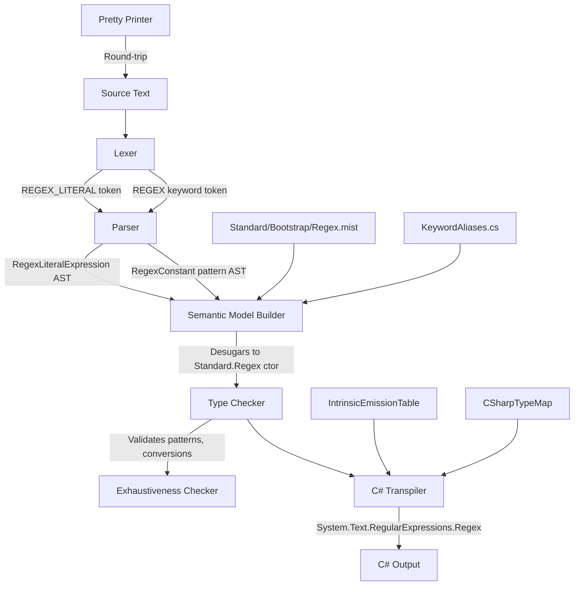

# Design Document: Mist Regex Type

## Overview

This design introduces `regex` as a first-class type in the Mist programming language. The feature spans the full compiler pipeline: lexing (backtick-delimited regex literals), parsing (new AST nodes), semantic analysis (type inference, compile-time validation, conversion rules), pattern matching (regex patterns with full-match semantics), refinement types (regex predicates on strings), C# transpilation, and editor support.

The design follows the same architectural patterns established by existing intrinsic types (`string`, `int`, `bool`, etc.) — a stdlib declaration in `Standard/Bootstrap/Regex.mist`, a keyword alias in `KeywordAliases.cs`, intrinsic emission templates in the C# backend, and a backing type map entry.

### Key Design Decisions

1. **Backtick delimiters** — Regex literals use `` `pattern` `` syntax. Backticks are unused in Mist source (only in Storm meta-grammar), so there's no conflict.
2. **Explicit string→regex conversion** — Invalid patterns can't be detected at compile time for non-literal strings, so the conversion must be explicit (can throw at runtime).
3. **String literal shorthand** — String literals assigned to `regex` variables are validated at compile time and don't require explicit cast syntax.
4. **Full-match semantics in patterns** — Regex patterns in `is`/`switch` test the entire string (anchored with `\A(?:...)\z`; `$` would also accept a trailing newline), consistent with how constant patterns work.
5. **Non-exhaustive patterns** — Regex patterns can never prove exhaustiveness over the string domain.
6. **Backend abstraction** — `Standard.Regex` is declared as an intrinsic class; the C# backend maps it to `System.Text.RegularExpressions.Regex`, but future backends can choose their own implementation.

## Architecture

The feature touches every layer of the compiler pipeline:



### Pipeline Changes by Layer

| Layer | Change |
|-------|--------|
| Grammar (`keywords.storm`) | Add `REGEX` keyword token |
| Grammar (`Mist.storm`) | Add `REGEX_LITERAL` token, `RegexLiteralExpression` in `Primary`, `RegexConstant` in `ConstantLiteral`, `REGEX` in `PrimitiveType`, regex refinement predicate support |
| Lexer | Storm-generated; handles backtick-delimited content with `\\` and `` \` `` escapes |
| Parser | Storm-generated; produces new AST node types |
| Semantic Model | `KeywordAliases.Map` entry, type inference for regex literals, desugaring to constructor invocation |
| Type Checker | Compile-time regex validation, conversion rules, pattern scrutinee validation, refinement evaluation |
| Exhaustiveness Checker | Treat regex patterns as non-exhaustive |
| Pretty Printer | Emit backtick-delimited literals in expression and pattern positions |
| C# Backend | Type map entry, intrinsic emission templates, pattern matching emission |
| Standard Library | `Standard/Bootstrap/Regex.mist` declaration |
| TextMate Grammar | Keyword highlighting, regex literal scope |

## Components and Interfaces

### 1. Grammar Extensions

#### `keywords.storm` Addition

```storm
// Regex keyword (alongside other primitive type keywords)
token REGEX = "regex";
```

#### `Mist.storm` Additions

```storm
// New token for regex literals
token REGEX_LITERAL = "`" (`\\\\` | "\\`" | `[^\`]`)* "`";

// Add to PrimitiveType rule
rule PrimitiveType
    = ... existing variants ...
    | REGEX as RegexType
    ;

// Add to Primary rule
rule Primary
    = ... existing variants ...
    | regexLiteral:REGEX_LITERAL as RegexLiteralExpression
    ;

// Add to ConstantLiteral rule
rule ConstantLiteral
    = ... existing variants ...
    | value:REGEX_LITERAL as RegexConstant
    ;
```

#### Refinement Predicate Extension

The existing `RefinementPredicate` rule uses `AndPattern`, which supports relational and constant patterns. For regex refinements on string types, the grammar already supports this through the `ConstantPattern` → `RegexConstant` path. A type alias like:

```mist
type Email = string `^[^@]+@[^@]+$`;
```

parses as a `TypeAliasDeclaration` where the `RefinableSingleTypeExpr` has a `RefinementPredicate` containing a `RegexConstant` pattern.

### 2. Standard Library Declaration

**File:** `Source/Standard/Bootstrap/Regex.mist`

```mist
namespace Standard;

public readonly intrinsic class Regex
{
    intrinsic public Regex(string pattern);
    intrinsic public string Pattern { get; }
    intrinsic public bool IsMatch(string input);
    intrinsic public bool IsFullMatch(string input);
    
    intrinsic public static implicit operator string(Regex r);
    intrinsic public static explicit operator Regex(string s);
}
```

### 3. Keyword Alias Mapping

**File:** `Source/Mist/Semantics/Model/KeywordAliases.cs`

Add entry:
```csharp
["regex"] = "Standard.Regex",
```

### 4. Semantic Model Builder Changes

The `SemanticModelBuilder` needs the following additions:

- **Regex literal desugaring**: When encountering a `RegexLiteralExpression` AST node, record it as a constructor invocation of `Standard.Regex(pattern)` where `pattern` is the content between backticks (with escape sequences preserved verbatim).
- **Type inference**: Infer `Standard.Regex` for `var` declarations initialized with regex literals.
- **Regex refinement handling**: When a `RefinementPredicate` on a `string` base type contains a `RegexConstant`, create a `RefinementType` that stores the regex pattern for compile-time and runtime evaluation.

### 5. Type Checker Changes

The `TypeCheckerAnalyzer` needs:

- **Compile-time regex validation**: When a `RegexLiteralExpression` is encountered (in any position — expression, pattern, or refinement), validate the pattern using `System.Text.RegularExpressions.Regex` with `RegexOptions.None`. Emit diagnostic on failure.
- **Conversion rules**:
  - `regex → string`: Implicit (always accepted)
  - `string → regex`: Explicit only (require cast syntax)
  - **String literal shorthand**: If a `string` literal is assigned to a `regex`-typed target, validate the literal at compile time. If valid, accept without explicit cast (desugar to explicit operator). If invalid, emit diagnostic.
- **Pattern matching validation**: When a `RegexConstant` pattern appears in an `is` expression or switch arm, verify the scrutinee type is `string`. Emit diagnostic otherwise.
- **Refinement type evaluation**: When a string literal is assigned to a regex-refined type, evaluate the regex against the literal using full-match semantics at compile time.

### 6. Exhaustiveness Checker Changes

Add a check: if any switch arm contains a `RegexConstant` pattern, that arm does NOT contribute to exhaustiveness coverage. Regex patterns over strings cannot prove they cover all possible values.

### 7. Pretty Printer Changes

**File:** `Source/Mist/Parsing/MistPrettyPrinter.cs`

- `EmitPrimary`: Add case for `RegexLiteralExpressionPrimaryNode` — emit the token lexeme (which includes backtick delimiters).
- `EmitConstantLiteral`: Add case for `RegexConstantConstantLiteralNode` — emit the token lexeme.
- `EmitPrimitiveType`: Add case for `RegexTypePrimitiveTypeNode` — emit `"regex"`.

### 8. C# Backend Changes

#### Type Map (`CSharpTypeMap.cs`)

Add to `BackingTypes`:
```csharp
["Standard.Regex"] = "System.Text.RegularExpressions.Regex",
```

#### Intrinsic Emission Table (`IntrinsicEmissionTable.cs`)

Register instance methods:
```csharp
// Regex instance methods
dict["Standard.Regex:IsMatch(Standard.String)"] = new IntrinsicEmissionTemplate("{0}.IsMatch({1})");
dict["Standard.Regex:IsFullMatch(Standard.String)"] = new IntrinsicEmissionTemplate(
    "System.Text.RegularExpressions.Regex.IsMatch({1}, \"\\\\A(?:\" + {0}.ToString() + \")\\\\z\")");
dict["Standard.Regex:Pattern()"] = new IntrinsicEmissionTemplate("{0}.ToString()");
```

Register cast operators:
```csharp
// Regex cast operators
dict["Standard.Regex:implicit(Standard.String)"] = new IntrinsicEmissionTemplate("{0}.ToString()");
dict["Standard.Regex:explicit(Standard.Regex)"] = new IntrinsicEmissionTemplate(
    "new System.Text.RegularExpressions.Regex({0}, System.Text.RegularExpressions.RegexOptions.Compiled)");
```

#### Emitter (`CSharpEmitter.cs`)

- **Regex literal emission**: When encountering a `RegexLiteralExpression`, emit `new Regex(<escaped_pattern>, RegexOptions.Compiled)`.
- **Using directive**: When any file references `Standard.Regex`, emit `using System.Text.RegularExpressions;`.
- **Pattern matching emission**:
  - `is` expression with regex: emit `Regex.IsMatch(scrutinee, @"\A(?:pattern)\z")`
  - Switch arm with regex: emit `string s when Regex.IsMatch(s, @"\A(?:pattern)\z")` guard
- **Static field hoisting** (optimization): When a regex pattern appears inside a loop or is evaluated multiple times, hoist to a `private static readonly Regex` field with `RegexOptions.Compiled`.

### 9. TextMate Grammar Changes

**File:** `Editor/mist-syntax-highlighting/syntaxes/mist.tmLanguage.json`

- Add `regex` to the primitive type keywords pattern (scope: `storage.type.primitive.mist`)
- Add a new `regex-literals` repository entry with begin/end pattern for backtick delimiters (scope: `string.regexp.mist`)
- Add escape sequence highlighting within regex literals (scope: `constant.character.escape.mist`)
- Insert the regex literal pattern after `strings` in the top-level patterns list

## Data Models

### AST Nodes (Storm-generated)

The Storm parser generator will produce these node types from the grammar additions:

| Node Type | Parent Rule | Fields |
|-----------|-------------|--------|
| `RegexTypePrimitiveTypeNode` | `PrimitiveType` | (none — keyword token) |
| `RegexLiteralExpressionPrimaryNode` | `Primary` | `RegexLiteral: Token` |
| `RegexConstantConstantLiteralNode` | `ConstantLiteral` | `Value: Token` |

### Semantic Model Representation

A regex literal in the semantic model is represented as:
- **Expression type**: `Standard.Regex` (resolved via `KeywordAliases.Map["regex"]`)
- **Desugared form**: Constructor invocation `Standard.Regex(patternString)`
- **Compile-time validation**: Pattern validated using `System.Text.RegularExpressions.Regex` constructor

### Refinement Type with Regex Predicate

When a regex refinement is declared:
```mist
type Email = string `^[^@]+@[^@]+$`;
```

The `RefinementType` stores:
- `BaseType`: `Standard.String`
- `Predicate`: A `RefinementPredicate` containing the `RegexConstant` AST node
- The predicate's `Evaluate(object constantValue)` method is extended to handle string values by testing them against the regex pattern using full-match semantics

## Correctness Properties

*A property is a characteristic or behavior that should hold true across all valid executions of a system — essentially, a formal statement about what the system should do. Properties serve as the bridge between human-readable specifications and machine-verifiable correctness guarantees.*

### Property 1: Pretty-printer round-trip for regex literals

*For any* valid Mist source text containing regex literal expressions and/or regex constant patterns, parsing the source into an AST and pretty-printing it, then parsing the pretty-printed output and pretty-printing again, SHALL produce identical text on both pretty-print passes.

**Validates: Requirements 10.1, 10.2, 10.3, 10.4**

### Property 2: Regex literal compile-time validation

*For any* string `P`, if `P` is a syntactically valid .NET regular expression (accepted by `new System.Text.RegularExpressions.Regex(P, RegexOptions.None)` without throwing), then a Mist program containing the regex literal `` `P` `` SHALL compile without diagnostics related to regex validation. Conversely, if `P` is NOT a valid .NET regex, the compiler SHALL emit a diagnostic error indicating the regex syntax error.

**Validates: Requirements 4.6, 5.3, 5.4, 7.7**

### Property 3: Conversion rule correctness

*For any* valid Mist program:
- Assigning a `regex` expression to a `string`-typed target (variable, parameter, or return) SHALL be accepted without explicit cast.
- Assigning a non-literal `string` expression to a `regex`-typed target without explicit cast SHALL produce a type mismatch diagnostic.
- Assigning a non-literal `string` expression to a `regex`-typed target WITH explicit cast SHALL be accepted.
- Assigning a string literal that is a valid .NET regex to a `regex`-typed target SHALL be accepted without explicit cast.
- Assigning a string literal that is NOT a valid .NET regex to a `regex`-typed target SHALL produce a diagnostic error.

**Validates: Requirements 6.1, 6.2, 6.3, 6.5, 6.6, 6.8, 6.9, 6.10**

### Property 4: Regex pattern matching type safety

*For any* Mist program containing a regex literal pattern in an `is` expression or switch arm:
- If the scrutinee's static type is `string`, the type checker SHALL accept the pattern without diagnostics.
- If the scrutinee's static type is NOT `string`, the type checker SHALL emit a diagnostic error.
- The exhaustiveness checker SHALL treat any switch expression containing only regex patterns (without a catch-all) as non-exhaustive.

**Validates: Requirements 7.2, 7.3, 7.5**

### Property 5: End-to-end transpilation correctness (batched)

*For any* valid Mist program using regex features (regex literals, IsMatch/IsFullMatch calls, regex-to-string conversion, string-to-regex explicit cast, regex pattern matching), the C# transpiler SHALL produce output that:
1. Compiles without errors using the .NET C# compiler
2. Produces the expected runtime behavior (regex matching, conversion results)

**Validates: Requirements 8.1–8.10, 9.1, 9.2, 9.5**

### Property 6: Regex refinement type validation

*For any* regex-refined string type `T = string P` where `P` is a valid regex pattern, and *for any* string literal `L`:
- If `L` fully matches `P` (the entire string matches), assignment of `L` to a variable of type `T` SHALL be accepted at compile time.
- If `L` does NOT fully match `P`, assignment of `L` to a variable of type `T` SHALL produce a compile-time diagnostic error.
- Assignment of a non-constant string expression to type `T` SHALL produce a diagnostic requiring pattern matching validation.

**Validates: Requirements 11.2, 11.5, 11.6**

## Error Handling

### Compile-Time Errors

| Condition | Diagnostic ID | Message |
|-----------|--------------|---------|
| Unterminated regex literal (no closing backtick) | `MIST_LEX_ERROR` | "Unterminated regex literal starting at line {L}, column {C}" |
| Invalid regex pattern in literal | `MIST_TC_REGEX_INVALID` | "Invalid regex pattern: {error} at offset {offset}" |
| Invalid regex pattern in string literal assigned to regex | `MIST_TC_REGEX_INVALID` | "Invalid regex pattern: {error} at offset {offset}" |
| String assigned to regex without explicit cast | `MIST_TC_0001` (type mismatch) | "Cannot implicitly convert type 'string' to 'regex'. An explicit cast exists (are you missing a cast?)" |
| Regex pattern on non-string scrutinee | `MIST_TC_REGEX_SCRUTINEE` | "Regex patterns require a 'string' scrutinee, but found '{type}'" |
| Regex refinement on non-string base type | `MIST_TC_REGEX_REFINEMENT` | "Regex refinement predicates are only valid on 'string' types" |
| String literal doesn't match regex-refined type | `MIST_TC_REFINEMENT_FAIL` | "String literal \"{value}\" does not match the regex pattern '{pattern}'" |
| Non-constant string assigned to regex-refined type | `MIST_TC_REFINEMENT_NONCONST` | "Cannot assign non-constant expression to regex-refined type '{type}'. Use pattern matching: if (value is {type} x) { ... }" |

### Runtime Errors

| Condition | Behavior |
|-----------|----------|
| Explicit cast from string to regex with invalid pattern | Throws `System.ArgumentException` from `new Regex(pattern)` |

### Error Recovery

- **Unterminated regex literal**: The lexer skips to end-of-line or end-of-file and continues lexing. No `REGEX_LITERAL` token is produced.
- **Invalid regex pattern**: The semantic model still records the expression type as `Standard.Regex` (allowing downstream analysis to continue without cascading errors).

## Testing Strategy

### Unit Tests (Example-Based)

- **Lexer**: Verify `REGEX_LITERAL` token production for specific patterns (empty, simple, escaped backtick, escaped backslash, multi-line, unterminated)
- **Parser**: Verify AST node production for regex literals in expression and pattern positions
- **KeywordAliases**: Verify the `"regex" → "Standard.Regex"` entry exists (update existing count assertion from 15 to 16)
- **Type Map**: Verify `"Standard.Regex" → "System.Text.RegularExpressions.Regex"` entry
- **Intrinsic Table**: Verify emission templates for `IsMatch`, `IsFullMatch`, `Pattern`
- **Exhaustiveness**: Verify regex patterns don't contribute to exhaustiveness

### Property-Based Tests (FsCheck)

Property-based tests use FsCheck with minimum 100 iterations per property. Each test references its design document property.

**Testing approach**: Following the test-process-spawning policy, property tests that require compilation use the **batched pattern** — generate all scenarios upfront, build a single Mist program, compile once in-process using `CompilerDriver`, and (if runtime verification is needed) run the output DLL once. Compare results line-by-line.

| Property | Test Class | Strategy |
|----------|-----------|----------|
| Property 1: Round-trip | `RegexPrettyPrinterRoundTripTests` | Generate random regex patterns → build Mist source → parse → pretty-print → parse → pretty-print → assert identical |
| Property 2: Validation | `RegexCompileTimeValidationTests` | Generate random strings (valid + invalid regex) → compile in-process → assert diagnostic presence/absence |
| Property 3: Conversions | `RegexConversionRuleTests` | Generate programs with various conversion scenarios → compile in-process → assert type checker accepts/rejects correctly |
| Property 4: Pattern matching | `RegexPatternMatchingTypeTests` | Generate programs with regex patterns on various scrutinee types → compile in-process → assert diagnostics |
| Property 5: E2E transpilation | `RegexTranspilationPropertyTests` | Generate valid programs using regex features → compile in-process → run output DLL once (batched) → verify output |
| Property 6: Refinement | `RegexRefinementTypeTests` | Generate regex-refined types + string literal assignments → compile in-process → assert acceptance/rejection |

**Tag format**: `// Feature: mist-regex-type, Property {N}: {property_text}`

**Process spawning note**: Properties 1–4 and 6 use in-process compilation only (no process spawn). Property 5 uses the batched pattern: 1 compile (in-process) + 1 process spawn to run the output DLL. This keeps total process spawns to 1 per test run for the E2E property.

### Integration Tests

- **Sample application**: Compile and run `samples/RegexLiterals/Program.mist`, compare stdout to baseline
- **AllFeatures orchestrator**: Verify the sample is included in the full-suite run

### PBT Library

- **Library**: FsCheck (already used in the project)
- **Minimum iterations**: 100 per property
- **Generator strategy**: Custom `Arbitrary` instances for regex patterns (valid patterns, invalid patterns, patterns with special characters, empty patterns, patterns with escape sequences)
