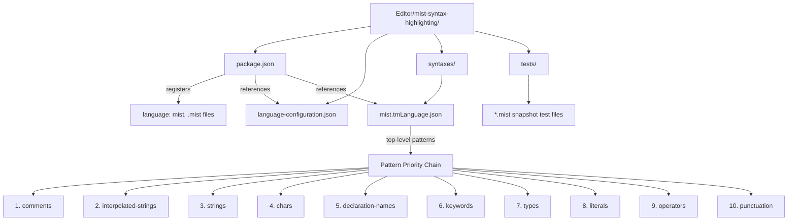

# Design Document

## Overview

This design describes a VS Code / Kiro editor extension that provides syntax highlighting for Mist language files (`.mist`). The extension follows the same manual-maintenance pattern as the existing Storm syntax highlighting extension (`Editor/storm-syntax-highlighting/`), producing a hand-crafted TextMate grammar JSON file.

The extension consists of three artifacts:
1. `package.json` — extension manifest registering the `.mist` language and grammar
2. `language-configuration.json` — editor behaviors (comments, brackets, auto-close)
3. `syntaxes/mist.tmLanguage.json` — TextMate grammar with tokenization rules

The TextMate grammar is the core deliverable. It uses regex-based patterns organized in a repository structure, with careful attention to pattern priority order and the special handling required for interpolated strings with nested expression highlighting.

## Architecture



The extension lives at `Editor/mist-syntax-highlighting/`, parallel to the existing Storm extension. It is installable via symlink into `~/.kiro/extensions/` or `~/.vscode/extensions/`.

## Components and Interfaces

### 1. Package Manifest (`package.json`)

Registers the Mist language with the editor. Mirrors the Storm extension structure.

```json
{
  "name": "mist-syntax-highlighting",
  "displayName": "Mist Syntax Highlighting",
  "version": "0.1.0",
  "publisher": "mist-lang",
  "engines": { "vscode": "^1.75.0" },
  "categories": ["Programming Languages"],
  "contributes": {
    "languages": [{
      "id": "mist",
      "aliases": ["Mist", "mist"],
      "extensions": [".mist"],
      "configuration": "./language-configuration.json"
    }],
    "grammars": [{
      "language": "mist",
      "scopeName": "source.mist",
      "path": "./syntaxes/mist.tmLanguage.json"
    }]
  },
  "scripts": {
    "test": "npx vscode-tmgrammar-test -g syntaxes/mist.tmLanguage.json tests/*.mist"
  },
  "devDependencies": {
    "vscode-tmgrammar-test": "^0.1.3"
  }
}
```

### 2. Language Configuration (`language-configuration.json`)

Defines editor behaviors for Mist files. Extends the Storm configuration with `{}` brackets and `'` auto-closing (Mist has char literals and braces for blocks/interpolation).

```json
{
  "comments": { "lineComment": "//" },
  "brackets": [["(", ")"], ["{", "}"], ["[", "]"]],
  "autoClosingPairs": [
    { "open": "\"", "close": "\"" },
    { "open": "'", "close": "'" },
    { "open": "(", "close": ")" },
    { "open": "{", "close": "}" },
    { "open": "[", "close": "]" }
  ],
  "surroundingPairs": [
    { "open": "\"", "close": "\"" },
    { "open": "'", "close": "'" },
    { "open": "(", "close": ")" },
    { "open": "{", "close": "}" },
    { "open": "[", "close": "]" }
  ]
}
```

### 3. TextMate Grammar (`syntaxes/mist.tmLanguage.json`)

This is the core component. The grammar is organized as a repository of named pattern groups, included from the top-level `patterns` array in a specific priority order.

#### Repository Structure

| Repository Key | Purpose | Scope(s) Assigned |
|---|---|---|
| `comments` | Line comments `//` | `comment.line.double-slash.mist` |
| `interpolated-strings` | `$"..."` with `{expr}` holes | `string.interpolated.mist`, interpolation punctuation, nested expressions |
| `strings` | Regular `"..."` literals | `string.quoted.double.mist`, escape sequences |
| `chars` | Character `'...'` literals | `string.quoted.single.mist`, escape sequences |
| `declaration-names` | Class, struct, method names | `entity.name.type.class.mist`, `entity.name.type.struct.mist`, `entity.name.function.mist` |
| `keywords` | Control flow, declarations, modifiers, other | `keyword.control.mist`, `keyword.declaration.mist`, `storage.modifier.mist`, `keyword.other.mist` |
| `types` | Primitive types and void | `storage.type.primitive.mist`, `storage.type.void.mist` |
| `literals` | Numeric and boolean literals | `constant.numeric.*`, `constant.language.boolean.mist` |
| `operators` | Comparison, logical, arithmetic, assignment | `keyword.operator.*.mist` |
| `punctuation` | Dot, comma, semicolon | `punctuation.*.mist` |

#### Pattern Priority Order and Rationale

TextMate grammars apply patterns in declaration order — the first match wins. The priority order is designed so that:

1. **Comments first** — `//` must win over operators like `/`. A comment consumes the rest of the line, preventing any tokens inside from being highlighted as code.
2. **Interpolated strings before regular strings** — `$"` must be matched before `"` alone. If regular strings came first, `$"Hello {name}"` would match as a regular string starting at `"`, missing the interpolation.
3. **Regular strings and chars** — These use begin/end patterns that consume their content, preventing keywords or operators inside string literals from being highlighted as code.
4. **Declaration names before keywords** — Patterns like `class Foo` need to capture `Foo` as an entity name. If keywords matched first, `class` would be consumed but `Foo` wouldn't get its entity scope. Declaration-name patterns use multi-token regex that matches the keyword + identifier together.
5. **Keywords before types** — Keywords like `var` and `this` must not accidentally match as type names. Keywords are checked first.
6. **Types** — Primitive type keywords (`int`, `string`, etc.) are matched after general keywords.
7. **Literals** — Numeric and boolean constants. Hex literals (`0xFF`) must be checked before plain integers (`0`) within this group.
8. **Operators** — Multi-character operators (`==`, `&&`, `<=`) must be listed before their single-character components (`=`, `<`, `!`).
9. **Punctuation** — Lowest priority catch-all for `.`, `,`, `;`.

## Data Models

### Scope Name Mapping

The complete mapping from Mist language constructs to TextMate scopes:

| Language Construct | TextMate Scope |
|---|---|
| `if`, `else`, `while`, `for`, `foreach`, `in`, `break`, `return` | `keyword.control.mist` |
| `namespace`, `using`, `class`, `struct` | `keyword.declaration.mist` |
| `public`, `private`, `static` | `storage.modifier.mist` |
| `new`, `var`, `this` | `keyword.other.mist` |
| `int`, `uint`, `long`, `ulong`, `short`, `ushort`, `byte`, `sbyte`, `float`, `double`, `decimal`, `bool`, `char`, `string` | `storage.type.primitive.mist` |
| `void` | `storage.type.void.mist` |
| `true`, `false` | `constant.language.boolean.mist` |
| Integer literals (e.g., `42`, `100L`) | `constant.numeric.integer.mist` |
| Hex literals (e.g., `0xFF`) | `constant.numeric.hex.mist` |
| Float literals (e.g., `3.14f`) | `constant.numeric.float.mist` |
| `"..."` strings | `string.quoted.double.mist` |
| `'...'` chars | `string.quoted.single.mist` |
| `$"..."` interpolated strings | `string.interpolated.mist` |
| Escape sequences (`\\`, `\"`, `\n`, etc.) | `constant.character.escape.mist` |
| `//` comments | `comment.line.double-slash.mist` |
| `==`, `!=`, `<`, `>`, `<=`, `>=` | `keyword.operator.comparison.mist` |
| `&&`, `\|\|`, `!` | `keyword.operator.logical.mist` |
| `+`, `-`, `*`, `/`, `%` | `keyword.operator.arithmetic.mist` |
| `=` | `keyword.operator.assignment.mist` |
| `.` | `punctuation.accessor.mist` |
| `,` | `punctuation.separator.comma.mist` |
| `;` | `punctuation.terminator.statement.mist` |
| Class name (after `class`) | `entity.name.type.class.mist` |
| Struct name (after `struct`) | `entity.name.type.struct.mist` |
| Method name (after type + identifier + `(`) | `entity.name.function.mist` |

### Detailed Pattern Designs

#### Comments

Simple match pattern — `//` to end of line:

```json
{
  "name": "comment.line.double-slash.mist",
  "match": "//.*$"
}
```

#### Keywords

Four sub-patterns using `\b` word boundaries to prevent partial matches:

```json
{
  "patterns": [
    {
      "name": "keyword.control.mist",
      "match": "\\b(if|else|while|for|foreach|in|break|return)\\b"
    },
    {
      "name": "keyword.declaration.mist",
      "match": "\\b(namespace|using|class|struct)\\b"
    },
    {
      "name": "storage.modifier.mist",
      "match": "\\b(public|private|static)\\b"
    },
    {
      "name": "keyword.other.mist",
      "match": "\\b(new|var|this)\\b"
    }
  ]
}
```

Word boundary `\b` ensures `foreach` doesn't match inside `foreachable`, and `int` doesn't match inside `interface`.

#### Types

Two sub-patterns — primitives and void:

```json
{
  "patterns": [
    {
      "name": "storage.type.primitive.mist",
      "match": "\\b(int|uint|long|ulong|short|ushort|byte|sbyte|float|double|decimal|bool|char|string)\\b"
    },
    {
      "name": "storage.type.void.mist",
      "match": "\\bvoid\\b"
    }
  ]
}
```

#### Literals

Hex before integer (so `0xFF` matches as hex, not `0` + identifier). Float uses two alternatives — decimal form and suffix-only form:

```json
{
  "patterns": [
    {
      "name": "constant.numeric.hex.mist",
      "match": "\\b0[xX][0-9a-fA-F]+([lLuU]|UL|ul|Ul|uL|Lu|lU|LU|lu)?\\b"
    },
    {
      "name": "constant.numeric.float.mist",
      "match": "\\b[0-9]+\\.[0-9]+[fFdDmM]?\\b|\\b[0-9]+[fFdDmM]\\b"
    },
    {
      "name": "constant.numeric.integer.mist",
      "match": "\\b[0-9]+([lLuU]|UL|ul|Ul|uL|Lu|lU|LU|lu)?\\b"
    },
    {
      "name": "constant.language.boolean.mist",
      "match": "\\b(true|false)\\b"
    }
  ]
}
```

#### Regular Strings

Begin/end pattern with nested escape sequence matching:

```json
{
  "name": "string.quoted.double.mist",
  "begin": "\"",
  "end": "\"",
  "patterns": [
    {
      "name": "constant.character.escape.mist",
      "match": "\\\\(\\\\|\\\"|n|r|t|0|')"
    }
  ]
}
```

#### Character Literals

Same structure as strings but with single quotes:

```json
{
  "name": "string.quoted.single.mist",
  "begin": "'",
  "end": "'",
  "patterns": [
    {
      "name": "constant.character.escape.mist",
      "match": "\\\\(\\\\|\\\"|n|r|t|0|')"
    }
  ]
}
```

#### Interpolated Strings (Complex Pattern)

This is the most complex pattern in the grammar. The Mist lexer handles interpolated strings via post-processing in `MistLexer.cs` — the Storm grammar can't handle the context-sensitive `$"...{expr}..."` syntax natively. The TextMate grammar uses a begin/end pattern with nested patterns for text, escape sequences, and expression holes.

The key insight from `MistLexer.cs`: an interpolated string starts with `$"`, contains text segments and `{expression}` holes (with brace-depth tracking for nested braces), and ends with `"`.

```json
{
  "name": "string.interpolated.mist",
  "begin": "\\$\"",
  "end": "\"",
  "beginCaptures": {
    "0": { "name": "punctuation.definition.string.begin.mist" }
  },
  "endCaptures": {
    "0": { "name": "punctuation.definition.string.end.mist" }
  },
  "patterns": [
    {
      "name": "constant.character.escape.mist",
      "match": "\\\\(\\\\|\\\"|n|r|t|0|')"
    },
    {
      "begin": "\\{",
      "end": "\\}",
      "beginCaptures": {
        "0": { "name": "punctuation.definition.interpolation.begin.mist" }
      },
      "endCaptures": {
        "0": { "name": "punctuation.definition.interpolation.end.mist" }
      },
      "patterns": [
        { "include": "source.mist" }
      ]
    }
  ]
}
```

Design decisions for interpolated strings:

1. The outer `begin`/`end` establishes the `string.interpolated.mist` scope for the entire region.
2. Escape sequences are matched first within the string (before expression holes), so `\{` would be treated as an escape if Mist supported it (currently it doesn't — `{` always opens an expression hole).
3. The expression hole uses a nested `begin`/`end` for `{` and `}`, with `include: source.mist` to apply the full Mist grammar to the embedded expression. This gives expressions inside interpolated strings the same highlighting as top-level code.
4. TextMate's begin/end matching handles brace nesting naturally — the `}` end pattern only matches the closing brace at the same nesting level as the opening `{`.

Limitation: TextMate grammars cannot track arbitrary brace depth the way `MistLexer.cs` does. For simple expressions like `$"Hello {name}"` or `$"{x + 1}"`, this works correctly. For expressions containing nested braces (e.g., `$"{new int[] { 1, 2 }}"`) the TextMate engine may close the interpolation at the first `}`. This is a known limitation of regex-based grammars and is acceptable — such deeply nested expressions in interpolated strings are rare in practice.

#### Declaration Names

Three patterns using multi-token regex to capture the identifier following a declaration keyword:

```json
{
  "patterns": [
    {
      "match": "\\b(class)\\s+([a-zA-Z_]\\w*)",
      "captures": {
        "1": { "name": "keyword.declaration.mist" },
        "2": { "name": "entity.name.type.class.mist" }
      }
    },
    {
      "match": "\\b(struct)\\s+([a-zA-Z_]\\w*)",
      "captures": {
        "1": { "name": "keyword.declaration.mist" },
        "2": { "name": "entity.name.type.struct.mist" }
      }
    },
    {
      "comment": "Method declaration: type/void followed by identifier followed by (",
      "match": "\\b(?:void|int|uint|long|ulong|short|ushort|byte|sbyte|float|double|decimal|bool|char|string|[A-Z]\\w*)(?:\\[\\])?\\s+([a-zA-Z_]\\w*)\\s*(?=\\()",
      "captures": {
        "1": { "name": "entity.name.function.mist" }
      }
    }
  ]
}
```

The method declaration pattern matches:
- A return type: any primitive type keyword, `void`, or a capitalized identifier (user-defined type)
- Optional array brackets `[]`
- Whitespace
- The method name (captured as `entity.name.function.mist`)
- Lookahead for `(` to confirm it's a method, not a field

This heuristic works for the common case. It won't match methods with fully qualified return types (`Foo.Bar Method()`), but that's an acceptable trade-off for a regex-based grammar.

#### Operators

Multi-character operators listed before single-character ones:

```json
{
  "patterns": [
    {
      "name": "keyword.operator.comparison.mist",
      "match": "==|!=|<=|>=|<|>"
    },
    {
      "name": "keyword.operator.logical.mist",
      "match": "&&|\\|\\||!"
    },
    {
      "name": "keyword.operator.arithmetic.mist",
      "match": "[+\\-*/%]"
    },
    {
      "name": "keyword.operator.assignment.mist",
      "match": "="
    }
  ]
}
```

Within the comparison pattern, `==` and `!=` are listed before `<` and `>`, and `<=`/`>=` before `<`/`>`, ensuring maximal munch. The assignment `=` is last so `==` matches first.

#### Punctuation

```json
{
  "patterns": [
    { "name": "punctuation.accessor.mist", "match": "\\." },
    { "name": "punctuation.separator.comma.mist", "match": "," },
    { "name": "punctuation.terminator.statement.mist", "match": ";" }
  ]
}
```

## Error Handling

TextMate grammars are declarative — there is no runtime error handling. However, the grammar should degrade gracefully:

1. **Unrecognized tokens** — Any text not matched by a pattern receives the default `source.mist` scope and inherits the editor's default text color. This is the correct fallback.
2. **Malformed strings** — If a string literal is missing its closing quote, the begin/end pattern will extend to the end of the line (or file). This is standard TextMate behavior and visually signals the error to the developer.
3. **Malformed interpolated strings** — If an expression hole `{` is not closed, the interpolation pattern extends until a `}` is found or the string ends. The visual mismatch alerts the developer.
4. **Regex pattern errors** — If a pattern regex is invalid, VS Code silently skips it. The `vscode-tmgrammar-test` tool catches these during development.

## Testing Strategy

Property-based testing is not applicable to this feature. The TextMate grammar is a static JSON configuration file — there are no functions with varying inputs to test universal properties against. The grammar's correctness is verified through snapshot-based tokenization tests.

### Testing Approach: `vscode-tmgrammar-test`

Following the Storm extension's pattern, tests use the `vscode-tmgrammar-test` tool. Each test file is a `.mist` file with inline scope assertions as comments.

**Test file format:**
```mist
// SYNTAX TEST "source.mist" "Test description"

if (x > 0) {
// <-- keyword.control.mist
//    ^ keyword.operator.comparison.mist
//      ^ constant.numeric.integer.mist
```

**Test categories:**

| Category | What's Verified | Example Test Cases |
|---|---|---|
| Keywords | All keyword groups get correct scopes | Each keyword in isolation; keywords inside expressions |
| Word boundaries | Keywords don't match inside identifiers | `interface` ≠ `int`, `format` ≠ `for`, `breaking` ≠ `break` |
| Types | Primitive types and void get type scopes | Each type keyword; types in declarations and expressions |
| Literals | Numeric, string, char, boolean scopes | Integers with suffixes, hex, floats, strings with escapes, chars |
| Interpolated strings | String region, delimiters, nested expressions | Simple `$"hello {name}"`, expressions with operators, nested calls |
| Comments | Line comments consume rest of line | Comments after code, comments containing keywords |
| Operators | Multi-char before single-char matching | `==` vs `=`, `<=` vs `<`, `&&` vs `&` |
| Declaration names | Entity names for class, struct, method | `class Foo`, `struct Bar`, `void DoSomething()` |
| Punctuation | Dot, comma, semicolon scopes | Member access, parameter lists, statement terminators |

**Running tests:**
```bash
cd Editor/mist-syntax-highlighting
npm install
npm test
```

This executes `npx vscode-tmgrammar-test -g syntaxes/mist.tmLanguage.json tests/*.mist`, which tokenizes each test file and verifies the inline scope assertions.

### Test File Organization

```
Editor/mist-syntax-highlighting/tests/
├── keywords.mist          — control flow, declarations, modifiers, other
├── types.mist             — primitive types, void, word boundaries
├── literals.mist          — integers, hex, floats, strings, chars, booleans
├── interpolated-strings.mist — interpolation delimiters, nested expressions, escapes
├── comments.mist          — line comments in various positions
├── operators.mist         — comparison, logical, arithmetic, assignment
├── declarations.mist      — class/struct/method name highlighting
├── punctuation.mist       — dot, comma, semicolon
└── edge-cases.mist        — keyword substrings in identifiers, operator ambiguities
```
