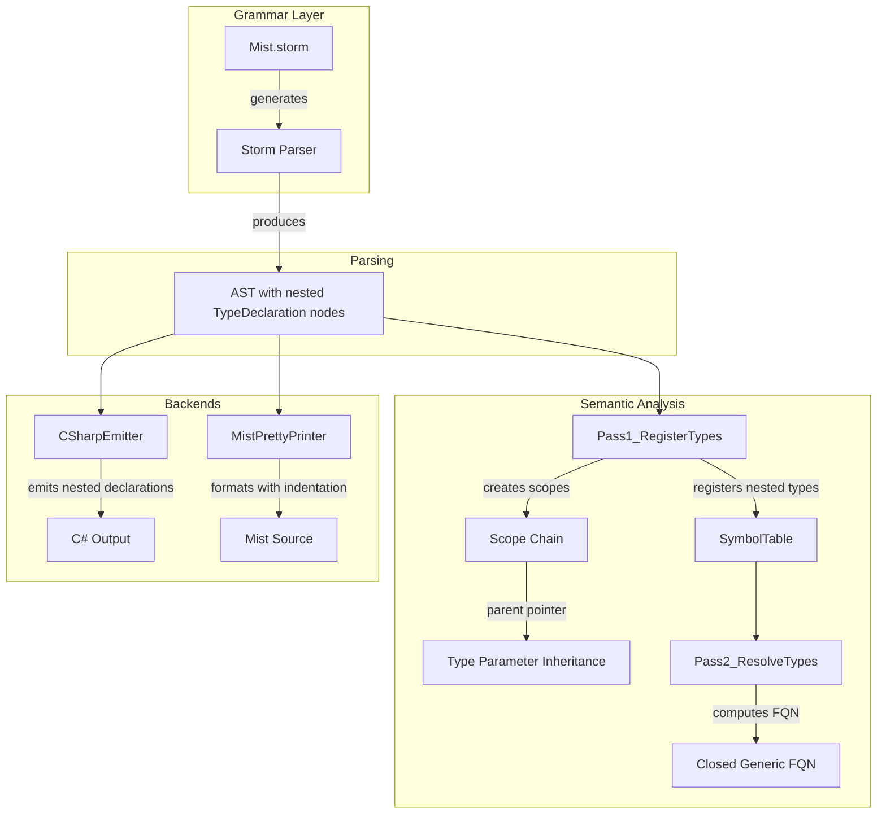

# Design Document: Nested Scoping

## Overview

This design adds nested scoping support to the Mist programming language, enabling type declarations within type declarations, namespace nesting within namespaces, generic type parameter inheritance for nested types, and fully qualified name (FQN) construction using closed generics.

The feature touches four compiler layers:
1. **Grammar & Parser** — extend `MemberDeclaration` and `NamespaceBodyItem` rules to accept nested types and namespaces
2. **Semantic Model Builder** — register nested types in the symbol table, compute FQNs with closed generics, propagate ancestor type parameters, and validate namespace uniqueness
3. **C# Emitter** — emit nested type declarations inside parent type bodies and handle namespace merging
4. **Pretty Printer** — format nested types/namespaces with correct indentation and round-trip fidelity

The design preserves the existing scope-chain architecture (`Scope` with parent pointers) and leverages it for type parameter inheritance — nested types naturally see ancestor type parameters through the parent scope chain.

## Architecture



### Key Design Decisions

1. **Grammar reuse over new productions**: Nested types are added as a new alternative in the existing `MemberDeclaration` rule rather than introducing a separate `NestedTypeDeclaration` rule. This keeps the grammar minimal and ensures nested type bodies use the same member list as top-level types.

2. **Scope chain for type parameter inheritance**: The existing `Scope(parent: parentScope)` pattern already provides lexical scoping. When a nested type's scope is created with the enclosing type's scope as its parent, ancestor type parameters become automatically visible through `Lookup()`. No special inheritance mechanism is needed.

3. **FQN uses closed generics**: The FQN of a nested type includes concrete type arguments for generic ancestors (e.g., `Foo<int>.Bar`), not open type parameters. This matches C# semantics and enables unambiguous type references.

4. **Namespace nesting via `NamespaceBodyItem` extension**: Block namespaces inside block namespaces are supported by adding a `NamespaceDeclaration` alternative to `NamespaceBodyItem`. File-scoped namespaces inside blocks are rejected at the parser level.

## Components and Interfaces

### Grammar Changes (Mist.storm)

**MemberDeclaration rule** — add a `TypeDeclaration` alternative:

```storm
rule MemberDeclaration
    = constructor:ConstructorDeclaration as ConstructorMember
    | method:MethodDeclaration           as MethodMember
    | operator:OperatorDeclaration       as OperatorMember
    | castOperator:CastOperatorDeclaration as CastOperatorMember
    | property:PropertyDeclaration       as PropertyMember
    | indexer:IndexerDeclaration         as IndexerMember
    | defaultBlock:DefaultBlockDeclaration as DefaultBlockMember
    | field:FieldDeclaration             as FieldMember
    | nestedType:TypeDeclaration         as NestedTypeMember   // NEW
    ;
```

**NamespaceBodyItem rule** — add a `NamespaceDeclaration` alternative:

```storm
rule NamespaceBodyItem
    = typeDeclaration:TypeDeclaration              as NamespaceTypeItem
    | newtypeDeclaration:NewtypeDeclaration        as NamespaceNewtypeItem
    | typeAliasDeclaration:TypeAliasDeclaration    as NamespaceTypeAliasItem
    | extensionDeclaration:ExtensionBlockDeclaration as NamespaceExtensionItem
    | namespaceDeclaration:NamespaceDeclaration    as NamespaceNamespaceItem  // NEW
    ;
```

### Semantic Model Builder Changes

**`RegisterMemberDeclaration`** — add a case for `NestedTypeMemberMemberDeclarationNode`:

```csharp
case NestedTypeMemberMemberDeclarationNode nestedTypeMember:
    RegisterTypeDeclaration(
        nestedTypeMember.NestedType,
        typeScope,        // parent type's scope becomes the nested type's parent scope
        symbolTable,
        namespaceName: null,  // nested types don't have their own namespace
        sourceText,
        diagnostics);
    break;
```

**FQN computation** — a new helper method `ComputeNestedTypeFqn`:

```csharp
internal static string ComputeNestedTypeFqn(ISymbol nestedTypeSymbol, SymbolTable symbolTable)
{
    var parts = new List<string>();
    var current = nestedTypeSymbol;

    while (current != null)
    {
        var type = current.DeclaredType;
        var name = current.Name;

        // If the type is generic and we have concrete type args, use closed form
        if (type is ClassType ct && ct.TypeParameters.Count > 0)
            name += FormatTypeArgs(ct.TypeParameters);
        else if (type is StructType st && st.TypeParameters.Count > 0)
            name += FormatTypeArgs(st.TypeParameters);
        else if (type is InterfaceType it && it.TypeParameters.Count > 0)
            name += FormatTypeArgs(it.TypeParameters);

        parts.Add(name);

        // Walk up to the containing type (if any)
        current = FindContainingTypeSymbol(current.ContainingScope, symbolTable);
    }

    parts.Reverse();

    // Prepend namespace if present
    var ns = GetContainingNamespaceForNestedType(nestedTypeSymbol, symbolTable);
    if (ns != null)
        parts.Insert(0, ns);

    return string.Join(".", parts);
}
```

**Namespace nesting in `Pass1_RegisterTypes`** — when processing a `BlockNamespace` inside a `NamespaceBodyItem`, compute the FQN by concatenating parent namespace + "." + declared name:

```csharp
case NamespaceNamespaceItemNamespaceBodyItemNode nsBodyItem:
    var nestedNsDecl = nsBodyItem.NamespaceDeclaration;
    var nestedDeclaredName = ExtractNamespaceName(nestedNsDecl, sourceText);
    var nestedFqn = parentNamespace + "." + nestedDeclaredName;
    var nestedScope = GetOrCreateNamespaceScope(globalScope, symbolTable, nestedFqn, nestedNsDecl);
    // Recursively register types and nested namespaces within
    RegisterNamespaceBody(nestedNsDecl, nestedScope, nestedFqn, globalScope, symbolTable, sourceText, diagnostics);
    break;
```

**Namespace validation** — new validation pass `Pass1_ValidateNamespaceDeclarations`:

```csharp
private static void Pass1_ValidateNamespaceDeclarations(
    CompilationUnitNode cu,
    SourceText? sourceText,
    DiagnosticBag diagnostics)
{
    // Check for duplicate file-scoped namespaces
    // Check for mixed file-scoped and block namespaces
    // Check for file-scoped namespace inside block namespace
}
```

**Type parameter inheritance** — no new code needed. The existing `RegisterClassDeclaration` creates `new Scope(parent: parentScope)`. When `parentScope` is the enclosing type's scope, the nested type's scope automatically inherits visibility of the parent's type parameters through `Scope.Lookup()`.

**Shadowing** — when a nested type declares its own type parameter with the same name as an ancestor's, `RegisterTypeParameters` adds it to the nested type's scope. Since `Scope.Lookup()` checks local members first before delegating to `Parent`, the nested type's parameter naturally shadows the ancestor's.

### C# Emitter Changes

**`EmitMemberDeclaration`** — add a case for nested types:

```csharp
case NestedTypeMemberMemberDeclarationNode nestedTypeMember:
    EmitTypeDeclaration(nestedTypeMember.NestedType);
    break;
```

**`EmitClassDeclaration` / `EmitStructDeclaration` / `EmitInterfaceDeclaration`** — these already iterate over members and call `EmitMemberDeclaration`. The new case above handles nested types. The emitter's existing indentation tracking (`_indent` field) ensures correct nesting in the output.

**Namespace emission** — `EmitNamespaceDeclaration` is extended to handle nested `NamespaceDeclaration` nodes within `NamespaceBodyItem`. Same-name blocks are merged by collecting all types from blocks with identical FQNs before emission.

### Pretty Printer Changes

**`EmitMemberDeclaration`** — add a case for nested types:

```csharp
case NestedTypeMemberMemberDeclarationNode nestedTypeMember:
    EmitTypeDeclaration(nestedTypeMember.NestedType);
    break;
```

**`EmitNamespaceBodyItem`** — add a case for nested namespaces:

```csharp
case NamespaceNamespaceItemNamespaceBodyItemNode nsItem:
    EmitNamespaceDeclaration(nsItem.NamespaceDeclaration);
    break;
```

The pretty printer already tracks indentation via `_indent` and increments it when entering type/namespace bodies. Nested types and namespaces inherit this behavior automatically.

### Diagnostic Messages

| Code | Message | Location |
|------|---------|----------|
| `MIST0301` | "Only one file-scoped namespace is permitted per file." | Second file-scoped namespace declaration |
| `MIST0302` | "File-scoped and block namespaces cannot be mixed in the same file." | The conflicting declaration |
| `MIST0303` | "Duplicate type '{name}' in type '{parent}'." | Second nested type with same name |
| `MIST0304` | "Type '{name}' conflicts with type parameter '{name}' on '{parent}'." | Nested type declaration |
| `MIST0305` | "File-scoped namespace declarations cannot appear inside a block namespace." | File-scoped namespace inside block |

## Data Models

### AST Node Changes

The Storm source generator will produce a new `NestedTypeMemberMemberDeclarationNode` variant for the `MemberDeclaration` rule, containing a `TypeDeclaration` child. Similarly, a `NamespaceNamespaceItemNamespaceBodyItemNode` variant is generated for the `NamespaceBodyItem` rule.

No changes to existing AST node types are required — `ClassDeclarationNode`, `StructDeclarationNode`, etc. remain unchanged. Their `Members` array simply gains the ability to contain `NestedTypeMemberMemberDeclarationNode` entries.

### Semantic Model Changes

**No new type classes** are introduced. `ClassType`, `StructType`, `InterfaceType`, `TraitType`, and `EnumType` already have:
- `ContainingNamespace: string?` — set to `null` for nested types (they don't have their own namespace)
- `MemberScope: IScope` — the scope whose `Parent` points to the enclosing type's scope
- `TypeParameters: IReadOnlyList<IType>` — only the nested type's own parameters (not inherited ones)

**FQN storage**: The FQN is not stored as a field on the type. It is computed on-demand by walking the scope chain from the nested type up to the root, collecting type names (with closed generic forms) and the namespace prefix. This avoids stale data if type arguments change during resolution.

### Scope Hierarchy Example

For the source:
```mist
namespace Quack;

class Foo<TValue> {
    class Bar {
        TValue item;
    }
}
```

The scope chain is:
```
GlobalScope
  └── NamespaceScope("Quack")
        └── ClassScope(Foo) [contains: TValue type param symbol]
              └── ClassScope(Bar) [parent → ClassScope(Foo)]
                    └── FieldSymbol("item", type: TValue)
```

`Bar`'s scope lookup for `TValue` traverses: `ClassScope(Bar)` → `ClassScope(Foo)` → finds `TValue`.

## Correctness Properties

*A property is a characteristic or behavior that should hold true across all valid executions of a system — essentially, a formal statement about what the system should do. Properties serve as the bridge between human-readable specifications and machine-verifiable correctness guarantees.*

### Property 1: Parser nesting universality

*For any* container type kind (class, struct, interface, trait, enum) and *for any* nested type kind (class, struct, interface, trait, enum), the parser SHALL produce a valid AST where the nested type appears as a `NestedTypeMember` within the container's member list.

**Validates: Requirements 1.1, 1.2, 1.3, 1.4, 1.5**

### Property 2: Nesting depth acceptance

*For any* nesting depth `d` where 1 ≤ d ≤ 8, and *for any* sequence of type kinds at each level, the parser SHALL successfully parse the nested type chain and produce an AST with exactly `d` levels of nesting.

**Validates: Requirements 1.6, 2.3, 5.3**

### Property 3: Modifier preservation on nested types

*For any* subset of the modifiers {public, private, static} applied to a nested type declaration, the parser SHALL produce an AST node whose modifier list contains exactly those modifiers.

**Validates: Requirements 1.7**

### Property 4: Parse–print–parse round trip

*For any* valid Mist source file containing nested types and/or nested namespaces, parsing the source, pretty-printing the resulting AST, then parsing the pretty-printed output SHALL produce an AST that is structurally identical to the original (same node types, same token lexemes, same tree shape), disregarding source position spans.

**Validates: Requirements 1.8, 12.5, 13.3**

### Property 5: Namespace FQN concatenation

*For any* chain of nested block namespaces with names `[n₁, n₂, ..., nₖ]`, the Semantic Model Builder SHALL compute the FQN of the innermost namespace as `n₁.n₂...nₖ`. When a file-scoped namespace `f` precedes the chain, the FQN SHALL be `f.n₁.n₂...nₖ`.

**Validates: Requirements 5.2, 5.4**

### Property 6: Type FQN construction

*For any* type declared inside a namespace (single-segment, multi-segment, or file-scoped), the Semantic Model Builder SHALL compute the type's FQN as the namespace path followed by a dot and the type's DisplayName.

**Validates: Requirements 6.1, 6.2, 6.3, 8.1, 8.5**

### Property 7: Closed generic FQN for nested types

*For any* nested type inside one or more generic ancestor types, the FQN SHALL include the closed generic form (concrete type arguments) at each ancestor level. If the nested type itself is generic, its own type arguments SHALL also appear in the FQN.

**Validates: Requirements 8.2, 8.3, 8.4**

### Property 8: Ancestor type parameter visibility

*For any* nested type at depth `d` inside generic ancestor types, *all* type parameters from all `d` ancestor levels SHALL be resolvable by name within the nested type's scope, with the innermost declaration taking precedence when names collide.

**Validates: Requirements 7.1, 7.2, 7.3**

### Property 9: Type parameter shadowing

*For any* nested type that declares a type parameter with the same name as an ancestor's type parameter, all references to that name within the nested type SHALL resolve to the nested type's own parameter, not the ancestor's.

**Validates: Requirements 7.4**

### Property 10: Same-name namespace scope sharing

*For any* file containing multiple block namespace declarations with the same qualified name, all type declarations from each block SHALL be resolvable by simple name from within any other block of the same namespace in that file.

**Validates: Requirements 4.1**

### Property 11: Different-name namespace scope isolation

*For any* file containing block namespace declarations with different qualified names, types declared in one namespace SHALL NOT be resolvable by simple name from within a block of a different namespace (without a using declaration).

**Validates: Requirements 4.2**

### Property 12: C# emission preserves nesting structure

*For any* nested type declaration, the C# emitter SHALL emit the type declaration inside the parent type's body, and SHALL NOT re-declare the parent's type parameters on the nested type's declaration.

**Validates: Requirements 10.1, 10.2**

## Error Handling

### Parser-Level Errors

- **File-scoped namespace inside block namespace** (Req 5.5): The parser reports a diagnostic and does not produce a `FileScopedNamespace` node at that position. Recovery continues parsing subsequent items.

### Semantic-Level Errors

- **Duplicate file-scoped namespace** (Req 3.1, 14.1): Detected during `Pass1_ValidateNamespaceDeclarations`. The second declaration is flagged; the first is used.
- **Mixed namespace styles** (Req 3.2, 3.3, 14.2): Detected in the same pass. The second style encountered is flagged.
- **Duplicate nested type name** (Req 9.4, 14.3): Detected during `RegisterTypeDeclaration` when adding to the parent type's scope. The second declaration is flagged.
- **Nested type name conflicts with type parameter** (Req 9.5): Detected during `RegisterTypeDeclaration` by checking if the name matches any type parameter in the parent scope.
- **Unresolved type parameter** (Req 7.5): Detected during `Pass2_ResolveTypes` when `Scope.Lookup()` returns null for a type reference name that isn't a known type.

### Error Recovery Strategy

All diagnostic errors are non-fatal. The compiler continues processing to report as many errors as possible in a single pass. When a duplicate nested type is detected, the second declaration is skipped (not registered in the symbol table) to avoid cascading errors.

## Testing Strategy

### Property-Based Tests (FsCheck + xUnit)

Property-based tests validate universal correctness properties using randomly generated inputs. Each property test runs a minimum of 100 iterations.

**Test organization**: A new test class `NestedScopingPropertyTests` in `Test/Mist.Tests/Semantics/`.

**Generators needed**:
- `ArbTypeKind` — generates one of {class, struct, interface, trait, enum}
- `ArbModifierSet` — generates subsets of {public, private, static}
- `ArbNestingDepth` — generates integers 1–8
- `ArbNestedTypeSource` — generates valid Mist source with nested types at random depths and kinds
- `ArbNamespaceChain` — generates valid namespace name chains

**Properties to implement**:
1. Parser nesting universality (Property 1)
2. Nesting depth acceptance (Property 2)
3. Modifier preservation (Property 3)
4. Parse–print–parse round trip (Property 4)
5. Namespace FQN concatenation (Property 5)
6. Type FQN construction (Property 6)
7. Closed generic FQN (Property 7)
8. Ancestor type parameter visibility (Property 8)
9. Type parameter shadowing (Property 9)
10. Same-name namespace scope sharing (Property 10)
11. Different-name namespace scope isolation (Property 11)
12. C# emission preserves nesting structure (Property 12)

**Process spawning**: Properties 1–5 and 10–11 use in-process compilation via `CompilerDriver.Compile()` (no process spawning). Properties 6–9 and 12 also use in-process compilation for semantic model inspection. No property test spawns an external process.

**Tag format**: Each test is tagged with a comment:
```csharp
// Feature: nested-scoping, Property 4: Parse–print–parse round trip
```

### Example-Based Unit Tests (xUnit)

Example tests cover specific scenarios, edge cases, and error conditions:

- Nested type body accepts all member kinds (fields, methods, properties, constructors, operators, indexers, default blocks, further nested types)
- Duplicate file-scoped namespace produces diagnostic
- Mixed namespace styles produce diagnostic
- File-scoped namespace inside block namespace produces diagnostic
- Duplicate nested type name produces diagnostic
- Nested type name conflicts with type parameter produces diagnostic
- Unresolved type parameter reference produces diagnostic
- Code outside parent requires qualified name to reference nested type
- C# emission for nested enum with underlying type and explicit values
- C# emission at depth > 4 produces valid output
- Namespace merging for same-name blocks in C# output
- Empty namespace omitted from C# output

### Integration Tests

- The `samples/NestedScoping/Program.mist` sample compiles and runs without errors (single process spawn, batched output verification)
- The `samples/AllFeatures/Program.mist` orchestrator includes the nested scoping demo

### TextMate Grammar Tests

- Manual verification that nested type keywords receive `keyword.declaration.mist` scope
- Manual verification that nested type identifiers receive correct `entity.name.type.*.mist` scope
- Verification that keywords inside strings/comments are not highlighted
