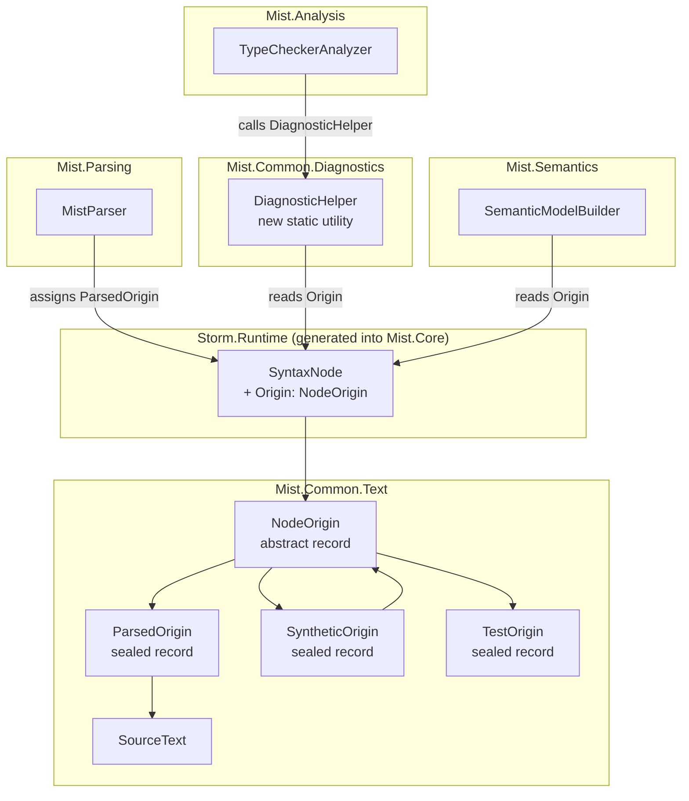

# Design Document: Node Origin Tracking

## Overview

This design introduces a `NodeOrigin` discriminated union that attaches directly to every AST node (`SyntaxNode`), providing an unambiguous reference to the node's source file. This replaces the current span-containment heuristic — which iterates all ASTs comparing numeric span ranges to guess which file a node belongs to — with a direct, O(1) lookup.

The core change touches three layers:
1. **Type definition** — A new `NodeOrigin` abstract record with three sealed subtypes lives in `Mist.Common.Text` alongside `SourceText`.
2. **Code generation** — The Storm source generator's `AstEmitter` emits an `Origin` property on the `SyntaxNode` base class.
3. **Assignment & consumption** — `MistParser` assigns `ParsedOrigin` during parsing; diagnostic helpers read `Origin` instead of searching ASTs by span containment.

### Key Design Decision: Where NodeOrigin Lives

**Decision:** `NodeOrigin` lives in `Mist.Common.Text` (the same namespace as `SourceText`).

**Rationale:** The `SyntaxNode` base class is emitted by the Storm source generator into the *consuming* project (Mist.Core). Since the generated code lives in the same assembly as `Mist.Common.Text`, the `Origin` property can reference `NodeOrigin` directly without cross-assembly concerns. The Storm source generator only needs to emit the property declaration — it doesn't need to reference `NodeOrigin` at compile time because it emits raw strings.

**Alternative considered:** Putting `NodeOrigin` in a separate shared assembly. Rejected because the generated `SyntaxNode` already lives inside Mist.Core, so no cross-assembly boundary exists.

## Architecture



### Data Flow

1. **Parsing:** `MistParser.Parse()` receives a `TokenStream` which carries a `SourceText`. After the Storm-generated parser produces a tree, `MistParser` walks the tree and sets `Origin = new ParsedOrigin(sourceText)` on every node.
2. **Semantic analysis:** `SemanticModelBuilder` reads `node.Origin` to get the `SourceText` for span-to-line/column conversion. The `FindSourceTextByContainment` and `FindSourceTextForNode` methods are removed.
3. **Type checking:** `TypeCheckerAnalyzer.MakeDiagnostic` reads `node.Origin` to resolve file path and location. The span-containment loop is removed.
4. **Synthetic nodes:** Future compiler passes that create synthetic nodes (desugaring, etc.) assign `SyntheticOrigin` with a `DerivedFrom` reference to the original node's origin.
5. **Test nodes:** Test code assigns `TestOrigin.Instance` (a singleton) to hand-constructed nodes.

## Components and Interfaces

### NodeOrigin Type Hierarchy

```csharp
namespace Mist.Common.Text;

/// <summary>
/// Represents the origin of an AST node — where it came from.
/// </summary>
public abstract record NodeOrigin;

/// <summary>
/// The node was produced by parsing a real source file.
/// </summary>
public sealed record ParsedOrigin(SourceText Source) : NodeOrigin;

/// <summary>
/// The node was synthesized by a compiler pass (e.g., desugaring).
/// </summary>
public sealed record SyntheticOrigin(NodeOrigin DerivedFrom, string Reason) : NodeOrigin;

/// <summary>
/// The node was constructed in a test — no source file exists.
/// </summary>
public sealed record TestOrigin : NodeOrigin
{
    public static readonly TestOrigin Instance = new();
    private TestOrigin() { }
}
```

### SyntaxNode Origin Property (emitted by AstEmitter)

The `AstEmitter.EmitRuntimeTypes()` method will emit an additional property on the `SyntaxNode` base class:

```csharp
public abstract class SyntaxNode
{
    public SourceSpan Span { get; set; }
    public Mist.Common.Text.NodeOrigin? Origin { get; set; }
    // ... existing properties ...
}
```

The property is nullable to maintain backward compatibility during the transition — nodes that haven't been assigned an origin yet will have `null`. The `DiagnosticHelper` treats `null` origin the same as `TestOrigin` (fallback to `<unknown>`).

### DiagnosticHelper (new static utility)

```csharp
namespace Mist.Common.Diagnostics;

/// <summary>
/// Resolves source locations from AST node origins for diagnostic creation.
/// </summary>
public static class DiagnosticHelper
{
    /// <summary>
    /// Resolves the source file path and line/column position from a node's origin.
    /// Chains through SyntheticOrigin references until a ParsedOrigin is found.
    /// </summary>
    public static (string Path, LinePositionSpan Location, string? SyntheticContext)
        ResolveLocation(Storm.Runtime.SyntaxNode node);
}
```

### MistParser Origin Assignment

After the Storm-generated parser returns a root node, `MistParser` will walk the tree and assign origin:

```csharp
// In MistParser.Parse(), after obtaining root:
if (root is not null)
{
    AssignOrigin(root, new ParsedOrigin(tokens.Source));
}

private static void AssignOrigin(Storm.Runtime.SyntaxNode node, ParsedOrigin origin)
{
    node.Origin = origin;
    foreach (var child in node.Children())
    {
        AssignOrigin(child, origin);
    }
}
```

### SemanticModelBuilder Changes

- Remove `FindSourceTextForNode` method entirely.
- Remove `FindSourceTextByContainment` method entirely.
- Replace all call sites with direct `node.Origin` access via `DiagnosticHelper.ResolveLocation()` or direct pattern matching on `node.Origin`.
- For span-to-text extraction (e.g., extracting identifier text from source), use `((ParsedOrigin)node.Origin).Source` instead of the containment lookup.

### TypeCheckerAnalyzer Changes

Replace the `MakeDiagnostic` and `MakeDiagnosticWarning` methods' span-containment loops with:

```csharp
private static Diagnostic MakeDiagnostic(string id, string message, SyntaxNode node, ISemanticModel model)
{
    var (path, location, _) = DiagnosticHelper.ResolveLocation(node);
    return new Diagnostic(
        new DiagnosticId(id),
        DiagnosticSeverity.Error,
        PipelineStage.Analysis,
        message,
        Location: location,
        CompilationUnitPath: path,
        AnalyzerName: "TypeChecker");
}
```

## Data Models

### NodeOrigin Records

| Type | Fields | Description |
|------|--------|-------------|
| `NodeOrigin` | (abstract) | Base type for all origin variants |
| `ParsedOrigin` | `Source: SourceText` | Node came from parsing a real file |
| `SyntheticOrigin` | `DerivedFrom: NodeOrigin`, `Reason: string` | Node was synthesized from another node |
| `TestOrigin` | (singleton) | Node was constructed in a test |

### SyntaxNode Extension

| Property | Type | Description |
|----------|------|-------------|
| `Origin` | `NodeOrigin?` | The origin of this node. Null only during transition period. |

### DiagnosticHelper.ResolveLocation Return

| Field | Type | Description |
|-------|------|-------------|
| `Path` | `string` | File path (or `<unknown>` for TestOrigin) |
| `Location` | `LinePositionSpan` | 1-based line/column span |
| `SyntheticContext` | `string?` | Description of synthetic chain if origin was synthetic |


## Correctness Properties

*A property is a characteristic or behavior that should hold true across all valid executions of a system — essentially, a formal statement about what the system should do. Properties serve as the bridge between human-readable specifications and machine-verifiable correctness guarantees.*

### Property 1: NodeOrigin Constructor Invariants

*For any* valid `SourceText` instance, constructing a `ParsedOrigin` SHALL produce a record whose `Source` property is the same instance. *For any* valid `NodeOrigin` and non-empty string, constructing a `SyntheticOrigin` SHALL produce a record whose `DerivedFrom` is the same origin and whose `Reason` is the same string.

**Validates: Requirements 1.2, 1.3**

### Property 2: Origin Property Round-Trip

*For any* `SyntaxNode` and *any* `NodeOrigin` variant (ParsedOrigin, SyntheticOrigin, or TestOrigin), setting the `Origin` property and then reading it back SHALL return a value equal to what was set.

**Validates: Requirements 2.2**

### Property 3: Parser Assigns Correct ParsedOrigin to All Nodes

*For any* valid Mist source file parsed by `MistParser`, every `SyntaxNode` in the resulting tree SHALL have an `Origin` of type `ParsedOrigin` whose `Source` is reference-equal to the `SourceText` that was passed to the parser.

**Validates: Requirements 3.1, 3.2**

### Property 4: ParsedOrigin Resolves to Correct Location

*For any* node with a `ParsedOrigin` and a non-empty `Span`, `DiagnosticHelper.ResolveLocation` SHALL return a path equal to `ParsedOrigin.Source.Path` and a `LinePositionSpan` equal to `ParsedOrigin.Source.ToLinePositionSpan(node.Span)`.

**Validates: Requirements 4.1**

### Property 5: SyntheticOrigin Chain Resolves to Terminal ParsedOrigin

*For any* chain of `SyntheticOrigin` records (depth 1 to N) whose terminal `DerivedFrom` is a `ParsedOrigin`, `DiagnosticHelper.ResolveLocation` SHALL return the path and location from that terminal `ParsedOrigin`'s `SourceText`.

**Validates: Requirements 4.2, 7.3**

### Property 6: Overlapping Spans Resolve Correctly via Origin

*For any* set of N source files with numerically overlapping span ranges, and *for any* node whose `Origin` is a `ParsedOrigin` referencing file F, `DiagnosticHelper.ResolveLocation` SHALL return file F's path — regardless of whether other files have spans that numerically contain the node's span.

**Validates: Requirements 4.4**

### Property 7: TestOrigin Diagnostic Creation Never Throws

*For any* `SyntaxNode` with `TestOrigin` and *any* `SourceSpan` value (including zero-length and large offsets), calling `DiagnosticHelper.ResolveLocation` SHALL return a valid result without throwing an exception, using `<unknown>` as the path and `default` as the location.

**Validates: Requirements 6.2**

## Error Handling

| Scenario | Behavior |
|----------|----------|
| `MistParser` receives `TokenStream` with null `Source` | Report `MIST_PARSE_ERROR` diagnostic and return `ParseResult` with null `Root`. Do not produce nodes without origin. |
| `node.Origin` is `null` (transition period) | `DiagnosticHelper.ResolveLocation` treats null the same as `TestOrigin` — returns `<unknown>` path and default location. No exception. |
| `SyntheticOrigin` chain is circular | Should not occur by construction (origins are immutable records assigned at creation time). If detected, `DiagnosticHelper` terminates after a maximum depth (e.g., 100) and returns `<unknown>`. |
| `node.Span` exceeds `SourceText.Contents.Length` | `DiagnosticHelper.ResolveLocation` returns the file path from origin but uses `default` for location. Does not throw. |
| `SyntheticOrigin` with empty `Reason` | Constructor validation prevents this — throw `ArgumentException` at construction time. |
| `ParsedOrigin` with null `Source` | Constructor validation prevents this — C# record positional parameter is non-nullable; compiler enforces at call site. |

## Testing Strategy

### Property-Based Testing

**Library:** FsCheck (already used in the project per test-process-spawning steering).

**Configuration:** Minimum 100 iterations per property test.

**Tag format:** `// Feature: node-origin-tracking, Property {N}: {title}`

Each correctness property above maps to a single property-based test:

| Property | Test Class | What Varies |
|----------|-----------|-------------|
| 1 | `NodeOriginConstructionPropertyTests` | Random SourceText (path + contents), random NodeOrigin variants, random reason strings |
| 2 | `OriginPropertyRoundTripTests` | Random NodeOrigin variants assigned to concrete SyntaxNode subclasses |
| 3 | `ParserOriginAssignmentPropertyTests` | Random valid Mist source files (batched — 1 compile, walk all trees) |
| 4 | `DiagnosticLocationResolutionPropertyTests` | Random SourceText + random valid spans within content bounds |
| 5 | `SyntheticChainResolutionPropertyTests` | Random chain depths (1–10), random intermediate reasons, random terminal ParsedOrigin |
| 6 | `OverlappingSpanResolutionPropertyTests` | N files with deliberately overlapping span ranges, random node placement |
| 7 | `TestOriginSafetyPropertyTests` | Random SourceSpan values (including edge cases: 0-length, max int, negative) |

### Unit Tests (Example-Based)

| Test | What It Verifies |
|------|-----------------|
| `AstEmitter_EmitsOriginProperty` | Generated source contains `NodeOrigin? Origin { get; set; }` |
| `MistParser_NullSourceText_ReportsError` | Null SourceText produces diagnostic, not an exception |
| `DiagnosticHelper_TestOrigin_ReturnsFallback` | TestOrigin resolves to `<unknown>` path |
| `DiagnosticHelper_SyntheticOrigin_IncludesContext` | Synthetic chain produces supplementary context string |
| `SyntheticOrigin_EmptyReason_Throws` | Empty string reason throws ArgumentException |

### Integration Tests

| Test | What It Verifies |
|------|-----------------|
| `TypeChecker_MultiFile_CorrectAttribution` | Compile multiple files with overlapping spans, verify diagnostics point to correct files |
| `SemanticModelBuilder_NoSpanContainment` | Verify `FindSourceTextByContainment` and `FindSourceTextForNode` are removed (reflection-based or compilation test) |

### Process Spawning Note

Property tests 1, 2, 4, 5, 6, and 7 are pure in-process tests — they exercise `NodeOrigin` types and `DiagnosticHelper` without compiling Mist programs. No process spawning required.

Property test 3 (parser origin assignment) requires parsing real source files. This uses the in-process `MistParser` directly (no `dotnet` process spawn). The parser is invoked in-process via the shared `CompilerDriver` pattern.
