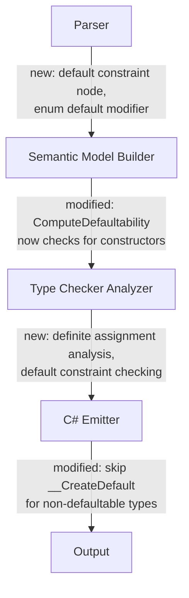

# Design Document: Optional Defaultability

## Overview

This design specifies the internal compiler changes needed to make defaultability optional in Mist. Currently, the compiler forces every concrete type to be defaultable — emitting `MIST_DEFAULT_REQUIRES_BINDING` when a type has non-defaultable fields without type bindings, even when the type has user-defined constructors that properly initialize those fields.

The redesign separates two distinct concepts:
- **Default (data)**: A precomputed, side-effect-free zero-value template. Types opt in via inference (all fields defaultable) or an explicit `default {}` block.
- **Constructor (behavior)**: Explicit initialization logic that may perform IO, fail, or depend on external state. Types with constructors no longer need to also be defaultable.

The key insight is: if a type has constructors, those constructors handle initialization. The compiler only needs to verify that constructors actually assign all fields (definite assignment). The type doesn't need a default value unless the developer explicitly provides one via a `default {}` block.

## Architecture

The changes span four compiler phases:



**Phase 1 — Parsing**: Add `DefaultConstraintConstraintNode` for `where T : default`. Add `IsDefault` flag on `EnumMemberDeclarationNode` for the `default` variant modifier.

**Phase 2 — Semantic Model Construction**: Modify `ComputeDefaultabilityForType` to check whether the type has user-defined constructors. If it does and has no `default {}` block, classify it as `NotDefaultable` *without error*. The `MIST_DEFAULT_REQUIRES_BINDING` diagnostic only fires for constructor-less types that have non-defaultable fields. Add `HasDefaultConstraint` to `TypeParameterConstraints`. Add `IsDefault` to `EnumMemberInfo`. Compute union type defaultability based on void membership.

**Phase 3 — Type Checking**: Add definite assignment analysis for constructor bodies. Add constraint satisfaction checking for `where T : default`. Update `default(T)` validation to allow type parameters with the `default` constraint.

**Phase 4 — Emission**: Skip `__CreateDefault()` generation for non-defaultable types. Emit `__CreateDefault()` for enums with a designated default variant. Emit a C# comment for `default` constraints (enforcement is compile-time only).

## Components and Interfaces

### Parser Changes

**New AST Node: `DefaultConstraintConstraintNode`**

```csharp
// Added to the constraint node hierarchy alongside ClassConstraintConstraintNode, etc.
public sealed class DefaultConstraintConstraintNode : ConstraintNode
{
    // No additional fields needed — presence indicates the constraint.
}
```

The parser recognizes `default` in constraint position (after `:` in a `where` clause) and produces this node. It must not conflict with existing `default` keyword handling in expression contexts.

**Modified AST: Enum Member Default Modifier**

The `EnumMemberDeclarationNode` gains an `IsDefault` boolean flag (or the parser emits a modifier token). The grammar recognizes `default` before a variant name:

```
enum_member := 'default'? IDENTIFIER (':' expression)? ','?
```

### Semantic Model Changes

**`TypeParameterConstraints` — new field:**

```csharp
/// <summary>Whether the 'default' constraint is present.</summary>
public bool HasDefaultConstraint { get; init; }
```

**`EnumMemberInfo` — new field:**

```csharp
/// <summary>Whether this member is designated as the enum's default variant.</summary>
public bool IsDefault { get; internal set; }
```

**`EnumType` — new properties:**

```csharp
/// <summary>The defaultability status of this enum type.</summary>
public DefaultabilityStatus Defaultability { get; internal set; } = DefaultabilityStatus.Unknown;

/// <summary>The designated default variant, if any.</summary>
public EnumMemberInfo? DefaultMember { get; internal set; }
```

**`ComputeDefaultabilityForType` (ClassType/StructType) — modified logic:**

```
1. If type has explicit default block → keep Explicit status, compute values
2. Check base class defaultability (unchanged)
3. Determine if type has user-defined constructors:
   hasConstructors = type.MemberScope.Members.Any(m => m.Kind == SymbolKind.Constructor)
4. If !hasConstructors:
   - Check all fields are defaultable (existing logic)
   - If any field non-defaultable → emit MIST_DEFAULT_REQUIRES_BINDING, set NotDefaultable
   - Else → set Inferred, compute default values
5. If hasConstructors && !hasExplicitBlock:
   - Set NotDefaultable (NO diagnostic — this is the key behavioral change)
6. If hasConstructors && hasExplicitBlock:
   - Already Explicit from step 1, compute default values
```

**New: `ComputeDefaultabilityForEnum`:**

```
1. Scan enum members for IsDefault flag
2. If exactly one member has IsDefault → set Explicit, record DefaultMember
3. If zero members have IsDefault → set NotDefaultable
4. If multiple members have IsDefault → emit diagnostic error
```

**Union type defaultability** (checked in `IsTypeDefaultable`):

```
For UnionType: defaultable iff Constituents contains VoidType
```

### Type Checker Changes

**Definite Assignment Analysis**

A new analysis pass runs on each constructor body. For each field declared on the type:

1. If the field has a field initializer → considered assigned at constructor entry
2. If the field's type is defaultable and has no initializer → considered assigned at constructor entry (synthetic default injection: the runtime initializes it as if `type x = default;`)
3. If the field's type is non-defaultable and has no initializer → must be explicitly assigned on all control-flow paths before constructor exit

The analysis is a forward dataflow analysis:
- **Domain**: set of definitely-assigned field names
- **Initial state**: fields from cases (1) and (2) above
- **Transfer function**: `this.fieldName = expr` adds `fieldName` to the set
- **Join** (at control-flow merge): intersection (field must be assigned on ALL paths)
- **Check**: at every exit point, all fields must be in the set

**Default Constraint Checking**

When validating `default(T)` where `T` is a `TypeParameterType`:
- If `T.Constraints?.HasDefaultConstraint == true` → valid
- Else → emit `MIST_DEFAULT_ON_TYPE_PARAMETER` (unchanged behavior)

When instantiating a generic with `where T : default`:
- Check that the type argument is defaultable (using `IsTypeDefaultable`)
- If not → emit new diagnostic `MIST_DEFAULT_CONSTRAINT_NOT_SATISFIED`

**Enum default(E) validation:**
- If `E` is `EnumType` with `Defaultability == Explicit` → valid
- If `E` is `EnumType` with `Defaultability == NotDefaultable` → emit `MIST_DEFAULT_NOT_SUPPORTED`

**Union default(U) validation:**
- If `U` is `UnionType` containing `VoidType` → valid
- If `U` is `UnionType` without `VoidType` → emit `MIST_DEFAULT_NOT_SUPPORTED`

### Emitter Changes

**`__CreateDefault()` generation:**
- ClassType/StructType: only emit when `Defaultability` is `Inferred` or `Explicit` (unchanged gate, but now more types will be `NotDefaultable`)
- EnumType: emit `__CreateDefault()` returning the designated default variant's value
- Non-defaultable types: skip entirely (no factory method)

**Constructor emission** for non-defaultable types: emit as normal C# constructors. The definite assignment guarantee ensures correctness.

**Default constraint emission**: emit a C# comment `// where T : default (Mist constraint — enforced at compile time)` since C# has no direct equivalent.

**Default expression for unions**: `default(T | void)` emits as the void sentinel value (the existing union void representation).

### Standard Library Change

```mist
intrinsic public class Array<TValue, Length:ZeroOrPositiveInt> : IEnumerable<TValue>
    where TValue : default
{
    // ... existing members unchanged
}
```

## Data Models

### Modified: `DefaultabilityStatus` (no changes needed)

The existing enum already has the right states:
- `Unknown` — initial
- `Inferred` — all fields defaultable, no constructor-only escape
- `Explicit` — has `default {}` block
- `NotDefaultable` — can't be defaulted

The semantic change is in *when* `NotDefaultable` is set without an accompanying diagnostic.

### Modified: `TypeParameterConstraints`

Add `HasDefaultConstraint` boolean field.

### Modified: `EnumMemberInfo`

Add `IsDefault` boolean field.

### Modified: `EnumType`

Add `Defaultability` property and `DefaultMember` property.

### New Diagnostic IDs

| ID | When |
|----|------|
| `MIST_DEFAULT_CONSTRAINT_NOT_SATISFIED` | Type argument doesn't satisfy `where T : default` |
| `MIST_FIELD_NOT_DEFINITELY_ASSIGNED` | Constructor doesn't assign a non-defaultable field |
| `MIST_ENUM_MULTIPLE_DEFAULTS` | More than one variant has `default` modifier |

### Existing Diagnostics (behavior changes)

| ID | Change |
|----|--------|
| `MIST_DEFAULT_REQUIRES_BINDING` | Only emitted for types WITHOUT constructors. Types with constructors get `NotDefaultable` silently. |
| `MIST_DEFAULT_NOT_SUPPORTED` | Extended to cover enums without default variant and unions without void. |
| `MIST_DEFAULT_ON_TYPE_PARAMETER` | Now has an escape: if `HasDefaultConstraint` is true, the expression is valid. |

## Correctness Properties

*A property is a characteristic or behavior that should hold true across all valid executions of a system — essentially, a formal statement about what the system should do. Properties serve as the bridge between human-readable specifications and machine-verifiable correctness guarantees.*

### Property 1: Constructor presence suppresses defaultability diagnostic

*For any* class or struct type that has at least one user-defined constructor and no explicit `default {}` block, the compiler SHALL classify it as `NotDefaultable` and SHALL NOT emit any diagnostic error (regardless of whether its fields are defaultable).

**Validates: Requirements 1.1, 1.2, 4.2**

### Property 2: Constructor-less types with non-defaultable fields produce an error

*For any* class or struct type that has no user-defined constructor and has at least one field whose type is non-defaultable (interface, trait, or another non-defaultable class/struct), the compiler SHALL emit a diagnostic error.

**Validates: Requirements 1.3, 11.1**

### Property 3: Default constraint round-trip

*For any* valid Mist AST containing a `where T : default` constraint clause, pretty-printing then re-parsing SHALL produce an equivalent AST.

**Validates: Requirements 5.8**

### Property 4: Definite assignment completeness

*For any* constructor body where all fields are explicitly assigned on every control-flow path, the compiler SHALL produce no definite-assignment diagnostic errors.

**Validates: Requirements 3.1, 3.4, 3.6**

### Property 5: Definite assignment error detection

*For any* constructor body where at least one non-defaultable field (with no initializer) is NOT assigned on some control-flow path, the compiler SHALL emit a `MIST_FIELD_NOT_DEFINITELY_ASSIGNED` diagnostic naming that field.

**Validates: Requirements 3.5, 11.2**

### Property 6: Synthetic default injection for defaultable fields

*For any* class or struct type with a constructor, fields whose types are defaultable and have no explicit initializer SHALL be considered definitely assigned at constructor entry (no diagnostic required, even if the constructor body doesn't assign them).

**Validates: Requirements 3.3**

### Property 7: Default constraint satisfaction

*For any* generic instantiation `G<A>` where `G` declares `where T : default`, if `A` is a defaultable type the instantiation SHALL produce no diagnostic, and if `A` is non-defaultable the compiler SHALL emit `MIST_DEFAULT_CONSTRAINT_NOT_SATISFIED`.

**Validates: Requirements 5.6, 9.2**

### Property 8: Enum default variant designation

*For any* enum type with exactly one variant marked `default`, the compiler SHALL classify the enum as defaultable and `default(E)` SHALL be valid. *For any* enum with no `default` variant, `default(E)` SHALL produce `MIST_DEFAULT_NOT_SUPPORTED`.

**Validates: Requirements 6.3, 6.4, 6.5, 6.6**

### Property 9: Union defaultability based on void membership

*For any* union type, it is defaultable if and only if `void` is one of its constituents. `default(T | void)` SHALL be valid; `default(A | B)` where neither is void SHALL produce `MIST_DEFAULT_NOT_SUPPORTED`.

**Validates: Requirements 7.1, 7.2, 7.3, 7.4**

### Property 10: __CreateDefault emission is gated by defaultability

*For any* type classified as `NotDefaultable`, the emitted C# code SHALL NOT contain a `__CreateDefault()` method for that type. *For any* type classified as `Inferred` or `Explicit`, the emitted C# SHALL contain a `__CreateDefault()` method.

**Validates: Requirements 12.1, 12.2**

### Property 11: Both constructor and default block coexistence

*For any* type that has both user-defined constructors and a `default {}` block, the compiler SHALL classify it as defaultable (`Explicit`), emit `__CreateDefault()`, AND emit the constructors. Both `new T(...)` and `default(T)` SHALL be valid.

**Validates: Requirements 4.1, 12.4**

### Property 12: Inheritance defaultability rules

*For any* derived type with a `default {}` block whose base type is non-defaultable, the compiler SHALL emit `MIST_DEFAULT_BASE_NOT_DEFAULTABLE`. *For any* derived type with constructors (no default block) and a non-defaultable base, the compiler SHALL allow it without error.

**Validates: Requirements 10.3, 10.4**

## Error Handling

### Diagnostic Error Scenarios

| Scenario | Diagnostic | Message Pattern |
|----------|-----------|-----------------|
| Constructor-less type, non-defaultable field | `MIST_DEFAULT_REQUIRES_BINDING` | "Field '{name}' has type '{type}' which is not defaultable. Add a constructor to assign the field, or add a `default {}` block with a type binding." |
| Constructor doesn't assign non-defaultable field | `MIST_FIELD_NOT_DEFINITELY_ASSIGNED` | "Field '{name}' must be definitely assigned before constructor '{ctor}' completes. The field's type '{type}' is not defaultable and has no initializer." |
| Type argument fails default constraint | `MIST_DEFAULT_CONSTRAINT_NOT_SATISFIED` | "Type '{arg}' does not satisfy the 'default' constraint on type parameter '{param}' of '{generic}'." |
| Enum has multiple default variants | `MIST_ENUM_MULTIPLE_DEFAULTS` | "Enum '{name}' has multiple variants with the 'default' modifier. Only one variant may be designated as default." |
| default(Enum) on enum without default variant | `MIST_DEFAULT_NOT_SUPPORTED` | "Enum '{name}' does not support the 'default' operator. Designate a default variant using `default VariantName,`." |
| default(Union) on union without void | `MIST_DEFAULT_NOT_SUPPORTED` | "Union type '{type}' does not support the 'default' operator. Only union types containing 'void' are defaultable." |
| Derived default block, non-defaultable base | `MIST_DEFAULT_BASE_NOT_DEFAULTABLE` | (existing message, unchanged) |

### Recovery Strategy

All new diagnostics are non-fatal (the compiler continues analysis). The semantic model marks the type as `NotDefaultable` and downstream checks that require defaultability will fail cleanly at their own validation points.

### Updated Diagnostic Message for MIST_DEFAULT_REQUIRES_BINDING

The message should now suggest adding a constructor as an alternative to a type binding:

> Field '{name}' on type '{type}' has type '{fieldType}' which is not defaultable. Either add a constructor to explicitly assign this field, or add a `default {}` block with a type binding.

## Testing Strategy

### Property-Based Tests (PBT)

The feature is well-suited for property-based testing. The core logic involves classification decisions based on type structure (fields, constructors, default blocks) — these are pure functions with large input spaces.

**Library**: FsCheck (already used in the project)
**Minimum iterations**: 100 per property

Tests will be structured as batched compilation tests following the Test Process Spawning Policy: generate N scenarios, build a single program, compile once in-process using the shared `CompilerDriver`, and verify diagnostics.

**Property test classes:**
1. `OptionalDefaultabilityClassificationTests` — Properties 1, 2, 10, 11
2. `DefiniteAssignmentPropertyTests` — Properties 4, 5, 6
3. `DefaultConstraintPropertyTests` — Properties 3, 7
4. `EnumDefaultabilityPropertyTests` — Property 8
5. `UnionDefaultabilityPropertyTests` — Property 9
6. `InheritanceDefaultabilityPropertyTests` — Property 12

Each property test uses the in-process `CompilerDriver` (no process spawning per iteration). Scenarios are generated as Mist source strings, compiled, and diagnostics inspected.

Tag format: `// Feature: optional-defaultability, Property N: {text}`

### Unit Tests (Example-Based)

- Parser: `default` constraint parses correctly alongside existing constraints
- Parser: `default` enum modifier parses correctly
- Pretty-printer: `default` constraint prints and re-parses correctly
- Emitter: non-defaultable type produces no `__CreateDefault`
- Emitter: enum with default variant produces correct `__CreateDefault`
- Emitter: `default` constraint emits C# comment
- Integration: sample app compiles and produces expected output

### Edge Cases

- Type with only inherited fields (no own fields) and a constructor — should be non-defaultable
- Enum with zero variants — should be non-defaultable
- Union of a single type `T | void` — should be defaultable
- Nested non-defaultable type used as field in a constructor-less type — should error
- Recursive type references in defaultability computation — topological sort handles this
- `where T : default, class` — multiple constraints on same parameter
- Constructor that assigns a field conditionally (if/else) — only valid if assigned on BOTH branches
