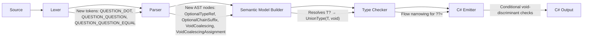

# Design Document: Optional Types

## Overview

This design introduces optional type syntax (`T?`), a standard library type alias (`Optional<T>`), and three operators (`?.`, `??`, `??=`) to the Mist programming language. The feature builds on Mist's existing union type infrastructure — `T?` is purely syntactic sugar for `T | void`, and the operators compile down to conditional checks against the void discriminant in the generated union helper structs.

The design touches five compiler phases: lexing (new tokens), parsing (grammar rules), semantic analysis (type checking and flow narrowing), code generation (C# emission), and tooling (TextMate grammar, book chapter, sample app).

### Design Rationale

Mist already has union types and void-as-a-value. Rather than introducing a separate nullable/optional wrapper type, this feature leverages the existing union infrastructure to provide ergonomic syntax. This means:
- No new runtime types — `T?` reuses the existing `Union_T_Void` helper struct
- No boxing overhead beyond what unions already incur
- Pattern matching with `is` continues to work on optional values
- The `Optional<T>` class is replaced with a transparent type alias, eliminating the class overhead

## Architecture

The feature integrates into the existing compiler pipeline without introducing new passes:



### Phase Responsibilities

1. **Lexer**: Emits three new multi-character tokens (`?.`, `??`, `??=`) and a single-character `?` token for the type suffix. Token priority ensures `??=` > `??` > `?.` > `?`.
2. **Parser**: New grammar rules for the optional type suffix, `?.` as a PostfixSuffix variant, `??` as a new precedence level (VoidCoalescing), and `??=` in the Assignment rule.
3. **Semantic Model Builder**: Resolves `T?` type references to `UnionType([T, VoidType])`, flattening if T already contains void.
4. **Type Checker**: Validates operand types for `?.`, `??`, `??=`; performs flow narrowing after `??=`.
5. **C# Emitter**: Generates conditional checks against the void discriminant tag in the union helper struct.

## Components and Interfaces

### Lexer Changes

New tokens added to `Mist.storm` (declared before single-character `?` for maximal-munch priority):

```storm
token QUESTION_QUESTION_EQUAL = "??=";
token QUESTION_QUESTION       = "??";
token QUESTION_DOT            = "?.";
token QUESTION                = "?";
```

Declaration order ensures `??=` is matched before `??`, which is matched before `?.`, which is matched before bare `?`.

### Grammar Changes

#### Optional Type Suffix

The `?` suffix is added to `TypeReference` and `SingleTypeRef` as an optional trailing `QUESTION` token. It binds tighter than `|` (union) but looser than `[]` (array rank):

```storm
rule TypeReference
    = unionType:UnionTypeRef                                                as UnionTypeRef
    | primitiveType:PrimitiveType arrayRank:ArrayRankSuffix? optional:QUESTION?  as PrimitiveTypeRef
    | VOID                                                                  as VoidTypeRef
    | UNKNOWN                                                               as UnknownTypeRef
    | name:QualifiedIdentifier typeArgs:TypeArgumentList? arrayRank:ArrayRankSuffix? optional:QUESTION?  as NamedTypeRef
    | LEFT_PARENTHESIS first:TupleTypeElement COMMA rest:TupleTypeElement (COMMA additional:TupleTypeElement)* RIGHT_PARENTHESIS  as TupleTypeRef
    ;
```

The `optional:QUESTION?` field appears after `arrayRank`, ensuring `int[]?` parses as `(int[]) | void` and `int?[]` parses as `(int | void)[]`.

#### Optional Chaining (`?.`)

A new `PostfixSuffix` variant handles `?.` for both member access and method calls:

```storm
rule PostfixSuffix
    = QUESTION_DOT name:IDENTIFIER typeArgs:TypeArgumentList? LEFT_PARENTHESIS arguments:ArgumentList? RIGHT_PARENTHESIS  as OptionalMethodCallSuffix
    | QUESTION_DOT name:IDENTIFIER                                            as OptionalMemberAccessSuffix
    | DOT name:IDENTIFIER typeArgs:TypeArgumentList? LEFT_PARENTHESIS arguments:ArgumentList? RIGHT_PARENTHESIS  as MethodCallSuffix
    | DOT name:IDENTIFIER                                                     as MemberAccessSuffix
    | LEFT_BRACKET index:Expression RIGHT_BRACKET                             as IndexSuffix
    | LEFT_PARENTHESIS arguments:ArgumentList? RIGHT_PARENTHESIS              as InvocationSuffix
    | SWITCH LEFT_BRACE arms:SwitchArmList? RIGHT_BRACE                       as SwitchExpressionSuffix
    ;
```

The `QUESTION_DOT` alternatives are declared before `DOT` alternatives so the parser tries the two-character token first.

#### Void-Coalescing (`??`)

A new precedence level `VoidCoalescing` is inserted between `Assignment` and `LogicalOr`:

```storm
rule Expression = Assignment;

rule Assignment
    = target:VoidCoalescing QUESTION_QUESTION_EQUAL value:Assignment  as VoidCoalescingAssignment
    | target:VoidCoalescing (EQUAL value:Assignment)?
    ;

rule VoidCoalescing = left:LogicalOr (QUESTION_QUESTION right:LogicalOr)*;
```

**Associativity**: The `??` operator is right-associative. The grammar achieves this by having the right operand recurse back to `LogicalOr` (not `VoidCoalescing`), so `a ?? b ?? c` parses as `a ?? (b ?? c)`.

**`??=` in Assignment**: The `??=` operator is parsed at the Assignment level alongside `=`. The left operand is a `VoidCoalescing` expression (which bottoms out at an identifier or postfix expression), and the right operand recurses to `Assignment` for right-associativity.

### Semantic Model Builder Changes

When the builder encounters a `TypeReference` node with the `optional` field set (i.e., the `QUESTION` token is present):

1. Resolve the base type `T` normally.
2. If `T` is already `void`, flag for a diagnostic warning (redundant `void?`).
3. If `T` is a `UnionType` that already contains void, return `T` unchanged (flattening).
4. If `T` is a `UnionType` without void, create a new `UnionType` with void added to the constituents.
5. Otherwise, create `UnionType([T, VoidType])`.

For double-optional (`T??`), the parser will see `T?` followed by another `?`. Since `T?` resolves to a union containing void, applying `?` again triggers the "already contains void" path. The type checker emits a diagnostic error for this case.

### Type Checker Changes

#### `?.` Operator Validation

When the type checker encounters an `OptionalMemberAccessSuffix` or `OptionalMethodCallSuffix`:

1. Check that the receiver type is a `UnionType` containing void. If not, emit `MIST_TC_XXXX` error.
2. Compute the "projected type" `T` by removing void from the union constituents. If only one constituent remains, `T` is that type. If multiple remain, `T` is a new union of the remaining constituents.
3. Resolve the member/method on `T`. If not found, emit the standard member-not-found error.
4. The result type is `R | void` where `R` is the member's return type (flattened if `R` already contains void).

#### `??` Operator Validation

When the type checker encounters a `VoidCoalescing` node:

1. Check that the left operand's type is a `UnionType` containing void. If not, emit error.
2. Compute `T` (the non-void portion of the left operand's type).
3. Check that the right operand's type is assignable to `T`. If not, emit error.
4. The result type is `T`.

#### `??=` Operator Validation and Flow Narrowing

When the type checker encounters a `VoidCoalescingAssignment` node:

1. Check that the left operand is an assignable variable (not readonly, not an arbitrary expression). If not, emit error.
2. Check that the left operand's type is a `UnionType` containing void. If not, emit error.
3. Compute `T` (the non-void portion).
4. Check that the right operand's type is assignable to `T`. If not, emit error.
5. **Flow narrowing**: After the `??=` statement, narrow the variable's type to `T` for all subsequent statements in the same scope (and nested blocks). This uses the existing `MethodFlowState` infrastructure to track narrowed types.
6. The `??=` node does not produce a value — it is statement-level only. If used as a sub-expression, emit error.

### C# Emitter Changes

#### `T?` Type Emission

Since `T?` resolves to `UnionType([T, void])` in the semantic model, the emitter maps this to C# as follows:

- **Value types** (int, float, bool, structs, enums): Emit as C# `T?` (`Nullable<T>`)
- **Reference types** (classes): Emit as `T?`, the CLR type `T` with a nullable reference annotation (using C# `null` to represent the void/absence case). The generated project enables nullable analysis, so the annotation is what marks the slot as one absence may occupy; it does not change the runtime type. Positions where C# refuses a nullable reference type (`typeof`, `as`, a pattern's type) spell the bare `T`.

This avoids generating a `Union_T_Void` helper struct entirely for two-constituent unions where one constituent is void. The emitter detects this pattern in `GetTypeName` / `EmitTypeReference` and short-circuits to the native C# nullable representation.

For multi-constituent unions containing void (e.g., `int | string | void`), the existing union helper struct approach is preserved.

#### Void Literal Emission

When `Void.Void` (or any void-typed expression) is assigned to an optional type, the emitter generates `null` instead of `MistVoid.Instance`, since both `Nullable<T>` and reference types use `null` to represent absence.

#### `?.` Emission

Since `T | void` maps to C#'s nullable/null representation, the `?.` operator maps directly to C#'s native null-conditional operator:

```csharp
// receiver?.Property  →  receiver?.Property
// receiver?.Method(args)  →  receiver?.Method(args)
```

No ternary expressions or temporary variables needed — C#'s `?.` already provides the exact semantics (short-circuit to null when receiver is null).

#### `??` Emission

Maps directly to C#'s native null-coalescing operator:

```csharp
// left ?? right  →  left ?? right
```

Short-circuit semantics are guaranteed by C#'s native `??` operator.

#### `??=` Emission

Maps directly to C#'s native null-coalescing assignment:

```csharp
// x ??= value  →  x ??= value;
```

Short-circuit semantics are guaranteed by C#'s native `??=` operator.

### Standard Library Changes

The existing `Optional<T>` class in `Source/Standard/Optional.mist` is replaced with a type alias:

```mist
type Optional<T> = T | void;
```

This is a breaking change for any code that uses `.HasValue` or `.Value` on `Optional<T>` values. The type checker will emit errors guiding users to use `??`, `?.`, or pattern matching instead.

### TextMate Grammar Changes

New patterns added to `mist.tmLanguage.json` in the operators section. Order matters — longer patterns first:

```json
{
  "match": "\\?\\?=",
  "name": "keyword.operator.void-coalescing-assignment.mist"
},
{
  "match": "\\?\\?",
  "name": "keyword.operator.void-coalescing.mist"
},
{
  "match": "\\?\\.",
  "name": "keyword.operator.void-conditional.mist"
}
```

The `?` suffix on types does not need a separate TextMate rule — it will be tokenized as punctuation following a type name, which is acceptable for syntax highlighting purposes.

## Data Models

### New AST Nodes (Generated by Storm)

| Node | Parent Rule | Fields |
|------|-------------|--------|
| `OptionalMemberAccessSuffix` | `PostfixSuffix` | `name: IDENTIFIER` |
| `OptionalMethodCallSuffix` | `PostfixSuffix` | `name: IDENTIFIER`, `typeArgs: TypeArgumentList?`, `arguments: ArgumentList?` |
| `VoidCoalescingAssignment` | `Assignment` | `target: VoidCoalescing`, `value: Assignment` |

### Modified AST Nodes

| Node | Change |
|------|--------|
| `PrimitiveTypeRef` | Add `optional: QUESTION?` field |
| `NamedTypeRef` | Add `optional: QUESTION?` field |
| `NamedSingleTypeRef` | Add `optional: QUESTION?` field |
| `PrimitiveSingleTypeRef` | Add `optional: QUESTION?` field |

### New Precedence Level

The expression precedence chain becomes:

```
Assignment (=, ??=) < VoidCoalescing (??) < LogicalOr (||) < LogicalAnd (&&)
< Equality (==, !=) < Relational (<, >, <=, >=, is)
< Additive (+, -) < Multiplicative (*, /, %)
< Unary (!, -, (T), async, await) < Postfix (., ?., [], (), switch)
< Primary (literals, identifiers, new, etc.)
```

### Semantic Model Representation

No new `IType` implementations are needed. The optional type is represented using existing types:

- `T?` → `UnionType(Constituents: [T, VoidType])` (canonical order by DisplayName)
- `Optional<T>` → `TypeAliasType(Name: "Optional", UnderlyingType: UnionType([T, VoidType]), TypeParameters: [T])`

The `TypeAliasType` is transparent — the type checker sees through it to the underlying `UnionType`.

### Flow Narrowing State

The `MethodFlowState` class (used by the type checker for tracking variable types through control flow) is extended to support `??=` narrowing:

```csharp
// After processing `x ??= value`:
flowState.NarrowType(variableSymbol, narrowedType: nonVoidPortion);
```

This narrowing persists for all subsequent statements in the same block scope and nested blocks, similar to how `is` pattern narrowing works.

## Correctness Properties

*A property is a characteristic or behavior that should hold true across all valid executions of a system — essentially, a formal statement about what the system should do. Properties serve as the bridge between human-readable specifications and machine-verifiable correctness guarantees.*

### Property 1: Optional suffix parsing equivalence

*For any* valid type name T (primitive, named, or generic), parsing `T?` SHALL produce a semantic type equivalent to parsing `T | void` — specifically, both resolve to a `UnionType` whose constituents are exactly `{T, void}` in canonical order.

**Validates: Requirements 1.1, 1.2**

### Property 2: Void deduplication in optional types

*For any* union type U that already contains void as a constituent, applying the `?` suffix SHALL produce a type with the same set of constituents as U (no duplicate void added).

**Validates: Requirements 1.3**

### Property 3: Optional suffix in all type positions

*For any* valid type name T and any type-reference position (variable declaration, parameter, return type, field, property, generic type argument, type alias), a program using `T?` in that position SHALL parse without errors and resolve to a `UnionType` containing void.

**Validates: Requirements 1.4**

### Property 4: Precedence — optional suffix binds tighter than union, looser than array

*For any* valid type name T, `T[]?` SHALL parse as `(T[]) | void` (array rank binds first), and for any types T and U, `T? | U` SHALL parse as `(T | void) | U` (optional binds before union).

**Validates: Requirements 1.6**

### Property 5: Double-optional is an error

*For any* valid type name T, a program containing the type annotation `T??` SHALL produce a diagnostic error indicating that the optional suffix cannot be applied to an already-optional type.

**Validates: Requirements 1.7**

### Property 6: Optional<T>, T?, and T|void structural equivalence

*For any* valid type T, a program that declares variables of type `Optional<T>`, `T?`, and `T | void` and cross-assigns between them SHALL produce no type-checking errors.

**Validates: Requirements 2.2, 2.3**

### Property 7: No member access on Optional<T> alias

*For any* valid type T, attempting to access `.HasValue` or `.Value` on a variable of type `Optional<T>` SHALL produce a diagnostic error indicating the member does not exist.

**Validates: Requirements 2.4**

### Property 8: Optional chaining projects receiver and wraps result type

*For any* class type T with a method returning type R, applying `?.` on an expression of type `T | void` to call that method SHALL infer the result type as `R | void`, and the member resolution SHALL succeed against type T.

**Validates: Requirements 3.1, 3.3, 3.7, 3.8**

### Property 9: Optional chaining requires optional type

*For any* type T that does not contain void as a union constituent, applying `?.` to an expression of type T SHALL produce a diagnostic error.

**Validates: Requirements 3.4**

### Property 10: Optional chaining parses at arbitrary depth

*For any* chain length N (2 ≤ N ≤ 10), a program containing N chained `?.` accesses SHALL parse without errors and produce a postfix expression with N `OptionalMemberAccessSuffix` or `OptionalMethodCallSuffix` nodes.

**Validates: Requirements 3.5**

### Property 11: Void-coalescing requires optional left operand

*For any* type T that does not contain void as a union constituent, using T as the left operand of `??` SHALL produce a diagnostic error.

**Validates: Requirements 4.1**

### Property 12: Void-coalescing result type inference

*For any* type T, when the left operand of `??` has type `T | void` and the right operand has type T, the inferred result type SHALL be T (void removed from the union).

**Validates: Requirements 4.2**

### Property 13: Void-coalescing right-associativity

*For any* chain of `??` operators of length N (2 ≤ N ≤ 5), the parser SHALL produce a right-associative AST structure where the rightmost `??` binds first.

**Validates: Requirements 4.6, 6.6**

### Property 14: Void-coalescing assignment requires mutable optional variable

*For any* readonly variable, non-variable expression, or variable whose type does not contain void, applying `??=` SHALL produce a diagnostic error.

**Validates: Requirements 5.1, 5.6, 5.7**

### Property 15: Void-coalescing assignment flow narrowing

*For any* type T, after `x ??= value` where x has type `T | void`, assigning x to a variable of type T (without void) in subsequent statements SHALL produce no type-checking errors.

**Validates: Requirements 5.4**

### Property 16: Void-coalescing assignment is statement-only

*For any* attempt to use `??=` as a sub-expression within another expression (e.g., `var y = (x ??= 5)`), the type checker SHALL produce a diagnostic error.

**Validates: Requirements 5.8**

### Property 17: Precedence — ?? between LogicalOr and Assignment

*For any* expression combining `??` with `||` and `=`, the parser SHALL produce an AST where `||` binds tighter than `??`, and `??` binds tighter than `=`. Specifically, `a || b ?? c` parses as `(a || b) ?? c`, and `x = a ?? b` parses as `x = (a ?? b)`.

**Validates: Requirements 6.1, 6.4**

### Property 18: T? emits as Nullable<T> for value types and as an annotated T for reference types

*For any* value type T, the C# code emitted for a program using `T?` SHALL use `T?` (C# Nullable) as the type representation and `null` for the void case. *For any* reference type T, the C# code emitted for `T?` SHALL use the CLR type `T` annotated as a nullable reference (`T?`) and `null` for the void case.

**Validates: Requirements 7.1**

## Error Handling

### Diagnostic Codes

| Code | Severity | Condition | Message |
|------|----------|-----------|---------|
| `MIST_TC_0040` | Error | `?.` applied to non-optional type | "Optional chaining operator '?.' requires a type of the form 'T \| void', but found '{type}'" |
| `MIST_TC_0041` | Error | `??` left operand is not optional | "Void-coalescing operator '??' requires the left operand to be of type 'T \| void', but found '{type}'" |
| `MIST_TC_0042` | Error | `??=` left operand is not optional | "Void-coalescing assignment '??=' requires the left operand to be of type 'T \| void', but found '{type}'" |
| `MIST_TC_0043` | Error | `??=` left operand is not assignable | "Void-coalescing assignment '??=' requires the left operand to be a mutable variable" |
| `MIST_TC_0044` | Error | `??` / `??=` right operand type mismatch | "Cannot assign '{rightType}' to the non-void portion '{T}' of '{leftType}'" |
| `MIST_TC_0045` | Error | Double-optional `T??` | "The optional suffix '?' cannot be applied to a type that already contains 'void'" |
| `MIST_TC_0046` | Warning | `void?` redundancy | "Applying '?' to 'void' is redundant — the type is already 'void'" |
| `MIST_TC_0047` | Error | `??=` used as expression | "The void-coalescing assignment '??=' is a statement and cannot be used as a sub-expression" |

### Error Recovery

- **Parser**: If `??` or `?.` appears in an unexpected position, the parser recovers by treating it as two separate `?` tokens (graceful degradation).
- **Type Checker**: When `?.` is applied to a non-optional type, the type checker still attempts member resolution on the base type to provide useful follow-up errors (e.g., "did you mean '.' instead of '?.'?").
- **Emitter**: If the type checker has already reported errors, the emitter skips code generation for the erroneous expressions (existing behavior).

## Testing Strategy

### Property-Based Tests (FsCheck)

The project uses **FsCheck.Xunit** (v3.1.0) for property-based testing. Each correctness property above maps to one or more FsCheck property tests with a minimum of 100 iterations.

**Test organization**: Property tests live in `Test/Mist.Tests/` under the appropriate subdirectory:
- `Parsing/` — Properties 1, 3, 4, 5, 10, 13, 17
- `Semantics/` — Properties 2, 6, 7, 8, 9, 11, 12, 14, 15, 16
- `Backend/` — Property 18

**Process spawning policy**: All property tests use in-process compilation via the shared `CompilerDriver`. No external processes are spawned per iteration. Integration tests that verify runtime behavior (short-circuit semantics, chained ?. execution) use the batched pattern: generate N scenarios, build one program, compile once, run once, compare N output lines.

**Tag format**: Each property test includes a comment referencing its design property:
```csharp
// Feature: optional-types, Property 1: Optional suffix parsing equivalence
```

### Unit Tests (xUnit)

Example-based unit tests cover:
- Specific edge cases: `void?` warning, `T??` error, `?.` on exact-void type
- TextMate grammar pattern matching (smoke tests)
- Integration: sample app compiles and produces expected output (batched, 1 process spawn)

### Integration Tests

- **Sample app verification**: Compile `samples/OptionalTypes/Program.mist`, run once, compare stdout against expected output (1 compile + 1 run = 2 process spawns).
- **Short-circuit verification**: A batched test that generates scenarios where right operands have observable side effects, compiles one program, runs once, and verifies side effects only occur when expected.

### Test Generators

Custom FsCheck generators needed:
- `ArbValidTypeName`: Generates valid Mist type names (primitives, single-word identifiers, generic types with type arguments)
- `ArbTypePosition`: Generates a type-reference position (variable, parameter, return, field, property, generic arg, type alias)
- `ArbClassWithMethod`: Generates a minimal class declaration with a method returning a known type
- `ArbChainLength`: Generates integers 2–10 for chaining depth tests

