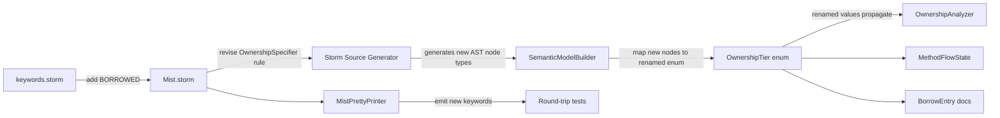

# Design Document: Ownership Keyword Revision

## Overview

This design revises the surface syntax and internal naming of two ownership specifiers in the Mist language:

| Before | After | Rationale |
|--------|-------|-----------|
| `frozen ref` | `frozen` | The `ref` is redundant — frozen is always a reference by definition |
| `ref` (bare) | `borrowed` | Frees `ref` for future C#-style pass-by-reference semantics |

The semantic behavior of all five ownership tiers is unchanged. This is a mechanical revision touching:
1. Lexer — add `BORROWED` keyword token
2. Parser grammar — revise `OwnershipSpecifier` rule alternatives
3. Semantic model — rename `OwnershipTier.FrozenRef` → `Frozen`, `OwnershipTier.Ref` → `Borrowed`
4. Analyzer — update all enum references in `OwnershipAnalyzer`, `MethodFlowState`, `BorrowEntry` doc comments
5. Pretty printer — emit `frozen ` and `borrowed ` instead of `frozen ref ` and `ref `
6. TextMate grammar — add `borrowed` to storage modifier pattern
7. Sample app — update keyword usage
8. Tests — update generators, assertions, and keyword arrays

### Design Rationale

The revision is motivated by reserving `ref` for future C#-style reference semantics (pass-by-reference for value types, ref locals, ref returns). The compound `frozen ref` was always slightly misleading — `frozen` alone is sufficient since the frozen tier is inherently a reference-based borrow. The new `borrowed` keyword makes the mutable borrow tier's intent explicit and self-documenting.

`readonly ref` is intentionally preserved because it will have dual meaning once C#-style refs are introduced: it will serve both as an ownership specifier and as a ref-passing modifier.

`ref` remains a reserved keyword (defined in `keywords.storm`) so that existing code using `ref` as an identifier will continue to fail, and the keyword is available for future use without a breaking change.

## Architecture

The change flows through the compiler pipeline in the same order as the original ownership system, but only modifies surface representations:



No new components are introduced. No runtime behavior changes. The Storm source generator automatically produces new AST node class names based on the grammar rule alternatives.

## Components and Interfaces

### 1. Lexer Changes (keywords.storm)

Add `BORROWED` token to the ownership keywords section:

```storm
// Ownership keywords
token OWNED    = "owned";
token FROZEN   = "frozen";
token REF      = "ref";
token BORROWED = "borrowed";
```

`REF` remains defined as a reserved keyword for future use. `BORROWED` is a new keyword that cannot be used as an identifier.

### 2. Grammar Changes (Mist.storm)

The `OwnershipSpecifier` rule is revised:

**Before:**
```storm
rule OwnershipSpecifier
    = OWNED                as OwnedSpecifier
    | FROZEN REF           as FrozenRefSpecifier
    | READONLY REF         as ReadonlyRefSpecifier
    | REF                  as RefSpecifier
    ;
```

**After:**
```storm
rule OwnershipSpecifier
    = OWNED                as OwnedSpecifier
    | FROZEN               as FrozenSpecifier
    | READONLY REF         as ReadonlyRefSpecifier
    | BORROWED             as BorrowedSpecifier
    ;
```

The Storm source generator will produce:
- `FrozenSpecifierOwnershipSpecifierNode` (replaces `FrozenRefSpecifierOwnershipSpecifierNode`)
- `BorrowedSpecifierOwnershipSpecifierNode` (replaces `RefSpecifierOwnershipSpecifierNode`)
- `ReadonlyRefSpecifierOwnershipSpecifierNode` (unchanged)
- `OwnedSpecifierOwnershipSpecifierNode` (unchanged)

### 3. Semantic Model (OwnershipTier.cs)

**Before:**
```csharp
public enum OwnershipTier
{
    Unrestricted,
    ReadonlyRef,
    FrozenRef,
    Ref,
    Owned,
}
```

**After:**
```csharp
public enum OwnershipTier
{
    Unrestricted,
    ReadonlyRef,
    Frozen,
    Borrowed,
    Owned,
}
```

Doc comments updated to reflect new names:
- `Frozen` — immutable view that blocks owner mutation, non-storable
- `Borrowed` — borrowed mutable, non-storable

### 4. SemanticModelBuilder (MapOwnershipSpecifier)

**Before:**
```csharp
private static OwnershipTier MapOwnershipSpecifier(OwnershipSpecifierNode? specifier)
{
    return specifier switch
    {
        OwnedSpecifierOwnershipSpecifierNode => OwnershipTier.Owned,
        FrozenRefSpecifierOwnershipSpecifierNode => OwnershipTier.FrozenRef,
        ReadonlyRefSpecifierOwnershipSpecifierNode => OwnershipTier.ReadonlyRef,
        RefSpecifierOwnershipSpecifierNode => OwnershipTier.Ref,
        _ => OwnershipTier.Unrestricted,
    };
}
```

**After:**
```csharp
private static OwnershipTier MapOwnershipSpecifier(OwnershipSpecifierNode? specifier)
{
    return specifier switch
    {
        OwnedSpecifierOwnershipSpecifierNode => OwnershipTier.Owned,
        FrozenSpecifierOwnershipSpecifierNode => OwnershipTier.Frozen,
        ReadonlyRefSpecifierOwnershipSpecifierNode => OwnershipTier.ReadonlyRef,
        BorrowedSpecifierOwnershipSpecifierNode => OwnershipTier.Borrowed,
        _ => OwnershipTier.Unrestricted,
    };
}
```

### 5. Ownership Analyzer Updates

All references to `OwnershipTier.FrozenRef` become `OwnershipTier.Frozen`.
All references to `OwnershipTier.Ref` become `OwnershipTier.Borrowed`.

Affected files:
- `OwnershipAnalyzer.cs` — switch cases, comparisons, borrow creation
- `MethodFlowState.cs` — `RestoreLenderState` switch, `HasRemainingFrozenBorrows` comparison

The `VariableOwnershipState` enum is unchanged (`LentRef`, `LentFrozen`, `LentReadonly` describe lending states, not tier names).

### 6. Pretty Printer (MistPrettyPrinter.cs)

**Before:**
```csharp
private static string EmitOwnershipSpecifier(OwnershipSpecifierNode? specifier)
{
    return specifier switch
    {
        OwnedSpecifierOwnershipSpecifierNode => "owned ",
        FrozenRefSpecifierOwnershipSpecifierNode => "frozen ref ",
        ReadonlyRefSpecifierOwnershipSpecifierNode => "readonly ref ",
        RefSpecifierOwnershipSpecifierNode => "ref ",
        _ => ""
    };
}
```

**After:**
```csharp
private static string EmitOwnershipSpecifier(OwnershipSpecifierNode? specifier)
{
    return specifier switch
    {
        OwnedSpecifierOwnershipSpecifierNode => "owned ",
        FrozenSpecifierOwnershipSpecifierNode => "frozen ",
        ReadonlyRefSpecifierOwnershipSpecifierNode => "readonly ref ",
        BorrowedSpecifierOwnershipSpecifierNode => "borrowed ",
        _ => ""
    };
}
```

### 7. TextMate Grammar

The storage modifier pattern adds `borrowed`:

**Before:**
```json
"match": "\\b(public|private|static|intrinsic|implicit|explicit|readonly|mutable|owned|frozen|ref)\\b"
```

**After:**
```json
"match": "\\b(public|private|static|intrinsic|implicit|explicit|readonly|mutable|owned|frozen|ref|borrowed)\\b"
```

The `\b` word boundary anchors ensure `borrowedItem` does not match.

### 8. Sample Application

The sample at `samples/OwnershipSystem/Program.mist` is updated:
- All `frozen ref` parameter annotations become `frozen`
- All bare `ref` parameter annotations become `borrowed`
- `readonly ref` and `owned` remain unchanged
- Output labels change: `[frozen-ref]` → `[frozen]`, `[ref-borrow]` → `[borrowed]`
- Method names updated for clarity: `DemoFrozenRef` → `DemoFrozen`, `DemoRefBorrowing` → `DemoBorrowed`

### 9. Test Updates

#### MistOwnershipGenerator

`GenOwnershipSpecifier()` changes from:
```csharp
Gen.Elements("owned ", "ref ", "readonly ref ", "frozen ref ");
```
to:
```csharp
Gen.Elements("owned ", "borrowed ", "readonly ref ", "frozen ");
```

`GenOptionalOwnershipSpecifier()` similarly updated.

#### OwnershipLendingPropertyTests

`TierToSpecifier` method updated:
- `OwnershipTier.Borrowed => "borrowed "`
- `OwnershipTier.Frozen => "frozen "`

All `OwnershipTier.Ref` references become `OwnershipTier.Borrowed`.
All `OwnershipTier.FrozenRef` references become `OwnershipTier.Frozen`.

#### OwnershipStorabilityPropertyTests

`RefTierKeywords` array changes from:
```csharp
["ref", "readonly ref", "frozen ref"]
```
to:
```csharp
["borrowed", "readonly ref", "frozen"]
```

#### OwnershipSignaturePropertyTests

Specifier/label pairs updated:
- `("ref ", "ref")` → `("borrowed ", "borrowed")`
- `("frozen ref ", "frozen ref")` → `("frozen ", "frozen")`

## Data Models

### AST Nodes (Generated by Storm)

**Before:**
```
OwnershipSpecifierNode (abstract)
├── OwnedSpecifierOwnershipSpecifierNode
├── FrozenRefSpecifierOwnershipSpecifierNode
├── ReadonlyRefSpecifierOwnershipSpecifierNode
└── RefSpecifierOwnershipSpecifierNode
```

**After:**
```
OwnershipSpecifierNode (abstract)
├── OwnedSpecifierOwnershipSpecifierNode
├── FrozenSpecifierOwnershipSpecifierNode
├── ReadonlyRefSpecifierOwnershipSpecifierNode
└── BorrowedSpecifierOwnershipSpecifierNode
```

### OwnershipTier Enum (After)

| Value | Keyword | Description |
|-------|---------|-------------|
| `Unrestricted` | (none) | Default reference semantics |
| `ReadonlyRef` | `readonly ref` | Live readonly view, non-storable |
| `Frozen` | `frozen` | Immutable view blocking owner mutation, non-storable |
| `Borrowed` | `borrowed` | Borrowed mutable, non-storable |
| `Owned` | `owned` | Sole ownership, storable, full control |

## Correctness Properties

*A property is a characteristic or behavior that should hold true across all valid executions of a system — essentially, a formal statement about what the system should do. Properties serve as the bridge between human-readable specifications and machine-verifiable correctness guarantees.*

### Property 1: Ownership-annotated round-trip parsing with revised keywords

*For any* valid Mist AST containing ownership specifiers (`owned`, `frozen`, `borrowed`, `readonly ref`) on variables, parameters, return types, and field declarations, pretty-printing the AST and then parsing the result and pretty-printing again SHALL produce identical output. The specifiers `frozen` and `borrowed` SHALL be preserved through the cycle without reverting to the old `frozen ref` or `ref` forms.

**Validates: Requirements 2.1, 2.2, 2.3, 2.4, 2.7, 5.1, 5.2, 5.3, 5.4, 5.5, 5.6, 9.1, 9.2, 9.3, 9.4, 9.5**

## Error Handling

### Rejected Old Syntax

When the parser encounters the old syntax forms, it produces clear diagnostics:

- **Bare `ref` in specifier position**: Since `ref` is no longer an alternative in the `OwnershipSpecifier` rule, the parser will not match it as a specifier. If a user writes `ref Foo x = ...`, the parser will attempt to parse `ref` as a type name (which fails since it's a keyword), producing a syntax error. A future enhancement could add a targeted error message suggesting `borrowed`.

- **`frozen ref` in specifier position**: Since the grammar now matches `FROZEN` alone (without `REF`), writing `frozen ref Foo x` will parse `frozen` as the specifier and then attempt to parse `ref Foo x` as the type and variable — `ref` is a keyword and not a valid type name, producing a syntax error. A future enhancement could add a targeted error message suggesting `frozen` alone.

### Build Verification

The primary error-handling strategy for this revision is build verification:
- The solution must compile with zero errors after all renames
- The solution must compile with zero warnings (per zero-warnings policy)
- All existing property-based tests must pass with the same semantics

### Doc Comment Updates

XML documentation comments in `BorrowEntry.cs` and `MethodFlowState.cs` that reference the old enum names (`FrozenRef`, `Ref` as tier names) are updated to reference `Frozen` and `Borrowed`.

## Testing Strategy

### Property-Based Tests (FsCheck)

The project uses **FsCheck 3.x with xUnit** for property-based testing.

**Configuration:**
- Minimum 100 iterations per property test (`MaxTest = 100`)
- Each test is tagged with a comment referencing the design property
- Tag format: `Feature: ownership-keyword-revision, Property 1: Ownership-annotated round-trip parsing with revised keywords`

**Round-Trip Property Test:**

The existing `OwnershipRoundTripPropertyTests` class is updated (not rewritten) to use the revised keywords. The `MistOwnershipGenerator` is the only component that changes — it generates `frozen ` and `borrowed ` instead of `frozen ref ` and `ref `. The test logic (parse → print → parse → print → compare) remains identical.

This single property test validates:
- Parser correctly recognizes `frozen`, `borrowed`, `readonly ref`, `owned`
- Pretty printer emits the correct keyword text for each specifier
- Round-trip idempotence holds for all declaration forms

**Existing Property Tests (Updated, Not Rewritten):**

The following test classes require mechanical updates to enum references and keyword strings, but their property logic is unchanged:
- `OwnershipLendingPropertyTests` — update `TierToSpecifier`, enum references
- `OwnershipStorabilityPropertyTests` — update `RefTierKeywords` array
- `OwnershipSignaturePropertyTests` — update specifier/label pairs
- `OwnershipMovePropertyTests` — update enum references if any
- `OwnershipFrozenBlockingPropertyTests` — update enum references if any
- `OwnershipExclusivityPropertyTests` — update enum references if any

### Unit Tests

- Verify `borrowed` is lexed as `BORROWED` token (not `IDENTIFIER`)
- Verify `borrowed` cannot be used as a variable name (parse error)
- Verify bare `ref` in specifier position produces a parse error
- Verify `frozen ref` in specifier position produces a parse error

### Integration Tests

- Compile and run the updated sample app, verify exit code 0 and expected output labels
- Build the full solution in Debug and Release, verify zero warnings

### Process Spawning Compliance

Per the test-process-spawning steering rule:
- All property tests compile in-process using the shared `CompilerDriver`
- The sample compilation integration test is the only process spawn (1 spawn total, already exists)
- No new process-spawning tests are introduced by this revision
