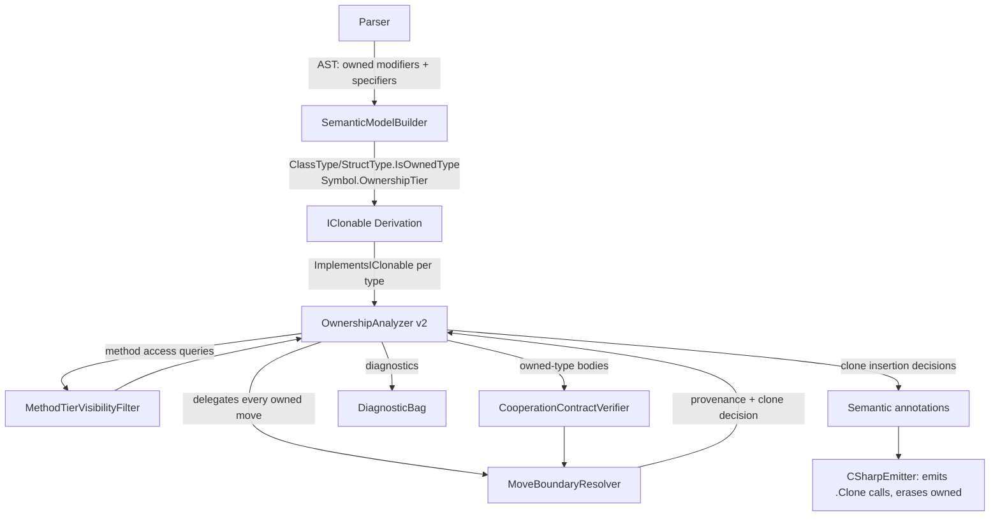

# Design Document: Ownership v2

## Overview

Ownership v2 is a redesign of the Mist ownership system (v1: `deep-ownership-types`). The defining shift is that **ownership is a property of a binding, not of a type**. Any class or struct can be held in an `owned var` binding and gain unique-ownership tracking. The `owned` modifier on a type declaration survives, but its meaning changes from a *structural field restriction* ("every field must itself be an owned type") to a *behavioral cooperation contract* ("the type author guarantees that every field assignment inside this type's methods and constructors comes from an owned source").

This redesign collapses what v1 implemented as several scattered, independently-enforced rules into a **single move-boundary enforcement point**. In v1, "this value must be owned" was checked separately at owned-binding initialization, at owned-field assignment, and at owned-parameter passing — each with its own provenance logic. In v2, every site where a value must move into an owned destination routes through **one resolver** that asks a single question: *is the source already owned? If not, can it be cloned via `IClonable<T>`? If neither, error.* (Requirement 6 AC 9.)

The system remains entirely compile-time. All ownership annotations are erased in emitted C#; the only runtime artifact v2 introduces is the occasional `.Clone()` call inserted at a move boundary (Requirement 14, Requirement 8 AC 8).

This document references requirements from `requirements.md` by number throughout (e.g., "Req 6 AC 9").

### Key design points

1. **Binding-level ownership** (Req 1, 12): `owned var x = ...` works for any *non-substructural* type (an unrestricted type or a type declared `owned`). The type need not be declared `owned`. Substructural types (`linear`, `affine`, `relevant`) are rejected — they carry their own usage discipline through drop semantics, so layering `owned` binding tracking on them is neither necessary nor sound (Req 1 AC 4, Req 13 AC 8).
2. **Single move boundary** (Req 6 AC 9): one `MoveBoundaryResolver` handles every "move into owned destination" site — owned binding init, owned field assignment, owned parameter passing.
3. **Method-tier visibility** (Req 2, 3): non-owned types in owned bindings expose readonly methods only; owned types expose all methods (their cooperation contract is verified).
4. **Cooperation contract** (Req 5): for `owned` types the compiler verifies all internal field assignments come from owned sources, routed through the same move boundary.
5. **`IClonable<T>`** (Req 8): the shared-to-owned bridge, auto-derived when all fields are clonable, bootstrapped from primitives.
6. **Removals** (Req 10, 11, 12): the v1 field restriction, the `owned` field modifier, struct ownership inference, and the `MIST_OWN_FIELD_NOT_OWNED` / structural `MIST_OWN_TYPE_REQUIRES_OWNED` checks are deleted.
7. **What stays** (Req 6, 7, 9): owned bindings/params/returns, move + use-after-move tracking, the lending state machine, zero-cost emission.

## Architecture

### How the analysis pipeline changes

The v1 `OwnershipAnalyzer` runs six passes (see `Source/Mist/Analysis/Builtin/OwnershipAnalyzer.cs`): Pass 1 owned-type declaration validation, Pass 2b owned-binding type validation, Pass 2 non-storability, Pass 2c owned-field-modifier validation, Pass 3 signature matching, Pass 4 flow-sensitive analysis. v2 restructures these into a smaller set of passes built around the move boundary.



**Phase 1 — Parsing.** The grammar (`Source/Mist/Grammar/Mist.storm`) keeps `OWNED` as a type `Modifier` and as an `OwnershipSpecifier` on variables, parameters, and return types. The one grammar change is removing the ability for the `owned` specifier to be *meaningfully* attached to a `FieldDeclaration` (Req 11 — see Migration section). The `FieldDeclaration` rule currently allows `ownershipSpecifier:OwnershipSpecifier?`; v2 treats an owned specifier on a field as a hard error.

**Phase 2 — Semantic Model Building.** `SemanticModelBuilder` continues to set `IsOwnedType` from the `owned` modifier (`Source/Mist/Semantics/Model/SemanticModelBuilder.cs` lines ~1596, ~1646) and `OwnershipTier.Owned` on owned-specified symbols. The affine/linear write-through to `IsOwnedType` is unchanged (drop semantics owns that). **Removed here:** nothing structural — but the downstream consumers of `IsOwnedType` change meaning (it now gates the cooperation contract and method-tier access, not field validation).

**Phase 2.5 — IClonable Derivation (new).** A derivation pass computes, for each user and bootstrap type, whether it implements `IClonable<T>` — either by explicit declaration or by auto-derivation (all fields clonable, Req 8 AC 6–7). The result is cached on the type model for the resolver to query.

**Phase 3 — Ownership Analysis (rewritten).** The `OwnershipAnalyzer` is rewritten around three collaborators:
- `MoveBoundaryResolver` — the single provenance/clone authority (Req 6 AC 9).
- `MethodTierVisibilityFilter` — decides whether a method call is allowed on an owned-bound receiver (Req 2, 3).
- `CooperationContractVerifier` — verifies `owned` type bodies (Req 5).

The flow-sensitive truth-table machinery (Live/LentReadonly/LentFrozen/LentRef/Moved) is **retained verbatim** from v1 — the `TruthTable` dictionary, `MethodFlowState`, `VariableOwnershipState`, and `AccessKind` are unchanged (Req 7, Req 9).

**Phase 4 — C# Emission.** `CSharpEmitter` continues to erase ownership annotations (Req 14 AC 1–5). The one addition: where the resolver decided a clone is required, the emitter emits an explicit `.Clone()` call at the assignment/argument site, except for pure-struct value types where it may be optimized away (Req 8 AC 8, Req 14 AC 7).

### Pass mapping: v1 → v2

| v1 Pass | v1 Responsibility | v2 Disposition |
|---------|-------------------|----------------|
| Pass 1 `ValidateOwnedTypeDeclarations` | All ref-type fields owned; reject interfaces/traits | **Field restriction deleted** (Req 10). Interface/trait rejection **kept** (Req 5 AC 6). |
| Pass 2b `ValidateOwnedBindingTypes` | Binding type must be owned type + initializer provenance | **Type-must-be-owned check deleted** (Req 1 AC 3, Req 10 AC 3). Initializer provenance **moved into `MoveBoundaryResolver`** (Req 1 AC 4–5). |
| Pass 2 `ValidateNonStorability` | Reject non-storable tiers as fields in owned types | **Deleted** for the owned-type-specific rule (the general "ref tiers not storable as fields" rule, if applied to all types, is out of scope here and untouched). |
| Pass 2c `ValidateOwnedFieldModifiers` | `owned` field must have owned type | **Replaced** by hard error: `owned` field modifier no longer supported (Req 11). |
| Pass 3 `ValidateSignatureMatching` | Ownership specifier match in interface/trait satisfaction | **Kept** (unchanged). |
| Pass 4 `AnalyzeFlowSensitive` | Move tracking, borrow checking, truth table | **Kept and extended**: move sites delegate to `MoveBoundaryResolver`; method calls consult `MethodTierVisibilityFilter`. |
| — (new) | Cooperation contract verification for owned types | **New** `CooperationContractVerifier` (Req 5). |

## Components and Interfaces

### Component 1: `IClonable<T>` (standard library)

**Purpose**: The shared-to-owned bridge. Produces a fresh, fully-independent owned value graph from a non-owned source (Req 8).

**Location**: `Source/Standard/IClonable.mist` (sibling to `IEnumerable.mist`).

```mist
namespace Standard;

interface IClonable<T>
{
    owned T Clone();
}
```

**Responsibilities**:
- Declares the single method `owned T Clone()` (Req 8 AC 1). The `owned` return specifier means `Clone()` hands out a fresh owned value, which is exactly what a move boundary needs.
- Bootstrap value types (`Int32`, `Int64`, `Boolean`, `Char`, `Single`, `Double`, `Decimal`, `Byte`, `SByte`, `Int16`, `UInt16`, `UInt32`, `UInt64`) and `String` implement it as base cases (Req 8 AC 6). Because these are `intrinsic`, their `Clone()` is satisfied intrinsically (identity copy for value types; strings are immutable so `Clone()` returns the same reference, observationally independent).
- Auto-derivation (Req 8 AC 6–7) is computed by the compiler, not written by hand, for ordinary types whose fields are all clonable.

**Bootstrap declaration example** (`Int32.mist` gains the interface):

```mist
intrinsic public readonly owned struct Int32 : IClonable<Int32>
{
    // ... existing operators ...
    intrinsic public owned Int32 Clone();
}
```

> Design note: bootstrap types are already declared `owned` in v1 (e.g. `Int32.mist` line 4). Under v2 that modifier is now a cooperation contract that they trivially satisfy (no field assignments). The new addition is the `IClonable<Int32>` base case.

### Component 2: `MoveBoundaryResolver` (new) — the single enforcement point

**Purpose**: The one and only mechanism that answers "can this source value move into an owned destination, and if so, how?" (Req 6 AC 9). Every owned-move site routes through it. This is the central design idea of v2: provenance is resolved in exactly one place.

```csharp
namespace Mist.Analysis.Builtin;

/// <summary>
/// Single authority for resolving moves into owned destinations (Requirement 6 AC 9).
/// Every owned-move site — owned binding initialization, field assignment on an
/// owned-bound instance, and owned-parameter passing — calls Resolve(). This is the
/// ONLY place provenance and implicit-clone decisions are made.
/// </summary>
public sealed class MoveBoundaryResolver
{
    /// <summary>
    /// Resolves whether <paramref name="source"/> can move into an owned destination.
    /// </summary>
    public MoveResolution Resolve(
        SyntaxNode source,
        IType destinationType,
        OwnedMoveSite site,
        MethodFlowState flowState,
        ISemanticModel model,
        DiagnosticBag diagnostics);
}

/// <summary>The kind of site requiring a move into an owned destination.</summary>
public enum OwnedMoveSite
{
    OwnedBindingInit,        // owned var x = <source>           (Req 1, Req 6)
    OwnedFieldAssignment,    // ownedInstance.Field = <source>   (Req 4)
    OwnedParameterPass,      // f(<source>) where param is owned (Req 6 AC 3, Req 9 AC 4)
}

/// <summary>The outcome of resolving a move into an owned destination.</summary>
public readonly record struct MoveResolution(
    MoveOutcome Outcome,
    ISymbol? ConsumedBinding);   // non-null when Outcome == MovedFromOwned

public enum MoveOutcome
{
    MovedFromOwned,   // source is already owned → consume it (mark Moved)
    ValueCopy,        // source is a value/primitive type → copy, no provenance needed (Req 4 AC 3/4)
    ImplicitClone,    // source is non-owned but IClonable → insert .Clone() (Req 6 AC 9, Req 8)
    DefaultGraph,     // source is default(T) / bare default → fresh graph (Req 6 AC 10)
    Error,            // none of the above → diagnostic emitted
}
```

**Resolution algorithm** (Req 6 AC 9, Req 8, Req 4):

```pascal
ALGORITHM Resolve(source, destinationType, site, flowState)
BEGIN
  // 1. default(T) and bare default are fresh owned graphs (Req 6 AC 10)
  IF IsDefaultExpression(source) THEN
    RETURN DefaultGraph

  // 2. Value types and primitives copy — never alias (Req 4 AC 3, AC 4)
  IF IsValueType(typeof(source)) OR IsPrimitive(typeof(source)) THEN
    RETURN ValueCopy

  // 3. Already-owned source: constructor call, owned-returning call, or
  //    move from an owned binding/parameter in the Live state (Req 6 AC 1-3, AC 8)
  IF YieldsOwnedValue(source, flowState) THEN
    // truth-table guards the move; LentRef/LentFrozen/LentReadonly/Moved reject
    IF source is a binding AND NOT IsActionPermitted(state(source), Move) THEN
      ReportTruthTableViolation(...)
      RETURN Error
    RETURN MovedFromOwned(consumedBinding := source binding or none)

  // 4. Non-owned source: bridge via IClonable (Req 6 AC 9, Req 8 AC 2-5)
  //    Cloning from a lent tier (borrowed/frozen/readonly ref) does NOT consume
  //    the lender — Clone() reads through the reference (Req 8 AC 5).
  IF ImplementsIClonable(typeof(source), destinationType) THEN
    RETURN ImplicitClone

  // 5. Nothing worked
  Report(MIST_OWN_REQUIRES_OWNED or MIST_OWN_NOT_CLONABLE)
  RETURN Error
END
```

**Responsibilities**:
- Subsumes v1's `YieldsUniqueOwnership` / `IsConstructorOrOwnedCall` (in `OwnershipAnalyzer.cs`) and centralizes them.
- Records, for `ImplicitClone` outcomes, an annotation the emitter reads to insert `.Clone()` (Req 14 AC 7).
- Marks consumed owned bindings as `Moved` in the `MethodFlowState` for `MovedFromOwned` (Req 6 AC 1–4).
- Cloning from lent tiers explicitly does **not** transition the lender's state (Req 8 AC 5).

### Component 3: `CooperationContractVerifier` (new)

**Purpose**: Verifies that an `owned` type honors its cooperation contract — every field assignment inside its methods and constructors has an owned source (Req 5 AC 3–4, Req 13 AC 4–5).

```csharp
namespace Mist.Analysis.Builtin;

/// <summary>
/// Verifies the cooperation contract for types declared 'owned' (Requirement 5).
/// For every assignment to a field of 'this' inside the type's methods and
/// constructors, the source must resolve as an owned move via MoveBoundaryResolver.
/// </summary>
public sealed class CooperationContractVerifier
{
    public void Verify(
        IType ownedType,
        MoveBoundaryResolver resolver,
        ISemanticModel model,
        DiagnosticBag diagnostics);
}
```

**Responsibilities**:
- For each method/constructor of an `owned` type, find assignments `this.Field = <source>` (and implicit assignments in constructors).
- Route each source through `MoveBoundaryResolver.Resolve(..., site: OwnedFieldAssignment)`. If the result is `Error`, emit `MIST_OWN_CONTRACT_VIOLATION` identifying the method, the field, and the non-owned source (Req 13 AC 4–5).
- **Static/global reads are rejected as sources** (documented design decision): a field assignment whose source is a static field read or global read does not yield an owned value and is not clonable-by-provenance, so it falls through to `Error`. This closes the alias-leak path for owned types (see Known Limitations).
- This is the "not blind trust" guarantee of Req 3 AC 3: mutable methods are permitted on owned types *because* this verifier proves the contract.

### Component 4: `MethodTierVisibilityFilter` (new)

**Purpose**: Decides whether a method call is permitted on a receiver held in an owned binding, based on whether the receiver's type is owned and whether the method is readonly (Req 2, Req 3).

```csharp
namespace Mist.Analysis.Builtin;

/// <summary>
/// Determines method-call visibility for receivers held in owned bindings (Req 2, 3).
///   - Owned type receiver  → all methods visible (contract verified).
///   - Non-owned type receiver → readonly methods only; mutable methods hidden.
/// Receivers NOT held in owned bindings are unaffected (full access as today).
/// </summary>
public sealed class MethodTierVisibilityFilter
{
    public MethodVisibility Resolve(
        ISymbol methodSymbol,
        IType receiverType,
        bool receiverIsOwnedBinding,
        ISemanticModel model);
}

public enum MethodVisibility { Allowed, HiddenMutable }
```

**Decision table** (Req 2 AC 1–4, Req 3 AC 1):

| Receiver binding | Receiver type | Method kind | Result |
|------------------|---------------|-------------|--------|
| owned | owned type | readonly | Allowed (Req 3 AC 1) |
| owned | owned type | mutable | Allowed (Req 3 AC 1, contract verified) |
| owned | non-owned type | readonly | Allowed (Req 2 AC 1) |
| owned | non-owned type | mutable | HiddenMutable → `MIST_OWN_MUTABLE_HIDDEN` (Req 2 AC 2/4, Req 13 AC 1) |
| unrestricted | any | any | Allowed (not an owned binding; out of scope) |

**Responsibilities**:
- Reuses `ReadonlyInferenceEngine` / `Symbol.ReadonlyStatus` (`Source/Mist/Semantics/ReadonlyInferenceEngine.cs`) to classify methods as readonly vs mutable — no new readonly machinery.
- Direct field assignment is **not** a method call and is governed separately by `MoveBoundaryResolver` (Req 2 AC 3, Req 3 AC 2).
- Value types in owned bindings: mutable methods on a struct value are safe to allow because the struct is copied; the filter treats value-type receivers as `Allowed` regardless of method kind (consistent with Req 4 AC 3 reasoning).

### Component 5: `OwnershipAnalyzer` (rewritten orchestrator)

The analyzer keeps its `IAnalyzer` identity (`AnalyzerId => "OWNERSHIP"`) and orchestrates the collaborators:

```csharp
public void Analyze(ISemanticModel model, DiagnosticBag diagnostics)
{
    var resolver = new MoveBoundaryResolver();
    var tierFilter = new MethodTierVisibilityFilter();
    var contract = new CooperationContractVerifier();

    // Pass A: declaration validation (interface/trait owned rejection only; Req 5 AC 6)
    RejectOwnedOnInterfacesAndTraits(model, diagnostics);

    // Pass B: hard-error any leftover owned field modifier (Req 11, Req 13 AC 6)
    RejectOwnedFieldModifier(model, diagnostics);

    // Pass B2: reject owned binding specifier on substructural types (Req 1 AC 4, Req 13 AC 8)
    RejectOwnedBindingOnSubstructuralTypes(model, diagnostics);

    // Pass C: cooperation contract for owned types (Req 5)
    foreach (var t in OwnedTypes(model))
        contract.Verify(t, resolver, model, diagnostics);

    // Pass D: flow-sensitive analysis (truth table retained from v1; Req 6, 7, 9)
    //   - owned move sites delegate to resolver
    //   - method calls on owned bindings consult tierFilter
    AnalyzeFlowSensitive(model, resolver, tierFilter, diagnostics);
}
```

## Data Models

### Type model changes (`ClassType` / `StructType`)

`IsOwnedType` (in `Source/Mist/Semantics/Model/Types/ClassType.cs` and `StructType.cs`) **stays** but is repurposed: it now signals "this type opts into the cooperation contract," not "this type's fields are all owned." The doc comment must be updated (currently reads "fields must themselves be owned").

A new computed/cached property records IClonable participation:

```csharp
// Added to ClassType and StructType
/// <summary>
/// Whether this type implements IClonable&lt;T&gt; — either declared explicitly or
/// auto-derived because all fields' types implement IClonable (Req 8 AC 6-7).
/// Computed by the IClonable derivation pass; consumed by MoveBoundaryResolver.
/// </summary>
public bool ImplementsIClonable { get; internal set; }
```

`Defaultability` / `DefaultValues` and `__CreateDefault` emission are unchanged and reused for the `default`-as-owned-source path (Req 6 AC 10).

### `Symbol.OwnershipTier`

Unchanged. `OwnershipTier.Owned` on locals/parameters/returns continues to mean binding/parameter/return ownership. The field-level use of this tier becomes invalid (Req 11).

### Flow-state model

`MethodFlowState`, `VariableOwnershipState` (Live/LentReadonly/LentFrozen/LentRef/Moved), and `AccessKind` are **unchanged** from v1 — the truth table is retained exactly (Req 7).

### What gets removed from the data model

- No `OwnershipInferenceEngine` for structs (Req 12 AC 1) — if present from v1 work, it is deleted (the v1 design proposed it; see Migration).
- No field-level owned tracking semantics.

## Correctness Properties

These properties target property-based testing (library: **FsCheck**, matching the existing Mist test suite). Each is universally quantified over generated programs/types.

### Property 1: Move boundary is the sole gate (Req 6 AC 9)
For all owned-move sites S (binding init, owned-field assignment, owned-param pass) and all source expressions e: the accept/reject decision and the clone-insertion decision for (S, e) equal `MoveBoundaryResolver.Resolve(e, ...)`. There is no site that accepts an owned move the resolver would reject, nor vice versa.

```
∀ site ∈ {BindingInit, FieldAssign, ParamPass}, ∀ source e:
    Decision(site, e) == Resolver.Resolve(e, site)
```

**Validates: Requirements 6.9, 4.1, 4.2**

### Property 2: Owned source implies no clone (Req 6 AC 1–3)
For all sources e that are already owned (constructor call, owned-returning call, or live owned binding), `Resolve(e)` ∈ {MovedFromOwned, ValueCopy, DefaultGraph} and never `ImplicitClone`.

**Validates: Requirements 6.1, 6.2, 6.3**

### Property 3: Non-owned clonable source implies exactly one clone (Req 6 AC 9, Req 8 AC 3)
For all non-owned reference sources e whose type implements `IClonable<T>`, `Resolve(e) == ImplicitClone`, and the emitter inserts exactly one `.Clone()` at that site (unless pure-struct optimization applies, Req 8 AC 8).

**Validates: Requirements 6.9, 8.2, 8.3**

### Property 4: Non-owned non-clonable source implies error (Req 8 AC 4, Req 13 AC 7)
For all non-owned reference sources e whose type does not implement `IClonable<T>`, `Resolve(e) == Error` and `MIST_OWN_NOT_CLONABLE` is emitted.

**Validates: Requirements 8.4, 13.7**

### Property 5: Clone from lent tier does not consume the lender (Req 8 AC 5)
For all bindings b lent as borrowed/frozen/readonly-ref and cloned into an owned destination, the post-clone state of b's lender equals its pre-clone state (no transition to Moved).

**Validates: Requirements 8.5**

### Property 6: IClonable auto-derivation is exactly "all fields clonable" (Req 8 AC 6–7)
For all types T, `ImplementsIClonable(T)` ⟺ (T explicitly declares `IClonable<T>`) ∨ (∀ field f ∈ T.Fields: ImplementsIClonable(typeof(f))). Bootstrap value types and String are base cases (always true).

**Validates: Requirements 8.6, 8.7**

### Property 7: Method tier visibility (Req 2, 3)
For all owned bindings of type T and methods m: m is callable ⟺ (T is owned) ∨ (m is readonly) ∨ (T is a value type).

**Validates: Requirements 2.1, 2.2, 3.1**

### Property 8: Cooperation contract soundness (Req 5 AC 3–4)
For all owned types T, T compiles ⟺ every field assignment in T's methods/constructors resolves as a non-error owned move.

**Validates: Requirements 5.3, 5.4**

### Property 9: Truth table preserved (Req 7)
For all states s and actions a, v2's permitted(s, a) == v1's truth table value. (Regression guard: the lending state machine is unchanged.)

**Validates: Requirements 7.1, 7.2, 7.3, 7.4, 7.5**

### Property 10: `default` yields ownership (Req 6 AC 10)
For all owned destinations of type T, both `default(T)` and bare `default` (typed LHS) resolve as `DefaultGraph` and are accepted as owned sources.

**Validates: Requirements 6.10**

### Property 13: Owned binding rejects substructural types (Req 1 AC 4)
For all types T declared `linear`, `affine`, or `relevant`, an `owned` binding of T is rejected with `MIST_OWN_SUBSTRUCTURAL_BINDING`. For all non-substructural types (unrestricted or `owned`), an `owned` binding is permitted (subject to provenance).

**Validates: Requirements 1.3, 1.4**

### Property 11: Round-trip parsing (Req 17)
For all valid owned type declarations, owned bindings, and `IClonable` implementations, parse → pretty-print → parse yields an equivalent syntax tree.

**Validates: Requirements 17.1, 17.2, 17.3**

### Property 12: Zero runtime ownership artifacts (Req 14)
For all compiled programs, emitted C# contains no `owned` keyword, no reference counting, no state fields, and no move-nulling — only `.Clone()` calls at resolved clone sites.

**Validates: Requirements 14.1, 14.3, 14.4**

## Error Handling

### Diagnostics added / kept / removed

| Diagnostic ID | Status | Trigger | Requirement |
|---------------|--------|---------|-------------|
| `MIST_OWN_USE_AFTER_MOVE` | **Kept** | Access to a moved binding | Req 6 AC 4, Req 13 AC 3 |
| `MIST_OWN_MUTABLE_HIDDEN` | **New** | Mutable method called on non-owned type in owned binding | Req 2 AC 4, Req 13 AC 1 |
| `MIST_OWN_REQUIRES_OWNED` | **New (repurposed)** | Owned destination assigned a non-owned, non-clonable source | Req 1 AC 5, Req 4 AC 2, Req 13 AC 2 |
| `MIST_OWN_NOT_CLONABLE` | **New** | Clone needed but type lacks `IClonable<T>` | Req 8 AC 4, Req 13 AC 7 |
| `MIST_OWN_CONTRACT_VIOLATION` | **New** | Owned type's method/ctor assigns a field from a non-owned source | Req 5 AC 4, Req 13 AC 4–5 |
| `MIST_OWN_FIELD_MODIFIER_REMOVED` | **New** | `owned` used as a field modifier | Req 11 AC 2, Req 13 AC 6 |
| `MIST_OWN_SUBSTRUCTURAL_BINDING` | **New** | `owned` binding specifier applied to a `linear`/`affine`/`relevant` type | Req 1 AC 4, Req 13 AC 8 |
| `MIST_OWN_INTERFACE_FORBIDDEN` | **Kept** | `owned` on interface/trait | Req 5 AC 6 |
| `MIST_OWN_INCOMPATIBLE_LEND` | **Kept** | Lending from an incompatible tier | Req 9 |
| `MIST_OWN_MUTATION_BLOCKED` | **Kept** | Mutation while frozen outstanding | Req 7 |
| `MIST_OWN_EXCLUSIVE_VIOLATION` | **Kept** | Access while borrowed/readonly outstanding | Req 7 |
| `MIST_OWN_FIELD_NOT_OWNED` | **REMOVED** | (v1: ref field in owned type not owned) | Req 10 AC 2, Req 11 AC 3 |
| `MIST_OWN_TYPE_REQUIRES_OWNED` | **REMOVED** | (v1: owned binding of non-owned type / structural check) | Req 10 AC 3 |

> Note on `MIST_DROP_FIELD_NOT_OWNED` (in `DropAnalyzer.cs`): this is a **separate** diagnostic belonging to drop/substructural semantics (affine/linear field containment), not the v1 ownership field restriction. It is **out of scope** and must not be removed by this work. Only the ownership analyzer's `MIST_OWN_FIELD_NOT_OWNED` is deleted (Req 11 AC 3).

### Error scenarios

**Scenario 1 — Mutable method on non-owned type in owned binding (Req 2 AC 4).**
- Condition: `owned var w = new Widget(...); w.SetValue(99);` where `Widget` is not `owned` and `SetValue` is mutable.
- Response: `MIST_OWN_MUTABLE_HIDDEN` naming the method, the type, and explaining non-owned types appear readonly in owned bindings; suggest declaring the type `owned` or using direct field assignment.
- Recovery: developer declares `Widget` owned, or assigns the field directly with an owned source.

**Scenario 2 — Non-owned, non-clonable source into owned destination (Req 8 AC 4).**
- Condition: `owned var c = sharedThing;` where `sharedThing`'s type is a non-owned class without `IClonable`.
- Response: `MIST_OWN_NOT_CLONABLE` suggesting the type implement `IClonable<T>`.

**Scenario 3 — Cooperation contract violation (Req 5 AC 4).**
- Condition: inside `owned class Vault`, a method assigns `this.Setting = someNonOwnedParam;`.
- Response: `MIST_OWN_CONTRACT_VIOLATION` naming the method, field, and source. Recovery: make the parameter `owned`, clone it, or construct fresh.

**Scenario 4 — Removed owned field modifier (Req 11 AC 2).**
- Condition: `owned MyClass data;` as a field.
- Response: hard error `MIST_OWN_FIELD_MODIFIER_REMOVED` — no warning, no silent acceptance (Req 19 AC 2).

**Scenario 5 — Use-after-move (Req 6 AC 4).**
- Condition: `owned var y = x; ... use(x);`
- Response: `MIST_OWN_USE_AFTER_MOVE` with binding name, move location, access location.

**Scenario 6 — Owned binding on a substructural type (Req 1 AC 4).**
- Condition: `owned var r = new LinearResource(...);` where `LinearResource` is declared `linear` (or `affine`/`relevant`).
- Response: hard error `MIST_OWN_SUBSTRUCTURAL_BINDING` naming the binding and the substructural type, explaining that substructural types manage their own usage discipline via drop semantics and cannot be combined with `owned` binding tracking.
- Recovery: drop the `owned` specifier and rely on the type's substructural discipline.

## Testing Strategy

### Unit testing
- `MoveBoundaryResolver`: table-driven tests over (source kind × destination site × clonability) verifying the `MoveOutcome`. Covers Req 6 AC 9, Req 8.
- `MethodTierVisibilityFilter`: the decision table above as explicit `[Theory]`/`[InlineData]` cases (Req 2, 3).
- `CooperationContractVerifier`: owned types with compliant and violating bodies (Req 5).
- IClonable derivation: types with all-clonable vs partially-clonable fields (Req 8 AC 6–7).
- Diagnostic removal: assert `MIST_OWN_FIELD_NOT_OWNED` and structural `MIST_OWN_TYPE_REQUIRES_OWNED` are never emitted for any input (Req 10).

### Property-based testing (FsCheck)
Properties 1–12 above. To honor the process-spawning policies (`test-process-spawning.md`, `spec-process-spawning-approval.md`), these use **in-process `CompilerDriver.Compile()`** for analysis-only properties (Properties 1–10 and 12 inspect diagnostics/semantic model without spawning) and a **single batched compile-and-run** for any property that must observe stdout. No per-iteration `dotnet` spawning. If any property is later found to need per-iteration process execution, that will be raised for approval before implementation.

### Integration testing
- The `samples/Ownership/Program.mist` proof code (Req 16) is the end-to-end integration test. Every `// PROOF:` block must compile and produce the exact expected stdout. The proof code is immutable per `sample-proof-code.md`.
- AllFeatures orchestrator wiring (Req 16 AC 6).

### Round-trip
- Parser round-trip property tests for owned type decls, owned bindings, and `IClonable` impls (Req 17).

## Migration / Removal

This section enumerates exactly what v1 code and artifacts are deleted or changed. There is **no backwards compatibility** (Req 19).

### Deleted code in `Source/Mist/Analysis/Builtin/OwnershipAnalyzer.cs`
1. `FieldNotOwned` diagnostic id (`MIST_OWN_FIELD_NOT_OWNED`) and all references (Req 11 AC 3).
2. `TypeRequiresOwned` diagnostic id (`MIST_OWN_TYPE_REQUIRES_OWNED`) and all references — the structural eligibility check (Req 10 AC 3).
3. `ValidateOwnedTypeDeclarations` → `ValidateOwnedClassOrStruct`: delete the field-restriction logic (the reference-field/owned-field/non-storable loop). **Keep** the interface/trait rejection, relocated to `RejectOwnedOnInterfacesAndTraits` (Req 5 AC 6).
4. `ValidateOwnedBindingTypes` (Pass 2b): delete the "type must be owned" check (Req 1 AC 3). The initializer-provenance logic (`YieldsUniqueOwnership`, `IsConstructorOrOwnedCall`, `TryResolveIdentifierSymbol` usage for provenance) is **absorbed into `MoveBoundaryResolver`**, not kept in place.
5. `ValidateOwnedFieldModifiers` (Pass 2c): delete entirely; replaced by the hard-error `RejectOwnedFieldModifier` (Req 11).
6. `ValidateNonStorability` (Pass 2): delete the owned-type-field-specific application (Req 10).
7. Helper `SatisfiesOwnedTypeFieldRestriction`: delete (Req 10).

### Changed code in `Source/Mist/Semantics/Model/`
8. `ClassType.cs` / `StructType.cs`: update the `IsOwnedType` doc comment (no longer "fields must themselves be owned"); add `ImplementsIClonable` property.

### Grammar changes in `Source/Mist/Grammar/Mist.storm`
9. The `FieldDeclaration` rule keeps parsing `ownershipSpecifier:OwnershipSpecifier?` syntactically (to produce a good error), but an owned specifier on a field is rejected as a hard error in the analyzer (Req 11 AC 1–2). If the grammar can cleanly drop the owned alternative for fields without harming `frozen`/`borrowed`/`readonly ref` field tiers, prefer removing it at the grammar level; otherwise enforce in the analyzer. (Implementation decides based on grammar regeneration impact.)

### Standard library additions in `Source/Standard/`
10. New file `Source/Standard/IClonable.mist` (Req 8 AC 1).
11. Bootstrap types gain `: IClonable<Self>` + intrinsic `Clone()`: `Int32`, `Int64`, `Int16`, `UInt32`, `UInt64`, `UInt16`, `Byte`, `SByte`, `Single`, `Double`, `Decimal`, `Boolean`, `Char`, `String` (Req 8 AC 6).

### Sample removals (Req 16 AC 1)
12. Delete `samples/DeepOwnershipTypes/` and `samples/OwnershipSystem/` entirely.
13. Remove their `RunDemo()` calls from `samples/AllFeatures/Program.mist` and `[[references]]` entries from `samples/AllFeatures/mist.toml`.
14. Add `samples/Ownership/` with the proof code from Req 16, plus AllFeatures wiring.

### Emitter changes in `Source/Mist/Backends/CSharpTranspiler/CSharpEmitter.cs`
15. Emit `.Clone()` at resolver-marked clone sites (Req 14 AC 7), with pure-struct optimization (Req 8 AC 8). Continue erasing `owned` (Req 14 AC 3). `__CreateDefault` machinery reused for `default`-as-owned-source — no change needed there.

### Book / docs (Req 18)
16. Add `book/src/advanced/ownership.md` as the single authoritative ownership chapter; reference it in `SUMMARY.md`. Compiled snippets per the Book Snippet Policy.

### TextMate grammar (Req 15)
17. Confirm `owned` highlighting before `class`/`struct` and before `var`/type; no IClonable-specific changes needed (follows existing interface highlighting).

## Known Limitations and Design Decisions

These are documented (not necessarily solved) per the design brief.

### LD-1: Non-owned type constructors in owned bindings may leak aliases
When `owned var x = new NonOwnedType(sharedAlias)` runs, the constructor body of a **non-owned** type has no cooperation contract. The constructor may store `sharedAlias` into a field, so the resulting graph is not provably alias-free even though `x` is an owned binding. v2 **accepts this weaker guarantee**: the owned binding guarantees unique ownership of the *root reference* and gates mutation at the binding level (readonly-method-only access, Req 2), but does not retroactively prove deep non-aliasing for non-owned constructors. Deep guarantees require declaring the type `owned` (cooperation contract verified). This is an intentional consequence of moving from type-level to binding-level ownership.

### LD-2: Statics as field-assignment sources in owned types
For `owned` types, the `CooperationContractVerifier` must reject field assignments whose source is a static or global read (e.g. `this.Field = SomeType.SharedInstance`). A static read yields neither an owned value (it's a shared global) nor a fresh graph, and treating it as clonable would silently duplicate global state. The verifier therefore routes static/global reads through the resolver, which returns `Error` (falls through to `MIST_OWN_CONTRACT_VIOLATION`). This keeps the owned graph free of aliases into mutable global state. (Non-owned types in owned bindings are unaffected because they cannot call mutable methods anyway, Req 2.)

### LD-3: Pure-struct clone elision
For value types whose copy semantics already produce independent values, the emitter may elide the emitted `.Clone()` (Req 8 AC 8). This is an optimization, not a correctness requirement; the resolver still reports `ImplicitClone`/`ValueCopy` and the observable behavior is identical.

## Dependencies

- **FsCheck** — property-based testing (existing dependency).
- **Storm** grammar/source generators — for any grammar regeneration (`Mist.storm`).
- Existing compiler phases: `SemanticModelBuilder`, `ReadonlyInferenceEngine`, `CSharpEmitter`, `DiagnosticBag`, `AnalyzerRunner`.
- Standard library bootstrap (`Source/Standard/Bootstrap/`) for `IClonable<T>` base cases.
