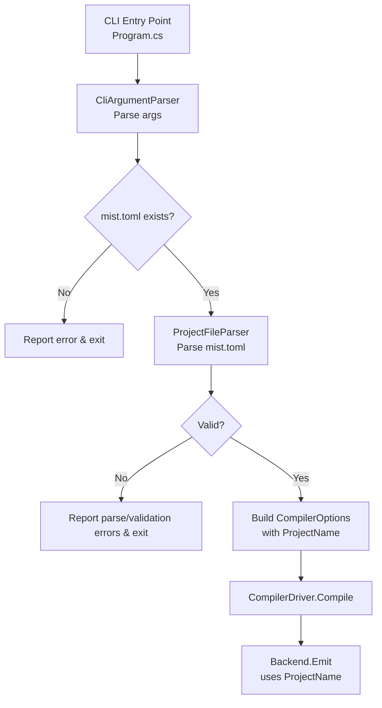

# Design Document: Project-Based Build Model — Project File

## Overview

This design covers Requirements 10–14: introducing a TOML project file (`mist.toml`) that provides an explicit project name, replacing the current folder-name derivation. The project file lives in the project folder root and is parsed early in the CLI pipeline, before the `CompilerDriver` is invoked. The project name flows through `CompilerOptions` into the backend, where it controls the `.csproj` filename and the output artifact name.

Requirements 1–9 (project-folder build model, source discovery, output/bin directories, clean semantics) are already implemented and are not covered here.

### Key Design Decisions

1. **TOML via Tomlyn** — The `Tomlyn` NuGet package is used for TOML parsing. It is the most mature .NET TOML library, supports TOML v1.0, and has zero transitive dependencies.

2. **Fail-fast on missing project file** — If `mist.toml` does not exist, the CLI reports an error and aborts before entering the compilation pipeline. This is a hard requirement (R10.4).

3. **New `ProjectConfiguration` record** — A simple, extensible record holds parsed project metadata. Starting with just `Name`, it can grow to include `version`, `dependencies`, etc. without breaking changes (R12.4).

4. **`ProjectName` added to `CompilerOptions`** — The project name is threaded through the existing `CompilerOptions` record so the `CompilerDriver` and backends receive it without signature changes to `IBackend.Emit`.

5. **Folder-name derivation removed** — The line in `CompilerDriver.Compile` that derives `projectName` from `Path.GetFileName(options.ProjectFolder)` is replaced by reading `options.ProjectName`.

## Architecture

The project file feature adds a thin layer between CLI argument parsing and compiler invocation:



The new components live in the `Mist.Core` library (`Source/Mist/`) so they are testable from `Mist.Tests`, while the CLI integration (reading the file and wiring it into `CompilerOptions`) lives in `Program.cs`.

## Components and Interfaces

### 1. `ProjectConfiguration` (new record)

**Location:** `Source/Mist/Driver/Contracts/ProjectConfiguration.cs`

```csharp
namespace Mist.Driver.Contracts;

/// <summary>
/// Structured representation of a parsed mist.toml project file.
/// Designed for forward-compatible extension with additional fields.
/// </summary>
public sealed record ProjectConfiguration(string Name);
```

This is intentionally minimal. Future fields (e.g., `Version`, `Dependencies`) are added as new record properties with default values, preserving backward compatibility.

### 2. `ProjectFileParser` (new static class)

**Location:** `Source/Mist/Driver/ProjectFileParser.cs`

```csharp
namespace Mist.Driver;

/// <summary>
/// Reads and validates a mist.toml project file, producing a
/// <see cref="ProjectConfiguration"/> or reporting diagnostics.
/// </summary>
public static class ProjectFileParser
{
    public const string FileName = "mist.toml";
    public const int MaxNameLength = 128;

    /// <summary>
    /// Parses the mist.toml file from the given project folder.
    /// Returns null and populates diagnostics on any error.
    /// </summary>
    public static ProjectConfiguration? Parse(
        string projectFolder,
        DiagnosticBag diagnostics);
}
```

**Responsibilities:**

1. Construct the path: `Path.Combine(projectFolder, "mist.toml")`
2. Read the file contents
3. Parse TOML using `Tomlyn.Toml.ToModel(content)` — catch `TomlException` for syntax errors (R12.3)
4. Extract the `name` key from the root table
5. Validate:
   - `name` key exists (R10.5) — error `MIST_PROJECT_MISSING_NAME`
   - `name` is not empty/whitespace (R10.6) — error `MIST_PROJECT_EMPTY_NAME`
   - `name` matches `^[a-zA-Z0-9\-_\.]+$` (R11.1) — error `MIST_PROJECT_INVALID_NAME`
   - `name.Length <= 128` (R11.3) — error `MIST_PROJECT_NAME_TOO_LONG`
6. Return `new ProjectConfiguration(name)` on success, or `null` with diagnostics on failure

**Diagnostic IDs:**

| ID | Severity | Condition |
|---|---|---|
| `MIST_PROJECT_FILE_NOT_FOUND` | Error | `mist.toml` does not exist in project folder |
| `MIST_PROJECT_FILE_READ_ERROR` | Error | I/O error reading the file |
| `MIST_PROJECT_TOML_ERROR` | Error | TOML syntax error |
| `MIST_PROJECT_MISSING_NAME` | Error | No `name` field in the TOML document |
| `MIST_PROJECT_EMPTY_NAME` | Error | `name` is empty or whitespace-only |
| `MIST_PROJECT_INVALID_NAME` | Error | `name` contains characters outside `[a-zA-Z0-9\-_\.]` |
| `MIST_PROJECT_NAME_TOO_LONG` | Error | `name` exceeds 128 characters |

All diagnostics use `PipelineStage.Driver` since project file parsing is a driver-level concern.

### 3. `CompilerOptions` (modified record)

**Location:** `Source/Mist/Driver/Contracts/CompilerOptions.cs`

Add a `ProjectName` field:

```csharp
public sealed record CompilerOptions(
    string ProjectFolder,
    ImmutableArray<string> SourcePaths,
    BackendId Backend,
    string OutputDirectory,
    string BinDirectory,
    string ProjectName,                    // NEW — from mist.toml
    ImmutableArray<string> EnabledAnalyzerIds);
```

### 4. `CompilerDriver.Compile` (modified)

**Location:** `Source/Mist/Driver/CompilerDriver.cs`

The existing line:
```csharp
var projectName = Path.GetFileName(
    options.ProjectFolder.TrimEnd(Path.DirectorySeparatorChar, Path.AltDirectorySeparatorChar));
```

Is replaced with:
```csharp
var projectName = options.ProjectName;
```

No other changes to `CompilerDriver`. The backend signatures (`IBackend.Emit`, `CSharpEmitter.Emit`, `CSharpCompilationDriver.Compile`) remain unchanged — they already accept `string projectName`.

### 5. CLI Integration (`Program.cs`)

**Location:** `Source/Mist.CLI/Program.cs`

In `CompileProject` (and the equivalent path in `RunRunCommand`), after resolving `cliArgs` and before constructing `CompilerOptions`:

1. Call `ProjectFileParser.Parse(cliArgs.ProjectFolder, diagnostics)`
2. If it returns `null`, format diagnostics and return exit code 1
3. Otherwise, pass `config.Name` as the `ProjectName` argument to `CompilerOptions`

The file-existence check (R10.4) is handled inside `ProjectFileParser.Parse`, keeping `Program.cs` clean.

### 6. Tomlyn Dependency

**Package:** `Tomlyn` (latest stable, e.g., `0.17.0`)

**Added to:** `Source/Mist/Mist.csproj` as a `<PackageReference>`:
```xml
<PackageReference Include="Tomlyn" Version="0.17.0" />
```

This makes the TOML parser available to `ProjectFileParser` in the core library.

## Data Models

### ProjectConfiguration

```
ProjectConfiguration
├── Name: string          # The validated project name from mist.toml
```

### mist.toml Schema

```toml
# Required. The project name used for .csproj and output artifact naming.
# Must match: [a-zA-Z0-9\-_\.]+
# Maximum length: 128 characters
name = "MyProject"
```

Only the `name` field is defined for this feature. Unknown keys are silently ignored to allow forward compatibility — future Mist versions can add new fields without older compilers rejecting the file.

### Updated CompilerOptions Flow

```
CliArguments                CompilerOptions              Backend
┌──────────────┐           ┌──────────────────┐         ┌─────────────────────┐
│ ProjectFolder │──parse──▶│ ProjectFolder     │         │                     │
│ BackendId     │  mist.   │ SourcePaths       │──emit──▶│ projectName param   │
│ OutputDir     │  toml    │ Backend           │         │ → .csproj filename  │
│ BinDir        │──────────│ OutputDirectory   │         │ → artifact name     │
│ Mode          │          │ BinDirectory      │         └─────────────────────┘
└──────────────┘          │ ProjectName (NEW) │
                           │ EnabledAnalyzerIds│
                           └──────────────────┘
```

### Diagnostic Model

All new diagnostics follow the existing `Diagnostic` record pattern:

```csharp
new Diagnostic(
    new DiagnosticId("MIST_PROJECT_*"),
    DiagnosticSeverity.Error,
    PipelineStage.Driver,
    message,
    Location: null,           // project file errors have no source span
    CompilationUnitPath: tomlFilePath,
    AnalyzerName: null)
```


## Correctness Properties

*A property is a characteristic or behavior that should hold true across all valid executions of a system — essentially, a formal statement about what the system should do. Properties serve as the bridge between human-readable specifications and machine-verifiable correctness guarantees.*

### Property 1: TOML parsing round-trip

*For any* valid project name (a non-empty string of 1–128 characters matching `[a-zA-Z0-9\-_\.]+`), writing it into a TOML string `name = "{name}"` and parsing it with `ProjectFileParser` should produce a `ProjectConfiguration` whose `Name` equals the original string.

**Validates: Requirements 10.2, 12.2**

### Property 2: Whitespace-only names are rejected

*For any* string composed entirely of whitespace characters (spaces, tabs, newlines, etc.), parsing a `mist.toml` containing that string as the `name` value should fail with a `MIST_PROJECT_EMPTY_NAME` diagnostic, and no `ProjectConfiguration` should be returned.

**Validates: Requirements 10.6**

### Property 3: Name character validation

*For any* non-empty string of length 1–128, if every character is in `[a-zA-Z0-9\-_\.]` then `ProjectFileParser` should accept it. If the string contains at least one character outside that set, `ProjectFileParser` should reject it with a `MIST_PROJECT_INVALID_NAME` diagnostic whose message includes each invalid character.

**Validates: Requirements 11.1, 11.2**

### Property 4: Project name propagation

*For any* valid project name, when `CompilerOptions` is constructed with that name as `ProjectName`, the `CompilerDriver` should pass that exact name to the backend's `Emit` method — never a folder-derived name.

**Validates: Requirements 10.3, 13.3**

### Property 5: Emitter uses project name for .csproj filename

*For any* valid project name, when `CSharpEmitter.Emit` is called with that name, the generated `.csproj` file in the output directory should be named `{projectName}.csproj`.

**Validates: Requirements 13.4**

## Error Handling

### Error Categories

| Category | Diagnostic IDs | Behavior |
|---|---|---|
| File not found | `MIST_PROJECT_FILE_NOT_FOUND` | CLI prints error, exits with code 1. Build never starts. |
| File I/O error | `MIST_PROJECT_FILE_READ_ERROR` | CLI prints error, exits with code 1. |
| TOML syntax error | `MIST_PROJECT_TOML_ERROR` | CLI prints error with Tomlyn's error details (line/column if available), exits with code 1. |
| Missing name field | `MIST_PROJECT_MISSING_NAME` | CLI prints error, exits with code 1. |
| Empty/whitespace name | `MIST_PROJECT_EMPTY_NAME` | CLI prints error, exits with code 1. |
| Invalid characters | `MIST_PROJECT_INVALID_NAME` | CLI prints error listing the invalid characters, exits with code 1. |
| Name too long | `MIST_PROJECT_NAME_TOO_LONG` | CLI prints error stating the 128-char limit, exits with code 1. |

### Error Reporting Strategy

- All project file errors are **fatal** — the build cannot proceed without a valid project name.
- Errors are reported through the existing `DiagnosticBag` mechanism and formatted via `DiagnosticFormatter.Format`.
- The `CompilationUnitPath` field on each diagnostic is set to the `mist.toml` file path for traceability.
- `ProjectFileParser.Parse` returns `null` on any error, making the caller's control flow simple: check for null, format diagnostics, exit.

### Validation Order

`ProjectFileParser` validates in this order, short-circuiting on the first error:

1. File existence check
2. File read (I/O)
3. TOML syntax parsing
4. `name` field presence
5. `name` non-empty/non-whitespace
6. `name` character validation (regex)
7. `name` length check (≤ 128)

This order ensures the most fundamental errors are reported first, avoiding confusing cascading messages.

## Testing Strategy

### Test Framework

- **xUnit** for test runner (already used in `Mist.Tests` and `Mist.CLI.Tests`)
- **FsCheck.Xunit** for property-based tests (already referenced in both test projects)
- **Tomlyn** available in `Mist.Tests` via transitive dependency from `Mist.Core`

### Property-Based Tests

Each correctness property maps to a single FsCheck property test with a minimum of 100 iterations.

| Property | Test Location | Generator Strategy |
|---|---|---|
| P1: TOML round-trip | `Mist.Tests` | Generate random strings from `[a-zA-Z0-9\-_\.]` of length 1–128. Write to temp `mist.toml`, parse, assert `Name` matches. |
| P2: Whitespace rejection | `Mist.Tests` | Generate random strings from whitespace chars (`\x20\t\n\r`). Write to temp `mist.toml`, parse, assert null result and `MIST_PROJECT_EMPTY_NAME` diagnostic. |
| P3: Character validation | `Mist.Tests` | Two sub-generators: (a) valid names from `[a-zA-Z0-9\-_\.]` — assert accepted; (b) strings with at least one char outside that set — assert rejected with diagnostic listing invalid chars. |
| P4: Name propagation | `Mist.Tests` | Generate valid names. Construct `CompilerOptions` with name. Use a mock/spy `IBackend` to capture the `projectName` argument passed to `Emit`. Assert it matches. |
| P5: Emitter .csproj naming | `Mist.Tests` | Generate valid names. Call `CSharpEmitter.Emit` with a mock semantic model into a temp directory. Assert a file named `{name}.csproj` exists. |

**Tag format:** Each property test includes a comment:
```
// Feature: project-based-build-model, Property {N}: {title}
```

### Unit Tests (Example-Based)

| Test | Validates |
|---|---|
| Missing `mist.toml` → `MIST_PROJECT_FILE_NOT_FOUND` | R10.4 |
| TOML without `name` key → `MIST_PROJECT_MISSING_NAME` | R10.5 |
| Malformed TOML → `MIST_PROJECT_TOML_ERROR` | R12.3 |
| Name exactly 128 chars → accepted | R11.3 (boundary) |
| Name of 129 chars → `MIST_PROJECT_NAME_TOO_LONG` | R11.4 (boundary) |
| Sample projects contain correct `mist.toml` files | R14.1–14.4 |

### Integration Tests

| Test | Validates |
|---|---|
| Full CLI build with `mist.toml` → artifact named per project name | R13.1, 13.5 |
| CLI build without `mist.toml` → error exit code 1 | R10.4 |

### Test Balance

- **Property tests** cover the core parsing and validation logic where input variation matters (5 properties, 100+ iterations each).
- **Unit tests** cover specific error scenarios and boundary conditions (6–8 tests).
- **Integration tests** verify end-to-end CLI behavior (2–3 tests).
- Property tests are the primary correctness mechanism for `ProjectFileParser`; unit tests fill in the specific error-path examples.
