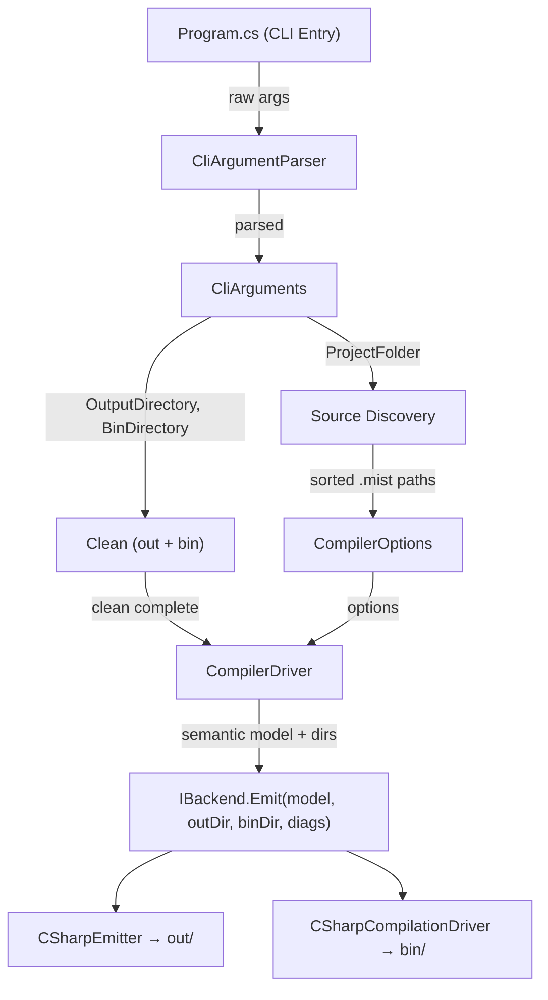

# Design Document: Project-Based Build Model

## Overview

This feature replaces the Mist compiler's current file-list CLI model with a project-folder-based build model. Today, `Mist.CLI` accepts zero or more positional arguments (individual `.mist` files or directories) and expands them into source paths. The new model accepts exactly one positional argument — a project folder — and automatically discovers all `.mist` files within it. Build output is split into two directories inside the project folder: `out/` for intermediate generated source (emitted C# and `.csproj`) and `bin/` for the final compiled artifact (DLL/executable). Both directories are cleaned before every build.

The change touches seven components across two projects (`Mist.CLI` and `Mist`):

1. `CliArguments` — data model change from file list to single project folder + new `BinDirectory` field
2. `CliArgumentParser` — validation logic for single project folder, `--bin` flag, filesystem checks
3. `CompilerOptions` — new `ProjectFolder` and `BinDirectory` fields
4. `Program.cs` — source discovery from project folder, dual-directory clean, updated lex mode
5. `IBackend` / `BackendResult` — `Emit` signature gains `binDirectory` parameter
6. `CSharpTranspilerBackend` — passes `binDirectory` through to compilation driver
7. `CSharpEmitter` / `CSharpCompilationDriver` — emitter writes to `outputDirectory`, compilation driver places artifact in `binDirectory`

## Architecture



The data flow is linear: CLI parses args → resolves defaults → discovers sources → cleans directories → builds `CompilerOptions` → hands off to `CompilerDriver` → backend emits to `out/`, compiles to `bin/`.

## Components and Interfaces

### 1. CliArguments (Data Model Change)

**File:** `Source/Mist.CLI/Args/CliArguments.cs`

**Current:**
```csharp
public sealed record CliArguments(
    IReadOnlyList<string> SourceFiles,
    string BackendId = "csharp",
    string OutputDirectory = "./out",
    CompilerMode Mode = CompilerMode.Compile);
```

**New:**
```csharp
public sealed record CliArguments(
    string ProjectFolder,
    string BackendId = "csharp",
    string OutputDirectory = "",
    string BinDirectory = "",
    CompilerMode Mode = CompilerMode.Compile);
```

- `SourceFiles` is removed entirely. Replaced by `ProjectFolder` (a single directory path).
- `OutputDirectory` default becomes `""` (empty string) — the CLI resolves it to `<ProjectFolder>/out` when empty.
- `BinDirectory` is new — defaults to `""`, resolved to `<ProjectFolder>/bin` when empty.
- `BackendId` and `Mode` are unchanged.

### 2. CliArgumentParser (Validation Logic)

**File:** `Source/Mist.CLI/Args/CliArgumentParser.cs`

Changes to `Parse()`:

- Track a single `string? projectFolder` instead of `List<string> sourceFiles`.
- Add `--bin` flag handling (same pattern as `--output`).
- After the parsing loop, apply validation:
  - If more than one positional argument was collected, emit error: `"Only a single project folder is accepted."`.
  - If exactly one positional argument:
    - If it's a file (`File.Exists(arg)`), emit error: `"Individual file paths are no longer accepted. Provide a project folder instead."`.
    - If it's not an existing directory (`!Directory.Exists(arg)`), emit error: `"Directory does not exist: '{arg}'."`.
  - If zero positional arguments, set `projectFolder` to `Directory.GetCurrentDirectory()`.
- Resolve `outputDirectory`: if still the default empty string, set to `Path.Combine(projectFolder, "out")`.
- Resolve `binDirectory`: if still the default empty string, set to `Path.Combine(projectFolder, "bin")`.

**New `--bin` flag parsing** (inserted alongside existing `--output` handling):
```csharp
else if (arg == "--bin")
{
    if (i + 1 >= args.Length)
        errors.Add(new CliParseError("Missing value for --bin flag."));
    else
    {
        i++;
        binDirectory = args[i];
    }
}
```

### 3. CompilerOptions (New Fields)

**File:** `Source/Mist/Driver/Contracts/CompilerOptions.cs`

**Current:**
```csharp
public sealed record CompilerOptions(
    ImmutableArray<string> SourcePaths,
    BackendId Backend,
    string OutputDirectory,
    ImmutableArray<string> EnabledAnalyzerIds);
```

**New:**
```csharp
public sealed record CompilerOptions(
    string ProjectFolder,
    ImmutableArray<string> SourcePaths,
    BackendId Backend,
    string OutputDirectory,
    string BinDirectory,
    ImmutableArray<string> EnabledAnalyzerIds);
```

- `ProjectFolder` — resolved absolute path of the project root.
- `BinDirectory` — resolved path for the final compiled artifact.
- `SourcePaths` and `OutputDirectory` remain, with `OutputDirectory` now meaning "intermediate output."

### 4. Program.cs (Orchestration Changes)

**File:** `Source/Mist.CLI/Program.cs`

**Source discovery** replaces the current expand-directories logic with a single call:

```csharp
var sourceFiles = Directory.EnumerateFiles(cliArgs.ProjectFolder, "*.mist", SearchOption.AllDirectories)
    .OrderBy(f => f, StringComparer.Ordinal)
    .ToList();
```

**Clean logic** — new helper method called before compilation or lex:

```csharp
static void CleanDirectory(string path)
{
    if (!Directory.Exists(path)) return;
    var di = new DirectoryInfo(path);
    foreach (var file in di.GetFiles()) file.Delete();
    foreach (var dir in di.GetDirectories()) dir.Delete(true);
}
```

Called as:
```csharp
try
{
    CleanDirectory(cliArgs.OutputDirectory);
    CleanDirectory(cliArgs.BinDirectory);
}
catch (IOException ex)
{
    Console.Error.WriteLine($"error: Failed to clean build directories: {ex.Message}");
    return 1;
}
```

**CompilerOptions construction** updated:
```csharp
var options = new CompilerOptions(
    ProjectFolder: Path.GetFullPath(cliArgs.ProjectFolder),
    SourcePaths: [.. sourceFiles],
    Backend: new BackendId(cliArgs.BackendId),
    OutputDirectory: cliArgs.OutputDirectory,
    BinDirectory: cliArgs.BinDirectory,
    EnabledAnalyzerIds: ImmutableArray<string>.Empty);
```

**Usage string** updated:
```
Usage: mist [project-folder] [--backend <id>] [--output <dir>] [--bin <dir>] [--mode <compile|lex>]
```

**Lex mode** — `RunLexMode` signature changes to accept the output directory (already does) and the clean happens before the mode switch, so lex mode benefits from the same dual-directory clean. The lex output path `Path.Combine(outputDirectory, "lexer")` is unchanged.

### 5. IBackend Interface (Signature Change)

**File:** `Source/Mist/Backends/Contracts/IBackend.cs`

**Current:**
```csharp
BackendResult Emit(ISemanticModel model, string outputDirectory, DiagnosticBag diagnostics);
```

**New:**
```csharp
BackendResult Emit(ISemanticModel model, string outputDirectory, string binDirectory, DiagnosticBag diagnostics);
```

The new `binDirectory` parameter tells the backend where to place the final compiled artifact, separate from the intermediate `outputDirectory`.

### 6. CSharpTranspilerBackend (Pass-Through)

**File:** `Source/Mist/Backends/CSharpTranspiler/CSharpTranspilerBackend.cs`

The `Emit` method signature gains `string binDirectory`. It passes `outputDirectory` to `CSharpEmitter.Emit` (unchanged) and passes `binDirectory` to `CSharpCompilationDriver.Compile`:

```csharp
public BackendResult Emit(ISemanticModel model, string outputDirectory, string binDirectory, DiagnosticBag diagnostics)
{
    // Step 1: Emit C# source files to outputDirectory
    CSharpEmitter.Emit(model, outputDirectory, bag);
    // ...
    // Step 2: Compile, placing artifact in binDirectory
    var compileResult = CSharpCompilationDriver.Compile(outputDirectory, binDirectory, bag);
    return compileResult;
}
```

### 7. CSharpCompilationDriver (Bin Directory)

**File:** `Source/Mist/Backends/CSharpTranspiler/CSharpCompilationDriver.cs`

**Current signature:**
```csharp
public static BackendResult Compile(string projectDirectory, DiagnosticBag diagnostics)
```

**New signature:**
```csharp
public static BackendResult Compile(string projectDirectory, string binDirectory, DiagnosticBag diagnostics)
```

The `dotnet build` invocation changes to pass `--output` pointing to `binDirectory`:

```csharp
var psi = new ProcessStartInfo
{
    FileName = "dotnet",
    Arguments = $"build --output \"{binDirectory}\"",
    WorkingDirectory = projectDirectory,
    // ...
};
```

The artifact path calculation changes from the hardcoded `bin/Debug/net10.0/` path to:

```csharp
string? artifactPath = succeeded
    ? Path.Combine(binDirectory, "MistOutput.dll")
    : null;
```

### 8. CompilerDriver (Wiring)

**File:** `Source/Mist/Driver/CompilerDriver.cs`

The backend `Emit` call in `Compile()` changes from:

```csharp
var backendResult = backend.Emit(semanticModel, options.OutputDirectory, backendBag);
```

to:

```csharp
var backendResult = backend.Emit(semanticModel, options.OutputDirectory, options.BinDirectory, backendBag);
```

### 9. CSharpEmitter (No Change)

`CSharpEmitter.Emit(model, outputDirectory, diagnostics)` is unchanged — it already writes to `outputDirectory`. The emitter does not need to know about `binDirectory`.

## Data Models

### CliArguments (before → after)

| Field | Before | After |
|---|---|---|
| `SourceFiles` | `IReadOnlyList<string>` | **Removed** |
| `ProjectFolder` | — | `string` (new) |
| `BackendId` | `string` (default `"csharp"`) | unchanged |
| `OutputDirectory` | `string` (default `"./out"`) | `string` (default `""`, resolved to `<ProjectFolder>/out`) |
| `BinDirectory` | — | `string` (new, default `""`, resolved to `<ProjectFolder>/bin`) |
| `Mode` | `CompilerMode` | unchanged |

### CompilerOptions (before → after)

| Field | Before | After |
|---|---|---|
| `ProjectFolder` | — | `string` (new) |
| `SourcePaths` | `ImmutableArray<string>` | unchanged |
| `Backend` | `BackendId` | unchanged |
| `OutputDirectory` | `string` | unchanged (now means intermediate output) |
| `BinDirectory` | — | `string` (new) |
| `EnabledAnalyzerIds` | `ImmutableArray<string>` | unchanged |

### IBackend.Emit Signature (before → after)

| Parameter | Before | After |
|---|---|---|
| `model` | `ISemanticModel` | unchanged |
| `outputDirectory` | `string` | unchanged (intermediate) |
| `binDirectory` | — | `string` (new, final artifact) |
| `diagnostics` | `DiagnosticBag` | unchanged |


## Correctness Properties

*A property is a characteristic or behavior that should hold true across all valid executions of a system — essentially, a formal statement about what the system should do. Properties serve as the bridge between human-readable specifications and machine-verifiable correctness guarantees.*

The prework analysis identified 7 consolidated properties from the 9 requirements. Structural/smoke checks (6.1–6.4, 7.1–7.3) and integration wiring checks (3.5, 3.6, 9.1–9.4) are excluded from PBT — they are verified by compilation and integration tests. The remaining behavioral properties are:

### Property 1: Single positional argument sets ProjectFolder

*For any* single string argument that corresponds to an existing directory, parsing that argument array should produce a `CliArguments` with `ProjectFolder` equal to that directory path and no parse errors.

**Validates: Requirements 1.1**

### Property 2: Multiple positional arguments produce a parse error

*For any* argument array containing two or more positional (non-flag) arguments, parsing should produce at least one error indicating that only a single project folder is accepted.

**Validates: Requirements 1.3**

### Property 3: Non-directory positional argument produces a parse error

*For any* single positional argument that is either an existing file path or a path that does not exist as a directory, parsing should produce a parse error rejecting the argument.

**Validates: Requirements 1.4, 1.5**

### Property 4: Source discovery returns exactly the sorted .mist files

*For any* directory tree containing an arbitrary mix of `.mist` and non-`.mist` files, source discovery should return exactly the set of `.mist` files, and the returned list should be sorted in ordinal string order.

**Validates: Requirements 2.1, 2.2**

### Property 5: Default directories are derived from ProjectFolder

*For any* valid project folder path parsed without explicit `--output` or `--bin` flags, the resolved `OutputDirectory` should equal `<ProjectFolder>/out` and the resolved `BinDirectory` should equal `<ProjectFolder>/bin`.

**Validates: Requirements 3.1, 3.3**

### Property 6: Explicit flag values override directory defaults

*For any* valid project folder and any explicit `--output` and `--bin` flag values, the resolved `OutputDirectory` and `BinDirectory` should equal the explicitly provided values, not the defaults.

**Validates: Requirements 3.2, 3.4**

### Property 7: Clean removes all directory contents

*For any* existing directory containing an arbitrary set of files and subdirectories, after the clean operation completes, the directory should exist but contain zero files and zero subdirectories.

**Validates: Requirements 4.1, 4.2**

## Error Handling

| Scenario | Component | Behavior |
|---|---|---|
| Multiple positional args | `CliArgumentParser` | Return `CliParseError` with message, print usage to stderr, exit 1 |
| Positional arg is a file | `CliArgumentParser` | Return `CliParseError`: "Individual file paths are no longer accepted." |
| Positional arg directory doesn't exist | `CliArgumentParser` | Return `CliParseError`: "Directory does not exist: '{path}'." |
| Missing value for `--bin` | `CliArgumentParser` | Return `CliParseError`: "Missing value for --bin flag." |
| No `.mist` files found | `Program.cs` | Print error to stderr, exit 1 |
| Clean fails (IOException) | `Program.cs` | Print error to stderr, exit 1 (build aborted) |
| `dotnet build` fails | `CSharpCompilationDriver` | Return `BackendResult(Succeeded: false)` with diagnostics |

All existing error paths (unknown backend, file read failures, lex/parse/semantic errors) are unchanged.

## Testing Strategy

### Unit Tests (Example-Based)

- **CliArgumentParser**: Test specific scenarios:
  - No arguments → ProjectFolder = cwd, OutputDirectory = cwd/out, BinDirectory = cwd/bin
  - Single valid directory → correct ProjectFolder
  - Single file path → parse error
  - Non-existent path → parse error
  - Two positional args → parse error
  - `--bin /custom/path` → BinDirectory set correctly
  - `--bin` without value → parse error
  - Zero `.mist` files → error message
  - Lex mode with project folder → correct source discovery and output path

- **CSharpCompilationDriver**: Verify `dotnet build --output` argument includes `binDirectory`.

- **CompilerDriver wiring**: Verify `Emit` is called with both `outputDirectory` and `binDirectory`.

### Property-Based Tests

Property-based tests use [FsCheck](https://fscheck.github.io/FsCheck/) (the standard .NET PBT library). Each test runs a minimum of 100 iterations.

| Property | Test Description | Tag |
|---|---|---|
| 1 | Generate random existing-directory paths, verify parser sets ProjectFolder | `Feature: project-based-build-model, Property 1: Single positional argument sets ProjectFolder` |
| 2 | Generate arrays of 2+ positional args, verify parse error | `Feature: project-based-build-model, Property 2: Multiple positional arguments produce a parse error` |
| 3 | Generate file paths and non-existent paths, verify parse error | `Feature: project-based-build-model, Property 3: Non-directory positional argument produces a parse error` |
| 4 | Generate random directory trees with mixed extensions, verify discovery returns sorted .mist-only list | `Feature: project-based-build-model, Property 4: Source discovery returns exactly the sorted .mist files` |
| 5 | Generate random folder paths without flags, verify defaults are `<folder>/out` and `<folder>/bin` | `Feature: project-based-build-model, Property 5: Default directories are derived from ProjectFolder` |
| 6 | Generate random folder + explicit flag values, verify overrides | `Feature: project-based-build-model, Property 6: Explicit flag values override directory defaults` |
| 7 | Generate random directory contents, run clean, verify empty | `Feature: project-based-build-model, Property 7: Clean removes all directory contents` |

### Integration Tests

- End-to-end: create a temp project folder with `.mist` files, invoke the compiler, verify `out/` contains `.cs` + `.csproj`, `bin/` contains `MistOutput.dll`.
- Lex mode: create a temp project folder, invoke with `--mode lex`, verify `out/lexer/` contains `.tokens` files.
- Clean verification: pre-populate `out/` and `bin/` with stale files, run build, verify stale files are gone and new artifacts are present.
