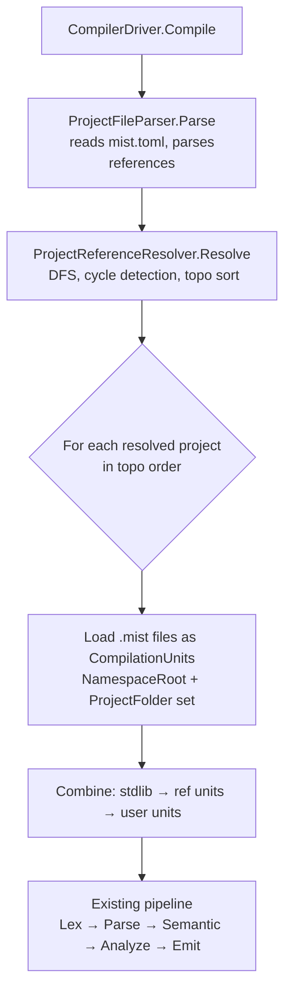

# Design Document: Project References

## Overview

This feature adds multi-project support to the Mist compiler. A project declares dependencies on other Mist projects via a `[[references]]` array in `mist.toml`. The compiler resolves each reference, recompiles the referenced project's sources from scratch, and makes its public symbols available to the referencing project's semantic model.

Visibility is deliberately flat (Requirement 6): every project the reference graph reaches, at any depth, is compiled, and its types are reachable from every other project on the terms their declared accessibility gives, as in C#, where the only visibility boundary is the assembly.

### Key Design Decisions

1. **Source-only**: Referenced projects are always recompiled from source. No pre-built artifact linking.
2. **Path resolution in parser**: Relative/absolute path normalization happens inside `ProjectFileParser`. Existence checks and file-vs-directory disambiguation happen in `ProjectReferenceResolver`.
3. **Resolver owns the graph walk**: A new `ProjectReferenceResolver` class performs DFS-based recursive resolution, cycle detection, deduplication, and topological ordering. `CompilerDriver` delegates entirely to it.
4. **Unit ordering**: `stdlib → referenced project units (deepest first) → user units`. This mirrors the existing stdlib-prepend pattern.
5. **Transitive visibility**: Not restricted. Each `CompilationUnit` is tagged with its originating project's canonical path so the program model can group units into that project's assembly, but no lookup is filtered by reference depth.

---

## Architecture



The resolver is a pure in-memory graph walk over the file system. It does not invoke the compiler pipeline recursively — it only reads `mist.toml` files and collects source file paths. The actual compilation of all units (stdlib + referenced + user) happens in a single unified pipeline pass, exactly as today.

---

## Components and Interfaces

### `ProjectReference` (new record)

```csharp
namespace Mist.Driver.Contracts;

/// <summary>
/// A single entry from the [[references]] array in mist.toml.
/// Carries the raw path string as written by the user; resolution to a
/// canonical file-system path is performed by ProjectReferenceResolver.
/// </summary>
public sealed record ProjectReference(string Path);
```

### `ProjectConfiguration` (updated)

```csharp
public sealed record ProjectConfiguration(
    string Name,
    string NamespaceRoot,
    ImmutableArray<ProjectReference> References);
```

The third parameter defaults to `ImmutableArray<ProjectReference>.Empty` when no `[[references]]` section is present, preserving backward compatibility with all existing call sites that only pass `Name` and `NamespaceRoot` — those will need to be updated to pass the empty array explicitly, or a factory overload can be provided.

### `CompilationUnit` (updated)

An `OriginProjectPath` init property records which project a unit came from:

```csharp
/// <summary>
/// The canonical path of the project that directly declared this unit as a
/// reference. Null for stdlib units and for the top-level user project's own
/// units. Groups a unit with the MistProject it came from.
/// </summary>
public string? OriginProjectPath { get; init; }
```

### `ProjectReferenceResolver` (new class)

```csharp
namespace Mist.Driver;

/// <summary>
/// Resolves the [[references]] graph declared in a project's mist.toml,
/// performing cycle detection, deduplication, and topological ordering.
/// Returns a flat list of ResolvedProjectReference values ordered
/// deepest-dependency-first, ready for CompilationUnit loading.
/// </summary>
public sealed class ProjectReferenceResolver
{
    public static ImmutableArray<ResolvedProjectReference> Resolve(
        string rootProjectFolder,
        ImmutableArray<ProjectReference> references,
        DiagnosticBag diagnostics);
}

/// <summary>
/// A fully resolved project reference: canonical mist.toml path,
/// project folder, parsed configuration, and source file paths.
/// </summary>
public sealed record ResolvedProjectReference(
    string CanonicalTomlPath,
    string ProjectFolder,
    ProjectConfiguration Configuration,
    ImmutableArray<string> SourcePaths);
```

The resolver is a static method (matching the `ProjectFileParser.Parse` pattern) that takes the root project folder and its declared references, and returns a topologically ordered list. It uses two sets for DFS cycle detection: `visited` (fully processed) and `inProgress` (currently on the DFS stack).

### `ProjectFileParser` (updated)

The `Parse` method gains logic to read the `[[references]]` array from the TOML model and populate `ProjectConfiguration.References`. Path normalization (relative → absolute, canonicalization, file-vs-directory disambiguation) is performed here and stored in `ProjectReference.Path` as the normalized absolute path. Existence checks are deferred to `ProjectReferenceResolver`.

---

## Data Models

### `mist.toml` format

```toml
name = "MyApp"
namespace_root = "MyApp"   # optional

[[references]]
path = "../SharedLib"      # directory containing mist.toml

[[references]]
path = "../Utils/mist.toml"  # direct path to mist.toml
```

Multiple `[[references]]` entries use TOML array-of-tables syntax. Each entry must have a `path` field. Unknown fields within an entry are silently ignored (forward-compatible).

### `ProjectReference` record

| Field  | Type     | Description                                                                 |
|--------|----------|-----------------------------------------------------------------------------|
| `Path` | `string` | Normalized absolute path to the referenced project's `mist.toml` file, as computed by `ProjectFileParser`. |

### `ResolvedProjectReference` record

| Field               | Type                          | Description                                              |
|---------------------|-------------------------------|----------------------------------------------------------|
| `CanonicalTomlPath` | `string`                      | Canonical absolute path to the referenced `mist.toml`.  |
| `ProjectFolder`     | `string`                      | Directory containing the `mist.toml`.                   |
| `Configuration`     | `ProjectConfiguration`        | Parsed project configuration.                           |
| `SourcePaths`       | `ImmutableArray<string>`      | All `.mist` files in `ProjectFolder` (sorted, stable).  |

### Diagnostic IDs (new)

| ID                                        | Stage    | Message template                                                                 |
|-------------------------------------------|----------|----------------------------------------------------------------------------------|
| `MIST_PROJECT_REFERENCE_MISSING_PATH`     | Driver   | `Reference entry in '{tomlPath}' is missing the required 'path' field.`         |
| `MIST_PROJECT_REFERENCE_EMPTY_PATH`       | Driver   | `Reference entry in '{tomlPath}' has an empty or whitespace 'path' field.`      |
| `MIST_PROJECT_REFERENCE_NOT_FOUND`        | Driver   | `Referenced project path '{normalizedPath}' does not exist.`                    |
| `MIST_PROJECT_REFERENCE_NO_PROJECT_FILE`  | Driver   | `Referenced directory '{normalizedPath}' does not contain a 'mist.toml' file.`  |
| `MIST_PROJECT_CIRCULAR_REFERENCE`         | Driver   | `Circular project reference detected: {A} → {B} → ... → {A}.`                  |

---

## Detailed Component Design

### `ProjectFileParser` changes

After the existing `namespace_root` parsing (step 8), a new step 9 reads the `[[references]]` array:

```
9. Read [[references]] array (optional)
   a. If "references" key is absent → References = ImmutableArray.Empty
   b. If present but not a TomlTableArray → report MIST_PROJECT_TOML_ERROR, return null
   c. For each entry in the array:
      i.  If "path" key is absent → report MIST_PROJECT_REFERENCE_MISSING_PATH, return null
      ii. If path value is not a string → report MIST_PROJECT_REFERENCE_MISSING_PATH, return null
      iii.If path string is empty or whitespace → report MIST_PROJECT_REFERENCE_EMPTY_PATH, return null
      iv. Normalize path:
          - If relative: Path.GetFullPath(Path.Combine(projectFolder, rawPath))
          - If absolute: Path.GetFullPath(rawPath)  [canonicalizes . and ..]
          - If normalized path is a directory: append "mist.toml"
          (Existence checks are NOT performed here — deferred to resolver)
      v.  Add ProjectReference(normalizedPath) to the list
   d. Return ProjectConfiguration(name, namespaceRoot, references.ToImmutable())
```

The parser does not check whether the normalized path exists. That responsibility belongs to `ProjectReferenceResolver`, which has the full context needed to produce good diagnostics (including the referencing project's name in the cycle chain).

### `ProjectReferenceResolver` algorithm

```
Resolve(rootProjectFolder, references, diagnostics):
  visited    = HashSet<string>   // canonical paths fully processed
  inProgress = HashSet<string>   // canonical paths currently on DFS stack
  result     = List<ResolvedProjectReference>  // topo order, deepest first

  rootCanonical = Path.GetFullPath(rootProjectFolder)

  DFS(canonicalTomlPath, chain):
    // chain = list of canonical paths from root to current (for cycle messages)

    if canonicalTomlPath in visited:
      return  // already processed, deduplicated

    if canonicalTomlPath in inProgress:
      // Cycle detected — build chain string
      cycleStart = chain.IndexOf(canonicalTomlPath)
      cycleChain = chain[cycleStart..] + [canonicalTomlPath]
      report MIST_PROJECT_CIRCULAR_REFERENCE with chain string
      return

    // Existence and file-vs-directory checks
    if not File.Exists(canonicalTomlPath):
      report MIST_PROJECT_REFERENCE_NOT_FOUND
      return
    if Path.GetFileName(canonicalTomlPath) != "mist.toml":
      report MIST_PROJECT_REFERENCE_NOT_FOUND
      return

    inProgress.Add(canonicalTomlPath)
    chain.Add(canonicalTomlPath)

    // Parse the referenced project's mist.toml
    projectFolder = Path.GetDirectoryName(canonicalTomlPath)
    parseBag = new DiagnosticBag()
    config = ProjectFileParser.Parse(projectFolder, parseBag)
    propagate parseBag diagnostics to outer diagnostics
    if config is null:
      inProgress.Remove(canonicalTomlPath)
      chain.RemoveLast()
      return

    // Recurse into transitive references
    for each ref in config.References:
      DFS(ref.Path, chain)  // ref.Path is already normalized by parser

    // Post-order: add after all dependencies
    sourcePaths = Directory.GetFiles(projectFolder, "*.mist", AllDirectories)
                           sorted by StringComparer.Ordinal
    result.Add(ResolvedProjectReference(canonicalTomlPath, projectFolder, config, sourcePaths))
    visited.Add(canonicalTomlPath)
    inProgress.Remove(canonicalTomlPath)
    chain.RemoveLast()

  // Kick off DFS for each direct reference of the root project
  for each ref in references:
    DFS(ref.Path, [rootCanonical])

  return result.ToImmutableArray()
```

**Deduplication**: The `visited` set ensures each project is added to `result` exactly once, even if it is reachable via multiple paths in the reference graph (diamond dependency pattern).

**Topological order**: Post-order DFS naturally produces deepest-dependency-first ordering. If C is a dependency of B, C is added to `result` before B.

**Error accumulation**: The resolver continues processing independent branches after encountering an error (missing file, invalid TOML), collecting all diagnostics before returning. Cycles cause early return for that branch only.

### `CompilerDriver` changes

In `CompilerDriver.Compile`, after loading stdlib units and before loading user units, insert reference resolution:

```
// Step 1b: Load stdlib (existing)
var stdlibUnits = StdlibLoader.LoadFor(backend, stdlibBag);
...

// Step 1c: Resolve project references (NEW)
var refBag = new DiagnosticBag();
ImmutableArray<CompilationUnit> refUnits = ImmutableArray<CompilationUnit>.Empty;

if (!string.IsNullOrEmpty(options.ProjectFolder))
{
    var projectConfig = ProjectFileParser.Parse(options.ProjectFolder, refBag);
    // propagate refBag diagnostics
    if (projectConfig is not null && !projectConfig.References.IsEmpty)
    {
        var resolved = ProjectReferenceResolver.Resolve(
            options.ProjectFolder,
            projectConfig.References,
            refBag);
        // propagate refBag diagnostics
        if (!refBag.HasErrors)
        {
            var refUnitBuilder = ImmutableArray.CreateBuilder<CompilationUnit>();
            foreach (var proj in resolved)
            {
                foreach (var path in proj.SourcePaths)
                {
                    var contents = File.ReadAllText(path);
                    var sourceText = new SourceText(path, contents);
                    refUnitBuilder.Add(new CompilationUnit(sourceText)
                    {
                        NamespaceRoot = proj.Configuration.NamespaceRoot,
                        ProjectFolder = proj.ProjectFolder,
                        OriginProjectPath = proj.CanonicalTomlPath,
                    });
                }
            }
            refUnits = refUnitBuilder.ToImmutable();
        }
    }
}

if (refBag.HasErrors)
    return new CompilerResult(false, null, allDiagnostics.ToImmutableArray());

// Step 1d: Combine units (updated)
// Order: stdlib → referenced project units (deepest first) → user units
var combinedUnits = ImmutableArray.CreateBuilder<CompilationUnit>(
    stdlibUnits.Length + refUnits.Length + userUnits.Count);
combinedUnits.AddRange(stdlibUnits);
combinedUnits.AddRange(refUnits);
combinedUnits.AddRange(userUnits);
```

The driver re-parses the root project's `mist.toml` here (it was already parsed by the CLI to build `CompilerOptions`, but the driver needs the `References` list). This is acceptable because the driver is the authoritative orchestrator and the parse is cheap. Alternatively, `CompilerOptions` could carry the parsed `ProjectConfiguration` — this is noted as a possible future refactor.

### Transitive visibility

**Mechanism**: Each `CompilationUnit` carries `OriginProjectPath` — the canonical path of the `mist.toml` of the project that owns that unit. Units from the user's own project and stdlib have `OriginProjectPath = null`. The program model uses the tag only to place each unit in its project's assembly (`MistAssemblyKind.Reference` for a referenced project).

**Flat by design**: The driver records the compilation's projects as `MistProject` values in a flat list, with no reference edges and no direct-versus-transitive marking. Name resolution therefore does not depend on how many reference hops separate two projects: a type declared in a transitively referenced project resolves from the root project exactly as one from a direct reference does, subject to its declared accessibility. No diagnostic asks a project to reference a transitive dependency explicitly (Requirements 6.2–6.4).

---

## Correctness Properties

*A property is a characteristic or behavior that should hold true across all valid executions of a system — essentially, a formal statement about what the system should do. Properties serve as the bridge between human-readable specifications and machine-verifiable correctness guarantees.*

### Property Reflection

Before writing properties, reviewing the prework for redundancy:

- 1.1 (parser accepts references) and 1.6 / 8.1 / 8.2 (round-trip) all test the same core parsing behavior. They can be unified into a single round-trip property.
- 1.4 (empty/whitespace path rejection) and 2.3 (path normalization) are distinct enough to keep separate.
- 3.3 (parse-once deduplication) and 5.4/5.5 (ordering) are distinct properties.
- 4.1 and 4.3 (cycle detection for various cycle shapes) can be unified into one property over cycle length.
- 5.2 and 5.3 (NamespaceRoot and ProjectFolder on units) can be combined into one "unit metadata" property.
- 7.2 (cycle message contains chain) is subsumed by 4.1 if the cycle property also checks the message.
- 7.4 (all errors reported) is a distinct property about error accumulation.
- 6.2 and 6.4 (transitive visibility at all depths) can be unified.

After reflection, the consolidated set of properties is:

---

### Property 1: mist.toml references round-trip

*For any* valid `ProjectConfiguration` containing a non-empty list of `ProjectReference` entries (each with a valid path string), serializing it to a `mist.toml` TOML string and then parsing that string with `ProjectFileParser.Parse` SHALL produce a `ProjectConfiguration` whose `References` list is equivalent to the original (same paths, same order).

**Validates: Requirements 1.1, 1.6, 8.1, 8.2**

---

### Property 2: Empty/whitespace reference paths are rejected

*For any* string composed entirely of whitespace characters (space, tab, newline, carriage return), using it as the `path` value in a `[[references]]` entry SHALL cause `ProjectFileParser.Parse` to return `null` and report a `MIST_PROJECT_REFERENCE_EMPTY_PATH` diagnostic whose message includes the path to the `mist.toml` file.

**Validates: Requirements 1.4, 7.3**

---

### Property 3: Unknown fields in [[references]] entries are ignored

*For any* valid `[[references]]` entry (with a valid `path` field) augmented with any number of additional unknown key-value fields, `ProjectFileParser.Parse` SHALL succeed and the resulting `ProjectReference` SHALL preserve the `path` value unchanged.

**Validates: Requirements 8.3**

---

### Property 4: Cycle detection for cycles of any length

*For any* reference graph containing a cycle of length N ≥ 1 (including direct self-references A → A and two-node cycles A → B → A), `ProjectReferenceResolver.Resolve` SHALL report a `MIST_PROJECT_CIRCULAR_REFERENCE` diagnostic whose message contains all nodes in the cycle chain, and SHALL return a failure result.

**Validates: Requirements 4.1, 4.2, 4.3, 7.2**

---

### Property 5: Deduplication — each project parsed exactly once

*For any* reference graph where the same project P is reachable via multiple paths (diamond dependency or repeated direct references), `ProjectReferenceResolver.Resolve` SHALL include P's units in the compilation exactly once, regardless of how many times P appears in the graph.

**Validates: Requirements 3.3**

---

### Property 6: Referenced unit metadata is correct

*For any* successfully resolved referenced project with namespace root R and project folder F, every `CompilationUnit` loaded from that project SHALL have `NamespaceRoot == R` and `ProjectFolder == F`.

**Validates: Requirements 5.2, 5.3**

---

### Property 7: Topological ordering — deepest dependency first

*For any* reference chain A → B → C (A references B, B references C), the `CompilationUnit`s from C SHALL appear before those from B in the combined compilation unit list, and both SHALL appear before A's own units.

**Validates: Requirements 5.4, 5.5**

---

### Property 8: Transitive types are visible on the same terms as direct ones

*For any* reference graph where A references B and B references C (but A does not reference C), a public type declared in C's source files SHALL be resolvable by name from A's compilation context.

**Validates: Requirements 6.2, 6.4**

---

### Property 9: All independent reference errors are reported

*For any* project with N independent invalid references (each pointing to a non-existent path), `ProjectReferenceResolver.Resolve` SHALL report N diagnostics — one per invalid reference — rather than stopping at the first error.

**Validates: Requirements 7.4**

---

## Error Handling

### Diagnostic IDs in `DiagnosticId.cs`

```csharp
// ── Project reference diagnostics ────────────────────────────────────

/// <summary>A [[references]] entry is missing the required 'path' field.</summary>
public static readonly DiagnosticId ProjectReferenceMissingPath =
    new("MIST_PROJECT_REFERENCE_MISSING_PATH");

/// <summary>A [[references]] entry has an empty or whitespace 'path' field.</summary>
public static readonly DiagnosticId ProjectReferenceEmptyPath =
    new("MIST_PROJECT_REFERENCE_EMPTY_PATH");

/// <summary>The normalized reference path does not point to an existing file or directory.</summary>
public static readonly DiagnosticId ProjectReferenceNotFound =
    new("MIST_PROJECT_REFERENCE_NOT_FOUND");

/// <summary>The normalized reference path points to a directory with no mist.toml.</summary>
public static readonly DiagnosticId ProjectReferenceNoProjectFile =
    new("MIST_PROJECT_REFERENCE_NO_PROJECT_FILE");

/// <summary>A circular reference was detected in the project reference graph.</summary>
public static readonly DiagnosticId ProjectCircularReference =
    new("MIST_PROJECT_CIRCULAR_REFERENCE");
```

### Error propagation strategy

- `ProjectFileParser.Parse` returns `null` on any reference parsing error (consistent with existing behavior for name/namespace errors).
- `ProjectReferenceResolver.Resolve` accumulates all diagnostics and returns an empty array on any error. The driver checks `diagnostics.HasErrors` after the call and short-circuits before loading units.
- Errors in a referenced project's `mist.toml` are propagated verbatim from the inner `DiagnosticBag` to the outer one, with no wrapping. The `CompilationUnitPath` on each diagnostic already identifies the offending file.
- Cycle detection aborts the current DFS branch but continues processing other independent branches, allowing multiple errors to be reported in a single compilation.

### Edge cases

| Scenario | Behavior |
|---|---|
| Reference to self (`path = "."`) | Detected as a cycle (A → A) |
| Two projects referencing each other | Detected as a two-node cycle (A → B → A) |
| Diamond dependency (A→B, A→C, B→D, C→D) | D is compiled once (deduplication via `visited` set) |
| Reference path points to a `.mist` file (not `mist.toml`) | `MIST_PROJECT_REFERENCE_NOT_FOUND` |
| Reference path is a directory with no `mist.toml` | `MIST_PROJECT_REFERENCE_NO_PROJECT_FILE` |
| Referenced project has zero `.mist` files | Resolved successfully; zero units added (not an error) |
| `[[references]]` array is present but empty | Parsed as empty references list; no error |

---

## Testing Strategy

### Unit tests (`ProjectFileParserTests` additions)

Specific example-based tests for deterministic error paths:

- Missing `path` field in `[[references]]` entry → `MIST_PROJECT_REFERENCE_MISSING_PATH`
- Empty string `path` → `MIST_PROJECT_REFERENCE_EMPTY_PATH`
- No `[[references]]` section → `References` is empty
- `[[references]]` with a direct `mist.toml` path → path used as-is
- `[[references]]` with a directory path → `mist.toml` appended
- Absolute path in `path` field → used directly after canonicalization
- Relative path with `..` segments → canonicalized correctly

### Unit tests (`ProjectReferenceResolverTests`)

- Non-existent path → `MIST_PROJECT_REFERENCE_NOT_FOUND`
- Directory without `mist.toml` → `MIST_PROJECT_REFERENCE_NO_PROJECT_FILE`
- File not named `mist.toml` → `MIST_PROJECT_REFERENCE_NOT_FOUND`
- Invalid referenced `mist.toml` → error propagated
- Diamond dependency → each project appears exactly once in result
- Direct self-reference → `MIST_PROJECT_CIRCULAR_REFERENCE`
- Two-node cycle → `MIST_PROJECT_CIRCULAR_REFERENCE` with both nodes in message
- Multiple independent errors → all reported

### Integration tests (`CompilerDriverReferenceIntegrationTests`)

- Single reference: A references B; B's types are visible in A
- Transitive reference: A→B→C; C's types visible in both A and B
- Explicit transitive: A→B, A→C, B→C; C's types visible in both A and B
- Ordering: units from C appear before B, B before A in `compilation.Units`
- Error propagation: invalid reference in A aborts compilation with correct diagnostic

### Property-based tests (`ProjectReferencePropertyTests`)

All property tests use **in-process compilation** via `CompilerDriver.Compile()` directly. No per-iteration process spawning. A shared `CompilerDriver` instance is reused across all iterations.

**Property 1 — Round-trip** (100 iterations, FsCheck):
- Generator: random list of 1–5 valid path strings (valid name characters, no existence check needed since the parser only normalizes paths)
- Write `mist.toml` with those paths as `[[references]]` entries
- Parse with `ProjectFileParser.Parse`
- Assert `result.References` paths match the input paths (after normalization)
- No process spawning; pure file I/O + in-process parsing

**Property 2 — Whitespace path rejection** (100 iterations, FsCheck):
- Generator: strings of 1–64 whitespace characters
- Write `mist.toml` with that string as a `path` value
- Assert `MIST_PROJECT_REFERENCE_EMPTY_PATH` is reported
- No process spawning

**Property 3 — Unknown fields ignored** (100 iterations, FsCheck):
- Generator: valid path string + random set of unknown key-value pairs
- Write `mist.toml` with the entry including unknown fields
- Assert parse succeeds and path is preserved
- No process spawning

**Property 4 — Cycle detection** (100 iterations, FsCheck):
- Generator: cycle length N from 1 to 5; create N temp directories each with a `mist.toml` referencing the next, with the last referencing the first
- Call `ProjectReferenceResolver.Resolve` in-process
- Assert `MIST_PROJECT_CIRCULAR_REFERENCE` is reported and message contains all node paths
- No process spawning (resolver is pure in-process logic)

**Property 5 — Deduplication** (100 iterations, FsCheck):
- Generator: diamond graph with random number of shared dependencies (1–3)
- Call `ProjectReferenceResolver.Resolve` in-process
- Assert each project's canonical path appears exactly once in the result
- No process spawning

**Property 6 — Unit metadata** (100 iterations, FsCheck):
- Generator: referenced project with random valid name/namespace root and 1–3 source files
- Resolve and load units via `CompilerDriver` in-process
- Assert all units from the referenced project have correct `NamespaceRoot` and `ProjectFolder`
- No process spawning

**Property 7 — Topological ordering** (100 iterations, FsCheck):
- Generator: reference chain of depth 2–4 (A→B→C→...)
- Compile in-process via `CompilerDriver.Compile`
- Assert units from deeper projects appear before units from shallower projects in `compilation.Units`
- No process spawning

**Property 8 — Transitive visibility** (100 iterations, FsCheck):
- Generator: A→B→C where C declares a type with a random valid name
- Compile A in-process; attempt to resolve C's type from A's semantic model
- Assert the type is found and no diagnostic is reported
- No process spawning

**Property 9 — All errors reported** (100 iterations, FsCheck):
- Generator: N (2–5) independent non-existent reference paths
- Call `ProjectReferenceResolver.Resolve` in-process
- Assert exactly N diagnostics are reported
- No process spawning

### PBT library and configuration

- **Library**: FsCheck 3.x with FsCheck.Xunit (already in `Mist.Tests.csproj`)
- **Iterations**: 100 per property (FsCheck default, `MaxTest = 100`)
- **Tag format**: `// Feature: project-references, Property N: <property text>`
- **Shared driver**: A single static `CompilerDriver` instance is shared across all iterations within a test class (stateless, safe to reuse per existing pattern)
- **No process spawning**: All property tests operate at the `ProjectFileParser` / `ProjectReferenceResolver` / `CompilerDriver.Compile` API level. No `Process.Start`, no `dotnet run`.
