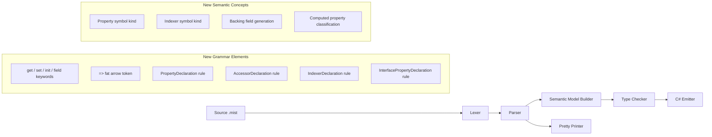

# Design Document: Properties

## Overview

This design adds property support to the Mist compiler, covering the full pipeline from grammar definition through C# emission. Properties are a core C# feature that provides controlled access to data through `get`, `set`, and `init` accessors, with support for auto-properties, block-body accessors, expression-bodied forms, the `field` keyword, static properties, computed properties, interface property declarations, and indexers.

The implementation touches every stage of the compiler pipeline:

1. **Grammar** — New keywords (`get`, `set`, `init`, `field`) and token (`=>`), plus new parser rules for `PropertyDeclaration`, `AccessorDeclaration`, `InterfacePropertyDeclaration`, and `IndexerDeclaration`.
2. **Lexer** — Recognizes the new keyword and operator tokens.
3. **Parser** — Produces AST nodes for all property forms.
4. **Semantic Model** — Registers property/indexer symbols, generates backing fields, classifies computed properties.
5. **Type Checker** — Validates accessor visibility, `value` parameter typing, `init` context, `field` keyword scope, and property access/assignment compatibility.
6. **C# Emitter** — Emits all property forms as valid C# syntax.
7. **Pretty Printer** — Round-trip formats property AST nodes back to Mist source.
8. **Syntax Highlighting** — TextMate grammar updates for new keywords and operators.

## Architecture

The property feature follows the existing compiler pipeline architecture. No new pipeline stages are introduced. Each existing stage is extended to handle property-related AST nodes and symbols.



### Design Decisions

1. **Property as a new MemberDeclaration alternative** — Properties are added as a new `PropertyMember` alternative in the existing `MemberDeclaration` rule, alongside `FieldMember`, `ConstructorMember`, and `MethodMember`. This keeps the grammar extension minimal and consistent.

2. **Accessor as a nested rule** — Each accessor (`get`, `set`, `init`) is modeled as an `AccessorDeclaration` rule with three body forms: auto (semicolon), block, and expression-bodied. This avoids combinatorial explosion in the grammar.

3. **Indexer as a separate MemberDeclaration alternative** — Indexers use `this[...]` syntax which is syntactically distinct from properties. They get their own `IndexerMember` alternative in `MemberDeclaration`.

4. **Interface properties as a separate rule** — Interface property declarations are body-less signatures, distinct from concrete property declarations. They get their own `InterfacePropertyDeclaration` rule alongside the existing `InterfaceMethodDeclaration`.

5. **SymbolKind extension** — Two new symbol kinds are added: `Property` and `Indexer`. This follows the existing pattern where each member type has its own `SymbolKind` value.

6. **Backing field naming convention** — Auto-generated backing fields use the pattern `_<propertyName>_k__BackingField` (similar to C# compiler convention but with a Mist prefix). This avoids collisions with user-defined fields.

7. **field keyword as a Primary expression** — The `field` keyword is added as a new `Primary` alternative (`FieldKeywordExpression`), similar to how `this` is handled. The semantic model resolves it contextually.

## Components and Interfaces

### Grammar Changes (Source/Mist/Grammar/)

#### keywords.storm — New Keyword Tokens

```storm
// Property-related keywords
token GET   = "get";
token SET   = "set";
token INIT  = "init";
token FIELD = "field";
```

#### Mist.storm — New Operator Token

```storm
token FAT_ARROW = "=>";
```

The `FAT_ARROW` token is declared in the operators section of `Mist.storm`, after `GREATER_THAN_OR_EQUAL` and before `PLUS`, so that `=>` is matched before `=` by maximal-munch.

#### Mist.storm — New Parser Rules

**PropertyDeclaration** — A property member with type, name, accessor list, and optional initializer:

```storm
rule PropertyDeclaration
    = modifiers:Modifier* type:TypeReference name:IDENTIFIER
      LEFT_BRACE accessors:AccessorDeclaration+ RIGHT_BRACE
      initializer:(EQUAL Expression SEMICOLON)?                    as BlockProperty
    | modifiers:Modifier* type:TypeReference name:IDENTIFIER
      FAT_ARROW body:Expression SEMICOLON                          as ExpressionBodiedProperty
    ;
```

**AccessorDeclaration** — An individual accessor (get, set, or init) with optional modifier and body:

```storm
rule AccessorDeclaration
    = accessorModifier:Modifier? GET SEMICOLON                                    as AutoGetAccessor
    | accessorModifier:Modifier? GET body:Block                                   as BlockGetAccessor
    | accessorModifier:Modifier? GET FAT_ARROW expression:Expression SEMICOLON    as ExpressionGetAccessor
    | accessorModifier:Modifier? SET SEMICOLON                                    as AutoSetAccessor
    | accessorModifier:Modifier? SET body:Block                                   as BlockSetAccessor
    | accessorModifier:Modifier? SET FAT_ARROW expression:Expression SEMICOLON    as ExpressionSetAccessor
    | accessorModifier:Modifier? INIT SEMICOLON                                   as AutoInitAccessor
    | accessorModifier:Modifier? INIT body:Block                                  as BlockInitAccessor
    | accessorModifier:Modifier? INIT FAT_ARROW expression:Expression SEMICOLON   as ExpressionInitAccessor
    ;
```

**MemberDeclaration update** — Add property and indexer alternatives:

```storm
rule MemberDeclaration
    = constructor:ConstructorDeclaration as ConstructorMember
    | method:MethodDeclaration           as MethodMember
    | property:PropertyDeclaration       as PropertyMember
    | indexer:IndexerDeclaration         as IndexerMember
    | field:FieldDeclaration             as FieldMember
    ;
```

Note: `PropertyMember` and `IndexerMember` are placed before `FieldMember` because a property declaration (`Type Name { ... }`) would otherwise be partially consumed as a field declaration (`Type Name`). The parser tries alternatives in order, so property/indexer must be attempted first.

**IndexerDeclaration** — An indexer member using `this[...]` syntax:

```storm
rule IndexerDeclaration
    = modifiers:Modifier* type:TypeReference THIS
      LEFT_BRACKET parameters:ParameterList RIGHT_BRACKET
      LEFT_BRACE accessors:AccessorDeclaration+ RIGHT_BRACE       as BlockIndexer
    ;
```

**InterfacePropertyDeclaration** — A property signature in an interface:

```storm
rule InterfacePropertyDeclaration
    = type:TypeReference name:IDENTIFIER
      LEFT_BRACE accessors:InterfaceAccessorDeclaration+ RIGHT_BRACE
    ;

rule InterfaceAccessorDeclaration
    = GET SEMICOLON   as InterfaceGetAccessor
    | SET SEMICOLON   as InterfaceSetAccessor
    ;
```

**InterfaceDeclaration update** — Add interface property declarations alongside methods:

```storm
rule InterfaceDeclaration = INTERFACE name:IDENTIFIER
    interfaceList:(COLON interfaceName:IDENTIFIER (COMMA IDENTIFIER)*)?
    LEFT_BRACE members:InterfaceMemberDeclaration* RIGHT_BRACE;

rule InterfaceMemberDeclaration
    = method:InterfaceMethodDeclaration     as InterfaceMethodMember
    | property:InterfacePropertyDeclaration as InterfacePropertyMember
    ;
```

**Primary update** — Add `field` keyword expression:

```storm
rule Primary
    = ...existing alternatives...
    | FIELD                                                        as FieldKeywordExpression
    ;
```

### AST Node Design

The Storm grammar generator produces the following AST node types from the rules above:

```mermaid
classDiagram
    class MemberDeclarationNode {
        <<abstract>>
    }
    class PropertyMemberMemberDeclarationNode {
        +PropertyDeclarationNode Property
    }
    class IndexerMemberMemberDeclarationNode {
        +IndexerDeclarationNode Indexer
    }

    class PropertyDeclarationNode {
        <<abstract>>
    }
    class BlockPropertyPropertyDeclarationNode {
        +ImmutableArray~ModifierNode~ Modifiers
        +TypeReferenceNode Type
        +Token Name
        +ImmutableArray~AccessorDeclarationNode~ Accessors
        +ExpressionNode? Initializer
    }
    class ExpressionBodiedPropertyPropertyDeclarationNode {
        +ImmutableArray~ModifierNode~ Modifiers
        +TypeReferenceNode Type
        +Token Name
        +ExpressionNode Body
    }

    class AccessorDeclarationNode {
        <<abstract>>
    }
    class AutoGetAccessorAccessorDeclarationNode {
        +ModifierNode? AccessorModifier
    }
    class BlockGetAccessorAccessorDeclarationNode {
        +ModifierNode? AccessorModifier
        +BlockNode Body
    }
    class ExpressionGetAccessorAccessorDeclarationNode {
        +ModifierNode? AccessorModifier
        +ExpressionNode Expression
    }

    class IndexerDeclarationNode {
        <<abstract>>
    }
    class BlockIndexerIndexerDeclarationNode {
        +ImmutableArray~ModifierNode~ Modifiers
        +TypeReferenceNode Type
        +ParameterListNode Parameters
        +ImmutableArray~AccessorDeclarationNode~ Accessors
    }

    MemberDeclarationNode <|-- PropertyMemberMemberDeclarationNode
    MemberDeclarationNode <|-- IndexerMemberMemberDeclarationNode
    PropertyDeclarationNode <|-- BlockPropertyPropertyDeclarationNode
    PropertyDeclarationNode <|-- ExpressionBodiedPropertyPropertyDeclarationNode
    AccessorDeclarationNode <|-- AutoGetAccessorAccessorDeclarationNode
    AccessorDeclarationNode <|-- BlockGetAccessorAccessorDeclarationNode
    AccessorDeclarationNode <|-- ExpressionGetAccessorAccessorDeclarationNode
```



The same pattern applies for `Set` and `Init` accessor variants (Auto, Block, Expression), and for interface property/accessor nodes.

### Semantic Model Changes

#### SymbolKind Extension

```csharp
public enum SymbolKind
{
    Namespace,
    Class,
    Struct,
    Interface,
    Field,
    Constructor,
    Method,
    Parameter,
    LocalVariable,
    Property,   // NEW
    Indexer,    // NEW
}
```

#### PropertyInfo Record

A new record type to store property metadata on the symbol:

```csharp
/// <summary>
/// Metadata about a property declaration, stored on the property symbol.
/// </summary>
public sealed class PropertyInfo
{
    public bool HasGet { get; init; }
    public bool HasSet { get; init; }
    public bool HasInit { get; init; }
    public bool IsComputed { get; init; }
    public bool IsStatic { get; init; }
    public bool IsExpressionBodied { get; init; }
    public AccessorInfo? GetAccessor { get; init; }
    public AccessorInfo? SetAccessor { get; init; }
    public AccessorInfo? InitAccessor { get; init; }
    public ISymbol? BackingField { get; init; }
}

public sealed class AccessorInfo
{
    public AccessorKind Kind { get; init; }       // Get, Set, Init
    public AccessorBodyKind BodyKind { get; init; } // Auto, Block, Expression
    public ModifierNode? Modifier { get; init; }
}

public enum AccessorKind { Get, Set, Init }
public enum AccessorBodyKind { Auto, Block, Expression }
```

#### SemanticModelBuilder — Pass 1 Extensions

The `RegisterMemberDeclaration` method is extended to handle `PropertyMemberMemberDeclarationNode` and `IndexerMemberMemberDeclarationNode`:

1. **Property Registration**: Creates a `Symbol` with `SymbolKind.Property`, walks the accessor list to build `PropertyInfo`, and stores it on the symbol.
2. **Backing Field Generation**: For auto-properties and properties using the `field` keyword, generates a private `Symbol` with `SymbolKind.Field` named `_<propertyName>_k__BackingField` in the type scope.
3. **Computed Property Classification**: If a property has only a `get` accessor with a body (block or expression) and no `set`/`init`, it is classified as computed (`PropertyInfo.IsComputed = true`) and no backing field is generated.
4. **Indexer Registration**: Creates a `Symbol` with `SymbolKind.Indexer`, stores parameter types and accessor info.
5. **Interface Property Registration**: Creates a `Symbol` with `SymbolKind.Property` on the interface type scope, marked as abstract.

#### SemanticModelBuilder — Pass 1d Extensions (Interface Satisfaction)

The existing `Pass1_ValidateInterfaceSatisfaction` method is extended to check that implementing types provide matching property accessors for interface property declarations, not just methods.

#### SemanticModelBuilder — Pass 2 Extensions

The `Pass2_ResolveTypes` method is extended to:

1. Resolve property type references.
2. Resolve `field` keyword references to the backing field symbol.
3. Resolve `value` implicit parameter in `set`/`init` accessor bodies to the property's declared type.
4. Resolve expression types in expression-bodied properties and accessors.

### Type Checker Changes

New checks added to `TypeCheckerAnalyzer`:

| Check | Diagnostic ID | Description |
|---|---|---|
| Property get access | MIST_TC_0019 | Property has no accessible `get` accessor |
| Property set access | MIST_TC_0020 | Property has no accessible `set`/`init` accessor |
| Property type mismatch | MIST_TC_0021 | Assigned value type incompatible with property type |
| Accessor modifier restrictiveness | MIST_TC_0022 | Accessor modifier must be more restrictive than property |
| `field` outside accessor | MIST_TC_0023 | `field` keyword used outside property accessor body |
| `field` in computed property | MIST_TC_0024 | `field` keyword used in computed property (no backing field) |
| `init` outside constructor/initializer | MIST_TC_0025 | `init`-only property assigned outside constructor context |
| `this` in static accessor | MIST_TC_0026 | `this` referenced in static property accessor |
| Static property via instance | MIST_TC_0027 | Static property accessed through instance reference |
| Expression body type mismatch | MIST_TC_0028 | Expression body type incompatible with property type |
| Duplicate indexer | MIST_TC_0029 | Duplicate indexer with same parameter types |
| Missing interface property | MIST_TC_0030 | Implementing type missing required interface property accessor |

The type checker walks property symbols similarly to how it walks method symbols:

1. For each `SymbolKind.Property` symbol, check accessor bodies (block and expression).
2. For `set`/`init` accessor bodies, inject an implicit `value` parameter of the property's declared type into the scope.
3. For `field` keyword expressions, verify the enclosing context is a property accessor and the property is not computed.
4. For property access expressions (member access suffix resolving to a property), verify accessor availability and visibility.

### C# Emitter Changes

The `CSharpSourceWriter` class is extended with new methods:

```
EmitPropertyDeclaration(PropertyDeclarationNode)
EmitAccessorDeclaration(AccessorDeclarationNode)
EmitIndexerDeclaration(IndexerDeclarationNode)
EmitInterfacePropertyDeclaration(InterfacePropertyDeclarationNode)
```

#### Emission Rules

| Mist Form | C# Output |
|---|---|
| `public int X { get; set; }` | `public int X { get; set; }` |
| `public int X { get; private set; }` | `public int X { get; private set; }` |
| `public int X { get; init; }` | `public int X { get; init; }` |
| `public int X { get { return field; } set { field = value; } }` | `private int _X_k__BackingField; public int X { get { return _X_k__BackingField; } set { _X_k__BackingField = value; } }` |
| `public int X => expr;` | `public int X => expr;` |
| `public int X { get => expr; }` | `public int X { get => expr; }` |
| `public int X { get; set; } = defaultValue;` | `public int X { get; set; } = defaultValue;` |
| `static int X { get; set; }` | `static int X { get; set; }` |
| `int X { get; set; }` (interface) | `int X { get; set; }` |
| `int this[int i] { get { ... } set { ... } }` | `int this[int i] { get { ... } set { ... } }` |

For properties using the `field` keyword, the emitter:
1. Emits a private backing field declaration before the property.
2. Replaces all `field` references in accessor bodies with the backing field name.

#### Member Access Emission

The existing `EmitPostfixSuffix` method is updated: when a `MemberAccessSuffix` resolves to a property symbol (via the semantic model), it emits the access as a property access (no parentheses), consistent with the existing `CSharpPropertyMembers` handling for ambient types like `string.Length`.

### Pretty Printer Changes

The `MistPrettyPrinter` class is extended with:

```
EmitPropertyDeclaration(PropertyDeclarationNode)
EmitAccessorDeclaration(AccessorDeclarationNode)
EmitIndexerDeclaration(IndexerDeclarationNode)
EmitInterfacePropertyDeclaration(InterfacePropertyDeclarationNode)
EmitInterfaceMemberDeclaration(InterfaceMemberDeclarationNode)
```

The `EmitMemberDeclaration` switch is extended to handle `PropertyMemberMemberDeclarationNode` and `IndexerMemberMemberDeclarationNode`. The `EmitInterfaceDeclaration` method is updated to iterate `InterfaceMemberDeclaration` nodes instead of only `InterfaceMethodDeclaration` nodes.

### Syntax Highlighting Changes

The TextMate grammar at `Editor/mist-syntax-highlighting/syntaxes/mist.tmLanguage.json` is updated:

1. **Keywords section** — Add `get`, `set`, `init`, `field` to the `keyword.other.mist` pattern:
   ```json
   {
     "name": "keyword.other.mist",
     "match": "\\b(new|var|this|get|set|init|field)\\b"
   }
   ```

2. **Operators section** — Add `=>` fat arrow operator:
   ```json
   {
     "name": "keyword.operator.arrow.mist",
     "match": "=>"
   }
   ```
   This pattern is placed before the assignment operator pattern (`=`) so that `=>` is matched first.

3. **Declaration names section** — Add property declaration pattern to highlight property names:
   ```json
   {
     "comment": "Property declaration: type followed by identifier followed by { or =>",
     "match": "\\b(?:void|int|uint|long|ulong|short|ushort|byte|sbyte|float|double|decimal|bool|char|string|[A-Z]\\w*)(?:\\[\\])?\\s+([a-zA-Z_]\\w*)\\s*(?=\\{|=>)",
     "captures": {
       "1": { "name": "entity.name.variable.property.mist" }
     }
   }
   ```

No changes are needed for string/comment scoping — the existing TextMate grammar already matches strings and comments before keywords, so `get`/`set`/`init`/`field` inside strings or comments will not receive keyword highlighting.

## Data Models

### New Symbol Metadata

The `Symbol` class gains an optional `PropertyInfo` property to store property-specific metadata. This is set during Pass 1 registration and read during type checking and emission.

```csharp
public sealed class Symbol : ISymbol
{
    // ... existing properties ...
    
    /// <summary>
    /// Property-specific metadata. Non-null only for Property and Indexer symbols.
    /// </summary>
    public PropertyInfo? PropertyMetadata { get; internal set; }
}
```

### Backing Field Naming

| Property Name | Generated Backing Field Name |
|---|---|
| `Name` | `_Name_k__BackingField` |
| `Count` | `_Count_k__BackingField` |
| `IsValid` | `_IsValid_k__BackingField` |

The backing field is registered as a `SymbolKind.Field` symbol in the type scope with `private` visibility. It is not visible to user code except through the `field` keyword.

### Property Classification Logic

```
IsComputed = HasGet && !HasSet && !HasInit && GetAccessor.BodyKind != Auto
NeedsBackingField = !IsComputed && (HasAutoAccessor || UsesFieldKeyword)
```

## Correctness Properties

*A property is a characteristic or behavior that should hold true across all valid executions of a system — essentially, a formal statement about what the system should do. Properties serve as the bridge between human-readable specifications and machine-verifiable correctness guarantees.*

### Property 1: Parse–Print–Parse Round Trip

*For any* valid Mist source text containing property declarations (auto-properties, block-body, expression-bodied, mixed forms, static, with initializers), interface property declarations, and indexer declarations, parsing the source to an AST, pretty-printing the AST back to source text, and parsing the result again SHALL produce an AST structurally equivalent to the first parse.

**Validates: Requirements 15.8, 2.1, 2.2, 2.3, 2.4, 3.1, 3.2, 3.3, 4.1, 4.2, 5.1, 7.1, 7.2, 7.3, 7.4, 8.1, 10.1, 11.1, 11.2, 15.1, 15.2, 15.3, 15.4, 15.5, 15.6, 15.7**

### Property 2: Semantic Model Property Registration Completeness

*For any* valid property declaration (with any combination of accessor forms, modifiers, static flag, and type), the semantic model builder SHALL register a symbol with `SymbolKind.Property` whose resolved type matches the declared type reference, whose `PropertyInfo` accurately reflects the accessor combination (get/set/init, body kinds, modifiers), whose `IsStatic` flag matches the presence of the `static` modifier, and whose backing field is present if and only if the property is not computed.

**Validates: Requirements 12.1, 12.2, 12.3, 12.4, 12.5, 8.2, 9.1, 9.2, 10.3, 11.3**

### Property 3: Accessor Modifier Restrictiveness Validation

*For any* property with a declared access level and an accessor with a modifier, the type checker SHALL accept the declaration if and only if the accessor modifier is strictly more restrictive than the property's access level (e.g., `public` property with `private set` is valid; `private` property with `public set` is invalid).

**Validates: Requirements 5.2, 5.3**

### Property 4: Property Access Type Safety

*For any* property access expression (read or write) at a call site, the type checker SHALL accept the access if and only if: (a) for reads, the property has a `get` accessor visible from the call site; (b) for writes, the property has a `set` or `init` accessor visible from the call site and the assigned value's type is compatible with the property's declared type; (c) for `init` accessor writes, the assignment occurs within a constructor or object initializer context.

**Validates: Requirements 13.1, 13.2, 13.3, 13.5, 10.4, 10.5, 11.4, 11.5**

### Property 5: Value Parameter Type Resolution

*For any* `set` or `init` accessor body (block or expression) that references the implicit `value` parameter, the type checker SHALL resolve `value` to the enclosing property's declared type.

**Validates: Requirements 13.4, 3.2, 7.3**

### Property 6: Field Keyword Contextual Resolution

*For any* occurrence of the `field` keyword inside a non-computed property's accessor body, the semantic model SHALL resolve it to the auto-generated backing field of the enclosing property. *For any* occurrence of `field` outside a property accessor body, or inside a computed property's accessor body, the type checker SHALL report a diagnostic error.

**Validates: Requirements 6.1, 6.2, 6.3, 9.3**

### Property 7: C# Emission Validity

*For any* valid Mist source containing property declarations (all forms), interface property declarations, and indexer declarations, the C# emitter SHALL produce output that is syntactically valid C# and preserves the semantic meaning of the original Mist source (accessor structure, modifiers, types, initializers, static flag, field keyword replacement, indexer parameters).

**Validates: Requirements 14.1, 14.2, 14.3, 14.4, 14.5, 14.6, 14.7, 14.8, 14.9, 14.10, 14.11**

### Property 8: Computed Property Classification Correctness

*For any* property declaration, the semantic model SHALL classify it as computed if and only if it has exactly one `get` accessor with a body (block or expression) and no `set` or `init` accessor. Computed properties SHALL have no backing field generated.

**Validates: Requirements 9.1, 9.2**

## Error Handling

### Parser Errors

- **Malformed accessor list**: If the parser encounters an accessor list that doesn't match any `AccessorDeclaration` alternative, it emits `MIST_PARSE_ERROR` and attempts recovery by skipping to the next `}`.
- **Interface property with body**: If an interface property accessor has a block or expression body, the parser rejects it (the `InterfaceAccessorDeclaration` rule only allows semicolons).
- **Missing accessor**: If a property declaration has an empty accessor list `{ }`, the parser emits `MIST_PARSE_ERROR` (the `+` quantifier on `AccessorDeclaration` requires at least one).

### Semantic Model Errors

- **Duplicate property name**: If a type already has a member with the same name, the existing duplicate detection in `Pass1_CheckMemberRedeclarations` catches it.
- **Unresolved property type**: If the property's type reference cannot be resolved, the semantic model uses `UnknownType.Instance` and emits `MIST_SEMANTIC_ERROR`.

### Type Checker Errors

All type checker errors use the diagnostic IDs listed in the Type Checker Changes section (MIST_TC_0019 through MIST_TC_0030). Each diagnostic includes:
- The diagnostic ID
- A human-readable message describing the error
- The source location (via the AST node's span)
- The compilation unit path

### Emitter Error Handling

The emitter does not produce diagnostics for property-related issues — all validation happens in earlier stages. If an unrecognized AST node variant is encountered, the emitter falls through to a no-op (consistent with existing behavior).

## Testing Strategy

### Property-Based Tests (PBT)

The project uses a C# PBT library (FsCheck or similar .NET PBT framework). Each property test runs a minimum of 100 iterations with randomly generated inputs.

**Test configuration:**
- Minimum 100 iterations per property test
- Each test tagged with: `Feature: properties, Property {N}: {description}`
- Generators produce random valid Mist property source text with varying:
  - Type names (primitive types, named types, array types)
  - Property names (valid identifiers)
  - Modifier combinations (public, private, static)
  - Accessor combinations (get, set, init; auto, block, expression)
  - Initializer expressions (literals, simple expressions)
  - Indexer parameter types and counts

**Properties to implement as PBT:**
1. Parse–Print–Parse round trip (Property 1)
2. Semantic model registration completeness (Property 2)
3. Accessor modifier restrictiveness (Property 3)
4. Property access type safety (Property 4)
5. Value parameter type resolution (Property 5)
6. Field keyword contextual resolution (Property 6)
7. C# emission validity (Property 7)
8. Computed property classification (Property 8)

### Unit Tests (Example-Based)

Unit tests cover specific examples and edge cases not well-suited to PBT:

- **Lexer token recognition**: Verify `get`, `set`, `init`, `field`, `=>` are lexed as correct token types.
- **Expression-bodied set/init validation**: Verify the type checker accepts valid statement expressions and rejects invalid ones (Requirement 13.7).
- **Syntax highlighting**: Verify TextMate grammar patterns match expected scopes for property keywords (Requirements 16.1–16.5).
- **Duplicate indexer detection**: Verify the type checker emits MIST_TC_0029 for duplicate indexers (Requirement 11.6).
- **Static property `this` rejection**: Verify the type checker emits MIST_TC_0026 when `this` appears in a static accessor (Requirement 8.4).

### Integration Tests

- **Properties sample compilation**: Compile `samples/Properties/` end-to-end and verify correct output (Requirements 17.1–17.13).
- **AllFeatures sample compilation**: Compile `samples/AllFeatures/` with property additions and verify all existing features still work (Requirements 18.1–18.6).

### Sample Application Structure

```
samples/Properties/
├── Program.mist          # Entry point demonstrating all property features
├── AutoProps.mist        # Auto-properties with get; set; and initializers
├── BlockAccessors.mist   # Block-body get/set with custom logic
├── ExpressionBodied.mist # Expression-bodied properties and accessors
├── FieldKeyword.mist     # field keyword usage in accessor bodies
├── MixedAccessors.mist   # Mixed accessor forms
├── AccessorModifiers.mist # private set; and similar patterns
├── InitAccessors.mist    # init-only setters
├── StaticProps.mist      # Static properties
├── ComputedProps.mist    # Computed properties (get-only with body)
├── IPropertyDemo.mist    # Interface property declarations
└── IndexerDemo.mist      # Indexer declarations with this[...]
```

Each file uses `namespace Properties;` and follows the same conventions as existing samples (e.g., `samples/Interfaces/`).
