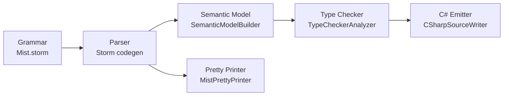
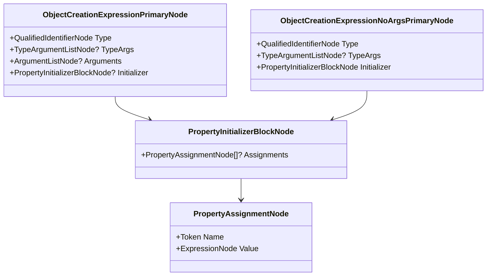

# Design Document: Property Initializers

## Overview

This design adds property initializer blocks to `new` expressions in Mist, enabling developers to set property and field values inline at construction time:

```mist
var p = new Point(0, 0) { X = 3, Y = 4 };
var config = new Config { Timeout = 30, Verbose = true };
```

The feature extends the existing `ObjectCreationExpression` grammar rule with an optional brace-delimited initializer block. Each assignment targets a named property (with `set`/`init` accessor) or public non-readonly field on the constructed type. The C# emitter produces standard C# object initializer syntax — a direct 1:1 mapping.

**Key design decisions:**

1. **Grammar extension, not new rule** — The initializer block is an optional suffix on the existing `ObjectCreationExpression` production, keeping the grammar minimal and avoiding ambiguity with block statements.
2. **Validation in the type checker** — Member existence, type compatibility, writability, accessibility, and duplicate detection are all checked in `TypeCheckerAnalyzer`, consistent with how property assignment is already validated (MIST_TC_0020, MIST_TC_0021, MIST_TC_0025).
3. **Semantic model records expression types only** — The semantic model builder resolves each value expression's type and the overall expression type (the constructed type). It does not create new symbol kinds for initializer assignments.
4. **Emitter produces inline C# initializer syntax** — Matching the existing single-line emission style used for `new` expressions.

## Architecture

The feature touches five pipeline stages in sequence:



1. **Grammar** (`Source/Mist/Grammar/Mist.storm`) — Extends `ObjectCreationExpression` with an optional `PropertyInitializerBlock`.
2. **Parser** — Storm source generator produces new AST node types automatically from the grammar change.
3. **Semantic Model** (`Source/Mist/Semantics/Model/SemanticModelBuilder.cs`) — Resolves value expressions within the initializer block during Pass 2.
4. **Type Checker** (`Source/Mist/Analysis/Builtin/TypeCheckerAnalyzer.cs`) — Validates member existence, type compatibility, writability, accessibility, and duplicates.
5. **C# Emitter** (`Source/Mist/Backends/CSharpTranspiler/CSharpEmitter.cs`) — Emits C# object initializer syntax.
6. **Pretty Printer** (`Source/Mist/Parsing/MistPrettyPrinter.cs`) — Formats the initializer block back to Mist source text for round-trip fidelity.

## Components and Interfaces

### Grammar Changes (`Mist.storm`)

The existing `ObjectCreationExpression` rule:

```storm
| NEW type:QualifiedIdentifier typeArgs:TypeArgumentList? LEFT_PARENTHESIS arguments:ArgumentList? RIGHT_PARENTHESIS as ObjectCreationExpression
```

Becomes:

```storm
| NEW type:QualifiedIdentifier typeArgs:TypeArgumentList? LEFT_PARENTHESIS arguments:ArgumentList? RIGHT_PARENTHESIS initializer:PropertyInitializerBlock? as ObjectCreationExpression
| NEW type:QualifiedIdentifier typeArgs:TypeArgumentList? initializer:PropertyInitializerBlock as ObjectCreationExpressionNoArgs
```

With new supporting rules:

```storm
rule PropertyInitializerBlock = LEFT_BRACE assignments:PropertyAssignmentList? RIGHT_BRACE;

rule PropertyAssignmentList = PropertyAssignment (COMMA PropertyAssignment)* COMMA?;

rule PropertyAssignment = name:IDENTIFIER EQUAL value:Expression;
```

**Design rationale:**

- The first alternative handles `new Type(args) { ... }` — constructor args with optional initializer.
- The second alternative handles `new Type { ... }` — no parentheses, initializer only (invokes parameterless constructor).
- `PropertyAssignmentList` allows trailing commas via the optional final `COMMA?`, consistent with other comma-separated lists in the grammar (e.g., `EnumMemberList`).
- The `PropertyInitializerBlock` uses `LEFT_BRACE`/`RIGHT_BRACE` which already have push/pop mode semantics for interpolated strings — this is safe because the initializer block is a standard expression context.

### AST Nodes (Storm-Generated)

The Storm source generator will produce the following node types from the grammar:

| Node | Fields |
|------|--------|
| `ObjectCreationExpressionPrimaryNode` | `Type`, `TypeArgs`, `Arguments`, `Initializer` (new, nullable) |
| `ObjectCreationExpressionNoArgsPrimaryNode` | `Type`, `TypeArgs`, `Initializer` (non-null) |
| `PropertyInitializerBlockNode` | `Assignments` (nullable `PropertyAssignmentListNode`) |
| `PropertyAssignmentListNode` | `PropertyAssignment[]` (via repetition) |
| `PropertyAssignmentNode` | `Name` (Token), `Value` (ExpressionNode) |

The existing `ObjectCreationExpressionPrimaryNode` gains an optional `Initializer` field. A new `ObjectCreationExpressionNoArgsPrimaryNode` variant handles the no-parentheses case.

### Semantic Model Changes (`SemanticModelBuilder.cs`)

In the `ResolveExpression` method's `case ObjectCreationExpressionPrimaryNode` branch (line ~13575), after resolving the type and constructor arguments:

1. **If `objCreation.Initializer` is non-null**, iterate over each `PropertyAssignment` in the block.
2. For each assignment, call `ResolveExpression` on the value expression to compute its type and record it in `expressionTypes`.
3. The overall expression type remains the constructed type (unchanged).

For the new `ObjectCreationExpressionNoArgsPrimaryNode`:

1. Resolve the type name identically to the existing path.
2. Handle type arguments if present.
3. Iterate over each `PropertyAssignment` and resolve value expressions.
4. Record the constructed type as the expression type.

No new symbol kinds are introduced. The semantic model does not need to store the resolved property/field targets — the type checker performs that lookup independently.

### Type Checker Changes (`TypeCheckerAnalyzer.cs`)

A new method `CheckPropertyInitializerBlock` is called from `CheckObjectCreation` when an initializer block is present:

```csharp
private void CheckPropertyInitializerBlock(
    PropertyInitializerBlockNode initializerBlock,
    IType constructedType,
    SyntaxNode parentNode,
    ISemanticModel model,
    DiagnosticBag diagnostics)
```

This method performs five validation passes on each `PropertyAssignment`:

1. **Member existence** — Look up the assignment name in the constructed type's `MemberScope`. The member must be a `SymbolKind.Property` or `SymbolKind.Field`. If not found, emit `MIST_PI_0001`.

2. **Type compatibility** — Get the member's `DeclaredType` and the value expression's type from `model.GetTypeOf(assignment.Value)`. Call `IsAssignable(valueType, memberType, model)`. If not assignable, emit `MIST_PI_0002`.

3. **Writability** — For properties: check `PropertyMetadata.HasSet || PropertyMetadata.HasInit`. If neither, emit `MIST_PI_0003`. For fields: check `symbol.ReadonlyStatus` — if `ExplicitReadonly`, `InferredReadonly`, or `ImplicitReadonly`, emit `MIST_PI_0004`.

4. **Accessibility** — Check the member's access modifier. If the property's set/init accessor has a `PrivateModifierModifierNode` and the call site is outside the declaring type, emit `MIST_PI_0005`. For fields with `PrivateModifierModifierNode`, same check.

5. **Duplicate detection** — Track seen member names in a `HashSet<string>`. If a name appears twice, emit `MIST_PI_0006` on the second occurrence.

Additionally, for the `ObjectCreationExpressionNoArgsPrimaryNode` variant, the type checker verifies that the type has a parameterless constructor (or no constructors at all, implying a default constructor).

### C# Emitter Changes (`CSharpEmitter.cs`)

In `CSharpSourceWriter.EmitPrimary` (the `case ObjectCreationExpressionPrimaryNode` branch, line ~5285):

After emitting `new Type(args)`, if `objCreation.Initializer` is non-null:

```csharp
if (objCreation.Initializer is not null)
{
    var assignments = new List<string>();
    foreach (var assignment in objCreation.Initializer.Assignments)
    {
        var name = assignment.Name.Lexeme;
        var value = EmitExpression(assignment.Value);
        assignments.Add($"{name} = {value}");
    }
    return $"new {type}{typeArgs}({argsStr}) {{ {string.Join(", ", assignments)} }}";
}
```

For `ObjectCreationExpressionNoArgsPrimaryNode`:

```csharp
case ObjectCreationExpressionNoArgsPrimaryNode objCreationNoArgs:
{
    var type = ExtractQualifiedName(objCreationNoArgs.Type);
    var typeArgs = EmitTypeArgumentList(objCreationNoArgs.TypeArgs);
    var assignments = new List<string>();
    foreach (var assignment in objCreationNoArgs.Initializer.Assignments)
    {
        var name = assignment.Name.Lexeme;
        var value = EmitExpression(assignment.Value);
        assignments.Add($"{name} = {value}");
    }
    return $"new {type}{typeArgs}() {{ {string.Join(", ", assignments)} }}";
}
```

Note: C# requires `()` even when the Mist source omits it, so the emitter always includes the empty argument list.

### Pretty Printer Changes (`MistPrettyPrinter.cs`)

In `EmitPrimary` (the `case ObjectCreationExpressionPrimaryNode` branch, line ~1836):

```csharp
case ObjectCreationExpressionPrimaryNode objCreation:
{
    var type = ExtractQualifiedName(objCreation.Type);
    var typeArgs = EmitTypeArgumentList(objCreation.TypeArgs);
    var args = EmitArgumentList(objCreation.Arguments);
    if (objCreation.Initializer is not null)
    {
        var assignments = EmitPropertyAssignmentList(objCreation.Initializer);
        return $"new {type}{typeArgs}({args}) {{ {assignments} }}";
    }
    return $"new {type}{typeArgs}({args})";
}

case ObjectCreationExpressionNoArgsPrimaryNode objCreationNoArgs:
{
    var type = ExtractQualifiedName(objCreationNoArgs.Type);
    var typeArgs = EmitTypeArgumentList(objCreationNoArgs.TypeArgs);
    var assignments = EmitPropertyAssignmentList(objCreationNoArgs.Initializer);
    return $"new {type}{typeArgs} {{ {assignments} }}";
}
```

With a helper:

```csharp
private string EmitPropertyAssignmentList(PropertyInitializerBlockNode block)
{
    if (block.Assignments is null)
        return "";
    var parts = new List<string>();
    foreach (var assignment in block.Assignments)
    {
        parts.Add($"{assignment.Name.Lexeme} = {EmitExpression(assignment.Value)}");
    }
    return string.Join(", ", parts);
}
```

### TextMate Grammar Changes

The TextMate grammar at `Editor/mist-syntax-highlighting/syntaxes/mist.tmLanguage.json` needs a pattern to highlight property names within initializer blocks. Since the initializer block uses standard braces and `=`, the existing patterns for identifiers and operators largely cover it. A specific pattern matching `IDENTIFIER =` after `{` or `,` within a `new` expression context can scope the identifier as `variable.other.property.mist`.

## Data Models

### New Diagnostic IDs

| ID | Severity | Condition | Message Template |
|----|----------|-----------|-----------------|
| `MIST_PI_0001` | Error | Member name not found on target type | `"Type '{typeName}' does not contain a property or field named '{memberName}'"` |
| `MIST_PI_0002` | Error | Value type not assignable to member type | `"Cannot assign '{valueType}' to '{memberName}' of type '{memberType}'"` |
| `MIST_PI_0003` | Error | Property has no set/init accessor | `"Property '{memberName}' has no accessible 'set' or 'init' accessor and cannot be assigned in an initializer"` |
| `MIST_PI_0004` | Error | Field is readonly | `"Field '{memberName}' is readonly and cannot be assigned in an initializer"` |
| `MIST_PI_0005` | Error | Member not accessible from call site | `"'{memberName}' is inaccessible due to its protection level"` |
| `MIST_PI_0006` | Error | Duplicate member assignment | `"Member '{memberName}' is assigned more than once in the initializer"` |

### AST Node Relationships



## Correctness Properties

*A property is a characteristic or behavior that should hold true across all valid executions of a system — essentially, a formal statement about what the system should do. Properties serve as the bridge between human-readable specifications and machine-verifiable correctness guarantees.*

### Property 1: Pretty-printer round trip

*For any* valid `new` expression with a property initializer block (with or without constructor arguments), parsing the pretty-printed output then pretty-printing again SHALL produce identical text.

**Validates: Requirements 9.4**

### Property 2: Emitter produces valid C# initializer syntax

*For any* valid `new` expression with a property initializer block containing N assignments, the emitted C# SHALL contain `{ Name1 = expr1, Name2 = expr2, ..., NameN = exprN }` immediately after the constructor call, where each NameK matches the Mist source identifier and each exprK is the emitted form of the corresponding value expression.

**Validates: Requirements 8.1, 8.2, 8.3**

### Property 3: Non-existent member produces diagnostic

*For any* type T and any identifier name that is not a declared property or field on T (or its base types), a property initializer `new T() { name = expr }` SHALL produce exactly one `MIST_PI_0001` diagnostic naming the invalid member and the type.

**Validates: Requirements 3.1, 3.2**

### Property 4: Type-incompatible assignment produces diagnostic

*For any* type T with a settable property P of type A, and any expression whose type B is not assignable to A, a property initializer `new T() { P = expr }` SHALL produce exactly one `MIST_PI_0002` diagnostic naming the member, expected type, and actual type.

**Validates: Requirements 4.1, 4.2**

### Property 5: Read-only property produces diagnostic

*For any* type T with a property P that has only a `get` accessor (no `set` or `init`), a property initializer `new T() { P = expr }` SHALL produce exactly one `MIST_PI_0003` diagnostic.

**Validates: Requirements 5.1, 5.2**

### Property 6: Readonly field produces diagnostic

*For any* type T with a field F marked `readonly`, a property initializer `new T() { F = expr }` SHALL produce exactly one `MIST_PI_0004` diagnostic.

**Validates: Requirements 5.3, 5.4**

### Property 7: Duplicate member produces diagnostic

*For any* property initializer block containing the same member name K more than once, the type checker SHALL produce exactly one `MIST_PI_0006` diagnostic for the duplicate occurrence.

**Validates: Requirements 6.1, 6.2**

### Property 8: Valid initializer produces no diagnostics

*For any* type T with N settable properties/fields, and a property initializer block assigning distinct, type-compatible values to a subset of those members, the type checker SHALL produce zero property-initializer diagnostics.

**Validates: Requirements 3.1, 4.1, 5.1, 6.1, 7.3**

### Property 9: Omitted argument list emits empty parens in C#

*For any* `new` expression using the no-args variant (`new Type { ... }`), the emitted C# SHALL include an explicit empty argument list `()` before the initializer block.

**Validates: Requirements 8.4**

## Error Handling

### Diagnostic Summary Table

| Diagnostic ID | Stage | Trigger | Recovery |
|---------------|-------|---------|----------|
| `MIST_PI_0001` | Type Checker | Member name not found on type | Skip this assignment, continue checking remaining assignments |
| `MIST_PI_0002` | Type Checker | Value type not assignable to member type | Report mismatch, continue checking remaining assignments |
| `MIST_PI_0003` | Type Checker | Property has no set/init accessor | Report error, continue checking remaining assignments |
| `MIST_PI_0004` | Type Checker | Field is readonly | Report error, continue checking remaining assignments |
| `MIST_PI_0005` | Type Checker | Member not accessible | Report error, continue checking remaining assignments |
| `MIST_PI_0006` | Type Checker | Duplicate member name | Report on second occurrence, continue checking remaining assignments |
| Parse error | Parser | Malformed initializer block syntax | Standard parser error recovery (skip to next `}` or `;`) |

**Error recovery strategy:** Each assignment in the initializer block is validated independently. A failure on one assignment does not prevent validation of subsequent assignments. This maximizes the number of diagnostics reported in a single compilation pass.

### Edge Cases

- **Empty initializer block** (`new T() { }`) — Valid, produces no diagnostics, emits `new T() { }` in C#.
- **Initializer on generic type** (`new Box<int> { Value = 42 }`) — Type arguments are resolved before member lookup; the member's type is the substituted type.
- **Initializer on struct** — Same rules as class; structs can have settable properties and public fields.
- **Init-only properties** — Allowed in initializer blocks (C# object initializers can assign to `init` properties). The type checker treats `HasInit` as sufficient for writability in this context.
- **Inherited members** — Member lookup walks the base type chain, consistent with `LookupMemberType` behavior.
- **Type alias transparency** — If the constructed type is a type alias, it is unwrapped to the underlying type before member lookup, consistent with existing `CheckObjectCreation` behavior.

## Testing Strategy

### Property-Based Tests (PBT)

The feature is well-suited for property-based testing because:
- The input space (type declarations × member combinations × value expressions) is large.
- Universal properties (round-trip, diagnostic presence/absence) hold across all valid inputs.
- Pure functions (pretty-printer, emitter output) have clear input/output behavior.

**Library:** FsCheck (already used throughout the test suite)
**Configuration:** Minimum 100 iterations per property test

Each property test will:
1. Generate random type declarations with varying numbers of properties/fields.
2. Generate random initializer blocks targeting those members.
3. Run the compiler pipeline (in-process via shared `CompilerDriver`).
4. Assert the property holds.

**Process spawning:** Tests that verify emitted C# compiles correctly will use the **batched approach** — generate all scenarios upfront, build a single program, compile once, run once, compare output lines. This avoids spawning 100+ processes per test run.

**Tag format:** `Feature: property-initializers, Property N: {property text}`

### Unit Tests

Unit tests cover specific examples and edge cases:
- Empty initializer block
- Single assignment
- Multiple assignments with trailing comma
- Initializer on generic type
- Initializer on struct
- Init-only property in initializer
- Inherited member in initializer
- Interaction with type aliases

### Integration Tests

- End-to-end compilation of the sample app (`samples/PropertyInitializers/Program.mist`)
- Verification that emitted C# compiles with `dotnet build` and produces expected stdout output
