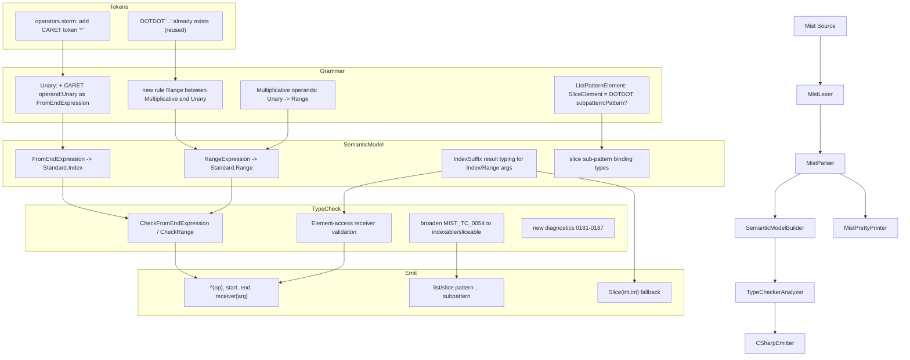

# Design Document: Ranges and Indices

## Overview

This design adds the two C# 8.0 expression-level "slicer operators" to Mist — the index-from-end operator `^` and the range operator `..` — together with full C# 11 list/slice pattern matching, and it migrates the pre-existing user-defined `Range` types out of the way so the simple name `Range` can be reserved for the language slice type (`System.Range`).

The work threads two new expression forms and one generalized pattern form through the existing pipeline:

```
Lexer (MistLexer)
  -> Grammar (Mist.storm, importing tokens/tokens)
  -> Parser (MistParser)
  -> Semantic Model (SemanticModelBuilder)
  -> Type Checker (TypeCheckerAnalyzer)
  -> C# Emitter (CSharpEmitter)
  -> Pretty Printer (MistPrettyPrinter)
```

The feature has three cooperating pieces:

1. **Index-from-end expression `^operand`** — a new prefix operator (a `Unary` alternative) producing a `System.Index` value. `^1` is the last element, `^0` is one-past-the-last (equal to the length).
2. **Range expression `start..end`** — a new precedence tier between `Multiplicative` and `Unary`, producing a `System.Range` value. All four bound forms (`a..b`, `a..`, `..b`, `..`) are supported, and either bound may be a `^k` index-from-end expression.
3. **List and slice patterns** — the existing `ListPattern` / `SliceElement` grammar is generalized so a slice element carries an arbitrary optional sub-pattern (`.. var rest`, `.. int[] tail`, `.. [.., 5]`, `.. { Length: > 0 }`), and the array-only type check is broadened to all indexable/sliceable receivers.

Element access itself does not need new syntax: the grammar's existing `IndexSuffix` (`receiver[Expression]`) already reaches the new range/index expressions through `Expression`, so `arr[^1]`, `arr[1..3]`, and `arr[..]` parse with no change to `IndexSuffix`. The new work for element access is entirely in the semantic model (result typing), type checker (receiver validation), and emitter.

### Forms Summary

| Mist form | Meaning | Result type | Emitted C# |
|---|---|---|---|
| `^k` | index k-from-end | `Index` (`System.Index`) | `^(k)` |
| `a..b` | range, both bounds | `Range` (`System.Range`) | `a..b` |
| `a..` | range, start only | `Range` | `a..` |
| `..b` | range, end only | `Range` | `..b` |
| `..` | full range | `Range` | `..` |
| `1..^1` | range with from-end end bound | `Range` | `1..^(1)` |
| `arr[^1]` | index-from-end access | element type | `arr[^(1)]` |
| `arr[1..3]` | array slice | same array type (new array) | `arr[1..3]` |
| `span[1..3]` | span slice | same span type (view) | `span[1..3]` |
| `str[1..3]` | string slice | `string` (new string) | `str[1..3]` |
| `x is [1, .. var m, 5]` | list+slice pattern | (pattern) | `x is [1, .. var m, 5]` |

### Design Decisions

1. **`^` is a new `Unary` alternative, not part of the range tier.** Placing `^` in the `Unary` rule (peer of `!` and unary `-`) makes it bind tighter than everything below unary, so `^1..^2` parses as `(^1)..(^2)` (Req 4.1) and `^a + b` parses as `(^a) + b` (Req 4.3). Because `Unary` remains the base node type of that rule, adding one more alternative does **not** change the type of any existing field — consumers only add a new switch case. Mist has no bitwise-exclusive-or operator, so the `^` lexeme is unambiguously the index-from-end operator (Req 1.5).

2. **Range is a new precedence tier inserted between `Multiplicative` and `Unary`.** This is the only placement that matches C# 8.0 exactly: range binds tighter than the binary arithmetic operators (`* / % + -`) but its bounds are unary-level expressions. Consequently `..n - 1` parses as `(..n) - 1` (Req 4.2), and `a * b..c` parses as `a * (b..c)` — both identical to C#, where the range operator sits directly below unary and above multiplicative and each bound is a `unary_expression`.

3. **Absent bounds are represented as null optional children.** The single `RangeExpression` node carries `Start: UnaryNode?` and `End: UnaryNode?`; a null child is an absent bound. One node covers all four forms (Req 3.1–3.4), so the semantic model, type checker, emitter, and pretty printer each handle the four forms by null-checking two fields rather than dispatching four node kinds.

4. **The `SliceElement` rule is generalized from a bare identifier to an optional full pattern.** C# 11 allows any pattern after `..`. A bare identifier (`.. name`) is **not** a valid Mist `Pattern`, so existing `.. name` slice bindings migrate to `.. var name`. `.. _` and bare `..` continue to parse (as a discard sub-pattern and an absent sub-pattern respectively).

5. **The array-only list-pattern check is broadened, not replaced.** The existing `MIST_TC_0054` check that requires a list-pattern scrutinee to be an array is generalized to accept any indexable/sliceable receiver (arrays, `Span<T>`/`ReadOnlySpan<T>`, `string`, `List<T>`, and the countable-plus-sliceable shape). The descriptor is repurposed (same ID, broadened message).

6. **Emission relies on native C# lowering.** Mist emits `^(operand)`, `start..end`, and `receiver[arg]` directly and lets the C# compiler perform its built-in Index/Range lowering for arrays, spans, and strings. An explicit `Slice(int, int)` fallback is designed for the narrow case where a Mist-sliceable receiver is not covered by C#'s implicit range support.

7. **`Range` is reserved for the language slice type.** Pre-existing user-defined types named `Range` are renamed (Requirement 18) so surfacing `Standard.Range` (= `System.Range`) creates no ambiguity. Method declarations named `Range` and attribute uses `[Range(...)]` are left alone, because they occupy separate declaration/resolution spaces.

## Architecture



### Pipeline Integration Points

| Stage | File | Change |
|---|---|---|
| Tokens | `Source/Mist/Grammar/tokens/operators.storm` | Add `token CARET = "^";`. `DOTDOT` reused unchanged. |
| Grammar | `Source/Mist/Grammar/Mist.storm` | Add `FromEndExpression` to `Unary`; insert new `Range` rule; change `Multiplicative` operands from `Unary` to `Range`; generalize `SliceElement` to carry an optional `Pattern`. |
| Parser | `MistParser` (generated) | Regenerated from the grammar; no hand edits. |
| Semantic model | `SemanticModelBuilder` | Resolve `FromEndExpression` -> `Standard.Index`, `RangeExpression` -> `Standard.Range`; thread the new `Range` tier; set element-access result types for `Index`/`Range` arguments; set slice sub-pattern binding types. |
| Type checker | `Source/Mist/Analysis/Builtin/TypeCheckerAnalyzer.cs` | `CheckFromEndExpression`, `CheckRange`, extended `CheckIndexSuffix`, broadened `CheckListPatternElementList`; thread the `Range` tier through multiplicative navigation. |
| Diagnostics | `Source/Mist/Common/Diagnostics/Descriptors/TypeCheckDiagnostics.cs` | 7 new descriptors (`MIST_TC_0181`–`MIST_TC_0187`); repurpose `MIST_TC_0054`. |
| Type surfacing | `Source/Standard/Bootstrap/Index.mist`, `Range.mist`; `CSharpTypeMap.cs`; `AmbientProvider/WellKnownTypeMap.cs` | Make `Standard.Index`/`Standard.Range` spellable and map them to `System.Index`/`System.Range`. |
| Emitter | `Source/Mist/Backends/CSharpTranspiler/CSharpEmitter.cs` | Emit `^(op)`, ranges, and native slicing; extend list/slice pattern emission; thread the `Range` tier. |
| Pretty printer | `Source/Mist/Parsing/MistPrettyPrinter.cs` | Print `^`, ranges, list/slice patterns; thread the `Range` tier. |
| TextMate | `Editor/mist-syntax-highlighting/syntaxes/mist.tmLanguage.json` | Highlight `^` and `..` as `keyword.operator.mist`. |
| Samples | `samples/RangesAndIndices/Program.mist`, `samples/AllFeatures/Program.mist` | New sample containing the locked proof code; AllFeatures calls `RunDemo()`. |
| Migration | `samples/Iterators`, `samples/RefinementTypes`, `book/snippets/type-system/refinement-types/property-pattern.mist` (+ generated `.cs`) | Rename user-defined `Range` types (Req 18). |
| Book / features | `book/src/**`, `book/SUMMARY.md`, `CSHARP_FEATURES.md` | Document the feature; update feature tracking. |

### Pipeline Coverage: Classic vs. Experimental

Mist has two compilation pipelines behind `ICompilationPipeline`. This feature is built out on the **classic** pipeline only; the **experimental** pipeline requires no feature work.

- **Classic (v1) — `ClassicPipeline`**: `SemanticModelBuilder` (Stage 4) -> analyzers including `TypeCheckerAnalyzer` (Stage 5) -> `CSharpEmitter` (Stage 6). This is the fully-implemented pipeline that every stage in this design targets, and it is built out **completely** for the feature: tokens, grammar, semantic model, type checking, emission, and pretty-printing.
- **Experimental (v2) — `ExperimentalPipeline`**: `ProgramModelBuilder` (Stage 4) -> analyzers (Stage 5, a `// TODO` no-op) -> emit (Stage 6, a `// TODO` that always returns failure). Its analysis and emit stages are unimplemented for **every** feature, not just this one.

The experimental `ProgramModel` currently models only the **declaration surface** — namespaces, types, members, and modifiers (the `AbstractTypeBuilder` / `ModifierBuilder` family under `ProgramModel/Construction`). It contains **no statement or expression modeling**: `ProgramModel/**` has no references to expression, statement, or body constructs, nor to `MultiplicativeNode`, the list/slice-pattern nodes, or `IndexSuffix`. Because this feature is entirely expression- and pattern-level, there is **nothing to add** to ProgramModel construction — the `MultiplicativeNode` operand retype and the new `FromEndExpression` / `RangeExpression` / generalized `SliceElement` nodes all live below the depth the experimental pipeline reaches today.

Accordingly, this feature does **not** extend the experimental pipeline: the Stage 5/6 `// TODO` stubs are left as-is, and no range/index/list-pattern analysis or emission is added there. If the `MultiplicativeNode` retype should incidentally surface a compile break in ProgramModel construction (the C# compiler will pinpoint it, per the ripple note in the AST section), the fix is limited to keeping ProgramModel building at its existing declaration-surface depth — never to implementing new experimental phases.

## Components and Interfaces

### 1. Token Changes (`Source/Mist/Grammar/tokens/operators.storm`)

Add a single token beside the existing single-character operators (near `EXCLAMATION`):

```storm
token CARET = "^";
```

Placement among the operator tokens is not significant: `^` is a unique single character, so there is no maximal-munch conflict with any other token.

**`DOTDOT` is reused, not redefined** (Req 1.2). The token file already declares:

```storm
token DOTDOT = "..";
token DOT    = ".";
```

`DOTDOT` is declared **before** `DOT`, so the lexer's maximal-munch rule tokenizes `..` as one `DOTDOT` rather than two `DOT`s.

**No lexer change is needed for `N..M`** (Req 1.4). `FLOAT_LITERAL` requires at least one digit after the decimal point:

```storm
token FLOAT_LITERAL = `[0-9]+` ("_" `[0-9]+`)* "." `[0-9]+` ("_" `[0-9]+`)* FLOAT_SUFFIX?
                    | `[0-9]+` ("_" `[0-9]+`)* FLOAT_SUFFIX;
```

There is no trailing-dot float form (`1.`), so in `0..2` the lexer matches `0` as `INTEGER_LITERAL` (the `FLOAT_LITERAL` attempt fails because the character after `0.` is `.`, not a digit), then `..` as `DOTDOT`, then `2` as `INTEGER_LITERAL`. This behavior already holds and requires no change.

### 2. Grammar Changes (`Source/Mist/Grammar/Mist.storm`)

#### 2a. Index-from-end as a `Unary` alternative

The current rule:

```storm
@memo
rule Unary
    = LEFT_PARENTHESIS targetType:TypeReference RIGHT_PARENTHESIS operand:Unary  as CastExpression
    | primary:Postfix              as PostfixExpression
    | ASYNC hint:IDENTIFIER body:Block                                            as AsyncHintBlockExpression
    | ASYNC body:Block                                                            as AsyncBlockExpression
    | ASYNC operand:Unary                                                         as AsyncExpression
    | AWAIT operand:Unary                                                         as AwaitExpression
    | EXCLAMATION operand:Unary    as LogicalNot
    | MINUS operand:Unary          as Negate
    ;
```

gains one alternative:

```storm
    | CARET operand:Unary          as FromEndExpression
```

**Rationale.** The operand is `Unary` (matching `LogicalNot` and `Negate`), which admits `^1`, `^count`, `^items.Length` (a `Postfix` under `Unary`), and `^(count + 1)` (a parenthesized `Primary` under `Unary`) — satisfying Req 2.2–2.4. Alternative ordering is immaterial because `CARET` is a distinct lead token: the PEG parser only enters this alternative when the next token is `^`.

#### 2b. New `Range` precedence tier

Change the `Multiplicative` operands from `Unary` to `Range`:

```storm
rule Multiplicative = left:Range (operator:(STAR | SLASH | MODULO) right:Range)*;
```

and insert the new rule immediately above `Unary`:

```storm
rule Range
    = start:Unary? DOTDOT end:Unary?   as RangeExpression
    | operand:Unary                    as NonRange
    ;
```

**PEG ordering and backtracking.** `RangeExpression` is listed **first** (longest-first). It requires a `DOTDOT`, so:
- For `a..b`, `a..`, `..b`, `..`, the `RangeExpression` alternative matches (each optional bound absorbs its `Unary` or nothing, and the mandatory `DOTDOT` anchors the alternative).
- For a plain unary expression with no `..` (for example `a`, `^2`, `foo()`), `start:Unary?` optionally matches the unary, the mandatory `DOTDOT` then fails, the whole alternative backtracks, and `NonRange` matches. Because `Unary` is annotated `@memo`, re-parsing the same unary as `NonRange` hits the memo cache — no quadratic blowup.

Listing `NonRange` first would be incorrect: `a..b` would match `NonRange` = `a` and leave `..b` dangling. `RangeExpression`-first is required.

This tier is transparent to non-range expressions: a bare `a` flows `Range(NonRange) -> Unary`, so all existing expressions keep parsing, only wrapped in one extra pass-through node.

#### 2c. Generalized `SliceElement`

The current pattern rules:

```storm
rule ListPatternElementList = ListPatternElement (COMMA ListPatternElement)*;

rule ListPatternElement
    = pattern:Pattern                          as PatternElement
    | DOTDOT name:(IDENTIFIER | DISCARD)?      as SliceElement
    ;
```

The `SliceElement` alternative changes so the slice carries an optional full sub-pattern:

```storm
rule ListPatternElement
    = pattern:Pattern                          as PatternElement
    | DOTDOT subpattern:Pattern?               as SliceElement
    ;
```

**Backtracking notes.**
- `PatternElement` is tried first, but no `PrimaryPattern` alternative begins with `DOTDOT`, so any `..`-led element falls through to `SliceElement` exactly as today.
- After `DOTDOT`, `subpattern:Pattern?` greedily attempts a pattern. Patterns never span the list separator `COMMA`, so in `[1, .. var m, 5]` the sub-pattern is `var m` and the following `, 5` is parsed by the surrounding `ListPatternElementList`. When the next token cannot begin a pattern (for example the `,` in `[.., 5]` or the `]` in `[x, ..]`), the optional sub-pattern is absent and a bare `..` slice is produced.
- The `Range` expression tier (2b) and the `SliceElement` pattern (2c) both consume `DOTDOT` but live in disjoint grammar contexts (expression precedence chain vs. `ListPatternElement`), so they never compete.

**Migration consequence.** A bare identifier is not a `Pattern`, so the old `.. name` binding form no longer parses; it becomes `.. var name`. `.. _` still parses because `DISCARD` is a `DiscardPattern`. See §10 for the concrete files affected.

### 3. AST Nodes (Storm-generated)

Storm generates node classes named `<AltName><RuleName>Node`.

**New nodes:**

| Node | Base | Fields |
|---|---|---|
| `FromEndExpressionUnaryNode` | `UnaryNode` | `Operand: UnaryNode` |
| `RangeExpressionRangeNode` | `RangeNode` | `Start: UnaryNode?`, `End: UnaryNode?` |
| `NonRangeRangeNode` | `RangeNode` | `Operand: UnaryNode` |

`RangeNode` is the new base node for the `Range` rule.

**Changed nodes:**

| Node | Change |
|---|---|
| `MultiplicativeNode` | `Left` and `Right` change type from `UnaryNode` to `RangeNode` (consequence of 2b). |
| `SliceElementListPatternElementNode` | Field `Name` (`Token?`, previously `IDENTIFIER \| DISCARD`) is replaced by `Subpattern` (`PatternNode?`). |

**Unchanged node (important):** `IndexSuffixPostfixSuffixNode.Index` remains an `ExpressionNode`. Because `Expression` now reaches `Range`, an `Index` child can be a `FromEndExpression` or `RangeExpression`; the node shape is identical, so `arr[^1]`, `arr[1..3]`, and `arr[..]` parse with no grammar change to `IndexSuffix` (Req 2.5, 3.6).

#### 3a. The `Range`-tier ripple (must be threaded through every `Multiplicative` consumer)

Changing `MultiplicativeNode.Left`/`.Right` from `UnaryNode` to `RangeNode` is the single most invasive part of this design. Every consumer that reads those fields as a `UnaryNode`, or that pattern-matches the precedence chain (for example `multiplicative.Left is PostfixExpressionUnaryNode ...`), stops compiling until it is updated to go through the new `Range` tier. The affected consumers include, at minimum:

- `CSharpEmitter.EmitMultiplicative` and `CSharpEmitter.ScanMultiplicativeForValueReturningCalls`
- `MistPrettyPrinter.EmitMultiplicative`
- `TypeCheckerAnalyzer.CheckMultiplicativeNode`, its read-analysis pass, and the several `TryExtract*` / chain-navigation helpers that walk `Multiplicative -> Unary -> Postfix`
- `SemanticModelBuilder`'s `MultiplicativeNode` resolution
- Test-constructed ASTs that assign a `UnaryNode` directly to `MultiplicativeNode.Left` (for example in the type-checker edge-case and preservation tests, and in the pattern generator used by property tests)

**Mitigation.** Introduce one shared helper:

```csharp
// Returns the inner Unary for a pass-through NonRange node, or null when the
// node is a genuine range expression (which a precedence-chain walker should
// treat as "not the shape I am looking for").
private static UnaryNode? UnwrapRange(RangeNode node)
{
    return node is NonRangeRangeNode nr ? nr.Operand : null;
}
```

Chain-navigation code calls `UnwrapRange` and treats a null result (a real range) as a non-match. Code that genuinely handles ranges (semantic model, type checker, emitter, pretty printer) adds explicit `RangeExpressionRangeNode` handling. The C# compiler pinpoints every site that must change by reporting the `UnaryNode`/`RangeNode` type mismatch, so the exact, complete set is discovered mechanically during implementation rather than guessed here.

### 4. Semantic Model Builder (`SemanticModelBuilder`)

#### 4a. New expression resolution

- **`FromEndExpressionUnaryNode`**: resolve `Operand`, then set the expression's Compile_Time_Type to `Standard.Index` via the stdlib type provider (`LookupStandardType("Index")`) (Req 5.1).
- **`RangeExpressionRangeNode`**: resolve each present bound (`Start`, `End` — either may be null), then set the expression's Compile_Time_Type to `Standard.Range` (`LookupStandardType("Range")`), independent of which bounds are present (Req 5.2).
- **`NonRangeRangeNode`**: resolve `Operand` and adopt its type (pure pass-through). This is how a bare `^2` or `a..b` propagates its type up the (single-element) multiplicative/additive chain to the use site.

The `MultiplicativeNode` resolution is updated to read `Range` operands: a `NonRange` operand contributes its inner unary type; a `RangeExpression` operand contributes `Standard.Range`.

#### 4b. Element-access result typing (`IndexSuffix`)

Consistent with the existing split (the builder assigns element-access result types; the checker validates the receiver), the builder sets the result type of `receiver[arg]` from the argument's Compile_Time_Type:

| Argument type | Receiver | Result Compile_Time_Type | Req |
|---|---|---|---|
| `Standard.Index` | Indexable_Type | receiver element type | 8.1 |
| `Standard.Range` | array `T[]` | same `T[]` | 8.2 |
| `Standard.Range` | `Span<T>` / `ReadOnlySpan<T>` | same span type | 8.3 |
| `Standard.Range` | `string` | `string` | 8.4 |
| `Standard.Range` | countable + `Range` indexer / `Slice(int,int)` | that member's declared slice-result type | 8.5 |
| integer | (existing behavior) | receiver element type | — |

New shared type predicates (placed alongside the existing type utilities used by `CheckIndexSuffix`):

- `IsCountableType(IType)` — exposes an `int` `Length` or `int` `Count`.
- `IsIndexableType(IType)` — countable and exposes an `int`-argument indexer: arrays, `Span<T>`, `ReadOnlySpan<T>`, `string`, `List<T>`, and countable types with an `int` indexer.
- `IsSliceableType(IType)` — countable and produces a contiguous sub-sequence via a `Range`-accepting indexer or a `Slice(int, int)` method: arrays, `Span<T>`, `ReadOnlySpan<T>`, `string`, plus the general countable-plus-sliceable shape.
- `TryGetElementType(IType, out IType)` / `TryGetSliceResultType(IType, out IType)` — array slice result is the same array type; span slice result is the same span type; string slice result is `string`; otherwise the declared return type of the `Range` indexer or `Slice(int, int)` method.

#### 4c. Slice sub-pattern binding types

For a `SliceElementListPatternElementNode` whose `Subpattern` is a binding pattern (a `VarPattern` or a declaration/`TypePattern`), the builder sets the bound variable's Compile_Time_Type to the receiver's slice-result type (`TryGetSliceResultType`), so `.. var middle` on an `int[]` binds `middle : int[]` (Req 20.2).

### 5. Type Checker (`TypeCheckerAnalyzer.cs`)

#### 5a. Index-from-end operand (`CheckFromEndExpression`)

- Operand integer-compatible (`IsIntLike`) -> accept (Req 6.1).
- Operand `void` -> `MIST_TC_0182` (Req 6.3).
- Operand any other non-integer type -> `MIST_TC_0181`, naming the operand type (Req 6.2, 12.1).

#### 5b. Range bounds (`CheckRange`)

For each **present** bound (null = absent, which is always valid and denotes start/end of sequence — Req 7.4):

- integer-compatible -> accept (Req 7.1).
- `Standard.Index` -> accept (Req 7.2).
- otherwise -> reject the **entire** range with `MIST_TC_0183`, naming the offending bound type and pointing at the bound's source span (Req 7.3, 12.2).

A present-but-invalid bound is never silently treated as absent (Req 7.5).

#### 5c. Element-access receiver validation (extend `CheckIndexSuffix`)

`CheckIndexSuffix` currently requires an `int`-like argument (or a matching custom indexer) and emits `IndexerParameterTypeMismatch` (`MIST_TC_0010`) otherwise. It is extended to branch on the argument's Compile_Time_Type:

- argument `Standard.Index`: require `IsIndexableType(receiver)`, else `MIST_TC_0184` naming the receiver type (Req 8.6, 12.3).
- argument `Standard.Range`: require `IsSliceableType(receiver)`, else `MIST_TC_0185` naming the receiver type (Req 8.7, 12.4).
- ordinary integer argument or matching custom indexer: existing behavior, unchanged.

#### 5d. List and slice pattern checking (broaden `CheckListPatternElementList`)

The current code requires the scrutinee to be an `ArrayType` and otherwise emits `MIST_TC_0054` (`PatternListRequiresArray`). It is broadened:

- **Receiver**: require `IsIndexableType(receiver)` (arrays, `Span<T>`, `ReadOnlySpan<T>`, `string`, `List<T>`, countable+int-indexer). Otherwise emit the repurposed `MIST_TC_0054` (`PatternListRequiresIndexable`, broadened message). Element sub-patterns are type-checked against the receiver's element type (Req 20.1, 20.3).
- **Slice sub-pattern**: for a `SliceElement` whose `Subpattern` is non-null, require `IsSliceableType(receiver)` and type-check the sub-pattern against `TryGetSliceResultType(receiver)`; where the sub-pattern is a binding, set the bound variable's type to that slice-result type. If the receiver is not sliceable, emit `MIST_TC_0187` naming the receiver type (Req 20.2, 20.5).
- **At most one slice**: if more than one `SliceElement` appears in a list pattern, emit `MIST_TC_0186` (Req 20.4).
- The existing `PatternListTooManyElements` (`MIST_TC_0055`, warning) is retained.

All new descriptors are registered through the same `TypeCheckDiagnostics` mechanism as existing diagnostics (Req 12.5, 20.6).

### 6. C# Emitter (`CSharpEmitter.cs`)

#### 6a. Expressions

- **`FromEndExpressionUnaryNode`** -> `^({EmitUnary(Operand)})`, i.e. the operand is always parenthesized: `^1` -> `^(1)`, `^(count + 1)` -> `^((count + 1))` (Req 11.1, 11.6).
- **`RangeExpressionRangeNode`** -> emit the present/absent bounds with the C# range operator: `a..b`, `a..`, `..b`, or `..`. Each present bound is emitted via the unary emitter, so a from-end bound renders as `1..^(1)` (Req 11.2, 11.6).
- **`NonRangeRangeNode`** -> emit `Operand` unchanged (pass-through). `EmitMultiplicative` is updated to emit its `Range` operands through a new `EmitRange` dispatcher.

#### 6b. Element access (`IndexSuffix`)

Structurally unchanged: `{receiver}[{arg}]`. The argument emits as `^(k)` or `s..e` naturally, and the design relies on the C# compiler's built-in Index/Range lowering for arrays, spans, and strings (Req 11.3, 11.4). Array slicing therefore produces a new array (Req 10.5), span slicing produces a view (Req 10.6), and string slicing produces a new string (Req 10.7) — exactly as in hand-written C# 8.0.

**`Slice(int, int)` fallback (Req 11.5).** C#'s *implicit range support* already lowers `receiver[range]` to `receiver.Slice(start, length)` for any type that exposes an `int` `Count`/`Length` and a `Slice(int, int)` method, so for the common case native emission suffices even when the type has no explicit `Range` indexer. The fallback is reserved for a receiver that Mist classifies as sliceable but that C# will **not** auto-lower (for example a slice member reachable only through an interface). In that case the emitter materializes the range explicitly:

```csharp
// Fallback shape (only when native C# range lowering does not apply):
//   var __r = <range>;
//   var (__off, __len) = __r.GetOffsetAndLength(<receiver>.Count);
//   <receiver>.Slice(__off, __len)
```

The precise boundary between "native lowering applies" and "explicit fallback required" is recorded as an open design question (see the end of this document) to be resolved during implementation by inspecting the specific receiver type.

#### 6c. List and slice patterns (extend `EmitListPatternElement`)

- List pattern -> `[{elements}]`, element order preserved (Req 22.1).
- Slice element, no sub-pattern -> `..` (Req 22.2).
- Slice element with sub-pattern -> `.. {EmitPattern(Subpattern)}` (Req 22.3). The current code reads the removed `Name` token and emits `.. var {name}`; it is rewritten to read `Subpattern` and emit the pattern's C# form, which reproduces `.. var middle`, `.. _`, `.. int[] rest`, `.. [.., 5]`, and `.. { Length: > 0 }`.
- `is`/`switch` positions are emitted in the corresponding C# `is`/`switch` positions (Req 22.4), unchanged mechanism.

### 7. Pretty Printer (`MistPrettyPrinter.cs`)

- `FromEndExpression` -> `^` immediately followed by the operand, no space (Req 13.1).
- `RangeExpression` -> present/absent bounds with no space around `..`: `a..b`, `a..`, `..b`, `..` (Req 13.2).
- `NonRange` -> pass-through; `EmitMultiplicative` threads the `Range` tier.
- Element access with an index/range argument -> `receiver[argument]` (Req 13.3), unchanged.
- List pattern -> `[` + comma-separated elements + `]` (Req 23.1).
- Slice element -> `..` (no sub-pattern) or `.. {subpattern}` with a single space after `..` (Req 23.2); read from `Subpattern`.

These formats preserve the round-trip property (parse -> print -> parse yields an equivalent AST) for Req 13.4 and 23.3.

### 8. Index / Range Type Surfacing

To make `Index` and `Range` spellable in the `Standard` namespace (Req 5.3, 5.4) and to map them to the CLR types, three coordinated changes mirror how `Span`/`ReadOnlySpan` are surfaced.

**Bootstrap declarations.** Add `Source/Standard/Bootstrap/Index.mist` and `Source/Standard/Bootstrap/Range.mist`, following the intrinsic-struct pattern used by `Span.mist` (`intrinsic public ... struct ... { }` in `namespace Standard`). Both are non-generic:

```mist
namespace Standard;

intrinsic public struct Index { }
```

```mist
namespace Standard;

intrinsic public struct Range { }
```

**Emission mapping** (`CSharpTypeMap.BackingTypes`): add

```
["Standard.Index"] = "System.Index",
["Standard.Range"] = "System.Range",
```

**Metadata mapping** (`WellKnownTypeMap.Entries`): add

```
[("System", "Index")] = ("Standard", "Index"),
[("System", "Range")] = ("Standard", "Range"),
```

so that when `System.Index`/`System.Range` appear from BCL metadata (for example as the return type of a `Range`-accepting indexer), the compiler surfaces them under their spellable `Standard` names. With these in place, `^k` (typed `Standard.Index`) and `a..b` (typed `Standard.Range`) may be stored in `Index`/`Range` locals, parameters, fields, and return positions and reused in element access (Req 5.5, 5.6).

### 9. TextMate Grammar (`Editor/mist-syntax-highlighting/syntaxes/mist.tmLanguage.json`)

- Add `^` to the operator match pattern with scope `keyword.operator.mist` (Req 14.1).
- Ensure `..` (`DOTDOT`) is matched as `keyword.operator.mist` in expression position (Req 14.2) and in slice-pattern position inside a list pattern (Req 14.4).
- Both reuse the same operator scope category as other Mist operators so theme styling is consistent (Req 14.3); no new tokens are introduced for list or slice patterns (Req 14.4).

### 10. Migration of Existing `Range` Type Names (Req 18)

Three user-defined `Range` types are renamed so the simple name `Range` is free for `Standard.Range`. In every case the implementer greps the file for `Range` to catch all constructor names, `new Range(...)` call sites, patterns, and comments.

| File | Rename | Notes |
|---|---|---|
| `samples/Iterators/Program.mist` | `Range` -> `CountSequence` (with nested `Enumerator`) | Update constructor, every `new Range(...)` (incl. `new Range(4)`, `new Range(count)`), and comments. Expected stdout is unchanged because the type name is not printed (Req 18.2, 18.3). |
| `samples/RefinementTypes/Program.mist` | `Range` -> `Interval`; alias `ValidRange` -> `ValidInterval` | Update constructor, alias declaration, every `new Range(...)` (incl. `new Range(10, 50)`), and every pattern naming the alias (incl. `is ValidRange validR` -> `is ValidInterval validR`). Update the `Describe()` string literal to the new name (e.g. `Interval(10, 50)`) and update the expected-output baseline (Req 18.4, 18.5). |
| `book/snippets/type-system/refinement-types/property-pattern.mist` | `Range` -> `Interval`; alias `ValidRange` -> `ValidInterval` | Update constructor, alias, every `new Range(10, 50)`, and patterns (incl. `is ValidRange valid`). Regenerate the corresponding `.cs` snippet per the Book Snippet Policy (Req 18.6, 18.7). Update chapter prose referencing the snippet's `Range` type (Req 18.8). |

**Left unchanged (must NOT be renamed):**

- The method `public static string Range(int min, int max)` in `book/snippets/type-system/refinement-types/adhoc-parameters.mist` and in `samples/AdhocRefinementConstraints/Program.mist` — a method name is a separate declaration space (Req 18.10).
- The attribute usage `[Range(1, 100)]` in `book/snippets/advanced/attributes/attribute-arguments.mist` — resolves in attribute context, not to the `Standard.Range` struct (Req 18.11).

Every affected sample and snippet must compile and run after renaming, with expected-output baselines updated wherever the type name is observable (Req 18.9). The suggested names (`CountSequence`, `Interval`, `ValidInterval`) may be adjusted during implementation provided the replacements do not reintroduce the name `Range` (Req 18.12).

### 11. Sample App, Book, and Feature Tracking

- **Sample app (Req 15).** `samples/RangesAndIndices/Program.mist` contains the locked proof code from requirements §15 **verbatim** within `RunDemo()` and must produce the specified expected output exactly. The proof code is immutable during implementation; if it does not compile, the compiler is fixed, not the proof code. `samples/AllFeatures/Program.mist` calls `RangesAndIndices.Program.RunDemo()` (Req 15.4).
- **Book (Req 16).** Add a section covering `^` and `..` (index-from-end access; the four range forms; from-end bounds in ranges; inclusive-start/exclusive-end slicing; array/span/string slicing; stored `Index`/`Range` values) and a section covering list and slice patterns (fixed-length list patterns; element sub-patterns; the slice pattern `..`; `.. var name` binding; `is`/`switch` usage; the empty list pattern `[]`; the at-most-one-slice constraint). All examples are compiled snippets per the Book Snippet Policy, and `book/SUMMARY.md` references the new section(s).
- **Feature tracking (Req 17).** Update `CSHARP_FEATURES.md` to add/mark implemented the index-from-end operator `^`, the range operator `..`, list patterns, and slice patterns, and update the summary counts.

## Data Models

### AST Node Types

| Node | Fields | Description |
|---|---|---|
| `FromEndExpressionUnaryNode` | `Operand: UnaryNode` | Index-from-end expression `^operand` |
| `RangeExpressionRangeNode` | `Start: UnaryNode?`, `End: UnaryNode?` | Range `start..end`; null child = absent bound |
| `NonRangeRangeNode` | `Operand: UnaryNode` | Pass-through for a non-range operand |
| `MultiplicativeNode` (changed) | `Left: RangeNode`, `Right: RangeNode`, `Operator` | Operands retyped from `UnaryNode` to `RangeNode` |
| `SliceElementListPatternElementNode` (changed) | `Subpattern: PatternNode?` | Slice pattern `.. subpattern?`; replaces the old `Name` token field |
| `IndexSuffixPostfixSuffixNode` (unchanged) | `Index: ExpressionNode` | Element access; `Index` may now resolve to an index/range expression |

### Type System

| Mist type | CLR type | Surfaced via |
|---|---|---|
| `Standard.Index` | `System.Index` | `Bootstrap/Index.mist` + `CSharpTypeMap` + `WellKnownTypeMap` |
| `Standard.Range` | `System.Range` | `Bootstrap/Range.mist` + `CSharpTypeMap` + `WellKnownTypeMap` |

Type-classification predicates (semantic model / shared type utilities): `IsCountableType`, `IsIndexableType`, `IsSliceableType`, `TryGetElementType`, `TryGetSliceResultType`.

### Diagnostic IDs

Existing highest type-checker id is `MIST_TC_0180`; the new block starts at `MIST_TC_0181`.

| ID | Descriptor | Severity | Message (shape) | Req |
|---|---|---|---|---|
| `MIST_TC_0054` (repurposed) | `PatternListRequiresIndexable` (was `PatternListRequiresArray`) | Error | "A list pattern requires a countable, indexable receiver, but found '{0}'" | 20.3 |
| `MIST_TC_0181` | `IndexFromEndOperandNotInteger` | Error | "The index-from-end operator '^' requires an integer operand, but the operand has type '{0}'" | 6.2, 12.1 |
| `MIST_TC_0182` | `IndexFromEndOperandVoid` | Error | "A void-typed expression cannot be used as the operand of the index-from-end operator '^'" | 6.3 |
| `MIST_TC_0183` | `RangeBoundInvalidType` | Error | "A range bound must be an integer or an 'Index', but the bound has type '{0}'" | 7.3, 12.2 |
| `MIST_TC_0184` | `IndexAccessRequiresIndexable` | Error | "Index-from-end access requires a countable, indexable receiver, but the receiver has type '{0}'" | 8.6, 12.3 |
| `MIST_TC_0185` | `RangeAccessRequiresSliceable` | Error | "Range slicing requires a sliceable receiver, but the receiver has type '{0}'" | 8.7, 12.4 |
| `MIST_TC_0186` | `PatternListMultipleSlices` | Error | "A list pattern may contain at most one slice pattern" | 20.4 |
| `MIST_TC_0187` | `PatternSliceRequiresSliceable` | Error | "A slice subpattern requires a sliceable receiver, but the receiver has type '{0}'" | 20.5 |

Existing `MIST_TC_0055` (`PatternListTooManyElements`, warning) is retained unchanged.

### C# Emission Mapping

| Mist | C# |
|---|---|
| `^1` | `^(1)` |
| `^(count + 1)` | `^((count + 1))` |
| `numbers[^1]` | `numbers[^(1)]` |
| `numbers[1..4]` | `numbers[1..4]` |
| `numbers[2..]` | `numbers[2..]` |
| `numbers[..2]` | `numbers[..2]` |
| `numbers[..]` | `numbers[..]` |
| `numbers[1..^1]` | `numbers[1..^(1)]` |
| `Index fromEnd = ^2;` | `System.Index fromEnd = ^(2);` |
| `Range r = 0..2;` | `System.Range r = 0..2;` |
| `x is [1, 2, 3]` | `x is [1, 2, 3]` |
| `x is [1, _, var third]` | `x is [1, _, var third]` |
| `x is [var h, .. var m, var l]` | `x is [var h, .. var m, var l]` |
| `x is [10, ..]` | `x is [10, ..]` |
| `x is []` | `x is []` |
| `x is [.. var rest, 50]` | `x is [.. var rest, 50]` |
| `x is [10, .. [.., 40, 50]]` | `x is [10, .. [.., 40, 50]]` |

## Correctness Properties

*A property is a characteristic or behavior that should hold true across all valid executions of a system — essentially, a formal statement about what the system should do. Properties serve as the bridge between human-readable specifications and machine-verifiable correctness guarantees.*

Properties are grouped as parse/print (in-process), semantic/type (in-process), emission-shape (in-process), and runtime-semantics (demonstrated by the `samples/RangesAndIndices` proof code and verified through the existing `AllFeatures` baseline test, with no new process spawn — see Testing Strategy).

### Property 1: Index and range expression round-trip

*For any* valid Mist AST containing index-from-end expressions (`^operand`) and range expressions (all four bound forms, including from-end bounds) in any Postfix value position, parsing then pretty-printing then parsing again SHALL produce a structurally equivalent AST.

**Validates: Requirements 2.1, 2.2, 2.3, 2.4, 2.5, 3.1, 3.2, 3.3, 3.4, 3.5, 3.6, 4.4, 13.1, 13.2, 13.3, 13.4**

### Property 2: From-end binds tighter than range

*For any* two unary operands `a` and `b`, parsing `^a..^b` SHALL produce a range expression whose start bound is the from-end expression of `a` and whose end bound is the from-end expression of `b`.

**Validates: Requirements 4.1**

### Property 3: Range bounds are unary-level

*For any* unary operand `n` and term `t`, parsing `..n - t` SHALL produce a subtraction expression whose left operand is the range expression `..n` (that is, additive operators bind looser than range, so a bound composed with a binary operator requires parentheses).

**Validates: Requirements 4.2**

### Property 4: From-end binds tighter than binary arithmetic

*For any* unary operands `a` and `b`, parsing `^a + b` SHALL produce an addition expression whose left operand is the from-end expression of `a`.

**Validates: Requirements 4.3**

### Property 5: Index expressions resolve to Index

*For any* index-from-end expression `^k` with an integer-compatible operand, the Semantic_Model_Builder SHALL resolve its Compile_Time_Type to `Standard.Index`.

**Validates: Requirements 5.1**

### Property 6: Range expressions resolve to Range

*For any* range expression in any of the four bound forms with valid bounds, the Semantic_Model_Builder SHALL resolve its Compile_Time_Type to `Standard.Range`, independent of which bounds are present.

**Validates: Requirements 5.2**

### Property 7: Index-from-end operand type checking

*For any* index-from-end expression, the Type_Checker SHALL accept it when the operand is integer-compatible and SHALL otherwise emit exactly one diagnostic that names the operand type (`MIST_TC_0181` for a non-integer operand, `MIST_TC_0182` for a `void` operand) and identifies the expression's source span.

**Validates: Requirements 6.1, 6.2, 6.3, 12.1**

### Property 8: Range bound type checking

*For any* range expression, the Type_Checker SHALL accept every absent bound and every present bound whose type is integer-compatible or `Standard.Index`, and SHALL reject the entire range with exactly one `MIST_TC_0183` diagnostic — naming the offending bound type and its source span — whenever a present bound has any other type (a present-but-invalid bound is never treated as absent).

**Validates: Requirements 7.1, 7.2, 7.3, 7.4, 7.5, 12.2**

### Property 9: Index element-access result typing

*For any* Indexable_Type receiver and any `Standard.Index` argument, the Type_Checker SHALL accept the element access and set its Compile_Time_Type to the receiver's element type.

**Validates: Requirements 8.1**

### Property 10: Range element-access result typing

*For any* Sliceable_Type receiver and any `Standard.Range` argument, the Type_Checker SHALL accept the element access and set its Compile_Time_Type to: the same array type for an array receiver, the same span type for `Span<T>`/`ReadOnlySpan<T>`, `string` for a `string` receiver, and the declared slice-result type of the `Range` indexer or `Slice(int, int)` method otherwise.

**Validates: Requirements 8.2, 8.3, 8.4, 8.5**

### Property 11: Element-access receiver rejection

*For any* receiver that is not an Indexable_Type used with a `Standard.Index` argument, the Type_Checker SHALL emit exactly one `MIST_TC_0184` diagnostic naming the receiver type; and *for any* receiver that is not a Sliceable_Type used with a `Standard.Range` argument, the Type_Checker SHALL emit exactly one `MIST_TC_0185` diagnostic naming the receiver type. Each diagnostic identifies the element-access source span.

**Validates: Requirements 8.6, 8.7, 12.3, 12.4**

### Property 12: Index-from-end access offset semantics

*For any* Indexable_Type value of length `L` and any `k` in `0..L`, evaluating `receiver[^k]` SHALL yield the same result as `receiver[L - k]` (so `^1` is the last element and `^0` is the offset equal to `L`), and *for any* from-start integer index, access SHALL resolve to that integer offset directly.

**Validates: Requirements 9.1, 9.2, 9.3, 9.4**

### Property 13: Range slicing semantics

*For any* Sliceable_Type value of length `L` and any start offset `s` and end offset `e` with `0 <= s <= e <= L` (where an absent start denotes `0`, an absent end denotes `L`, and a from-end bound `^k` denotes `L - k`), evaluating `receiver[s..e]` SHALL produce the sub-sequence of length `e - s` containing exactly the elements at offsets `s` through `e - 1` (Inclusive_Start, Exclusive_End); slicing an array SHALL yield a new array, slicing a span SHALL yield a view over the same backing memory, and slicing a `string` SHALL yield a new string.

**Validates: Requirements 10.1, 10.2, 10.3, 10.4, 10.5, 10.6, 10.7**

### Property 14: Index and range emission shape

*For any* index-from-end expression, the Emitter SHALL produce `^(<operand>)`; *for any* range expression, the Emitter SHALL produce the C# range with the present and absent bounds preserved (`<start>..<end>`, `<start>..`, `..<end>`, or `..`); and *for any* element access whose argument is an index or range value, the Emitter SHALL produce `<receiver>[<argument>]` with operand parentheses where required to preserve evaluation order.

**Validates: Requirements 11.1, 11.2, 11.3, 11.4, 11.6**

### Property 15: List and slice pattern round-trip

*For any* valid Mist AST containing list patterns and slice patterns — including empty list patterns, fixed-length patterns, slice patterns with no sub-pattern, and slice patterns carrying discard/`var`/declaration/nested-list/property sub-patterns, in both `is` and `switch` positions — parsing then pretty-printing then parsing again SHALL produce a structurally equivalent AST.

**Validates: Requirements 19.1, 19.2, 19.3, 19.4, 19.5, 19.6, 19.7, 23.1, 23.2, 23.3**

### Property 16: List and slice pattern type checking

*For any* list pattern matched against an Indexable_Type receiver, the Type_Checker SHALL accept it and type-check each element sub-pattern against the receiver's element type; *for any* slice sub-pattern, the Type_Checker SHALL require a Sliceable_Type receiver, type-check the sub-pattern against the slice-result type, and set any binding introduced by the sub-pattern to that slice-result type; and the Type_Checker SHALL emit `MIST_TC_0054` for a non-indexable receiver, `MIST_TC_0186` for more than one slice element, and `MIST_TC_0187` for a slice sub-pattern against a non-sliceable receiver.

**Validates: Requirements 20.1, 20.2, 20.3, 20.4, 20.5**

### Property 17: List and slice pattern match semantics

*For any* Indexable_Type value and any list pattern, the compiled match result SHALL equal the reference C# 11 list-pattern semantics: a slice-free pattern matches only when the receiver length equals the element count and every element matches at its offset; a pattern with a slice matches only when the length is at least the element count, every pre-slice element matches from the start, and every post-slice element matches from the end; a slice sub-pattern additionally matches the intervening contiguous sub-sequence and binds any variables it introduces to that sub-sequence; a discard slice produces no binding; and the empty list pattern `[]` matches only a zero-length receiver.

**Validates: Requirements 21.1, 21.2, 21.3, 21.4, 21.5**

### Property 18: List and slice pattern emission shape

*For any* list pattern, the Emitter SHALL produce `[<elements>]` preserving element order; *for any* slice pattern with no sub-pattern, the Emitter SHALL produce `..`; and *for any* slice pattern carrying a sub-pattern, the Emitter SHALL produce `.. <subpattern>`, emitted in the corresponding C# `is`/`switch` position.

**Validates: Requirements 22.1, 22.2, 22.3, 22.4**

## Error Handling

### Parse Errors

| Condition | Behavior |
|---|---|
| `^` with no following operand (e.g. `^)`) | Parse error: expected an operand after `^`. |
| `[1, .. var a, .. var b]` (two slices) | Parses structurally; rejected by the type checker (`MIST_TC_0186`), matching C# which surfaces the multiple-slice restriction as a semantic error. |
| Unterminated list pattern (`[1, 2`) | Parse error: expected `]`. The parser synchronizes at the next `]` or `;`. |

### Type-Checker Diagnostics

| ID | Severity | Condition | Message (shape) |
|---|---|---|---|
| `MIST_TC_0054` (repurposed) | Error | List pattern on a non-indexable receiver | "A list pattern requires a countable, indexable receiver, but found '{0}'" |
| `MIST_TC_0181` | Error | `^` operand not integer-compatible | "The index-from-end operator '^' requires an integer operand, but the operand has type '{0}'" |
| `MIST_TC_0182` | Error | `^` operand is `void` | "A void-typed expression cannot be used as the operand of the index-from-end operator '^'" |
| `MIST_TC_0183` | Error | Range bound neither integer nor `Index` | "A range bound must be an integer or an 'Index', but the bound has type '{0}'" |
| `MIST_TC_0184` | Error | `Index` argument on non-indexable receiver | "Index-from-end access requires a countable, indexable receiver, but the receiver has type '{0}'" |
| `MIST_TC_0185` | Error | `Range` argument on non-sliceable receiver | "Range slicing requires a sliceable receiver, but the receiver has type '{0}'" |
| `MIST_TC_0186` | Error | More than one slice pattern in a list pattern | "A list pattern may contain at most one slice pattern" |
| `MIST_TC_0187` | Error | Slice sub-pattern on non-sliceable receiver | "A slice subpattern requires a sliceable receiver, but the receiver has type '{0}'" |

### Recovery Strategy

- On type errors, the checker rejects the smallest failing construct (the whole range for an invalid bound per Req 7.3/7.5; the individual element access or pattern otherwise) and continues so multiple errors surface in one pass.
- An invalid `^` operand or range bound resolves the enclosing expression to an error type, suppressing cascade diagnostics at the use site.

## Testing Strategy

### Dual approach

- **Property-based tests** cover the universal properties above.
- **Unit tests** cover concrete examples, edge cases, and error conditions (single-token lexing, the four range forms as fixed cases, void operand, each diagnostic id, type-surfacing declarations, and the migration invariants such as "no user type named `Range` remains in a migrated file" and "the `Range` method and `[Range(...)]` attribute are untouched").

### Library and configuration

- **Library**: FsCheck (already used across the suite).
- **Iterations**: minimum 100 per property test.
- **Shared driver**: a single reused `CompilerDriver` instance (stateless) for any in-process compilation, per workspace policy.
- **Tag format** on each property test: `// Feature: ranges-and-indices, Property N: <property text>`.

### Process spawning: none added

This feature introduces **zero** new process-spawning tests. Every Mist-owned stage is verified in-process, and all runtime behavior is proven through the **existing** `AllFeatures_CompilesRunsAndMatchesBaseline` integration test, into which this feature's sample is wired.

**In-process (no spawn).** Properties 1–11, 14, 16, and 18, plus all unit tests, run through `CompilerDriver.Compile()` and the in-memory lexer / parser / semantic-model / type-checker / emitter / pretty-printer APIs. This covers everything Mist actually owns: tokenizing `^` and `..`, parsing the new expression and pattern forms, precedence and associativity, `Index`/`Range` type resolution, operand/bound/receiver type checking and every new diagnostic, the emitted C# **text** (emission-shape assertions), and parse -> print -> parse round-trips.

**Runtime (proven by the existing sample baseline, no new spawn).** The runtime-semantics properties — index-from-end offset (`^k` == `L - k`, Property 12), slice inclusive-start / exclusive-end with array-copy, span-view, and string-copy results (Property 13), and list/slice pattern match semantics (Property 17) — are **not** verified by spawning a program from this feature's tests. Mist's obligation for these ends at emitting the correct C# syntax, which is asserted in-process by Properties 14 and 18; the runtime behavior of that syntax is guaranteed by the C# language specification for `^`, `..`, and list patterns. The behaviors are *demonstrated* by the locked proof code in `samples/RangesAndIndices`, whose observable output is folded into the `AllFeatures` baseline and checked by the single, already-existing sample test run. No test added by this feature calls `Process.Start` or `dotnet run`.

### Integration tests (existing harness, no new spawns)

- **Sample app (Req 15)**: `samples/RangesAndIndices/Program.mist` holds the locked proof code inside `RunDemo()`. It is wired into `samples/AllFeatures` by project reference and a `RangesAndIndices.Program.RunDemo()` call (Req 15.4), so its output becomes part of `samples/__baselines__/AllFeatures.out`. Verification rides on the existing `AllFeatures_CompilesRunsAndMatchesBaseline` test — this feature contributes sample content and a baseline entry, not a new test process.
- **Migration (Req 18)**: the renamed samples (`Iterators`, `RefinementTypes`) and the book snippet compile and run under the existing sample/snippet coverage; only the stored baselines change, and only where the renamed type name is observable in output. No new spawning test is added.
- **Book snippets (Req 16)**: compiled through the existing snippet harness.

## Requirements Coverage

| Requirement | Design section(s) | Status |
|---|---|---|
| 1. Operator tokens | §2.1 (Token Changes) | New (`CARET`); `DOTDOT`/float behavior (1.2, 1.4) **already satisfied** by existing lexer, no change |
| 2. Index-from-end parsing | §2.2a (Unary alt), §3 (nodes); Property 1 | New |
| 3. Range parsing | §2.2b (Range rule), §3 (absent-bound nodes); Property 1 | New |
| 4. Precedence/associativity | §2.2a–b (placement), Design Decisions 1–2; Properties 2, 3, 4 | New |
| 5. Index/Range type resolution & surfacing | §4a, §8 (surfacing); Properties 5, 6 | New |
| 6. Index operand type checking | §5a; Property 7 | New (`MIST_TC_0181/0182`) |
| 7. Range bound type checking | §5b; Property 8 | New (`MIST_TC_0183`) |
| 8. Sliceable/indexable receiver checking | §4b, §5c; Properties 9, 10, 11 | New (`MIST_TC_0184/0185`) |
| 9. Index-from-end access semantics | §6b (native lowering); Property 12 | New (relies on C# lowering) |
| 10. Range slicing semantics | §6b (native lowering + Slice fallback); Property 13 | New (relies on C# lowering) |
| 11. C# emission | §6a–b; Property 14 | New |
| 12. Diagnostics for invalid uses | §5, Data Models (diagnostics), Error Handling; Properties 7, 8, 11 | New |
| 13. Pretty-printer & round-trip | §7; Property 1 | New |
| 14. TextMate grammar | §9 | New (`^`; `..` scope) |
| 15. Sample application | §11; Testing Strategy (integration) | New (locked proof code) |
| 16. Book documentation | §11 | New |
| 17. Feature coverage doc | §11 | New (doc) |
| 18. `Range` type migration | §10; Testing Strategy (migration integration) | New |
| 19. List/slice pattern parsing | §2.2c (SliceElement generalization), §3 (node change); Property 15 | **Partially exists**: `ListPattern` parsing exists; `SliceElement` generalized; 19.7 disambiguation **already satisfied & tested** (`ArrayLiteralPatternDisambiguationPropertyTests`) |
| 20. List/slice pattern type checking | §5d (broaden `MIST_TC_0054`); Property 16 | **Partially exists**: array-receiver check exists (`MIST_TC_0054`); broadened + `MIST_TC_0186/0187` new |
| 21. List/slice match semantics | §6c (native list patterns); Property 17 | New (relies on C# list-pattern lowering) |
| 22. List/slice pattern emission | §6c; Property 18 | New (extends existing list-pattern emission) |
| 23. List/slice pretty-printing & round-trip | §7; Property 15 | New (extends existing list-pattern printing) |
