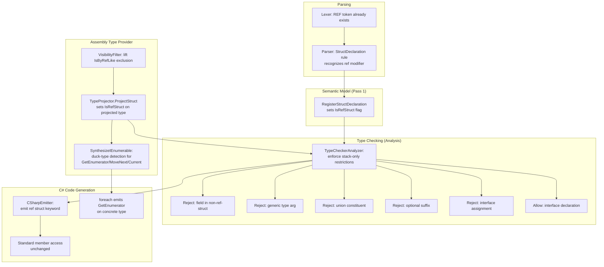

# Design Document: Ref Structs

## Overview

This design adds ref struct support to the Mist compiler, enabling declaration of stack-only value types in Mist source code and consumption of C# ref struct types (e.g., `Span<T>`, `ReadOnlySpan<T>`) from ambient .NET assemblies.

The feature touches every major compiler phase:

1. **Parsing** — Recognize `ref struct` as a declaration modifier combination
2. **Semantic Model** — Add `IsRefStruct` flag to `StructType`; register ref struct declarations
3. **Assembly Type Provider / Visibility Filter** — Lift the `IsByRefLike` exclusion; project ref struct types and members referencing them
4. **Type Checking** — Enforce stack-only usage restrictions (no heap fields, no generics, no unions, no optionals, no interface assignment)
5. **Code Generation** — Emit `ref struct` declarations and standard member access
6. **IEnumerable Synthesis** — Synthesize `IEnumerable<T>` on duck-typed ambient types (enabling `foreach` over `Span<T>`)
7. **Tooling & Documentation** — TextMate grammar, book, CSHARP_FEATURES.md, sample app

The design is intentionally conservative: ref structs participate in the type system as structs with an additional flag, and all restrictions are enforced at usage sites rather than requiring new type kinds.

## Architecture



### Key Design Decisions

1. **Single flag on StructType** — Rather than introducing a new type kind, we add `IsRefStruct` to the existing `StructType`. This minimizes changes across the compiler since ref structs behave identically to regular structs in most contexts.

2. **Restrictions at usage sites** — The type checker validates ref struct constraints at the point of use (field declarations, generic arguments, union types, optional suffixes, interface assignments), not at the declaration site. This means declaring `ref struct Foo : IBar` is valid; only `IBar x = foo` is rejected.

3. **IEnumerable synthesis for duck-typed types** — The `TypeProjector` already synthesizes `Enumerator` associated type slots for types implementing `IEnumerable<T>`. We extend this to also synthesize `IEnumerable<T>` on types that duck-type to the enumerable pattern but don't explicitly implement the interface. This enables `foreach` resolution through Mist's existing interface-based iteration machinery.

4. **No emission of synthesized interfaces** — The synthesized `IEnumerable<T>` exists only in Mist's type system. The emitter never writes it to C# output. The emitted `foreach` calls `GetEnumerator()` on the concrete type, which C#'s duck-typing handles correctly.

5. **Grammar reuse** — The `REF` token already exists in the keyword list. The `Modifier` rule already includes `ref` as `RefSpecifier` in ownership contexts. For struct declarations, we detect `ref` in the modifier list during semantic model building rather than adding a new grammar production.

## Components and Interfaces

### 1. Parser / Grammar (`Mist.storm`)

No grammar changes required. The existing `StructDeclaration` rule already accepts `modifiers:Modifier*` before `STRUCT`, and the `Modifier` rule does not include `REF` directly — but the `OwnershipSpecifier` rule does. However, looking at the grammar more carefully:

The `StructDeclaration` rule is:
```
rule StructDeclaration = modifiers:Modifier* STRUCT name:IDENTIFIER ...
```

The `Modifier` rule does NOT include `REF`. The `REF` token appears only in `OwnershipSpecifier`. We need to add `REF` as a modifier variant:

```
rule Modifier
    = PUBLIC    as PublicModifier
    | PRIVATE   as PrivateModifier
    | STATIC    as StaticModifier
    | INTRINSIC as IntrinsicModifier
    | READONLY  as ReadonlyModifier
    | OWNED     as OwnedModifier
    | ASYNC     as AsyncModifier
    | REF       as RefModifier        // NEW
    ;
```

This allows `ref struct Foo { ... }` to parse with `ref` captured in the modifiers list.

**Validation**: The `SemanticModelBuilder` will validate that `ref` only appears on struct declarations. If `ref` appears on a class, interface, trait, or enum, a diagnostic is emitted.

### 2. Semantic Model (`StructType`)

Add a new property to `StructType`:

```csharp
/// <summary>
/// Indicates whether this type is a ref struct (stack-only, cannot be boxed).
/// When true, the type cannot be used as a field in non-ref-struct types,
/// as a generic type argument, in union types, or as an optional type.
/// </summary>
public bool IsRefStruct { get; internal set; }
```

### 3. Semantic Model Builder (`SemanticModelBuilder`)

**`RegisterStructDeclaration`** — After creating the `StructType`, check if the modifier list contains a `RefModifier` node. If so, set `IsRefStruct = true`.

**`Pass1_RegisterTypes`** — Add validation: if a `RefModifier` appears on a non-struct type declaration (class, interface, trait, enum), emit diagnostic `MIST2001: The 'ref' modifier is only valid on struct declarations`.

**`RegisterStructDeclaration`** — Also handle `readonly ref struct` by checking for both `ReadonlyModifier` and `RefModifier` in the modifier list.

### 4. Visibility Filter (`VisibilityFilter`)

**Changes to `IsTypeExcluded`**:
- Remove the `IsRefStruct(clrType)` check. Ref struct types are no longer excluded.

**Changes to `IsMemberExcluded`**:
- Remove step 3 (`IsRefStruct(member.DeclaringType)` check). Members of ref struct types are no longer excluded.
- The `ReferencesExcludedType` check (step 8) will naturally stop excluding members that reference ref struct types, since `IsTypeExcluded` no longer excludes ref structs.

The `IsRefStruct` helper method remains (it's useful for the TypeProjector).

### 5. Type Projector (`TypeProjector`)

**Changes to `ProjectStruct`**:
- After creating the `StructType`, check if the CLR type `IsByRefLike`. If so, set `IsRefStruct = true` on the projected `StructType`.

```csharp
private (IType Type, ImmutableArray<ISymbol> Members) ProjectStruct(...)
{
    var structType = new StructType(displayName, memberScope, containingNamespace);
    
    // NEW: Mark ref structs
    if (clrType.IsByRefLike)
        structType.IsRefStruct = true;
    
    // ... existing code ...
}
```

### 6. IEnumerable Synthesis for Duck-Typed Types

**New method in `TypeProjector`**: `SynthesizeDuckTypedIEnumerable`

This method is called during `ProjectStruct` (and `ProjectClass`) for types that:
1. Do NOT already implement `IEnumerable<T>` (checked via `GetGenericIEnumerableImplementations`)
2. DO have a public parameterless `GetEnumerator()` method
3. Whose `GetEnumerator()` return type has a public `bool MoveNext()` method
4. Whose `GetEnumerator()` return type has a public `Current` property

When all conditions are met:
- Resolve `TElement` from the `Current` property's return type
- Synthesize `IEnumerable<TElement>` in the type's interface list
- Synthesize the `Enumerator` associated type slot (reusing existing `SynthesizeEnumeratorSlots` logic)

The synthesized interface is marked with a flag (or tracked in a set) so the emitter knows not to emit it.

**Integration with existing `SynthesizeEnumeratorSlots`**: The existing method already handles types that explicitly implement `IEnumerable<T>`. The new duck-typing synthesis adds the interface to the type's interface list *before* calling `SynthesizeEnumeratorSlots`, so the existing slot synthesis logic handles the rest.

### 7. Type Checker (`TypeCheckerAnalyzer`)

New validation rules added to the type checker:

| Rule | Location | Diagnostic |
|------|----------|------------|
| Ref struct as field type in non-ref-struct | Field declaration validation | `MIST2002: Ref struct type '{name}' cannot be used as a field in non-ref-struct type '{container}'` |
| Ref struct as property type in non-ref-struct | Property declaration validation | `MIST2003: Ref struct type '{name}' cannot be used as a property type in non-ref-struct type '{container}'` |
| Ref struct as generic type argument | Type argument resolution | `MIST2004: Ref struct type '{name}' cannot be used as a generic type argument` |
| Ref struct in union type | Union type resolution | `MIST2005: Ref struct type '{name}' cannot participate in union types` |
| Ref struct with optional suffix | Optional type resolution | `MIST2006: Ref struct type '{name}' cannot be optional` |
| Ref struct assigned to interface variable | Assignment/argument validation | `MIST2007: Ref struct value cannot be converted to interface type '{iface}'` |
| `ref` modifier on non-struct | Type declaration validation | `MIST2001: The 'ref' modifier is only valid on struct declarations` |

**Permitted uses** (no diagnostic):
- Ref struct as local variable type
- Ref struct as method parameter type
- Ref struct as method return type
- Ref struct as field type in another ref struct
- Ref struct declaring interface implementations
- Member access on ref struct values (same rules as regular structs)

### 8. C# Emitter (`CSharpEmitter`)

**Changes to `EmitStructDeclaration`**:
- When emitting the struct keyword, check `IsRefStruct` on the resolved `StructType`. If true, emit `ref struct` instead of `struct`.

```csharp
var keyword = structType.IsRefStruct ? "ref struct" : "struct";
```

All other emission (fields, methods, properties, indexers, constructors) remains unchanged — ref structs emit identically to regular structs in their member bodies.

**Changes to `EmitForeachStatement`**:
- No changes needed. The existing foreach emission already emits `foreach (Type var in collection)` which calls `GetEnumerator()` on the concrete type. C#'s duck-typing handles the rest.

**Synthesized interface suppression**:
- The emitter must not emit synthesized `IEnumerable<T>` in the base list of emitted types. Since we only synthesize on *ambient* types (not Mist-declared types), and ambient types are never emitted, this is automatically handled.

### 9. TextMate Grammar

Add a pattern before the existing `struct` declaration pattern to match `ref struct`:

```json
{
  "comment": "ref struct declaration: ref struct Name",
  "match": "\\b(ref)\\s+(struct)\\s+([a-zA-Z_]\\w*)",
  "captures": {
    "1": { "name": "storage.modifier.mist" },
    "2": { "name": "keyword.declaration.mist" },
    "3": { "name": "entity.name.type.struct.mist" }
  }
}
```

And a generic variant:
```json
{
  "comment": "Generic ref struct declaration: ref struct Name<T>",
  "match": "\\b(ref)\\s+(struct)\\s+([a-zA-Z_]\\w*)\\s*(<)",
  "captures": {
    "1": { "name": "storage.modifier.mist" },
    "2": { "name": "keyword.declaration.mist" },
    "3": { "name": "entity.name.type.mist" },
    "4": { "name": "punctuation.definition.typeparameters.begin.mist" }
  }
}
```

These patterns must appear before the generic `struct` pattern and the non-generic `struct` pattern to ensure `ref struct` is matched as a unit.

## Data Models

### StructType (Modified)

```csharp
public sealed class StructType : IType
{
    // ... existing properties ...
    
    /// <summary>
    /// Indicates whether this type is a ref struct (stack-only, cannot be boxed).
    /// </summary>
    public bool IsRefStruct { get; internal set; }  // NEW
}
```

### Modifier Rule (Modified Grammar)

```
rule Modifier
    = PUBLIC    as PublicModifier
    | PRIVATE   as PrivateModifier
    | STATIC    as StaticModifier
    | INTRINSIC as IntrinsicModifier
    | READONLY  as ReadonlyModifier
    | OWNED     as OwnedModifier
    | ASYNC     as AsyncModifier
    | REF       as RefModifier          // NEW
    ;
```

### Diagnostic Codes (New)

| Code | Message |
|------|---------|
| MIST2001 | The 'ref' modifier is only valid on struct declarations |
| MIST2002 | Ref struct type '{0}' cannot be used as a field in non-ref-struct type '{1}' |
| MIST2003 | Ref struct type '{0}' cannot be used as a property type in non-ref-struct type '{1}' |
| MIST2004 | Ref struct type '{0}' cannot be used as a generic type argument |
| MIST2005 | Ref struct type '{0}' cannot participate in union types |
| MIST2006 | Ref struct type '{0}' cannot be optional |
| MIST2007 | Ref struct value cannot be converted to interface type '{0}' |

### Synthesized Interface Tracking

The `TypeProjector` tracks which interfaces were synthesized (vs. explicitly implemented) using a flag on the projected type or a separate registry. For ambient types, this distinction matters only conceptually — since ambient types are never emitted, the emitter never needs to filter them.

For the `foreach` resolution path: the `SemanticModelBuilder.TryInferForeachElementType` already resolves `IEnumerable<T>` from the type's interface list. Once the synthesized `IEnumerable<T>` is in the interface list, foreach resolution works automatically.

## Correctness Properties

*A property is a characteristic or behavior that should hold true across all valid executions of a system — essentially, a formal statement about what the system should do. Properties serve as the bridge between human-readable specifications and machine-verifiable correctness guarantees.*

### Property 1: Ref struct parsing round-trip

*For any* valid identifier and set of struct members (fields, methods, properties, constructors, indexers), parsing a `ref struct` declaration and inspecting the resulting semantic model SHALL produce a `StructType` with `IsRefStruct = true`, and the type SHALL retain all declared members.

**Validates: Requirements 1.1, 1.2, 1.3**

### Property 2: Ref struct permitted usage sites

*For any* ref struct type `R`, using `R` as the type of a local variable, a method parameter, a method return type, or a field within another ref struct declaration SHALL produce zero diagnostics from the type checker.

**Validates: Requirements 3.1, 3.2, 3.3, 3.4**

### Property 3: Ref struct field/property rejection in non-ref-struct types

*For any* ref struct type `R` and any non-ref-struct type `T` (class or regular struct), declaring a field or property of type `R` inside `T` SHALL cause the type checker to emit a diagnostic error.

**Validates: Requirements 3.5, 3.6**

### Property 4: Ref struct generic type argument rejection

*For any* ref struct type `R` and any generic type `G<T>`, using `R` as a type argument (i.e., `G<R>`) SHALL cause the type checker to emit a diagnostic error.

**Validates: Requirements 3.7**

### Property 5: Ref struct union type rejection

*For any* ref struct type `R` and any other type `U`, forming a union type `R | U` SHALL cause the type checker to emit a diagnostic error.

**Validates: Requirements 3.8**

### Property 6: Ref struct optional type rejection

*For any* ref struct type `R`, applying the optional suffix `R?` SHALL cause the type checker to emit a diagnostic error.

**Validates: Requirements 3.9**

### Property 7: Ref struct interface assignment rejection

*For any* ref struct type `R` that declares interface implementation `I`, and any variable of type `I`, assigning a value of type `R` to that variable SHALL cause the type checker to emit a diagnostic error.

**Validates: Requirements 3.11, 3.12**

### Property 8: Ref struct member access equivalence

*For any* ref struct type `R` with public members (methods, properties, indexers), accessing those members on a value of type `R` SHALL resolve successfully using the same rules as regular struct member access, producing no diagnostics.

**Validates: Requirements 4.1, 4.2, 4.3, 4.4**

### Property 9: Ref struct C# emission

*For any* Mist-declared ref struct with fields, methods, and properties, the emitted C# output SHALL contain the `ref struct` keyword in the type declaration, and the emitted code SHALL compile successfully with the C# compiler.

**Validates: Requirements 5.1, 5.2, 5.3, 5.4, 5.5, 5.6**

### Property 10: Ref modifier on non-struct types produces diagnostic

*For any* class declaration preceded by the `ref` modifier, the compiler SHALL emit a diagnostic error indicating that `ref` is only valid on struct declarations.

**Validates: Requirements 1.5**

## Error Handling

### Diagnostic Strategy

All ref struct constraint violations are reported as **errors** (not warnings), since violating stack-only semantics would produce incorrect IL that the .NET runtime would reject.

| Scenario | Severity | Recovery |
|----------|----------|----------|
| `ref` on non-struct declaration | Error | Skip the modifier, continue parsing |
| Ref struct in field of non-ref-struct | Error | Report and continue checking other fields |
| Ref struct as generic type argument | Error | Report, treat as error type for downstream resolution |
| Ref struct in union type | Error | Report, exclude from union constituents |
| Ref struct with optional suffix | Error | Report, treat as non-optional for downstream |
| Ref struct assigned to interface | Error | Report at assignment site, continue |
| Unknown type that might be ref struct | No error | If a type cannot be resolved, existing "unknown type" diagnostics apply; ref struct checks only fire on resolved types |

### Error Recovery

The compiler continues processing after ref struct errors to report as many issues as possible in a single compilation. The type checker does not cascade — a ref struct type used in an invalid position is still treated as a valid type for the purposes of member resolution on that expression.

### Assembly Loading Errors

If an assembly contains a ref struct type that cannot be fully loaded (e.g., references types from unavailable assemblies), the existing assembly loading error handling applies — the type is skipped with a warning.

## Testing Strategy

### Unit Tests (Example-Based)

- **Parser tests**: Verify specific syntax variants parse correctly (`ref struct`, `public ref struct`, `readonly ref struct`, `ref readonly struct`)
- **Diagnostic tests**: Verify specific error messages for each invalid usage pattern
- **TextMate grammar tests**: Verify scope assignments for `ref struct` declarations
- **Integration tests**: Compile and run the sample application, verify output matches expected

### Property-Based Tests

Property-based testing is appropriate for this feature because:
- The type checker rules are universal properties that hold across all valid/invalid inputs
- The input space (type names, member combinations, usage positions) is large
- Pure logic (type checking, parsing) is cost-effective to test with many iterations

**Library**: FsCheck (already used in the project's test suite)

**Configuration**: Minimum 100 iterations per property test

**Tag format**: `Feature: ref-structs, Property {N}: {property text}`

Each correctness property (1–10) maps to one property-based test that generates random inputs and verifies the stated invariant. The test approach follows the project's existing batched pattern:
1. Generate N scenarios (struct declarations, usage patterns)
2. Build a single Mist program containing all scenarios
3. Compile once using the shared `CompilerDriver` instance (in-process)
4. Verify diagnostics (or lack thereof) for each scenario

This avoids spawning external processes per iteration, consistent with the test process spawning policy.

### End-to-End Tests

- The sample application (`samples/RefStructs/Program.mist`) serves as the primary end-to-end test
- Compile with zero diagnostics, run with zero exit code, verify stdout matches expected output exactly
- The `AllFeatures` orchestrator includes the ref structs sample in the full-suite run

