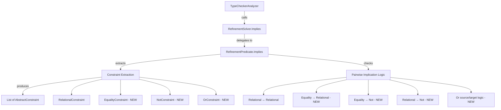

# Design Document: Refinement Comparison Engine Expansion

## Overview

This design expands the `RefinementPredicate.Implies()` method to handle additional pattern types beyond the current relational-only constraint extraction. Today, the `Implies` method extracts `RelationalConstraint` records (operator + value) from both source and target predicates, then checks pairwise implication. This works for `>=`, `<=`, `>`, `<` patterns but ignores constant equality (`== literal`), inequality/negation (`not literal`), and disjunction (`or`) patterns.

The expansion introduces a richer constraint representation that can express equality, inequality, not-patterns, and or-patterns alongside the existing relational constraints. The `Implies` method will be extended to reason about these new constraint types while preserving backward compatibility with all existing relational implication logic.

**Key design decision:** Rather than building a general-purpose SMT solver, the engine uses pattern-specific implication rules that are sound (never claims implication when it doesn't hold) and reasonably complete for the supported patterns. Unsupported patterns (property patterns, regex patterns, arithmetic expressions) cause the engine to return `false`, falling back to requiring explicit pattern matching from the developer.

## Architecture

The expansion is contained entirely within `RefinementPredicate.cs` in the `Mist.Semantics.Model.Types` namespace. No changes to the `RefinementSolver` facade or the type checker's calling code are needed — the public API (`RefinementPredicate.Implies(RefinementPredicate other)`) remains unchanged.



The architecture remains a single-pass structural analysis: extract constraints from AST, then check pairwise implication. No iterative solving or fixpoint computation is needed.

## Components and Interfaces

### Extended Constraint Types

The current `RelationalConstraint` record is supplemented with additional constraint types. All constraint types implement a common discriminated union pattern:

```csharp
// Existing (unchanged)
private enum RelOp { Gte, Lte, Gt, Lt }
private readonly record struct RelationalConstraint(RelOp Op, long Value);

// New constraint types
private readonly record struct EqualityConstraint(long Value);
private readonly record struct NotConstraint(long Value);  // represents != / not
private readonly record struct OrConstraint(ImmutableArray<long> Values);  // represents a or b or c

// Unified constraint wrapper
private enum ConstraintKind { Relational, Equality, Not, Or }
private readonly record struct Constraint(
    ConstraintKind Kind,
    RelationalConstraint? Relational,
    EqualityConstraint? Equality,
    NotConstraint? NotValue,
    OrConstraint? Or);
```

### Modified `Implies` Method

The top-level `Implies` method changes from operating on `List<RelationalConstraint>` to operating on `List<Constraint>`. The pairwise implication check is extended to handle all constraint kind combinations.

**Special handling for Or-patterns:**
- **Source is Or-pattern:** The or-pattern at the top level of a refinement type means the predicate is a disjunction. For implication to hold, *every* alternative in the source or-pattern must individually imply the target. This is handled by decomposing the source or-pattern into individual equality constraints and checking each against the target.
- **Target is Or-pattern:** The source must imply at least one alternative in the target or-pattern. This is checked by testing whether the source value is a member of the target's value set.

### Extraction Logic Changes

The `ExtractConstraints` method is extended to recognize:
1. `DirectPatternUnaryPatternNode` containing `ConstantPatternPrimaryPatternNode` → `EqualityConstraint`
2. `NotPatternUnaryPatternNode` containing `ConstantPatternPrimaryPatternNode` → `NotConstraint`
3. Top-level `OrPatternNode` (when the `AndPatternNode` is part of an or-pattern structure) → `OrConstraint`

For or-patterns specifically: The `RefinementPredicate` stores an `AndPatternNode` as its AST root. An or-pattern refinement type like `int 7 or 8` is parsed as an `AndPatternNode` whose structure contains the or-alternatives. The extraction logic needs to detect when the predicate represents an or-pattern by examining whether the AST contains `OrPatternNode` children, and if so, extract the individual constant values into an `OrConstraint`.

**Important:** The or-pattern in a refinement type definition context is represented differently from or-patterns in match expressions. In a refinement type like `type Lucky = int 7 or 8;`, the parser produces an `AndPatternNode` where the `Left` is a `DirectPatternUnaryPatternNode` containing the first constant, and additional alternatives appear via the or-pattern structure. The extraction logic must handle this AST shape.

### Implication Rules Matrix

| Source \ Target | >= b | <= b | > b | < b | == b | != b / not b | a or b |
|---|---|---|---|---|---|---|---|
| **>= a** | a >= b | — | a > b | — | — | — (unless > or <) | — |
| **<= a** | — | a <= b | — | a < b | — | — (unless > or <) | — |
| **> a** | a >= b | — | a >= b | — | — | a == b (implies != a) | — |
| **< a** | — | a <= b | — | a <= b | — | a == b (implies != a) | — |
| **== a** | a >= b | a <= b | a > b | a < b | a == b | a != b | a ∈ {values} |
| **!= a / not a** | — | — | — | — | — | a == b (identity) | — |
| **a or b** | all vals >= b | all vals <= b | all vals > b | all vals < b | — | all vals != b | subset check |

"—" means the implication does not hold (returns false).

## Data Models

### AST Node Relationships (existing, unchanged)

```
RefinementPredicate
  └── AstNode: AndPatternNode
        ├── Left: UnaryPatternNode
        │     ├── DirectPatternUnaryPatternNode → PrimaryPatternNode
        │     │     ├── GreaterThanOrEqualRelationalPatternPrimaryPatternNode
        │     │     ├── LessThanOrEqualRelationalPatternPrimaryPatternNode
        │     │     ├── GreaterThanRelationalPatternPrimaryPatternNode
        │     │     ├── LessThanRelationalPatternPrimaryPatternNode
        │     │     └── ConstantPatternPrimaryPatternNode  ← NEW for extraction
        │     └── NotPatternUnaryPatternNode  ← NEW for extraction
        │           └── Operand: PrimaryPatternNode (ConstantPatternPrimaryPatternNode)
        ├── Right: UnaryPatternNode (optional, for compound and-patterns)
        └── UnaryPatterns: ImmutableArray<UnaryPatternNode> (for 3+ parts)
```

### Constraint Data Model (new internal types)

```csharp
private enum ConstraintKind { Relational, Equality, Not, Or }

private readonly record struct Constraint(
    ConstraintKind Kind,
    RelationalConstraint? Relational = null,
    EqualityConstraint? Equality = null,
    NotConstraint? NotValue = null,
    OrConstraint? Or = null);

private readonly record struct EqualityConstraint(long Value);
private readonly record struct NotConstraint(long Value);
private readonly record struct OrConstraint(ImmutableArray<long> Values);
```

All constraint types are `private` nested types within `RefinementPredicate` — no public API surface changes.

## Correctness Properties

*A property is a characteristic or behavior that should hold true across all valid executions of a system — essentially, a formal statement about what the system should do. Properties serve as the bridge between human-readable specifications and machine-verifiable correctness guarantees.*

### Property 1: Equality-to-relational equivalence

*For any* integer value `a` and *for any* relational constraint target (operator, value), `Implies(== a, target)` SHALL return the same result as `Implies(>= a and <= a, target)`.

**Validates: Requirements 1.1, 1.2, 1.3, 1.4, 1.5, 1.6, 1.7**

### Property 2: Not-pattern identity and non-implication

*For any* integer value `a`, `Implies(not a, not a)` SHALL return true. *For any* integer value `a` and *for any* relational constraint (op, b), `Implies(not a, relational)` SHALL return false. *For any* integer values `a` and `b`, `Implies(not a, == b)` SHALL return false.

**Validates: Requirements 2.1, 2.3, 2.4, 8.1, 8.3, 8.4**

### Property 3: Equality implies not-pattern

*For any* integer values `a` and `b` where `a != b`, `Implies(== a, not b)` SHALL return true. When `a == b`, `Implies(== a, not b)` SHALL return false.

**Validates: Requirements 2.2, 8.2**

### Property 4: Relational-to-not implication

*For any* integer value `a`: `Implies(> a, not a)` SHALL return true; `Implies(< a, not a)` SHALL return true; `Implies(>= a, not a)` SHALL return false; `Implies(<= a, not a)` SHALL return false.

**Validates: Requirements 2.5, 8.5, 8.6, 8.7, 8.8**

### Property 5: Cross-operator relational implication

*For any* integer values `a` and `b`: `Implies(>= a, > b)` SHALL return true if and only if `a > b`; `Implies(<= a, < b)` SHALL return true if and only if `a < b`; `Implies(> a, > b)` SHALL return true if and only if `a >= b`; `Implies(< a, < b)` SHALL return true if and only if `a <= b`.

**Validates: Requirements 3.1, 3.2, 3.3, 3.4**

### Property 6: Or-pattern source requires all alternatives to imply target

*For any* set of integer values `{v1, v2, ..., vn}` forming an or-pattern source, and *for any* relational constraint target, `Implies(v1 or v2 or ... or vn, target)` SHALL return true if and only if every individual value in the set satisfies the target constraint.

**Validates: Requirements 7.4, 7.6**

### Property 7: Or-pattern target membership

*For any* integer value `a` and *for any* set of integer values `S`, `Implies(== a, S as or-pattern)` SHALL return true if and only if `a ∈ S`.

**Validates: Requirements 7.1, 7.5**

### Property 8: Or-pattern subset implication

*For any* two sets of integer values `A` and `B` represented as or-patterns, `Implies(A, B)` SHALL return true if and only if `A ⊆ B` (every element of A is also in B).

**Validates: Requirements 7.2, 7.3**

### Property 9: Soundness — Implies true means brute-force confirms

*For any* pair of predicates (source, target) drawn from the expanded constraint types (relational, equality, not, or), when `Implies(source, target)` returns true, then for every integer value `v` in a test range, if `source.Evaluate(v)` is true then `target.Evaluate(v)` must also be true.

**Validates: Requirements 1.1–1.7, 2.1–2.5, 3.1–3.4, 7.1–7.7, 8.1–8.8**

## Error Handling

- **Unsupported patterns:** When `ExtractConstraints` encounters a pattern it cannot reason about (property patterns, regex patterns, type patterns), it returns an empty constraint list for that predicate. The `Implies` method already returns `false` when `targetConstraints.Count == 0`, which is the correct fallback behavior. No exceptions are thrown.
- **Non-extractable constants:** When `TryExtractLongFromExpression` returns `null` (e.g., for arithmetic expressions like `x + 1`), the constraint is simply not added to the list. This means the engine cannot prove implications involving such expressions, which satisfies Requirement 4.3.
- **Or-pattern with non-constant alternatives:** If an or-pattern contains alternatives that are not integer constants (e.g., type patterns in an or), the extraction returns an empty or-constraint and implication returns false.
- **Base type mismatch:** The type checker validates base type compatibility before calling `RefinementSolver.Implies`. The solver itself does not need to check base types — this is enforced at the call site (Requirement 5.2).

## Testing Strategy

### Property-Based Tests (FsCheck)

The primary testing approach uses property-based testing with FsCheck, extending the existing `RefinementImplicationPropertyTests` pattern. A new test class `RefinementComparisonEnginePropertyTests` will be created with generators for the expanded constraint types.

**Library:** FsCheck 3.1.0 with FsCheck.Xunit integration (already in project)

**Configuration:** Minimum 100 iterations per property test (`[Property(MaxTest = 100)]`)

**Tag format:** `Feature: refinement-comparison-engine, Property {N}: {property_text}`

**Test approach:** All property tests operate in-process by constructing AST nodes directly and calling `RefinementPredicate.Implies()`. No process spawning is needed — the implication logic is pure computation on AST structures.

**Generators needed:**
- `Gen<EqualityConstraint>` — random integer values wrapped in `ConstantPatternPrimaryPatternNode`
- `Gen<NotConstraint>` — random integer values wrapped in `NotPatternUnaryPatternNode`
- `Gen<OrConstraint>` — random sets of 2-5 integer values
- `Gen<MixedPredicate>` — combines all constraint types for the soundness property

**Brute-force oracle:** The existing `BruteForceImplies` pattern (evaluate both predicates across a range of integers) serves as the oracle for the soundness property. Since `Evaluate` already handles constant patterns, not-patterns, and or-patterns correctly, it provides ground truth.

### Unit Tests (Example-Based)

Example-based tests cover:
- Unsupported pattern rejection (property patterns, regex patterns) — Requirements 4.1, 4.2
- Arithmetic expression non-extraction — Requirement 4.3
- Multi-numeric-type literal parsing — Requirement 5.1
- Or-pattern no range inference — Requirement 7.7

### Integration Tests

- Sample compilation and execution (`samples/RefinementComparison/Program.mist`) — Requirements 6.1–6.5
- AllFeatures orchestrator includes the new sample — Requirement 6.4

### Process Spawning Note

All property-based tests and unit tests are **in-process only** — they construct AST nodes directly and call `Implies()` without spawning any external processes. The only process spawn is for the integration test that compiles and runs the sample app (1 compile + 1 run = 2 process spawns total for the entire integration test).
