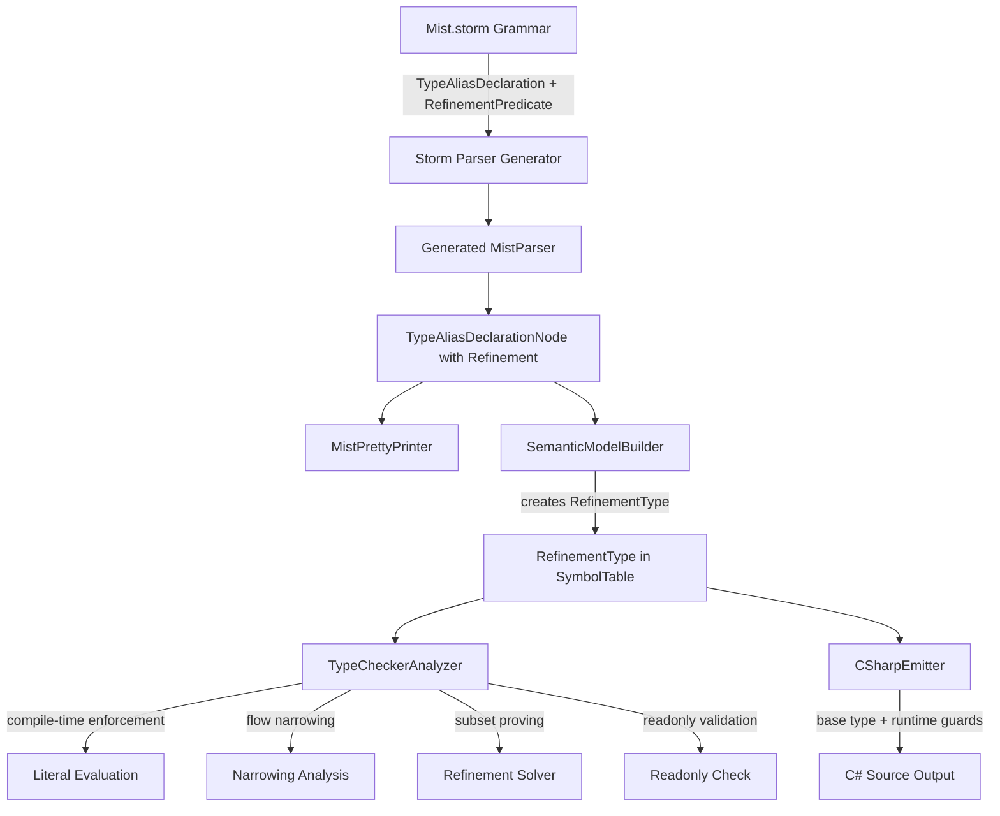

# Design Document: Refinement Types

## Overview

Refinement types extend the type alias system to allow attaching pattern-match predicates that constrain valid values. A refinement type is defined via the existing `type` alias syntax with an additional predicate after the base type (e.g., `type AdultAge = int >= 18;`). The compiler enforces the predicate at compile time for literals and requires pattern matching (`is` expressions) for runtime validation of non-constant values.

The implementation spans the full compiler pipeline: grammar extension, parsing, pretty-printing, semantic model construction, type checking (compile-time enforcement, flow narrowing, subset proving), C# transpilation, and editor syntax highlighting.

### Design Decisions

1. **Reuse pattern match syntax**: Refinement predicates use the same grammar as pattern match expressions (relational patterns, logical `and`, property patterns). This avoids introducing new syntax and leverages existing parser infrastructure.

2. **Readonly constraint for soundness**: Property patterns in refinements may only reference `readonly` fields/properties. This prevents a refinement from being silently invalidated by mutation after the value is proven to satisfy the predicate.

3. **Nominal subtyping**: A refinement type is a nominal subtype of its base type. Widening (refinement → base) is always safe. Narrowing (base → refinement) requires either a compile-time literal check or runtime pattern matching.

4. **No special checked syntax**: Runtime validation uses the existing `is` expression mechanism. No new keywords or conversion syntax are introduced.

5. **Conservative flow narrowing**: Flow narrowing only applies to local primitive variables that are provably unmodified (not reassigned, not captured by closures). This avoids unsound narrowing in concurrent or aliased scenarios.

6. **Refinement predicate binds tighter than union**: In `type T = int >= 0 | string;`, the `>= 0` attaches to `int`, not to the entire union. The `|` operator has lower precedence.

7. **Arithmetic erases refinements**: Any arithmetic operation on a refinement-typed value produces the base type. The compiler does not attempt to prove that derived values satisfy refinements.

8. **Subset proving is limited**: The type checker proves simple relational implications (`>= 21` implies `>= 18`) and compound `and` implications. It does not attempt arithmetic reasoning or cross-method analysis.

## Architecture



## Components and Interfaces

### 1. Grammar Changes (Storm)

**File: `Source/Mist/Grammar/Mist.storm`**

Extend the `TypeAliasDeclaration` rule to accept an optional refinement predicate. The refinement uses the existing `Pattern` rule infrastructure but is restricted to the subset valid for refinements (relational, logical `and`, property patterns, constants).

The key insight is that the refinement predicate attaches to each `SingleTypeRef` in a union, not to the entire type expression. This means the grammar change is at the `SingleTypeRef` level within the type alias context.

```storm
rule TypeAliasDeclaration = TYPE name:IDENTIFIER typeParams:TypeParameterList? EQUAL type:RefinableTypeExpression
    constraints:ConstraintClause*
    SEMICOLON;

rule RefinableTypeExpression
    = unionType:RefinableUnionTypeExpr   as RefinableUnionType
    | singleType:RefinableSingleTypeExpr as RefinableSingleType
    ;

rule RefinableUnionTypeExpr = first:RefinableSingleTypeExpr (PIPE rest:RefinableSingleTypeExpr)+;

rule RefinableSingleTypeExpr = type:SingleTypeRef refinement:RefinementPredicate?;

rule RefinementPredicate = predicate:AndPattern;
```

The `RefinementPredicate` reuses the existing `AndPattern` rule (which includes relational patterns, logical `and`, property patterns, and constants). The `OrPattern` level is excluded because `or` in refinements is expressed via the union `|` operator.

**Precedence**: The refinement predicate binds tighter than `|` because it's part of `RefinableSingleTypeExpr`, which is a constituent of the union.

### 2. AST Node Structure

The Storm source generator will produce updated nodes:

```csharp
// Generated - TypeAliasDeclaration now has RefinableTypeExpression instead of TypeReference
public sealed class TypeAliasDeclarationNode : SyntaxNode
{
    public Token Name { get; }
    public TypeParameterListNode? TypeParams { get; }
    public RefinableTypeExpressionNode Type { get; }
    public ConstraintClauseNode[]? Constraints { get; }
}

// New: wraps a SingleTypeRef with an optional refinement
public sealed class RefinableSingleTypeExprNode : SyntaxNode
{
    public SingleTypeRefNode Type { get; }
    public RefinementPredicateNode? Refinement { get; }
}

// New: the refinement predicate (reuses AndPatternNode)
public sealed class RefinementPredicateNode : SyntaxNode
{
    public AndPatternNode Predicate { get; }
}
```

### 3. Pretty Printer Changes

**File: `Source/Mist/Parsing/MistPrettyPrinter.cs`**

Update `EmitTypeAliasDeclaration` to handle the new `RefinableTypeExpression`:

```csharp
private void EmitTypeAliasDeclaration(TypeAliasDeclarationNode aliasDecl)
{
    var name = aliasDecl.Name.Lexeme;
    var typeParams = EmitTypeParameterList(aliasDecl.TypeParams);
    var typeExpr = EmitRefinableTypeExpression(aliasDecl.Type);
    AppendLine($"type {name}{typeParams} = {typeExpr};");
}

private string EmitRefinableTypeExpression(RefinableTypeExpressionNode node)
{
    return node switch
    {
        RefinableUnionTypeNode union => EmitRefinableUnion(union),
        RefinableSingleTypeNode single => EmitRefinableSingle(single.SingleType),
        _ => throw new InvalidOperationException()
    };
}

private string EmitRefinableSingle(RefinableSingleTypeExprNode expr)
{
    var type = EmitSingleTypeRef(expr.Type);
    if (expr.Refinement is null) return type;
    var predicate = EmitPattern(expr.Refinement.Predicate);
    return $"{type} {predicate}";
}
```

### 4. Semantic Model Changes

**New type: `Source/Mist/Semantics/Model/Types/RefinementType.cs`**

```csharp
public sealed class RefinementType : IType
{
    public string Name { get; }              // The alias name (e.g., "AdultAge")
    public IType BaseType { get; }           // The underlying type (e.g., IntType)
    public RefinementPredicate Predicate { get; } // The constraint
    public string DisplayName => Name;
    public TypeKind Kind => BaseType.Kind;
}
```

**New type: `Source/Mist/Semantics/Model/Types/RefinementPredicate.cs`**

```csharp
public sealed class RefinementPredicate
{
    public AndPatternNode AstNode { get; }   // The pattern AST for emission
    public string Description { get; }       // Human-readable (e.g., ">= 18")
    
    /// Evaluates the predicate against a compile-time constant value.
    /// Returns true if the value satisfies the predicate, false otherwise.
    public bool Evaluate(object constantValue) { ... }
    
    /// Checks if this predicate logically implies another predicate.
    /// Used for subset relationship proving.
    public bool Implies(RefinementPredicate other) { ... }
}
```

**SemanticModelBuilder changes:**

- **Pass 1**: Register type alias as before. No change for refinement detection at this stage.
- **Pass 2**: When resolving a `TypeAliasDeclarationNode` whose `RefinableTypeExpression` contains a `RefinementPredicate`:
  1. Resolve the base `SingleTypeRef` to an `IType`
  2. Validate the predicate is compatible with the base type (relational patterns require comparable types)
  3. If the base type is non-primitive and the predicate uses property patterns, validate all referenced members are `readonly`
  4. Construct a `RefinementType` wrapping the base type and predicate
  5. Store the `RefinementType` as the alias's `DeclaredType`

### 5. Type Checker Changes

**File: `Source/Mist/Analysis/Builtin/TypeCheckerAnalyzer.cs`**

New responsibilities:

1. **Compile-time literal enforcement**: When assigning a literal to a `RefinementType` variable, evaluate the predicate against the literal value. Emit diagnostic if it fails.

2. **Non-constant rejection**: When assigning a non-constant expression to a `RefinementType` variable (and the source type is the base type, not already the same refinement type), emit a diagnostic requiring pattern matching.

3. **Widening acceptance**: When assigning a `RefinementType` value to a `BaseType` variable, always accept (nominal subtyping).

4. **Subset proving**: When assigning one `RefinementType` to another with the same base type, use `RefinementPredicate.Implies()` to check if the source is a subset of the target.

5. **Readonly validation**: When a refinement predicate uses property patterns, verify all referenced members are `readonly`.

6. **Flow narrowing**: After an `if` condition that proves a refinement predicate for a local variable:
   - Create an anonymous `RefinementType` scoped to the then-branch
   - Only for local primitives not captured by closures and not reassigned

7. **Arithmetic erasure**: When a `RefinementType` value participates in arithmetic, the result type is the base type.

**New helper: Refinement Solver**

A focused module within the type checker for proving subset relationships:

```csharp
internal static class RefinementSolver
{
    /// Returns true if sourcePredicate logically implies targetPredicate.
    /// Handles: >= a implies >= b when a >= b
    ///          <= a implies <= b when a <= b
    ///          (>= a and <= b) implies (>= c and <= d) when a >= c and b <= d
    public static bool Implies(RefinementPredicate source, RefinementPredicate target) { ... }
}
```

### 6. C# Transpiler Changes

**File: `Source/Mist/Backends/CSharpTranspiler/CSharpEmitter.cs`**

Refinement types are erased to their base type in C#:

- **Variable declarations**: `AdultAge x = 20;` → `int x = 20;`
- **Method parameters**: `void Foo(AdultAge age)` → `void Foo(int age)` with a runtime guard at method entry
- **Pattern matching**: `x is AdultAge age` → runtime predicate check with variable binding:
  ```csharp
  // Mist: if (x is AdultAge age) { ... }
  // C#:   if (x >= 18) { var age = x; ... }
  ```
- **Switch expressions**: Refinement type patterns become guard conditions on match arms

**Runtime guard emission for method parameters:**
```csharp
// Mist: void Foo(AdultAge age) { ... }
// C#:
void Foo(int age)
{
    if (!(age >= 18))
        throw new ArgumentException($"Value {age} does not satisfy refinement '>= 18' on type 'AdultAge'", nameof(age));
    ...
}
```

### 7. Editor Syntax Highlighting

**File: `Editor/mist-syntax-highlighting/syntaxes/mist.tmLanguage.json`**

No new keywords are introduced. The existing patterns for `type`, relational operators, and `and` already cover refinement type declarations. The TextMate grammar highlights:
- `type` as `keyword.declaration.mist`
- The alias name as `entity.name.type.alias.mist`
- Relational operators as `keyword.operator.relational.mist`
- `and` as `keyword.operator.logical.mist`

Verify existing patterns cover the refinement context. If not, add a specific pattern for type alias declarations that captures the refinement portion.

## Data Models

### RefinementType

```
RefinementType
├── Name: string                    // The alias identifier (e.g., "AdultAge")
├── BaseType: IType                 // The underlying type (e.g., IntType)
├── Predicate: RefinementPredicate  // The constraint
├── DisplayName: string             // Returns Name
└── Kind: TypeKind                  // Delegates to BaseType.Kind
```

### RefinementPredicate

```
RefinementPredicate
├── AstNode: AndPatternNode         // The pattern AST (for emission and evaluation)
├── Description: string             // Human-readable form (e.g., ">= 18")
├── Evaluate(value): bool           // Compile-time constant evaluation
└── Implies(other): bool            // Subset relationship proving
```

### Type Hierarchy

```
IType
├── StructType (int, bool, etc.)
├── ClassType
├── UnionType
│   └── Constituents: IType[]       // Can contain RefinementType instances
├── TypeAliasType
│   └── UnderlyingType: IType
└── RefinementType                  // NEW
    ├── BaseType: IType
    └── Predicate: RefinementPredicate
```

## Correctness Properties

### Property 1: Parsing produces correct AST structure for refinement types

*For any* valid refinement type alias source string (simple relational, compound `and`, property pattern, union with refinements), parsing the source SHALL produce a `TypeAliasDeclarationNode` whose base type and refinement predicate fields correctly reflect the input.

**Validates: Requirements 1.1, 1.2, 1.3, 1.5, 1.7**

### Property 2: Pretty-print round-trip for refinement types

*For any* valid refinement type alias declaration source string, parsing it and pretty-printing the resulting AST, then parsing and pretty-printing again, SHALL produce identical text output (idempotence).

**Validates: Requirements 2.1, 2.2, 2.3, 2.4**

### Property 3: Compile-time enforcement correctness

*For any* refinement type with a relational predicate and *for any* integer literal, the type checker SHALL accept the assignment if and only if the literal satisfies the predicate. Specifically: for `type T = int >= N;` and literal `L`, assignment is accepted iff `L >= N`.

**Validates: Requirements 5.1, 5.2, 5.4**

### Property 4: Widening always accepted

*For any* refinement type `R` with base type `B`, assigning a value of type `R` to a variable of type `B` SHALL always be accepted by the type checker.

**Validates: Requirements 8.3, 9.4**

### Property 5: Subset relationship correctness

*For any* two refinement types with the same base type and simple relational predicates (`>= a` and `>= b`), the type checker SHALL accept assignment from the first to the second if and only if `a >= b` (the source is more constrained).

**Validates: Requirements 9.1, 9.2, 9.5**

### Property 6: Arithmetic produces base type

*For any* refinement type `R` with base type `B`, performing any arithmetic operation on a value of type `R` SHALL produce a result of type `B`.

**Validates: Requirements 8.1, 8.2**

### Property 7: Transpilation correctness

*For any* valid Mist program containing refinement type declarations and usages (literal assignments, pattern matching, widening), transpiling to C# and compiling the output SHALL produce zero compilation errors.

**Validates: Requirements 12.1, 12.3, 12.5**

## Error Handling

| Diagnostic ID | Stage | Condition | Message Template |
|---|---|---|---|
| `MIST_TC_0070` | Type Checker | Literal violates refinement predicate | `Value '{value}' does not satisfy refinement '{predicate}' on type '{typeName}'` |
| `MIST_TC_0071` | Type Checker | Non-constant assigned to refinement type | `Cannot assign '{exprType}' to '{refinementType}' without proving the refinement. Use pattern matching to validate at runtime` |
| `MIST_TC_0072` | Type Checker | Refinement predicate incompatible with base type | `Refinement predicate '{predicate}' is not valid for base type '{baseType}'. Relational patterns require a comparable type` |
| `MIST_TC_0073` | Type Checker | Mutable member in refinement predicate | `Refinement predicate on type '{typeName}' references mutable member '{memberName}'. All members in a refinement predicate must be readonly` |
| `MIST_TC_0074` | Type Checker | Cannot prove subset relationship | `Cannot assign '{sourceType}' to '{targetType}' because the compiler cannot prove that '{sourcePredicate}' implies '{targetPredicate}'` |
| `MIST_TC_0075` | Type Checker | Refinement type used in inline position | `Refinement types can only be defined via type alias declarations` |

**Error recovery strategy:**
- When a literal violates a refinement, report the diagnostic and continue type checking (the variable gets the refinement type for downstream analysis).
- When a non-constant is assigned without pattern matching, report the diagnostic and treat the assignment as valid for downstream analysis (avoid cascading errors).
- When a predicate is incompatible with the base type, assign `ErrorType` to the alias and suppress cascading diagnostics.

## Testing Strategy

### Property-Based Tests (using FsCheck)

1. **Parsing correctness** — Generate random valid refinement type alias source strings (varying base types, predicate operators, compound predicates, union combinations). Parse and verify AST structure.

2. **Pretty-print round-trip** — Generate random valid refinement type alias source strings. Verify `print(parse(print(parse(s)))) == print(parse(s))`.

3. **Compile-time enforcement** — Generate random refinement types (`int >= N` for random N) and random integer literals. Build semantic model and run type checker. Verify acceptance/rejection matches predicate evaluation.

4. **Widening acceptance** — Generate programs assigning refinement-typed values to base-typed variables. Verify zero diagnostics.

5. **Subset proving** — Generate pairs of relational predicates with known subset relationships. Verify the solver correctly accepts/rejects.

6. **Arithmetic erasure** — Generate programs performing arithmetic on refinement-typed values. Verify result type is the base type.

7. **Transpilation correctness** — Generate valid Mist programs with refinement types. Transpile and compile C# output. Use **batched approach** (1 compile, 1 run per test class).

### Unit Tests (example-based)

- Literal violating predicate produces `MIST_TC_0070`
- Non-constant assignment produces `MIST_TC_0071`
- Incompatible predicate produces `MIST_TC_0072`
- Mutable member in predicate produces `MIST_TC_0073`
- Non-provable subset produces `MIST_TC_0074`
- Flow narrowing from `if (x >= 18)` narrows to `AdultAge`
- Flow narrowing invalidated by reassignment
- No narrowing on closure-captured variables
- Pattern matching with `is AdultAge age` introduces correct type
- Union with refinements: each constituent checked independently
- Switch expression with refinement type patterns

### Process Spawning Note

Property 7 (transpilation correctness) requires compiling C# output. Per workspace rules, this uses the **batched approach**: generate all scenarios upfront, build a single Mist program, compile once, run once, compare results line-by-line. This limits process spawns to 1 per test class.
