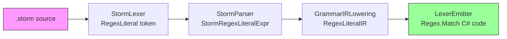

# Design Document: Regex Literals

## Overview

This design adds regex literals as a first-class expression type to the Storm meta-grammar language. Regex literals use backtick delimiters (`` `pattern` ``) and flow through the full compiler pipeline: lexer → parser → AST → IR → C# code emission. The generated C# lexer code uses `System.Text.RegularExpressions.Regex` with position-anchored matching and the `Compiled` option.

The change touches six layers of the Storm source generator, the Storm syntax highlighting extension, and the Mist grammar file. Each layer receives a minimal, parallel addition that mirrors the existing `StringLiteral` / `CharClass` patterns.

### Design Rationale

Backtick delimiters were chosen because they are unused in the current Storm grammar, visually distinct from string literals (`"..."`) and character classes (`[...]`), and familiar from other languages (e.g., Go raw strings, JavaScript template literals). The implementation delegates to .NET's `Regex` engine rather than hand-rolling a matcher, keeping the emitter simple and leveraging a battle-tested regex implementation.

## Architecture

The regex literal feature follows the existing expression pipeline. Each stage already has a pattern for adding new expression types (switch/case dispatch), so the changes are additive and isolated.



**Data flow for a regex literal `` `[a-zA-Z]+` ``:**

1. **StormLexer** scans backtick-to-backtick, produces `StormToken(RegexLiteral, "`[a-zA-Z]+`")`
2. **StormParser** strips delimiters, produces `StormRegexLiteralExpr(Pattern: "[a-zA-Z]+")`
3. **GrammarIRLowering** maps AST → `RegexLiteralIR(Pattern: "[a-zA-Z]+")`
4. **LexerEmitter** generates anchored `Regex.Match` C# code returning match length or 0

## Components and Interfaces

### 1. StormLexer (StormLexer.cs)

**Changes:**
- Add `RegexLiteral` to `StormTokenKind` enum (between `CharClass` and `Equals`)
- Add backtick scanning branch in `Tokenize()`, after the `[` (CharClass) branch

**Scanning logic:**
```
if c == '`':
    start = pos
    pos++  // skip opening backtick
    while pos < text.Length && text[pos] != '`':
        if text[pos] == '\\' && pos + 1 < text.Length:
            pos += 2  // skip escaped character (including \`)
        else:
            pos++
    if pos < text.Length:
        pos++  // skip closing backtick
    else:
        emit diagnostic: "Unterminated regex literal"
    lexeme = text[start..pos]  // includes backtick delimiters
    emit StormToken(RegexLiteral, lexeme, ...)
```

This mirrors the existing string literal scanning logic, substituting backtick for double-quote.

### 2. StormParser (StormParser.cs)

**Changes:**
- Add `case StormTokenKind.RegexLiteral:` in `ParsePrimary()` — strip backtick delimiters, return `StormRegexLiteralExpr(pattern)`
- Add `StormTokenKind.RegexLiteral` to `IsExpressionStart()` switch

**Delimiter stripping:** `pattern = lexeme.Substring(1, lexeme.Length - 2)` — same approach as `UnquoteString` but without escape processing (regex escapes are passed through verbatim to the .NET Regex engine).

### 3. StormSyntax — AST Node (StormSyntax.cs)

**Addition:**
```csharp
/// <summary>
/// A backtick-delimited regex literal: `[a-zA-Z]+`
/// </summary>
public sealed record StormRegexLiteralExpr(
    string Pattern)
    : StormExpression;
```

The `Pattern` property stores the regex without backtick delimiters.

### 4. ExpressionIR — IR Node (ExpressionIR.cs)

**Addition:**
```csharp
/// <summary>
/// A regex literal pattern: `[a-zA-Z]+`
/// </summary>
public sealed class RegexLiteralIR : ExpressionIR
{
    public string Pattern { get; }

    public RegexLiteralIR(string pattern)
    {
        Pattern = pattern;
    }
}
```

### 5. GrammarIRLowering (GrammarIRLowering.cs)

**Changes — two switch statements:**

In `InlineFragments()`:
```csharp
case StormRegexLiteralExpr regexExpr:
    return new RegexLiteralIR(regexExpr.Pattern);
```

In `LowerRuleExpression()`:
```csharp
case StormRegexLiteralExpr regexExpr:
    return new RegexLiteralIR(regexExpr.Pattern);
```

Both are direct mappings — no fragment inlining or reference resolution needed for regex literals.

### 6. LexerEmitter (LexerEmitter.cs)

**Changes:**

Add `case RegexLiteralIR` in `GenerateMatchExpr()`:
```csharp
case RegexLiteralIR regex:
    return GenerateRegexLiteralMatch(regex.Pattern, posVar);
```

New method `GenerateRegexLiteralMatch`:
```csharp
private static string GenerateRegexLiteralMatch(string pattern, string posVar)
{
    var escaped = EscapeStringForCSharp(pattern);
    var varName = UniqueVar("rm");
    return $"((Func<int>)(() => {{ " +
           $"var {varName} = Regex.Match(input, @\"{escaped}\", " +
           $"RegexOptions.Compiled).Success ? " +
           $"Regex.Match(input.Substring({posVar}), " +
           $"\"^(?:{escaped})\", RegexOptions.Compiled) : " +
           $"System.Text.RegularExpressions.Match.Empty; " +
           $"return {varName}.Success ? {varName}.Length : 0; }}))()";
}
```

Simplified approach — generate a static `Regex` field and use `Match(input, pos)`:
```csharp
// Generated code pattern:
private static readonly Regex _regex_N = new Regex(@"^(?:PATTERN)", RegexOptions.Compiled);

// In TryMatch method:
var m = _regex_N.Match(input, pos);
return (m.Success && m.Index == pos) ? m.Length : 0;
```

The `^` anchor combined with `Match(input, pos)` ensures matching starts at exactly `pos`. The `(?:...)` non-capturing group wraps the user pattern to prevent alternation leaking.

**Emit-level changes:**
- Track whether any token uses `RegexLiteralIR` during emission
- If so, add `using System.Text.RegularExpressions;` to the generated file
- Emit static `Regex` fields at class level for each unique pattern
- Reference those fields in `TryMatch` methods

### 7. storm.tmLanguage.json

**Addition to repository:**
```json
"regex-literals": {
    "name": "string.regexp.storm",
    "begin": "`",
    "end": "`",
    "patterns": [
        {
            "name": "constant.character.escape.storm",
            "match": "\\\\."
        }
    ]
}
```

**Addition to top-level patterns array** (after `#strings`, before `#character-classes`):
```json
{ "include": "#regex-literals" }
```

Using `begin`/`end` (rather than `match`) correctly handles escaped backticks within the regex body.

### 8. Mist.storm Migration

Character classes that map to standard regex patterns will be replaced:

| Before | After | Location |
|--------|-------|----------|
| `[ \t\r\n]+` | `` `\s+` `` | WHITESPACE token |
| `[^\n]*` | `` `[^\n]*` `` | LINE_COMMENT token |
| `[0-9a-fA-F]` | `` `[0-9a-fA-F]` `` | HEX_DIGIT fragment |
| `[0-9]+` | `` `[0-9]+` `` | INTEGER_LITERAL, FLOAT_LITERAL |
| `[a-zA-Z_]` | `` `[a-zA-Z_]` `` | IDENTIFIER token |
| `[a-zA-Z0-9_]*` | `` `[a-zA-Z0-9_]*` `` | IDENTIFIER token |
| `[xX]` | `` `[xX]` `` | HEX_LITERAL token |
| `[lLuU]` | `` `[lLuU]` `` | INT_SUFFIX fragment |
| `[fFdDmM]` | `` `[fFdDmM]` `` | FLOAT_SUFFIX fragment |
| `[^'\\]` | `` `[^'\\]` `` | CHAR_LITERAL token |
| `[^"\\]` | `` `[^"\\]` `` | STRING_LITERAL token |
| `[^"\\{]` | `` `[^"\\{]` `` | INTERPOLATED_STRING_TEXT |

The migration is mechanical — each `[...]` becomes `` `[...]` `` with the same content. Some multi-part tokens (like IDENTIFIER = `[a-zA-Z_][a-zA-Z0-9_]*`) can be collapsed into a single regex literal: `` `[a-zA-Z_][a-zA-Z0-9_]*` ``.

## Data Models

### New Types

| Type | Layer | Properties | Description |
|------|-------|------------|-------------|
| `StormTokenKind.RegexLiteral` | Lexer enum | — | New enum variant for regex literal tokens |
| `StormRegexLiteralExpr` | AST (StormSyntax.cs) | `Pattern: string` | AST node for regex literals |
| `RegexLiteralIR` | IR (ExpressionIR.cs) | `Pattern: string` | IR node for regex literals |

### Data Flow

```
Source: `[a-zA-Z]+`
  ↓ StormLexer
Token: { Kind: RegexLiteral, Lexeme: "`[a-zA-Z]+`" }
  ↓ StormParser (strip delimiters)
AST: StormRegexLiteralExpr { Pattern: "[a-zA-Z]+" }
  ↓ GrammarIRLowering
IR: RegexLiteralIR { Pattern: "[a-zA-Z]+" }
  ↓ LexerEmitter
C#: private static readonly Regex _regex_0 = new Regex(@"^(?:[a-zA-Z]+)", RegexOptions.Compiled);
    // In TryMatch: var m = _regex_0.Match(input, pos); return (m.Success && m.Index == pos) ? m.Length : 0;
```

### Existing Types Modified

| Type | Change |
|------|--------|
| `StormTokenKind` enum | Add `RegexLiteral` variant |
| `StormLexer.Tokenize()` | Add backtick scanning branch |
| `StormParser.ParsePrimary()` | Add `RegexLiteral` case |
| `StormParser.IsExpressionStart()` | Add `RegexLiteral` to switch |
| `GrammarIRLowering.InlineFragments()` | Add `StormRegexLiteralExpr` case |
| `GrammarIRLowering.LowerRuleExpression()` | Add `StormRegexLiteralExpr` case |
| `LexerEmitter.GenerateMatchExpr()` | Add `RegexLiteralIR` case |
| `LexerEmitter.Emit()` | Conditionally add `using System.Text.RegularExpressions;` |


## Correctness Properties

*A property is a characteristic or behavior that should hold true across all valid executions of a system — essentially, a formal statement about what the system should do. Properties serve as the bridge between human-readable specifications and machine-verifiable correctness guarantees.*

### Property 1: Lex-parse round trip preserves regex pattern

*For any* string `p` that does not contain an unescaped backtick, wrapping `p` in a minimal Storm token declaration (e.g., `` token T = `p`; ``), tokenizing with `StormLexer`, and parsing with `StormParser` SHALL produce a `StormRegexLiteralExpr` whose `Pattern` property equals `p`.

**Validates: Requirements 1.1, 1.5, 2.1, 3.2**

### Property 2: IR lowering preserves regex pattern

*For any* `StormRegexLiteralExpr` with pattern `p`, lowering through `GrammarIRLowering` (both the `InlineFragments` and `LowerRuleExpression` paths) SHALL produce a `RegexLiteralIR` whose `Pattern` property equals `p`.

**Validates: Requirements 4.2, 5.1, 5.2**

### Property 3: Emitter generates anchored compiled Regex code

*For any* `RegexLiteralIR` with pattern `p`, the C# code generated by `LexerEmitter.GenerateMatchExpr` SHALL contain a `Regex` instantiation with `RegexOptions.Compiled`, the pattern anchored with `^`, and a return expression that yields the match length on success or `0` on failure.

**Validates: Requirements 6.1, 6.2, 6.3, 6.5**

### Property 4: Mist grammar migration produces identical tokenization

*For any* valid Mist source text, tokenizing with the migrated `Mist.storm` (using regex literals) SHALL produce a token sequence identical in token kinds and lexemes to tokenizing with the original `Mist.storm` (using character classes).

**Validates: Requirements 8.4**

## Error Handling

| Scenario | Behavior | Diagnostic |
|----------|----------|------------|
| Unterminated regex literal (no closing backtick) | Lexer consumes to EOF, emits error diagnostic, produces `RegexLiteral` token with partial lexeme | `STORM_SYNTAX_ERROR`: "Unterminated regex literal" |
| Empty regex literal (`` `` ``) | Lexer produces `RegexLiteral` token with empty pattern; parser produces `StormRegexLiteralExpr(Pattern: "")` | No error — empty regex is valid (matches empty string) |
| Invalid regex pattern (e.g., `` `[unclosed` ``) | Passes through pipeline unchanged; error surfaces at C# compile time when `new Regex(...)` throws | No Storm-level diagnostic — validation delegated to .NET Regex engine |
| Regex literal in rule expression | Lowered to `RegexLiteralIR` — regex literals are valid in both token and rule expressions | No error |

**Design decision:** Regex pattern validation is intentionally deferred to the .NET Regex engine at compile time rather than adding a regex validator to the Storm pipeline. This keeps the Storm compiler simple and ensures compatibility with the full .NET regex syntax.

## Testing Strategy

### Unit Tests (Example-Based)

| Test | Validates |
|------|-----------|
| Lex simple regex literal `` `abc` `` → RegexLiteral token | Req 1.1 |
| Lex regex with escaped backtick `` `a\`b` `` → single token | Req 1.2 |
| Lex unterminated regex literal → diagnostic emitted | Req 1.3 |
| Parse regex literal in token body → StormRegexLiteralExpr | Req 2.1 |
| Parse regex literal in fragment body → StormRegexLiteralExpr | Req 2.2 |
| Parse regex literal as sequence start → accepted | Req 2.3 |
| Emit with regex literal → `using System.Text.RegularExpressions;` present | Req 6.4 |
| Emit without regex literal → no regex using directive | Req 6.4 |
| tmLanguage.json contains `regex-literals` pattern with `string.regexp.storm` scope | Req 7.1, 7.2, 7.3 |

### Property-Based Tests

Property-based tests use a PBT library (e.g., FsCheck or similar .NET PBT framework) with minimum 100 iterations per property.

| Property Test | Design Property | Min Iterations |
|---------------|-----------------|----------------|
| Lex-parse round trip preserves pattern | Property 1 | 100 |
| IR lowering preserves pattern | Property 2 | 100 |
| Emitter generates anchored compiled Regex code | Property 3 | 100 |
| Migration tokenization equivalence | Property 4 | 100 |

**Generator strategy for regex patterns:**
- Generate strings from printable ASCII excluding unescaped backticks
- Include edge cases: empty string, single character, special regex chars (`[`, `]`, `(`, `)`, `*`, `+`, `?`, `.`, `^`, `$`, `|`, `\`)
- Include escaped backticks (`\``) in generated patterns
- For migration equivalence: generate valid Mist source snippets (identifiers, numbers, strings, whitespace, operators)

**Tag format:** Each property test is tagged with:
```
// Feature: regex-literals, Property N: <property text>
```
