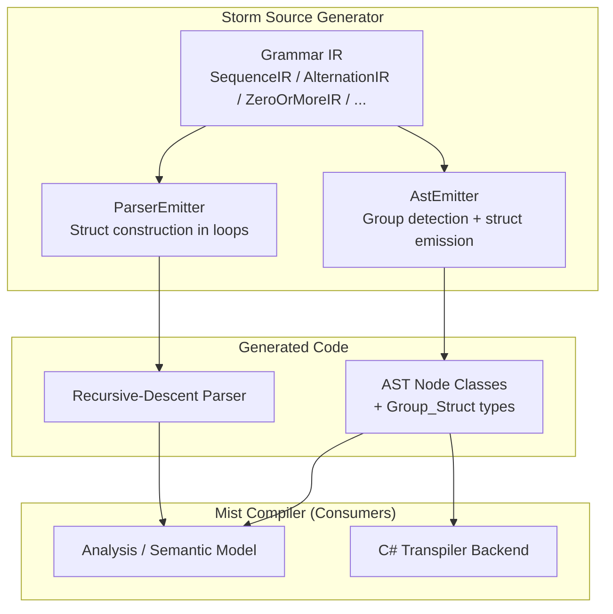

# Design Document: Storm Anonymous Groups

## Overview

This design addresses the Flat_Field_Antipattern in the Storm source generator, where anonymous groups `(...)` under repetition modifiers (`*`/`+`) flatten their labelled fields onto the parent node class. The parser loop overwrites these scalar fields each iteration, losing all values except the last.

The fix introduces **Group_Struct projection**: each anonymous group becomes its own `struct` type, and the parent node holds a scalar, nullable, or `ImmutableArray` of that struct depending on the group's modifier. This preserves per-iteration values and makes the grammar's structure explicit in the generated type system.

A migration strategy using `[Obsolete]`-attributed shim properties provides a compile-safe path from the old API to the new one, with CS0618 warnings serving as the migration worklist.

## Architecture

The change is localised to two emitters in the Storm source generator and the downstream Mist compiler consumers:



### Change Scope

1. **AstEmitter** — detect anonymous groups in the IR expression tree, emit `struct` types, emit properties on the parent node with the correct collection/nullable wrapping, emit shim properties during migration.
2. **ParserEmitter** — change loop bodies to construct struct values per iteration and accumulate them in a builder, rather than assigning to scalar node properties.
3. **EmissionContext** — add a `bool EmitObsoleteShims` flag to control shim generation.
4. **Mist Compiler consumers** — migrate ~793 call sites from flat properties to the new `Group0` list property.

## Components and Interfaces

### 1. Anonymous Group Detection (AstEmitter)

An **anonymous group** is identified in the IR as a `SequenceIR` node that:
- Is the direct `Inner` of a `ZeroOrMoreIR`, `OneOrMoreIR`, or `OptionalIR`; OR appears as a bare `SequenceIR` at the top level of an alternative's expression
- Contains at least one `FieldLabelIR` referencing an expression within it

The detection algorithm walks the alternative's expression tree and collects groups:

```csharp
// Pseudocode for group detection
List<AnonymousGroupInfo> DetectAnonymousGroups(RuleAlternativeIR alt)
{
    var groups = new List<AnonymousGroupInfo>();
    var index = 0;
    WalkForGroups(alt.Expression, alt.FieldLabels, groups, ref index);
    return groups;
}

void WalkForGroups(ExpressionIR expr, IReadOnlyList<FieldLabelIR> labels,
                   List<AnonymousGroupInfo> groups, ref int index)
{
    switch (expr)
    {
        case ZeroOrMoreIR { Inner: SequenceIR seq } when HasLabelsInside(seq, labels):
            groups.Add(new(seq, Modifier.ZeroOrMore, index++, GetLabelsInside(seq, labels)));
            break;
        case OneOrMoreIR { Inner: SequenceIR seq } when HasLabelsInside(seq, labels):
            groups.Add(new(seq, Modifier.OneOrMore, index++, GetLabelsInside(seq, labels)));
            break;
        case OptionalIR { Inner: SequenceIR seq } when HasLabelsInside(seq, labels):
            groups.Add(new(seq, Modifier.Optional, index++, GetLabelsInside(seq, labels)));
            break;
        case SequenceIR seq:
            // Walk elements to find nested repetitions/optionals
            foreach (var elem in seq.Elements)
                WalkForGroups(elem, labels, groups, ref index);
            break;
    }
}
```

**Key invariant**: Group_Index is assigned by a single left-to-right walk of the alternative's expression tree. The first anonymous group encountered is `Group0`, the second `Group1`, etc.

### 2. Pure_Token_Alternation Detection

Before emitting a Group_Struct, the emitter checks whether the anonymous group's body qualifies for the Pure_Token_Alternation optimisation:

```csharp
bool IsPureTokenAlternation(SequenceIR seq, IReadOnlyList<FieldLabelIR> labelsInGroup)
{
    // A pure-token alternation is when the group contains exactly one labeled field
    // whose expression is an AlternationIR where ALL alternatives are TokenRefIR.
    if (labelsInGroup.Count != 1)
        return false;

    var labelExpr = labelsInGroup[0].Expression;
    if (labelExpr is not AlternationIR alt)
        return false;

    return alt.Alternatives.All(a => a is TokenRefIR);
}
```

When this optimisation applies:
- No struct is emitted for the group
- The labelled field is promoted directly to the parent node as `Token`, `Token?`, or `ImmutableArray<Token>` depending on the modifier
- The parser emitter uses existing token-matching logic unchanged

### 3. Group_Struct Emission (AstEmitter)

For each anonymous group that does NOT qualify for Pure_Token_Alternation, the AstEmitter emits:

```csharp
public struct {RuleName}NodeGroup{N}
{
    public {FieldType} {FieldName};
    // ... one field per label inside the group
}
```

Field type derivation follows the same rules used for labelled fields on ordinary nodes:
- `TokenRefIR` → `Token`
- `RuleRefIR` → `{Rule}Node`
- `AlternationIR` (pure token) inside the group → `Token` (nested Pure_Token_Alternation)
- Nested anonymous group → nested `{RuleName}NodeGroup{N}Group{M}` struct (or collapsed if pure-token)

The struct uses **public fields** (not properties) since it is a simple value carrier with no encapsulation needs.

### 4. Parent Node Property Emission

The parent node class gets a property for each group:

| Modifier | Property Type | Default Value |
|----------|--------------|---------------|
| (none) | `{Rule}NodeGroup{N}` | `= default;` |
| `?` | `{Rule}NodeGroup{N}?` | (no default, nullable) |
| `*` | `ImmutableArray<{Rule}NodeGroup{N}>` | `= ImmutableArray<{Rule}NodeGroup{N}>.Empty;` |
| `+` | `ImmutableArray<{Rule}NodeGroup{N}>` | `= ImmutableArray<{Rule}NodeGroup{N}>.Empty;` |

The property name is `Group{N}` (e.g., `Group0`, `Group1`).

### 5. Children() Override Update

The `Children()` override on parent node classes must yield node-typed fields from inside group structs. For list-typed group properties (`*`/`+`):

```csharp
foreach (var g in Group0)
{
    if (g.Right != null)
        yield return g.Right;
}
```

For scalar/nullable group properties, yield each non-null node field directly.

### 6. ParserEmitter — Struct Construction

For a `*`-modified anonymous group, the current pattern:

```csharp
// CURRENT (broken): scalar fields overwritten each iteration
Token _operator = default;
MultiplicativeNode _right = default!;
while (!_hasError) { ... _operator = ...; _right = ...; }
node.Operator = _operator;
node.Right = _right;
```

Becomes:

```csharp
// NEW: struct construction per iteration
var _group0_b = ImmutableArray.CreateBuilder<AdditiveNodeGroup0>();
while (!_hasError)
{
    var _listSaved = _pos;
    var _savedError = _hasError;
    var _savedDiagCount = _diagnostics?.Count ?? 0;

    var _g0_operator = Match((int)TokenKind.PLUS) ?? Match((int)TokenKind.MINUS);
    var _g0_right = _ParseMultiplicative();

    if (_g0_right == null || _pos == _listSaved)
    {
        _hasError = _savedError;
        _pos = _listSaved;
        _diagnostics?.TruncateTo(_savedDiagCount);
        break;
    }

    _group0_b.Add(new AdditiveNodeGroup0 { Operator = _g0_operator.Value, Right = _g0_right });
}
var _group0 = _group0_b.ToImmutable();
// ... later:
node.Group0 = _group0;
```

For `?`-modified groups:

```csharp
AdditiveNodeGroup0? _group0 = null;
if (Peek() == (int)TokenKind.SOME_GUARD)
{
    var _g0_field = ...;
    _group0 = new AdditiveNodeGroup0 { Field = _g0_field };
}
node.Group0 = _group0;
```

For bare (no-modifier) groups:

```csharp
var _g0_field = ...;
var _group0 = new AdditiveNodeGroup0 { Field = _g0_field };
node.Group0 = _group0;
```

### 7. Obsolete Shim Generation

When `EmissionContext.EmitObsoleteShims` is `true`, the AstEmitter additionally emits the old properties on the parent node class with `[Obsolete("Use Group{N}")]`:

```csharp
[Obsolete("Use Group0")]
public Token Operator => Group0.Length > 0 ? Group0[^1].Operator : default;

[Obsolete("Use Group0")]
public MultiplicativeNode Right => Group0.Length > 0 ? Group0[^1].Right : default!;

[Obsolete("Use Group0")]
public ImmutableArray<MultiplicativeNode> Multiplicatives
    => Group0.Select(g => g.Right).ToImmutableArray();
```

**Forwarding rules:**
- Scalar shims on `*`/`+` groups: return from the last element (`Group0[^1].Field`) — preserves current last-wins semantics for unmigrated consumers.
- List shims: project the relevant field from each element using LINQ `.Select(g => g.Field).ToImmutableArray()`.
- Scalar shims on `?` groups: return `Group0?.Field ?? default`.

### 8. EmissionContext Extension

```csharp
public sealed class EmissionContext
{
    // ... existing properties ...

    /// <summary>
    /// When true, the AstEmitter emits [Obsolete] shim properties that forward
    /// to the new Group_Struct data. This enables incremental migration.
    /// </summary>
    public bool EmitObsoleteShims { get; }

    public EmissionContext(
        string consumerNamespace,
        string grammarName,
        GrammarIR grammar,
        MemoizationPlan? memoization = null,
        IReadOnlyList<TraitIR>? traits = null,
        IReadOnlyDictionary<string, IReadOnlyList<TraitIR>>? ruleTraitBindings = null,
        bool emitObsoleteShims = false)
    {
        // ...
        EmitObsoleteShims = emitObsoleteShims;
    }
}
```

### 9. Shim Removal Mechanism

Shim removal is achieved by setting `EmitObsoleteShims = false` (or removing the parameter). When disabled:
- No `[Obsolete]` properties are emitted
- Only the new `Group{N}` properties exist
- Any remaining usage of the old property names becomes a compile error

## Data Models

### AnonymousGroupInfo (internal to AstEmitter)

```csharp
internal readonly record struct AnonymousGroupInfo(
    SequenceIR Sequence,
    GroupModifier Modifier,
    int GroupIndex,
    IReadOnlyList<FieldLabelIR> Labels);

internal enum GroupModifier { None, Optional, ZeroOrMore, OneOrMore }
```

### Generated Struct Example (AdditiveNodeGroup0)

```csharp
public struct AdditiveNodeGroup0
{
    public Token Operator;
    public MultiplicativeNode Right;
}
```

### Generated Node Example (AdditiveNode, shims enabled)

```csharp
public sealed class AdditiveNode : SyntaxNode
{
    public MultiplicativeNode Left { get; set; } = default!;
    public ImmutableArray<AdditiveNodeGroup0> Group0 { get; set; }
        = ImmutableArray<AdditiveNodeGroup0>.Empty;

    // --- Obsolete shims (migration phase only) ---
    [Obsolete("Use Group0")]
    public Token Operator => Group0.Length > 0 ? Group0[^1].Operator : default;

    [Obsolete("Use Group0")]
    public MultiplicativeNode Right => Group0.Length > 0 ? Group0[^1].Right : default!;

    [Obsolete("Use Group0")]
    public ImmutableArray<MultiplicativeNode> Multiplicatives
        => Group0.Select(g => g.Right).ToImmutableArray();

    public override IEnumerable<SyntaxNode> Children()
    {
        yield return Left;
        foreach (var g in Group0)
        {
            yield return g.Right;
        }
    }
}
```

## Zero-Warnings Policy Override: CS0618 During Migration

The project enforces a zero-warnings policy (see workspace rule `zero-warnings-policy`). This design introduces an **intentional, temporary exception** for CS0618 (obsolete member usage) warnings during the migration phase.

**Rationale**: The `[Obsolete]` shim properties exist precisely so that CS0618 warnings serve as the migration worklist. Suppressing them would defeat the purpose. The warnings ARE the mechanism for tracking migration progress.

**Scope of exception**:
- CS0618 warnings originating from usage of `[Obsolete("Use Group{N}")]` shim properties are **permitted** during the migration phase.
- No global suppression in `.editorconfig`, `Directory.Build.props`, or `#pragma` is allowed.
- The exception is **temporary** — it ends when the CS0618 warning count from shim usage reaches zero.
- At that point, shims are removed (`EmitObsoleteShims = false`), and the zero-warnings policy resumes in full.

**Tracking**: The migration progress is measured by `dotnet build | grep CS0618 | wc -l`. Each commit that migrates consumers should reduce this count.

## Correctness Properties

*A property is a characteristic or behavior that should hold true across all valid executions of a system — essentially, a formal statement about what the system should do. Properties serve as the bridge between human-readable specifications and machine-verifiable correctness guarantees.*

### Property 1: Group struct emission for anonymous groups

*For any* grammar rule alternative containing a `SequenceIR` with `FieldLabelIR` entries nested inside a `ZeroOrMoreIR`, `OneOrMoreIR`, or `OptionalIR`, the AstEmitter output SHALL contain a `public struct {RuleName}NodeGroup{N}` declaration with one field per label.

**Validates: Requirements 1.1, 1.2**

### Property 2: Group index uniqueness and ordering

*For any* rule alternative containing K anonymous groups, the emitted struct names SHALL be `Group0` through `Group{K-1}` in left-to-right source order, with no duplicates or gaps.

**Validates: Requirements 1.3**

### Property 3: Parent property type matches modifier

*For any* anonymous group with modifier M, the parent node's property type SHALL be:
- No modifier → `{Rule}NodeGroup{N}`
- `?` → `{Rule}NodeGroup{N}?`
- `*` or `+` → `ImmutableArray<{Rule}NodeGroup{N}>`

**Validates: Requirements 1.5**

### Property 4: Flat field exclusion

*For any* anonymous group (when shims are disabled), the parent node class SHALL NOT contain properties whose names match the labels declared inside the group.

**Validates: Requirements 1.6**

### Property 5: Pure_Token_Alternation collapses to Token

*For any* anonymous group whose body is an `AlternationIR` where all alternatives are `TokenRefIR`, the AstEmitter SHALL NOT emit a Group_Struct, and the parent property SHALL be `Token`, `Token?`, or `ImmutableArray<Token>` per the modifier.

**Validates: Requirements 2.1, 2.2**

### Property 6: Parser struct construction per iteration

*For any* `*`- or `+`-modified anonymous group (non-Pure_Token_Alternation), the ParserEmitter output SHALL contain `CreateBuilder<{Rule}NodeGroup{N}>` and a loop body that constructs a struct value, and SHALL NOT assign to scalar node properties from inside the loop.

**Validates: Requirements 3.1, 3.5**

### Property 7: Backward compatibility for non-group rules

*For any* grammar rule that contains no anonymous groups requiring Group_Struct emission, the AstEmitter and ParserEmitter output SHALL be identical to the output produced before this change.

**Validates: Requirements 6.1, 6.2**

### Property 8: Shim property forwarding correctness

*For any* anonymous group under a `*` modifier, when shims are enabled, the scalar shim property's expression body SHALL reference `Group0[^1].{Field}`, and the list shim SHALL project from `Group0.Select(g => g.{Field})`.

**Validates: Requirements 5.1, 5.2**

### Property 9: Children() yields all node-typed group fields

*For any* rule with a `*`- or `+`-modified anonymous group containing node-typed fields, the emitted `Children()` override SHALL contain a `foreach` over the group list that yields each node-typed field.

**Validates: Requirements 7.2**

## Error Handling

### Invalid Grammar Patterns

The design does not introduce new diagnostic error conditions on the grammar author. Anonymous groups are already valid grammar syntax — this change only corrects how they are projected into C#.

### Edge Cases

| Scenario | Handling |
|----------|----------|
| Anonymous group with zero labels | Not treated as an anonymous group — no struct emitted. Falls through to existing unlabeled-property logic. |
| Nested groups (group inside group) | Inner group becomes a nested struct inside the outer. Group_Index resets within each nesting level. |
| Mixed labeled/unlabeled elements in a group | Only labeled elements become struct fields. Unlabeled tokens (like keywords) are consumed by the parser but not stored. |
| Empty repetition (`*` with zero matches) | The `ImmutableArray` is empty (`.Empty`). Shim scalars return `default`/`default!`. |
| Pure_Token_Alternation with a single token | Still qualifies (vacuously all alternatives are token refs). Collapses to `Token`. |

## Testing Strategy

### Test Taxonomy Alignment

Following the project's testing philosophy:

1. **Building-block invariant tests (many)** — Property-based tests that exercise the AstEmitter and ParserEmitter in isolation with generated grammar IR inputs. These tests invoke only the stage under test on directly-constructed IR, never routing through the parser or full pipeline.

2. **Coupling tests (a handful)** — Example-based tests that feed real grammar fragments (like the `Additive` rule) through the full `CreateContext` helper to verify the IR lowering → emission pipeline produces expected output.

3. **End-to-end (AllFeatures)** — The sample at `samples/StormAnonymousGroups/Program.mist` exercises the feature through the full compile-and-run cycle, validated by the existing `AllFeatures_CompilesRunsAndMatchesBaseline` test.

### Property-Based Tests

**Library**: FsCheck (already used in the test project)
**Minimum iterations**: 100 per property

Each property test:
- Constructs `RuleIR` / `RuleAlternativeIR` / `ExpressionIR` values directly (no grammar parsing)
- Invokes `AstEmitter.EmitAstNodes(context)` or `ParserEmitter.Emit(context)` on the constructed IR
- Asserts structural properties of the emitted string output

Tests exercise only the emitter stage — they do NOT parse `.storm` grammar text or compile C# code per iteration.

**Tag format**: `// Feature: storm-anonymous-groups, Property {N}: {title}`

### Example-Based Unit Tests

Cover the specific rules from Requirement 4 and the explicit test cases from Requirement 9:
- `Additive` rule produces `AdditiveNodeGroup0` with `Token Operator` + `MultiplicativeNode Right`
- `Equality` rule produces `EqualityNodeGroup0` with `Token Operator` + `RelationalNode Right`
- Pure_Token_Alternation applied to `(PLUS | MINUS)` inside a group → `Token` field
- Shim properties present and correctly forwarding when enabled

### Process Spawning

No tests in this feature spawn external processes. All property tests invoke emitter functions in-process on directly-constructed IR. The only process-spawning test is the pre-existing `AllFeatures_CompilesRunsAndMatchesBaseline` which runs the compiled sample — this is not a new test added by this feature.
