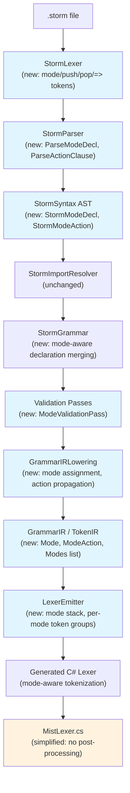
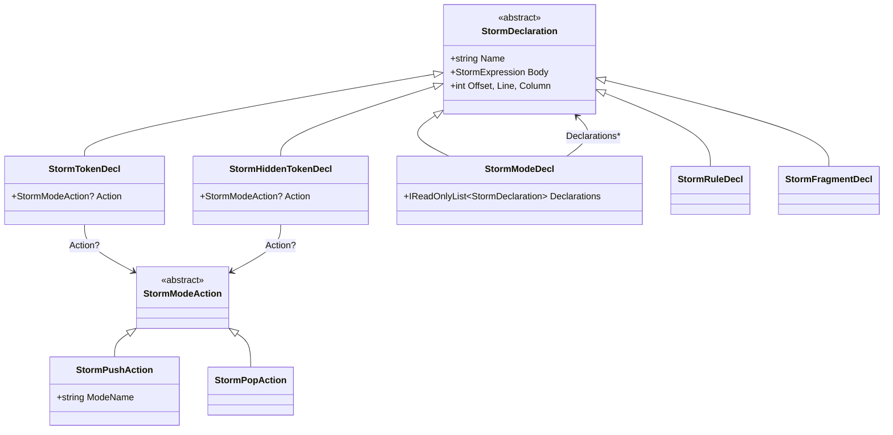
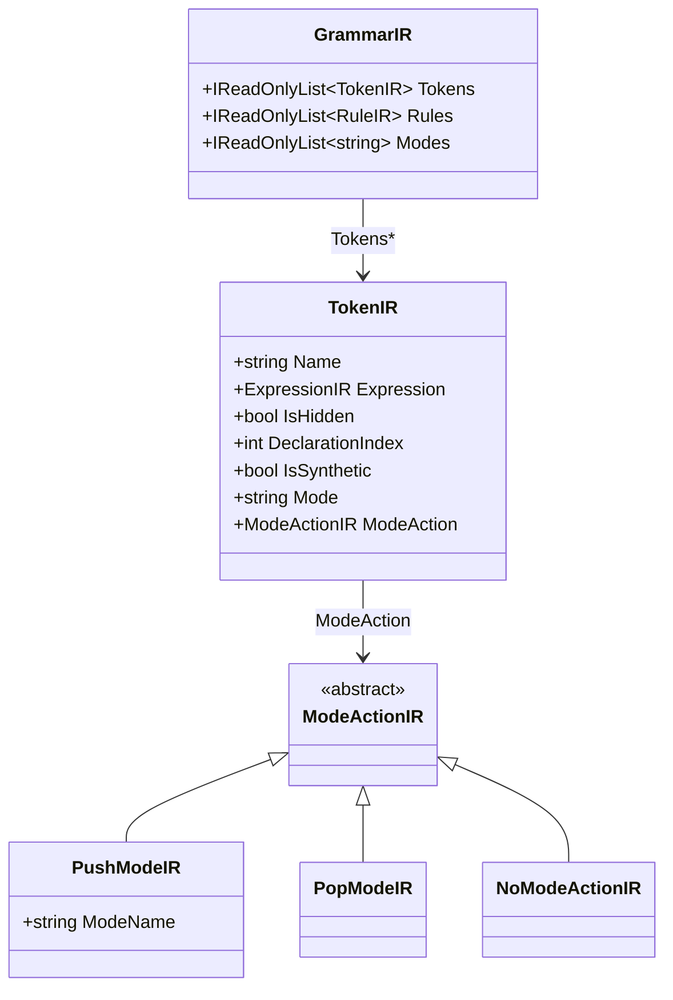

# Design Document: Storm Lexer Modes

## Overview

This design adds lexer mode support to the Storm grammar DSL, enabling context-sensitive tokenization via a push/pop mode stack. The feature touches every layer of the Storm source generator pipeline — from the frontend lexer/parser that reads `.storm` files, through the syntax AST and GrammarIR, to the LexerEmitter that generates C# code — and culminates in updating the Mist grammar to use modes for interpolated strings, eliminating the hand-written post-processing workaround in `MistLexer.cs`.

The design follows the existing Storm architecture: hand-written frontend (StormLexer → StormParser → StormSyntax AST), resolution (StormImportResolver → StormGrammar), validation passes, IR lowering (GrammarIRLowering → GrammarIR), and emission (LexerEmitter). Each layer is extended to carry mode information, and the generated lexer gains a runtime mode stack.

### Key Syntax Decisions (Already Agreed)

- Mode blocks: `mode ModeName { ... }`
- Action clause arrow: `=>` (not `->`)
- Push/pop as keywords (functors): `=> push ModeName` and `=> pop`
- `default` is a reserved lowercase keyword for the implicit top-level mode
- AST types: `StormPushAction` / `StormPopAction`

### Example Storm Grammar with Modes

```storm
grammar Example;

token DOLLAR_QUOTE = "$\"" => push Interpolation;
token LEFT_BRACE   = "{";

mode Interpolation {
    token INTERP_TEXT  = (`[^"\\{]` | ESCAPE_SEQ)+;
    token INTERP_LBRACE = "{" => push default;
    token INTERP_END    = "\"" => pop;
    fragment ESCAPE_SEQ = "\\\\" | "\\\"" | "\\n";
}
```

## Architecture

The feature extends the existing Storm source generator pipeline. No new pipeline stages are introduced; each existing stage is augmented to carry mode metadata.



Blue nodes are modified; orange node is simplified.

## Components and Interfaces

### 1. StormLexer (Frontend)

**File:** `Source/Storm.SourceGenerator/Frontend/StormLexer.cs`

New token kinds added to `StormTokenKind`:

| Token Kind | Lexeme | Purpose |
|---|---|---|
| `ModeKeyword` | `mode` | Mode block declaration |
| `DefaultKeyword` | `default` | Reserved default mode name |
| `PushKeyword` | `push` | Push action in action clause |
| `PopKeyword` | `pop` | Pop action in action clause |
| `FatArrow` | `=>` | Action clause arrow operator |
| `LeftBrace` | `{` | Mode block opening |
| `RightBrace` | `}` | Mode block closing |

The `ClassifyKeyword` method is extended to recognize `mode`, `default`, `push`, and `pop`. The `ClassifyOperator` method is extended to recognize `=>` as a two-character operator (checked before single `=`). `{` and `}` are added as single-character operators.

### 2. StormParser (Frontend)

**File:** `Source/Storm.SourceGenerator/Frontend/StormParser.cs`

New parsing methods:

- `ParseModeDecl()`: Parses `mode Identifier { Declaration* }`. Called from `ParseDeclaration()` when `Current.Kind == StormTokenKind.ModeKeyword`.
- `ParseActionClause()`: Parses the optional `=> push Identifier` or `=> pop` after a token body expression. Called at the end of `ParseTokenDecl()` and `ParseHiddenTokenDecl()`, before consuming the semicolon.

The `SynchronizeToDeclaration()` method is updated to also stop on `ModeKeyword` and `RightBrace`.

`ParseDeclaration()` gains a new case:
```
case StormTokenKind.ModeKeyword:
    return ParseModeDecl();
```

### 3. StormSyntax AST

**File:** `Source/Storm.SourceGenerator/Frontend/StormSyntax.cs`

New types:

```csharp
/// Mode action base type for push/pop actions on token declarations.
public abstract record StormModeAction;

/// A push action: => push ModeName
public sealed record StormPushAction(string ModeName) : StormModeAction;

/// A pop action: => pop
public sealed record StormPopAction() : StormModeAction;

/// A mode block declaration: mode ModeName { declarations }
public sealed record StormModeDecl(
    string Name,
    IReadOnlyList<StormDeclaration> Declarations,
    int Offset,
    int Line,
    int Column) : StormDeclaration(Name, new StormReferenceExpr(Name), Offset, Line, Column);
```

Modified types:

- `StormTokenDecl`: Add optional `StormModeAction? Action` parameter (default `null`).
- `StormHiddenTokenDecl`: Add optional `StormModeAction? Action` parameter (default `null`).

`StormModeDecl` extends `StormDeclaration` so it can appear in `StormFile.Declarations`. The `Body` field is set to a placeholder `StormReferenceExpr(Name)` since mode declarations don't have a body expression — the meaningful content is in the `Declarations` list.

### 4. StormGrammar (Resolve)

**File:** `Source/Storm.SourceGenerator/Resolve/StormGrammar.cs`

The `CollectDeclarations` method is updated to handle `StormModeDecl` nodes. When a `StormModeDecl` is encountered:

1. The mode declaration itself is added to the declarations list (for mode name tracking).
2. Each declaration inside the mode block is added to the declarations list with its source position preserved.
3. Duplicate mode name detection is performed.

A new `ModeNames` property is added to `StormGrammar` that lists all declared mode names (extracted from `StormModeDecl` nodes), always including `"default"`.

### 5. Validation: ModeValidationPass

**File:** `Source/Storm.SourceGenerator/Validate/ModeValidationPass.cs` (new)

A new validation pass that runs after name resolution:

1. **Duplicate mode names**: Reports `STORM_DUPLICATE_MODE` if two `StormModeDecl` nodes share the same name.
2. **Rules in mode blocks**: Reports `STORM_RULE_IN_MODE` if a `StormModeDecl` contains any `StormRuleDecl`.
3. **Undefined push targets**: Reports `STORM_UNDEFINED_MODE` if a `StormPushAction` references a mode name not in the grammar's mode list (note: `default` is always in the mode list).
4. **Pop from default warning**: Reports `STORM_POP_FROM_DEFAULT` (warning) if a `StormPopAction` is on a token in the `default` mode (not inside any `StormModeDecl`).
5. **Reserved mode name**: Reports `STORM_RESERVED_MODE_NAME` if a `StormModeDecl` uses the name `default`, which is reserved for the implicit top-level mode.

New diagnostic IDs in `StormDiagnosticIds`:

| ID | Constant | Severity |
|---|---|---|
| `STORM0011` | `STORM_DUPLICATE_MODE` | Error |
| `STORM0012` | `STORM_RULE_IN_MODE` | Error |
| `STORM0013` | `STORM_UNDEFINED_MODE` | Error |
| `STORM0014` | `STORM_POP_FROM_DEFAULT` | Warning |
| `STORM0015` | `STORM_RESERVED_MODE_NAME` | Error |

### 6. GrammarIR Extensions

**Files:** `Source/Storm.SourceGenerator/IR/TokenIR.cs`, `Source/Storm.SourceGenerator/IR/GrammarIR.cs`

**TokenIR** gains two new properties:

```csharp
/// The mode this token belongs to. Defaults to "default".
public string Mode { get; }

/// The mode action (push/pop/none) for this token.
public ModeActionIR ModeAction { get; }
```

**ModeActionIR** (new type in `ExpressionIR.cs` or a new file):

```csharp
public abstract class ModeActionIR;
public sealed class PushModeIR : ModeActionIR { public string ModeName { get; } }
public sealed class PopModeIR : ModeActionIR;
public sealed class NoModeActionIR : ModeActionIR;
```

**GrammarIR** gains:

```csharp
/// All declared mode names, always including "default".
public IReadOnlyList<string> Modes { get; }
```

### 7. GrammarIRLowering

**File:** `Source/Storm.SourceGenerator/IR/GrammarIRLowering.cs`

The `Lower` method is extended:

1. **Mode tracking**: Before processing declarations, scan for `StormModeDecl` nodes to build the mode name list.
2. **Mode assignment**: When creating `TokenIR` entries, determine the mode from the enclosing `StormModeDecl` (or `"default"` for top-level tokens).
3. **Action propagation**: Read the `Action` property from `StormTokenDecl`/`StormHiddenTokenDecl` and convert to `ModeActionIR`.
4. **Fragment scoping**: Fragments inside a `StormModeDecl` are scoped to that mode. The `fragmentsByName` dictionary becomes `Dictionary<(string Mode, string Name), StormDeclaration>` to support mode-scoped lookup. During inlining, fragments are resolved first within the current mode, then falling back to the default mode.

### 8. LexerEmitter

**File:** `Source/Storm.SourceGenerator/Emit/LexerEmitter.cs`

Major changes to the generated lexer structure:

**Generated code structure:**

```csharp
public static class ExampleLexer
{
    // Mode constants
    private const int Mode_default = 0;
    private const int Mode_Interpolation = 1;

    // Token-to-mode mapping
    private static readonly int[] TokenModes = { /* mode index per TokenKind */ };

    // Per-mode token lists (indices into the token array)
    private static readonly int[][] ModeTokens = { /* tokens per mode */ };

    // Mode stack for runtime
    [ThreadStatic]
    private static Stack<int>? _modeStack;

    public static TokenStream Lex(SourceText source, DiagnosticBag diagnostics)
    {
        var modeStack = new Stack<int>();
        modeStack.Push(Mode_default);
        // ... main lex loop ...
        // Only try tokens in ModeTokens[modeStack.Peek()]
        // After emitting token, apply push/pop action
    }

    public static int GetTokenMode(int tokenKind) => TokenModes[tokenKind];
}
```

The `EmitLexMethod` is restructured:
1. Initialize a mode stack with `Mode_default`.
2. In the main loop, only try `TryMatch_*` methods for tokens belonging to the current mode.
3. After emitting a matched token, check for push/pop actions and update the mode stack.
4. Pop safety: if popping when only default mode remains, do nothing.

The existing filter that skips `INTERPOLATED_STRING_START/TEXT/END` tokens is removed — these tokens are now handled naturally via modes.

### 9. Mist Grammar Update

**File:** `Source/Mist/Grammar/Mist.storm`

The interpolated string tokens are restructured using modes:

```storm
// In default mode (top-level):
token INTERPOLATED_STRING_START = "$\"" => push Interpolation;

// Interpolation mode:
mode Interpolation {
    token INTERPOLATED_STRING_TEXT = (`[^"\\{]` | ESCAPE_SEQUENCE)+;
    token INTERPOLATION_OPEN      = "{" => push default;
    token INTERPOLATED_STRING_END = "\"" => pop;
    fragment ESCAPE_SEQUENCE      = "\\\\" | "\\\"" | "\\n" | "\\r" | "\\t" | "\\0" | "\\'";
}
```

The existing `INTERPOLATED_STRING_TEXT` and `INTERPOLATED_STRING_END` tokens are moved from the default mode into the `Interpolation` mode. A new `INTERPOLATION_OPEN` token replaces the generic `LEFT_BRACE` for interpolation contexts.

For the closing brace after an interpolation expression, the existing `RIGHT_BRACE` token in the default mode needs a `=> pop` action. However, `RIGHT_BRACE` is also used in non-interpolation contexts (blocks, etc.). To handle this, a separate `INTERPOLATION_CLOSE` token is not needed — instead, the mode stack naturally handles this: when `{` inside interpolation pushes the `default` mode, the regular `RIGHT_BRACE` token in the `default` mode doesn't pop. Instead, the parser grammar handles brace matching. The approach is:

- `INTERPOLATION_OPEN` (`{`) in Interpolation mode → `=> push default`
- A new `INTERPOLATION_CLOSE` (`}`) token is declared in the `default` mode with `=> pop`, but only matched when the mode stack depth > 1 (i.e., we were pushed from Interpolation). This requires a refinement: we add a dedicated `INTERPOLATION_CLOSE` token that is tried before `RIGHT_BRACE` when the mode stack indicates we're in a pushed-default context.

**Simpler approach**: Use a dedicated mode for interpolation expressions:

```storm
token INTERPOLATED_STRING_START = "$\"" => push Interpolation;

mode Interpolation {
    token INTERPOLATED_STRING_TEXT = (`[^"\\{]` | ESCAPE_SEQUENCE)+;
    token INTERPOLATION_OPEN      = "{" => push default;
    token INTERPOLATED_STRING_END = "\"" => pop;
    fragment ESCAPE_SEQUENCE      = "\\\\" | "\\\"" | "\\n" | "\\r" | "\\t" | "\\0" | "\\'";
}
```

The closing brace problem is solved by tracking mode stack depth in the generated lexer: when the current mode is `default` and the mode stack has depth > 1, a `}` triggers a pop. This is implemented as a special `RIGHT_BRACE` handling in the generated lexer — when `RIGHT_BRACE` is matched and the mode stack depth > 1, it automatically pops. Alternatively, we declare a separate token:

```storm
token INTERPOLATION_CLOSE = "}" => pop;
```

This token is declared in the `default` mode but only activates when the mode stack depth > 1. Since the LexerEmitter always tries all tokens in the current mode, and `INTERPOLATION_CLOSE` would conflict with `RIGHT_BRACE`, we need declaration-order priority: `RIGHT_BRACE` is declared first (for normal blocks), and `INTERPOLATION_CLOSE` is declared after. But both match `}` with the same length, so the first one wins — which is wrong for interpolation.

**Final approach**: The cleanest solution is to not use a separate token. Instead, the generated lexer checks mode stack depth after matching `RIGHT_BRACE`: if depth > 1, it pops. This is a special behavior encoded in the emitter for tokens with `=> pop` that match `}`. Actually, the simplest correct approach used by ANTLR is:

- `INTERPOLATION_OPEN` in Interpolation mode pushes `default`.
- In the `default` mode, `RIGHT_BRACE` has no action normally.
- We add a `=> pop` action to `RIGHT_BRACE` but only when mode stack depth > 1.

Since Storm doesn't support conditional actions, we use a pragmatic approach: declare `RIGHT_BRACE` with `=> pop` in the `default` mode. This means every `}` in the `default` mode pops. To prevent this from breaking non-interpolation braces, we pair every `LEFT_BRACE` with a `=> push default` action. This way, `{` pushes `default` and `}` pops it, maintaining the stack correctly for both block braces and interpolation braces.

```storm
token LEFT_BRACE  = "{" => push default;
token RIGHT_BRACE = "}" => pop;
```

This is the ANTLR approach and works correctly: every `{`/`}` pair is balanced on the mode stack, and the interpolation `{` also pushes `default` (via `INTERPOLATION_OPEN` in the Interpolation mode), so the `}` pop returns to Interpolation mode.

### 10. MistLexer Simplification

**File:** `Source/Mist/Lexing/MistLexer.cs`

After mode support is working:

1. Remove `FixInterpolatedStrings` method.
2. Remove `LexInterpolatedString` method.
3. Remove `LexExpression` method.
4. Remove `AdjustLinePosition` method.
5. The `Lex` method becomes a thin wrapper that calls the generated lexer and maps diagnostics.

### 11. Storm TextMate Grammar Update

**File:** `Editor/storm-syntax-highlighting/syntaxes/storm.tmLanguage.json`

New patterns added to the repository:

```json
{
  "mode-blocks": {
    "match": "\\b(mode)\\s+(\\w+)",
    "captures": {
      "1": { "name": "storage.type.storm" },
      "2": { "name": "entity.name.tag.storm" }
    }
  },
  "action-clauses": {
    "patterns": [
      {
        "match": "(=>)\\s+(push)\\s+(\\w+)",
        "captures": {
          "1": { "name": "keyword.operator.storm" },
          "2": { "name": "keyword.control.storm" },
          "3": { "name": "entity.name.tag.storm" }
        }
      },
      {
        "match": "(=>)\\s+(pop)",
        "captures": {
          "1": { "name": "keyword.operator.storm" },
          "2": { "name": "keyword.control.storm" }
        }
      }
    ]
  }
}
```

The `keywords` section is updated to include `mode`, `default`, `push`, `pop`. The `storage-types` pattern is updated to include `mode`. Brace patterns are added for `{` and `}`.

### 12. Storm Pretty-Printer

**File:** `Source/Storm.SourceGenerator/Frontend/StormPrettyPrinter.cs` (new)

A new pretty-printer class that formats `StormFile` ASTs back to Storm source text. This enables round-trip testing of the parser.

```csharp
public static class StormPrettyPrinter
{
    public static string Print(StormFile file) { ... }
    private static string PrintDeclaration(StormDeclaration decl) { ... }
    private static string PrintModeDecl(StormModeDecl mode) { ... }
    private static string PrintExpression(StormExpression expr) { ... }
    private static string PrintActionClause(StormModeAction? action) { ... }
}
```

## Data Models

### AST Layer (StormSyntax)



### IR Layer



### Generated Lexer Runtime Model

```mermaid
stateDiagram-v2
    [*] --> default
    default --> Interpolation : match "$\"" (push)
    Interpolation --> default : match "{" (push)
    default --> Interpolation : match "}" (pop)
    Interpolation --> [*] : match "\"" (pop)
    
    state default {
        [*] --> MatchDefaultTokens
        MatchDefaultTokens --> MatchDefaultTokens : next char
    }
    state Interpolation {
        [*] --> MatchInterpTokens
        MatchInterpTokens --> MatchInterpTokens : next char
    }
```


## Correctness Properties

*A property is a characteristic or behavior that should hold true across all valid executions of a system — essentially, a formal statement about what the system should do. Properties serve as the bridge between human-readable specifications and machine-verifiable correctness guarantees.*

### Property 1: Storm Grammar Round-Trip

*For any* valid Storm grammar file containing mode declarations and action clauses, parsing the file into a `StormFile` AST, pretty-printing it back to source text, and parsing the result again SHALL produce an equivalent `StormFile` AST.

**Validates: Requirements 9.4, 9.1, 9.2, 9.3, 1.1, 2.1**

### Property 2: Mode Assignment Correctness

*For any* Storm grammar containing a mix of top-level token declarations and mode-scoped token declarations, lowering to `GrammarIR` SHALL assign each token's `Mode` property to `"default"` if declared outside any mode block, or to the enclosing mode's name if declared inside a mode block. Additionally, each token's `ModeAction` SHALL match the action clause from the AST (`PushModeIR` for `=> push`, `PopModeIR` for `=> pop`, `NoModeActionIR` for no action).

**Validates: Requirements 1.3, 1.4, 4.4, 2.2, 2.3**

### Property 3: Action Clause Parsing

*For any* token declaration with a valid action clause (`=> push ModeName` or `=> pop`), the Storm parser SHALL produce a `StormTokenDecl` (or `StormHiddenTokenDecl`) whose `Action` property is a `StormPushAction` with the correct mode name or a `StormPopAction`, respectively. For token declarations without an action clause, the `Action` property SHALL be `null`.

**Validates: Requirements 2.1, 2.6**

### Property 4: Mode-Aware Lexer Correctness

*For any* Storm grammar with mode declarations and any valid input string, the generated lexer SHALL only match tokens belonging to the current mode on top of the mode stack, correctly push modes on push-action tokens, and correctly pop modes on pop-action tokens, producing a token stream where each token's kind belongs to the mode that was active when it was matched.

**Validates: Requirements 5.2, 5.3, 5.4**

### Property 5: Token Kind Uniqueness Across Modes

*For any* Storm grammar with mode declarations, the generated `TokenKind` enum SHALL contain globally unique entries for all tokens across all modes — no two tokens (even in different modes) share the same `TokenKind` value.

**Validates: Requirements 5.6**

### Property 6: Interpolated String Lexing Equivalence

*For any* valid Mist source file containing interpolated strings, the token stream produced by the mode-based generated lexer SHALL be equivalent (same token kinds, lexemes, and ordering) to the token stream produced by the previous post-processing approach in `MistLexer.FixInterpolatedStrings`.

**Validates: Requirements 6.6**

### Property 7: Mode-Related Diagnostic Detection

*For any* Storm grammar containing mode-related errors (duplicate mode names, push actions referencing undefined modes, or rule declarations inside mode blocks), the source generator SHALL report at least one diagnostic error identifying the specific problem.

**Validates: Requirements 1.5, 1.6, 2.4**

### Property 8: Fragment Scoping Within Modes

*For any* Storm grammar where a fragment is declared inside a mode block, the GrammarIR lowering process SHALL inline that fragment only within tokens of the same mode. Tokens in other modes that reference the same fragment name SHALL resolve to a different fragment (if one exists in their mode) or produce an undefined-reference diagnostic.

**Validates: Requirements 4.5**

## Error Handling

### Parse Errors

- **Unknown token after `=>`**: If the parser encounters a token other than `push` or `pop` after `=>`, it reports a syntax error and synchronizes to the next semicolon or declaration keyword.
- **Missing mode name after `push`**: Reports "Expected mode name after 'push'" and continues parsing.
- **Missing `{` after mode name**: Reports "Expected '{' after mode name" and synchronizes.
- **Unterminated mode block**: If EOF is reached inside a mode block, reports "Unterminated mode block" with the location of the `mode` keyword.

### Validation Errors

| Condition | Diagnostic ID | Severity | Message Template |
|---|---|---|---|
| Duplicate mode name | `STORM0011` | Error | "Duplicate mode name '{name}': first declared at {line}:{col}" |
| Rule inside mode block | `STORM0012` | Error | "Parser rules are not permitted inside mode blocks" |
| Push to undefined mode | `STORM0013` | Error | "Push action references undefined mode '{name}'" |
| Pop from default mode | `STORM0014` | Warning | "Pop action on default-mode token has no effect" |
| Reserved mode name | `STORM0015` | Error | "'{name}' is a reserved mode name and cannot be used as a user-defined mode" |

### Runtime Safety

- **Pop from empty stack**: The generated lexer treats the mode stack as always having at least the `default` mode. A pop when only `default` remains is a no-op (the lexer stays in the `default` mode). No runtime exception is thrown.
- **No matching token in current mode**: Falls through to the existing error-recovery path (emits an `Error` token and advances one character).

## Testing Strategy

### Testing Framework

- **Unit tests**: xUnit
- **Property-based tests**: FsCheck.Xunit (already in use, minimum 100 iterations per property)
- **Test project**: `Test/Storm.SourceGenerator.Tests/`

### Property-Based Tests

Each correctness property maps to one FsCheck property test. Generators produce random Storm grammar structures (mode names, token declarations with/without actions, nested modes, etc.).

| Property | Test Class | Generator Strategy |
|---|---|---|
| P1: Round-trip | `StormModeRoundTripPropertyTests` | Generate random `StormFile` ASTs with modes, actions, fragments |
| P2: Mode assignment | `ModeAssignmentPropertyTests` | Generate grammars with mixed mode/default tokens, lower to IR |
| P3: Action parsing | `ActionClauseParsingPropertyTests` | Generate token declaration strings with push/pop/none actions |
| P4: Lexer correctness | `ModeLexerPropertyTests` | Generate simple mode grammars + input strings, run generated lexer |
| P5: Token uniqueness | `TokenKindUniquenessPropertyTests` | Generate grammars with multiple modes, check enum uniqueness |
| P6: Interpolation equivalence | `InterpolationEquivalencePropertyTests` | Generate Mist source with interpolated strings, compare old vs new |
| P7: Diagnostic detection | `ModeDiagnosticPropertyTests` | Generate grammars with known mode errors, verify diagnostics |
| P8: Fragment scoping | `FragmentScopingPropertyTests` | Generate grammars with mode-scoped fragments, verify inlining |

Each test is tagged: `// Feature: storm-lexer-modes, Property N: <property text>`

### Unit Tests

Unit tests cover specific examples and edge cases not suited for property testing:

- **Parser examples**: Parse specific mode block syntax, verify AST structure
- **TextMate grammar**: Verify JSON patterns match expected scopes (8.1–8.5)
- **MistLexer simplification**: Verify post-processing methods are removed (7.1, 7.2)
- **Mist grammar structure**: Verify Interpolation mode exists with expected tokens (6.1–6.5)
- **Pop from default**: Verify warning diagnostic (2.5)
- **Empty mode block**: Verify parsing succeeds with zero declarations
- **Mode stack depth safety**: Verify pop from single-element stack is no-op (5.5)

### Integration Tests

- **End-to-end pipeline**: Feed a `.storm` file with modes through the full generator pipeline, compile the output, and verify it produces correct tokens.
- **Mist interpolated strings**: Lex real Mist source files with interpolated strings using the new mode-based lexer and verify output matches expected token streams.
- **Diagnostic mapping**: Verify `MistLexer` still maps Storm diagnostics to Mist diagnostics after simplification (7.3).
