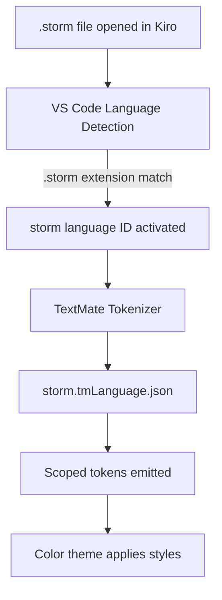

# Design Document

## Overview

This design describes a VS Code / Kiro extension that provides TextMate grammar-based syntax highlighting for `.storm` files — the DSL used by the Mist compiler to define lexer tokens and parser rules. The extension is a declarative, zero-runtime package consisting of a `package.json` manifest and a `.tmLanguage.json` grammar file. It lives in `Editor/storm-syntax-highlighting/` within the project repository and is installed into Kiro via a symlink to `~/.kiro/extensions/`.

The TextMate grammar maps Storm language constructs to standard TextMate scopes so that any VS Code-compatible color theme renders Storm files with meaningful syntax coloring out of the box.

## Architecture

The extension follows the standard VS Code declarative language extension pattern:



There is no executable code. The entire extension is driven by two JSON files:

1. `package.json` — declares the language contribution (`.storm` → `storm` language ID) and points to the grammar file.
2. `syntaxes/storm.tmLanguage.json` — contains the TextMate grammar rules that map Storm syntax patterns to scopes.

The extension directory structure:

```
Editor/storm-syntax-highlighting/
├── package.json
└── syntaxes/
    └── storm.tmLanguage.json
```

### Design Decisions

- **Single grammar file**: Storm is a small DSL with a flat structure (no embedded languages), so a single `.tmLanguage.json` file is sufficient. No injection grammars are needed.
- **Symlink installation**: Rather than packaging as a `.vsix`, the extension is symlinked into `~/.kiro/extensions/` so that grammar edits are reflected immediately on editor reload. This is ideal for a project-local extension under active development.
- **No runtime activation**: The extension uses `"activationEvents": []` (implicit activation on language match) with no JavaScript/TypeScript code, keeping it lightweight and instant.

## Components and Interfaces

### Component 1: Package Manifest (`package.json`)

The manifest declares:

- **Extension metadata**: `name`, `displayName`, `version`, `publisher`, `description`, `engines.vscode`.
- **Language contribution**: Registers the `storm` language ID with `.storm` file extension and optional language configuration (comment toggling).
- **Grammar contribution**: Associates `source.storm` scope with `syntaxes/storm.tmLanguage.json`.

Key fields:

```json
{
  "name": "storm-syntax-highlighting",
  "displayName": "Storm Syntax Highlighting",
  "version": "0.1.0",
  "publisher": "mist-lang",
  "engines": { "vscode": "^1.75.0" },
  "categories": ["Programming Languages"],
  "contributes": {
    "languages": [{
      "id": "storm",
      "aliases": ["Storm", "storm"],
      "extensions": [".storm"],
      "configuration": "./language-configuration.json"
    }],
    "grammars": [{
      "language": "storm",
      "scopeName": "source.storm",
      "path": "./syntaxes/storm.tmLanguage.json"
    }]
  }
}
```

### Component 2: Language Configuration (`language-configuration.json`)

Optional but recommended. Provides bracket matching and comment toggling:

```json
{
  "comments": { "lineComment": "//" },
  "brackets": [["[", "]"], ["(", ")"]],
  "autoClosingPairs": [
    { "open": "\"", "close": "\"" },
    { "open": "[", "close": "]" },
    { "open": "(", "close": ")" }
  ]
}
```

### Component 3: TextMate Grammar (`syntaxes/storm.tmLanguage.json`)

The grammar is structured using a `repository` of named patterns, included from the top-level `patterns` array. The tokenization order matters — patterns listed earlier take priority.

#### Grammar Repository Structure

| Repository Key | Scope Assigned | What It Matches |
|---|---|---|
| `comments` | `comment.line.double-slash.storm` | `//` to end of line |
| `strings` | `string.quoted.double.storm` | `"..."` with escape highlighting |
| `character-classes` | `constant.other.character-class.storm` | `[...]` character class expressions |
| `keywords` | `keyword.control.storm`, `keyword.control.import.storm` | `grammar`, `import` |
| `storage-types` | `storage.type.storm` | `token`, `hidden`, `fragment`, `rule` |
| `as-keyword` | `keyword.operator.storm` | `as` keyword |
| `definition-names` | `entity.name.function.storm` | Names after `token`, `rule`, `fragment` keywords |
| `alternative-labels` | `entity.name.tag.storm` | Names after `as` keyword |
| `labeled-fields` | `variable.parameter.storm` | `label:` in `label:Reference` patterns |
| `operators` | `keyword.operator.quantifier.storm`, `keyword.operator.storm`, `keyword.operator.assignment.storm` | `*`, `+`, `?`, `|`, `=` |
| `punctuation` | `punctuation.terminator.storm` | `;` |

#### Pattern Priority Order

The top-level `patterns` array includes repository entries in this order (highest priority first):

1. `comments` — line comments consume the rest of the line
2. `strings` — string literals (with nested escape sequences)
3. `character-classes` — `[...]` blocks
4. `definition-names` — `token NAME =`, `rule Name =`, `fragment NAME =` (must precede bare keyword matches)
5. `alternative-labels` — `as Name`
6. `labeled-fields` — `label:Reference`
7. `keywords` — `grammar`, `import`
8. `storage-types` — `token`, `hidden`, `fragment`, `rule`
9. `as-keyword` — standalone `as`
10. `operators` — `*`, `+`, `?`, `|`, `=`
11. `punctuation` — `;`

### Component 4: README Update

A new "Editor Support" section is appended to the project `README.md` with:

- Description of the extension
- Symlink installation command for Kiro
- Explanation of why symlinks are preferred
- Reload/restart instruction

## Data Models

This extension has no runtime data models. The "data" is entirely the TextMate grammar structure itself.

### TextMate Grammar Schema

The `.tmLanguage.json` file follows the standard TextMate grammar JSON schema:

```
Root
├── $schema: string (optional, for editor validation)
├── name: "Storm"
├── scopeName: "source.storm"
├── fileTypes: [".storm"]
├── patterns: Pattern[]          — top-level pattern includes
└── repository: Record<string, Pattern>
    └── Pattern
        ├── match: string        — single-line regex
        ├── begin/end: string    — multi-line region delimiters
        ├── name: string         — scope name assigned to entire match
        ├── captures: Record<number, {name: string}>
        ├── beginCaptures / endCaptures
        └── patterns: Pattern[]  — nested patterns within a region
```

### Scope Naming Conventions

All scopes follow the TextMate naming convention with `.storm` suffix:

| Category | Scope |
|---|---|
| Line comment | `comment.line.double-slash.storm` |
| String literal | `string.quoted.double.storm` |
| Escape sequence | `constant.character.escape.storm` |
| Character class | `constant.other.character-class.storm` |
| Control keyword | `keyword.control.storm` |
| Import keyword | `keyword.control.import.storm` |
| Storage type | `storage.type.storm` |
| Operator keyword | `keyword.operator.storm` |
| Quantifier | `keyword.operator.quantifier.storm` |
| Assignment | `keyword.operator.assignment.storm` |
| Definition name | `entity.name.function.storm` |
| Alternative label | `entity.name.tag.storm` |
| Labeled field | `variable.parameter.storm` |
| Punctuation | `punctuation.terminator.storm` |


## Error Handling

Since this extension is purely declarative (no runtime code), error handling is limited to grammar authoring correctness:

1. **Malformed regex patterns**: If a regex in the `.tmLanguage.json` is invalid, VS Code silently ignores that pattern. The grammar should be validated by opening a representative `.storm` file and visually confirming all constructs are highlighted.
2. **Scope priority conflicts**: If two patterns match the same text, the first pattern in the `patterns` array wins. The priority order defined in the Components section prevents conflicts (e.g., `definition-names` before bare `storage-types` ensures `token FOO` highlights `FOO` as a name, not as part of the keyword).
3. **Unclosed regions**: The `strings` pattern uses `begin`/`end` with `"` delimiters. An unclosed string will highlight everything to end-of-file as a string — this is standard TextMate behavior and matches how most editors handle unterminated strings.
4. **Character class nesting**: TextMate grammars don't support recursive patterns. The `character-classes` pattern uses a simple `\[...\]` match which handles the flat character classes used in Storm (no nested brackets).

## Testing Strategy

### Why Property-Based Testing Does Not Apply

This feature is a declarative TextMate grammar extension consisting entirely of JSON configuration files. There is no executable code, no functions with inputs/outputs, and no data transformations. The "behavior" is regex pattern matching performed by the VS Code TextMate tokenizer engine — testing this means verifying that specific input text receives specific scope assignments. This is configuration validation, which is best served by example-based snapshot tests, not property-based testing.

### Testing Approach

**Snapshot / Example-Based Grammar Tests**

Use the [`vscode-tmgrammar-test`](https://github.com/nicolo-ribaudo/vscode-tmgrammar-test) CLI tool (or equivalent) to write inline-annotated test files that assert specific scope assignments on specific lines of Storm code.

Test fixture files (`.storm` samples) should cover each grammar construct:

1. **Keyword scoping**: Verify `grammar`, `import`, `token`, `hidden`, `fragment`, `rule`, `as` each receive their expected scopes.
2. **Comment scoping**: Verify `// comment text` receives `comment.line.double-slash.storm`.
3. **String scoping**: Verify `"literal"` receives `string.quoted.double.storm` and escape sequences like `\\n` receive `constant.character.escape.storm`.
4. **Character class scoping**: Verify `[a-zA-Z_]` receives `constant.other.character-class.storm`.
5. **Definition name scoping**: Verify names in `token FOO =`, `rule Bar =`, `fragment BAZ =` receive `entity.name.function.storm`.
6. **Alternative label scoping**: Verify names after `as` receive `entity.name.tag.storm`.
7. **Labeled field scoping**: Verify `label:` in `label:Reference` receives `variable.parameter.storm`.
8. **Operator scoping**: Verify `*`, `+`, `?` receive quantifier scope; `|` receives operator scope; `=` receives assignment scope.
9. **Punctuation scoping**: Verify `;` receives `punctuation.terminator.storm`.

**Manual Validation**

Open the real grammar files (`Source/Mist/Grammar/Mist.storm` and `Source/Mist/Grammar/keywords.storm`) in Kiro with the extension installed and visually confirm that all constructs are highlighted correctly. This serves as the integration test.

**Test File Location**

Test fixtures should live in `Editor/storm-syntax-highlighting/tests/` alongside a test runner configuration.
