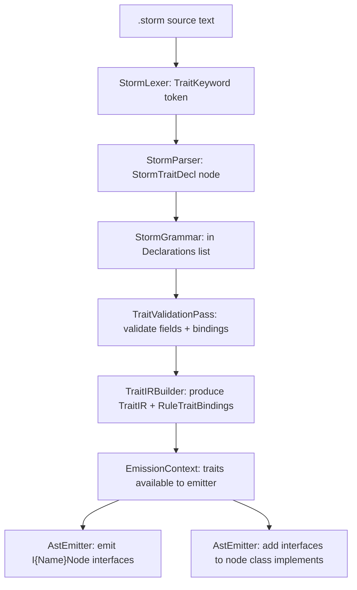
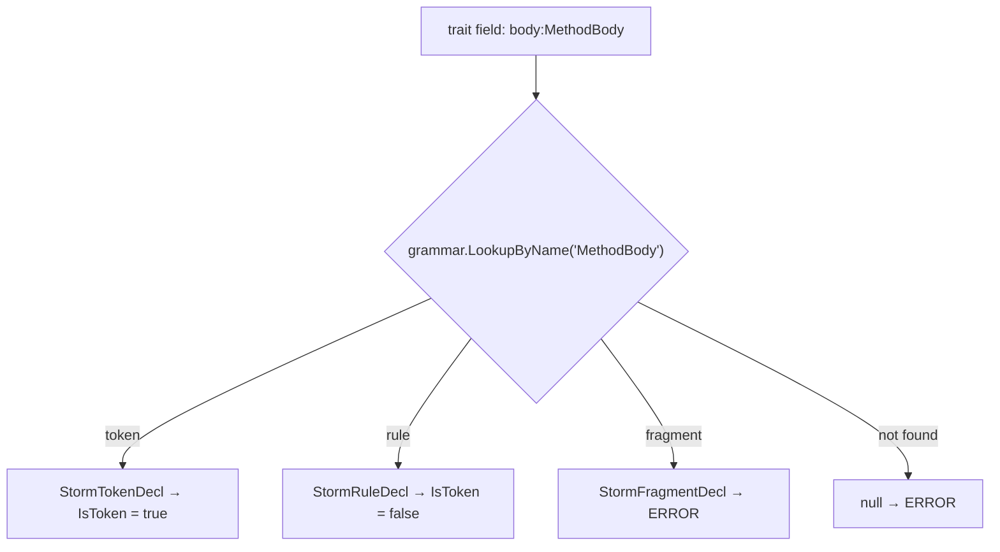

# Design Document: Storm Trait Keyword

## Overview

This design adds a `trait` keyword to the Storm grammar definition language. A trait declares a structural contract — a set of named, typed fields — that grammar rules can bind to. The Storm source generator validates that binding rules satisfy the trait's field shape and emits a C# interface for each trait. Nodes that bind a trait implement the interface, enabling polymorphic code over heterogeneous AST nodes sharing a common field shape.

Traits have no parsing semantics. They do not alter the grammar, the parser, or the parse result. They are purely a post-parse structural assertion affecting only the emitted C# AST node types.

### Design Decisions

- **Traits are declaration-order-independent**: Forward references are supported. A rule may bind a trait declared later in the file, and a trait may reference rules or tokens declared after it. This mirrors how rules can already reference other rules declared later.
- **Trait validation is a new pass between existing validation and IR lowering**: Trait structural checking needs resolved names but doesn't need lowered IR. It runs after `NameResolutionPass` and before `GrammarIRLowering`.
- **Traits do NOT participate in the GrammarIR pipeline**: Traits are not lowered to IR because they have no parsing semantics. They exist only for the AST emission phase. The `TraitIR` is stored alongside the `GrammarIR` and passed to the emitter via `EmissionContext`.
- **Trait composition uses interface inheritance**: When `trait B : A = ...`, the emitted `IBNode` extends `IANode`. This matches C# interface semantics naturally.
- **Inline block trait propagation validates arm target rules**: When a rule with trait bindings uses an inline block, each arm's target rule is validated against the trait. The trait interface is placed on the target rule's node class (not the wrapper).
- **StormRuleDecl gains a TraitBindings list**: Rather than creating a new syntax node subtype, the existing `StormRuleDecl` record gains an optional `IReadOnlyList<string> TraitBindings` property (default empty). This minimizes churn to the parser.
- **StormTraitDecl is a new StormDeclaration subtype**: Traits are top-level declarations alongside rules, tokens, and fragments.

## Architecture

The trait feature integrates into the Storm source generator pipeline at three points:

```
Parse → Resolve → Validate → [TraitValidation] → Lower → [TraitIRBuild] → Emit
                                                                              ↓
                                                                   EmitTraitInterfaces
                                                                   EmitNodeImplements
```

### Pipeline Integration Points

| Pipeline Stage | Change |
|---|---|
| `StormLexer` | Add `TraitKeyword` to `StormTokenKind` and `ClassifyKeyword` |
| `StormParser` | Parse `trait` declarations and trait bindings on rules |
| `StormSyntax` | Add `StormTraitDecl`, `StormTraitField`; extend `StormRuleDecl` with trait bindings |
| `StormGrammar` | Include trait declarations in the declarations list and `declarationsByName` |
| `StormPrettyPrinter` | Format trait declarations and rule trait bindings |
| `NameResolutionPass` | Skip trait declarations (no body expressions to resolve) |
| New: `TraitValidationPass` | Validate trait field types, trait bindings, structural satisfaction |
| `GrammarIRLowering` | Ignore trait declarations (they produce no `RuleIR` or `TokenIR`) |
| New: `TraitIR` types | Lowered trait representation for emission |
| New: `TraitIRBuilder` | Builds `TraitIR` from `StormGrammar` after validation |
| `EmissionContext` | Add `IReadOnlyList<TraitIR> Traits` |
| `AstEmitter` | Emit trait interfaces; add interfaces to node class implements lists |
| `StormIncrementalGenerator` | Wire up trait validation and IR building |
| `storm.tmLanguage.json` | Add `trait` keyword highlighting |

## Components and Interfaces

### 1. Lexer Changes (`StormLexer.cs`)

Add `TraitKeyword` to `StormTokenKind` enum:

```csharp
/// <summary>The <c>trait</c> keyword.</summary>
TraitKeyword,
```

Add to `ClassifyKeyword`:

```csharp
"trait" => StormTokenKind.TraitKeyword,
```

Add `TraitKeyword` to `SynchronizeToDeclaration` in the parser:

```csharp
case StormTokenKind.TraitKeyword:
    return;
```

### 2. Syntax Changes (`StormSyntax.cs`)

**New record: `StormTraitField`**

```csharp
/// <summary>
/// A single field within a trait declaration: <c>fieldName:TypeName</c> with optional
/// cardinality suffix (<c>?</c>, <c>*</c>, <c>+</c>).
/// </summary>
public sealed record StormTraitField(
    string FieldName,
    string TypeName,
    StormFieldCardinality Cardinality);

/// <summary>
/// The cardinality of a trait field.
/// </summary>
public enum StormFieldCardinality
{
    /// <summary>Exactly one (no suffix).</summary>
    One,
    /// <summary>Optional (<c>?</c>).</summary>
    Optional,
    /// <summary>Zero or more (<c>*</c>).</summary>
    ZeroOrMore,
    /// <summary>One or more (<c>+</c>).</summary>
    OneOrMore,
}
```

**New record: `StormTraitDecl`**

```csharp
/// <summary>
/// A <c>trait Name = field1:Type1 field2:Type2*;</c> declaration.
/// Traits may optionally compose other traits via colon syntax:
/// <c>trait B : A = extraField:Foo;</c>
/// </summary>
public sealed record StormTraitDecl(
    string Name,
    IReadOnlyList<StormTraitField> Fields,
    IReadOnlyList<string> ComposedTraits,
    int Offset,
    int Line,
    int Column)
    : StormDeclaration(Name, new StormReferenceExpr(Name), Offset, Line, Column);
```

Design note: `StormTraitDecl` extends `StormDeclaration` with a placeholder body expression (same pattern as `StormModeDecl`). The `Body` property is unused for traits but satisfies the base record contract. The `ComposedTraits` list holds trait names from the colon syntax (e.g., `trait B : A = ...` → `ComposedTraits = ["A"]`).

**Extended record: `StormRuleDecl`**

Add a `TraitBindings` property:

```csharp
public sealed record StormRuleDecl(
    string Name,
    StormExpression Body,
    int Offset,
    int Line,
    int Column,
    bool IsMemo = false,
    IReadOnlyList<string>? TraitBindings = null)
    : StormDeclaration(Name, Body, Offset, Line, Column);
```

When `TraitBindings` is null or empty, the rule has no trait bindings (backward compatible).

### 3. Parser Changes (`StormParser.cs`)

**Trait declaration parsing:**

Add `StormTokenKind.TraitKeyword` to the declaration dispatch in `ParseDeclaration`:

```csharp
case StormTokenKind.TraitKeyword:
    return ParseTraitDecl();
```

The `ParseTraitDecl` method:

```csharp
/// <summary>
/// trait Name = field1:Type1 field2:Type2?;
/// trait Name : ComposedTrait1, ComposedTrait2 = field1:Type1;
/// </summary>
private StormTraitDecl ParseTraitDecl()
{
    var kw = Advance(); // consume 'trait'
    var nameTok = Expect(StormTokenKind.Identifier, "trait name");

    // Optional trait composition: : Trait1, Trait2
    var composedTraits = new List<string>();
    if (Match(StormTokenKind.Colon))
    {
        composedTraits.Add(Expect(StormTokenKind.Identifier, "trait name").Lexeme);
        while (Match(StormTokenKind.Comma))
        {
            composedTraits.Add(Expect(StormTokenKind.Identifier, "trait name").Lexeme);
        }
    }

    Expect(StormTokenKind.Equals, "'='");

    // Parse space-separated fields until semicolon
    var fields = new List<StormTraitField>();
    while (Current.Kind == StormTokenKind.Identifier && Peek(1).Kind == StormTokenKind.Colon)
    {
        fields.Add(ParseTraitField());
    }

    if (fields.Count == 0)
    {
        Error("Trait must declare at least one field");
    }

    Expect(StormTokenKind.Semicolon, "';'");
    return new StormTraitDecl(nameTok.Lexeme, fields, composedTraits,
                              kw.Offset, kw.Line, kw.Column);
}
```

The `ParseTraitField` method:

```csharp
/// <summary>
/// fieldName:TypeName(?|*|+)?
/// </summary>
private StormTraitField ParseTraitField()
{
    var fieldNameTok = Advance(); // consume field name identifier
    Advance(); // consume ':'
    var typeTok = Expect(StormTokenKind.Identifier, "type name");

    var cardinality = StormFieldCardinality.One;
    if (Match(StormTokenKind.Question))
        cardinality = StormFieldCardinality.Optional;
    else if (Match(StormTokenKind.Star))
        cardinality = StormFieldCardinality.ZeroOrMore;
    else if (Match(StormTokenKind.Plus))
        cardinality = StormFieldCardinality.OneOrMore;

    return new StormTraitField(fieldNameTok.Lexeme, typeTok.Lexeme, cardinality);
}
```

**Rule trait binding parsing:**

Modify `ParseRuleDecl` to check for a colon after the rule name:

```csharp
private StormRuleDecl ParseRuleDecl(bool isMemo = false)
{
    var kw = Advance(); // consume 'rule'
    var nameTok = Expect(StormTokenKind.Identifier, "rule name");

    // Optional trait bindings: : Trait1, Trait2
    List<string>? traitBindings = null;
    if (Match(StormTokenKind.Colon))
    {
        traitBindings = new List<string>();
        traitBindings.Add(Expect(StormTokenKind.Identifier, "trait name").Lexeme);
        while (Match(StormTokenKind.Comma))
        {
            traitBindings.Add(Expect(StormTokenKind.Identifier, "trait name").Lexeme);
        }
    }

    Expect(StormTokenKind.Equals, "'='");
    var body = ParseExpression();
    Expect(StormTokenKind.Semicolon, "';'");
    return new StormRuleDecl(nameTok.Lexeme, body, kw.Offset, kw.Line, kw.Column,
                             IsMemo: isMemo, TraitBindings: traitBindings);
}
```

The annotated rule parsing path (`ParseAnnotatedDeclaration`) also needs updating to pass `isMemo: true` through the same parsing logic.

### 4. StormGrammar Changes (`StormGrammar.cs`)

`StormTraitDecl` is a `StormDeclaration`, so it already flows through `StormGrammar.Build()` and appears in the `Declarations` list and `declarationsByName` dictionary. The `LookupByName` method will find it. No changes are needed to `StormGrammar` itself — the existing infrastructure handles it.

### 5. Pretty Printer Changes (`StormPrettyPrinter.cs`)

Add `StormTraitDecl` to the `PrintDeclaration` switch:

```csharp
StormTraitDecl trait => PrintTraitDecl(trait, indent),
```

The `PrintTraitDecl` method:

```csharp
private static string PrintTraitDecl(StormTraitDecl trait, string indent)
{
    var sb = new StringBuilder();
    sb.Append($"{indent}trait {trait.Name}");

    if (trait.ComposedTraits.Count > 0)
    {
        sb.Append(" : ");
        sb.Append(string.Join(", ", trait.ComposedTraits));
    }

    sb.Append(" = ");

    for (var i = 0; i < trait.Fields.Count; i++)
    {
        if (i > 0) sb.Append(' ');
        var field = trait.Fields[i];
        sb.Append($"{field.FieldName}:{field.TypeName}");
        sb.Append(field.Cardinality switch
        {
            StormFieldCardinality.Optional => "?",
            StormFieldCardinality.ZeroOrMore => "*",
            StormFieldCardinality.OneOrMore => "+",
            _ => ""
        });
    }

    sb.AppendLine(";");
    return sb.ToString();
}
```

Modify `PrintDeclaration` for `StormRuleDecl` to include trait bindings:

```csharp
StormRuleDecl rule => rule.TraitBindings is { Count: > 0 }
    ? $"{indent}rule {rule.Name} : {string.Join(", ", rule.TraitBindings)} = {PrintExpression(rule.Body)};\n"
    : $"{indent}rule {rule.Name} = {PrintExpression(rule.Body)};\n",
```

The `@memo` prefix case follows the same pattern — if the rule has trait bindings, include the colon syntax in the output.

### 6. Validation: `TraitValidationPass` (New File)

Location: `Source/Storm.SourceGenerator/Validate/TraitValidationPass.cs`

This static class runs after `NameResolutionPass` succeeds. It validates:

1. **Trait field type resolution**: Each trait field's `TypeName` must resolve to a declared token or rule.
2. **Duplicate trait names**: Already caught by `StormGrammar.Build()` since traits are `StormDeclaration` subtypes.
3. **Trait binding resolution**: Each name in a rule's `TraitBindings` must resolve to a `StormTraitDecl`.
4. **Trait composition resolution**: Each name in a trait's `ComposedTraits` must resolve to another `StormTraitDecl`.
5. **Structural satisfaction**: Each binding rule's field labels must include entries matching every trait field (including composed fields) by name, type, and cardinality.
6. **Multi-alternative restriction**: Rules with named alternatives (multi-alternative rules) cannot bind traits.
7. **Inline block propagation**: When a rule with trait bindings has an inline block body, each arm's target rule is validated against the trait.

```csharp
public static class TraitValidationPass
{
    public static List<StormDiagnostic> Run(StormGrammar grammar)
    {
        var diagnostics = new List<StormDiagnostic>();

        // Collect all trait declarations
        var traitsByName = new Dictionary<string, StormTraitDecl>();
        foreach (var decl in grammar.Declarations)
        {
            if (decl is StormTraitDecl traitDecl)
            {
                traitsByName[traitDecl.Name] = traitDecl;
            }
        }

        // Validate trait field type references
        foreach (var trait in traitsByName.Values)
        {
            foreach (var field in trait.Fields)
            {
                var resolved = grammar.LookupByName(field.TypeName);
                if (resolved == null)
                {
                    diagnostics.Add(/* STORM0018: unresolved trait field type */);
                }
                else if (resolved is StormFragmentDecl)
                {
                    diagnostics.Add(/* STORM0018: fragments not valid in trait fields */);
                }
            }

            // Validate composed trait references
            foreach (var composedName in trait.ComposedTraits)
            {
                if (!traitsByName.ContainsKey(composedName))
                {
                    diagnostics.Add(/* STORM0019: unresolved composed trait */);
                }
            }
        }

        // Validate rule trait bindings
        foreach (var decl in grammar.Declarations)
        {
            if (decl is StormRuleDecl { TraitBindings: { Count: > 0 } } ruleDecl)
            {
                ValidateRuleTraitBindings(ruleDecl, traitsByName, grammar, diagnostics);
            }
        }

        return diagnostics;
    }
}
```

**Structural satisfaction algorithm:**

For a rule binding a trait, the pass collects the rule's field labels (from `StormLabeledExpr` nodes in the rule body) and checks each trait field against them:

1. Find a field label with the same name as the trait field.
2. Verify the labeled expression resolves to the same type name as the trait field (token or rule reference).
3. Verify the cardinality matches: the labeled expression must be wrapped in the appropriate `StormOptionalExpr` / `StormZeroOrMoreExpr` / `StormOneOrMoreExpr`, or have no wrapper for `One` cardinality.

Type matching works by inspecting the `StormExpression` inside the label:
- `StormReferenceExpr(name)` → type is `name`, cardinality is `One`
- `StormOptionalExpr(StormReferenceExpr(name))` → type is `name`, cardinality is `Optional`
- `StormZeroOrMoreExpr(StormReferenceExpr(name))` → type is `name`, cardinality is `ZeroOrMore`
- `StormOneOrMoreExpr(StormReferenceExpr(name))` → type is `name`, cardinality is `OneOrMore`

### 7. New Diagnostic IDs

| ID | Constant | Message |
|---|---|---|
| `STORM0018` | `STORM_TRAIT_FIELD_UNRESOLVED` | Trait field type '{typeName}' in trait '{traitName}' cannot be resolved to a token or rule |
| `STORM0019` | `STORM_TRAIT_BINDING_UNRESOLVED` | Trait binding '{traitName}' on rule '{ruleName}' cannot be resolved to a declared trait |
| `STORM0020` | `STORM_TRAIT_FIELD_MISSING` | Rule '{ruleName}' binds trait '{traitName}' but is missing field '{fieldName}' |
| `STORM0021` | `STORM_TRAIT_FIELD_MISMATCH` | Rule '{ruleName}' field '{fieldName}' has type '{actual}' but trait '{traitName}' requires '{expected}' |
| `STORM0022` | `STORM_TRAIT_MULTI_ALT` | Rule '{ruleName}' has named alternatives and cannot bind traits |
| `STORM0023` | `STORM_TRAIT_COMPOSED_UNRESOLVED` | Trait '{traitName}' composes '{composedName}' which is not a declared trait |
| `STORM0024` | `STORM_TRAIT_INLINE_ARM_UNSATISFIED` | Inline arm target rule '{targetName}' does not satisfy trait '{traitName}' bound on rule '{ruleName}' |

### 8. Trait IR Types (New File)

Location: `Source/Storm.SourceGenerator/IR/TraitIR.cs`

```csharp
/// <summary>
/// Lowered representation of a trait declaration.
/// Contains resolved field references for emission.
/// </summary>
public sealed class TraitIR
{
    public string Name { get; }
    public IReadOnlyList<TraitFieldIR> Fields { get; }
    public IReadOnlyList<TraitIR> ComposedTraits { get; }

    public TraitIR(string name, IReadOnlyList<TraitFieldIR> fields,
                   IReadOnlyList<TraitIR> composedTraits)
    {
        Name = name;
        Fields = fields;
        ComposedTraits = composedTraits;
    }

    /// <summary>
    /// Returns all fields including those inherited from composed traits.
    /// </summary>
    public IEnumerable<TraitFieldIR> AllFields()
    {
        foreach (var composed in ComposedTraits)
        {
            foreach (var field in composed.AllFields())
                yield return field;
        }
        foreach (var field in Fields)
            yield return field;
    }
}

/// <summary>
/// A single field within a trait, with its type resolved to either
/// a token or a rule name (string-based, for emission purposes).
/// </summary>
public sealed class TraitFieldIR
{
    public string FieldName { get; }
    public string TypeName { get; }
    public bool IsToken { get; }
    public StormFieldCardinality Cardinality { get; }

    public TraitFieldIR(string fieldName, string typeName, bool isToken,
                        StormFieldCardinality cardinality)
    {
        FieldName = fieldName;
        TypeName = typeName;
        IsToken = isToken;
        Cardinality = cardinality;
    }
}
```

### 9. TraitIRBuilder (New File)

Location: `Source/Storm.SourceGenerator/IR/TraitIRBuilder.cs`

Builds `TraitIR` objects from the `StormGrammar` after validation passes. Runs after `TraitValidationPass` succeeds. Resolves field types to determine whether they are tokens or rules (needed for emission to produce the correct C# property type).

```csharp
public static class TraitIRBuilder
{
    public sealed class BuildResult
    {
        public IReadOnlyList<TraitIR> Traits { get; }
        public IReadOnlyDictionary<string, IReadOnlyList<TraitIR>> RuleTraitBindings { get; }

        public BuildResult(IReadOnlyList<TraitIR> traits,
                          IReadOnlyDictionary<string, IReadOnlyList<TraitIR>> ruleTraitBindings)
        {
            Traits = traits;
            RuleTraitBindings = ruleTraitBindings;
        }
    }

    public static BuildResult Build(StormGrammar grammar)
    {
        // 1. Build TraitIR for each StormTraitDecl (resolve field types)
        // 2. Build rule→traits mapping for each StormRuleDecl with TraitBindings
        // 3. Resolve inline block propagation (arm target rules inherit parent traits)
        // Returns both for use by EmissionContext
    }
}
```

The `RuleTraitBindings` dictionary maps rule names to their resolved `TraitIR` list. For inline block rules, the arm target rule names are also added to this mapping with the propagated traits.

### 10. EmissionContext Changes

Extend `EmissionContext` to hold trait information:

```csharp
public sealed class EmissionContext
{
    // ... existing properties ...

    /// <summary>
    /// All trait declarations in the grammar, lowered to IR.
    /// Empty when no traits are declared.
    /// </summary>
    public IReadOnlyList<TraitIR> Traits { get; }

    /// <summary>
    /// Maps rule names to their bound traits (resolved, including propagated inline block traits).
    /// Empty when no rules bind traits.
    /// </summary>
    public IReadOnlyDictionary<string, IReadOnlyList<TraitIR>> RuleTraitBindings { get; }
}
```

### 11. AstEmitter Changes

**Emit trait interfaces:**

After emitting all rule node types, emit one interface per `TraitIR`:

```csharp
private static void EmitTraitInterface(CodeWriter writer, TraitIR trait)
{
    var interfaceName = $"I{trait.Name}Node";

    // Build base interface list from composed traits
    var baseInterfaces = trait.ComposedTraits
        .Select(ct => $"I{ct.Name}Node")
        .ToList();

    var declaration = baseInterfaces.Count > 0
        ? $"public interface {interfaceName} : {string.Join(", ", baseInterfaces)}"
        : $"public interface {interfaceName}";

    writer.WriteBlock(declaration, () =>
    {
        // Only emit properties for this trait's own fields (not composed)
        foreach (var field in trait.Fields)
        {
            var propType = GetTraitPropertyType(field);
            var propName = PascalCase(field.FieldName);
            writer.WriteLine($"{propType} {propName} {{ get; }}");
        }
    });
}
```

**Property type mapping:**

```csharp
private static string GetTraitPropertyType(TraitFieldIR field)
{
    if (field.IsToken)
    {
        return field.Cardinality switch
        {
            StormFieldCardinality.Optional => "Token?",
            StormFieldCardinality.ZeroOrMore => "ImmutableArray<Token>",
            StormFieldCardinality.OneOrMore => "ImmutableArray<Token>",
            _ => "Token"  // One
        };
    }

    var nodeType = field.TypeName + "Node";
    return field.Cardinality switch
    {
        StormFieldCardinality.Optional => $"{nodeType}?",
        StormFieldCardinality.ZeroOrMore => $"ImmutableArray<{nodeType}>",
        StormFieldCardinality.OneOrMore => $"ImmutableArray<{nodeType}>",
        _ => nodeType  // One
    };
}
```

**Add interfaces to node class declarations:**

When emitting a sealed node (single-alternative rule), check if the rule has trait bindings:

```csharp
private static void EmitSealedNode(CodeWriter writer, RuleIR rule, EmissionContext context)
{
    var nodeTypeName = rule.Name + "Node";
    var baseType = "SyntaxNode";

    // Check for trait interfaces
    var interfaces = new List<string>();
    if (context.RuleTraitBindings.TryGetValue(rule.Name, out var traits))
    {
        foreach (var trait in traits)
        {
            interfaces.Add($"I{trait.Name}Node");
            // Composed trait interfaces are inherited transitively via interface extension
        }
    }

    var implementsList = interfaces.Count > 0
        ? $"{baseType}, {string.Join(", ", interfaces)}"
        : baseType;

    writer.WriteBlock($"public sealed class {nodeTypeName} : {implementsList}", () =>
    {
        // ... existing property emission ...
    });
}
```

The existing node properties satisfy the trait interface contract implicitly (guaranteed by `TraitValidationPass`), so no explicit interface implementation members are needed.

### 12. StormIncrementalGenerator Changes

Insert trait validation and IR building into the pipeline:

```csharp
// After Step 3: Validate (existing)
// ...

// Step 3b: Trait validation
var traitValidationDiags = TraitValidationPass.Run(grammar);
foreach (var diag in traitValidationDiags)
{
    context.ReportDiagnostic(diag.ToRoslynDiagnostic());
    if (diag.Severity == StormDiagnosticSeverity.Error)
        hasValidationErrors = true;
}

if (hasValidationErrors) return;

// After Step 4: Lower to IR (existing)
// ...

// Step 4b: Build trait IR
var traitBuildResult = TraitIRBuilder.Build(grammar);

// Step 5/6: Emit (pass traits to EmissionContext)
var emissionContext = new EmissionContext(
    consumerNamespace, grammarName, loweringResult.Grammar,
    memoizationPlan, traitBuildResult.Traits, traitBuildResult.RuleTraitBindings);
```

### 13. GrammarIRLowering Changes

Minimal change: skip `StormTraitDecl` declarations during lowering (they don't produce `TokenIR` or `RuleIR`). The existing lowering loop checks `decl is StormRuleDecl` explicitly, so trait declarations are already skipped by the token/fragment/rule loops. No modification needed.

However, the `NameResolutionPass` needs a small update to skip `StormTraitDecl` declarations (trait bodies are placeholder expressions, not real references):

```csharp
// In NameResolutionPass.Run:
foreach (var decl in grammar.Declarations)
{
    if (decl is StormTraitDecl) continue; // Traits have no body expressions
    var isRuleContext = decl is StormRuleDecl;
    WalkExpression(decl.Body, grammar, isRuleContext, decl, diagnostics);
}
```

### 14. TextMate Grammar Changes

Update `Editor/storm-syntax-highlighting/syntaxes/storm.tmLanguage.json`:

**Add `trait` to `definition-names` pattern:**

```json
"definition-names": {
    "match": "\\b(token|rule|fragment|trait)\\s+(\\w+)",
    "captures": {
        "1": { "name": "storage.type.storm" },
        "2": { "name": "entity.name.function.storm" }
    }
}
```

**Add `trait` to `storage-types` pattern:**

```json
"storage-types": {
    "name": "storage.type.storm",
    "match": "\\b(token|hidden|fragment|rule|mode|inline|trait)\\b"
}
```

**Add rule trait binding pattern** (colon-separated trait names after rule name):

```json
"trait-bindings": {
    "match": "\\b(rule)\\s+(\\w+)\\s*(:)\\s*(\\w+(?:\\s*,\\s*\\w+)*)",
    "captures": {
        "1": { "name": "storage.type.storm" },
        "2": { "name": "entity.name.function.storm" },
        "3": { "name": "punctuation.separator.storm" },
        "4": { "name": "entity.other.inherited-class.storm" }
    }
}
```

This pattern must be included before `definition-names` to take priority when a rule has trait bindings.

### 15. Inline Block Trait Propagation

When a rule with trait bindings uses an inline block body, the traits are validated against and propagated to each arm's target rule:

1. **Validation**: `TraitValidationPass` detects that the rule body is a `StormInlineBlockExpr`. For each arm, it resolves the target rule and validates that the target rule's field labels satisfy the trait.
2. **IR Building**: `TraitIRBuilder` adds the trait to the arm target rule's binding list in `RuleTraitBindings`.
3. **Emission**: `AstEmitter` looks up traits for the target rule name and adds the interfaces to the target node class.

Deduplication: if a target rule already has its own trait bindings that include the same trait, it appears only once in the implements list.

## Data Models

### Trait Resolution Flow



### Field Type Resolution



### Cardinality to C# Type Mapping

| Cardinality | Token field | Rule field |
|---|---|---|
| One (no suffix) | `Token` | `{TypeName}Node` |
| Optional (`?`) | `Token?` | `{TypeName}Node?` |
| ZeroOrMore (`*`) | `ImmutableArray<Token>` | `ImmutableArray<{TypeName}Node>` |
| OneOrMore (`+`) | `ImmutableArray<Token>` | `ImmutableArray<{TypeName}Node>` |

### Structural Satisfaction Check

For each trait field `F` on trait `T` bound to rule `R`:

1. Find a `StormLabeledExpr` in `R`'s body where `Label == F.FieldName`
2. Extract the inner expression type:
   - Direct `StormReferenceExpr(name)` → type = `name`, cardinality = `One`
   - Wrapped in `StormOptionalExpr` → cardinality = `Optional`
   - Wrapped in `StormZeroOrMoreExpr` → cardinality = `ZeroOrMore`
   - Wrapped in `StormOneOrMoreExpr` → cardinality = `OneOrMore`
3. Check `extractedType == F.TypeName` and `extractedCardinality == F.Cardinality`

## Correctness Properties

### Property 1: Trait declaration round-trip

*For any* valid Storm source containing trait declarations (with varying field counts 1..N, varying cardinality suffixes, and optional trait composition), pretty-printing the parsed AST and re-parsing the result SHALL produce a `StormTraitDecl` node whose trait name, field names, field type names, field cardinalities, and composed trait names are identical to the original.

**Validates: Requirements 1, 2, 10**

### Property 2: Rule trait binding round-trip

*For any* valid Storm source containing rule declarations with trait bindings (one or more comma-separated trait names between colon and equals), pretty-printing and re-parsing SHALL preserve the trait binding list in declaration order.

**Validates: Requirements 3, 10**

### Property 3: Trait field type resolution

*For any* trait field type name that matches a declared token name, `TraitFieldIR.IsToken` SHALL be `true`. *For any* trait field type name that matches a declared rule name, `TraitFieldIR.IsToken` SHALL be `false`. *For any* trait field type name that does not match any token, rule, or fragment, the validation pass SHALL emit `STORM0018`.

**Validates: Requirements 4, 5**

### Property 4: Structural satisfaction

*For any* rule binding a trait where every trait field has a matching labeled expression in the rule body with identical type name and cardinality, trait validation SHALL succeed (no diagnostics). *For any* rule binding a trait where at least one trait field is missing or mismatched, validation SHALL emit `STORM0020` or `STORM0021`.

**Validates: Requirement 5**

### Property 5: Interface emission correctness

*For any* rule that binds one or more traits, the emitted sealed class SHALL include all corresponding `I{TraitName}Node` interfaces in its implements list. *For any* trait interface, it SHALL contain one get-only property per trait field with the correct C# type per the cardinality-to-type mapping table.

**Validates: Requirements 6, 7**

### Property 6: Trait composition inheritance

*For any* trait `B` that composes trait `A`, the emitted interface `IBNode` SHALL extend `IANode`. *For any* rule binding `B`, the emitted node SHALL implement both `IBNode` and (transitively) `IANode`.

**Validates: Requirements 3.6, 6.9, 7.3**

### Property 7: Inline block propagation

*For any* rule with trait bindings whose body is an inline block, the trait interfaces SHALL appear on each arm's target rule node class (not on a wrapper node). If an arm target rule does not satisfy the trait, validation SHALL emit `STORM0024`.

**Validates: Requirement 8**

### Property 8: Multi-alternative rejection

*For any* rule with named alternatives that also declares trait bindings, validation SHALL emit `STORM0022`.

**Validates: Requirement 3.5**

### Property 9: Zero downstream impact

After implementing the trait feature, the Mist compiler (`Source/Mist/`), Mist CLI (`Source/Mist.CLI/`), and all tests in `Test/Mist.Tests/` and `Test/Mist.CLI.Tests/` SHALL continue to compile and pass without modification.

**Validates: Requirement 14**

## Error Handling

| Scenario | Diagnostic | Recovery |
|---|---|---|
| Trait field type not found | `STORM0018` | Skip field, continue checking remaining fields |
| Trait binding name not found | `STORM0019` | Skip binding, continue checking remaining bindings |
| Rule missing a trait field | `STORM0020` | Report, continue checking other fields |
| Rule field type/cardinality mismatch | `STORM0021` | Report, continue checking other fields |
| Multi-alternative rule with trait binding | `STORM0022` | Report, skip trait validation for this rule |
| Composed trait name not found | `STORM0023` | Skip composition, treat trait as having only its own fields |
| Inline arm target doesn't satisfy | `STORM0024` | Report, continue checking other arms |
| Trait with zero fields | `STORM0001` (syntax error) | Parser reports, no trait decl produced |
| Missing semicolon on trait | `STORM0001` (syntax error) | Parser synchronizes to next declaration |

All validation errors are non-fatal to the overall compilation — they prevent emission but do not crash the generator. Each error is reported independently so the user sees all problems at once.

## Testing Strategy

### Unit Tests (Storm.SourceGenerator.Tests)

1. **Lexer tests**: Verify `trait` produces `TraitKeyword`, `traits` produces `Identifier`, `Trait` produces `Identifier`.
2. **Parser tests**: Verify parsing of trait declarations with 1, 2, N fields; all cardinality variants; trait composition; error cases (missing semicolon, zero fields, missing colon in field).
3. **Parser tests**: Verify rule trait binding parsing with 1, 2, N bindings; memo + trait binding combination; no binding (backward compat).
4. **Pretty printer tests**: Verify round-trip for trait declarations and rule trait bindings.
5. **Validation tests**: Verify `STORM0018`–`STORM0024` diagnostics are emitted for the corresponding error conditions.
6. **Emission tests**: Verify generated C# contains `I{Name}Node` interfaces with correct properties; verify node classes include trait interfaces in their implements lists.

### Integration Tests

1. **CallableDeclaration trait**: Add trait to `Mist.storm`, verify the Mist compiler still builds, verify `ICallableDeclarationNode` is generated with the expected properties, verify both `ConstructorDeclarationNode` and `MethodDeclarationNode` implement it.
2. **Full pipeline**: A small standalone `.storm` grammar with traits, compiled end-to-end, producing correct C# output.

## File Change Summary

| File | Change Type | Description |
|---|---|---|
| `Source/Storm.SourceGenerator/Frontend/StormLexer.cs` | Modify | Add `TraitKeyword` to enum and `ClassifyKeyword` |
| `Source/Storm.SourceGenerator/Frontend/StormSyntax.cs` | Modify | Add `StormTraitDecl`, `StormTraitField`, `StormFieldCardinality`; extend `StormRuleDecl` |
| `Source/Storm.SourceGenerator/Frontend/StormParser.cs` | Modify | Add trait declaration parsing, rule trait binding parsing |
| `Source/Storm.SourceGenerator/Frontend/StormPrettyPrinter.cs` | Modify | Add trait and binding formatting |
| `Source/Storm.SourceGenerator/Validate/TraitValidationPass.cs` | New | Trait structural validation |
| `Source/Storm.SourceGenerator/Validate/NameResolutionPass.cs` | Modify | Skip `StormTraitDecl` (no body to resolve) |
| `Source/Storm.SourceGenerator/IR/TraitIR.cs` | New | `TraitIR`, `TraitFieldIR` types |
| `Source/Storm.SourceGenerator/IR/TraitIRBuilder.cs` | New | Builds `TraitIR` from grammar |
| `Source/Storm.SourceGenerator/Emit/EmissionContext.cs` | Modify | Add `Traits` and `RuleTraitBindings` properties |
| `Source/Storm.SourceGenerator/Emit/AstEmitter.cs` | Modify | Emit interfaces, add to node implements |
| `Source/Storm.SourceGenerator/Generator/StormIncrementalGenerator.cs` | Modify | Wire up new passes |
| `Source/Storm.SourceGenerator/Diagnostics/StormDiagnosticIds.cs` | Modify | Add `STORM0018`–`STORM0024` |
| `Editor/storm-syntax-highlighting/syntaxes/storm.tmLanguage.json` | Modify | Add `trait` keyword highlighting |
| `Source/Mist/Grammar/Mist.storm` | Modify | Add `CallableDeclaration` trait (Req 12) |
| `Test/Storm.SourceGenerator.Tests/` | New files | Tests for all new functionality |
