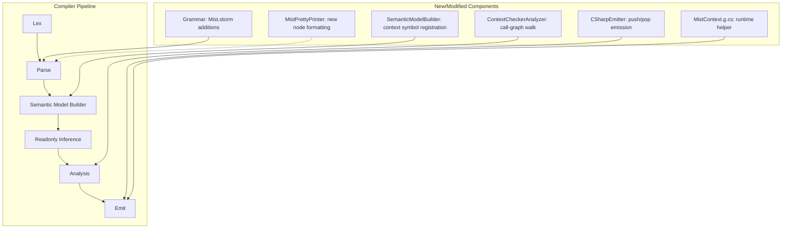

# Design Document: Structured Context

## Overview

Structured context adds Racket-style `parameterize` semantics to Mist, allowing values to propagate through the call graph without explicit parameter threading. The feature reuses the existing `with` keyword in new syntactic positions (inside method bodies and on method signatures) while preserving the existing trait-with block usage at the top level.

The implementation spans the full compiler pipeline:

1. **Grammar** — New `Statement` alternatives for context declarations/blocks, and a `WithClause` list on method-like declarations (methods, constructors, interface methods, trait methods).
2. **Parser** — Storm-generated parser produces new AST node types from the grammar additions.
3. **Semantic Model Builder** — Registers context-bound locals as `SymbolKind.LocalVariable`, resolves context types, and records `with` clause metadata on method symbols.
4. **Context Checker (new analyzer)** — Walks the call graph to verify that every method with a `with` clause is always called within a scope that provides the required context type. Also enforces that implementing types match interface/trait method `with` clauses exactly (no variance).
5. **C# Emitter** — Generates `try/finally` push/pop patterns and a `MistContext.g.cs` runtime helper file.
6. **Pretty Printer** — Formats all new AST nodes for round-trip fidelity.

Context values are keyed by exact resolved type (aliases resolve through, unions are distinct from constituents, generic instantiations with different type args are distinct keys). The runtime representation is a static `Dictionary<Type, Stack<object>>` in the emitted C#.

## Architecture



The context checker is a **new** `IAnalyzer` implementation (`ContextCheckerAnalyzer`) registered alongside the existing `TypeCheckerAnalyzer`. It runs after the semantic model is fully built and readonly inference is complete, so it has access to resolved types and the full call graph.

## Components and Interfaces

### 1. Grammar Additions (Mist.storm)

**New rules added to the `Statement` alternative list:**

```storm
rule Statement
    = ...existing alternatives...
    | withVarDeclaration:WithVarDeclarationStatement         as WithVarDeclarationStatement
    | withTypedDeclaration:WithTypedDeclarationStatement     as WithTypedDeclarationStatement
    | withDiscardDeclaration:WithDiscardDeclarationStatement as WithDiscardDeclarationStatement
    | withPushStatement:WithPushStatement                    as WithPushStatement
    | withBlockStatement:WithBlockStatement                  as WithBlockStatement
    ;

rule WithVarDeclarationStatement = WITH VAR name:IDENTIFIER EQUAL initializer:Expression SEMICOLON;
rule WithTypedDeclarationStatement = WITH type:TypeReference name:IDENTIFIER EQUAL initializer:Expression SEMICOLON;
rule WithDiscardDeclarationStatement = WITH type:TypeReference UNDERSCORE EQUAL initializer:Expression SEMICOLON;
rule WithPushStatement = WITH value:Expression SEMICOLON;
rule WithBlockStatement = WITH LEFT_PARENTHESIS expression:Expression RIGHT_PARENTHESIS body:Block;
```

**New rule for method signature context bindings:**

```storm
rule WithClause = WITH type:TypeReference name:IDENTIFIER;
```

**Modified method-like declarations** (adding `withClauses:WithClause*` after the parameter list, before constraints/body):

- `MethodDeclaration` — standard class/struct methods
- `ConstructorDeclaration` — constructors (context checked at `new` expression call sites)
- `InterfaceMethodDeclaration` — interface method signatures (defines the contract for implementors)
- `TraitMethodDeclaration` — trait method signatures (defines the structural matching requirement)

**Disambiguation strategy:**
- Top-level `WithDeclaration` uses `WITH IDENTIFIER COLON IDENTIFIER` — the `COLON` after the first identifier distinguishes it.
- Context declarations appear only inside the `Statement` rule (method bodies). The parser sees `WITH` followed by `VAR`, a type reference + identifier + `EQUAL`, `_` + `EQUAL`, `LEFT_PARENTHESIS`, or a general expression + `SEMICOLON`.
- Method-level `WithClause` appears positionally after `)` and before `{`/`;`/`where`.

**Note on `_` token:** The grammar needs an `UNDERSCORE` token or the parser must recognize `IDENTIFIER` with text `"_"` as the discard marker. Since `_` is a valid identifier in the current grammar (`[a-zA-Z_][a-zA-Z0-9_]*`), the `WithDiscardDeclarationStatement` rule will match `WITH TypeReference IDENTIFIER EQUAL` where the identifier text is `_`. The semantic model builder will check the identifier text to distinguish discard from binding.

### 2. Semantic Model Builder Extensions

**Pass 1 additions:**
- When visiting method-like declarations, extract `WithClause` nodes and store them as metadata on the method symbol (a new `WithClauses` property on the method symbol, containing a list of `(IType Type, string Identifier)` pairs).

**Pass 2 additions:**
- For `WithVarDeclarationStatement`: infer the type from the initializer expression, register a `SymbolKind.LocalVariable` with that type.
- For `WithTypedDeclarationStatement`: resolve the type reference, register a `SymbolKind.LocalVariable` with the resolved type.
- For `WithDiscardDeclarationStatement`: resolve the type reference, no local variable registration.
- For `WithPushStatement`: infer the type from the expression, no local variable registration.
- For `WithBlockStatement`: infer the type from the expression, process the block body.
- For method `WithClause`: resolve the type reference, register a `SymbolKind.LocalVariable` in the method body scope.

**Context type resolution** follows the type keying rules:
- `TypeAliasType` → resolve to `UnderlyingType` before keying (so alias and underlying type share a key).
- `UnionType` → treated as its own distinct key (not decomposed into constituents; `int | string` is independent from `int` and `string`).
- `ConstructedType` (generics) → each distinct type argument combination is a separate key.
- `RefinementType` → keyed by the refined type (the base type with its predicate is the key).

### 3. ContextCheckerAnalyzer (New)

```csharp
public sealed class ContextCheckerAnalyzer : IAnalyzer
{
    public string AnalyzerId => "ContextChecker";
    
    public void Analyze(ISemanticModel model, DiagnosticBag diagnostics) { ... }
}
```

**Algorithm — Context Availability Checking:**
1. Collect all method symbols that have `WithClauses`.
2. For each call site in the program that invokes such a method:
   a. Walk up the enclosing scopes and call chain looking for a context declaration whose resolved type matches the required type (exact match after alias resolution).
   b. A context declaration satisfies the requirement if it appears before the call site in the same block, or in any enclosing block/method that transitively calls the current method.
   c. If the walk reaches `Main` without finding a provider, emit a diagnostic.
3. Handle cycles by maintaining a visited set per walk path.
4. For interface/virtual dispatch, use the `with` clauses declared on the interface/base method signature (not the concrete implementing method's clauses).

**Algorithm — Interface/Trait Contract Enforcement (Requirement 8):**
1. For each interface method that declares `with` clauses:
   a. Find all types that implement the interface.
   b. For each implementing type's corresponding method, verify that it declares the **exact same** `with` clauses (matched by resolved type, no variance — not even subtype/supertype relationships).
   c. If the implementing method omits a `with` clause, emit `MIST_CTX_0006`.
   d. If the implementing method declares a `with` clause with a different type (including via inheritance), emit `MIST_CTX_0006`.
2. For each trait method that declares `with` clauses:
   a. During structural matching (trait satisfaction resolution), a type's method is only considered a structural match if it also declares the same `with` clauses (matched by exact resolved type).
   b. If a type's method matches in name, parameters, and return type but differs in `with` clauses, it is **not** a structural match for trait satisfaction.
   c. This means the type will fail trait satisfaction if no other method matches, which is reported through the existing trait satisfaction diagnostic infrastructure.
3. When a call is dispatched through an interface or trait type, the context checker uses the `with` clauses from the **interface or trait method signature** (not the concrete type) to determine context requirements at the call site.

**Diagnostic IDs:**
- `MIST_CTX_0001` — Missing context: "Method `{method}` requires context of type `{type}`, but no matching context declaration is in scope at {location}."
- `MIST_CTX_0002` — Duplicate context binding: "Method `{method}` has multiple `with` clauses binding type `{type}`."
- `MIST_CTX_0003` — Context declaration outside method body.
- `MIST_CTX_0004` — Cannot infer context type from expression.
- `MIST_CTX_0005` — Context-bound variable is not reassignable.
- `MIST_CTX_0006` — Interface/trait with-clause contract violation: "Method `{method}` on type `{type}` must declare `with {contextType}` to satisfy interface/trait `{contract}` at {location}."

### 4. C# Emitter Extensions

**Context declaration statements** emit as:

```csharp
// with var x = expr;  OR  with TypeReference x = expr;
var x = expr;
MistContext.Push<TypeReference>(x);
try {
    // ... rest of scope ...
} finally {
    MistContext.Pop<TypeReference>();
}
```

For discard (`with TypeReference _ = expr;`):
```csharp
MistContext.Push<TypeReference>(expr);
try {
    // ... rest of scope ...
} finally {
    MistContext.Pop<TypeReference>();
}
```

For push-only (`with expr;`):
```csharp
MistContext.Push<InferredType>(expr);
try {
    // ... rest of scope ...
} finally {
    MistContext.Pop<InferredType>();
}
```

**Context block** (`with(expr) { ... }`):
```csharp
MistContext.Push<InferredType>(expr);
try {
    // ... block body ...
} finally {
    MistContext.Pop<InferredType>();
}
```

**Method with clause** (`with TypeReference identifier`):
```csharp
var identifier = (TypeReference)MistContext.Peek<TypeReference>();
```

**Method with a clause whose key names a type parameter** (`T Get<T>() with T value`): the CLR
erases what makes two Mist keys distinct (`string?` and `string` are one `System.String`), so the
clause gains a `System.Type` parameter, placed with the default and constructor witnesses, that the
call site fills with the key it closed the clause to (Requirement 5.1). The body peeks by that
parameter; a nested call holding the same open key forwards it; a `with` block under it files by it.
A closed key keeps the generic spelling above.
```csharp
public static T Get<T>(System.Type __context_0)
{
    var value = (T)MistContext.Peek(__context_0);
    return value;
}

// Get<string?>() written under `with string? opt;` and `with "required";`
Get<string?>(typeof(MistContext.Optional<string>));
```
An answer whose channel differs from its slot's -- a slot `T Read() with T value` on `IBox<T>`
answered by `string? Read() with string? value` on `OptBox : IBox<string?>` -- is reached through an
explicit implementation that forwards only what the answer requires, as a weaker generic answer's
witnesses are. A member the target runs with no call written (an operator, a `Drop`, an enumerator
member) carries no parameter and keeps `Peek<T>()`, as does a `with` block whose open key no enclosing
clause holds; those file under the CLR-erased key.

**Multiple context declarations in the same scope** nest `try/finally` blocks so that pops happen in reverse declaration order.

### 5. MistContext.g.cs Runtime Helper

Generated when any compilation unit uses structured context:

```csharp
internal static class MistContext
{
    private static readonly Dictionary<Type, Stack<object>> _stacks = new();

    public static void Push<T>(object value)
    {
        var type = typeof(T);
        if (!_stacks.TryGetValue(type, out var stack))
        {
            stack = new Stack<object>();
            _stacks[type] = stack;
        }
        stack.Push(value);
    }

    public static void Pop<T>()
    {
        _stacks[typeof(T)].Pop();
    }

    public static T Peek<T>()
    {
        return (T)_stacks[typeof(T)].Peek();
    }

    // The generic members delegate to these, which a key carried as a System.Type parameter uses.
    public static void Push(Type key, object value) { ... }
    public static void Pop(Type key) { ... }
    public static object Peek(Type key) { ... }
}
```

### 6. Pretty Printer Extensions

New `Emit*` methods in `MistPrettyPrinter`:
- `EmitWithVarDeclarationStatement` — formats `with var {name} = {expr};`
- `EmitWithTypedDeclarationStatement` — formats `with {type} {name} = {expr};`
- `EmitWithDiscardDeclarationStatement` — formats `with {type} _ = {expr};`
- `EmitWithPushStatement` — formats `with {expr};`
- `EmitWithBlockStatement` — formats `with ({expr}) { ... }`
- Method declarations emit `with {type} {name}` clauses after the parameter list.

### 7. TextMate Grammar Updates

The `with` keyword already has scope `keyword.other.mist`. The TextMate grammar needs patterns for:
- Context declaration statements: highlight type references and identifiers appropriately.
- Context block: highlight `with` + parenthesized expression.
- Method `with` clauses: highlight type as type scope, identifier as `variable.parameter.mist`.
- Discard `_` as `variable.language.mist`.

## Data Models

### Context Clause Metadata (on Method Symbols)

```csharp
/// <summary>
/// Represents a single with-clause on a method signature.
/// </summary>
public sealed class ContextClauseInfo
{
    /// <summary>The resolved context type (after alias resolution).</summary>
    public required IType ContextType { get; init; }
    
    /// <summary>The bound identifier name within the method body.</summary>
    public required string Identifier { get; init; }
    
    /// <summary>Source span of the with clause for diagnostics.</summary>
    public required SourceSpan Span { get; init; }
}
```

### Context Declaration Info (for the checker)

```csharp
/// <summary>
/// Tracks a context declaration within a scope for the context checker.
/// </summary>
public sealed class ContextDeclarationInfo
{
    /// <summary>The resolved context type being pushed.</summary>
    public required IType ContextType { get; init; }
    
    /// <summary>The AST node of the declaration (for location reporting).</summary>
    public required SyntaxNode DeclarationNode { get; init; }
    
    /// <summary>The scope in which this declaration appears.</summary>
    public required IScope DeclaringScope { get; init; }
}
```

### Context Type Resolution

The context type key is determined by:
1. If the declared type is a `TypeAliasType`, unwrap to `UnderlyingType` recursively. This means `type Name = string;` and `string` share the same context key.
2. If the declared type is a `ConstructedType`, use the full constructed type (including type arguments) as the key. `List<int>` and `List<string>` are independent keys.
3. If the declared type is a `UnionType`, use the union type itself as the key (distinct from any constituent). `int | string` is a different key from `int` and from `string`.
4. If the declared type is a `RefinementType`, use the refinement type as the key.
5. Otherwise, use the type directly.

Type equality for context keying uses reference equality on the resolved `IType` instance from the semantic model (since the model canonicalizes types).

## Correctness Properties

*A property is a characteristic or behavior that should hold true across all valid executions of a system — essentially, a formal statement about what the system should do. Properties serve as the bridge between human-readable specifications and machine-verifiable correctness guarantees.*

### Property 1: Pretty-printer round-trip idempotence

*For any* valid Mist AST containing structured context constructs (with-var declarations, with-typed declarations, with-discard declarations, with-push statements, with-block statements, and method with-clauses on methods, constructors, interface methods, and trait methods), `print(parse(print(ast)))` SHALL equal `print(ast)`.

**Validates: Requirements 1.1, 1.2, 1.3, 1.4, 1.5, 1.6, 1.7, 1.8, 2.1, 2.2, 2.3, 3.1, 3.2, 3.3, 3.5, 11.1, 11.2, 11.3, 11.4, 11.5, 11.6, 11.7, 13.1**

### Property 2: Context checker soundness and completeness

*For any* valid Mist program where every call site of a method with `with` clauses has a matching context declaration (of the exact resolved type) reachable in the call graph, the context checker SHALL emit zero context-availability diagnostics. Conversely, *for any* program where a call site lacks a reachable context declaration for a required type, the context checker SHALL emit exactly one diagnostic per unsatisfied type at that call site.

**Validates: Requirements 1.9, 2.4, 3.4, 3.6, 3.7, 8.6, 9.1, 9.2, 9.3, 9.4, 9.5, 9.6, 9.7, 9.8, 13.2, 13.3**

### Property 3: Context type keying exactness

*For any* Mist program using context declarations and bindings, the context system SHALL key values by the exact resolved type such that: (a) type aliases resolve to their underlying type before keying (so alias and underlying type share a key), (b) each distinct generic type argument combination produces an independent key, (c) union types are distinct keys from any of their constituent types, and (d) no inheritance-based lookup or subtype traversal is performed.

**Validates: Requirements 5.1, 5.2, 5.3, 5.4, 5.6, 5.7, 5.8**

### Property 4: Runtime context propagation and scoping

*For any* valid Mist program with context declarations and consumers connected through a call graph of arbitrary depth, compiling and executing the program SHALL produce output demonstrating that: (a) consumers receive the most recently pushed value for their bound type, (b) context values propagate through intermediate methods that neither declare nor consume context, (c) when a shadowing scope exits, the previous value is restored for subsequent consumers, and (d) context declarations of different types do not interfere with each other.

**Validates: Requirements 4.1, 4.2, 4.3, 4.4, 4.5, 4.8, 5.5, 6.1, 6.2, 6.3, 6.4, 6.5, 7.1, 7.4, 10.1, 10.2, 10.3, 10.4, 10.5, 12.1, 12.2, 12.3, 12.4, 12.5, 12.6, 12.7, 12.8**

### Property 5: Interface and trait with-clause contract enforcement

*For any* Mist program where an interface method declares `with` clauses, every implementing type's corresponding method SHALL declare the exact same `with` clauses (matched by resolved type, no variance). Conversely, *for any* implementing method that omits or mismatches a `with` clause from the interface method, the compiler SHALL emit a diagnostic. For traits, *for any* type's method that matches a trait method in name, parameters, and return type but differs in `with` clauses, the compiler SHALL NOT consider it a structural match for trait satisfaction.

**Validates: Requirements 8.1, 8.2, 8.3, 8.4, 8.5**

## Error Handling

### Compile-Time Errors (Diagnostics)

| ID | Condition | Message Template |
|----|-----------|-----------------|
| `MIST_CTX_0001` | Method with `with` clause called without matching context in scope | "Method '{method}' requires context of type '{type}', but no matching context declaration is in scope at {location}." |
| `MIST_CTX_0002` | Method has multiple `with` clauses binding the same type | "Method '{method}' has duplicate context binding for type '{type}' at {location}." |
| `MIST_CTX_0003` | Context declaration statement appears outside a method body | "Context declaration is only valid inside a method body, at {location}." |
| `MIST_CTX_0004` | Context expression type cannot be inferred | "Cannot determine context type from expression at {location}." |
| `MIST_CTX_0005` | Assignment to a context-bound variable | "Context-bound variable '{name}' is not reassignable, at {location}." |
| `MIST_CTX_0006` | Implementing method missing required with-clause from interface/trait | "Method '{method}' on type '{type}' must declare `with {contextType}` to satisfy interface/trait '{contract}' at {location}." |

### Runtime Errors

The runtime context infrastructure (`MistContext.g.cs`) does not throw exceptions under normal operation because the compile-time context checker guarantees that `Peek<T>()` is only called when a value of type `T` exists on the stack. If the checker has a bug and a `Peek` is called on an empty stack, the .NET `Stack<T>.Peek()` will throw `InvalidOperationException` — this is an internal compiler error, not a user-facing error.

### Graceful Degradation

- If the context checker encounters a cycle in the call graph, it terminates that path without emitting a false-positive diagnostic.
- If a type reference in a `with` clause cannot be resolved, the existing type resolution infrastructure emits an "undefined type" diagnostic (reusing existing `TypeCheckerAnalyzer` diagnostics), and the context checker skips validation for that clause.

## Testing Strategy

### Property-Based Tests (using FsCheck)

Each correctness property maps to a property-based test with minimum 100 iterations:

1. **Round-trip test** — Generate random valid Mist source programs containing all context construct variants (including with-clauses on constructors, interface methods, and trait methods). Parse, print, parse again, print again. Assert the two printed outputs are identical.
   - Tag: `Feature: structured-context, Property 1: Pretty-printer round-trip idempotence`
   - Generator: Builds random method bodies with context declarations, blocks, and methods/constructors/interface methods/trait methods with with-clauses.

2. **Context checker soundness/completeness test** — Generate random call graphs with varying context declaration placements. Compile in-process using `CompilerDriver`. Assert diagnostics are emitted if and only if a context requirement is unsatisfied.
   - Tag: `Feature: structured-context, Property 2: Context checker soundness and completeness`
   - Generator: Builds programs with methods that have with-clauses, varying whether context is provided at call sites. Includes interface/trait dispatch scenarios.

3. **Type keying test** — Generate programs using type aliases, generic types with varying type arguments, union types, and refinement types as context keys. Compile in-process. Assert the checker correctly identifies matches and mismatches based on resolved types.
   - Tag: `Feature: structured-context, Property 3: Context type keying exactness`
   - Generator: Builds programs with aliases, generics, unions, and refinement types in context positions. Verifies alias-to-underlying sharing and union-constituent independence.

4. **Runtime propagation test** — Generate programs with context declarations at various call-graph depths, shadowing, and restoration. Compile and run (batched: one compile, one process spawn, multiple output lines). Assert each consumer receives the expected value.
   - Tag: `Feature: structured-context, Property 4: Runtime context propagation and scoping`
   - Generator: Builds programs with nested context scopes and intermediate transparent methods.
   - **Process spawning note**: Uses batched approach — generates N scenarios, builds a single program that prints N labeled results, compiles once, runs once, compares output line-by-line.

5. **Contract enforcement test** — Generate programs with interfaces and traits that declare `with` clauses on their methods, paired with implementing types that either match or mismatch the clauses. Compile in-process. Assert diagnostics are emitted if and only if an implementing method omits or mismatches a required `with` clause. For traits, assert that structural matching fails when `with` clauses differ.
   - Tag: `Feature: structured-context, Property 5: Interface and trait with-clause contract enforcement`
   - Generator: Builds programs with interfaces/traits declaring with-clauses and implementing types with varying clause correctness (exact match, omitted clause, wrong type, extra clause).

### Unit Tests (Example-Based)

- Diagnostic message format verification (Requirements 14.1–14.5)
- Undefined type in with-clause (Requirement 7.3)
- Assignment to context-bound variable (Requirement 7.5)
- MistContext.g.cs generation conditional (Requirement 12.9)
- TextMate grammar scope assertions (Requirements 15.1–15.7)
- Backward compatibility: existing trait-with programs produce identical results (Requirement 13.4)
- Interface contract violation diagnostic format (Requirement 8.2, 8.3)
- Trait structural matching failure when with-clauses differ (Requirement 8.4, 8.5)

### Integration Tests

- Sample app (`samples/StructuredContext/Program.mist`) compiles and runs with expected output (Requirements 16.1–16.21)
- Semantic model correctly registers with-clause locals as `SymbolKind.LocalVariable` (Requirements 4.6, 7.2)
- `WithBlockRegistry` continues to work for trait-with blocks (Requirement 13.5)
- Interface method dispatch uses interface with-clauses for context checking (Requirement 8.6)
- Constructor with-clause verified at `new` expression call sites (Requirement 3.6)

### Test Configuration

- Property-based tests: minimum 100 iterations per property (5 property tests total)
- In-process compilation via shared `CompilerDriver` instance (no process spawn per iteration)
- Runtime execution tests use batched approach: 1 compile + 1 `dotnet exec` per test class
- Library: FsCheck (already used in the project)
